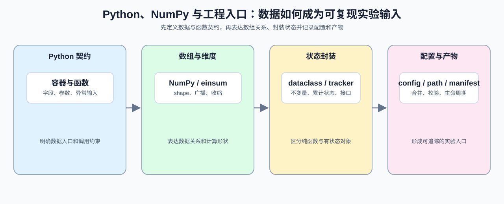

# Group 0A: Python, NumPy, and Engineering Entry | 0A: Python、NumPy 与工程入口

本组围绕后续 Notebook 会反复使用的工程接口展开：用 Python 表达数据与函数契约，用 NumPy 检查数组维度，用对象维护跨调用状态，再用配置、manifest 和 artifact 记录一次运行。

## Group Overview | 组概览

这一组按“Python 数据与函数 → NumPy 数组与维度 → 对象状态 → 配置与运行身份”的顺序组织。完成后，学习者应能选择合适的数据结构、检查函数输入、解释 shape 变换、维护有状态对象，并追踪一次运行的配置、输入和 artifact。

这条线可以概括为：Python 负责表达数据和函数契约，NumPy 负责表达数组和 shape，对象负责维护跨调用状态，配置与 manifest 负责记录一次运行；PyTorch 再在这些基础上加入 Tensor、device 和 autograd。

03 与 04 都会出现“状态”，但管理范围不同：

| 页面 | 管理对象 | 状态位置 | 典型操作 |
|:---|:---|:---|:---|
| 03 | 对象内部字段与生命周期 | Python 对象实例 | 校验不变量、更新、查询、重置 |
| 04 | 一次运行的外部条件与产物 | config、路径、manifest、artifact | 合并配置、定位资源、登记输入输出与运行身份 |

## Group Asset Overview | 组内资产总览

| 页 | 核心职责 | Q 数 | 验证数 | 覆盖 Q | 定位 |
|:---|:---|:---:|:---:|:---|:---|
| [01](./01_Python_Essentials_for_LLM.ipynb) | 数据结构、函数契约、输入校验与惰性样本流 | 4 | 4 | Q1, Q2, Q3, Q4 | 起步页 |
| [02](./02_NumPy_and_Einsum.ipynb) | 广播、维度变换、Einsum 与 shape 守恒 | 3 | 3 | Q1, Q2, Q3 | 数组表达 |
| [03](./03_Python_OOP_and_Utility_Patterns.ipynb) | 对象内部不变量、状态更新与生命周期 | 3 | 3 | Q1, Q2, Q3 | 内部状态 |
| [04](./04_Python_Config_and_Data_Entry.ipynb) | 外部配置、路径、manifest、artifact 与运行身份 | 4 | 4 | Q1, Q2, Q3, Q4 | 运行状态 |

## Learning Path | 学习路径

### Recommended Order | 推荐顺序

- 按 [01](./01_Python_Essentials_for_LLM.ipynb) → [02](./02_NumPy_and_Einsum.ipynb) → [03](./03_Python_OOP_and_Utility_Patterns.ipynb) → [04](./04_Python_Config_and_Data_Entry.ipynb) 阅读：先检查数据与函数输入，再处理数组维度，随后维护跨调用状态，最后组织配置、路径和运行产物。若要尽快进入 Part 2，优先完成 01、02；需要阅读模型对象或复现实验时，再补 03、04。

### Next Steps | 后续衔接

- 完成本组后进入 [0B](./0B.md)，把数组表达转换为 Tensor、layout 和 Autograd 中的张量表达。遇到 shape 问题回看 02，遇到对象状态问题回看 03，遇到配置或 artifact 追踪问题回看 04。

如果已经熟悉 Python 和 NumPy，可以直接用各页验证题检查自己的函数、shape 和运行记录习惯，再进入 0B。

## Environment Notes | 环境说明

- 默认按 `CPU-first` 阅读，优先把表达方式、维度关系和运行契约看懂；单页如有额外环境要求，以页面说明为准。
