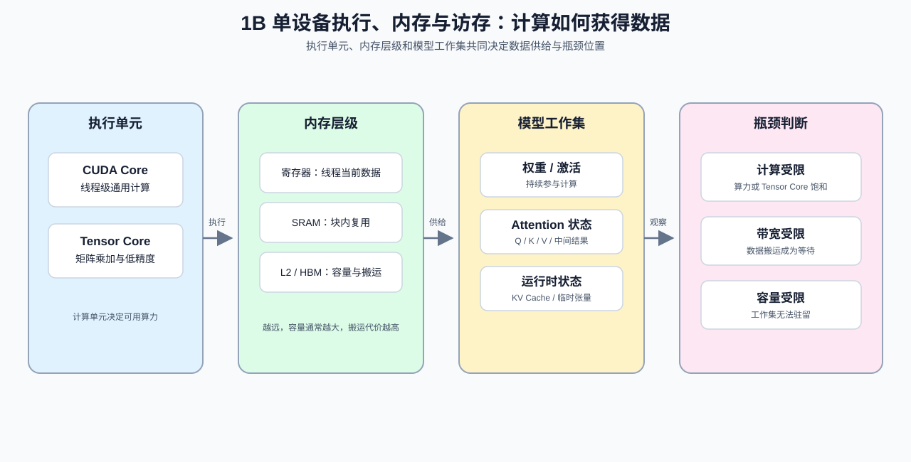

# Group 1B: Single-Device Execution, Memory and Data Access | 1B: 单设备执行、内存与访存

本组以 GPU 为例解释单设备计算、内存与访存约束。

## Group Goal | 组定位与学习目标

这一组建立单设备性能判断所需的三条线索：GPU 执行单元负责什么，数据经过哪些内存层级，以及模型工作集如何形成。学习者先用硬件和访存关系解释注意力、KV Cache 与 Tensor Core 的成本，再把计算、带宽和容量假设交给性能剖析验证。CPU / GPU / NPU / TPU 的运行时与兼容性差异由 [1F](./1F.md) 补充。阅读顺序和 Part 级前导路径见 [intro](./intro.md)，建议从 [1A](./1A.md) 进入后再学习本组。

## Group Assets and Reading Order | 组内资产与阅读顺序

| 小节 | 核心职责 | 学习角色 |
|:---|:---|:---|
| [03](./03_GPU_Architecture_and_Memory.ipynb) | 识别 GPU 层次结构与访存瓶颈 | 单设备硬件入口 |
| [04](./04_Attention_Memory_Optimization.ipynb) | 区分 Attention 的表示、工作集与缓存组织 | Attention 显存杠杆总览 |
| [11](./11_KV_Cache_and_Memory_Growth.ipynb) | 解释 KV Cache 为什么增长 | KV 状态容量账本 |
| [12](./12_TensorCore_and_Mixed_Precision.ipynb) | 判断混合精度怎样影响吞吐 | 低精度执行入口 |
| [13](./13_Profiling_and_Bottleneck_Analysis.ipynb) | 将已有记录转换为资源归因和判别实验 | 性能归因入口 |
| [14](./14_FlashAttention_Memory_Model.ipynb) | 看懂 FlashAttention 的显存收益 | Attention 工作集与 I/O |
| [23](./23_TensorCore_Deep_Dive.ipynb) | 看清 TensorCore 的加速边界 | 矩阵计算路径 |
| [24](./24_SRAM_Optimization_Techniques.ipynb) | 利用 Shared Memory 降低回流 | 片上复用机制 |
| [25](./25_Sparse_Computation_and_Sparse_Attention.ipynb) | 判断稀疏何时真正有效 | 稀疏执行可行性 |

## Group Mechanism Chains | 组内机制子链

1B 不是九页线性顺读。先用 03 建立共同硬件语境，再按问题进入三条子链；13 接收各子链产生的记录并完成资源归因。

| 子链 | 阅读顺序 | 主要回答的问题 |
|:---|:---|:---|
| Attention 状态与工作集 | [03](./03_GPU_Architecture_and_Memory.ipynb) → [04](./04_Attention_Memory_Optimization.ipynb) → [11](./11_KV_Cache_and_Memory_Growth.ipynb) / [14](./14_FlashAttention_Memory_Model.ipynb) | 长期 KV 状态与临时 Attention 工作集分别怎样增长？ |
| 低精度矩阵执行 | [03](./03_GPU_Architecture_and_Memory.ipynb) → [12](./12_TensorCore_and_Mixed_Precision.ipynb) → [23](./23_TensorCore_Deep_Dive.ipynb) | 数据格式、矩阵形状和硬件路径怎样共同决定计算候选？ |
| 片上复用与稀疏执行 | [03](./03_GPU_Architecture_and_Memory.ipynb) → [24](./24_SRAM_Optimization_Techniques.ipynb) → [25](./25_Sparse_Computation_and_Sparse_Attention.ipynb) | 数据复用或跳过计算能否覆盖同步、索引和不规则访问成本？ |
| 证据汇合 | 前述任一子链 → [13](./13_Profiling_and_Bottleneck_Analysis.ipynb) | 当前工作负载主要受计算、访存、搬运、同步还是启动约束？ |

## Environment Notes | 环境说明

- 默认按 `CPU-first` 阅读，先把硬件关系、数量级和访存账本算清楚。
- 少量页面如需 `GPU optional` 或 `GPU required`，以后续单页说明为准，不在组页重复展开。
