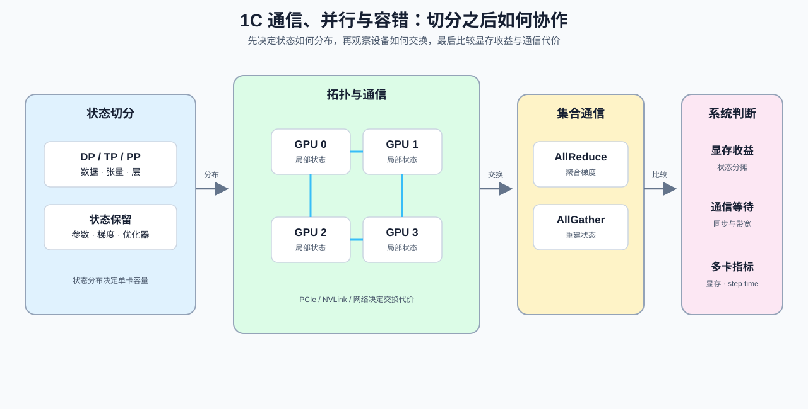

# Group 1C: Communication, Parallelism and Fault Tolerance | 1C: 通信、并行与容错

本组解释多设备切分带来的通信、同步与恢复代价。

## Group Goal | 组定位与学习目标

学习者在这一组回答三个工程问题：什么对象需要切分，每一步需要交换哪些数据，以及系统中断后能否恢复。先建立拓扑、集合通信和训练状态账本，再筛选并行候选；通信调度与容错恢复是候选确定后的两个分支。建议在 [1B](./1B.md) 的单卡访存基础上进入本组。

## Group Assets and Reading Order | 组内资产与阅读顺序

| 小节 | 核心职责 | 学习角色 |
|:---|:---|:---|
| [05](./05_Communication_Topologies.ipynb) | 判断通信拓扑和显存共享关系 | 拓扑与链路入口 |
| [20](./20_NCCL_and_AllReduce_Basics.ipynb) | 讲清 NCCL 和 AllReduce 原语 | 集合通信入口 |
| [06](./06_VRAM_Calculation_and_ZeRO.ipynb) | 估算显存开销与 ZeRO 收益 | 训练状态分片账本 |
| [26](./26_Parallel_Strategy_Decision_Framework.ipynb) | 按训练状态、模型、上下文、专家和请求筛选并行策略 | 并行候选入口 |
| [27](./27_Communication_Scheduling_Optimization.ipynb) | 压缩通信调度的关键路径 | 通信重叠入口 |
| [28](./28_Fault_Tolerance_and_Checkpointing.ipynb) | 评估容错与检查点代价 | 恢复成本入口 |

## Group Mechanism Chain | 组内机制链

| 阶段 | 阅读入口 | 本阶段产出 |
|:---|:---|:---|
| 基础量 | [05 通信拓扑](./05_Communication_Topologies.ipynb) → [20 NCCL 与 AllReduce](./20_NCCL_and_AllReduce_Basics.ipynb) | 链路带宽、延迟、集合通信与通信负载口径 |
| 机制计算 | [06 显存计算与 ZeRO](./06_VRAM_Calculation_and_ZeRO.ipynb) | 参数、梯度和优化器状态的复制 / 分片账本 |
| 系统约束 | [26 并行策略决策](./26_Parallel_Strategy_Decision_Framework.ipynb) | 资源账本、候选硬门槛与组合可行性 |
| 通信分支 | [27 通信调度](./27_Communication_Scheduling_Optimization.ipynb) | 通信就绪时间、调度顺序与暴露等待 |
| 恢复分支 | [28 容错与检查点](./28_Fault_Tolerance_and_Checkpointing.ipynb) | 保存清单、间隔成本、分片一致性与恢复条件 |
| 下游专题 | 通信与并行 / 性能优化 | 进入真实多卡环境测量通信时间、暴露等待、单步时间与扩展效率 |

## Environment Notes | 环境说明

- 默认按 `CPU-first` 阅读，先完成状态分摊、通信量和带宽的估算。
- 需要真实多卡证据的实验进入 Part 02 后，按具体页面登记的环境和工作负载执行。
