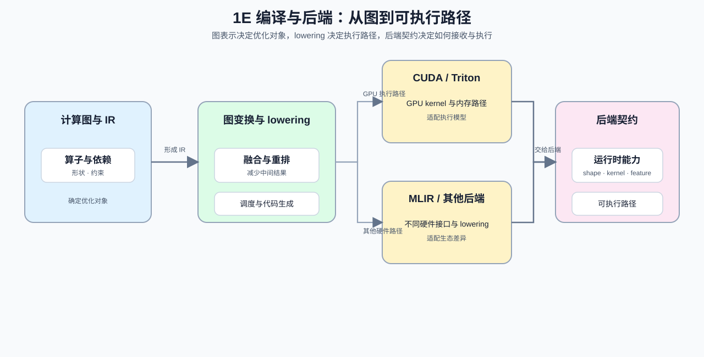

# Group 1E: Compilers and Backends | 1E: 编译与后端

本组回答“模型计算图如何变成后端执行路径”的问题：图优化、融合、动态形状、IR 与 lowering 如何共同决定生成什么代码、采用什么 specialization，以及后端约束怎样反馈到模型与算子设计。

## Group Goal | 组定位与学习目标

完成本组后，学习者应能区分图优化、算子融合、动态 shape 处理与 code generation 的职责，理解 backend 是模型、图、编译器与设备之间的一条执行链。硬件生态、设备兼容和 TCO 由 [1F](./1F.md) 承担，不在本组重复展开。

## Group Asset Overview | 组内资产总览

| 页 | 核心职责 | Q 数 | 代码块数 | 已有码的 Q | 待补代码的 Q | 定位 |
| --- | --- | ---: | ---: | --- | --- | --- |
| [09](./09_AI_Compilers_and_Graph_Optimization.ipynb) | 建立图优化、IR 与后端约束的共同框架 | 3 | 3 | 全部 | 无 | 主线页 |
| [19](./19_Operator_Fusion_Introduction.ipynb) | 用中间张量与访存解释融合收益 | 3 | 3 | Q1, Q2, Q3 | 无 | 主线页；与 1D 桥接 |
| [30](./30_Dynamic_Shape_Handling.ipynb) | 解释动态 shape 如何改变 specialization 与执行波动 | 3 | 3 | 全部 | 无 | 主线页 |
| [32](./32_TVM_MLIR_Deep_Practice.ipynb) | 理解编译器分层和 lowering 流程 | 4 | 4 | Q1, Q2, Q3, Q4 | 无 | 扩展页 |

## Group Mechanism Chain | 组内机制链

| 阶段 | 阅读入口 | 本阶段产出 |
|:---|:---|:---|
| 基础量 | [09 图优化与编译器](./09_AI_Compilers_and_Graph_Optimization.ipynb) | 图、IR、pass 与后端的共同语言 |
| 机制计算 | [19 算子融合](./19_Operator_Fusion_Introduction.ipynb) → [30 动态形状](./30_Dynamic_Shape_Handling.ipynb) | 中间张量流量、路径复用、填充与 specialization 代价 |
| 系统约束 | [32 TVM / MLIR](./32_TVM_MLIR_Deep_Practice.ipynb) | lowering 依赖、调度可行性与硬件能力约束 |
| 下游专题 | 算子优化 / 部署与异构系统 | 验证生成路径是否命中目标内核、后端与运行时 |

## Compiler-to-Deployment Contract | 编译到部署的契约

1E 的输出不是抽象的“已优化图”，而是一条带约束的后端执行路径；1F 再检查这条路径能否被目标设备和 runtime 接收。学习者可以用下表区分两组的连续关系。

| 从 1E 带出的信息 | 1F / 部署专题要继续检查什么 | 对应入口 |
|:---|:---|:---|
| 图结构、shape 范围与 specialization | 目标 runtime 是否接受该模型结构与动态形状 | [30](./30_Dynamic_Shape_Handling.ipynb) → [34](./34_Heterogeneous_Accelerators_and_Runtime_Constraints.ipynb) |
| fusion、lowering 与代码生成路径 | 目标设备是否有匹配 kernel、编译器或 fallback | [19](./19_Operator_Fusion_Introduction.ipynb)、[32](./32_TVM_MLIR_Deep_Practice.ipynb) → [1F](./1F.md) |
| backend 所需特性与版本 | artifact、插件和服务 runtime 是否组成可执行组合 | [部署专题 07](../topic_discussion/deployment_heterogeneous/07_accelerator_runtime_compatibility.md) |

本组主要连接算子优化的图级/编译支撑路径；部署 runtime、设备兼容与成本判断由 [1F](./1F.md) 和部署与异构专题继续完成。

## Environment Notes | 环境说明

- 默认按 `CPU-first` 阅读；完整编译工具链、GPU 和特定 backend 的要求以单页说明为准。
- 本组讲编译和后端机制，不将理论图优化直接写成真实服务性能结论。
