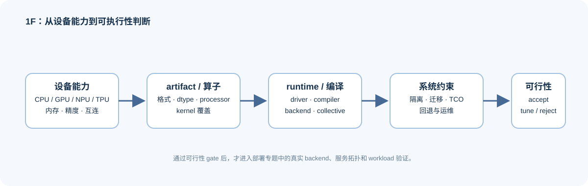

# Group 1F: Hardware Adaptation and System Constraints | 1F: 硬件适配与系统约束

本组检查模型候选能否在目标设备与运行时上执行和交付。

## Group Goal | 组定位与学习目标

学习者将沿着“设备能力 → 模型产物、算子与运行时 → 资源隔离与迁移成本 → 可执行性”检查 CPU、GPU、NPU、TPU 候选，再把通过硬约束的方案送入真实后端基准测试。

## Group Asset Overview | 组内资产总览

| 小节 | 核心职责 | 学习角色 |
|:---|:---|:---|
| [10](./10_Domestic_AI_Chips_Overview.ipynb) | 比较设备能力、软件栈成熟度和迁移风险 | 芯片与生态入口 |
| [31](./31_GPU_Virtualization_and_MIG.ipynb) | 理解资源隔离、虚拟化与多租户约束 | 资源分区入口 |
| [33](./33_TCO_and_Cost_Model.ipynb) | 估算设备、迁移、运维与扩容成本 | 成本约束入口 |
| [34](./34_Heterogeneous_Accelerators_and_Runtime_Constraints.ipynb) | 检查 CPU/GPU/NPU/TPU 的模型产物、运行时、算子和阶段放置可行性 | 异构执行桥接页 |

## Group Mechanism Chain | 组内机制链

| 阶段 | 阅读入口 | 本阶段产出 |
|:---|:---|:---|
| 基础量 | [10 芯片与软件栈](./10_Domestic_AI_Chips_Overview.ipynb) | 设备精度、容量、算子、编译器与生态能力表 |
| 机制计算 | [31 GPU 虚拟化与 MIG](./31_GPU_Virtualization_and_MIG.ipynb) → [33 TCO 与成本](./33_TCO_and_Cost_Model.ipynb) | 资源切片、隔离影响、迁移风险与单位工作负载成本 |
| 系统约束 | [34 异构加速器与运行时](./34_Heterogeneous_Accelerators_and_Runtime_Constraints.ipynb) | 模型产物、算子、运行时与阶段放置的硬性准入结果 |
| 下游专题 | [部署与异构系统](../topic_discussion/deployment_heterogeneous/intro.md) / 性能优化 | 只让通过兼容性检查的候选进入真实后端和固定工作负载复测 |

## Input from Compilers and Backends | 接收编译与后端约束

硬件适配不能只核对显存和数据类型。来自 [1E 编译与后端](./1E.md) 的图结构、形状特征、降级路径和后端能力，必须与设备条件共同通过检查，才能成为可部署候选。

| 1E 的执行路径信息 | 1F 的判断 | 后续验证 |
|:---|:---|:---|
| 图结构与形状特化 | 目标运行时是否能够加载并处理同类请求 | [34](./34_Heterogeneous_Accelerators_and_Runtime_Constraints.ipynb) |
| 融合与计算内核路径 | 目标设备是否原生支持，或会触发回退 | [部署专题 07](../topic_discussion/deployment_heterogeneous/07_accelerator_runtime_compatibility.md) |
| 后端版本与插件依赖 | 驱动、编译器与运行时是否形成一致组合 | 固定工作负载的加载日志与结果 JSON |

## Environment Notes | 环境说明

- 默认按 `CPU-first` 完成设备能力、兼容性和成本判断；不把模拟分数当作真实设备性能。
- 真实 GPU / NPU / TPU 的运行时、算子路径和性能，需要在目标设备与固定工作负载上复测。
