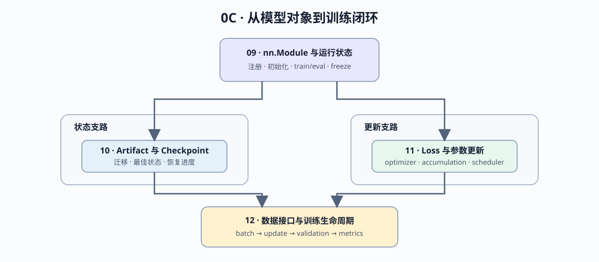

# Group 0C: PyTorch Model and Training Lifecycle | 0C: PyTorch 模型与训练闭环

本组把模型对象、参数初始化、持久化状态、参数更新、数据接口和模型评价接成完整训练生命周期。学习者将从 `nn.Module` 的构造与初始化出发，分别建立 checkpoint 和 optimizer 更新机制，最后在统一 batch 契约下完成训练、验证与指标评价。

## Group Overview | 组概览

09 建立模型对象、初始化尺度、运行模式和可训练状态。10 管理模型 artifact、结构迁移、最佳状态和可续训 checkpoint；11 管理 loss、optimizer 与 scheduler 的更新时序；12 将数据入口、模型调用、参数更新、验证和任务指标接成可执行训练生命周期。

完整训练状态不只包含模型权重。恢复训练时，需要让以下六类状态重新回到同一进度点：

| 状态对象 | 主要内容 | 更新位置 | 恢复时的作用 | 负责页 |
|:---|:---|:---|:---|:---|
| Model | parameter、buffer、初始化方案 | 构造时初始化；optimizer step 或模块内部更新 | 恢复模型计算状态 | 09、10 |
| Optimizer | momentum、Adam moments、step | optimizer step | 延续参数更新轨迹 | 10、11 |
| Scheduler | 当前阶段、step、学习率状态 | optimizer step 之后 | 延续学习率计划 | 10、11 |
| RNG | Python、PyTorch、CUDA 随机状态 | 随采样、初始化和随机算子推进 | 保持采样与随机算子可复现 | 10 |
| Progress | epoch、global step | 训练循环 | 从正确进度继续运行 | 10、12 |
| Validation state | best metric、未改善轮数、早停状态 | validation 之后 | 保留最佳状态与停止判断 | 10、12 |

## Group Asset Overview | 组内资产总览

| 页 | 核心问题 | Q 数 | 验证覆盖 | 在组内的作用 |
|:---|:---|:---:|:---:|:---|
| [09](./09_PyTorch_nn_Module_Basics.md) | 模块、初始化、注册状态、运行模式与冻结状态怎样协同 | 5 | Q1–Q5 | 建立模型对象 |
| [10](./10_PyTorch_State_dict_and_Persistence.md) | 模型 artifact 与训练 checkpoint 怎样保存、迁移并恢复 | 5 | Q1–Q5 | 建立状态支路 |
| [11](./11_PyTorch_Optimizers_and_Loss.md) | loss、参数组、优化器状态和 scheduler 怎样形成更新 | 5 | Q1–Q5 | 建立参数更新机制 |
| [12](./12_PyTorch_Minimal_Training_Interface.md) | 单样本怎样经过 batch 契约进入训练、验证与指标评价 | 7 | Q1–Q7 | 汇合训练闭环 |

## Learning Path | 学习路径

### Recommended Order | 推荐顺序

[09](./09_PyTorch_nn_Module_Basics.md) 后分别补齐状态和更新机制，再由 [12](./12_PyTorch_Minimal_Training_Interface.md) 汇入训练与验证时间线：

- 状态支路：09 → [10](./10_PyTorch_State_dict_and_Persistence.md)，关注模型 artifact、最佳状态和训练恢复。
- 更新支路：09 → [11](./11_PyTorch_Optimizers_and_Loss.md)，关注 loss、参数组、梯度累积与 scheduler。
- 生命周期组合：10 / 11 → [12](./12_PyTorch_Minimal_Training_Interface.md)，把 batch、forward、loss、backward、update、validation 和 metrics 放到同一条时间线中。

### Next Steps | 后续衔接

- 进入 [0D](./0D.md)，从 Transformer Block 总览继续观察激活、归一化和 Attention 的机制。
- 阅读 Part 02 的训练或模型页面时，可按“输入字段—模块状态—梯度—更新位置”回查本组对应小节。

## Environment Notes | 环境说明

- 全组为 `CPU-first`，示例使用小张量验证接口、状态与生命周期。
