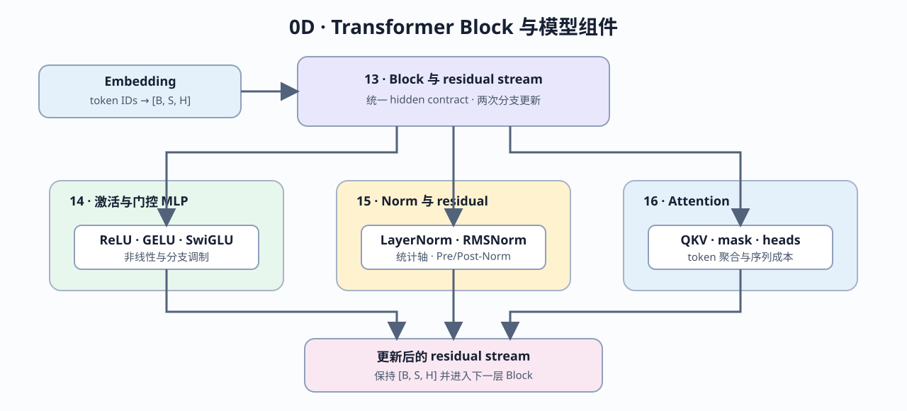

# Group 0D: Transformer Block and Model Components | 0D: Transformer Block 与模型组件

本组从 Transformer Block 的 residual stream 出发，再分别展开非线性与门控、归一化与 residual 位置、Attention 与 token 信息聚合。四节共同解释现代 decoder Block 为什么保持统一 hidden shape，以及不同组件怎样更新同一条主路径。

## Group Overview | 组概览

13 建立 Block 数据流、两次 residual update、Norm 放置和多层堆叠。14、15、16 随后从不同维度展开：激活控制 MLP 非线性与门控，归一化控制统计路径，Attention 控制 token 间的信息聚合与序列成本。

Embedding 位于重复 Block 之前，用 `[B, S, H]` hidden state 初始化 residual stream；Block 内的 Attention 和 MLP 再通过 Norm 与 residual addition 更新这条主路径：

| 组件 | 在模型中的位置 | 输入输出契约 | 对 residual stream 的作用 | 对应页 |
|:---|:---|:---|:---|:---|
| Embedding | Block stack 之前 | token IDs → `[B, S, H]` | 初始化第一层 hidden state | 13 的输入契约 |
| Norm | Attention / MLP 分支入口或出口 | `[B, S, H] → [B, S, H]` | 控制分支统计尺度 | 15 |
| Attention | Block 的 token-mixing 分支 | `[B, S, H] → [B, S, H]` | 聚合 token 间信息并形成更新量 | 16 |
| MLP | Block 的 channel-mixing 分支 | `H → H_ffn → H` | 逐 token 变换并形成更新量 | 14 |
| Residual | 贯穿 Block stack | 主路径 + 分支更新 | 保持统一 hidden contract 并传给下一层 | 13 |

## Group Asset Overview | 组内资产总览

| 页 | 核心问题 | Q 数 | 验证覆盖 | 在组内的作用 |
|:---|:---|:---:|:---:|:---|
| [13](./13_Transformer_Block_Dataflow_and_Residual_Stream.md) | Block 怎样保持 hidden shape 并两次更新 residual stream | 4 | Q1–Q4 | 建立 Block 总览 |
| [14](./14_Activation_Functions.md) | 输出、梯度与门控分支如何改变非线性 | 4 | Q1–Q4 | 解释 MLP 非线性 |
| [15](./15_Normalization_Techniques.md) | 统计轴、归一化公式和 residual 位置有何差异 | 5 | Q1–Q5 | 解释数值稳定路径 |
| [16](./16_Attention_Mechanism_Intro.md) | QKV、mask、heads、序列成本和位置缺失如何闭合 | 7 | Q1–Q7 | 解释 token 信息聚合 |

## Learning Path | 学习路径

### Recommended Order | 推荐顺序

先阅读 [13](./13_Transformer_Block_Dataflow_and_Residual_Stream.md) 建立 Block 数据流，再按组件并行阅读：

- [14](./14_Activation_Functions.md)：非线性、门控与 MLP 更新；
- [15](./15_Normalization_Techniques.md)：统计轴、`eps` 与 residual 位置；
- [16](./16_Attention_Mechanism_Intro.md)：可见性、聚合、多头布局、序列成本与位置信息。

14–16 分别解释 MLP、统计路径和 token 聚合，可在完成 13 后按所需组件阅读；它们在 Part 02 的 Block 组装页重新汇合。

### Next Steps | 后续衔接

- 进入 [0E](./0E.md)，学习 profiling、显存账本和调试证据。
- 进入 Part 02 时，13–16 分别衔接 LLaMA Block、SwiGLU、RMSNorm 与 Attention 页面。

## Environment Notes | 环境说明

- 全组为 `CPU-first`，重点是 hidden state、residual 和组件机制。
