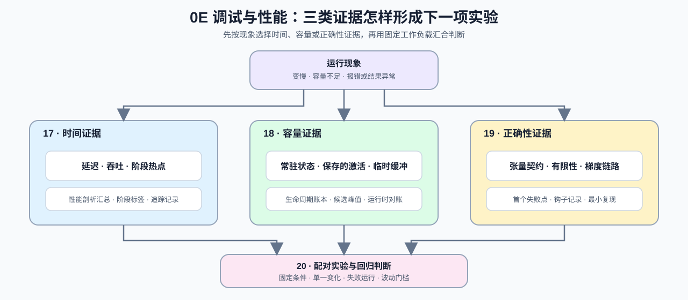

# Group 0E: Debugging and Performance | 0E: 调试与性能

## Group Overview | 组概览

本组把运行现象转换成三类可检查的证据：17 记录时间分布与阶段热点，18 建立内存对象的生命周期账本，19 定位张量或梯度链路中的首个失败点。需要比较优化候选时，再进入 20 固定工作负载（workload）和单一变化，判断基线与候选的差异是否超过测量波动。

## Learning Entries | 组内学习入口

| 页面 | 何时进入 | 本节回答的问题 | 带走的证据 |
|:---|:---|:---|:---|
| [Part 00 · 17 PyTorch 性能分析基础](./17_PyTorch_Profiling_Basics.md) | 延迟升高、吞吐下降或阶段耗时异常 | 时间消耗发生在哪个阶段？ | 重复时间样本、中位数与 P95、阶段标签、性能剖析（Profiler）汇总与追踪记录（trace） |
| [Part 00 · 18 内存分析与优化](./18_Memory_Profiling_and_Optimization.md) | 容量不足、峰值异常或对象持续驻留 | 哪些对象在什么时刻同时存活？ | 生命周期账本、候选峰值、运行时对账、未建模占用与可用余量 |
| [Part 00 · 19 调试与异常定位](./19_Debugging_and_Anomaly_Localization.md) | 报错、NaN/Inf、输出异常或梯度链路中断 | 第一个不满足契约的张量或模块在哪里？ | 张量契约、首个失败点、钩子记录与最小复现 |
| [Part 00 · 20 性能证据与实验设计](./20_Performance_Evidence_and_Experiment_Design.md) | 需要比较优化候选或判断性能回归 | 变化是否超过基线波动并满足约束？ | 固定工作负载、单一变量、重复样本、失败运行与接受/拒绝/复测结论 |

## Learning Path | 学习路径

### Recommended Order | 推荐顺序

完整学习时按 17 → 18 → 19 → 20 阅读：先认识三类证据，再学习怎样把证据组织成可复查的配对实验。排查具体问题时，17–19 是并列入口：

- 运行变慢：从 [17](./17_PyTorch_Profiling_Basics.md) 开始。
- 容量不足或持续增长：从 [18](./18_Memory_Profiling_and_Optimization.md) 开始。
- 报错、NaN 或梯度异常：从 [19](./19_Debugging_and_Anomaly_Localization.md) 开始。
- 需要比较候选或判断性能回归：将相关证据带入 [20](./20_Performance_Evidence_and_Experiment_Design.md)。

### Next Steps | 后续衔接

- 需要继续学习测量、时间线、性能剖析与瓶颈归因时，进入[性能分析专题](../topic_discussion/performance_analysis/intro.md)。
- 已取得证据并准备比较优化候选时，进入[性能优化专题](../topic_discussion/performance_optimization/intro.md)。
- 需要从框架记录推导算术强度、实际带宽和资源瓶颈时，进入 [Part 01 · 13 性能分析与瓶颈定位](../01_Hardware_Math_and_Systems/13_Profiling_and_Bottleneck_Analysis.md)。

## Environment Notes | 环境说明

- 17–20 均可在 CPU 上完成证据组织、账本计算和判断练习，不需要为组页单独安装 GPU 环境。
- CUDA 时间、运行时分配器峰值和执行后端证据由后续性能分析、性能优化及相关 Part 02 实验采集；进入具体实验时再使用对应环境说明。
