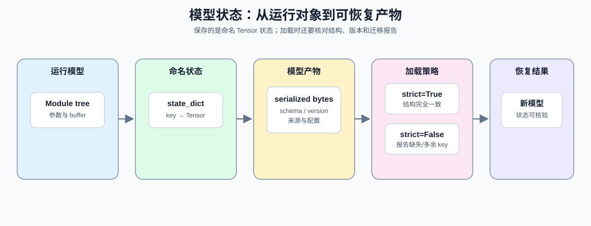

# 10. PyTorch State dict and Persistence | PyTorch 状态、Checkpoint 与恢复

**难度：** Medium | **环境：** CPU-first | **标签：** `PyTorch`, `state_dict`, `持久化` | **目标人群：** 准备保存、恢复或迁移模型状态的学习者

> 🚀 **云端运行环境**
>
> 本章节的实战代码可以点击以下链接在免费 GPU 算力平台上直接运行：
>
> [](https://colab.research.google.com/github/datawhalechina/llm-algo-leetcode/blob/main/00_Prerequisites/10_PyTorch_State_dict_and_Persistence.ipynb)
> [](https://modelscope.cn/my/mynotebook) *(国内推荐：魔搭社区免费实例)*


模型持久化需要同时处理状态内容、序列化介质、结构兼容性和训练进度。本页从 `state_dict` 的 key/value 契约出发，依次验证独立快照、结构迁移、模型 artifact，以及绑定验证状态的可续训 checkpoint。

**关键词：** `state_dict`, `artifact`, `training checkpoint`, `resume`



## 前置阅读
**导语：** 先确认 parameter 与 buffer 如何注册，再观察这些状态如何离开当前模型实例并被恢复。
- [09. PyTorch nn.Module Basics | PyTorch nn.Module 基础](./09_PyTorch_nn_Module_Basics.md)
- [0C 组页](./0C.md)

## 相关阅读
**导语：** 状态能够可靠恢复后，再学习 optimizer 更新，并在数据接口页把它们接成完整训练生命周期。
- [11. PyTorch Optimizers and Loss | PyTorch 优化器与损失函数](./11_PyTorch_Optimizers_and_Loss.md)
- [12. PyTorch Data Interface and Training Lifecycle | PyTorch 数据接口与训练生命周期](./12_PyTorch_Minimal_Training_Interface.md)

## Q1：`state_dict` 解决什么问题？

模型不只包含可训练参数，还可能包含 running statistics、mask 或缩放量等 buffer。`state_dict` 用稳定 key 将这些 Tensor 汇总为模型状态，但不会保存 Python 类定义和普通属性。


```python
import copy
import torch
import torch.nn as nn


class TinyNet(nn.Module):
    def __init__(self):
        super().__init__()
        self.linear = nn.Linear(2, 1)
        # buffer 常用来存 scale、mask、统计量或缓存这类“要保存但不训练”的状态。
        self.register_buffer('scale', torch.tensor(1.0))

    def forward(self, x):
        return self.linear(x) * self.scale


model = TinyNet()
state = model.state_dict()
print('state_dict keys：', sorted(state.keys()))

```

## Q1 验证：`state_dict` 是否同时包含参数和 buffer？

这里直接看 keys，确认参数和 buffer 都在，但普通属性不在。


```python
model = TinyNet()
state = model.state_dict()
assert 'linear.weight' in state
assert 'linear.bias' in state
assert 'scale' in state
print('✅ state_dict keys 通过')

```

## Q2：怎样把模型状态写入独立介质并恢复到新实例？

直接把一个模型自己的 `state_dict` 再加载回去，无法验证序列化链路。更完整的检查应把状态写入独立字节流，再由新建模型实例读取并恢复。


```python
import io

model = TinyNet()
with torch.no_grad():
    model.linear.weight.fill_(2.0)
    model.linear.bias.fill_(0.5)
    model.scale.fill_(3.0)

state_buffer = io.BytesIO()
torch.save(model.state_dict(), state_buffer)
state_buffer.seek(0)
loaded_state = torch.load(state_buffer, weights_only=True, map_location='cpu')
restored_model = TinyNet()
restored_model.load_state_dict(loaded_state)
print('序列化字节数：', state_buffer.getbuffer().nbytes)

```

## Q2 验证：新实例的参数、buffer 与输出是否一致？

状态恢复后，不只要比较 key，还要比较 Tensor 值与相同输入上的模型输出。


```python
for key, value in model.state_dict().items():
    assert torch.allclose(value, restored_model.state_dict()[key])
sample = torch.tensor([[1.0, -1.0]])
assert torch.allclose(model(sample), restored_model(sample))
assert restored_model.scale.item() == 3.0
print('✅ 独立序列化与恢复通过')

```

## Q3：结构变化时，严格加载与部分加载有什么区别？

严格加载要求当前模型与保存状态拥有完全一致的 key。结构迁移时可以使用 `strict=False`，但必须检查返回的 missing 与 unexpected keys，不能把“没有抛异常”当作迁移成功。


```python
class TinyNetWithHead(TinyNet):
    def __init__(self):
        super().__init__()
        self.head = nn.Linear(1, 2)


base_state = TinyNet().state_dict()
migrated_model = TinyNetWithHead()
try:
    migrated_model.load_state_dict(base_state, strict=True)
except RuntimeError as error:
    strict_error = str(error)
else:
    raise AssertionError('strict loading should fail for the added head')

load_result = migrated_model.load_state_dict(base_state, strict=False)
print('missing keys：', load_result.missing_keys)
print('unexpected keys：', load_result.unexpected_keys)

```

## Q3 验证：迁移报告是否准确指出新增结构？

新增 head 应成为 missing keys，而原模型状态不应产生 unexpected keys。严格模式的错误信息也应指出缺失项。


```python
assert set(load_result.missing_keys) == {'head.weight', 'head.bias'}
assert load_result.unexpected_keys == []
assert 'head.weight' in strict_error and 'head.bias' in strict_error
print('✅ strict / non-strict 加载报告通过')

```

## Q4：怎样让模型产物携带可检查的版本信息？

裸 `state_dict` 只能说明有哪些 Tensor。可维护的模型产物还应记录格式版本、模型类型和构造参数；加载函数则应返回结构化报告，让调用者明确哪些状态被恢复。


```python
def build_model_artifact(model, format_version, model_config):
    """打包模型状态以及重建模型所需的最小元数据。"""
    return {
        'format_version': format_version,
        'model_class': type(model).__name__,
        'model_config': dict(model_config),
        'model_state': copy.deepcopy(model.state_dict()),
    }


def load_model_artifact(artifact, model, strict=True):
    """加载模型状态，并返回可审计的兼容性报告。"""
    result = model.load_state_dict(artifact['model_state'], strict=strict)
    return {
        'format_version': artifact['format_version'],
        'model_class': artifact['model_class'],
        'missing_keys': list(result.missing_keys),
        'unexpected_keys': list(result.unexpected_keys),
    }


artifact_model = TinyNet()
artifact = build_model_artifact(artifact_model, format_version=1, model_config={'in_features': 2})
report = load_model_artifact(artifact, TinyNet(), strict=True)
print(report)

```

## Q4 验证：模型产物与加载报告是否一致？

报告需要保留格式版本和模型类型，并明确严格加载没有缺失或意外 key。模型继续变化时，已经生成的产物也必须保持为独立快照。


```python
assert artifact['format_version'] == 1
assert artifact['model_class'] == 'TinyNet'
assert artifact['model_config'] == {'in_features': 2}
assert report['missing_keys'] == []
assert report['unexpected_keys'] == []
saved_weight = artifact['model_state']['linear.weight'].clone()
with torch.no_grad():
    artifact_model.linear.weight.add_(1.0)
assert torch.equal(artifact['model_state']['linear.weight'], saved_weight)
print('✅ 模型产物与加载报告通过')

```

## Q5：怎样让最佳指标、早停与可续训 checkpoint 使用同一训练状态？

验证指标改善时，需要更新 best metric、保存对应模型状态并清零未改善计数；连续未改善时，早停计数才推进。用于恢复训练的 checkpoint 还应包含 optimizer、scheduler、随机数状态、epoch 和 global step。


```python
def update_validation_state(val_loss, state, model):
    """根据验证损失更新 best checkpoint 与早停计数。"""
    updated = dict(state)
    if val_loss < state['best_val_loss']:
        updated['best_val_loss'] = float(val_loss)
        updated['bad_epochs'] = 0
        updated['best_model_state'] = copy.deepcopy(model.state_dict())
    else:
        updated['bad_epochs'] = state['bad_epochs'] + 1
    updated['should_stop'] = updated['bad_epochs'] >= updated['patience']
    return updated


def build_training_checkpoint(model, optimizer, scheduler, epoch, global_step, validation_state):
    """保存继续训练所需的模型、更新器、进度与随机数状态。"""
    return {
        'model': copy.deepcopy(model.state_dict()),
        'optimizer': copy.deepcopy(optimizer.state_dict()),
        'scheduler': copy.deepcopy(scheduler.state_dict()),
        'epoch': int(epoch),
        'global_step': int(global_step),
        'validation_state': copy.deepcopy(validation_state),
        'torch_rng_state': torch.get_rng_state().clone(),
    }


def restore_training_checkpoint(checkpoint, model, optimizer, scheduler):
    """恢复训练状态并返回进度字段。"""
    model.load_state_dict(checkpoint['model'])
    optimizer.load_state_dict(checkpoint['optimizer'])
    scheduler.load_state_dict(checkpoint['scheduler'])
    torch.set_rng_state(checkpoint['torch_rng_state'])
    return {
        'epoch': checkpoint['epoch'],
        'global_step': checkpoint['global_step'],
        'validation_state': copy.deepcopy(checkpoint['validation_state']),
    }


training_model = TinyNet()
training_optimizer = torch.optim.AdamW(training_model.parameters(), lr=1e-2)
training_scheduler = torch.optim.lr_scheduler.StepLR(training_optimizer, step_size=1, gamma=0.5)
training_optimizer.zero_grad(set_to_none=True)
training_model(torch.ones(2, 2)).mean().backward()
training_optimizer.step()
training_scheduler.step()
validation_state = {
    'best_val_loss': float('inf'), 'bad_epochs': 0, 'patience': 2,
    'should_stop': False, 'best_model_state': None,
}
validation_state = update_validation_state(0.4, validation_state, training_model)
training_checkpoint = build_training_checkpoint(
    training_model, training_optimizer, training_scheduler,
    epoch=3, global_step=12, validation_state=validation_state,
)
print('checkpoint fields：', sorted(training_checkpoint))

```

## Q5 验证：最佳状态和训练进度能否一起恢复？

恢复后的模型输出、optimizer/scheduler 状态、训练进度和验证状态都应与保存时一致；checkpoint 也必须保持为独立快照。


```python
saved_weight = training_checkpoint['model']['linear.weight'].clone()
with torch.no_grad():
    training_model.linear.weight.add_(1.0)
assert torch.equal(training_checkpoint['model']['linear.weight'], saved_weight)

restored_training_model = TinyNet()
restored_optimizer = torch.optim.AdamW(restored_training_model.parameters(), lr=1e-2)
restored_scheduler = torch.optim.lr_scheduler.StepLR(restored_optimizer, step_size=1, gamma=0.5)
progress = restore_training_checkpoint(
    training_checkpoint, restored_training_model, restored_optimizer, restored_scheduler
)
assert torch.equal(restored_training_model.state_dict()['linear.weight'], saved_weight)
assert progress['epoch'] == 3 and progress['global_step'] == 12
assert progress['validation_state']['best_val_loss'] == 0.4
assert progress['validation_state']['best_model_state'] is not None
assert restored_scheduler.state_dict()['last_epoch'] == training_scheduler.state_dict()['last_epoch']
print('✅ 最佳状态、早停字段与可续训 checkpoint 通过')

```
