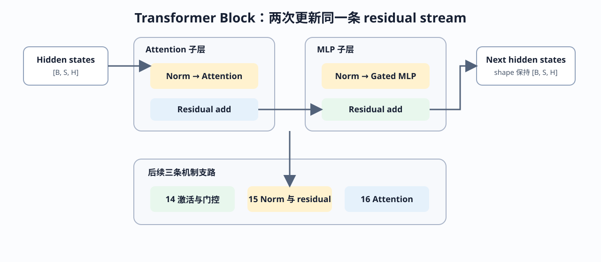

# 13. Transformer Block Dataflow and Residual Stream | Transformer Block 数据流与残差通路

**难度：** Medium | **环境：** CPU-first | **标签：** `Transformer`, `Block`, `Residual` | **目标人群：** 准备理解现代大模型组件如何组装的学习者

> 🚀 **云端运行环境**
>
> 本章节的实战代码可以点击以下链接在免费 GPU 算力平台上直接运行：
>
> [](https://colab.research.google.com/github/datawhalechina/llm-algo-leetcode/blob/main/00_Prerequisites/13_Transformer_Block_Dataflow_and_Residual_Stream.ipynb)
> [](https://modelscope.cn/my/mynotebook) *(国内推荐：魔搭社区免费实例)*


Transformer Block 接收 `[batch, sequence, hidden]` 形式的 hidden state，并通过 Attention 与 MLP 两次更新 residual stream。理解 shape 守恒、残差更新和 Norm 放置后，激活函数、归一化与 Attention 才能回到同一条 Block 数据流中。

**关键词：** `hidden state`, `residual stream`, `Pre-Norm`, `Block stack`



## 前置阅读
**导语：** 模型对象和训练生命周期说明了 Block 如何被调用与更新；本页进一步观察 Block 内部如何保持 hidden state 契约。
- [12. PyTorch Data Interface and Training Lifecycle | PyTorch 数据接口与训练生命周期](./12_PyTorch_Minimal_Training_Interface.md)
- [0D 组页](./0D.md)

## 相关阅读
**导语：** Block 总览之后，可以分别深入非线性、统计路径和 token 信息聚合，并在 Part 02 中实现完整 LLaMA Block。
- [14. Activation Functions | 激活函数](./14_Activation_Functions.md)
- [15. Normalization Techniques | 归一化技术](./15_Normalization_Techniques.md)
- [16. Attention Mechanism Intro | Attention 机制导论](./16_Attention_Mechanism_Intro.md)
- [Part 02 · 05 LLaMA3 Block Tutorial](../02_PyTorch_Algorithms/05_LLaMA3_Block_Tutorial.md)

## Q1：为什么 Block 的输入输出通常保持同一 hidden shape？

Residual addition 要求主路径与更新分支拥有相同 shape。Block 可以在内部拆分 heads 或扩大 MLP 中间维，但写回 residual stream 前必须恢复为 `[batch, sequence, hidden]`。


```python
import torch
import torch.nn as nn


def residual_update(hidden_states, branch_update):
    """检查 residual contract 后，将分支更新写回主路径。"""
    if hidden_states.shape != branch_update.shape:
        raise ValueError(
            f'residual shape mismatch: {tuple(hidden_states.shape)} != {tuple(branch_update.shape)}'
        )
    return hidden_states + branch_update


hidden_states = torch.randn(2, 4, 8)
branch_update = torch.randn_like(hidden_states)
updated_states = residual_update(hidden_states, branch_update)
print('residual shape：', tuple(updated_states.shape))

```

## Q1 验证：Residual addition 是否保持 shape 并拒绝非法更新？

合法更新应保持主路径 shape；hidden 维不一致时应在相加前给出明确错误。


```python
assert updated_states.shape == hidden_states.shape
assert torch.allclose(updated_states - hidden_states, branch_update)
try:
    residual_update(hidden_states, torch.randn(2, 4, 4))
except ValueError as error:
    assert 'residual shape mismatch' in str(error)
else:
    raise AssertionError('shape 不一致时 residual update 应失败')
print('✅ residual shape contract 通过')

```

## Q2：Attention 与 MLP 怎样形成两次 residual update？

现代 decoder Block 通常先把 Attention 输出写回 residual stream，再把 MLP 输出写回更新后的主路径。下面用保持 shape 的分支分别表示 token mixing 与 channel mixing，验证两次更新的顺序和 hidden shape 契约。


```python
class ResidualBlockSkeleton(nn.Module):
    def __init__(self, hidden_size):
        super().__init__()
        self.attention_update = nn.Linear(hidden_size, hidden_size, bias=False)
        self.mlp_update = nn.Sequential(
            nn.Linear(hidden_size, hidden_size * 2, bias=False),
            nn.SiLU(),
            nn.Linear(hidden_size * 2, hidden_size, bias=False),
        )

    def forward(self, hidden_states):
        after_attention = residual_update(hidden_states, self.attention_update(hidden_states))
        output = residual_update(after_attention, self.mlp_update(after_attention))
        return {'input': hidden_states, 'after_attention': after_attention, 'output': output}


block = ResidualBlockSkeleton(hidden_size=8)
block_states = block(torch.randn(2, 4, 8))
print({name: tuple(value.shape) for name, value in block_states.items()})

```

## Q2 验证：两次分支更新是否都写回同一 residual stream？

三个观察点应保持相同 shape，且 Attention 更新和 MLP 更新都应改变主路径状态。


```python
assert block_states['input'].shape == block_states['after_attention'].shape == block_states['output'].shape
assert not torch.equal(block_states['input'], block_states['after_attention'])
assert not torch.equal(block_states['after_attention'], block_states['output'])
print('✅ Attention/MLP 两次 residual update 通过')

```

## Q3：Pre-Norm 与 Post-Norm 把统计控制放在什么位置？

Pre-Norm 先归一化分支输入，再把分支输出加回原 residual；Post-Norm 先完成分支更新，再归一化相加结果。两者都保持 shape，但 residual 主路径和统计变换的相对位置不同。


```python
def pre_norm_step(hidden_states, norm, branch):
    """Norm -> branch -> residual add。"""
    return residual_update(hidden_states, branch(norm(hidden_states)))


def post_norm_step(hidden_states, norm, branch):
    """Branch -> residual add -> norm。"""
    return norm(residual_update(hidden_states, branch(hidden_states)))


norm = nn.LayerNorm(8)
branch = nn.Linear(8, 8, bias=False)
norm_input = torch.randn(2, 4, 8)
pre_norm_output = pre_norm_step(norm_input, norm, branch)
post_norm_output = post_norm_step(norm_input, norm, branch)
print('pre/post shape：', pre_norm_output.shape, post_norm_output.shape)

```

## Q3 验证：两种 Norm 放置是否保持 shape 但产生不同状态？

相同输入和分支下，两条路径都应输出有限值并保持 residual shape；由于归一化位置不同，结果不应完全相同。


```python
assert pre_norm_output.shape == post_norm_output.shape == norm_input.shape
assert torch.isfinite(pre_norm_output).all() and torch.isfinite(post_norm_output).all()
assert not torch.allclose(pre_norm_output, post_norm_output)
print('✅ Pre-Norm / Post-Norm 数据流通过')

```

## Q4：多个 Block 堆叠时，residual stream 怎样逐层演化？

Block stack 在层间传递同一 hidden-state 契约，每层读取上一层输出并产生新的 residual state。记录逐层状态，可以检查 shape 守恒、层数和状态是否真实推进。


```python
class BlockStack(nn.Module):
    def __init__(self, hidden_size, num_blocks):
        super().__init__()
        self.blocks = nn.ModuleList([
            ResidualBlockSkeleton(hidden_size) for _ in range(num_blocks)
        ])

    def forward(self, hidden_states):
        layer_states = [hidden_states]
        for block in self.blocks:
            hidden_states = block(hidden_states)['output']
            layer_states.append(hidden_states)
        return layer_states


stack = BlockStack(hidden_size=8, num_blocks=3)
stack_input = torch.randn(2, 4, 8)
layer_states = stack(stack_input)
print('layer state shapes：', [tuple(state.shape) for state in layer_states])

```

## Q4 验证：层数、shape 和状态推进是否一致？

三个 Block 应产生四个可观察状态；每个状态保持统一 shape，相邻层输出应发生变化。


```python
assert len(layer_states) == 4
assert all(state.shape == stack_input.shape for state in layer_states)
assert all(not torch.equal(left, right) for left, right in zip(layer_states, layer_states[1:]))
assert len(stack.blocks) == 3
print('✅ Block stack 与 residual state 推进通过')

```
