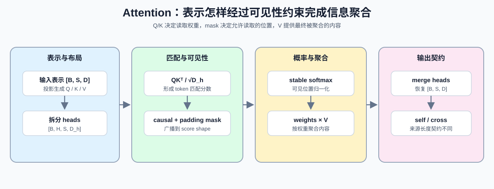

# 16. Attention Mechanism Intro | Attention 机制导论

**难度：** Medium | **环境：** CPU-first | **标签：** `PyTorch`, `注意力`, `mask` | **目标人群：** 准备进入 Transformer 结构与优化内容的学习者

> 🚀 **云端运行环境**
>
> 本章节的实战代码可以点击以下链接在免费 GPU 算力平台上直接运行：
>
> [](https://colab.research.google.com/github/datawhalechina/llm-algo-leetcode/blob/main/00_Prerequisites/16_Attention_Mechanism_Intro.ipynb)
> [](https://modelscope.cn/my/mynotebook) *(国内推荐：魔搭社区免费实例)*


Attention 用 Q/K 的匹配分数决定从 V 中聚合哪些信息。理解这条数据流后，还要能判断 causal mask 与 padding mask 如何组合、mask 怎样广播到多头分数，以及自注意力和交叉注意力的形状契约有何不同。本页用小张量验证这些机制，为后续模型架构、显存模型和算子优化建立共同基础。

**关键词：** `Q`, `K`, `V`, `mask`, `shape contract`



## 前置阅读
**导语：** Embedding 提供 token 表示，归一化稳定 block 内的数据尺度；具备这两个背景后再进入 token 间的信息聚合。
- [15. Normalization Techniques | 归一化技术](./15_Normalization_Techniques.md)
- [0D 组页](./0D.md)

## 相关阅读
**导语：** 掌握最小 Attention 语义后，可以分别沿显存模型、FlashAttention 和 KV Cache 管理继续深入。
- [P1: 04. Attention Memory Optimization | Attention 显存优化](../01_Hardware_Math_and_Systems/04_Attention_Memory_Optimization.md)
- [P1: 14. FlashAttention Memory Model | FlashAttention 显存模型](../01_Hardware_Math_and_Systems/14_FlashAttention_Memory_Model.md)
- [03. RoPE 旋转位置编码](../02_PyTorch_Algorithms/03_RoPE_Tutorial.md)
- [22. vLLM PagedAttention | vLLM PagedAttention](../02_PyTorch_Algorithms/22_vLLM_PagedAttention.md)

## Q1：Q / K / V 分别承担什么职责？

Attention 用三组向量完成匹配与聚合：Q 表示当前 token 的查询，K 表示可被匹配的索引，V 表示命中后参与聚合的内容。可以把它理解成 token 之间的问答：Q 负责提出问题，K 参与匹配，V 提供取回内容。


```python
import math
import torch
import torch.nn.functional as F


def build_causal_mask(seq_len):
    return torch.tril(torch.ones(seq_len, seq_len, dtype=torch.bool))


def masked_softmax(scores, mask=None, dim=-1):
    if mask is not None:
        mask = mask.to(dtype=torch.bool)
        scores = scores.masked_fill(~mask, torch.finfo(scores.dtype).min)
    shifted = scores - scores.max(dim=dim, keepdim=True).values
    probs = torch.softmax(shifted, dim=dim)
    if mask is not None:
        mask_f = mask.to(dtype=probs.dtype)
        probs = probs * mask_f
        denom = probs.sum(dim=dim, keepdim=True)
        probs = torch.where(denom > 0, probs / denom.clamp_min(1e-12), torch.zeros_like(probs))
    return probs


def attention_weights(q, k, mask=None):
    d_k = q.shape[-1]
    scores = torch.matmul(q, k.transpose(-2, -1)) / math.sqrt(d_k)
    return masked_softmax(scores, mask=mask, dim=-1)


def scaled_dot_product_attention(q, k, v, mask=None):
    weights = attention_weights(q, k, mask=mask)
    output = torch.matmul(weights, v)
    return output, weights


q = torch.tensor([[[1.0, 0.0, 1.0], [0.0, 1.0, 1.0]]])
k = torch.tensor([[[1.0, 2.0, 0.0], [3.0, 0.0, 1.0]]])
v = torch.tensor([[[10.0, 0.0], [0.0, 20.0]]])
mask = build_causal_mask(2).unsqueeze(0)
weights = attention_weights(q, k, mask=mask)
output, _ = scaled_dot_product_attention(q, k, v, mask=mask)
print('weights：')
print(weights)
print('output：')
print(output)

```

## Q1 验证：最小 attention 输出是否可见？

这里直接把权重和输出打印出来，确认 Q/K/V 的最小流程已经跑通。


```python
q = torch.tensor([[[1.0, 0.0], [0.0, 1.0]]])
k = torch.tensor([[[1.0, 2.0], [3.0, 4.0]]])
mask = build_causal_mask(2).unsqueeze(0)
weights = attention_weights(q, k, mask=mask)
expected = torch.tensor([[[1.0, 0.0], [0.19557033, 0.80442965]]])
assert torch.allclose(weights, expected, atol=1e-5, rtol=1e-5)
print('✅ attention_weights 通过')

```

## Q2：什么时候必须先看 causal mask 的语义？

自回归 Attention 的当前位置只能读取历史和自身，causal mask 因而遮蔽所有未来 token；padding mask 则排除批处理中补齐的无效 key。两类约束组合后形成可广播到 `[batch, heads, query_length, key_length]` 的可见性 mask。


```python
def build_attention_mask(key_padding_mask, query_length, causal):
    """构造可广播到多头分数的 [B, 1, S_q, S_k] 可见性 mask。"""
    batch_size, key_length = key_padding_mask.shape
    visible = key_padding_mask[:, None, None, :].expand(batch_size, 1, query_length, key_length)
    if causal:
        if query_length != key_length:
            raise ValueError('causal self-attention requires query_length == key_length')
        visible = visible & build_causal_mask(query_length)[None, None, :, :]
    return visible


mask = build_causal_mask(4)
key_padding_mask = torch.tensor([[1, 1, 1, 0], [1, 1, 0, 0]], dtype=torch.bool)
self_mask = build_attention_mask(key_padding_mask, query_length=4, causal=True)
cross_mask = build_attention_mask(key_padding_mask, query_length=2, causal=False)
print('causal mask：')
print(mask.int())
print('self mask shape:', tuple(self_mask.shape))
print('cross mask shape:', tuple(cross_mask.shape))

```

## Q2 验证：causal 与 padding 约束能否正确组合？

验证下三角可见性、padding 屏蔽和 self/cross attention 的 shape contract。


```python
mask = build_causal_mask(4)
expected = torch.tensor([
    [True, False, False, False],
    [True, True, False, False],
    [True, True, True, False],
    [True, True, True, True],
])
assert torch.equal(mask, expected)
assert self_mask.shape == (2, 1, 4, 4)
assert cross_mask.shape == (2, 1, 2, 4)
assert not self_mask[0, 0, 0, 1]
assert not self_mask[0, 0, 3, 3]
assert cross_mask[0, 0, 0].tolist() == [True, True, True, False]
print('✅ causal 与 padding mask 组合通过')

```

## Q3：什么时候必须先看 softmax 的数值稳定性？

对 score 执行 softmax 前先减去行最大值，可以避免指数计算溢出，同时不改变归一化结果。序列变长或分数幅度增大时，这项处理直接影响训练和推理的数值稳定性。


```python
scores = torch.tensor([[1.0, 2.0, 3.0], [4.0, 5.0, 6.0]])
mask = torch.tensor([[True, True, False], [True, True, True]])
probs = masked_softmax(scores, mask=mask)
print('masked_softmax：')
print(probs)
print('row sum：', probs.sum(dim=-1))

```

## Q3 验证：softmax 和 mask 的稳定性是否正确？

这里直接确认：被 mask 的位置会变成 0，未被 mask 的位置行和为 1。


```python
scores = torch.tensor([[1.0, 2.0, 3.0], [4.0, 5.0, 6.0], [9.0, 8.0, 7.0]])
mask = torch.tensor([
    [True, True, False],
    [True, True, True],
    [False, False, False],
])
probs = masked_softmax(scores, mask=mask)

assert torch.allclose(probs[:2].sum(dim=-1), torch.ones(2), atol=1e-6, rtol=1e-6)
assert torch.allclose(probs[0, 2], torch.tensor(0.0))
assert torch.equal(probs[2], torch.zeros(3))
assert torch.isfinite(probs).all()
print('✅ masked_softmax 与全遮蔽行通过')
```

## Q4：如何把 QK^T、mask、softmax 和 V 串成 Attention 闭环？

读 Attention 实现时，要把 score、mask、softmax 和 value 聚合放回同一条数据流，而不是分开背公式。这个闭环就是 Transformer block 中最核心的一段：先得到匹配分数，再屏蔽未来位置，最后按权重聚合 V。


```python
q = torch.tensor([[[1.0, 0.0], [0.0, 1.0]]])
k = torch.tensor([[[1.0, 2.0], [3.0, 4.0]]])
v = torch.tensor([[[10.0, 0.0], [0.0, 20.0]]])
mask = build_causal_mask(2).unsqueeze(0)
output, weights = scaled_dot_product_attention(q, k, v, mask=mask)
print('weights:')
print(weights)
print('output:')
print(output)

```

## Q4 验证：Attention 的最小闭环是否可见？

这里直接检查权重和输出 shape，确认最小 attention 流程已经完整闭合。


```python
q = torch.tensor([[[1.0, 0.0], [0.0, 1.0]]])
k = torch.tensor([[[1.0, 2.0], [3.0, 4.0]]])
v = torch.tensor([[[10.0, 0.0], [0.0, 20.0]]])
mask = build_causal_mask(2).unsqueeze(0)
output, weights = scaled_dot_product_attention(q, k, v, mask=mask)
assert output.shape == (1, 2, 2)
assert weights.shape == (1, 2, 2)
print('✅ Attention 闭环通过')

```

## Q5：自注意力与交叉注意力的 shape contract 有什么不同？

两者都要求 batch、head 和 Q/K 特征维可以完成矩阵乘法，K 与 V 还必须共享来源序列长度。自注意力通常满足 `S_q = S_k = S_v`；交叉注意力允许查询序列长度 `S_q` 与来源序列长度 `S_k` 不同，因此不能把“所有序列长度相同”写成通用契约。

```python
def attention_contract_ok(q_shape, k_shape, v_shape, mode):
    """检查 [B, H, S, D] 形式的自注意力或交叉注意力契约。"""
    same_batch = q_shape[0] == k_shape[0] == v_shape[0]
    same_head = q_shape[1] == k_shape[1] == v_shape[1]
    score_feature_match = q_shape[3] == k_shape[3]
    source_length_match = k_shape[2] == v_shape[2]
    self_length_match = q_shape[2] == k_shape[2] if mode == 'self' else True
    return same_batch and same_head and score_feature_match and source_length_match and self_length_match


print('self contract：', attention_contract_ok((2, 4, 8, 16), (2, 4, 8, 16), (2, 4, 8, 32), mode='self'))
print('cross contract：', attention_contract_ok((2, 4, 3, 16), (2, 4, 8, 16), (2, 4, 8, 32), mode='cross'))
```

## Q5 验证：Self / cross attention 的合法与非法 shape 能否区分？

Self-attention 要求查询与来源序列长度一致；cross-attention 允许二者不同，但 K/V 的来源长度必须一致。


```python
assert attention_contract_ok((2, 4, 8, 16), (2, 4, 8, 16), (2, 4, 8, 32), mode='self')
assert attention_contract_ok((2, 4, 3, 16), (2, 4, 8, 16), (2, 4, 8, 32), mode='cross')
assert not attention_contract_ok((2, 4, 3, 16), (2, 4, 8, 16), (2, 4, 7, 32), mode='cross')
print('✅ self / cross attention shape contract 通过')

```

## Q6：多头 Attention 怎样在 head 维和 hidden 维之间转换？

多头 Attention 把 `[B, S, D]` 拆成 `[B, H, S, D_h]`，让不同 head 独立计算，再把结果合回 hidden 维。拆分与合并必须保持元素顺序和总维度不变；这一布局契约也是后续阅读 GQA、FlashAttention 和 fused kernel 的基础。


```python
def split_heads(x, num_heads):
    """把 [B, S, D] 转成 [B, H, S, D_h]。"""
    batch_size, seq_len, hidden_size = x.shape
    if hidden_size % num_heads != 0:
        raise ValueError('hidden_size must be divisible by num_heads')
    head_dim = hidden_size // num_heads
    return x.view(batch_size, seq_len, num_heads, head_dim).transpose(1, 2)


def merge_heads(x):
    """把 [B, H, S, D_h] 合回 [B, S, D]。"""
    batch_size, num_heads, seq_len, head_dim = x.shape
    return x.transpose(1, 2).contiguous().view(batch_size, seq_len, num_heads * head_dim)


x = torch.arange(24, dtype=torch.float32).reshape(1, 3, 8)
heads = split_heads(x, num_heads=2)
restored = merge_heads(heads)
print('head shape:', tuple(heads.shape))
print('round trip:', torch.equal(restored, x))

```

## Q6 验证：手写多头数据流是否与 PyTorch 参考实现一致？

除布局往返外，还应比较每个 head 的手写 Attention 与 `scaled_dot_product_attention`，确认分数缩放、softmax 和 V 聚合没有发生语义偏差。


```python
x = torch.arange(24, dtype=torch.float32).reshape(1, 3, 8) / 10
q = split_heads(x, num_heads=2)
k = split_heads(x + 0.1, num_heads=2)
v = split_heads(x - 0.2, num_heads=2)
manual_output, _ = scaled_dot_product_attention(q, k, v)
reference_output = F.scaled_dot_product_attention(q, k, v)

assert q.shape == (1, 2, 3, 4)
assert torch.equal(merge_heads(split_heads(x, 2)), x)
assert torch.allclose(manual_output, reference_output, atol=1e-6, rtol=1e-6)
print('✅ 多头布局与 PyTorch SDPA 对照通过')

```

## Q7：序列长度和位置信息怎样限制标准 Attention？

每个 query 都与全部 key 形成分数，因此分数矩阵随序列长度按平方增长。另一方面，若不加入位置编码或位置偏置，自注意力只根据内容匹配；同步打乱 token 顺序只会同步打乱输出，模型无法仅凭 Attention 区分原始次序。


```python
def attention_score_elements(batch_size, num_heads, seq_len):
    """返回标准自注意力分数张量 [B, H, S, S] 的元素数。"""
    return batch_size * num_heads * seq_len * seq_len


short_scores = attention_score_elements(batch_size=2, num_heads=4, seq_len=8)
long_scores = attention_score_elements(batch_size=2, num_heads=4, seq_len=16)

tokens = torch.tensor([[[1.0, 0.0], [0.0, 2.0], [1.0, 1.0]]])
permutation = torch.tensor([2, 0, 1])
output, _ = scaled_dot_product_attention(tokens, tokens, tokens)
permuted = tokens[:, permutation]
permuted_output, _ = scaled_dot_product_attention(permuted, permuted, permuted)
print('score elements：', short_scores, '->', long_scores)

```

## Q7 验证：长度翻倍和顺序置换是否符合机制预期？

序列长度翻倍时分数元素数应变为四倍；没有位置机制时，置换输入后输出只发生同样的置换。


```python
assert long_scores == 4 * short_scores
assert torch.allclose(permuted_output, output[:, permutation], atol=1e-6)
print('✅ Attention 二次增长与位置缺失特性通过')

```
