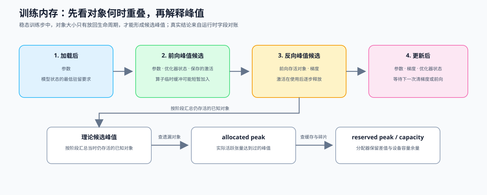

# 18. Memory Profiling and Optimization | 显存分析与优化

**难度：** Medium | **环境：** CPU-first | **标签：** `PyTorch`, `显存`, `训练优化` | **目标人群：** Part 2-4 前置补课者

> 🚀 **云端运行环境**
>
> 本章节的实战代码可以点击以下链接在免费 GPU 算力平台上直接运行：
>
> [](https://colab.research.google.com/github/datawhalechina/llm-algo-leetcode/blob/main/00_Prerequisites/18_Memory_Profiling_and_Optimization.ipynb)
> [](https://modelscope.cn/my/mynotebook) *(国内推荐：魔搭社区免费实例)*


训练时，模型参数只是显存占用的一部分。反向传播还需要保存梯度、优化器状态、activation 和临时缓冲，因此“模型能够加载”不等于“一步训练能够完成”。你将先建立理论账本，找出主导对象，再比较 batch、梯度累积、混合精度和 checkpoint 等策略，并把账本映射到实际运行的 `allocated`、`reserved` 和 `peak`。

**关键词：** `memory`, `checkpoint`, `accumulation`



## 前置阅读
**导语：** 先从 0E 组页判断当前问题是否属于容量证据，再把参数、梯度、activation 和临时张量放进同一账本。
- [0E 组页](./0E.md)

## Q1：显存账本先分哪几层？

模型参数能够放进 GPU，并不代表训练一定不会 OOM（显存不足）：反向传播还会产生梯度、优化器状态和需要暂存的 activation（前向过程中为了反向计算而保留的中间结果）。先按对象的生命周期把常驻状态与动态状态分开，才能知道峰值来自模型本身，还是来自某一次训练步骤；这里的账本用于定位主要项，不等同于 CUDA allocator 的完整峰值。


| 显存对象 | 生命周期 | 是否随 batch 变化 | 主要影响因素 |
|:---|:---|:---:|:---|
| 参数 | 模型加载后持续存在 | 否 | 参数量、dtype |
| 梯度 | backward 后产生，更新前保留 | 通常否 | 可训练参数量、梯度 dtype |
| 优化器状态 | 优化器初始化后持续存在 | 否 | 优化器类型、状态精度 |
| Activation | forward 产生，backward 前保留 | 是 | batch、序列长度、层数 |
| 临时缓冲 | 算子执行期间短暂存在 | 是 | 算子实现、workspace、layout |

真实 GPU 观测时，还要区分三个运行时字段：allocated 是当前仍被张量使用的显存，reserved 是分配器已经向设备申请并保留的显存，peak 是测量区间内达到过的峰值。它们不能直接替代理论账本，但能帮助解释“账本看似放得下、运行时仍然 OOM”的情况。

| 观测字段 | 直接回答的问题 | 适合用来判断 |
|:---|:---|:---|
| allocated | 当前活跃张量用了多少？ | 常驻对象和当前 batch 的实际占用 |
| reserved | 分配器向设备保留了多少？ | 缓存、碎片或分配器行为 |
| peak | 本次测量最高到过多少？ | 是否接近容量上限 |


```python
import torch
import torch.nn as nn


def pretty_mb(nbytes):
    return f"{nbytes / 1024**2:.2f} MB"


class TinyLedgerNet(nn.Module):
    def __init__(self):
        super().__init__()
        self.net = nn.Sequential(
            nn.Linear(512, 1024),
            nn.ReLU(),
            nn.Linear(1024, 512),
        )

    def forward(self, x):
        return self.net(x)


model = TinyLedgerNet()
param_count = sum(p.numel() for p in model.parameters())
param_bytes = param_count * 4
grad_bytes = param_count * 4
adam_state_bytes = param_count * 8

batch_size, seq_len, hidden_size = 16, 64, 512
activation_bytes = batch_size * seq_len * hidden_size * 4

components = {
    'parameters_mb': param_bytes / 1024**2,
    'gradients_mb': grad_bytes / 1024**2,
    'optimizer_state_mb': adam_state_bytes / 1024**2,
    'activation_mb': activation_bytes / 1024**2,
}
ledger = dict(components)
ledger['static_state_mb'] = ledger['parameters_mb'] + ledger['gradients_mb'] + ledger['optimizer_state_mb']
ledger['one_step_estimate_mb'] = ledger['static_state_mb'] + ledger['activation_mb']
ledger['dominant'] = max(components, key=components.get)
print('ledger:', {name: round(value, 2) if isinstance(value, float) else value for name, value in ledger.items()})

```

## Q1 验证：训练状态与单步工作集是否分别可核对？

账本各项应非负，单步估算应等于常驻状态与 activation 之和，主导对象必须来自已记录组件。


```python
assert ledger['one_step_estimate_mb'] == ledger['static_state_mb'] + ledger['activation_mb']
assert ledger['dominant'] in components
assert all(value >= 0 for value in components.values())
print('✅ 训练状态与单步工作集账本通过')

```

## Q2：常驻显存和动态显存，谁更像当前瓶颈？

同样是 OOM，模型一加载就失败、反向传播时失败，以及运行多步后持续增长，原因可能完全不同。先比较账本中的对象大小，再把主导对象和现象对应起来，才能决定优先调整模型状态、单步 batch，还是 activation 保存策略。

| 主导对象 | 主要表现 | 优先考虑 |
|:---|:---|:---|
| 参数 / 梯度 | 模型状态本身占用较高 | 减小模型、调整 dtype、减少可训练参数 |
| 优化器状态 | Adam 等状态占比高 | 更换优化器、使用分片或参数策略 |
| Activation | batch 或序列长度增加时峰值明显 | 缩小 micro-batch、使用 checkpoint |
| 临时缓冲 | 某个算子运行时突然抬高 | 检查 workspace、layout 和算子实现 |


```python
def dominant_memory_term(param_mb, grad_mb, optim_mb, activation_mb, temporary_mb=0):
    """比较显存对象大小，并返回主导对象、占比和下一项检查。"""
    if min(param_mb, grad_mb, optim_mb, activation_mb, temporary_mb) < 0:
        raise ValueError('各类显存估算不能为负数')
    items = {
        'parameters': param_mb,
        'gradients': grad_mb,
        'optimizer_state': optim_mb,
        'activations': activation_mb,
        'temporary': temporary_mb,
    }
    total = sum(items.values())
    dominant = max(items, key=items.get)
    return {
        'dominant': dominant,
        'dominant_share_pct': round(items[dominant] / total * 100, 1) if total else 0.0,
        'items': items,
    }


dominant_report = dominant_memory_term(
    param_mb=1200, grad_mb=1200, optim_mb=4800, activation_mb=1800, temporary_mb=200
)
print('dominant report:', dominant_report)
# 输出示例：optimizer_state 占比最高，应先检查优化器状态，而不是先缩 batch

```

## Q2 验证：主导对象、占比和总量是否一致？

给定 optimizer state 最大的账本，结果应识别对应对象，并让各项之和与输入总量一致。


```python
assert dominant_report['dominant'] == 'optimizer_state'
assert 0 < dominant_report['dominant_share_pct'] <= 100
assert sum(dominant_report['items'].values()) == 9200
print('✅ 主导内存对象识别通过')

```

## Q3：什么时候该缩 batch，什么时候该做梯度累积？

先区分两个 batch：`micro-batch` 是一次真正送入模型的样本数，`effective batch` 是累积若干次梯度后才更新一次参数的总样本数。缩小 micro-batch 会降低单次 activation 峰值；梯度累积可以近似保住 effective batch，但会增加前向 / 反向次数，不会减少参数、梯度或 optimizer state 的长期占用。

| 策略 | 主要减少什么 | 主要代价 |
|:---|:---|:---|
| 缩小 micro-batch | 单次 activation 峰值 | 单次处理量变小 |
| 增加 gradient accumulation | 在较小 micro-batch 下保持 effective batch | 前向 / 反向次数增加 |
| 两者配合 | 在容量限制下维持目标更新规模 | 吞吐和训练时间需要重新测量 |


```python
configs = [
    {"name": "baseline", "micro_batch": 16, "accum_steps": 1, "world_size": 1},
    {"name": "accumulated", "micro_batch": 4, "accum_steps": 4, "world_size": 1},
]

seq_len, hidden_size, dtype_bytes = 64, 512, 2

def mb(nbytes):
    """把字节数转换为便于阅读的 MB。"""
    return nbytes / 1024**2

for cfg in configs:
    effective_batch = cfg["micro_batch"] * cfg["accum_steps"] * cfg["world_size"]
    activation_bytes = cfg["micro_batch"] * seq_len * hidden_size * dtype_bytes
    forward_backward_rounds = cfg["accum_steps"]
    cfg['effective_batch'] = effective_batch
    cfg['activation_peak_mb'] = mb(activation_bytes)
    cfg['forward_backward_rounds'] = forward_backward_rounds
    print(cfg)

```

## Q3 验证：相同 effective batch 下，micro-batch 与累计轮数是否形成交换？

缩小 micro-batch 应降低 activation 峰值；为了保持相同 effective batch，需要增加 forward/backward 轮数。


```python
assert configs[0]['effective_batch'] == configs[1]['effective_batch']
assert configs[1]['activation_peak_mb'] < configs[0]['activation_peak_mb']
assert configs[1]['forward_backward_rounds'] > configs[0]['forward_backward_rounds']
print('✅ effective batch、activation 峰值和累计轮数关系通过')

```

## Q4：混合精度和梯度检查点分别省什么？

如果账本显示 activation 占比高，可以考虑减少每个元素的字节数，或减少 backward 前需要保存的中间结果。混合精度主要改变存储精度和字节数；梯度检查点则少保存 activation、在反向阶段重新计算部分 forward。两者可以叠加，但前者要检查数值稳定性，后者要承担额外计算。


```python
import math

layers = 12
batch_size, seq_len, hidden_size = 8, 32, 512

def activation_mb(dtype_bytes, checkpoint_factor=1):
    """估算保存的激活，并返回一个重算次数代理值。"""
    if dtype_bytes <= 0 or checkpoint_factor < 1:
        raise ValueError('dtype_bytes 必须大于 0，checkpoint_factor 至少为 1')
    saved_layers = math.ceil(layers / checkpoint_factor)
    memory = saved_layers * batch_size * seq_len * hidden_size * dtype_bytes / 1024**2
    recompute_proxy = max(0, checkpoint_factor - 1)
    return memory, recompute_proxy

rows = [
    ("fp32 / no checkpoint", activation_mb(4, 1)),
    ("bf16 / no checkpoint", activation_mb(2, 1)),
    ("fp32 / checkpoint every 2 blocks", activation_mb(4, 2)),
    ("bf16 / checkpoint every 2 blocks", activation_mb(2, 2)),
]

for name, (memory, recompute_proxy) in rows:
    print(f"{name:<32} {memory:>6.2f} MB | recompute proxy: {recompute_proxy}")

print("checkpointing mainly reduces saved activations; bf16 mainly cuts dtype bytes")

```

## Q4 验证：dtype 与 checkpoint 是否分别改变字节数和重算代价？

低精度应减少单元素字节数，checkpoint 应减少保存层数并提高重算代理，两者可以叠加。


```python
assert rows[1][1][0] < rows[0][1][0]
assert rows[2][1][0] < rows[0][1][0]
assert rows[3][1][0] < rows[1][1][0]
assert rows[2][1][1] > rows[0][1][1]
print('✅ dtype 字节数与 checkpoint 重算代理关系通过')

```

## Q5：显存泄漏怎么排查？

如果显存不是在某一步突然升高，而是每轮训练后都继续增长，先检查是否把带计算图的 Tensor 或 loss 持续放进列表。例如，loss.item() 只保存数字，detach() 保留 Tensor 但切断当前计算图，no_grad() 则关闭一段代码的梯度追踪；三者解决的不是同一个问题。


```python
import torch
import torch.nn as nn
import torch.nn.functional as F


torch.manual_seed(0)
model = nn.Linear(4, 2)
x = torch.randn(8, 4)
y = torch.randint(0, 2, (8,))

loss_bucket = []
for _ in range(2):
    out = model(x)
    loss = F.cross_entropy(out, y)
    loss_bucket.append(loss)

scalar_bucket = []
for _ in range(2):
    out = model(x)
    loss = F.cross_entropy(out, y)
    scalar_bucket.append(loss.item())

with torch.no_grad():
    pred = model(x)

detached = model(x).detach()

print(f"keep tensor: type={type(loss_bucket[0]).__name__}, grad_fn={loss_bucket[0].grad_fn is not None}")
print(f"keep scalar: type={type(scalar_bucket[0]).__name__}, value={scalar_bucket[0]:.4f}")
print(f"no_grad output requires_grad={pred.requires_grad}")
print(f"detach output requires_grad={detached.requires_grad}, grad_fn={detached.grad_fn}")
print("store tensors only when you really need the graph")

```

## Q5 验证：保存 Tensor、标量和切断计算图是否产生不同状态？

直接保存 loss Tensor 会保留 `grad_fn`；保存标量、使用 `no_grad()` 或 `detach()` 不应继续持有当前计算图。


```python
assert loss_bucket[0].grad_fn is not None
assert isinstance(scalar_bucket[0], float)
assert not pred.requires_grad
assert not detached.requires_grad and detached.grad_fn is None
print('✅ 计算图持有、标量保存、no_grad 和 detach 区分通过')

```

## Q6：如何根据主导对象选择显存策略？

先判断常驻状态还是 activation 主导，再选择策略：常驻状态超出容量时，优先检查 dtype、模型规模或 optimizer state；activation 主导时，才比较 micro-batch 和 checkpoint；effective batch 不足时，再用 gradient accumulation 补回更新规模。最后用固定 workload 测量吞吐、重算和质量代价。


```python
def estimate_step_budget(param_mb, grad_mb, optim_mb, activation_mb, can_fit=None, memory_cap_mb=None, effective_batch=None, target_effective_batch=None):
    """根据主导显存对象和容量上限给出教学用策略建议。

    这是理论决策器，不测量真实 GPU 峰值；返回结果需要用固定 workload 复核。
    """
    if min(param_mb, grad_mb, optim_mb, activation_mb) < 0:
        raise ValueError('显存估算不能为负数')
    total_mb = param_mb + grad_mb + optim_mb + activation_mb
    static_mb = param_mb + grad_mb + optim_mb
    if can_fit is None:
        if memory_cap_mb is None:
            raise ValueError('can_fit 和 memory_cap_mb 至少提供一个')
        can_fit = total_mb <= memory_cap_mb
    if not can_fit and memory_cap_mb is not None and static_mb > memory_cap_mb:
        return {'strategy': 'inspect_static_state', 'total_mb': total_mb, 'reason': '常驻状态已超过容量', 'metrics': ['static_state_mb', 'peak_memory_mb']}
    if not can_fit:
        return {'strategy': 'reduce_batch_or_checkpoint', 'total_mb': total_mb, 'reason': '单步工作集超过容量', 'metrics': ['peak_memory_mb', 'throughput']}
    if effective_batch is not None and target_effective_batch is not None and effective_batch < target_effective_batch:
        return {'strategy': 'gradient_accumulation', 'total_mb': total_mb, 'reason': '需要恢复目标 effective batch', 'metrics': ['throughput', 'step_time_ms']}
    if activation_mb >= optim_mb:
        return {'strategy': 'checkpoint', 'total_mb': total_mb, 'reason': 'activation 是主要动态开销', 'metrics': ['peak_memory_mb', 'recompute_time_ms']}
    return {'strategy': 'keep_batch_and_profile', 'total_mb': total_mb, 'reason': '当前账本没有显示单一主导策略', 'metrics': ['throughput', 'peak_memory_mb']}


decision = estimate_step_budget(
    param_mb=1200, grad_mb=1200, optim_mb=4800, activation_mb=1800, memory_cap_mb=8000
)
print('decision:', decision)
# 输出示例：先识别常驻状态或单步工作集，再决定具体实验变量

```

## Q6 验证：策略建议是否来自容量和主导对象？

当单步工作集超过容量但常驻状态仍可容纳时，应优先比较 batch 或 checkpoint，并保留峰值显存与吞吐作为复测指标。


```python
assert decision['strategy'] == 'reduce_batch_or_checkpoint'
assert decision['total_mb'] == 9000
assert {'peak_memory_mb', 'throughput'} <= set(decision['metrics'])
print('✅ 内存主导对象到策略建议的映射通过')

```

## 相关阅读
**导语：** 完成本节后，可以继续学习 PyTorch 的显存分配语义，并把理论账本与训练侧策略比较连接起来。
- [PyTorch CUDA 显存管理文档](https://docs.pytorch.org/docs/stable/notes/cuda.html)
- [PyTorch memory_snapshot 官方说明](https://docs.pytorch.org/docs/stable/torch_cuda_memory.html)
- [17. PyTorch Profiling Basics | PyTorch 性能分析基础](./17_PyTorch_Profiling_Basics.md)
- [19. Debugging and Anomaly Localization | 调试与异常定位](./19_Debugging_and_Anomaly_Localization.md)
- [20. Performance Evidence and Experiment Design | 性能证据汇总与实验设计](./20_Performance_Evidence_and_Experiment_Design.md)
- [76. Activation / Checkpoint / Offload Benchmark | 激活检查点与卸载对比](../02_PyTorch_Algorithms/76_Activation_Checkpoint_Offload_Benchmark.md)
