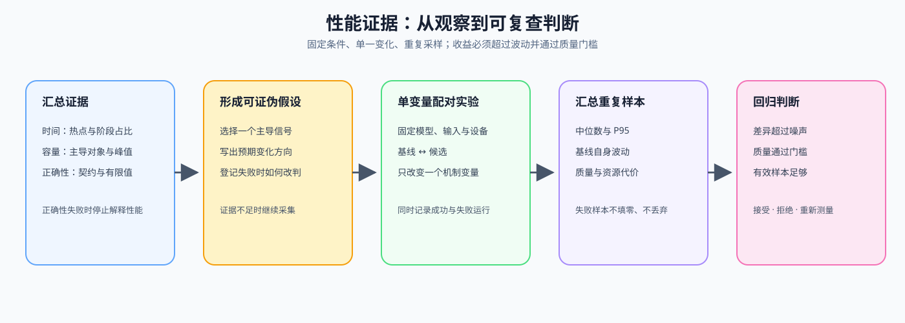

# 20. Performance Evidence and Experiment Design | 性能证据汇总与实验设计

**难度：** Medium | **环境：** CPU-first | **标签：** `evidence`, `baseline`, `experiment design` | **目标人群：** Part 2-4 前置补课者

> 🚀 **云端运行环境**
>
> 本章节的实战代码可以点击以下链接在免费 GPU 算力平台上直接运行：
>
> [](https://colab.research.google.com/github/datawhalechina/llm-algo-leetcode/blob/main/00_Prerequisites/20_Performance_Evidence_and_Experiment_Design.ipynb)
> [](https://modelscope.cn/my/mynotebook) *(国内推荐：魔搭社区免费实例)*


时间热点、容量风险和正确性状态需要放进同一份证据记录，才能形成可复查的性能判断。你将先记录 baseline，再选择热点，汇总 17–19 的证据形成假设，最后设计一次只改变一个条件的验证。

**关键词：** `baseline`, `hypothesis`, `single-variable experiment`, `evidence level`



## 前置阅读
**导语：** 完成 17 的时间观察、18 的显存账本和 19 的异常定位后，进入本页把证据整理成下一步实验决策。
- [17. PyTorch Profiling Basics | PyTorch 性能分析基础](./17_PyTorch_Profiling_Basics.md)
- [18. Memory Profiling and Optimization | 显存分析与优化](./18_Memory_Profiling_and_Optimization.md)
- [19. Debugging and Anomaly Localization | 调试与异常定位](./19_Debugging_and_Anomaly_Localization.md)

## Q1：如何把一次运行的性能信号整理成可比较的记录？

假设你已经从一次运行中得到 step 时间、处理 token 数和资源观察值。两次运行的 latency 都是 20 ms，但一次处理 1 个样本、另一次处理 8 个样本，它们的 throughput 并不相同。这里把这些输入整理成一条 summary，方便与另一组 workload 或 baseline 比较；zone 表示初步归因类别，next_check 表示下一项检查。

| 记录字段 | 它回答的问题 | 输出或观察方向 |
|:---|:---|:---|
| latency | 一次运行花了多久？ | 判断单次响应是否变慢 |
| throughput | 单位时间处理了多少 token？ | 判断整体产出是否下降 |
| GPU 利用率 | GPU 是否持续有工作？ | 偏低时检查输入或同步 |
| CPU 等待时间 | CPU 是否在等待数据或设备？ | 偏高时检查数据管线或同步 |
| summary | 当前运行呈现什么症状？ | 输出 zone 和 next_check |


```python
def summarize_step_metrics(step_ms, tokens, gpu_busy_pct, cpu_wait_ms):
    """汇总一次运行的性能症状，并给出下一步观察方向。

    这些判断是教学用启发式规则，不替代固定 workload 的实测。
    """
    if step_ms <= 0 or tokens < 0:
        raise ValueError('step_ms 必须大于 0，tokens 不能为负数')
    if not 0 <= gpu_busy_pct <= 100 or cpu_wait_ms < 0:
        raise ValueError('GPU 利用率应在 0 到 100 之间，CPU 等待时间不能为负数')
    tok_per_s = tokens / (step_ms / 1000.0)
    if cpu_wait_ms > 40 and gpu_busy_pct < 60:
        zone, next_check = 'likely_input_or_sync_bound', 'inspect_input_pipeline_or_sync'
    elif gpu_busy_pct < 50:
        zone, next_check = 'low_gpu_utilization', 'inspect_input_pipeline_or_sync'
    elif step_ms > 200:
        zone, next_check = 'slow_compute_path', 'inspect_forward_or_kernel'
    else:
        zone, next_check = 'no_single_signal', 'collect_more_evidence'
    return {
        'latency_ms': step_ms,
        'throughput_tok_s': round(tok_per_s, 1),
        'gpu_busy_pct': gpu_busy_pct,
        'cpu_wait_ms': cpu_wait_ms,
        'zone': zone,
        'next_check': next_check,
    }


examples = [
    ('输入或同步可疑', dict(step_ms=180, tokens=360, gpu_busy_pct=42, cpu_wait_ms=55)),
    ('计算路径可疑', dict(step_ms=260, tokens=520, gpu_busy_pct=86, cpu_wait_ms=8)),
    ('证据不足', dict(step_ms=160, tokens=360, gpu_busy_pct=72, cpu_wait_ms=8)),
]
summaries = [summarize_step_metrics(**kwargs) for _, kwargs in examples]
for (label, _), result in zip(examples, summaries):
    print(label, '->', result['zone'], '| next:', result['next_check'])
# 输出示例: summary 中 latency_ms=180, throughput_tok_s=2000.0, bottleneck=data

```

## Q1 验证：三类性能信号能否映射到不同观察方向？

```python
assert [item['zone'] for item in summaries] == [
    'likely_input_or_sync_bound', 'slow_compute_path', 'no_single_signal'
]
assert summaries[0]['throughput_tok_s'] == 2000.0
print('✅ 性能信号汇总与初步归因通过')
```

## Q2：如何从阶段耗时中选出最值得展开的热点？

假设你已经从 17 节得到一组阶段事件。每条记录包含 `name`、`total_ms` 和 `calls`，排序后再派生 `share_pct`。热点是对总耗时贡献最大的阶段；它用于选择下一项检查，还不能单独证明根因。

| 阶段 | 观察对象 | 下一项验证 |
|:---|:---|:---|
| dataloader | 数据准备和搬运 | 检查输入管线与同步 |
| forward | 前向算子与激活 | 展开算子耗时和显存 |
| backward | 反向计算与梯度 | 检查梯度计算和保存策略 |
| optimizer | 参数更新和状态访问 | 检查优化器循环与状态 |


```python
def top_hotspots(events, topk=2):
    """按阶段总耗时排序，并补充其在总时间中的占比。

    events 中每项需要包含 name、total_ms 和 calls；这里处理的是
    已经整理好的事件记录，不负责从 profiler 采集原始事件。
    """
    if not isinstance(events, list) or not events or topk <= 0:
        return []
    required = {'name', 'total_ms', 'calls'}
    if any(not required.issubset(event) for event in events):
        raise ValueError('每个事件都必须包含 name、total_ms 和 calls')
    if any(event['total_ms'] < 0 or event['calls'] <= 0 for event in events):
        raise ValueError('total_ms 不能为负数，calls 必须大于 0')
    total_ms = sum(event['total_ms'] for event in events)
    if total_ms <= 0:
        raise ValueError('事件总耗时必须大于 0')
    ordered = sorted(events, key=lambda event: event['total_ms'], reverse=True)
    return [
        {**event, 'share_pct': round(event['total_ms'] / total_ms * 100, 1)}
        for event in ordered[:topk]
    ]


events = [
    {'name': 'forward', 'total_ms': 38, 'calls': 2},
    {'name': 'backward', 'total_ms': 74, 'calls': 2},
    {'name': 'optimizer', 'total_ms': 18, 'calls': 1},
    {'name': 'dataloader', 'total_ms': 52, 'calls': 4},
]
hotspots = top_hotspots(events)
print('hotspots:', hotspots)
print('focus:', hotspots[0]['name'])
# 输出示例: hotspots -> [('backward', 74), ('dataloader', 52)], focus -> backward

```

## Q2 验证：热点排序与阶段占比是否正确？

```python
assert [item['name'] for item in hotspots] == ['backward', 'dataloader']
assert hotspots[0]['share_pct'] == round(74 / 182 * 100, 1)
assert top_hotspots([], topk=2) == []
print('✅ 阶段热点排序与占比计算通过')
```

## Q3：如何把时间、容量与正确性证据合成一个可验证假设？

17 提供时间热点，18 提供主导内存对象与容量风险，19 提供结构、数值和梯度是否可信。正确性失败时应先停止性能归因；结果可信后，再判断容量压力或时间热点是否足以形成实验假设。

| 证据来源 | 输入字段 | 汇总后的作用 |
|:---|:---|:---|
| 时间证据 | hotspot、stage share | 判断哪个阶段值得展开 |
| 容量证据 | dominant object、peak / capacity | 判断是否接近容量上限 |
| 正确性证据 | contract、finite、gradient | 决定性能结果能否继续解释 |


```python
def synthesize_evidence(hotspot, memory_signal, correctness):
    """汇总三类既有证据；不在本页重新计算 profiler 或显存账本。"""
    required_hotspot = {'name', 'share_pct'}
    required_memory = {'dominant_object', 'peak_memory_mb', 'capacity_mb'}
    required_correctness = {'contract_ok', 'finite', 'gradient_ok'}
    if not required_hotspot <= set(hotspot):
        raise KeyError('hotspot 缺少 name 或 share_pct')
    if not required_memory <= set(memory_signal):
        raise KeyError('memory_signal 缺少容量证据字段')
    if not required_correctness <= set(correctness):
        raise KeyError('correctness 缺少正确性证据字段')
    if memory_signal['capacity_mb'] <= 0 or memory_signal['peak_memory_mb'] < 0:
        raise ValueError('capacity_mb 必须为正，peak_memory_mb 不能为负')
    if not 0 <= hotspot['share_pct'] <= 100:
        raise ValueError('share_pct 必须位于 0 到 100 之间')

    failed_checks = [name for name, ok in correctness.items() if not ok]
    capacity_ratio = memory_signal['peak_memory_mb'] / memory_signal['capacity_mb']
    if failed_checks:
        status = 'blocked_by_correctness'
        primary_signal = 'correctness'
        hypothesis = '先修复正确性问题，再解释性能结果'
    elif capacity_ratio >= 0.90:
        status = 'ready_for_experiment'
        primary_signal = 'memory'
        hypothesis = f"{memory_signal['dominant_object']} 导致容量压力"
    elif hotspot['share_pct'] >= 40:
        status = 'ready_for_experiment'
        primary_signal = 'time'
        hypothesis = f"{hotspot['name']} 位于时间关键路径"
    else:
        status = 'need_more_evidence'
        primary_signal = 'none'
        hypothesis = '当前没有单一强信号'

    return {
        'status': status,
        'primary_signal': primary_signal,
        'hypothesis': hypothesis,
        'hotspot': hotspot['name'],
        'hotspot_share_pct': hotspot['share_pct'],
        'dominant_object': memory_signal['dominant_object'],
        'capacity_ratio': round(capacity_ratio, 3),
        'failed_checks': failed_checks,
    }


correctness_ok = {'contract_ok': True, 'finite': True, 'gradient_ok': True}
capacity_evidence = synthesize_evidence(
    hotspot={'name': 'backward', 'share_pct': 40.7},
    memory_signal={'dominant_object': 'activation', 'peak_memory_mb': 61, 'capacity_mb': 64},
    correctness=correctness_ok,
)
input_evidence = synthesize_evidence(
    hotspot={'name': 'dataloader', 'share_pct': 55.0},
    memory_signal={'dominant_object': 'activation', 'peak_memory_mb': 24, 'capacity_mb': 64},
    correctness=correctness_ok,
)
invalid_evidence = synthesize_evidence(
    hotspot={'name': 'forward', 'share_pct': 62.0},
    memory_signal={'dominant_object': 'temporary', 'peak_memory_mb': 30, 'capacity_mb': 64},
    correctness={'contract_ok': True, 'finite': False, 'gradient_ok': True},
)
print('capacity:', capacity_evidence)
print('input:', input_evidence)
print('invalid:', invalid_evidence)

```

## Q3 验证：正确性门槛、容量压力与时间热点能否正确分流？

```python
assert capacity_evidence['primary_signal'] == 'memory'
assert capacity_evidence['capacity_ratio'] == round(61 / 64, 3)
assert input_evidence['primary_signal'] == 'time'
assert input_evidence['hotspot'] == 'dataloader'
assert invalid_evidence['status'] == 'blocked_by_correctness'
assert invalid_evidence['failed_checks'] == ['finite']
print('✅ 三类证据的优先级与归因通过')
```

## Q4：如何把证据假设变成单变量实验？

每次实验先固定模型、输入、batch、dtype、设备、重复次数和测量方法，再根据 Q3 的主信号只改变一个候选变量。正确性未通过时不应启动性能比较；证据不足时应增加重复采样，而不是直接修改多个参数。

| 实验字段 | 需要记录的内容 |
|:---|:---|
| hypothesis | 哪个机制可能造成当前现象 |
| fixed conditions | model、input、batch、dtype、device、repeats |
| single change | baseline 与 candidate 唯一不同的变量 |
| metrics | 能同时观察收益与代价的指标 |
| evidence level | teaching proxy、smoke test 或 repeated benchmark |


```python
def design_single_variable_experiment(evidence, baseline):
    """根据证据生成 baseline/candidate 对照；candidate 最多改变一个变量。"""
    required = {'model', 'input_shape', 'batch_size', 'dtype', 'device', 'repeats'}
    missing = sorted(required - set(baseline))
    if missing:
        raise KeyError(f'baseline 缺少固定条件: {missing}')
    fixed_conditions = {key: baseline[key] for key in sorted(required)}

    if evidence['status'] == 'blocked_by_correctness':
        return {
            'action': 'fix_correctness_first',
            'hypothesis': evidence['hypothesis'],
            'baseline': dict(baseline),
            'candidate': None,
            'changed_variable': None,
            'fixed_conditions': fixed_conditions,
            'metrics': ['contract_ok', 'finite', 'gradient_ok'],
            'evidence_level': 'teaching_proxy',
        }

    candidate = dict(baseline)
    if evidence['primary_signal'] == 'memory' and evidence['dominant_object'] == 'activation':
        changed_variable = 'checkpoint'
        candidate[changed_variable] = not baseline.get(changed_variable, False)
        metrics = ['peak_memory_mb', 'latency_ms', 'throughput_tok_s']
    elif evidence['primary_signal'] == 'time' and evidence['hotspot'] == 'dataloader':
        changed_variable = 'num_workers'
        current_workers = baseline.get(changed_variable, 0)
        if not isinstance(current_workers, int) or current_workers < 0:
            raise ValueError('num_workers 必须是非负整数')
        candidate[changed_variable] = current_workers + 2
        metrics = ['latency_ms', 'cpu_wait_ms', 'throughput_tok_s']
    else:
        return {
            'action': 'collect_more_evidence',
            'hypothesis': evidence['hypothesis'],
            'baseline': dict(baseline),
            'candidate': None,
            'changed_variable': None,
            'fixed_conditions': fixed_conditions,
            'metrics': ['latency_ms', 'throughput_tok_s'],
            'evidence_level': 'teaching_proxy',
        }

    return {
        'action': 'run_comparison',
        'hypothesis': evidence['hypothesis'],
        'baseline': dict(baseline),
        'candidate': candidate,
        'changed_variable': changed_variable,
        'fixed_conditions': fixed_conditions,
        'metrics': metrics,
        'evidence_level': 'teaching_proxy',
    }


baseline = {
    'model': 'TinyLM',
    'input_shape': (4, 128),
    'batch_size': 4,
    'dtype': 'fp32',
    'device': 'cpu',
    'repeats': 5,
    'checkpoint': False,
    'num_workers': 0,
}
memory_plan = design_single_variable_experiment(capacity_evidence, baseline)
input_plan = design_single_variable_experiment(input_evidence, baseline)
blocked_plan = design_single_variable_experiment(invalid_evidence, baseline)
print('memory plan:', memory_plan)
print('input plan:', input_plan)
print('blocked plan:', blocked_plan)

```

## Q4 验证：candidate 是否只改变一个变量，并保留固定条件？

```python
def changed_keys(plan):
    if plan['candidate'] is None:
        return []
    keys = set(plan['baseline']) | set(plan['candidate'])
    return sorted(key for key in keys if plan['baseline'].get(key) != plan['candidate'].get(key))


assert memory_plan['action'] == 'run_comparison'
assert changed_keys(memory_plan) == ['checkpoint']
assert input_plan['action'] == 'run_comparison'
assert changed_keys(input_plan) == ['num_workers']
assert input_plan['candidate']['num_workers'] == baseline['num_workers'] + 2
assert input_plan['fixed_conditions']['input_shape'] == baseline['input_shape']
assert blocked_plan['action'] == 'fix_correctness_first'
assert blocked_plan['candidate'] is None
assert all(plan['evidence_level'] == 'teaching_proxy' for plan in (memory_plan, input_plan, blocked_plan))
print('✅ 正确性门槛与单变量实验计划通过')
```

## 相关阅读
**导语：** 完成本节练习后，可以用下面的官方资料继续学习真实 profiler、CUDA 显存管理和 PyTorch 的运行时设计。
- [P1: 06. VRAM Calculation and ZeRO | 显存计算与 ZeRO 优化](../01_Hardware_Math_and_Systems/06_VRAM_Calculation_and_ZeRO.md)
- [PyTorch Profiler 官方教程](https://docs.pytorch.org/tutorials/recipes/recipes/profiler_recipe.html)
- [PyTorch CUDA 显存管理文档](https://docs.pytorch.org/docs/stable/notes/cuda.html)
