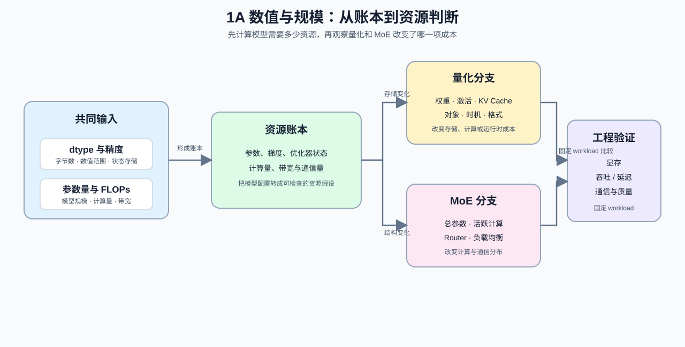

# Group 1A: Numerics and Scale | 1A: 数值与规模

本组把模型配置转换成可复查的容量与计算预算。

## Group Goal | 组定位与学习目标

学习者在这一组完成三类可复查计算：根据数据类型换算参数和状态的存储量，根据模型结构估算参数量与 FLOPs，再比较量化和 MoE 如何改变显存、计算、带宽或通信成本。完成这些计算后，可以把一份模型配置转成资源假设，并为后续实验明确需要测量的指标。

阅读顺序和 Part 级前导路径见 [intro](./intro.md)。

## Group Assets and Reading Order | 组内资产与阅读顺序

| 小节 | 核心职责 | 学习角色 |
|:---|:---|:---|
| [01](./01_Data_Types_and_Precision.md) | 建立显存与精度账本直觉 | 数值表示入口 |
| [02](./02_LLM_Params_and_FLOPs.md) | 估清参数量与 FLOPs 数量级 | 模型规模账本 |
| [21](./21_Quantization_Theory_and_INT4_INT8.md) | 判断量化何时值得做 | 低精度成本入口 |
| [22](./22_MoE_Parameter_and_Compute.md) | 看清 MoE 的参数与计算分离 | 稀疏架构账本 |

## Group Mechanism Chain | 组内机制链

| 阶段 | 阅读入口 | 本阶段产出 |
|:---|:---|:---|
| 基础量 | [01 数据类型与精度](./01_Data_Types_and_Precision.md) | 位宽、参数与训练状态的字节账本 |
| 机制计算 | [02 参数量与 FLOPs](./02_LLM_Params_and_FLOPs.md) | 参数量、前向 / 训练计算量与利用率口径 |
| 系统约束 | [21 量化理论](./21_Quantization_Theory_and_INT4_INT8.md) / [22 MoE 参数与计算](./22_MoE_Parameter_and_Compute.md) | 表示压缩或稀疏激活怎样改变存储、计算与通信假设 |
| 下游专题 | 量化与压缩 / 模型架构演进 / 性能优化；通信量与切分策略进入 [1C](./1C.md) | 把账本作为候选设计输入，再用固定工作负载验证真实执行收益 |

## Environment Notes | 环境说明

- 默认按 `CPU-first` 阅读，先完成公式、账本和机制判断。
- 如果某页提供 `GPU optional` 实验，以该页的配置和环境说明为准。
