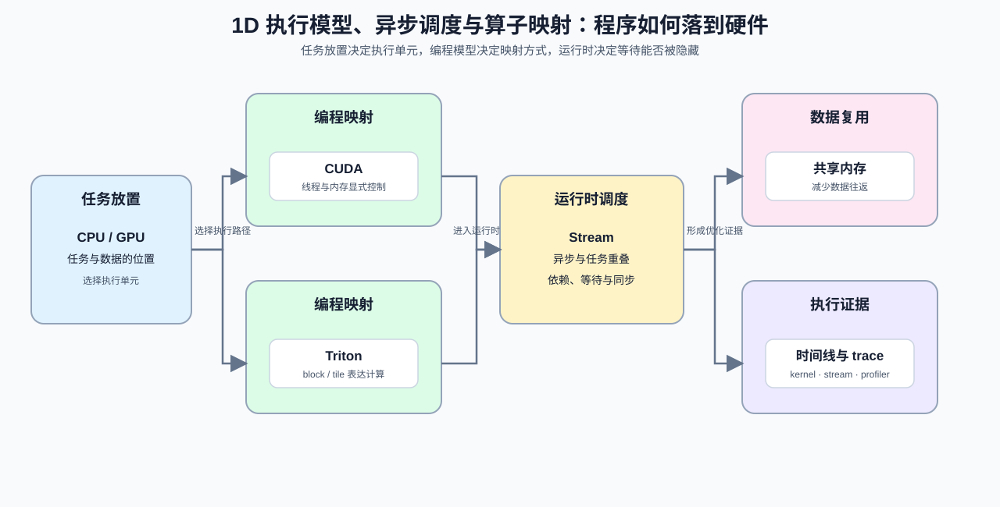

# Group 1D: Execution Models, Asynchrony and Operator Mapping | 1D: 执行模型、异步调度与算子映射

本组回答“程序如何落到实际执行单元”的问题：从 CPU / GPU 的阶段分工进入，继续理解 CUDA / Triton 的编程模型、stream 异步关系、warp / block 映射与动态执行约束。

## Group Goal | 组定位与学习目标

完成本组后，学习者应能解释任务放在哪个执行单元、数据如何在层级之间移动、异步任务能否重叠，以及程序块如何映射为线程、warp、block 或 Triton program。它服务算子优化和性能优化的执行路径理解；设备兼容、资源隔离和硬件迁移判断则进入 [1F](./1F.md)。

## Group Asset Overview | 组内资产总览

| 页 | 核心职责 | Q 数 | 代码块数 | 已有码的 Q | 待补代码的 Q | 定位 |
| --- | --- | ---: | ---: | --- | --- | --- |
| [07](./07_CPU_GPU_Heterogeneous_Scheduling.md) | 分配 host / device 的执行阶段并识别 overlap | 4 | 4 | Q1, Q2, Q3, Q4 | 无 | 主线页 |
| [08](./08_Programming_Models_CUDA_Triton.md) | 选择合适的编程与映射方式 | 4 | 4 | Q1, Q2, Q3, Q4 | 无 | 主线页 |
| [15](./15_CUDA_Execution_Model.md) | 理解 CUDA 执行层级 | 3 | 3 | Q1, Q2, Q3 | 无 | 主线页 |
| [16](./16_Warp_Block_SharedMemory_Basics.md) | 用 Warp / Block / Shared Memory 提升复用 | 3 | 3 | Q1, Q2, Q3 | 无 | 主线页 |
| [17](./17_CUDA_Stream_and_Asynchrony.md) | 看懂异步执行和重叠收益 | 3 | 3 | Q1, Q2, Q3 | 无 | 主线页 |
| [18](./18_Triton_Block_Model.md) | 把程序块映射到执行块 | 3 | 3 | Q1, Q2, Q3 | 无 | 主线页 |
| [29](./29_CUDA_Stream_Advanced_Scheduling.md) | 压低 Stream 调度开销 | 5 | 6 | 全部 | 无 | 扩展页 |

## Group Mechanism Chains | 组内机制子链

1D 包含“任务怎样排”和“程序怎样映射”两条子链。它们共享执行时间线，但分别处理调度依赖与计算粒度，最后在真实计算内核和流水线中汇合。

| 子链 | 阅读顺序 | 主要回答的问题 |
|:---|:---|:---|
| 阶段放置与异步调度 | [07](./07_CPU_GPU_Heterogeneous_Scheduling.md) → [17](./17_CUDA_Stream_and_Asynchrony.md) → [29](./29_CUDA_Stream_Advanced_Scheduling.md) | 哪些阶段放在主机或设备上，哪些依赖允许跨 Stream 重叠，何时值得引入 Event 或 CUDA Graph？ |
| 执行层级与程序映射 | [08](./08_Programming_Models_CUDA_Triton.md) → [15](./15_CUDA_Execution_Model.md) → [16](./16_Warp_Block_SharedMemory_Basics.md) → [18](./18_Triton_Block_Model.md) | 工作怎样映射到线程、Warp、Block 与 Triton program，数据怎样在块内复用并处理边界？ |
| 下游汇合 | 两条子链 → Part 03 / Part 04 | 计算内核是否同时满足正确映射、合理访存和可重叠执行？ |

## Learning Path | 学习路径

- 先读 [07](./07_CPU_GPU_Heterogeneous_Scheduling.md) 和 [08](./08_Programming_Models_CUDA_Triton.md)，建立阶段放置、程序映射和异步执行的共同语境。
- 再读 [15](./15_CUDA_Execution_Model.md)、[16](./16_Warp_Block_SharedMemory_Basics.md)、[17](./17_CUDA_Stream_and_Asynchrony.md) 和 [18](./18_Triton_Block_Model.md)，把执行层级、片上复用、stream overlap 和 block programming 接起来。
- 最后按需要阅读 [29](./29_CUDA_Stream_Advanced_Scheduling.md)。动态 shape、图融合和 lowering 进入 [1E](./1E.md)；GPU 虚拟化与设备运行时约束进入 [1F](./1F.md)。

## Environment Notes | 环境说明

- 默认按 `CPU-first` 阅读，先把执行模型和调度关系想清楚；需要 CUDA 工具链或 `GPU required` 的页面，以单页环境说明为准。
- 本组解释执行路径，不对某个硬件或 backend 的生产性能作出泛化结论。
