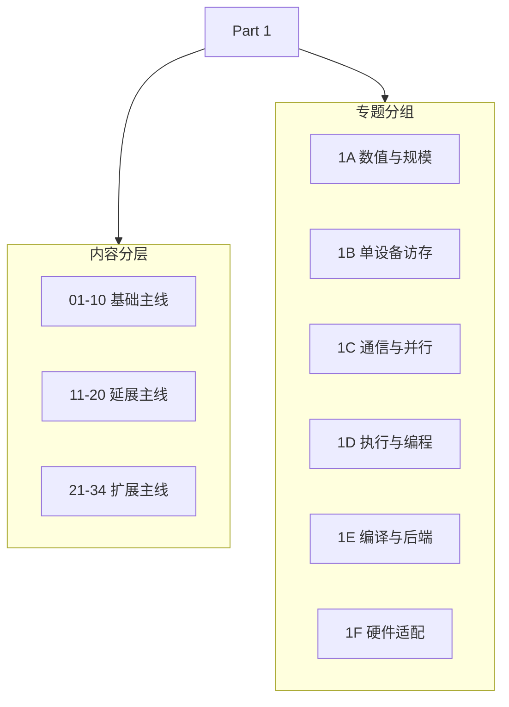

# Part 01: Hardware, Math, and Systems | 第一部分：硬件、数学与系统

## Part Overview | Part 概览

本部分覆盖 34 个讨论题（01–34），把第零部分的 PyTorch 与训练基础连接到后续算法、算子和系统实践。`01–10` 建立基础坐标，`11–20` 深入常见执行机制，`21–34` 扩展到量化、稀疏、并行、编译和异构约束。

Part 1 按 6 个专题组织：`1A`、`1B`、`1C`、`1D`、`1E`、`1F` 分别承担数值规模、单设备访存、通信并行、执行编程、编译后端和硬件适配这六条主线。具体每组怎么读、怎么接后续 Part，由各组导航页分别说明。

## Part Asset Overview | Part 资产总览

六个组分别回答数量级、单设备执行、通信并行、执行映射、编译后端和硬件适配问题。少数桥接页会被多个专题引用，但其权威解释仍保留在所属组。

| 学习组 | 核心职责 | 当前内容映射 | 每组多少节 |
|:---|:---|:---|:---|
| [1A](./1A.md) | 建立数量级与资源账本 | [01](./01_Data_Types_and_Precision.md)、[02](./02_LLM_Params_and_FLOPs.md)、[21](./21_Quantization_Theory_and_INT4_INT8.md)、[22](./22_MoE_Parameter_and_Compute.md) | 4 |
| [1B](./1B.md) | 识别单设备瓶颈与访存路径 | [03](./03_GPU_Architecture_and_Memory.md)、[04](./04_Attention_Memory_Optimization.md)、[11](./11_KV_Cache_and_Memory_Growth.md)、[12](./12_TensorCore_and_Mixed_Precision.md)、[13](./13_Profiling_and_Bottleneck_Analysis.md)、[14](./14_FlashAttention_Memory_Model.md)、[23](./23_TensorCore_Deep_Dive.md)、[24](./24_SRAM_Optimization_Techniques.md)、[25](./25_Sparse_Computation_and_Sparse_Attention.md) | 9 |
| [1C](./1C.md) | 刻画通信、并行与容错边界 | [05](./05_Communication_Topologies.md)、[06](./06_VRAM_Calculation_and_ZeRO.md)、[20](./20_NCCL_and_AllReduce_Basics.md)、[26](./26_Parallel_Strategy_Decision_Framework.md)、[27](./27_Communication_Scheduling_Optimization.md)、[28](./28_Fault_Tolerance_and_Checkpointing.md) | 6 |
| [1D](./1D.md) | 掌握执行模型、异步调度与算子映射 | [07](./07_CPU_GPU_Heterogeneous_Scheduling.md)、[08](./08_Programming_Models_CUDA_Triton.md)、[15](./15_CUDA_Execution_Model.md)、[16](./16_Warp_Block_SharedMemory_Basics.md)、[17](./17_CUDA_Stream_and_Asynchrony.md)、[18](./18_Triton_Block_Model.md)、[29](./29_CUDA_Stream_Advanced_Scheduling.md) | 7 |
| [1E](./1E.md) | 建立编译、后端与动态执行判断 | [09](./09_AI_Compilers_and_Graph_Optimization.md)、[19](./19_Operator_Fusion_Introduction.md)、[30](./30_Dynamic_Shape_Handling.md)、[32](./32_TVM_MLIR_Deep_Practice.md) | 4 |
| [1F](./1F.md) | 判断硬件适配、资源隔离与系统约束 | [10](./10_Domestic_AI_Chips_Overview.md)、[31](./31_GPU_Virtualization_and_MIG.md)、[33](./33_TCO_and_Cost_Model.md)、[34](./34_Heterogeneous_Accelerators_and_Runtime_Constraints.md) | 4 |

## Learning Path | 学习路径

Part 1 不只是知识目录，也是 Part 2 到 Part 5 的共同前置。阅读上可以按三层理解：`01-10` 是基础主线，`11-20` 是延展主线，`21-34` 是扩展主线。

### Recommended Order | 推荐顺序

- 快速入门：先看 [1A](./1A.md) → [1B](./1B.md)
- 系统学习：按 [1A](./1A.md) → [1B](./1B.md) → [1C](./1C.md) → [1D](./1D.md) → [1E](./1E.md) → [1F](./1F.md) 顺序推进

### Next Steps | 后续衔接

- 先看 [1A](./1A.md)、[1B](./1B.md)，把精度、参数量、单设备架构和访存直觉先立起来，主要服务性能、推理、量化与算子专题。
- 先看 [1C](./1C.md)、[1D](./1D.md)，把通信、并行、调度、block / warp / shared memory 和 Triton block model 理顺，主要服务通信并行、性能与算子专题。
- 先看 [1E](./1E.md)、[1F](./1F.md)，理解编译后端、硬件适配、runtime 约束和成本，并按需进入算子优化或部署与异构专题。

## Topic Mapping | 专题映射与职责边界

Part 01 提供公式、资源账本、硬件约束和可行性判断；真实框架运行、GPU benchmark、artifact 与项目决策进入 Part 02–05。

| 组 | 主要支撑专题 | 在 Part 01 中完成什么 | 后续不在本组重复什么 |
|:---|:---|:---|:---|
| 1A 数值与规模 | 架构、量化、性能 | dtype、参数、FLOPs、稀疏参数账本 | 真实低精度 kernel 与质量收益 |
| 1B 单设备访存 | 推理、性能分析、算子 | 存储层次、KV 增长、Attention 工作集与瓶颈假设 | Serving 调度与端到端吞吐 |
| 1C 通信与并行 | 通信并行、性能 | 拓扑、collective、状态切分、通信量与容错 | 多卡扩展效率和项目 adapter |
| 1D 执行与编程 | 算子、性能、推理 | CUDA/Triton 映射、stream、异步与 overlap 直觉 | 生产 kernel 的调参与回归 |
| 1E 编译与后端 | 算子、部署 | 图、IR、融合、动态 shape 与 lowering 关系 | 具体 backend 的版本矩阵和性能结论 |
| 1F 硬件适配 | 部署异构、性能 | 设备能力、runtime、隔离、成本和可行性 gate | 目标设备上的真实加载与服务证据 |

## Environment Notes | 环境说明

- 默认按 `CPU-first` 学习公式、账本和机制判断。
- 需要 GPU、编译工具链或多卡环境的内容，以对应小节和专题 Quickstart 为准。
