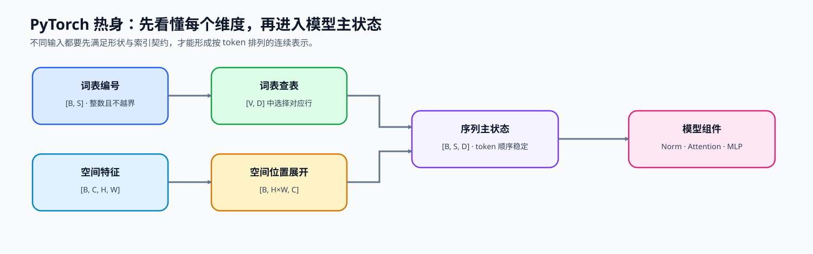
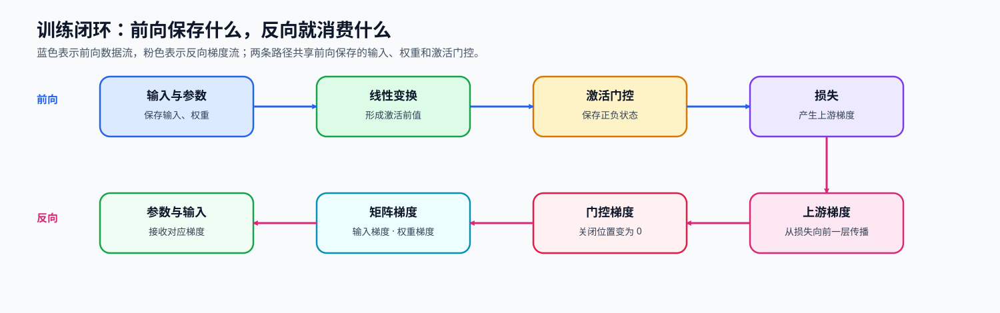

# 00. PyTorch Warmup | PyTorch 热身

**难度：** Easy | **环境：** CPU-first | **标签：** `基础实现`, `PyTorch`, `入门热身` | **目标人群：** 基础实现学习者

> 🚀 **云端运行环境**
>
> 本章节的实战代码可以点击以下链接在免费 GPU 算力平台上直接运行：
>
> [](https://colab.research.google.com/github/datawhalechina/llm-algo-leetcode/blob/main/02_PyTorch_Algorithms/00_PyTorch_Warmup.ipynb)
> [](https://modelscope.cn/my/mynotebook) *(国内推荐：魔搭社区免费实例)*


---

## 本节导读

Part 02 的解码器组件都从同一份输入状态开始：词元编号先变成连续表示，随后沿模型主干完成前向计算；训练时，损失再把梯度传回参数。张量轴、词表索引和计算图共同约束这条路径。

完成本节后，你能够根据每个维度的含义重排张量，解释 token id 如何选择词表向量，并用保存的前向状态验证局部反向传播。

**关键词：** `reshape`, `Embedding`, `backpropagation`

---
## 前置阅读

**导语：** 下面会直接使用张量重排、Embedding 和 Autograd；如果这些操作还不熟悉，可先用对应页面补齐一个最小例子。

- [P0: 05. PyTorch Tensor Fundamentals | PyTorch 张量基础操作](../00_Prerequisites/05_PyTorch_Tensor_Fundamentals.md)
- [P0: 07. PyTorch Autograd and Backward | PyTorch 自动求导与反向传播](../00_Prerequisites/07_PyTorch_Autograd_and_Backward.md)
- [P0: 09. PyTorch nn.Module Basics | PyTorch nn.Module 基础](../00_Prerequisites/09_PyTorch_nn_Module_Basics.md)

---
### Step 1：把空间特征整理成序列

模型不仅要求元素数量正确，还要求每个轴承担正确语义。二维特征进入序列模型时，空间位置需要按固定顺序展开为 token 轴，通道维则保留为每个 token 的特征；多头表示回到主干状态时，同样必须保持 token 顺序不变。

| 输入 | 目标 | 需要保持的语义 |
| --- | --- | --- |
| `[B, C, H, W]` 图像特征 | `[B, H×W, C]` 序列特征 | 每个空间位置仍对应原来的 `C` 个通道值 |
| 多头表示 `[B, H, S, D]` | `[B, S, H×D]` | 词元顺序不变，只合并注意力头与头维度 |


### Step 2：从 tokenizer 输出到连续表示

分词器将文本映射为词表编号。每个编号选择词表矩阵中的一行，得到对应词元的连续向量；这些向量保持原输入顺序，组成后续模型块读取的主状态。查表成立的前提是编号具有整数类型、形状符合批次—序列布局，并且取值没有越过词表边界。

| 对象 | 形状 | 含义 |
| --- | --- | --- |
| `input_ids` | `[B, S]`、`torch.long` | tokenizer 输出的词表编号，必须落在 `[0,V)` |
| 词嵌入权重 | `[V, D]` | `V` 个词元的可训练向量表 |
| 词嵌入输出 | `[B, S, D]` | 与输入位置逐一对应的连续表示 |
### Step 3：让梯度沿计算图回到参数

训练不仅需要前向输出，还需要把损失对输出的变化量传回输入和参数。局部线性变换会保存输入和权重，激活函数会保存决定梯度能否通过的状态；反向传播按相反方向消费这些状态并产生对应梯度。保存状态越多，反向越直接，但训练显存占用也越高。

| 阶段 | 关键状态 | 它在后续计算中的作用 |
| --- | --- | --- |
| 线性变换前向 | 输入、权重 | 决定权重梯度与输入梯度的矩阵关系 |
| 激活前向 | 激活门控状态 | 决定哪些位置允许梯度继续传递 |
| 反向传播 | 上游梯度 | 依次形成输入、权重和偏置梯度 |


### Step 4：代码设计与基础契约验证

本题使用已完成的 token id 输入校验作为公共前提。你将补全张量重排、Embedding 查表、前向状态保存和局部反向传播；测试分别检查形状语义、查表等价性、前向数值与梯度一致性。

| TODO / 函数 | 学习者完成的机制 | 必须满足的约束 | 测试证据 |
|---|---|---|---|
| TODO 1：保持位置—通道对应关系的序列重排<br>`tensor_warmup` | 将二维特征整理为序列表示 | 元素数与空间顺序不变，通道成为末维 | 两种重排的形状与数值一致 |
| TODO 2：验证 Embedding 查表等价性<br>`embedding_warmup` | 用同一词表矩阵生成两条查表结果 | token id 必须选择同一行向量 | 模块输出与直接索引结果一致 |
| TODO 3：保存局部前向状态<br>`LinearReLUFunction.forward` | 计算线性变换和激活，并保存反向必需状态 | 输出形状正确，门控状态与激活前值一致 | 与 PyTorch 前向结果一致 |
| TODO 4：按链式法则回传梯度<br>`LinearReLUFunction.backward` | 从上游梯度得到输入、权重和偏置梯度 | 三类梯度形状与对应对象一致 | 与 Autograd 梯度一致 |

```python
# 导入所有必需的库
import torch
import torch.nn as nn
import torch.nn.functional as F
import einops
```


```python
def validate_token_ids(input_ids: torch.Tensor, vocab_size: int) -> None:
    """检查 tokenizer 输出能否直接作为 Embedding 的输入。"""
    is_rank_two = input_ids.ndim == 2
    is_integer_ids = input_ids.dtype == torch.long
    ids_in_vocab = vocab_size > 0 and (input_ids.numel() == 0 or (input_ids.min() >= 0 and input_ids.max() < vocab_size))
    if not (is_rank_two and is_integer_ids and ids_in_vocab):
        raise ValueError('input_ids 必须是词表范围内的二维 torch.long 张量')


def tensor_warmup(x: torch.Tensor) -> tuple[torch.Tensor, torch.Tensor]:
    """将 `[B, C, H, W]` 图像特征整理为 `[B, H×W, C]` 序列。"""
    if x.ndim != 4:
        raise ValueError('x 必须是 [batch, channels, height, width]')
    # ==========================================
    # TODO 1：保持位置—通道对应关系的序列重排
    # ==========================================
    # x_native = ???  # [B, H×W, C]；空间位置按原顺序展开。
    # x_einops = ???  # [B, H×W, C]；必须与原生重排逐元素一致。
    raise NotImplementedError('TODO 1：请完成空间特征到序列的重排')
    return x_native, x_einops


def embedding_warmup(input_ids: torch.Tensor, vocab_size: int, hidden_dim: int):
    """对照 `nn.Embedding` 与直接权重索引的查表结果。"""
    validate_token_ids(input_ids, vocab_size)
    if hidden_dim <= 0:
        raise ValueError('hidden_dim 必须为正数')
    # ==========================================
    # TODO 2：验证 Embedding 查表等价性
    # ==========================================
    # emb_layer = ???  # [V, D] 的可训练词表矩阵。
    # out_official = ???  # [B, S, D]；通过 Embedding 模块查表。
    # out_manual = ???  # [B, S, D]；从同一权重中直接选择对应行。
    raise NotImplementedError('TODO 2：请完成 Embedding 查表对照')
    return out_official, out_manual


class LinearReLUFunction(torch.autograd.Function):
    """实现 `relu(x @ W^T + b)`，并显式保存 ReLU 反向所需状态。"""
    @staticmethod
    def forward(ctx, x: torch.Tensor, weight: torch.Tensor, bias: torch.Tensor):
        # ==========================================
        # TODO 3：保存局部前向状态
        # ==========================================
        # z = ???  # [..., out_features]；线性变换的激活前值。
        # y = ???  # 与 z 同形；负值位置必须被截断。
        # mask = ???  # bool 张量；True 表示梯度允许通过。
        raise NotImplementedError('TODO 3：请实现 Linear → ReLU 前向')
        ctx.save_for_backward(x, weight, mask)
        return y

    @staticmethod
    def backward(ctx, grad_output: torch.Tensor):
        x, weight, mask = ctx.saved_tensors
        # ==========================================
        # TODO 4：按链式法则回传梯度
        # ==========================================
        # grad_z = ???  # 与 grad_output 同形；激活关闭位置必须为 0。
        # grad_x = ???  # 与 x 同形。
        # grad_weight = ???  # 与 weight 同形。
        # grad_bias = ???  # 与 bias 同形；汇总 batch 维。
        raise NotImplementedError('TODO 4：请实现 Linear → ReLU 反向')
        return grad_x, grad_weight, grad_bias
```


```python
# 测试设计：分别验证 token id、张量重排、Embedding 查表和 Linear → ReLU 的前向/反向。
# 每个测试对应一个机制责任，方便定位未完成的 TODO。

def test_token_id_contract():
    """验证合法 token id 可通过，错误形状、类型和越界值会被拒绝。"""
    validate_token_ids(torch.tensor([[0, 2], [1, 3]], dtype=torch.long), 4)
    for input_ids in (torch.tensor([0, 1]), torch.tensor([[0.0, 1.0]]), torch.tensor([[0, 4]], dtype=torch.long)):
        try: validate_token_ids(input_ids, 4)
        except ValueError: continue
        raise AssertionError('不合法的 tokenizer 输出应被拒绝')

def test_spatial_to_sequence_rearrangement():
    """验证两种重排保持相同的空间顺序与通道语义。"""
    x=torch.arange(2*3*4*5,dtype=torch.float32).reshape(2,3,4,5)
    native, semantic=tensor_warmup(x)
    assert native.shape == semantic.shape == (2,20,3)
    assert torch.equal(native,semantic) and torch.equal(native[0,0],x[0,:,0,0])
    try: tensor_warmup(torch.randn(2,3,4))
    except ValueError: pass
    else: raise AssertionError('非四维特征应被拒绝')

def test_embedding_lookup_equivalence():
    """验证 Embedding 模块与同一权重矩阵的直接索引等价。"""
    official,manual=embedding_warmup(torch.tensor([[0,3],[2,1]],dtype=torch.long),4,6)
    assert official.shape == manual.shape == (2,2,6)
    assert torch.allclose(official,manual)

def test_linear_relu_forward():
    """验证自定义前向与 PyTorch 的线性变换加 ReLU 一致。"""
    x=torch.tensor([[1.,-2.],[.5,3.]],requires_grad=True)
    weight=torch.tensor([[1.,1.],[-1.,.5]],requires_grad=True); bias=torch.tensor([0.,-.5],requires_grad=True)
    actual=LinearReLUFunction.apply(x,weight,bias); expected=F.relu(F.linear(x,weight,bias))
    assert torch.allclose(actual,expected)
    assert torch.all(actual[F.linear(x,weight,bias)<0] == 0)

def test_linear_relu_backward():
    """验证输入、权重和偏置梯度与 Autograd 参考结果一致。"""
    x=torch.randn(2,4,requires_grad=True); weight=torch.randn(3,4,requires_grad=True); bias=torch.randn(3,requires_grad=True)
    F.relu(F.linear(x,weight,bias)).sum().backward(); expected=(x.grad.clone(),weight.grad.clone(),bias.grad.clone())
    x.grad=weight.grad=bias.grad=None
    LinearReLUFunction.apply(x,weight,bias).sum().backward()
    assert torch.allclose(x.grad,expected[0]) and torch.allclose(weight.grad,expected[1]) and torch.allclose(bias.grad,expected[2])

def run_warmup_tests():
    """依次运行四项机制练习及其公共输入契约测试。"""
    test_token_id_contract(); test_spatial_to_sequence_rearrangement(); test_embedding_lookup_equivalence(); test_linear_relu_forward(); test_linear_relu_backward()
    print('✅ Warmup：输入、重排、查表、前向与反向契约测试通过')

try: run_warmup_tests()
except NotImplementedError:
    print('请先完成 TODO 1–4，再运行测试。'); raise
```

---

🛑 **STOP HERE** 🛑
<br><br><br><br><br><br><br><br><br><br>
> 请先尝试自己完成代码并跑通测试。<br>
> 如果遇到困难，可以继续向下查看参考代码。
<br><br><br><br><br><br><br><br><br><br>

---
## 参考代码与解析

### 代码

```python
def validate_token_ids(input_ids: torch.Tensor, vocab_size: int) -> None:
    """检查 tokenizer 输出能否直接作为 Embedding 的输入。"""
    # 公共输入契约：token id 必须是词表范围内的二维整数张量。
    is_rank_two = input_ids.ndim == 2
    is_integer_ids = input_ids.dtype == torch.long
    ids_in_vocab = vocab_size > 0 and (input_ids.numel() == 0 or (input_ids.min() >= 0 and input_ids.max() < vocab_size))
    if not (is_rank_two and is_integer_ids and ids_in_vocab):
        raise ValueError('input_ids 必须是词表范围内的二维 torch.long 张量')


def tensor_warmup(x: torch.Tensor) -> tuple[torch.Tensor, torch.Tensor]:
    """将 `[B, C, H, W]` 图像特征整理为 `[B, H×W, C]` 序列。"""
    if x.ndim != 4:
        raise ValueError('x 必须是 [batch, channels, height, width]')
    # TODO 1：保持位置—通道对应关系的序列重排
    x_native = x.permute(0, 2, 3, 1).reshape(x.shape[0], x.shape[2] * x.shape[3], x.shape[1])
    x_einops = einops.rearrange(x, 'b c h w -> b (h w) c')
    return x_native, x_einops


def embedding_warmup(input_ids: torch.Tensor, vocab_size: int, hidden_dim: int):
    """对照 `nn.Embedding` 与直接权重索引的查表结果。"""
    validate_token_ids(input_ids, vocab_size)
    if hidden_dim <= 0:
        raise ValueError('hidden_dim 必须为正数')
    # TODO 2：验证 Embedding 查表等价性
    emb_layer = nn.Embedding(vocab_size, hidden_dim)
    emb_layer.weight.data.normal_(0, 0.1)
    out_official = emb_layer(input_ids)
    out_manual = emb_layer.weight[input_ids]
    return out_official, out_manual


class LinearReLUFunction(torch.autograd.Function):
    """实现 `relu(x @ W^T + b)`，并显式保存 ReLU 反向所需状态。"""
    @staticmethod
    def forward(ctx, x: torch.Tensor, weight: torch.Tensor, bias: torch.Tensor):
        # TODO 3：保存局部前向状态
        z = F.linear(x, weight, bias)
        y = F.relu(z)
        mask = z > 0
        ctx.save_for_backward(x, weight, mask)
        return y

    @staticmethod
    def backward(ctx, grad_output: torch.Tensor):
        x, weight, mask = ctx.saved_tensors
        # TODO 4：按链式法则回传梯度
        grad_z = grad_output * mask
        grad_x = grad_z @ weight
        grad_weight = grad_z.transpose(-1, -2) @ x
        grad_bias = grad_z.sum(dim=0)
        return grad_x, grad_weight, grad_bias
```

### 解析

#### TODO 1：保持位置—通道对应关系的序列重排

- 空间位置组成序列轴，通道组成特征轴；重排前后元素数量和位置对应关系都不能改变。
- 答案分别使用原生张量操作与语义化重排，测试比较形状、逐元素结果和首个空间位置。

#### TODO 2：验证 Embedding 查表等价性

- token id 的含义是词表行号，因此两条路径必须读取同一份权重。
- 答案比较模块查表与直接索引，测试验证输出形状和数值完全一致。

#### TODO 3：保存局部前向状态

- 激活前值决定 ReLU 的门控状态，输入和权重则用于形成两类矩阵梯度。
- 答案保存最小必要状态，测试将输出与 PyTorch 参考路径逐元素比较。

#### TODO 4：按链式法则回传梯度

- 上游梯度先经过激活门控，再分别投影到输入、权重和偏置。
- 答案保持三类梯度与目标对象同形，测试与 Autograd 产生的参考梯度比较。
## 相关阅读

本节的基础算子可以沿两个方向继续：先看 PyTorch 的官方张量与自动求导接口，再把这些操作放回 GPU 精度和内存层级。

- [PyTorch 张量文档](https://pytorch.org/docs/stable/tensors.html)
- [PyTorch 自动求导文档](https://pytorch.org/docs/stable/autograd.html)
- [einops 开源仓库](https://github.com/arogozhnikov/einops)
- [PyTorch 原论文：An Imperative Style, High-Performance Deep Learning Library](https://arxiv.org/abs/1912.01703)
- [P1: 大模型的数据格式与混合精度](../01_Hardware_Math_and_Systems/01_Data_Types_and_Precision.md)
- [P1: GPU 物理架构与内存层级](../01_Hardware_Math_and_Systems/03_GPU_Architecture_and_Memory.md)
