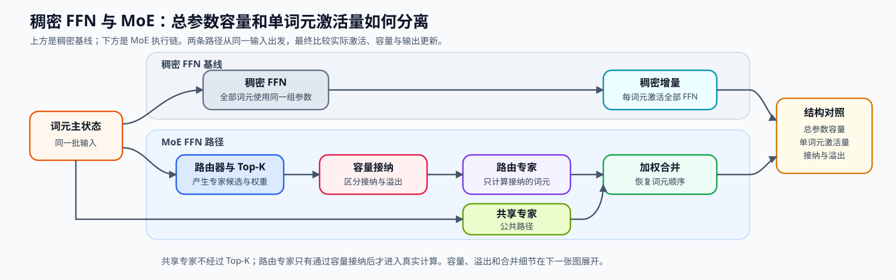
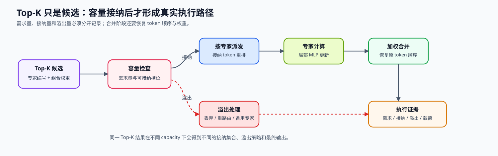

# 06. MoE Router | MoE 路由器

**难度：** Medium | **环境：** CPU-first | **标签：** `模型结构`, `MoE`, `Router` | **目标人群：** 模型结构学习者

> 🚀 **云端运行环境**
>
> 本章节的实战代码可以点击以下链接在免费 GPU 算力平台上直接运行：
>
> [](https://colab.research.google.com/github/datawhalechina/llm-algo-leetcode/blob/main/02_PyTorch_Algorithms/06_MoE_Router.ipynb)
> [](https://modelscope.cn/my/mynotebook) *(国内推荐：魔搭社区免费实例)*


---

## 本节导读

普通 Transformer Block 里的 MLP 是稠密计算：每个 token 都要经过同一组参数。模型越大，计算量也越大；但很多时候，一个 token 并不需要动用全部专家能力，只需要被送到最合适的少数分支。

MoE 的核心是把 MLP 拆成多个专家，再由路由器（Router）为每个 token 选择少数分支。本节沿着路由概率、Top-K 选择、专家容量、分发与合并建立完整机制链，帮助你理解稀疏激活如何换取更大的参数容量，以及路由集中为何会转化为容量溢出和执行长尾。

**关键词：** `MoE`, `路由器`, `Top-K`, `专家容量`

---
## 前置阅读

**导语：** 先理解解码器块中稠密 MLP 的位置，再观察 MoE 如何让路由器为每个 token 选择少数专家，并把专家输出写回原来的通道接口。

- [05. LLaMA3 Block Tutorial | LLaMA3 Block 教程](../02_PyTorch_Algorithms/05_LLaMA3_Block_Tutorial.md)
- 可选回看：[P0: 09. PyTorch nn.Module Basics | PyTorch nn.Module 基础](../00_Prerequisites/09_PyTorch_nn_Module_Basics.md)（不熟悉 `ModuleList` 与模块参数时使用）

### Step 1：从稠密 MLP 到稀疏专家容量

稠密 Transformer 块中，每个 token 都经过同一组 MLP 参数。MoE 把通道变换拆成多个专家，再由路由器为每个 token 选择少数分支，使总参数容量可以增长，而每个 token 的激活计算仍由 Top-K 控制。

专家也可以进一步细分：细粒度专家把相同总容量拆成更多、更小的分支；共享专家为所有 token 提供共同路径，路由专家承担差异化能力。这些设计改变参数容量和路由空间，但都会受到专家容量与执行布局约束。

| 结构 | 每个 token 经过什么 | 扩容方式 | 新约束 |
|---|---|---|---|
| 稠密 MLP | 一组固定参数 | 扩大中间维 | 所有参数都参与计算 |
| Top-K MoE | 少数路由专家 | 增加专家数 | 路由、专家容量与分发 |
| 共享 + 路由专家 | 共享路径和少数专用路径 | 分离共同与专用容量 | 共享计算与稀疏计算同时存在 |
| 细粒度专家 | 更多、更小的专家 | 提高组合选择空间 | 路由和跨设备调度更复杂 |



### Step 2：路由概率、Top-K 与稀疏组合

路由器先产生对全部专家的路由分数和概率，再保留 Top-K 专家。完整概率描述训练时的全局偏好，Top-K 索引决定实际分发目标，截取后的权重经过重归一化后用于组合专家输出；三者不能互相替代。Top-K 只形成候选分配，容量门控、专家执行与输出合并共同决定最终路径。

| 中间量 | 形状 | 机制职责 |
|---|---|---|
| 路由分数 | `[B,T,E]` | token 对全部专家的原始打分 |
| 完整概率 | `[B,T,E]` | 保留训练统计和全局偏好 |
| Top-K 编号与权重 | `[B,T,K]` | 决定稀疏执行路径与组合系数 |
| 重归一化权重 | `[B,T,K]` | 保证选中专家的组合权重和为 1，并用于加权恢复 token 输出 |

### Step 3：从路由偏好到容量、分发与合并

设每个专家本轮最多接收固定数量的 token。被选中次数超过专家容量时，系统必须丢弃、重路由、排队或启用备用路径；因此路由概率正确并不足以保证 MoE 可执行。共享专家和细粒度专家也必须进入同一份容量账本。

| 阶段 | 输入 | 输出 | 需要观察的风险 |
|---|---|---|---|
| Top-K 选择 | 全部专家概率 | 专家编号与权重 | 路由是否过度集中 |
| 容量门控 | token 去向与专家容量 | 已接纳与溢出 token | 丢弃、重路由与长尾 |
| 分发 | 已接纳 token 与目标专家 | 按专家分组的批次 | 跨卡通信载荷与负载不均 |
| 专家计算 | 专家批次 | 专家输出 | 最慢专家决定同步点 |
| 合并 | 专家输出、原位置与权重 | 恢复 token 顺序的主状态 | 顺序、权重与形状必须守恒 |



### Step 4：代码设计与 Top-K 路由器

本题先构造完整概率、Top-K 选择和重归一化权重，再把离散分配映射为容量计划。专家计算与合并骨架保持完整，学习者只补全会改变 token 去向的四处机制。

| TODO / 函数 | 学习者完成的机制 | 必须满足的约束 | 测试证据 |
|---|---|---|---|
| TODO 1 · `TopKRouter.forward` | 在专家维计算完整 Softmax 概率 | 每个 token 覆盖全部 `E` 个专家 | 每行概率和为 1 |
| TODO 2 · `TopKRouter.forward` | 获取 Top-K 权重与专家索引 | 形状为 `[tokens, K]`；索引位于 `[0, E)` | 选中数量、形状、范围与去重正确 |
| TODO 3 · `TopKRouter.forward` | 对保留权重重归一化 | 每个 token 的稀疏组合权重和为 1 | 与完整概率选中项一致 |
| TODO 4 · `build_capacity_plan` | 将离散分配映射到专家容量 | 每个专家按稳定顺序接收前 `capacity` 个分配 | 接纳掩码、容量溢出与专家负载可核对 |

```python
import torch
import torch.nn as nn
import torch.nn.functional as F
```


```python
class TopKRouter(nn.Module):
    """将每个 token 路由到少数专家，并保留完整概率用于批次统计。"""

    def __init__(self, hidden_size: int, num_experts: int, top_k: int):
        super().__init__()
        if num_experts <= 0 or not 0 < top_k <= num_experts:
            raise ValueError('top_k 必须在 1 到 num_experts 之间')
        self.num_experts = num_experts
        self.top_k = top_k
        self.gate = nn.Linear(hidden_size, num_experts, bias=False)

    def forward(self, hidden_states: torch.Tensor):
        """返回完整概率、Top-K 重归一化权重和选中专家索引。"""
        if hidden_states.ndim != 3:
            raise ValueError('hidden_states 必须是 [batch, seq_len, hidden_size]')
        _, _, hidden_size = hidden_states.shape
        flat_hidden_states = hidden_states.reshape(-1, hidden_size)
        router_logits = self.gate(flat_hidden_states)

        # ==========================================
        # TODO 1：计算全部专家的路由概率。
        # ==========================================
        # routing_probs = ???  # 在 expert 维度归一化，并用 FP32 保存统计口径
        raise NotImplementedError('TODO 1：请计算完整 Router 概率')

        # ==========================================
        # TODO 2：选择每个 token 的 Top-K 专家。
        # ==========================================
        # routing_weights = ???
        # selected_experts = ???
        raise NotImplementedError('TODO 2：请选择 Top-K 权重与索引')

        # ==========================================
        # TODO 3：让每个 token 的保留权重重新和为 1。
        # ==========================================
        # routing_weights = ???
        raise NotImplementedError('TODO 3：请重归一化 Top-K 权重')
        return routing_probs, routing_weights.to(hidden_states.dtype), selected_experts


def build_capacity_plan(
    selected_experts: torch.Tensor, num_experts: int, capacity: int
) -> tuple[torch.Tensor, torch.Tensor, torch.Tensor]:
    """返回分配接受掩码、专家负载与各专家 overflow 数。"""
    if selected_experts.ndim != 2 or selected_experts.dtype != torch.long:
        raise ValueError('selected_experts 必须是二维 torch.long 张量')
    if num_experts <= 0 or capacity <= 0:
        raise ValueError('num_experts 与 capacity 必须为正数')
    if torch.any((selected_experts < 0) | (selected_experts >= num_experts)):
        raise ValueError('selected_experts 含越界专家索引')

    expert_load = torch.bincount(selected_experts.flatten(), minlength=num_experts)
    accepted_mask = torch.zeros_like(selected_experts, dtype=torch.bool)
    for expert_idx in range(num_experts):
        # ==========================================
        # TODO 4：找到当前专家的分配位置，并截取容量范围内的分配。
        # ==========================================
        # expert_positions = ???
        # accepted_positions = ???
        raise NotImplementedError('TODO 4：请建立专家容量计划')
        if accepted_positions.numel() > 0:
            accepted_mask[accepted_positions[:, 0], accepted_positions[:, 1]] = True
    overflow_per_expert = (expert_load - capacity).clamp_min(0)
    return accepted_mask, expert_load, overflow_per_expert


class SparseMoEBlock(nn.Module):
    """用 Top-K Router 的结果按专家聚合 token 更新。"""

    def __init__(self, hidden_size: int, num_experts: int, top_k: int):
        super().__init__()
        self.router = TopKRouter(hidden_size, num_experts, top_k)
        self.experts = nn.ModuleList(
            [nn.Linear(hidden_size, hidden_size) for _ in range(num_experts)]
        )

    def forward(self, hidden_states: torch.Tensor) -> torch.Tensor:
        """返回与输入同形状的稀疏专家聚合结果。"""
        batch_size, seq_len, hidden_size = hidden_states.shape
        _, routing_weights, selected_experts = self.router(hidden_states)
        flat_hidden_states = hidden_states.reshape(-1, hidden_size)
        final_hidden_states = torch.zeros_like(flat_hidden_states)

        for expert_idx, expert in enumerate(self.experts):
            token_idx, kth_expert = torch.where(selected_experts == expert_idx)
            if token_idx.numel() > 0:
                expert_output = expert(flat_hidden_states[token_idx])
                expert_weight = routing_weights[token_idx, kth_expert].unsqueeze(-1)
                final_hidden_states[token_idx] += expert_output * expert_weight
        return final_hidden_states.reshape(batch_size, seq_len, hidden_size)
```


```python
# 测试设计：分别验证全量概率、Top-K 契约、重归一化和专家聚合。
# 每个测试只对应一项 Router 责任，便于定位未完成的 TODO。


def test_full_probability_distribution():
    """完整概率应覆盖全部专家，并在专家维归一化。"""
    router = TopKRouter(hidden_size=4, num_experts=5, top_k=2)
    x = torch.randn(2, 3, 4)
    probs, _, _ = router(x)
    assert probs.shape == (6, 5)
    assert probs.dtype == torch.float32
    assert torch.allclose(probs.sum(dim=-1), torch.ones(6))


def test_topk_contract_and_bounds():
    """Top-K 结果应保持固定形状、合法索引和互异专家。"""
    router = TopKRouter(hidden_size=4, num_experts=5, top_k=2)
    _, weights, indices = router(torch.randn(2, 3, 4))
    assert weights.shape == indices.shape == (6, 2)
    assert torch.all((indices >= 0) & (indices < 5))
    assert torch.all(indices.sort(dim=-1).values[:, 1:] != indices.sort(dim=-1).values[:, :-1])


def test_renormalized_weights_match_selected_probability():
    """稀疏权重应等于选中概率的重新归一化结果。"""
    router = TopKRouter(hidden_size=4, num_experts=5, top_k=2)
    probs, weights, indices = router(torch.randn(2, 3, 4))
    selected_probs = probs.gather(dim=-1, index=indices)
    expected = selected_probs / selected_probs.sum(dim=-1, keepdim=True)
    assert torch.allclose(weights.float(), expected)
    assert torch.allclose(weights.sum(dim=-1), torch.ones(6))


def test_capacity_plan_tracks_acceptance_and_overflow():
    """容量计划应保留稳定分配顺序，并显式记录 overflow。"""
    selected = torch.tensor([[0, 1], [0, 1], [0, 2]], dtype=torch.long)
    accepted, load, overflow = build_capacity_plan(selected, num_experts=3, capacity=2)
    assert torch.equal(load, torch.tensor([3, 2, 1]))
    assert torch.equal(overflow, torch.tensor([1, 0, 0]))
    assert accepted[:, 0].tolist() == [True, True, False]
    assert int(accepted.sum()) == 5


def test_sparse_aggregation_uses_router_weights():
    """恒等专家经路由加权合并后应恢复原 token 状态。"""
    moe = SparseMoEBlock(hidden_size=4, num_experts=5, top_k=2)
    with torch.no_grad():
        for expert in moe.experts:
            expert.weight.copy_(torch.eye(4))
            expert.bias.zero_()
    x = torch.randn(2, 3, 4)
    assert torch.allclose(moe(x), x, atol=1e-5)


def test_router_config_contract():
    """非法 Top-K 配置必须在构造阶段被拒绝。"""
    for top_k in (0, 6):
        try:
            TopKRouter(hidden_size=4, num_experts=5, top_k=top_k)
        except ValueError:
            continue
        raise AssertionError('非法 top_k 应被拒绝')


def run_topk_router_tests():
    """运行 Router、容量计划与合并路径的全部测试。"""
    test_full_probability_distribution()
    test_topk_contract_and_bounds()
    test_renormalized_weights_match_selected_probability()
    test_capacity_plan_tracks_acceptance_and_overflow()
    test_sparse_aggregation_uses_router_weights()
    test_router_config_contract()
    print('✅ Top-K Router：概率、选择、容量计划与聚合测试通过')


try:
    run_topk_router_tests()
except NotImplementedError:
    print('请先完成 TODO 1–4，再运行测试。')
    raise
```

🛑 **STOP HERE** 🛑

请先独立完成 TODO 1–4 并通过测试，再展开参考代码与解析。
## 参考代码与解析

### 代码

```python
class TopKRouter(nn.Module):
    """将每个 token 路由到少数专家，并保留完整概率用于批次统计。"""

    def __init__(self, hidden_size: int, num_experts: int, top_k: int):
        super().__init__()
        if num_experts <= 0 or not 0 < top_k <= num_experts:
            raise ValueError('top_k 必须在 1 到 num_experts 之间')
        self.num_experts = num_experts
        self.top_k = top_k
        self.gate = nn.Linear(hidden_size, num_experts, bias=False)

    def forward(self, hidden_states: torch.Tensor):
        """返回完整概率、Top-K 重归一化权重和选中专家索引。"""
        if hidden_states.ndim != 3:
            raise ValueError('hidden_states 必须是 [batch, seq_len, hidden_size]')
        _, _, hidden_size = hidden_states.shape
        flat_hidden_states = hidden_states.reshape(-1, hidden_size)
        router_logits = self.gate(flat_hidden_states)

        # ==========================================
        # TODO 1：计算全部专家的路由概率。
        # ==========================================
        # routing_probs = ???  # 在 expert 维度归一化，并用 FP32 保存统计口径
        routing_probs = F.softmax(router_logits.float(), dim=-1)

        # ==========================================
        # TODO 2：选择每个 token 的 Top-K 专家。
        # ==========================================
        # routing_weights = ???
        # selected_experts = ???
        routing_weights, selected_experts = torch.topk(routing_probs, self.top_k, dim=-1)

        # ==========================================
        # TODO 3：让每个 token 的保留权重重新和为 1。
        # ==========================================
        # routing_weights = ???
        routing_weights = routing_weights / routing_weights.sum(dim=-1, keepdim=True)
        return routing_probs, routing_weights.to(hidden_states.dtype), selected_experts


def build_capacity_plan(
    selected_experts: torch.Tensor, num_experts: int, capacity: int
) -> tuple[torch.Tensor, torch.Tensor, torch.Tensor]:
    """返回分配接受掩码、专家负载与各专家 overflow 数。"""
    if selected_experts.ndim != 2 or selected_experts.dtype != torch.long:
        raise ValueError('selected_experts 必须是二维 torch.long 张量')
    if num_experts <= 0 or capacity <= 0:
        raise ValueError('num_experts 与 capacity 必须为正数')
    if torch.any((selected_experts < 0) | (selected_experts >= num_experts)):
        raise ValueError('selected_experts 含越界专家索引')

    expert_load = torch.bincount(selected_experts.flatten(), minlength=num_experts)
    accepted_mask = torch.zeros_like(selected_experts, dtype=torch.bool)
    for expert_idx in range(num_experts):
        # ==========================================
        # TODO 4：找到当前专家的分配位置，并截取容量范围内的分配。
        # ==========================================
        # expert_positions = ???
        # accepted_positions = ???
        expert_positions = torch.nonzero(selected_experts == expert_idx, as_tuple=False)
        accepted_positions = expert_positions[:capacity]
        if accepted_positions.numel() > 0:
            accepted_mask[accepted_positions[:, 0], accepted_positions[:, 1]] = True
    overflow_per_expert = (expert_load - capacity).clamp_min(0)
    return accepted_mask, expert_load, overflow_per_expert


class SparseMoEBlock(nn.Module):
    """用 Top-K Router 的结果按专家聚合 token 更新。"""

    def __init__(self, hidden_size: int, num_experts: int, top_k: int):
        super().__init__()
        self.router = TopKRouter(hidden_size, num_experts, top_k)
        self.experts = nn.ModuleList(
            [nn.Linear(hidden_size, hidden_size) for _ in range(num_experts)]
        )

    def forward(self, hidden_states: torch.Tensor) -> torch.Tensor:
        """返回与输入同形状的稀疏专家聚合结果。"""
        batch_size, seq_len, hidden_size = hidden_states.shape
        _, routing_weights, selected_experts = self.router(hidden_states)
        flat_hidden_states = hidden_states.reshape(-1, hidden_size)
        final_hidden_states = torch.zeros_like(flat_hidden_states)

        for expert_idx, expert in enumerate(self.experts):
            token_idx, kth_expert = torch.where(selected_experts == expert_idx)
            if token_idx.numel() > 0:
                expert_output = expert(flat_hidden_states[token_idx])
                expert_weight = routing_weights[token_idx, kth_expert].unsqueeze(-1)
                final_hidden_states[token_idx] += expert_output * expert_weight
        return final_hidden_states.reshape(batch_size, seq_len, hidden_size)
```

### 解析

#### TODO 1：保留完整专家概率

- 判断依据：每个 token 在专家维的概率和必须为 1，且统计使用 FP32。
- 实现动作：对路由分数做专家维 Softmax；`test_full_probability_distribution` 检查形状、精度和归一化。

#### TODO 2：选择 Top-K 专家

- 判断依据：每个 token 恰好选择 K 个不同且合法的专家。
- 实现动作：同时取得选中概率与专家索引；`test_topk_contract_and_bounds` 检查数量、范围和去重。

#### TODO 3：重归一化稀疏权重

- 判断依据：截取后的 K 个权重必须重新和为 1。
- 实现动作：用选中概率之和归一化；`test_renormalized_weights_match_selected_probability` 核对数值。

#### TODO 4：建立容量接纳计划

- 判断依据：每个专家最多接纳 `capacity` 个分配，需求、接纳与溢出必须可分别核对。
- 实现动作：按稳定顺序截取当前专家的位置；`test_capacity_plan_tracks_acceptance_and_overflow` 检查接纳掩码和溢出计数。

## 相关阅读

完成 Top-K 路由后，可从代表性模型确认路由器的实现，再沿着负载均衡和专家并行观察 token 去向如何转化为系统代价。

- [Switch Transformers 原论文](https://arxiv.org/abs/2101.03961)
- [Mixtral 模型实现说明](https://huggingface.co/docs/transformers/main/en/model_doc/mixtral)
- [07. MoE 负载均衡损失](../02_PyTorch_Algorithms/07_MoE_Load_Balancing_Loss.md)
- [80. MoE 专家并行基准](../02_PyTorch_Algorithms/80_MoE_Expert_Parallel_Benchmark.md)
- [P1: 通信拓扑与分布式基石](../01_Hardware_Math_and_Systems/05_Communication_Topologies.md)
