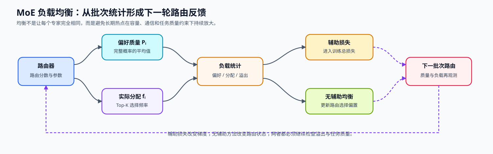
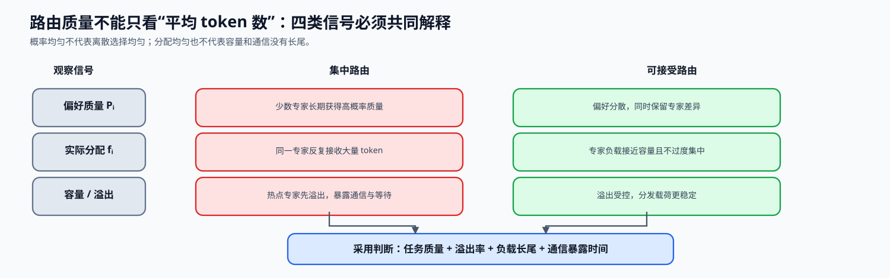

# 07. MoE Load Balancing Loss | MoE 负载均衡损失

**难度：** Hard | **环境：** CPU-first | **标签：** `模型结构`, `MoE`, `负载均衡` | **目标人群：** 模型结构学习者

> 🚀 **云端运行环境**
>
> 本章节的实战代码可以点击以下链接在免费 GPU 算力平台上直接运行：
>
> [](https://colab.research.google.com/github/datawhalechina/llm-algo-leetcode/blob/main/02_PyTorch_Algorithms/07_MoE_Load_Balancing_Loss.ipynb)
> [](https://modelscope.cn/my/mynotebook) *(国内推荐：魔搭社区免费实例)*


---

## 本节导读

上一节的路由器已经能把 token 分给 Top-K 专家，但训练过程中它可能很快学会“偏科”：大量 token 被送到少数几个专家，其他专家长期拿不到样本。这样 MoE 表面上有很多参数，实际却退化成少数专家过载、其余专家闲置。

负载均衡机制要把路由集中反馈给路由器：辅助损失通过梯度同时约束平均偏好与实际分配，无辅助路径则根据历史负载调整下一轮选择偏置。本节比较两条反馈路径，并追踪它们与容量溢出、训练质量和路由稳定性的关系。

**关键词：** `MoE`, `负载均衡`, `辅助损失`

---
## 前置阅读

**导语：** 先理解路由器如何保留完整概率、选择 Top-K 专家并完成重归一化；随后再从一个批次的角度比较“偏好”与“实际分配”。

- [06. MoE Router | MoE 路由器](../02_PyTorch_Algorithms/06_MoE_Router.md)
- 可选回看：[15. End-to-End Fine-Tuning Experiment | 端到端微调实验](../02_PyTorch_Algorithms/15_End_to_End_Fine_Tuning_Experiment.md)（需要回看辅助损失如何进入训练总损失时使用）

### Step 1：路由正确还不够——还要避免专家拥塞

Top-K 路由器可以为单个 token 选择专家，却不保证一个批次或多个训练更新步中的 token 会均匀分布。若多数 token 长期集中到少数专家，容量溢出、排队、跨卡通信和同步长尾都会放大；均衡机制需要把这种系统风险反馈给路由器。

| 观察层次 | 需要回答的问题 | 对应信号 |
|---|---|---|
| 单个 token | 它偏好哪些专家 | 完整概率与 Top-K 专家编号 |
| 一个批次 | 偏好和实际分配是否集中 | `P_i`、`f_i`、专家计数 |
| 多个 step | 热点是否持续、是否振荡 | 移动统计、路由偏置变化 |
| 系统执行 | 哪些专家先触及容量 | 专家容量、容量溢出、等待与通信载荷 |



### Step 2：用偏好、派发与容量三类分布观察路由

负载均衡至少需要同时看三类量：`P_i` 是路由器给专家 $i$ 的平均概率质量，`f_i` 是专家实际被 Top-K 选中的比例，专家容量与容量溢出则说明执行阶段是否还能接收这些 token。只看其中一项可能掩盖“概率看似均匀、离散选择却集中”或“分配尚可、容量配置仍不足”的问题。

| 量 | 来源 | 回答的问题 |
|---|---|---|
| $P_i$ | 全部专家概率的 token 均值 | 路由器的平均偏好是否集中 |
| $f_i$ | Top-K 专家编号的出现次数 | 实际分配是否集中 |
| 容量利用率 | 已接纳数量 / 专家容量 | 专家槽位利用是否均衡 |
| 溢出率 | 超容量分配 | 是否需要重路由、丢弃或扩容 |



### Step 3：辅助损失与无辅助均衡的不同反馈路径

经典辅助损失把平均偏好 $P_i$ 与实际分配 $f_i$ 放入训练目标：偏好和派发同时集中时惩罚增大。它直接影响梯度，因此系数过大可能干扰主任务。另一类无辅助均衡方法不把额外项加入主损失，而是根据历史负载动态调整专家选择偏置；这减少了损失耦合，但引入了额外状态、更新节奏和稳定性问题。容量回退只保护当前批次可执行，不能替代长期均衡。

$$
P_i=\frac{1}{T}\sum_t p_{t,i},\qquad
f_i=\frac{1}{TK}\sum_t\mathbf{1}_{i\in\operatorname{TopK}(p_t)},\qquad
L_{balance}=\alpha E\sum_i f_iP_i.
$$

| 路径 | 反馈进入哪里 | 优点 | 需要警惕 |
|---|---|---|---|
| 辅助损失 | 训练总损失与梯度 | 机制直接、统计清晰 | 系数影响主任务，均衡不等于语义路由正确 |
| 无辅助均衡 | 路由选择偏置或控制状态 | 不直接改写主任务损失 | 偏置更新可能振荡，仍需监测容量溢出与质量 |
| 容量回退 | 执行阶段重路由或丢弃 | 保护单步可执行性 | 不能替代长期路由训练 |

### Step 4：代码设计与批次级负载均衡损失

本题先用完整概率和 Top-K 索引计算 `P_i`、`f_i` 与辅助损失，再用专家计数完成一步无辅助偏置更新。两个函数共享负载统计，但分别作用于训练损失与下一轮路由偏置。

| TODO / 函数 | 学习者完成的机制 | 必须满足的约束 | 测试证据 |
|---|---|---|---|
| TODO 1 · `compute_load_balancing_loss` | 汇总每个专家的平均路由概率 `P_i` | 从完整概率沿 token 维取平均 | `P_i` 总和为 1 |
| TODO 2 · `compute_load_balancing_loss` | 统计每个专家的实际分配比例 `f_i` | 按 Top-K 索引计数并按总分配数归一化 | `f_i` 总和为 1；集中路由可识别 |
| TODO 3 · `compute_load_balancing_loss` | 计算辅助均衡损失 | 使用同一专家维度的 `P_i` 与 `f_i` | 均匀路由低于集中路由 |
| TODO 4 · `update_router_bias` | 根据负载误差更新专家偏置 | 过载专家降低偏置，欠载专家提高偏置 | 均衡负载不变；更新方向正确 |

```python
import torch
import torch.nn.functional as F

```


```python
def compute_load_balancing_loss(
    router_probs: torch.Tensor,
    selected_experts: torch.Tensor,
    num_experts: int,
    top_k: int,
    alpha: float = 0.01,
    return_stats: bool = False,
):
    """计算 Top-K MoE 的 batch 级负载均衡辅助损失。"""
    if router_probs.ndim != 2 or selected_experts.ndim != 2:
        raise ValueError('router_probs 与 selected_experts 都必须是二维张量')
    total_tokens, probability_experts = router_probs.shape
    if total_tokens == 0 or probability_experts != num_experts:
        raise ValueError('router_probs 的 token 数与专家维必须有效')
    if selected_experts.shape != (total_tokens, top_k):
        raise ValueError('selected_experts 必须是 [tokens, top_k]')
    if not 0 < top_k <= num_experts:
        raise ValueError('top_k 必须在 1 到 num_experts 之间')
    if selected_experts.dtype != torch.long:
        raise ValueError('selected_experts 必须为 torch.long')
    if torch.any((selected_experts < 0) | (selected_experts >= num_experts)):
        raise ValueError('selected_experts 含越界专家索引')

    # ==========================================
    # TODO 1：计算每个专家的平均路由概率 P_i。
    # ==========================================
    # P_i = ???
    raise NotImplementedError('TODO 1：请汇总完整概率分布')

    # ==========================================
    # TODO 2：计算每个专家的实际分配比例 f_i。
    # ==========================================
    # expert_mask = ???
    # tokens_per_expert = ???
    # f_i = ???
    raise NotImplementedError('TODO 2：请统计 Top-K 分配比例')

    # ==========================================
    # TODO 3：计算负载均衡辅助损失。
    # ==========================================
    # aux_loss = ???
    raise NotImplementedError('TODO 3：请计算辅助损失')
    return (aux_loss, P_i, f_i) if return_stats else aux_loss


def update_router_bias(
    expert_counts: torch.Tensor, router_bias: torch.Tensor, step_size: float
) -> tuple[torch.Tensor, torch.Tensor]:
    """根据本轮专家负载执行一步无辅助路由偏置更新。"""
    if expert_counts.ndim != 1 or router_bias.shape != expert_counts.shape:
        raise ValueError('expert_counts 与 router_bias 必须是一维同形张量')
    if torch.any(expert_counts < 0) or step_size <= 0:
        raise ValueError('专家计数不能为负，step_size 必须为正数')

    # ==========================================
    # TODO 4：计算相对平均负载误差，并沿抵消拥塞的方向更新偏置。
    # ==========================================
    # load_error = ???
    # updated_bias = ???
    raise NotImplementedError('TODO 4：请完成无辅助偏置反馈')
    return updated_bias, load_error
```


```python
# 测试设计：分别验证均匀、集中、偏好/派发错配和输入契约。
# 每个测试对应一类 batch 级路由现象，避免把所有判断混在单一大测试中。


def test_uniform_routing_statistics():
    """均匀偏好与均匀分配应得到理论基线损失。"""
    num_experts, top_k, num_tokens, alpha = 8, 2, 80, 0.01
    selected = torch.tensor(
        [[(2 * i) % num_experts, (2 * i + 1) % num_experts] for i in range(num_tokens)],
        dtype=torch.long,
    )
    probs = torch.full((num_tokens, num_experts), 1 / num_experts)
    loss, P_i, f_i = compute_load_balancing_loss(probs, selected, num_experts, top_k, alpha, True)
    assert torch.allclose(P_i, torch.full((num_experts,), 1 / num_experts))
    assert torch.allclose(f_i, torch.full((num_experts,), 1 / num_experts))
    assert torch.allclose(loss, torch.tensor(alpha), atol=1e-6)


def test_concentrated_routing_has_larger_penalty():
    """集中到少数专家的路由应产生更大的均衡惩罚。"""
    num_experts, top_k, num_tokens, alpha = 8, 2, 80, 0.01
    selected = torch.tensor([[0, 1]] * num_tokens, dtype=torch.long)
    probs = torch.zeros(num_tokens, num_experts)
    probs[:, :2] = 0.5
    concentrated = compute_load_balancing_loss(probs, selected, num_experts, top_k, alpha)
    uniform = torch.tensor(alpha)
    assert concentrated > uniform * 2


def test_preference_and_dispatch_can_differ():
    """概率偏好均匀时，离散分配仍可能集中。"""
    num_experts, top_k, num_tokens = 8, 2, 40
    probs = torch.full((num_tokens, num_experts), 1 / num_experts)
    selected = torch.tensor([[0, 1]] * num_tokens, dtype=torch.long)
    _, P_i, f_i = compute_load_balancing_loss(probs, selected, num_experts, top_k, return_stats=True)
    assert torch.allclose(P_i, torch.full((num_experts,), 1 / num_experts))
    assert torch.allclose(f_i[:2], torch.tensor([0.5, 0.5]))
    assert torch.allclose(f_i[2:], torch.zeros(num_experts - 2))


def test_bias_feedback_moves_away_from_overloaded_experts():
    """过载专家偏置应降低，欠载专家偏置应提高。"""
    counts = torch.tensor([8.0, 4.0, 2.0, 2.0])
    bias = torch.zeros(4)
    updated, error = update_router_bias(counts, bias, step_size=0.1)
    assert error[0] > 0 and updated[0] < 0
    assert error[2] < 0 and updated[2] > 0
    balanced, balanced_error = update_router_bias(torch.ones(4), bias, step_size=0.1)
    assert torch.allclose(balanced, bias)
    assert torch.allclose(balanced_error, torch.zeros(4))


def test_load_balance_input_contract():
    """形状、类型、索引和 Top-K 非法时必须拒绝输入。"""
    probs = torch.full((4, 4), 0.25)
    selected = torch.tensor([[0, 1]] * 4, dtype=torch.long)
    invalid_cases = [
        (probs[:, :3], selected, 4, 2),
        (probs, selected.float(), 4, 2),
        (probs, torch.tensor([[0, 4]] * 4), 4, 2),
        (probs, selected, 4, 0),
    ]
    for args in invalid_cases:
        try:
            compute_load_balancing_loss(*args)
        except ValueError:
            continue
        raise AssertionError('非法路由输入应被拒绝')


def run_load_balance_tests():
    """运行负载统计、辅助损失和偏置反馈的全部测试。"""
    test_uniform_routing_statistics()
    test_concentrated_routing_has_larger_penalty()
    test_preference_and_dispatch_can_differ()
    test_bias_feedback_moves_away_from_overloaded_experts()
    test_load_balance_input_contract()
    print('✅ 负载均衡：辅助损失、偏置反馈与输入契约测试通过')


try:
    run_load_balance_tests()
except NotImplementedError:
    print('请先完成 TODO 1–4，再运行测试。')
    raise
```

🛑 **STOP HERE** 🛑

请先独立完成 TODO 1–4 并通过测试，再展开参考代码与解析。

## 参考代码与解析

### 代码


```python
def compute_load_balancing_loss(
    router_probs: torch.Tensor,
    selected_experts: torch.Tensor,
    num_experts: int,
    top_k: int,
    alpha: float = 0.01,
    return_stats: bool = False,
):
    """计算 Top-K MoE 的 batch 级负载均衡辅助损失。"""
    if router_probs.ndim != 2 or selected_experts.ndim != 2:
        raise ValueError('router_probs 与 selected_experts 都必须是二维张量')
    total_tokens, probability_experts = router_probs.shape
    if total_tokens == 0 or probability_experts != num_experts:
        raise ValueError('router_probs 的 token 数与专家维必须有效')
    if selected_experts.shape != (total_tokens, top_k):
        raise ValueError('selected_experts 必须是 [tokens, top_k]')
    if not 0 < top_k <= num_experts:
        raise ValueError('top_k 必须在 1 到 num_experts 之间')
    if selected_experts.dtype != torch.long:
        raise ValueError('selected_experts 必须为 torch.long')
    if torch.any((selected_experts < 0) | (selected_experts >= num_experts)):
        raise ValueError('selected_experts 含越界专家索引')

    # ==========================================
    # TODO 1：计算每个专家的平均路由概率 P_i。
    # ==========================================
    # P_i = ???
    P_i = router_probs.mean(dim=0)

    # ==========================================
    # TODO 2：计算每个专家的实际分配比例 f_i。
    # ==========================================
    # expert_mask = ???
    # tokens_per_expert = ???
    # f_i = ???
    expert_mask = F.one_hot(selected_experts, num_classes=num_experts)
    tokens_per_expert = expert_mask.sum(dim=(0, 1)).float()
    f_i = tokens_per_expert / (total_tokens * top_k)

    # ==========================================
    # TODO 3：计算负载均衡辅助损失。
    # ==========================================
    # aux_loss = ???
    aux_loss = alpha * num_experts * (f_i * P_i).sum()
    return (aux_loss, P_i, f_i) if return_stats else aux_loss


def update_router_bias(
    expert_counts: torch.Tensor, router_bias: torch.Tensor, step_size: float
) -> tuple[torch.Tensor, torch.Tensor]:
    """根据本轮专家负载执行一步无辅助路由偏置更新。"""
    if expert_counts.ndim != 1 or router_bias.shape != expert_counts.shape:
        raise ValueError('expert_counts 与 router_bias 必须是一维同形张量')
    if torch.any(expert_counts < 0) or step_size <= 0:
        raise ValueError('专家计数不能为负，step_size 必须为正数')

    # ==========================================
    # TODO 4：计算相对平均负载误差，并沿抵消拥塞的方向更新偏置。
    # ==========================================
    # load_error = ???
    # updated_bias = ???
    mean_load = expert_counts.float().mean()
    load_error = (expert_counts.float() - mean_load) / mean_load.clamp_min(1.0)
    updated_bias = router_bias - step_size * load_error.to(router_bias.dtype)
    return updated_bias, load_error
```

### 解析

#### TODO 1：统计平均路由偏好

- 判断依据：$P_i$ 来自完整概率，所有专家的偏好质量之和应为 1。
- 实现动作：沿 token 维求均值；`test_uniform_routing_statistics` 检查均匀分布。

#### TODO 2：统计实际专家分配

- 判断依据：$f_i$ 按 `tokens × top_k` 次选择归一化，不能用概率质量替代。
- 实现动作：把专家索引转为计数后归一化；`test_preference_and_dispatch_can_differ` 验证偏好与分配可以不同。

#### TODO 3：计算辅助均衡损失

- 判断依据：均匀偏好与均匀分配的基线为 $\alpha$，集中路由应获得更大惩罚。
- 实现动作：对同一专家维的 $P_i f_i$ 求和并乘尺度；两个路由测试检查基线和集中情况。

#### TODO 4：更新无辅助路由偏置

- 判断依据：过载专家偏置下降，欠载专家偏置上升，均衡负载不变化。
- 实现动作：以平均负载归一化误差并沿反方向更新；`test_bias_feedback_moves_away_from_overloaded_experts` 检查方向。

## 相关阅读

负载均衡将路由器的统计量连接到专家并行中的容量与通信问题；下列材料分别用于核对公式、真实模型和项目级证据。

- [Switch Transformers 原论文](https://arxiv.org/abs/2101.03961)
- [Mixtral 模型实现说明](https://huggingface.co/docs/transformers/main/en/model_doc/mixtral)
- [80. MoE 专家并行基准](../02_PyTorch_Algorithms/80_MoE_Expert_Parallel_Benchmark.md)
- [P1: 通信拓扑与分布式基石](../01_Hardware_Math_and_Systems/05_Communication_Topologies.md)
