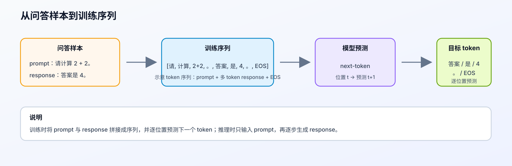
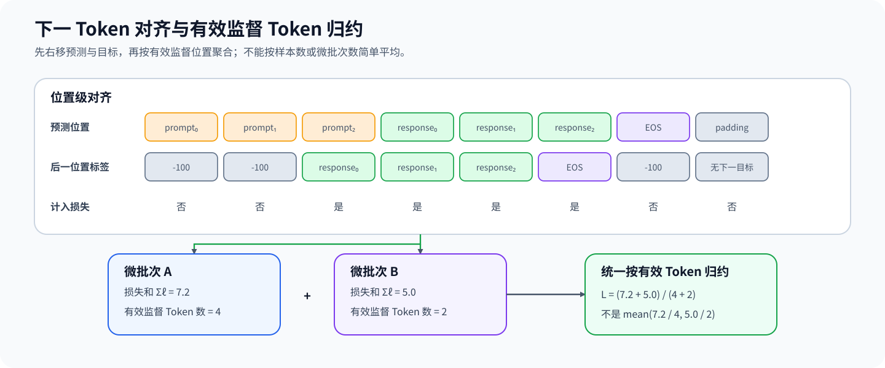

# 13. SFT Training Loop | 监督微调训练循环

**难度：** Medium | **环境：** CPU-first | **标签：** `训练微调`, `SFT`, `训练循环` | **目标人群：** 训练机制学习者

> 🚀 **云端运行环境**
>
> 本章节的实战代码可以点击以下链接在免费 GPU 算力平台上直接运行：
>
> [](https://colab.research.google.com/github/datawhalechina/llm-algo-leetcode/blob/main/02_PyTorch_Algorithms/13_SFT_Training_Loop.ipynb)
> [](https://modelscope.cn/my/mynotebook) *(国内推荐：魔搭社区免费实例)*


---

## 本节导读

把模型结构写出来以后，下一步就是让它按监督数据学习回答。微调（fine-tuning）是继续训练预训练模型以适应下游任务的总称，监督微调（supervised fine-tuning，SFT）使用 prompt-response 标注数据建立输入与回答之间的监督关系。SFT 最容易出错的地方不在优化器，而在监督位置与损失口径：模型输入通常是 `[prompt + response]`，真正应该学习的是 response，而不是让模型复述 prompt。

本节从一条样本进入训练开始，依次确定对话模板、prompt 与 response 的监督边界、下一个 token 的预测对齐，以及变长样本下的损失分母。完成后，你应该能判断哪些位置提供监督、损失如何对齐，以及为什么不同长度样本应按有效监督 token 数聚合。

**关键词：** `SFT`, `chat template`, `label masking`, `next-token prediction`, `effective tokens`

---
## 前置阅读

**导语：** 先理解损失函数和最小训练生命周期，再观察 SFT 如何限定监督位置。

- [P0: 11. PyTorch Optimizers and Loss | PyTorch 优化器与损失](../00_Prerequisites/11_PyTorch_Optimizers_and_Loss.md)
- [P0: 12. PyTorch Data Interface and Training Lifecycle | 数据接口与训练生命周期](../00_Prerequisites/12_PyTorch_Minimal_Training_Interface.md)

---
### Step 1：一条 SFT 样本如何变成下一个 token 预测

SFT 用“输入—回答”样本继续训练预训练模型。它与语言模型预训练共享 next-token prediction 和反向传播链路，但两者的数据来源、监督范围与训练目标并不相同。真实对话样本还要先经过模型约定的对话模板：训练序列包含 assistant 回答，推理输入则停在 assistant 起始提示处。模板、分词器和监督边界必须来自同一个模型契约，否则监督位置可能发生偏移。

| 对比项 | 语言模型预训练 | 监督微调（SFT） |
| --- | --- | --- |
| 常见起点 | 随机初始化或中间 checkpoint | 预训练模型 |
| 数据形态 | 连续文本或文档语料 | prompt-response / 对话样本 |
| 训练目标 | 学习通用语言分布 | 学习指令遵循与回答行为 |
| 监督范围 | 通常覆盖全部非 padding token | 通常只覆盖 response 与可选 EOS |
| 有效监督位置 | 正文中的非填充位置 | 回答与可选结束标记所在位置 |
| 共同机制 | next-token cross entropy、反向传播和参数更新 | next-token cross entropy、反向传播和参数更新 |



### Step 2：上下文、回答与填充位置承担什么角色

模板化序列同时包含上下文、回答、可选结束标记和填充位置。上下文帮助模型理解任务，但通常不作为 SFT 的目标；回答和结束标记提供监督；填充只负责让不同长度样本组成一批数据。assistant 起点必须从模板化序列中确定，不能用固定字符长度猜测。

| 位置 | 0 | 1 | 2 | 3 | 4 | 5 | 6 | 7 | 8 |
|:---|:---:|:---:|:---:|:---:|:---:|:---:|:---:|:---:|:---:|
| 语义 | prompt | prompt | prompt | response | response | response | response | EOS | padding |
| 是否提供上下文 | 是 | 是 | 是 | 是 | 是 | 是 | 是 | 是 | 否 |
| 是否提供监督 | 否 | 否 | 否 | 是 | 是 | 是 | 是 | 是 | 否 |

### Step 3：从监督位置得到有效 token 平均损失

模型在位置 $t$ 根据当前及更早的上下文预测位置 $t+1$。SFT 只从回答和可选结束标记对应的预测中收集损失；上下文与填充位置不贡献监督。一个 batch 的损失应先累加全部有效监督位置，再除以有效监督 token 数，而不是让长短样本或微批次获得不受控制的权重。

$$
L_{\text{batch}} = \frac{\sum_{i \in \mathcal{V}} \ell_i}{|\mathcal{V}|}, \qquad \mathcal{V}=\{i \mid i \text{ 是有效回答目标}\}
$$

| 预测位置 | 0 | 1 | 2 | 3 | 4 | 5 | 6 | 7 |
|:---|:---:|:---:|:---:|:---:|:---:|:---:|:---:|:---:|
| 下一 token 角色 | prompt | prompt | response | response | response | response | EOS | padding |
| 是否计入损失 | 否 | 否 | 是 | 是 | 是 | 是 | 是 | 否 |



### Step 4：实现监督边界与 token 加权损失

题目区从 chat template 与 tokenizer 已经给出的 prompt/response token 边界开始：先用 `build_sft_data` 构造右侧 padding 的三件套，再由 `compute_sft_loss_terms` 暴露损失总和与有效 token 数，最后由 `compute_sft_loss` 得到 batch 平均损失。这样既能检查监督边界，也能验证变长样本下的损失分母；模板格式本身由 tokenizer 的模型契约负责，不在代码里手写另一套控制 token。

| TODO / 函数 | 学习者完成的机制 | 必须满足的约束 | 测试证据 |
| --- | --- | --- | --- |
| TODO 1：建立监督边界<br>`build_sft_data` | 构造截断后的监督标签并统计有效监督量 | prompt 为 `-100`，response / EOS 保留；监督量不足时拒绝样本 | `_assert_sft_data_contract`、`_assert_truncation_guard` |
| TODO 2：同步右侧填充<br>`build_sft_data` | 为输入、有效位置和监督目标追加对应填充值 | 三个序列等长，padding 不参与注意力与监督 | `_assert_sft_data_contract` 的变长与填充用例 |
| TODO 3：对齐预测与目标<br>`compute_sft_loss_terms` | 将预测位置与后一位置的目标对齐 | 位移后仍保持 batch、序列和词表维度契约 | `_assert_loss_alignment`、`_assert_supervision_scope` |
| TODO 4：按有效 token 归约<br>`compute_sft_loss` | 用损失总和与有效监督量得到 batch 损失 | 不按样本数或微批次数等权平均 | `_assert_effective_token_reduction` |


```python
import torch
import torch.nn as nn
```


```python
# 题目设计：先确定监督边界，再显式计算有效 token 的损失总和与分母。
# 四个 TODO 分别覆盖标签、padding、next-token 对齐和 token 加权聚合。
def build_sft_data(
    prompt_ids: list[int],
    response_ids: list[int],
    pad_id: int = 0,
    eos_id: int | None = None,
    max_len: int = 16,
    min_response_tokens: int = 1,
):
    """构造一条右侧 padding 的 SFT 样本。

    参数：prompt_ids / response_ids 为 token id 列表；pad_id 和 eos_id
    分别指定 padding 与可选 EOS；max_len 是输出固定长度；
    min_response_tokens 是截断后必须保留的监督 token 数。

    返回三个长度为 max_len 的 torch.long 张量：input_ids、
    attention_mask 和 labels；labels 中的 -100 不参与交叉熵。
    截断后有效监督 token 不足时抛出 ValueError。
    """
    response_with_eos = response_ids + ([] if eos_id is None else [eos_id])
    input_ids = (prompt_ids + response_with_eos)[:max_len]

    # ==========================================
    # TODO 1：建立截断后的监督边界
    # ==========================================
    # labels = ???  # 与 input_ids 等长；prompt 忽略，response / EOS 保留目标 token。
    # valid_supervised = ???  # 截断后仍参与监督的 token 数。
    raise NotImplementedError("TODO 1：建立监督边界并统计有效监督 token")
    if valid_supervised < min_response_tokens:
        raise ValueError("截断后没有足够的 response token 参与监督")

    attention_mask = [1] * len(input_ids)
    pad_len = max_len - len(input_ids)
    # ==========================================
    # TODO 2：同步追加右侧填充值
    # ==========================================
    # padded_input_ids = ???  # 真实 token 后追加 pad_id。
    # padded_attention_mask = ???  # 真实位置为 1，padding 位置为 0。
    # padded_labels = ???  # padding 位置必须忽略监督。
    raise NotImplementedError("TODO 2：同步填充输入、有效位置与监督目标")

    return (
        torch.tensor(padded_input_ids, dtype=torch.long),
        torch.tensor(padded_attention_mask, dtype=torch.long),
        torch.tensor(padded_labels, dtype=torch.long),
    )


def compute_sft_loss_terms(
    logits: torch.Tensor,
    labels: torch.Tensor,
    attention_mask: torch.Tensor | None = None,
):
    """返回有效监督位置的损失总和与 token 数。

    logits 的形状为 [batch_size, seq_len, vocab_size]；labels 和
    attention_mask 的形状为 [batch_size, seq_len]。没有有效监督
    token 时抛出 ValueError。
    """
    # ==========================================
    # TODO 3：完成 next-token 对齐
    # ==========================================
    # shift_logits = ???  # 去掉最后一个预测位置。
    # shift_labels = ???  # 去掉第一个目标位置。
    raise NotImplementedError("TODO 3：对齐预测与目标")

    if attention_mask is not None:
        shift_attention_mask = attention_mask[..., 1:].contiguous()
        shift_labels = shift_labels.masked_fill(shift_attention_mask == 0, -100)
    valid_token_count = (shift_labels != -100).sum()
    if valid_token_count.item() == 0:
        raise ValueError("当前 batch 没有有效监督 token")

    # 骨架负责逐位置交叉熵；ignore_index 对应的位置贡献为 0。
    token_losses = nn.functional.cross_entropy(
        shift_logits.reshape(-1, shift_logits.size(-1)),
        shift_labels.reshape(-1),
        ignore_index=-100,
        reduction="none",
    )
    loss_sum = token_losses.sum()
    return loss_sum, valid_token_count


def compute_sft_loss(logits: torch.Tensor, labels: torch.Tensor, attention_mask: torch.Tensor | None = None):
    """按有效监督 token 数归一化并返回 batch 平均损失。"""
    loss_sum, valid_token_count = compute_sft_loss_terms(logits, labels, attention_mask)

    # ==========================================
    # TODO 4：按有效监督 token 归约损失
    # ==========================================
    # mean_loss = ???  # loss_sum 除以 valid_token_count。
    raise NotImplementedError("TODO 4：按有效监督 token 数归一化损失")
    return mean_loss

```


```python
# 测试设计：分别验证数据契约、监督边界、next-token 对齐与有效 token 分母。
# 最后一项使用长短样本对照，检查完整 batch 与按 token 加权的分批结果一致。
def _build_sft_test_case():
    """构造可重复的 CPU-first SFT 测试样本。"""
    prompt = [10, 20, 30]
    response = [40, 50, 60, 70]
    pad_id, eos_id, max_len = 0, 2, 9
    tensors = build_sft_data(prompt, response, pad_id, eos_id, max_len)
    return tensors, prompt, pad_id, eos_id, max_len

def _assert_sft_data_contract(tensors):
    """验证 input_ids、attention_mask 和 labels 的结构契约。"""
    input_ids, attention_mask, labels = tensors
    assert input_ids.tolist() == [10, 20, 30, 40, 50, 60, 70, 2, 0], "Input IDs 构造错误！"
    assert attention_mask.tolist() == [1, 1, 1, 1, 1, 1, 1, 1, 0], "attention_mask 构造错误！"
    assert labels.tolist() == [-100, -100, -100, 40, 50, 60, 70, 2, -100], "Labels 构造或 Padding 错误！"

def _assert_truncation_guard(prompt, pad_id, eos_id):
    """验证截断后不能丢失全部有效 response 监督。"""
    try:
        build_sft_data(prompt, [40], pad_id=pad_id, eos_id=eos_id, max_len=3)
    except ValueError:
        return
    raise AssertionError("截断后没有 response token 时应该报错")

def _make_aligned_logits(labels, max_len):
    """构造一个只在有效 response 位置预测正确的 logits。"""
    torch.manual_seed(42)
    logits = torch.randn(1, max_len, 100)
    for position, target in [(2, 40), (3, 50), (4, 60), (5, 70), (6, 2)]:
        logits[0, position, target] = 50.0
    return logits

def _assert_loss_alignment(tensors, max_len):
    """验证 shift 后的 logits、labels 与 attention_mask 对齐。"""
    input_ids, attention_mask, labels = tensors
    logits = _make_aligned_logits(labels, max_len)
    loss = compute_sft_loss(logits, labels.unsqueeze(0), attention_mask.unsqueeze(0))
    assert loss.item() < 0.01, f"Loss 异常偏大，可能包含了 Prompt 或 Padding 的计算！Loss = {loss.item()}"
    return logits, labels.unsqueeze(0), attention_mask.unsqueeze(0)

def _assert_supervision_scope(logits, labels_batch, attention_batch):
    """验证 prompt 不监督、response 受监督、padding 被屏蔽。"""
    neutral_logits = torch.zeros_like(logits)
    neutral_loss = compute_sft_loss(neutral_logits, labels_batch, attention_batch)

    prompt_candidate = neutral_logits.clone()
    prompt_candidate[0, 0, 99] = 50.0
    prompt_loss = compute_sft_loss(prompt_candidate, labels_batch, attention_batch)
    assert torch.allclose(prompt_loss, neutral_loss), "Prompt 位置不应参与 loss"

    response_candidate = neutral_logits.clone()
    response_candidate[0, 2, 40] = 10.0
    response_loss = compute_sft_loss(response_candidate, labels_batch, attention_batch)
    assert response_loss < neutral_loss, "response 目标位置没有参与 loss"

    labels_with_pad_target = labels_batch.clone()
    labels_with_pad_target[0, -1] = 99
    protected_loss = compute_sft_loss(neutral_logits, labels_with_pad_target, attention_batch)
    assert torch.allclose(protected_loss, neutral_loss), "padding 目标没有被 attention_mask 屏蔽"

def _assert_effective_token_reduction():
    """变长样本必须按有效 token 数聚合损失与梯度。"""
    labels = torch.tensor([
        [-100, -100, 1, -100, -100],
        [-100, 2, 3, 4, -100],
    ])
    attention_mask = torch.ones_like(labels)
    base_logits = torch.zeros(2, 5, 7)
    base_logits[0, 1, 1] = 8.0  # 短样本的唯一监督位置预测较好。

    full_logits = base_logits.clone().requires_grad_(True)
    full_loss = compute_sft_loss(full_logits, labels, attention_mask)
    full_loss.backward()

    split_logits = base_logits.clone().requires_grad_(True)
    short_sum, short_count = compute_sft_loss_terms(
        split_logits[:1], labels[:1], attention_mask[:1]
    )
    long_sum, long_count = compute_sft_loss_terms(
        split_logits[1:], labels[1:], attention_mask[1:]
    )
    token_weighted_loss = (short_sum + long_sum) / (short_count + long_count)
    token_weighted_loss.backward()

    unweighted_micro_mean = 0.5 * (short_sum / short_count + long_sum / long_count)
    assert torch.allclose(full_loss, token_weighted_loss), "完整 batch 与 token 加权结果不一致"
    assert torch.allclose(full_logits.grad, split_logits.grad), "token 加权后的梯度尺度不一致"
    assert not torch.allclose(full_loss, unweighted_micro_mean), "变长样本不应等权平均 micro-batch mean"

def test_sft_pipeline():
    """运行 CPU-first 的 SFT 机制测试。"""
    try:
        tensors, prompt, pad_id, eos_id, max_len = _build_sft_test_case()
        _assert_sft_data_contract(tensors)
        _assert_truncation_guard(prompt, pad_id, eos_id)
        logits, labels_batch, attention_batch = _assert_loss_alignment(tensors, max_len)
        _assert_supervision_scope(logits, labels_batch, attention_batch)
        _assert_effective_token_reduction()

        print("✅ SFT 数据契约、监督边界与有效 token 聚合测试通过。")

    except NotImplementedError:
        print("请先完成 TODO 部分的代码！")
        raise
    except (AttributeError, NameError, TypeError, ValueError) as e:
        print("代码可能未完成，导致变量未定义" if isinstance(e, NameError) else "代码可能未完成，导致了类型错误")
        raise NotImplementedError("请先完成 TODO 部分的代码！") from e
    except AssertionError as e:
        print(f"❌ 测试失败: {e}")
        raise NotImplementedError("请先完成 TODO 部分的代码！") from e
    except Exception as e:
        print(f"❌ 发生异常: {e}")
        raise

test_sft_pipeline()

```

---

🛑 **STOP HERE** 🛑
<br><br><br><br><br><br><br><br><br><br>
> 请先尝试自己完成代码并跑通测试。<br>
> 如果你正在 Colab 中运行，并且遇到困难没有思路，可以向下滚动查看参考答案。
<br><br><br><br><br><br><br><br><br><br>

---
## 参考代码与解析

### 代码


```python
def build_sft_data(
    prompt_ids: list[int],
    response_ids: list[int],
    pad_id: int = 0,
    eos_id: int | None = None,
    max_len: int = 16,
    min_response_tokens: int = 1,
):
    """构造一条右侧 padding 的 SFT 样本。

    参数：prompt_ids / response_ids 为 token id 列表；pad_id 和 eos_id
    指定 padding 与可选 EOS；max_len 是输出固定长度；
    min_response_tokens 是截断后必须保留的监督 token 数。

    返回三个长度为 max_len 的 torch.long 张量；labels 中的 -100 不参与交叉熵。
    截断后有效监督 token 不足 min_response_tokens 时抛出 ValueError。
    """
    response_with_eos = response_ids + ([] if eos_id is None else [eos_id])
    input_ids = (prompt_ids + response_with_eos)[:max_len]

    # TODO 1：建立截断后的监督边界。
    labels = ([-100] * len(prompt_ids) + response_with_eos)[:max_len]
    valid_supervised = sum(label != -100 for label in labels)
    if valid_supervised < min_response_tokens:
        raise ValueError("截断后没有足够的 response token 参与监督，请调大 max_len 或过滤该样本。")

    # TODO 2：同步追加右侧填充值。
    attention_mask = [1] * len(input_ids)
    pad_len = max_len - len(input_ids)
    padded_input_ids = input_ids + [pad_id] * pad_len
    padded_attention_mask = attention_mask + [0] * pad_len
    padded_labels = labels + [-100] * pad_len

    return (
        torch.tensor(padded_input_ids, dtype=torch.long),
        torch.tensor(padded_attention_mask, dtype=torch.long),
        torch.tensor(padded_labels, dtype=torch.long),
    )


def compute_sft_loss_terms(
    logits: torch.Tensor,
    labels: torch.Tensor,
    attention_mask: torch.Tensor | None = None,
):
    """返回有效监督位置的损失总和与 token 数。"""
    # TODO 3：完成 next-token 对齐。
    shift_logits = logits[..., :-1, :].contiguous()
    shift_labels = labels[..., 1:].contiguous()

    if attention_mask is not None:
        shift_attention_mask = attention_mask[..., 1:].contiguous()
        shift_labels = shift_labels.masked_fill(shift_attention_mask == 0, -100)

    valid_token_count = (shift_labels != -100).sum()
    if valid_token_count.item() == 0:
        raise ValueError("当前 batch 没有有效监督 token，请检查 labels、padding 或截断策略。")

    token_losses = nn.functional.cross_entropy(
        shift_logits.reshape(-1, shift_logits.size(-1)),
        shift_labels.reshape(-1),
        ignore_index=-100,
        reduction="none",
    )
    loss_sum = token_losses.sum()
    return loss_sum, valid_token_count


def compute_sft_loss(logits: torch.Tensor, labels: torch.Tensor, attention_mask: torch.Tensor | None = None):
    """按有效监督 token 数归一化并返回 batch 平均损失。"""
    loss_sum, valid_token_count = compute_sft_loss_terms(logits, labels, attention_mask)

    # TODO 4：按有效监督 token 聚合损失。
    mean_loss = loss_sum / valid_token_count
    return mean_loss

```

### 解析

**TODO 1：构造监督标签**

- prompt 与 padding 写入 `-100`，response 与 EOS 保留 token id。
- `input_ids` 与 `labels` 使用同一截断范围；截断后没有有效监督 token 时直接拒绝样本。

**TODO 2：同步右侧填充**

- `input_ids`、`attention_mask` 与 `labels` 必须保持等长。
- `attention_mask` 控制模型是否读取 padding，`labels=-100` 控制该位置是否进入 loss。

**TODO 3：对齐 next-token 目标**

- `logits[..., :-1, :]` 预测 `labels[..., 1:]`。
- 骨架随后应用有效位置检查并统计监督 token，测试用手工结果验证对齐范围。

**TODO 4：按有效 Token 聚合**

- 先累加各微批次的损失总和与有效 Token 数，再统一相除。
- 测试比较完整 batch 与变长微批次，确认二者得到相同的 token 加权损失和梯度。

## 相关阅读


- [14. LoRA Tutorial | LoRA 教程](../02_PyTorch_Algorithms/14_LoRA_Tutorial.md)
- [15. End-to-End Fine-Tuning Experiment | 端到端微调实验](../02_PyTorch_Algorithms/15_End_to_End_Fine_Tuning_Experiment.md)
- [P0: 17. PyTorch Profiling Basics | PyTorch 性能剖析基础](../00_Prerequisites/17_PyTorch_Profiling_Basics.md)
- [P0: 18. Memory Profiling and Optimization | 显存剖析与优化](../00_Prerequisites/18_Memory_Profiling_and_Optimization.md)
- [Hugging Face TRL SFTTrainer](https://huggingface.co/docs/trl/sft_trainer)
- [PyTorch CrossEntropyLoss](https://pytorch.org/docs/stable/generated/torch.nn.CrossEntropyLoss.html)