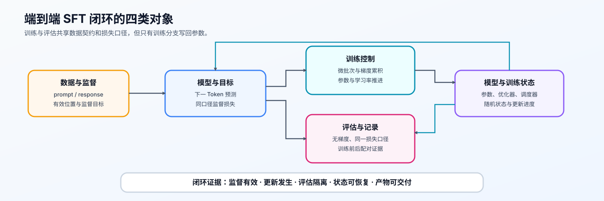
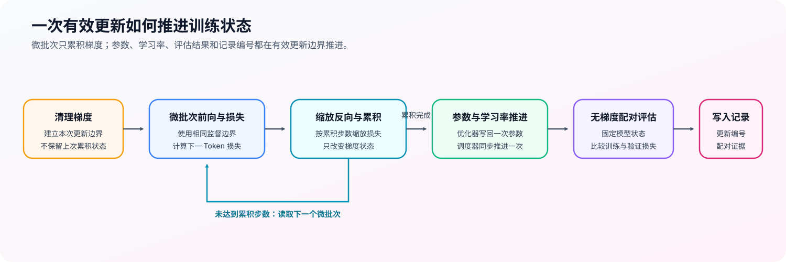

# 15. End to End Fine Tuning Experiment | 端到端微调实验

**难度：** Medium | **环境：** CPU-first / GPU optional | **标签：** `SFT`, `训练闭环`, `训练控制` | **目标人群：** 已完成训练组件学习的实践者

> 🚀 **云端运行环境**
>
> 本章节的实战代码可以点击以下链接在免费 GPU 算力平台上直接运行：
>
> [](https://colab.research.google.com/github/datawhalechina/llm-algo-leetcode/blob/main/02_PyTorch_Algorithms/15_End_to_End_Fine_Tuning_Experiment.ipynb)
> [](https://modelscope.cn/my/mynotebook) *(国内推荐：魔搭社区免费实例)*


---

## 本节导读

数据、监督标签、next-token loss、梯度累积和参数更新分别正确，并不自动意味着训练闭环已经接通。只要其中一个接口的张量语义或更新时机不一致，训练就可能出现 loss 不降、监督位置错位，或者代码能运行但参数没有按预期学习。

本节用一个可快速运行的最小语言模型，把 SFT batch、统一 loss、评估和有效参数更新连接为同一条链路。CPU 部分验证接口与更新语义；可选 GPU 实验再用固定真实模型与指令数据验证有效更新、资源记录和训练产物。
## 前置阅读

**导语：** 先理解监督 token 如何构造、一次有效更新何时发生，再把这些接口接入端到端训练循环。

- [13. SFT Training Loop | 监督微调训练循环](../02_PyTorch_Algorithms/13_SFT_Training_Loop.md)
- [12. Optimizer Updates and Learning Rate Scheduling | 优化器更新与学习率调度](../02_PyTorch_Algorithms/12_Optimizer_Updates_and_Learning_Rate_Scheduling.md)
- [11. Gradient Accumulation | 梯度累积](../02_PyTorch_Algorithms/11_Gradient_Accumulation.md)

---
### Step 1：端到端 SFT 闭环由哪些对象组成

SFT 训练把 prompt / response 转成带监督边界的 token 序列，经模型预测、next-token loss、反向传播和有效参数更新形成闭环。训练控制决定哪些微批次共同形成一次更新；评估复用同一损失口径，才可以比较训练前后的状态。

| 对象 | 输入与输出 | 在闭环中的作用 |
|:---|:---|:---|
| 数据与监督 | prompt / response → 序列、有效位置与监督目标 | 确定哪些 token 参与学习 |
| 模型与目标 | 一批序列 → 下一 token 预测损失 | 建立预测与监督之间的梯度信号 |
| 训练控制 | 微批次 → 有效批次 → 参数更新 | 决定何时写回参数与推进学习率 |
| 评估与记录 | 训练 / 验证数据 → 同口径损失 | 检查训练链路是否连通 |


### Step 2：运行后应如何判断闭环是否接通

最小实验不追求代表性任务指标，而是依次检查数据、监督、更新和评估是否使用一致口径。重复样本可让 loss 快速下降，适合验证训练链路；正式任务仍需独立验证集、任务指标与样例回归。

| 观察对象 | 正常现象 | 对应的训练连接 |
|:---|:---|:---|
| 序列与监督边界 | 上下文、回答和填充位置角色明确 | 数据进入正确监督位置 |
| 下一 token 目标 | 对齐后仍有有效回答目标 | 预测与监督关系成立 |
| 参数与优化状态 | 有效更新后参数变化、优化状态建立 | 反向传播与参数写回已经接通 |
| 训练与验证记录 | 同一损失口径形成连续记录 | 训练、评估与报告没有断开 |
### Step 3：训练状态如何跨更新边界衔接

一次训练更新要让数据、监督、评估和参数写回使用同一口径：样本先形成可监督的 batch，模型输出再按 next-token 对齐计算 loss；评估复用这一 loss，全部 micro-batch 的梯度累积完成后才写回参数。这样训练记录中的每个数值都能追溯到同一条数据流。

| 训练状态 | 负责的机制 | 与下一步的连接 |
|:---|:---|:---|
| 可监督数据 | 上下文不监督，回答与结束标记提供目标，填充被忽略 | 进入模型并确定预测目标 |
| 统一损失 | 下一 token 预测与有效目标范围 | 为反向传播和评估提供同一标量口径 |
| 评估状态 | 暂停梯度记录并复用相同目标 | 生成训练前后可比较的数值 |
| 有效更新与记录 | 梯度累积、参数写回、学习率推进与过程记录 | 将一次逻辑更新写入报告 |
| 恢复状态 | 模型、优化器、调度器、随机状态与更新进度 | 从同一更新边界继续，而不是只恢复模型权重 |
| 交付产物 | 模型或适配器、分词器、对话模板与产物清单 | 让后续训练阶段重建相同输入与模型语义 |


### Step 4：实现并验证最小 SFT 闭环

题目区按训练数据流保留四项机制责任：构造监督标签、对齐 next-token loss、以无梯度模式评估、在一次有效更新中累积梯度并记录评估点。模型结构、batch 切片、报告字段和调度器调用顺序由骨架提供。

| TODO / 函数 | 学习者完成的机制 | 必须满足的约束 | 测试证据 |
|:---|:---|:---|:---|
| TODO 1：构造监督标签<br>`build_sft_batch` | 构造 response / EOS 的监督标签 | prompt 与 padding 为 `-100`，截断后仍有目标 token | `_assert_sft_batch_contract` |
| TODO 2：对齐预测与目标<br>`compute_sft_loss` | 错开预测位置与下一 token 目标 | 忽略无效目标位置并保持标量 loss 口径 | `_assert_next_token_loss` |
| TODO 3：保持评估状态隔离<br>`evaluate_loss` | 无梯度评估并恢复调用前模式 | 复用训练损失，返回后不污染模型状态 | `_assert_evaluation_state` |
| TODO 4：缩放微批次损失<br>`run_finetuning_experiment` | 按累积步数缩放并反向传播 | 每个逻辑 batch 只更新一次 | `_assert_training_update_and_report` |

```python
import torch
import torch.nn as nn
```


```python

# 题目设计：把 SFT 的数据、loss、评估和有效参数更新串成一个最小闭环。
# TODO 只保留四个机制责任；切片、派生字段和报告格式由骨架提供。
def build_sft_batch(prompt_ids, response_ids, pad_id=0, eos_id=2, max_len=10):
    """拼接一条 SFT 样本，并返回定长的输入、掩码和监督标签。

    prompt 只提供上下文，response + EOS 才是监督目标；padding 不应产生 loss。
    """
    # ==========================================
    # TODO 1：构造输入序列与监督标签
    # ==========================================
    response_with_eos = response_ids + [eos_id]
    # input_ids = ???  # prompt、response 与 EOS 按顺序组成的一维 token 列表。
    # labels = ???  # 与 input_ids 等长；prompt 不监督，response 与 EOS 保留目标。
    raise NotImplementedError("TODO 1：构造 input_ids 与监督 labels")

    if len(input_ids) > max_len:
        input_ids = input_ids[:max_len]
        labels = labels[:max_len]
    if not any(label != -100 for label in labels):
        raise ValueError("截断后没有有效监督 token")

    attention_mask = [1] * len(input_ids)
    pad_len = max_len - len(input_ids)
    input_ids = input_ids + [pad_id] * pad_len
    attention_mask = attention_mask + [0] * pad_len
    labels = labels + [-100] * pad_len

    return {
        "input_ids": torch.tensor(input_ids, dtype=torch.long),
        "attention_mask": torch.tensor(attention_mask, dtype=torch.long),
        "labels": torch.tensor(labels, dtype=torch.long),
    }


def collate_sft_batch(samples, pad_id=0, eos_id=2, max_len=10):
    """将多条定长 SFT 样本堆叠成 batch。"""
    items = [build_sft_batch(prompt, response, pad_id=pad_id, eos_id=eos_id, max_len=max_len) for prompt, response in samples]
    return {key: torch.stack([item[key] for item in items], dim=0) for key in items[0]}


class TinyCausalLM(nn.Module):
    """用于验证训练接口的最小语言模型；本题不要求修改模型结构。"""
    def __init__(self, vocab_size=64, hidden_size=32):
        super().__init__()
        self.embedding = nn.Embedding(vocab_size, hidden_size)
        self.rnn = nn.GRU(hidden_size, hidden_size, batch_first=True)
        self.lm_head = nn.Linear(hidden_size, vocab_size)

    def forward(self, input_ids, attention_mask=None):
        x = self.embedding(input_ids)
        hidden, _ = self.rnn(x)
        logits = self.lm_head(hidden)
        return logits


def compute_sft_loss(logits, labels, attention_mask=None):
    """按 causal LM 的 next-token 对齐规则计算 SFT loss。"""
    # ==========================================
    # TODO 2：对齐预测位置与下一 token 目标
    # ==========================================
    # aligned_logits = ???  # 去掉最后一个预测位置，保持 [batch, time - 1, vocab]。
    # aligned_targets = ???  # 去掉第一个目标位置，保持 [batch, time - 1]。
    raise NotImplementedError("TODO 2：完成 next-token 对齐与 SFT loss")
    if attention_mask is not None:
        target_mask = attention_mask[..., 1:].contiguous()
        aligned_targets = aligned_targets.masked_fill(target_mask == 0, -100)
    if not torch.any(aligned_targets != -100):
        raise ValueError("当前 batch 没有有效监督 token")
    return nn.CrossEntropyLoss(ignore_index=-100)(
        aligned_logits.view(-1, aligned_logits.size(-1)), aligned_targets.view(-1)
    )


def evaluate_loss(model, batch):
    """在不记录梯度的条件下，用统一口径计算一个 batch 的 loss。"""
    # ==========================================
    # TODO 3：在无梯度评估后恢复调用前模式
    # ==========================================
    # was_training = ???  # 调用前的 model.training 状态。
    model.eval()
    with torch.no_grad():
        # logits = ???  # 当前 batch 的真实模型输出。
        # loss = ???  # 复用 compute_sft_loss 得到的标量张量。
        raise NotImplementedError("TODO 3：在无梯度模式下复用 SFT loss")
    model.train(was_training)
    return float(loss.item())


def run_finetuning_experiment(model, optimizer, train_batch, val_batch=None, accum_steps=2, num_updates=40, eval_every=10, scheduler=None):
    """
    在小批样本上训练，验证梯度累积、参数更新、可选学习率调度和 train / val 报告。

    每次 optimizer.step() 前处理 accum_steps 个等大的 micro-batch。
    """
    if train_batch["input_ids"].size(0) % accum_steps != 0:
        raise ValueError("batch size 必须能被 accum_steps 整除")

    # 一次有效更新、scheduler 和 history 由骨架处理。
    report = {
        "initial_train_loss": evaluate_loss(model, train_batch),
        "initial_val_loss": evaluate_loss(model, val_batch) if val_batch is not None else None,
        "final_train_loss": None,
        "final_val_loss": None,
        "history": [],
    }
    micro_size = train_batch["input_ids"].size(0) // accum_steps
    for step in range(1, num_updates + 1):
        model.train()
        optimizer.zero_grad()
        for idx in range(accum_steps):
            start, end = idx * micro_size, (idx + 1) * micro_size
            mb = {key: value[start:end] for key, value in train_batch.items()}
            logits = model(mb["input_ids"], mb.get("attention_mask"))
            # ==========================================
            # TODO 4：缩放微批次损失并反向传播
            # ==========================================
            # scaled_loss = ???  # 当前微批次 loss 除以 accum_steps。
            raise NotImplementedError("TODO 4：完成有效更新中的缩放反传")
            scaled_loss.backward()
        optimizer.step()
        if scheduler is not None:
            scheduler.step()
        if step == 1 or step % eval_every == 0 or step == num_updates:
            record = {"step": step, "train_loss": evaluate_loss(model, train_batch)}
            if val_batch is not None:
                record["val_loss"] = evaluate_loss(model, val_batch)
            report["history"].append(record)
    report["final_train_loss"] = evaluate_loss(model, train_batch)
    report["final_val_loss"] = evaluate_loss(model, val_batch) if val_batch is not None else None
    return report

```


```python
# 测试设计：分别验证 SFT 样本、next-token loss、有效更新与报告契约。
def _build_sft_case():
    """构造固定的重复训练样本和独立的验证 batch。"""
    train_samples = [([1, 2, 3], [4, 5, 6, 7])] * 4
    val_samples = [([1, 2, 3], [4, 5, 6, 7])] * 2
    return (
        collate_sft_batch(train_samples, pad_id=0, eos_id=2, max_len=9),
        collate_sft_batch(val_samples, pad_id=0, eos_id=2, max_len=9),
    )


def _assert_sft_batch_contract(train_batch):
    """监督标签、padding 和截断必须遵守同一 SFT batch 契约。"""
    assert train_batch["input_ids"].shape == (4, 9), "train batch shape 错误"
    assert torch.all(train_batch["labels"][:, :3] == -100), "prompt token 不应参与监督"
    assert torch.all(train_batch["attention_mask"][:, 8] == 0), "padding 的 attention_mask 应为 0"
    assert torch.all(train_batch["labels"][:, 8] == -100), "padding 不应参与 loss"
    truncated = build_sft_batch([1, 2, 3, 4], [5, 6], max_len=5)
    assert truncated["labels"].tolist() == [-100, -100, -100, -100, 5], "截断后监督标签错误"


def _assert_next_token_loss():
    """next-token shift 和 padding mask 必须与手工交叉熵一致。"""
    torch.manual_seed(9)
    logits = torch.randn(1, 4, 8)
    labels = torch.tensor([[-100, 2, 3, -100]])
    mask = torch.tensor([[1, 1, 1, 0]])
    actual = compute_sft_loss(logits, labels, mask)
    expected_labels = labels[:, 1:].masked_fill(mask[:, 1:] == 0, -100)
    expected = nn.CrossEntropyLoss(ignore_index=-100)(logits[:, :-1, :].reshape(-1, 8), expected_labels.reshape(-1))
    assert torch.allclose(actual, expected), "next-token shift 或 padding mask 错误"


def _assert_evaluation_state(train_batch):
    """评估前后的训练模式必须一致，且评估不得留下参数梯度。"""
    model = TinyCausalLM(vocab_size=64, hidden_size=32)
    model.train()
    loss = evaluate_loss(model, train_batch)
    assert isinstance(loss, float), "evaluate_loss 应返回 Python float"
    assert model.training, "evaluate_loss 不应污染调用前的训练模式"
    assert all(parameter.grad is None for parameter in model.parameters()), "评估不应建立参数梯度"


def _assert_training_update_and_report(train_batch, val_batch):
    """重复样本上应发生有效更新，scheduler 与 history 只按 update 记录。"""
    model = TinyCausalLM(vocab_size=64, hidden_size=32)
    optimizer = torch.optim.AdamW(model.parameters(), lr=0.05)
    scheduler = torch.optim.lr_scheduler.LambdaLR(optimizer, lr_lambda=lambda update: 1.0 / (1.0 + 0.01 * update))
    before = {name: parameter.detach().clone() for name, parameter in model.named_parameters()}
    report = run_finetuning_experiment(model, optimizer, train_batch, val_batch, accum_steps=2, num_updates=30, eval_every=10, scheduler=scheduler)
    assert any(not torch.equal(before[name], parameter.detach()) for name, parameter in model.named_parameters()), "参数没有更新"
    assert len(optimizer.state) > 0, "完成有效 update 后应建立 optimizer state"
    assert scheduler.last_epoch == 30, "scheduler 应按有效 update 推进"
    assert len(report["history"]) >= 3, "训练过程应记录评估 history"
    assert report["final_train_loss"] < report["initial_train_loss"], "train loss 没有下降"
    assert report["final_val_loss"] < report["initial_val_loss"], "val loss 没有下降"


def test_end_to_end_finetuning():
    """运行 CPU-first 的 SFT 数据、loss、更新和报告闭环测试。"""
    try:
        torch.manual_seed(7)
        train_batch, val_batch = _build_sft_case()
        _assert_sft_batch_contract(train_batch)
        _assert_next_token_loss()
        _assert_evaluation_state(train_batch)
        _assert_training_update_and_report(train_batch, val_batch)
        print("✅ SFT 数据、loss、有效更新和评估报告闭环通过。")
    except (AttributeError, NameError, TypeError, ValueError, AssertionError) as error:
        raise NotImplementedError("请先完成机制 TODO，再运行端到端 SFT 测试。") from error


test_end_to_end_finetuning()
```

---

🛑 **STOP HERE** 🛑
<br><br><br><br><br><br><br><br><br><br>
> 请先尝试自己完成代码并跑通测试。<br>
> 如果你正在 Colab 中运行，并且遇到困难没有思路，可以向下滚动查看参考答案。
<br><br><br><br><br><br><br><br><br><br>

---
#### CPU 实验报告

`report` 是 `run_finetuning_experiment(...)` 返回的 Python 字典，包含初始 / 最终 train、val loss 和 `history`。运行题目区与测试区后，复制 `report` 和测试输出，填写下表。

运行题目区 → 运行测试区 → 复制结果 → 填写报告 → 写出结论

| 检查项 | 来源 | 记录内容 | CPU 实验说明 |
|:---|:---|:---|:---|
| 训练曲线 | `report` | `initial_train_loss` → `final_train_loss` | 重复样本上的 train loss 应总体下降；只说明训练链路接通 |
| 验证口径 | `report` | `initial_val_loss` → `final_val_loss` | val loss 能计算，且复用同一套 loss 规则 |
| 评估记录 | `report["history"]` | 第 1 步、间隔步和最后一步的 train / val loss | 检查评估记录逻辑，不代表泛化能力 |
| 参数更新 | 测试输出 | `Optimizer updated parameters` | 为 `True`，证明 `optimizer.step()` 生效 |
| 优化器状态 | 测试输出 | `state entries` | 大于 `0`，证明优化器状态已建立 |
| 测试状态 | 测试区提示 | 端到端闭环测试结果 | 应为通过 |

可直接使用下面的简短格式记录：

```text
实验环境：CPU；模型：TinyCausalLM；数据：重复样本
训练结果：train loss ______ → ______；val loss ______ → ______
闭环检查：参数更新 ______；optimizer state entries ______；测试 ______
结论：CPU 训练闭环 ______，依据是 ____________________。
证据边界：本报告不说明真实 GPU 显存、吞吐或任务泛化能力。
```
(注意：本报告只验证 CPU 上的训练闭环；真实模型、GPU 显存和训练耗时见 Step 5，不能与本表数值直接比较。)
## 参考代码与解析

### 代码


```python
import torch
import torch.nn as nn


def build_sft_batch(prompt_ids, response_ids, pad_id=0, eos_id=2, max_len=10):
    """拼接一条 SFT 样本，并返回定长的输入、掩码和监督标签。"""
    # TODO 1：prompt 只作上下文；response 与 EOS 才写入监督标签。
    response_with_eos = response_ids + [eos_id]
    input_ids = prompt_ids + response_with_eos
    labels = [-100] * len(prompt_ids) + response_with_eos

    if len(input_ids) > max_len:
        input_ids = input_ids[:max_len]
        labels = labels[:max_len]
    if not any(label != -100 for label in labels):
        raise ValueError("截断后没有有效监督 token")

    attention_mask = [1] * len(input_ids)
    pad_len = max_len - len(input_ids)
    if pad_len > 0:
        input_ids = input_ids + [pad_id] * pad_len
        attention_mask = attention_mask + [0] * pad_len
        labels = labels + [-100] * pad_len

    return {
        "input_ids": torch.tensor(input_ids, dtype=torch.long),
        "attention_mask": torch.tensor(attention_mask, dtype=torch.long),
        "labels": torch.tensor(labels, dtype=torch.long),
    }


def collate_sft_batch(samples, pad_id=0, eos_id=2, max_len=10):
    """将多条定长 SFT 样本堆叠成 batch。"""
    items = [build_sft_batch(prompt, response, pad_id=pad_id, eos_id=eos_id, max_len=max_len) for prompt, response in samples]
    return {key: torch.stack([item[key] for item in items], dim=0) for key in items[0]}


class TinyCausalLM(nn.Module):
    """用于验证训练接口的最小语言模型；本题不要求修改模型结构。"""
    def __init__(self, vocab_size=64, hidden_size=32):
        super().__init__()
        self.embedding = nn.Embedding(vocab_size, hidden_size)
        self.rnn = nn.GRU(hidden_size, hidden_size, batch_first=True)
        self.lm_head = nn.Linear(hidden_size, vocab_size)

    def forward(self, input_ids, attention_mask=None):
        x = self.embedding(input_ids)
        hidden, _ = self.rnn(x)
        logits = self.lm_head(hidden)
        return logits


def compute_sft_loss(logits, labels, attention_mask=None):
    """按 causal LM 的 next-token 对齐规则计算 SFT loss。"""
    # TODO 2：将 logits 与 labels 错开一位，并忽略 prompt / padding。
    aligned_logits = logits[..., :-1, :].contiguous()
    aligned_targets = labels[..., 1:].contiguous()
    if attention_mask is not None:
        target_mask = attention_mask[..., 1:].contiguous()
        aligned_targets = aligned_targets.masked_fill(target_mask == 0, -100)
    if not torch.any(aligned_targets != -100):
        raise ValueError("当前 batch 没有有效监督 token")

    loss_fct = nn.CrossEntropyLoss(ignore_index=-100)
    loss = loss_fct(aligned_logits.view(-1, aligned_logits.size(-1)), aligned_targets.view(-1))
    return loss


def evaluate_loss(model, batch):
    """在不记录梯度的条件下，用统一口径计算一个 batch 的 loss。"""
    # TODO 3：评估不建立反向图，但必须复用训练的 SFT loss。
    was_training = model.training
    model.eval()
    with torch.no_grad():
        logits = model(batch["input_ids"], batch.get("attention_mask"))
        loss = compute_sft_loss(logits, batch["labels"], batch.get("attention_mask"))
    model.train(was_training)
    return float(loss.item())


def run_finetuning_experiment(model, optimizer, train_batch, val_batch=None, accum_steps=2, num_updates=40, eval_every=10, scheduler=None):
    """在小批样本上训练，记录梯度累积、参数更新和 train / val 报告。"""
    # TODO 4：每个 micro-batch 的 SFT loss 按 accum_steps 缩放后再 backward。
    if train_batch["input_ids"].size(0) % accum_steps != 0:
        raise ValueError("batch size 必须能被 accum_steps 整除")

    report = {
        "initial_train_loss": evaluate_loss(model, train_batch),
        "initial_val_loss": evaluate_loss(model, val_batch) if val_batch is not None else None,
        "final_train_loss": None,
        "final_val_loss": None,
        "history": [],
    }
    micro_size = train_batch["input_ids"].size(0) // accum_steps

    for step in range(1, num_updates + 1):
        model.train()
        optimizer.zero_grad()

        for idx in range(accum_steps):
            start = idx * micro_size
            end = (idx + 1) * micro_size
            mb = {key: value[start:end] for key, value in train_batch.items()}
            logits = model(mb["input_ids"], mb.get("attention_mask"))
            scaled_loss = compute_sft_loss(logits, mb["labels"], mb.get("attention_mask")) / accum_steps
            scaled_loss.backward()

        optimizer.step()
        if scheduler is not None:
            scheduler.step()

        if step == 1 or step % eval_every == 0 or step == num_updates:
            record = {"step": step, "train_loss": evaluate_loss(model, train_batch)}
            if val_batch is not None:
                record["val_loss"] = evaluate_loss(model, val_batch)
            report["history"].append(record)

    report["final_train_loss"] = evaluate_loss(model, train_batch)
    report["final_val_loss"] = evaluate_loss(model, val_batch) if val_batch is not None else None
    return report

```

### 解析

**TODO 1：构造监督标签**

- prompt 只提供上下文，response 与 EOS 才是监督目标；padding 和 prompt 都以 `-100` 排除在损失外。
- 截断测试确认输入与标签共用同一长度边界，并保留至少一个有效目标。

**TODO 2：对齐预测与目标**

- 位置 $t$ 的输出预测位置 $t+1$，因此预测去掉末位、目标去掉首位。
- 手工交叉熵对照同时检查位移和填充掩码，避免损失范围悄然偏移。

**TODO 3：保持评估状态隔离**

- 评估关闭梯度记录并复用训练损失，但不能永久改变调用前的训练 / 评估模式。
- 状态测试验证返回值类型、模式恢复和参数梯度三项不变量。

**TODO 4：缩放微批次损失**

- 每个微批次损失除以累积步数后再反向传播，使一次逻辑更新保持统一梯度尺度。
- 更新测试检查参数、优化器、调度器与评估记录是否都按有效更新推进。
### Step 5：可选 GPU 实验——真实 SFT 监督与有效更新

CPU 题目确认 prompt 屏蔽、next-token loss、评估状态和有效更新；GPU 实验在真实模型与指令数据上复用同一监督契约，对比训练前后固定训练集与验证集损失，并记录更新时间、监督 Token 和峰值显存。环境创建见[后训练实验 Quickstart](../topic_discussion/post_training_optimization/quickstart.md#pt-sft-cuda-quickstart)。

| 学习问题 | CPU 已确认 | GPU 要确认 |
|---|---|---|
| SFT 监督契约能否驱动真实模型更新 | 标签边界、损失对齐、累积与评估状态 | 真实 tokenizer 下的有效监督 Token、训练前后配对损失、资源代价与失败状态 |

#### 5.1 环境、数据切分与配对口径

本实验使用 `PT-SFT-CUDA`。首次运行先完成专题 Quickstart；已有环境只需激活、通过 Profile 预检，并从同一解释器启动 JupyterLab。参考显存为 8 GiB，默认模型在支持 BF16 的单卡上运行；显存不足时先降低序列长度，不同时修改模型、样本数和更新次数。

| 配置层 | 本节固定口径 | 修改规则 |
|:---|:---|:---|
| 运行环境 | `PT-SFT-CUDA`；单张 NVIDIA GPU | 不与 vLLM、量化 Serving 或分布式环境混装 |
| 模型与数据 | `Qwen/Qwen2.5-0.5B`；`tatsu-lab/alpaca` | 5.2 自动解析并记录模型与数据实际提交版本 |
| 数据切分 | 固定抽样 32 条；24 条训练、8 条验证 | 两个集合按样本 ID 隔离，模型更新前后复用同一批样本 |
| 工作负载 | batch 1；长度 256；8 次有效更新 | 普通复测只改运行标签；压力实验另建工作负载版本 |
| 配对变量 | 同一初始化模型：更新前 → 更新后 | tokenizer、模板、标签、数据、dtype 和评估函数保持不变 |
| 结果资产 | `benchmarks/results/pt_sft_training/pt-sft-training_<run_label>.json` | 记录版本、监督 Token、损失、时间、显存、失败与决策 |

`dry_run` 只登记实验协议，`real_gpu` 才下载固定快照并执行训练；本机制实验只保存结果 JSON，不保存可部署 checkpoint。

```python
# 学习者入口：普通复测通常只修改这两项。
RUN_MODE = "dry_run"  # 默认值 dry_run；改为 real_gpu 才执行真实 SFT 更新。
RUN_LABEL = "default"  # 默认值 default；正式复测改为唯一标签，避免覆盖同名结果。

# 模型与数据来源：main 会在 5.2 自动解析并记录为本次实际使用的 commit。
MODEL_ID = "Qwen/Qwen2.5-0.5B"  # 使用基础模型，避免把既有指令能力混入最小 SFT 证据。
MODEL_REVISION = "main"  # 请求的模型 revision；可填写分支、标签或 commit hash。
DATASET_ID = "tatsu-lab/alpaca"  # 固定 instruction / input / output 字段的数据源。
DATASET_REVISION = "main"  # 请求的数据 revision；5.2 记录解析后的 commit。

# 固定工作负载：普通复测保持不变，改变后递增 WORKLOAD_VERSION。
ENVIRONMENT_PROFILE = "PT-SFT-CUDA"  # 必须先通过同名 Profile 预检。
WORKLOAD_ID = "pt-sft-training"  # 稳定工作负载身份。
WORKLOAD_VERSION = "v1"  # v1 固定监督边界、切分和训练前后配对评测。
TOTAL_SAMPLES = 32  # 固定抽样总数；训练集与验证集从中隔离。
TRAIN_SAMPLES = 24  # 用于参数更新和训练集配对评测。
MAX_LENGTH = 256  # prompt 与 response 合并后的最大 Token 数。
BATCH_SIZE = 1  # 单次送入 GPU 的微批次大小。
UPDATES = 8  # 有效 optimizer update 次数。
LEARNING_RATE = 2e-5  # 全参数 SFT 学习率。
SEED = 42  # 固定抽样、数据顺序与模型随机状态。
LOCAL_FILES_ONLY = False  # 默认值 False；模型和数据已缓存且需离线运行时改为 True。

OUTPUT_RELATIVE_PATH = f"benchmarks/results/pt_sft_training/{WORKLOAD_ID}_{RUN_LABEL}.json"  # 由运行标签派生，不需要手填绝对路径。
```

#### 5.2 执行训练前后配对实验并写入 JSON

执行单元解析模型与数据的固定提交版本，构造只监督 response / EOS 的 labels，并在同一训练集和验证集上比较更新前后损失。结果同时记录监督 Token、截断、更新时间、峰值显存、失败阶段和决策，不把少量更新外推为任务能力提升。

```python
# 5.2 读取 5.1 的唯一配置，执行真实 SFT 训练前后配对实验并保存 JSON。
import gc
import platform
import random
import time

import torch
from tools.notebook_runtime import failure_record, hash_ids, package_version, resolve_model_commit, save_json, stable_sample
from tools.project_runtime import resolve_project_root
from tools.training_mechanism_runtime import cuda_hardware_snapshot, median_and_p95

REPO_ROOT = resolve_project_root()
OUTPUT_PATH = REPO_ROOT / OUTPUT_RELATIVE_PATH
result = {
    "schema_version": "post-training-mechanism-gpu/v1",
    "semantic_id": "PT-SFT-TRAINING",
    "environment_profile": ENVIRONMENT_PROFILE,
    "run_mode": RUN_MODE,
    "run_label": RUN_LABEL,
    "framework": {"python": platform.python_version(), "torch": torch.__version__, "transformers": package_version("transformers"), "datasets": package_version("datasets")},
    "hardware": {"cuda_available": torch.cuda.is_available(), "cuda": torch.version.cuda},
    "model": {"id": MODEL_ID, "requested_revision": MODEL_REVISION, "resolved_commit": None},
    "dataset": {"id": DATASET_ID, "requested_revision": DATASET_REVISION, "resolved_commit": None, "train_ids_hash": None, "evaluation_ids_hash": None},
    "workload": {"id": WORKLOAD_ID, "version": WORKLOAD_VERSION, "total_samples": TOTAL_SAMPLES, "train_samples": TRAIN_SAMPLES, "evaluation_samples": TOTAL_SAMPLES - TRAIN_SAMPLES, "max_length": MAX_LENGTH, "batch_size": BATCH_SIZE, "updates": UPDATES, "learning_rate": LEARNING_RATE, "seed": SEED},
    "baseline": None, "candidate": None, "mechanism_metrics": None, "failure": None,
    "evidence_level": "dry_run", "decision": "not_measured",
}

execution_stage = "environment_preflight"
if RUN_MODE == "real_gpu":
    model = optimizer = None
    try:
        if not torch.cuda.is_available():
            raise RuntimeError("RUN_MODE=real_gpu，但 CUDA 不可用")
        if TRAIN_SAMPLES <= 0 or TRAIN_SAMPLES >= TOTAL_SAMPLES:
            raise ValueError("TRAIN_SAMPLES 必须位于 0 与 TOTAL_SAMPLES 之间")
        from datasets import load_dataset
        from huggingface_hub import HfApi
        from transformers import AutoModelForCausalLM, AutoTokenizer

        random.seed(SEED)
        torch.manual_seed(SEED)
        torch.cuda.manual_seed_all(SEED)
        device = torch.device("cuda")
        dtype = torch.bfloat16 if torch.cuda.is_bf16_supported() else torch.float16

        execution_stage = "revision_resolution"
        model_commit, model_revision_source = resolve_model_commit(MODEL_ID, MODEL_REVISION, local_files_only=LOCAL_FILES_ONLY)
        if LOCAL_FILES_ONLY:
            dataset_commit, dataset_revision_source = DATASET_REVISION, "local_cache_requested_revision"
        else:
            dataset_commit = HfApi().dataset_info(DATASET_ID, revision=DATASET_REVISION).sha
            dataset_revision_source = "huggingface_hub_api"
        result["model"].update({"resolved_commit": model_commit, "resolution_source": model_revision_source})
        result["dataset"].update({"resolved_commit": dataset_commit, "resolution_source": dataset_revision_source})

        execution_stage = "dataset_and_supervision"
        tokenizer = AutoTokenizer.from_pretrained(MODEL_ID, revision=model_commit, local_files_only=LOCAL_FILES_ONLY)
        if tokenizer.pad_token_id is None:
            tokenizer.pad_token = tokenizer.eos_token
        source = load_dataset(DATASET_ID, split="train", revision=dataset_commit)
        sampled, sampled_ids = stable_sample(source, TOTAL_SAMPLES * 2, SEED, text_column="output")

        def encode_record(record):
            instruction = str(record.get("instruction", "")).strip()
            context = str(record.get("input", "")).strip()
            response = str(record.get("output", "")).strip()
            prompt = f"### Instruction:\n{instruction}\n"
            if context:
                prompt += f"### Input:\n{context}\n"
            prompt += "### Response:\n"
            prompt_ids = tokenizer(prompt, add_special_tokens=False)["input_ids"]
            response_ids = tokenizer(response, add_special_tokens=False)["input_ids"] + [tokenizer.eos_token_id]
            input_ids = (prompt_ids + response_ids)[:MAX_LENGTH]
            labels = ([-100] * len(prompt_ids) + response_ids)[:MAX_LENGTH]
            supervised = sum(token != -100 for token in labels[1:])
            if supervised == 0:
                return None
            pad = MAX_LENGTH - len(input_ids)
            return {"input_ids": input_ids + [tokenizer.pad_token_id] * pad, "attention_mask": [1] * len(input_ids) + [0] * pad, "labels": labels + [-100] * pad, "supervised_tokens": supervised, "truncated": len(prompt_ids) + len(response_ids) > MAX_LENGTH}

        encoded, kept_ids = [], []
        for record, sample_id in zip(sampled, sampled_ids):
            item = encode_record(record)
            if item is not None:
                encoded.append(item)
                kept_ids.append(sample_id)
            if len(encoded) == TOTAL_SAMPLES:
                break
        if len(encoded) < TOTAL_SAMPLES:
            raise ValueError(f"有效监督样本不足：需要 {TOTAL_SAMPLES}，实际 {len(encoded)}")
        train_items, evaluation_items = encoded[:TRAIN_SAMPLES], encoded[TRAIN_SAMPLES:]
        train_ids, evaluation_ids = kept_ids[:TRAIN_SAMPLES], kept_ids[TRAIN_SAMPLES:]
        result["dataset"].update({"train_ids_hash": hash_ids(train_ids), "evaluation_ids_hash": hash_ids(evaluation_ids), "selection_seed": SEED})

        def batches(items):
            for start in range(0, len(items), BATCH_SIZE):
                chunk = items[start:start + BATCH_SIZE]
                yield {key: torch.tensor([item[key] for item in chunk], dtype=torch.long, device=device) for key in ("input_ids", "attention_mask", "labels")}

        def evaluate(items):
            model.eval()
            weighted_loss, token_count = 0.0, 0
            with torch.no_grad():
                for batch in batches(items):
                    count = int((batch["labels"][:, 1:] != -100).sum().item())
                    with torch.autocast("cuda", dtype=dtype):
                        loss = model(**batch).loss
                    weighted_loss += float(loss.item()) * count
                    token_count += count
            return weighted_loss / token_count, token_count

        execution_stage = "model_loading_and_baseline"
        torch.cuda.empty_cache()
        torch.cuda.reset_peak_memory_stats()
        model = AutoModelForCausalLM.from_pretrained(MODEL_ID, revision=model_commit, local_files_only=LOCAL_FILES_ONLY, dtype=dtype).to(device)
        model.config.use_cache = False
        initial_train_loss, train_supervised_tokens = evaluate(train_items)
        initial_evaluation_loss, evaluation_supervised_tokens = evaluate(evaluation_items)
        result["baseline"] = {"name": "initial_model", "train_token_weighted_loss": initial_train_loss, "evaluation_token_weighted_loss": initial_evaluation_loss}

        execution_stage = "effective_updates"
        optimizer = torch.optim.AdamW(model.parameters(), lr=LEARNING_RATE)
        scaler = torch.amp.GradScaler("cuda", enabled=dtype == torch.float16)
        update_losses, update_times_ms = [], []
        train_batches = list(batches(train_items))
        for step in range(UPDATES):
            batch = train_batches[step % len(train_batches)]
            model.train()
            optimizer.zero_grad(set_to_none=True)
            torch.cuda.synchronize()
            started = time.perf_counter()
            with torch.autocast("cuda", dtype=dtype):
                loss = model(**batch).loss
            scaler.scale(loss).backward()
            scaler.step(optimizer)
            scaler.update()
            torch.cuda.synchronize()
            update_times_ms.append((time.perf_counter() - started) * 1000)
            update_losses.append(float(loss.detach().item()))

        execution_stage = "paired_evaluation"
        final_train_loss, _ = evaluate(train_items)
        final_evaluation_loss, _ = evaluate(evaluation_items)
        median_update_ms, p95_update_ms = median_and_p95(update_times_ms)
        truncated_samples = sum(item["truncated"] for item in encoded)
        train_decreased = final_train_loss < initial_train_loss
        evaluation_finite = bool(torch.isfinite(torch.tensor(final_evaluation_loss)))
        result.update({
            "hardware": cuda_hardware_snapshot(),
            "candidate": {"name": "full_parameter_sft_after_updates", "train_token_weighted_loss": final_train_loss, "evaluation_token_weighted_loss": final_evaluation_loss, "update_losses": update_losses},
            "mechanism_metrics": {"train_supervised_tokens": train_supervised_tokens, "evaluation_supervised_tokens": evaluation_supervised_tokens, "truncated_samples": truncated_samples, "median_update_ms": median_update_ms, "p95_update_ms": p95_update_ms, "peak_allocated_bytes": int(torch.cuda.max_memory_allocated()), "peak_reserved_bytes": int(torch.cuda.max_memory_reserved()), "train_loss_decreased": train_decreased, "evaluation_loss_finite": evaluation_finite},
            "evidence_level": "real_model_training_mechanism_benchmark",
            "decision": "accept_mechanism" if train_decreased and evaluation_finite else "tune",
        })
    except Exception as error:
        result["failure"] = failure_record(execution_stage, error)
        result["evidence_level"] = "failed_real_gpu_attempt"
        result["decision"] = "reject_until_fixed"
    finally:
        del optimizer, model
        gc.collect()
        torch.cuda.empty_cache()
elif RUN_MODE != "dry_run":
    raise ValueError("RUN_MODE 只能是 dry_run 或 real_gpu")

save_json(OUTPUT_PATH, result)
print(OUTPUT_PATH)
print(result["decision"], result["failure"])

```

#### 5.3 读取训练前后配对结果

先检查 `failure`，再核对模型与数据提交版本、样本身份、监督 Token、训练前后损失、更新时间和显存。`accept_mechanism` 只表示真实 SFT 监督能够形成有限更新并降低当前训练集损失，不表示模型能力已经提升。

```python
# 5.3 只读取 5.2 按当前 RUN_LABEL 生成的结果，不回退到其他运行。
import json

if not OUTPUT_PATH.exists():
    print(f"尚未找到结果文件：{OUTPUT_PATH}")
else:
    record = json.loads(OUTPUT_PATH.read_text(encoding="utf-8"))
    summary = {
        "run_label": record.get("run_label"),
        "model_commit": record.get("model", {}).get("resolved_commit"),
        "dataset_commit": record.get("dataset", {}).get("resolved_commit"),
        "baseline": record.get("baseline"),
        "candidate": record.get("candidate"),
        "mechanism_metrics": record.get("mechanism_metrics"),
        "failure": record.get("failure"),
        "evidence_level": record.get("evidence_level"),
        "decision": record.get("decision"),
    }
    print(json.dumps(summary, ensure_ascii=False, indent=2))
```

#### 5.4 解释监督、更新与资源证据

先检查 `failure`、模型与数据版本以及样本身份；口径可比后，再按监督契约、训练前后损失、资源代价和决策读取结果。当前仓库尚未登记本节统一实机快照，因此下表保留待验证状态；不得用短训练的损失变化替代独立任务质量。

| 观察项 | 读取字段 | 当前结果 | 解释与动作 |
|:---|:---|:---|:---|
| 运行与口径 | `failure`、model / dataset commit、两组 `ids_hash` | 待验证 | 版本或样本不一致时先重跑，不解释候选差异 |
| 机制与路径 | `train_supervised_tokens`、`evaluation_supervised_tokens`、`truncated_samples` | 待验证 | 确认回答监督存在，并记录截断是否改变训练口径 |
| 正确性或质量 | baseline / candidate 的两组 `token_weighted_loss` | 待验证 | 训练损失应下降，验证损失仅用于暴露明显退化 |
| 资源与性能 | `median_update_ms`、`p95_update_ms`、峰值显存 | 待验证 | 仅解释当前模型、长度与 batch；扩展矩阵交给项目复测 |
| 证据与决策 | `failure`、`evidence_level`、`decision` | 待验证 | `accept_mechanism` 后进入 LoRA 或完整 SFT 项目，不直接交付 checkpoint |

## 相关阅读

- [63. LoRA Variants Benchmark | LoRA 变体基准](../02_PyTorch_Algorithms/63_LoRA_Variants_Benchmark.md)
- [62. Instruction Fine-Tuning Project | 指令微调项目](../02_PyTorch_Algorithms/62_Instruction_Fine_Tuning_Project.md)
- [65. QLoRA Selection Project | QLoRA 选型项目](../02_PyTorch_Algorithms/65_QLoRA_Selection_Project.md)
- [73. Training Performance Analysis | 训练性能分析](../02_PyTorch_Algorithms/73_Training_Performance_Analysis.md)
- [Hugging Face Transformers: causal language modeling](https://huggingface.co/docs/transformers/tasks/language_modeling)
- [TRL SFTTrainer 文档](https://huggingface.co/docs/trl/sft_trainer)