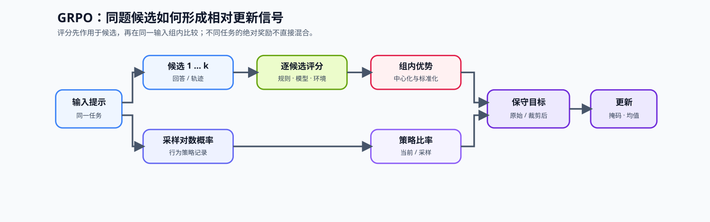
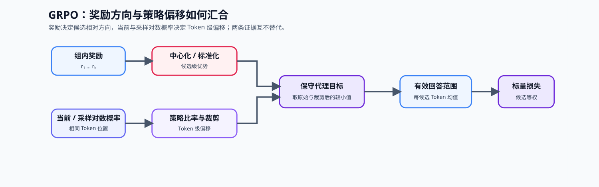

# 18. GRPO Loss Tutorial | 组相对策略优化损失

**难度：** Medium-Hard | **环境：** CPU-first | **标签：** `后训练对齐`, `GRPO`, `RLVR` | **目标人群：** 已理解偏好与策略优化基础的学习者

> 🚀 **云端运行环境**
>
> 本章节的实战代码可以点击以下链接在免费 GPU 算力平台上直接运行：
>
> [](https://colab.research.google.com/github/datawhalechina/llm-algo-leetcode/blob/main/02_PyTorch_Algorithms/18_GRPO_Loss_Tutorial.ipynb)
> [](https://modelscope.cn/my/mynotebook) *(国内推荐：魔搭社区免费实例)*


---

## 本节导读

同一个提示往往可以采样出多个候选回答。GRPO 不把这些候选的绝对奖励直接混在一起，而是先在同组内比较谁更好，再把相对优势送入受裁剪的策略更新。这样可在合适的反馈条件下减少对显式价值模型的依赖。

DPO 与 GRPO 使用不同的反馈组织方式：DPO 使用已整理好的离线偏好对；GRPO 使用同一任务下的候选组和组内反馈；RLVR 则把数学答案、代码执行结果或工具任务终态写成可检查的奖励。这里先建立“候选组—相对优势—受约束更新”的因果链，再判断这种相对排序何时可信。
## 前置阅读

**导语：** 先理解最小 SFT 闭环、PPO 的 ratio / clip 和离线偏好对，再看同一 prompt 的多个候选如何形成 GRPO 的相对训练信号。

- [15. End-to-End Fine-Tuning Experiment | 端到端微调实验](../02_PyTorch_Algorithms/15_End_to_End_Fine_Tuning_Experiment.md)
- [16. RLHF PPO Memory | RLHF / PPO 资源桥接](../02_PyTorch_Algorithms/16_RLHF_PPO_Memory.md)
- [17. DPO Loss Tutorial | 直接偏好优化损失教程](../02_PyTorch_Algorithms/17_DPO_Loss_Tutorial.md)

---
### Step 1：同一输入的候选如何变成相对训练信号

GRPO 为同一个输入或任务采样多个候选回答；在工具场景中，每个候选也可以是一条完整轨迹。奖励模型、规则验证器或环境反馈为候选给分。更新信号取决于候选相对同组其他候选的位置，而不是不同任务之间不可直接比较的绝对奖励。组内归一化可以降低奖励尺度差异，但不能证明奖励已经代表真实任务质量。

| 对象 | 作用 | 与其他组的关系 | 需要补充的证据 |
|:---|:---|:---|:---|
| 候选组 | 同一输入的多个回答或轨迹 | 只在组内比较 | 组规模与采样多样性 |
| 奖励 | 候选的外部评分 | 不跨组直接排序 | 奖励来源与覆盖范围 |
| 组内优势 | 相对组内中心和尺度的训练信号 | 每组整体保持平衡 | 单候选组与奖励无差异情况 |
| 规则验证器 | 数学、代码或格式的规则反馈 | 只评价已编码规则 | 独立任务质量与失败样本 |
| 轨迹终态 | 工具调用后的成功、失败或超时 | 仍只在同一任务组内比较 | 工具正确性、环境版本与执行日志 |


### Step 2：组内归一化与裁剪如何共同限制更新

每个候选组先以组内平均奖励建立比较基线，再用组内尺度归一化相对差异。得到的组内优势与新旧策略比率共同进入裁剪目标。奖励相同或只有一个候选时，组内比较不应凭空制造更新方向。

$$A_i = \frac{r_i-\mu_g}{\max(\sigma_g, \varepsilon)}, \qquad \rho_i=\exp(\log \pi_{new}-\log \pi_{old})$$

| 步骤 | 计算 | 机制作用 |
| --- | --- | --- |
| 组内中心化 | 候选奖励减去组内平均奖励 | 去除不同任务的共同基线 |
| 尺度归一化 | 相对差异除以组内奖励尺度 | 让更新主要看组内排序 |
| 策略比率 | 当前策略相对采样策略的变化 | 衡量一次更新的偏移幅度 |
| 裁剪目标 | 原始目标与受限目标取更保守者 | 限制一次更新过度放大 |



### Step 3：把组内排名与真实质量分开验证

GRPO 的 loss 只使用组内相对优势；还要验证奖励是否真的指向目标能力。实际 reward 往往由 correctness、格式、长度、安全或稳定性信号组合。组合前要固定每一项的量纲、适用位置和失败行为，否则数值范围较大的代理指标可能盖过任务质量。

| Reward 分量 | 常见来源 | 失真表现 | 必须同时检查的证据 |
| --- | --- | --- | --- |
| correctness | 答案匹配、单元测试、环境终态 | 利用 verifier 漏洞 | 隐藏评测与失败样本 |
| format | 标签、JSON、工具调用 schema | 格式通过但任务失败 | 格式通过率与独立正确率 |
| length / style | 长度惩罚、冗余与风格规则 | 截断推理或模板化 | 输出长度分布与任务质量 |
| safety / policy | 分类器、规则或人工偏好 | 过度拒答或分布偏差 | 拒答率、helpfulness 与分组结果 |
| KL / stability | 当前策略与 Reference 的差异 | 更新过强或停滞 | KL、ratio、裁剪比例与失败运行 |

### Step 4：实现 GRPO 的组内优势与裁剪损失

题目区接收二维 token log probability、response mask，以及候选级 reward 和 `group_ids`。学习者先独立计算组内 advantage，再构造策略比率、裁剪目标和候选等权聚合。旧策略与 reward 只提供固定训练目标。

| TODO / 函数 | 学习者完成的机制 | 必须满足的约束 | 测试证据 |
| --- | --- | --- | --- |
| TODO 1 / `compute_group_advantages` | 按 `group_ids` 计算候选级相对优势 | 每组均值为零，单元素组优势为零 | 多组、单元素组与近零方差 |
| TODO 2 / `compute_grpo_loss`：策略比率 | 比较当前策略与采样策略 | 旧策略固定且不接收梯度 | ratio 与梯度隔离 |
| TODO 3 / `compute_grpo_loss`：裁剪目标 | 将候选优势广播到 token 并选择保守目标 | 保留优势正负方向 | 上下界与有限 loss |
| TODO 4 / `compute_grpo_loss`：候选等权聚合 | 每条 response 先按有效 token 求均值 | 每个候选至少一个有效 token | 变长 mask 与候选权重 |

```python
import torch

```


```python
def compute_group_advantages(rewards, group_ids, eps=1e-6):
    """在每个 prompt 组内标准化候选 reward。"""
    if rewards.ndim != 1 or rewards.shape != group_ids.shape:
        raise ValueError("rewards 与 group_ids 必须是同形一维张量")
    if eps <= 0:
        raise ValueError("eps 必须为正")
    advantages = torch.zeros_like(rewards)
    for group_id in group_ids.unique(sorted=True):
        group_mask = group_ids == group_id
        group_rewards = rewards[group_mask]
        # ==========================================
        # TODO 1：逐组计算中心化 reward、稳定尺度和相对 advantage。
        # centered = ???
        # scale = ???
        # advantages[group_mask] = ???
        # ==========================================
    return advantages


def compute_grpo_loss(log_probs_new, log_probs_old, rewards, group_ids, response_mask=None, clip_range=0.2, eps=1e-6):
    """计算简化 GRPO loss：组内相对优势与 PPO 风格裁剪。

    Args:
        log_probs_new: 当前策略的 token 对数概率，形状 [候选数, 序列长度]。
        log_probs_old: 采样时旧策略的同位置对数概率。
        rewards: 每个候选的外部 reward，形状 [候选数]。
        group_ids: 标记候选属于哪个 prompt 组的整数 ID。
        response_mask: 有效 response token 的布尔掩码。
        clip_range: ratio 的单步允许偏移。
        eps: 组内标准差的数值保护项。

    Note:
        reward 只负责形成组内排序；独立质量仍需在 held-out 评测中确认。
    """
    if log_probs_new.ndim != 2 or log_probs_new.shape != log_probs_old.shape:
        raise ValueError("新旧策略 log_probs 必须是同形二维张量")
    if rewards.shape[0] != log_probs_new.shape[0]:
        raise ValueError("rewards / group_ids 必须与候选维一致")
    if clip_range < 0:
        raise ValueError("clip_range 必须非负")
    if response_mask is None:
        response_mask = torch.ones_like(log_probs_new, dtype=torch.bool)
    if response_mask.shape != log_probs_new.shape or not torch.all(response_mask.bool().any(dim=-1)):
        raise ValueError("response_mask 必须同形且至少包含一个有效位置")

    advantages = compute_group_advantages(rewards, group_ids, eps=eps)

    # ==========================================
    # TODO 2：冻结旧策略记录，计算 token 级策略比率及其裁剪值。
    # ratio = ???
    # clipped_ratio = ???
    # ==========================================

    # ==========================================
    # TODO 3：广播候选优势，构造原始、裁剪和保守目标。
    # token_advantages = ???
    # surrogate = ???
    # clipped_surrogate = ???
    # conservative = ???
    # ==========================================

    # ==========================================
    # TODO 4：每个候选先按有效 token 求均值，再在候选间等权聚合。
    # token_counts = ???
    # per_candidate = ???
    # loss = ???
    # ==========================================
    return loss, advantages
```


```python
# 测试目标：分别验证组内归一化、裁剪方向、梯度和输入契约。

def _grpo_fixture():
    """构造多组、变长掩码和单元素组的 GRPO 样例。"""
    return (
        torch.tensor([[-1.0, -0.5], [-0.5, -0.7], [-1.5, -0.4], [-0.2, -0.9], [-0.8, -1.0]], requires_grad=True),
        torch.tensor([[-1.1, -0.4], [-0.4, -0.8], [-1.6, -0.5], [-0.3, -0.8], [-0.8, -1.1]], requires_grad=True),
        torch.tensor([1.0, 2.0, 0.5, 1.5, 3.0]),
        torch.tensor([0, 0, 1, 1, 2]),
        torch.tensor([[True, True], [True, False], [True, True], [True, True], [True, False]]),
    )

def test_grpo_group_advantage():
    """验证组内优势中心化与单元素组处理。"""
    new, old, rewards, group_ids, mask = _grpo_fixture()
    _, advantages = compute_grpo_loss(new, old, rewards, group_ids, mask)
    for gid in group_ids.unique(sorted=True):
        group_adv = advantages[group_ids == gid]
        assert torch.allclose(group_adv.mean(), torch.tensor(0.0), atol=1e-6)
    assert advantages[-1].item() == 0.0, "单元素组没有相对排序信号"

def test_grpo_ratio_clipping_and_gradient():
    """验证策略比率、裁剪目标和梯度隔离。"""
    new, old, rewards, group_ids, mask = _grpo_fixture()
    loss, advantages = compute_grpo_loss(new, old, rewards, group_ids, mask)
    assert loss.ndim == 0 and torch.isfinite(loss)
    assert torch.all(torch.exp(new.detach() - old.detach()) > 0)
    loss.backward()
    assert new.grad is not None and torch.isfinite(new.grad).all()
    assert old.grad is None, "旧策略不应接收梯度"

def test_grpo_candidate_equal_weighting():
    """验证不同回复长度的候选先聚合再等权。"""
    new = torch.zeros(2, 2)
    old = torch.zeros(2, 2)
    rewards = torch.tensor([0.0, 2.0])
    group_ids = torch.tensor([0, 0])
    mask = torch.tensor([[True, True], [True, False]])
    loss, _ = compute_grpo_loss(new, old, rewards, group_ids, mask)
    assert torch.allclose(loss, torch.tensor(0.0)), "长短候选应先各自聚合再等权"

def test_grpo_input_contract():
    """验证张量形状和 eps 的输入契约。"""
    new, old, rewards, group_ids, mask = _grpo_fixture()
    try:
        compute_grpo_loss(new, old[:-1], rewards, group_ids, mask)
    except ValueError:
        pass
    else:
        raise AssertionError("形状不一致应被拒绝")
    try:
        compute_grpo_loss(new, old, rewards, group_ids, mask, eps=0.0)
    except ValueError:
        return
    raise AssertionError("非正 eps 应被拒绝")

def run_grpo_tests():
    """运行 GRPO 题目区的全部具名机制测试。"""
    test_grpo_group_advantage()
    test_grpo_ratio_clipping_and_gradient()
    test_grpo_candidate_equal_weighting()
    test_grpo_input_contract()
    print("✅ GRPO 组内优势、裁剪、候选等权、梯度与输入契约测试通过。")

run_grpo_tests()

```

---

🛑 **STOP HERE** 🛑
<br><br><br><br><br><br><br><br><br><br>
> 请先尝试自己完成代码并跑通测试。<br>
> 如果你正在 Colab 中运行，并且遇到困难没有思路，可以向下滚动查看参考答案。
<br><br><br><br><br><br><br><br><br><br>

---

## 参考代码与解析

### 代码

```python
def compute_group_advantages(rewards, group_ids, eps=1e-6):
    """在每个 prompt 组内标准化候选 reward。"""
    if rewards.ndim != 1 or rewards.shape != group_ids.shape:
        raise ValueError("rewards 与 group_ids 必须是同形一维张量")
    if eps <= 0:
        raise ValueError("eps 必须为正")
    advantages = torch.zeros_like(rewards)
    for group_id in group_ids.unique(sorted=True):
        group_mask = group_ids == group_id
        group_rewards = rewards[group_mask]
        # TODO 1：候选只与同一 prompt 的组内均值和尺度比较。
        centered = group_rewards - group_rewards.mean()
        scale = group_rewards.std(unbiased=False).clamp_min(eps)
        advantages[group_mask] = centered / scale
    return advantages


def compute_grpo_loss(log_probs_new, log_probs_old, rewards, group_ids, response_mask=None, clip_range=0.2, eps=1e-6):
    """计算简化 GRPO loss：组内相对优势与 PPO 风格裁剪。"""
    if log_probs_new.ndim != 2 or log_probs_new.shape != log_probs_old.shape:
        raise ValueError("新旧策略 log_probs 必须是同形二维张量")
    if rewards.shape[0] != log_probs_new.shape[0]:
        raise ValueError("rewards / group_ids 必须与候选维一致")
    if clip_range < 0:
        raise ValueError("clip_range 必须非负")
    if response_mask is None:
        response_mask = torch.ones_like(log_probs_new, dtype=torch.bool)
    if response_mask.shape != log_probs_new.shape or not torch.all(response_mask.bool().any(dim=-1)):
        raise ValueError("response_mask 必须同形且至少包含一个有效位置")

    advantages = compute_group_advantages(rewards, group_ids, eps=eps)

    # TODO 2：当前策略与采样策略形成 token 级比率。
    ratio = torch.exp(log_probs_new - log_probs_old.detach())
    clipped_ratio = torch.clamp(ratio, 1.0 - clip_range, 1.0 + clip_range)

    # TODO 3：候选优势广播到 token，并选择较保守的目标。
    token_advantages = advantages.detach().unsqueeze(-1)
    surrogate = ratio * token_advantages
    clipped_surrogate = clipped_ratio * token_advantages
    conservative = torch.minimum(surrogate, clipped_surrogate)

    # TODO 4：先在每个候选内部按有效 token 求均值，再让候选等权。
    mask = response_mask.bool()
    token_counts = mask.sum(dim=-1)
    per_candidate = (conservative * mask).sum(dim=-1) / token_counts
    loss = -per_candidate.mean()
    return loss, advantages
```

### 解析

#### TODO 1：计算候选级组内优势

- 对每个 `group_id` 计算 `centered = reward - group_mean`，再除以 `std.clamp_min(eps)`。
- 单元素组的 centered 为零，测试确认不会凭空制造相对优势。

#### TODO 2：计算策略比率

- 使用 `torch.exp(log_probs_new - log_probs_old.detach())` 形成逐 token ratio。
- `torch.clamp` 给出允许区间，梯度测试确认旧策略不接收梯度。

#### TODO 3：构造 Token 级裁剪目标

- 用 `unsqueeze(-1)` 将候选级 advantage 广播到该候选的 token。
- 原始与裁剪 surrogate 通过 `torch.minimum` 形成保守目标。

#### TODO 4：让候选等权参与更新

- 每条 response 先除以自己的有效 token 数，再在候选维取均值。
- 变长 mask 测试确认长候选不会仅因 token 更多而获得更大权重。

### Step 5：可选 GPU 实验——真实模型组内优势与有限更新

CPU 题目确认组内归一化、策略比率和裁剪目标；GPU 实验固定模型、候选回复与规则奖励，比较两档 group size，并用零方差反例确认“没有组内差异就没有更新信号”。环境创建见[后训练优化实验 Quickstart](../topic_discussion/post_training_optimization/quickstart.md#pt-rl-cuda-quickstart)。

| 学习问题 | CPU 已确认 | GPU 要确认 |
|:---|:---|:---|
| 组内奖励如何进入更新 | advantage 的均值、尺度与正负方向 | 真实回复 log-prob 是否沿组内优势方向分离 |
| group size 改变什么 | 候选只在同组比较 | 奖励离散度、有效优势数、更新代价与显存如何变化 |
| 奖励塌缩时会怎样 | 近零方差受 `eps` 保护 | 全等奖励产生零优势，不应伪造有效更新证据 |

#### 5.1 环境与固定工作负载

普通复测只修改 `RUN_MODE` 与 `RUN_LABEL`。本实验使用固定候选与可复查规则奖励隔离采样噪声；它验证 GRPO 更新机制，不代表真实 rollout 的质量或吞吐。

| 配置项 | 默认值 | 作用 |
|:---|:---|:---|
| Profile | `PT-RL-CUDA` | 单卡偏好优化与 RL 机制环境，参考显存 12 GiB |
| 模型 | `Qwen/Qwen2.5-0.5B-Instruct@main` | 5.2 自动解析并记录不可变 commit |
| 候选组 | 2 个 prompt，每组最多 4 个固定候选 | 保持候选内容与奖励规则可复查 |
| 候选 | `group_size = 2 / 4` | 比较组内统计与有限更新证据 |
| 更新预算 | LoRA，4 个 optimizer step | 只验证真实模型梯度、分离方向和资源 |


```python
# 学习者入口：普通复测通常只修改这两项。
RUN_MODE = "dry_run"  # 默认值 dry_run；改为 real_gpu 才执行真实 GRPO 更新。
RUN_LABEL = "default"  # 默认值 default；正式复测改为唯一标签，避免覆盖结果。

# 模型快照：main 会在 5.2 自动解析并记录为不可变 commit。
MODEL_ID = "Qwen/Qwen2.5-0.5B-Instruct"
MODEL_REVISION = "main"
LOCAL_FILES_ONLY = False  # 默认值 False；相同快照已缓存且需离线运行时改为 True。

# 固定工作负载：改变以下参数后递增 WORKLOAD_VERSION。
ENVIRONMENT_PROFILE = "PT-RL-CUDA"
WORKLOAD_ID = "pt-grpo-real-model-update"
WORKLOAD_VERSION = "v1"
GROUP_SIZE_CANDIDATES = [2, 4]  # 每个 prompt 纳入更新的候选数。
MAX_LENGTH = 96  # prompt 与 response 合并后的最大 Token 数。
CLIP_RANGE = 0.2  # 新旧策略比率的对称裁剪范围。
LORA_RANK = 8  # 低秩适配器秩；固定可训练参数预算。
LORA_ALPHA = 16  # LoRA 缩放分子，实际缩放为 alpha / rank。
UPDATE_STEPS = 4  # 每档 group size 使用相同的有效更新数。
LEARNING_RATE = 2e-4  # 仅更新 LoRA 参数。
SEED = 42
OUTPUT_RELATIVE_PATH = f"benchmarks/results/pt_grpo/{WORKLOAD_ID}_{RUN_LABEL}.json"

```

#### 5.2 执行组内对照并保存 JSON

5.2 为每档 group size 从同一模型快照重新开始，记录奖励离散度、非零优势、策略分离、裁剪比例、更新时间和峰值显存；全等奖励只用于验证零方差保护。


```python
import gc
import platform
import time

import torch
from tools.notebook_runtime import failure_record, hash_ids, package_version, resolve_model_commit, save_json
from tools.post_training_runtime import build_response_batch, move_response_batch, response_sequence_logps
from tools.project_runtime import resolve_project_root
from tools.training_mechanism_runtime import cuda_hardware_snapshot, gradient_l2_norm, median_and_p95

GROUP_FIXTURES = [
    {"prompt": "Return only the integer result of 2 + 2.", "responses": ["4", "5", "The answer is 4.", "I do not know."], "rewards": [1.0, 0.0, 0.6, 0.0]},
    {"prompt": "Return only the integer result of 3 * 3.", "responses": ["9", "6", "The answer is 9.", "10"], "rewards": [1.0, 0.0, 0.6, 0.0]},
]
REPO_ROOT = resolve_project_root()
OUTPUT_PATH = REPO_ROOT / OUTPUT_RELATIVE_PATH
result = {
    "schema_version": "post-training-mechanism-gpu/v1",
    "semantic_id": "PT-GRPO-LOSS",
    "environment_profile": ENVIRONMENT_PROFILE,
    "run_mode": RUN_MODE, "run_label": RUN_LABEL,
    "framework": {"python": platform.python_version(), "torch": torch.__version__, "transformers": package_version("transformers"), "peft": package_version("peft")},
    "hardware": {"cuda_available": torch.cuda.is_available(), "cuda": torch.version.cuda},
    "model": {"id": MODEL_ID, "requested_revision": MODEL_REVISION, "resolved_commit": None},
    "dataset": {"source": "embedded_fixed_candidate_groups", "groups": len(GROUP_FIXTURES), "sample_hash": hash_ids([str(item) for item in GROUP_FIXTURES])},
    "workload": {"id": WORKLOAD_ID, "version": WORKLOAD_VERSION, "group_size_candidates": GROUP_SIZE_CANDIDATES, "max_length": MAX_LENGTH, "clip_range": CLIP_RANGE, "lora_rank": LORA_RANK, "lora_alpha": LORA_ALPHA, "update_steps": UPDATE_STEPS, "learning_rate": LEARNING_RATE, "seed": SEED},
    "baseline": {"name": "sampling_policy_before_update"},
    "candidates": [], "failure": None, "evidence_level": "dry_run", "decision": "not_measured",
}

def group_advantages(rewards, group_ids, eps=1e-6):
    advantages = torch.zeros_like(rewards)
    for group_id in group_ids.unique(sorted=True):
        mask = group_ids == group_id
        values = rewards[mask]
        advantages[mask] = (values - values.mean()) / values.std(unbiased=False).clamp_min(eps)
    return advantages

execution_stage = "environment_preflight"
if RUN_MODE == "real_gpu":
    model = optimizer = None
    try:
        if not torch.cuda.is_available():
            raise RuntimeError("RUN_MODE=real_gpu，但 CUDA 不可用")
        from peft import LoraConfig, TaskType, get_peft_model
        from transformers import AutoModelForCausalLM, AutoTokenizer

        device = torch.device("cuda")
        dtype = torch.bfloat16 if torch.cuda.is_bf16_supported() else torch.float16
        execution_stage = "revision_and_tokenization"
        model_commit, revision_source = resolve_model_commit(MODEL_ID, MODEL_REVISION, local_files_only=LOCAL_FILES_ONLY)
        result["model"].update({"resolved_commit": model_commit, "resolution_source": revision_source})
        tokenizer = AutoTokenizer.from_pretrained(MODEL_ID, revision=model_commit, local_files_only=LOCAL_FILES_ONLY)

        for group_size in GROUP_SIZE_CANDIDATES:
            execution_stage = f"group_size_{group_size}"
            prompts, responses, reward_values, group_values = [], [], [], []
            for group_id, fixture in enumerate(GROUP_FIXTURES):
                prompts.extend([fixture["prompt"]] * group_size)
                responses.extend(fixture["responses"][:group_size])
                reward_values.extend(fixture["rewards"][:group_size])
                group_values.extend([group_id] * group_size)
            batch = move_response_batch(build_response_batch(tokenizer, prompts, responses, max_length=MAX_LENGTH), device)
            rewards = torch.tensor(reward_values, dtype=torch.float32, device=device)
            group_ids = torch.tensor(group_values, dtype=torch.long, device=device)
            advantages = group_advantages(rewards, group_ids)
            collapsed_advantages = group_advantages(torch.ones_like(rewards), group_ids)

            gc.collect(); torch.cuda.empty_cache(); torch.cuda.reset_peak_memory_stats()
            torch.manual_seed(SEED); torch.cuda.manual_seed_all(SEED)
            base = AutoModelForCausalLM.from_pretrained(MODEL_ID, revision=model_commit, local_files_only=LOCAL_FILES_ONLY, dtype=dtype).to(device)
            base.config.use_cache = False
            model = get_peft_model(base, LoraConfig(r=LORA_RANK, lora_alpha=LORA_ALPHA, lora_dropout=0.0, target_modules=["q_proj", "v_proj"], bias="none", task_type=TaskType.CAUSAL_LM))
            trainable = [parameter for parameter in model.parameters() if parameter.requires_grad]
            optimizer = torch.optim.AdamW(trainable, lr=LEARNING_RATE)
            model.eval()
            with torch.no_grad(), torch.autocast("cuda", dtype=dtype):
                old_logps, _ = response_sequence_logps(model, batch, normalize=True)
            old_logps = old_logps.detach()
            update_times_ms, losses, gradient_norms, clip_fractions = [], [], [], []
            model.train()
            for _ in range(UPDATE_STEPS):
                optimizer.zero_grad(set_to_none=True)
                torch.cuda.synchronize(); started = time.perf_counter()
                with torch.autocast("cuda", dtype=dtype):
                    new_logps, _ = response_sequence_logps(model, batch, normalize=True)
                    ratio = torch.exp(new_logps - old_logps)
                    clipped_ratio = ratio.clamp(1.0 - CLIP_RANGE, 1.0 + CLIP_RANGE)
                    loss = -torch.minimum(ratio * advantages, clipped_ratio * advantages).mean()
                loss.backward(); gradient_norms.append(gradient_l2_norm(trainable)); optimizer.step()
                torch.cuda.synchronize(); update_times_ms.append((time.perf_counter() - started) * 1000); losses.append(float(loss.detach())); clip_fractions.append(float((ratio.ne(clipped_ratio)).float().mean()))
            model.eval()
            with torch.no_grad(), torch.autocast("cuda", dtype=dtype):
                final_logps, _ = response_sequence_logps(model, batch, normalize=True)
            shifts = final_logps - old_logps
            positive = shifts[advantages > 0].mean()
            negative = shifts[advantages < 0].mean()
            separation = float(positive - negative)
            median_ms, p95_ms = median_and_p95(update_times_ms)
            result["candidates"].append({"group_size": group_size, "reward_std_mean": float(torch.stack([rewards[group_ids == gid].std(unbiased=False) for gid in group_ids.unique()]).mean()), "nonzero_advantages": int(advantages.ne(0).sum()), "zero_variance_guard_passed": bool(collapsed_advantages.eq(0).all()), "losses": losses, "policy_separation": separation, "gradient_norms": gradient_norms, "mean_clip_fraction": sum(clip_fractions) / len(clip_fractions), "median_update_ms": median_ms, "p95_update_ms": p95_ms, "peak_allocated_bytes": int(torch.cuda.max_memory_allocated())})
            del optimizer, model, base; optimizer = model = None

        selected = max(result["candidates"], key=lambda item: item["policy_separation"])
        passed = selected["policy_separation"] > 0 and selected["zero_variance_guard_passed"]
        result.update({"hardware": cuda_hardware_snapshot(), "selected_candidate": {"group_size": selected["group_size"]}, "evidence_level": "real_model_grpo_mechanism_benchmark", "decision": "accept_mechanism" if passed else "tune"})
    except Exception as error:
        result.update({"failure": failure_record(execution_stage, error), "evidence_level": "failed_real_gpu_attempt", "decision": "reject_until_fixed"})
    finally:
        del optimizer, model
        gc.collect(); torch.cuda.empty_cache()
elif RUN_MODE != "dry_run":
    raise ValueError("RUN_MODE 只能是 dry_run 或 real_gpu")

save_json(OUTPUT_PATH, result)
print(OUTPUT_PATH)
print(result["decision"], result["failure"])

```

#### 5.3 读取结果

本节只读取当前 `RUN_LABEL` 对应的 JSON。先确认奖励组确有离散度、全等奖励触发零优势，再比较两档 group size 的策略分离、裁剪比例、耗时和显存。


```python
import json

if not OUTPUT_PATH.exists():
    print(f"尚未找到结果文件：{OUTPUT_PATH}")
else:
    record = json.loads(OUTPUT_PATH.read_text(encoding="utf-8"))
    print(json.dumps({key: record.get(key) for key in ("run_label", "model", "selected_candidate", "failure", "evidence_level", "decision")}, ensure_ascii=False, indent=2))
    for candidate in record.get("candidates", []):
        print({key: candidate.get(key) for key in ("group_size", "reward_std_mean", "nonzero_advantages", "zero_variance_guard_passed", "policy_separation", "mean_clip_fraction", "median_update_ms", "peak_allocated_bytes")})

```

#### 5.4 解释证据与决策

先检查奖励离散度与零方差保护，再解释策略分离；group size 更大不自动代表更好，候选多样性、奖励可靠性和更新代价必须一起看。

| 观察结果 | 机制解释 | 本节决策 |
|:---|:---|:---|
| 正优势候选相对负优势候选获得更大 log-prob 增量 | 组内优势进入了真实模型更新 | `accept_mechanism` |
| 分离方向正确但裁剪比例高或波动大 | 学习率、裁剪范围或奖励尺度需要复测 | `tune` |
| 全等奖励仍产生更新、分离为负或运行失败 | 归一化、旧策略锚点或环境不成立 | `reject_until_fixed` |

## 相关阅读

- [Part 02 · 50 偏好数据与评测](../02_PyTorch_Algorithms/50_Preference_Data_and_Evaluation.md)
- [Part 02 · 85 GRPO 组内对齐项目](../02_PyTorch_Algorithms/85_GRPO_Groupwise_Alignment_Project.md)
- [DeepSeekMath / GRPO 论文](https://arxiv.org/abs/2402.03300)
- [TRL GRPOTrainer 文档](https://huggingface.co/docs/trl/grpo_trainer)