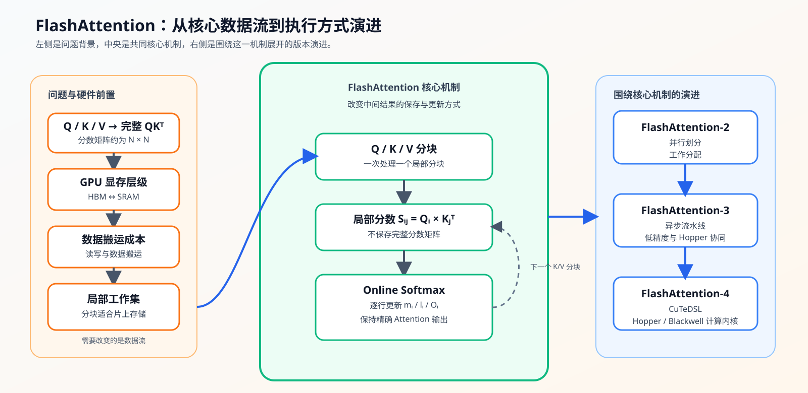
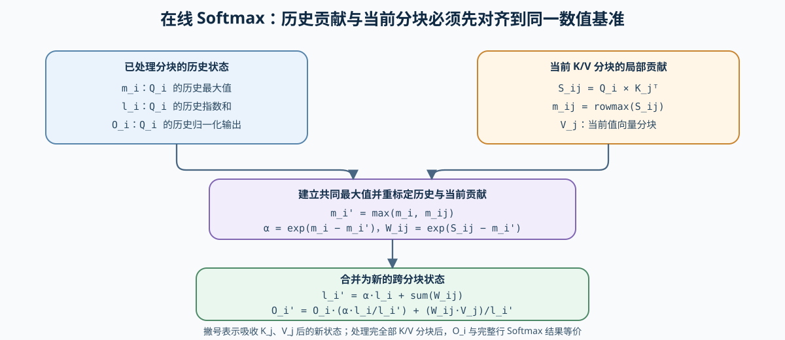
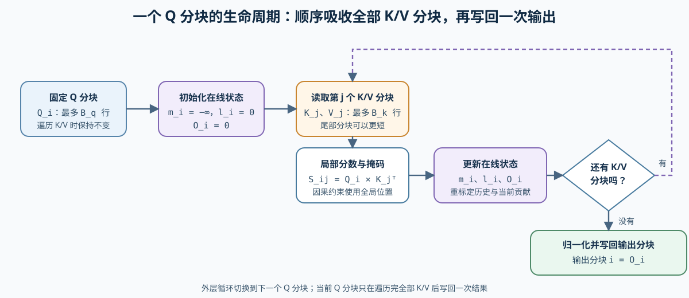

# 20. FlashAttention Sim | FlashAttention 模拟
**难度：** Hard | **环境：** CPU-first | **标签：** `推理优化`, `Attention`, `FlashAttention` | **目标人群：** 推理优化学习者

> 🚀 **云端运行环境**
>
> 本章节的实战代码可以点击以下链接在免费 GPU 算力平台上直接运行：
>
> [](https://colab.research.google.com/github/datawhalechina/llm-algo-leetcode/blob/main/02_PyTorch_Algorithms/20_FlashAttention_Sim.ipynb)
> [](https://modelscope.cn/my/mynotebook) *(国内推荐：魔搭社区免费实例)*


---

## 本节导读

标准 Attention 会先形成完整 Score 矩阵；当序列变长，这个中间矩阵会同时带来存储和读写压力。本节从这一问题出发，依次理解分块计算如何缩小当前工作集、Online Softmax 如何保持结果等价，以及这些机制如何落到一个可验证的前向模拟。

学习时请把三个问题连起来：哪些数据需要暂存、跨分块时如何维持同一行的归一化、以及工作集变小后需要怎样测量实际收益。

**关键词：** `FlashAttention`, `online softmax`, `tiling`

---

## 前置阅读

**导语：** 如果你已能写出普通 Attention，先通过完整 Score 与 tile 工作集的对比建立直觉；遇到“为什么减少写回会影响速度”的问题，再回查 GPU 内存层级。
- [P1: 14. FlashAttention Memory Model | FlashAttention 显存模型](../01_Hardware_Math_and_Systems/14_FlashAttention_Memory_Model.md)
- [P1: 03. GPU Architecture and Memory | GPU 物理架构与内存层级](../01_Hardware_Math_and_Systems/03_GPU_Architecture_and_Memory.md)

---

### Step 1: Attention 中间工作集与分块动机

给定 $Q、K、V$ 后，标准实现先计算完整的 $S=QK^T$，再对每一行做 softmax，最后与 $V$ 相乘。序列长度为 $N$ 时，$S$ 包含 $N^2$ 个元素；它不是最终输出，却可能作为大块中间数据写入并再次读取 HBM。

这里的**算法 tile**指 token 维度上的一小段 Q，与一小段 K/V 形成的局部 score 矩阵；它不是 Transformer 模型 Block，也不是 CUDA thread block。真实 FlashAttention 会把当前 tile 尽量放在寄存器或 shared memory 等片上存储中处理，减少完整 Score 的 HBM 往返。

先比较完整 Score 与局部 tile：分块不会删去 Attention 所需的信息，而是改变中间结果的出现、保留和合并方式；下一步关注这种方式怎样保持结果一致。

| 阶段 | 标准 Attention | 分块路径 |
|---|---|---|
| Score | 先得到完整 `QKᵀ` | 只计算当前 `Q block × K block` |
| Softmax | 对完整行统一计算 | 用跨分块摘要逐步合并 |
| 输出 | 最后与完整概率矩阵相乘 | 逐块累加当前 V 分块的贡献 |
| 工作集 | 完整 Score 需要长期处理较大的中间区域 | 单个 tile 限制当前暂存区域 |


### Step 2: Online Softmax 如何保持数值等价
分块以后不能对每个 tile 独立 Softmax 再相加，因为同一 Q 行的归一化分母覆盖全部 K/V。每行需要持续携带三类跨分块摘要；新 tile 到来时，先将历史摘要和当前 tile 对齐到同一最大值基准，再合并指数权重和输出贡献，从而保持与完整行 Softmax 相同的结果。

| 跨分块摘要 | 保存的信息 | 合并新 tile 时的职责 |
|---|---|---|
| 最大值 | 已处理 score 中的数值基准 | 选择新的共同基准，避免指数计算溢出 |
| 指数和 | 已处理 token 的归一化累计量 | 重标定历史贡献后，加上当前 tile 的贡献 |
| 累计输出 | 已处理 token 对输出的加权贡献 | 按新的归一化比例合并历史与当前 V 的贡献 |


### Step 3: 一个 Q 分块如何吸收全部 K/V 分块
固定一个 Q 分块，让它依次接收全部 K/V 分块；每轮把局部 score 的贡献并入跨分块摘要，直到当前 Q 分块获得与完整 Attention 相同的输出。下图把这一过程压缩为一个 Q tile 的生命周期。

| 计算阶段 | 保持不变的对象 | 状态变化 |
|---|---|---|
| 开始处理一个 Q 分块 | 当前 Q 分块 | 建立对应的跨分块摘要 |
| 接收一个 K/V 分块 | 当前 Q 分块与历史状态 | 形成局部分数，并合并新的上下文贡献 |
| 接收完全部 K/V 分块 | 当前 Q 分块 | 得到包含完整上下文信息的 Attention 输出 |




### Step 4: 实现并验证分块 Attention
本题用二维 Q、K、V 复现分块 Attention；双层分块循环、输入校验和状态写回已经提供，学习者补全跨分块状态、局部分数、因果掩码、Online Softmax 重标定和归一化输出。测试覆盖普通与因果路径、尾块、dtype、较大分数和非法输入。

| 函数 | 学习者完成的机制 | 必须满足的约束 | 测试证据 |
|---|---|---|---|
| `flash_attention_forward_sim` | TODO 1：初始化每行最大值与指数和 | 最大值以负无穷开始，指数和以零开始 | 普通路径与尾块等价测试 |
| `flash_attention_forward_sim` | TODO 2：形成局部分数与因果掩码 | 使用全局 token 位置；未来位置权重为零 | 因果 Attention 等价测试 |
| `flash_attention_forward_sim` | TODO 3：把历史与当前 tile 对齐到同一最大值 | 指数和与输出贡献使用相同重标定因子 | 大分数稳定性与 dtype 测试 |
| `flash_attention_forward_sim` | TODO 4：合并归一化输出 | 与完整 Attention 在误差门槛内一致 | 多组形状与分块大小测试 |


```python
import torch
import math
```


```python
def flash_attention_forward_sim(q, k, v, block_size=2, causal=False):
    """计算二维输入上的 FlashAttention 前向模拟。

    Args:
        q, k, v: [seq_len, dim] 张量，device 和 dtype 应保持一致。
        block_size: Q/K/V 的分块大小，必须为正数。
        causal: 是否只允许关注当前位置及之前的 K token。

    Returns:
        [seq_len, dim] 的 attention 输出。

    """
    if q.ndim != 2 or k.ndim != 2 or v.ndim != 2:
        raise ValueError('q、k、v 必须是 [seq_len, dim] 二维张量')
    if q.shape != k.shape or k.shape != v.shape:
        raise ValueError('q、k、v 的形状必须一致')
    if q.device != k.device or k.device != v.device:
        raise ValueError('q、k、v 必须位于同一 device')
    if q.dtype != k.dtype or k.dtype != v.dtype:
        raise TypeError('q、k、v 必须使用相同 dtype')
    if block_size <= 0:
        raise ValueError('block_size 必须为正数')

    seq_len, dim = q.shape
    
    out = torch.zeros((seq_len, dim), device=q.device, dtype=q.dtype)
    # TODO 1（跨分块状态）：初始化每一行的最大值基准与指数和。
    # 最大值形状为 [seq_len, 1]，初始值为负无穷；指数和形状相同，初始值为零。
    # m = ???
    # l = ???
    raise NotImplementedError("TODO 1：请初始化 m 与 l")
    
    scale = 1.0 / math.sqrt(dim)
    
    # 外层循环：遍历 Q 的分块
    for i in range(0, seq_len, block_size):
        q_block = q[i:i+block_size] * scale
        m_i = m[i:i+block_size]
        l_i = l[i:i+block_size]
        out_i = out[i:i+block_size]
        
        # 内层循环：遍历 K, V 的分块
        for j in range(0, seq_len, block_size):
            k_block = k[j:j+block_size]
            v_block = v[j:j+block_size]
            
            # TODO 2（局部分数）：计算当前 tile，并在因果路径屏蔽未来位置。
            # q_block 已完成缩放，scores 形状为 [Q_tile, K_tile]。
            # scores = ???
            if causal:
                query_pos = torch.arange(i, i + q_block.shape[0], device=q.device)[:, None]
                key_pos = torch.arange(j, j + k_block.shape[0], device=q.device)[None, :]
                # key 的全局位置晚于 query 时，future_mask 为真。
                # future_mask = ???
                scores = scores.masked_fill(future_mask, -float('inf'))
            raise NotImplementedError("TODO 2：请计算 scores 与 future_mask")
            
            # TODO 3（数值重标定）：把历史状态与当前 tile 对齐到同一最大值。
            # 当前最大值保留列维；新基准取历史与当前最大值的逐元素较大值。
            # tile_max = ???
            # new_max = ???
            # history_scale = ???
            # tile_weights = ???
            raise NotImplementedError("TODO 3：请完成最大值基准与指数权重的重标定")

            # TODO 4（归一化合并）：更新指数和与当前 Q tile 的输出。
            # new_l 汇总历史与当前指数和；out_i 使用同一归一化比例合并两部分贡献。
            # new_l = ???
            # out_i = ???
            raise NotImplementedError("TODO 4：请更新指数和与归一化输出")
            m_i = new_max
            l_i = new_l
        
        out[i:i+block_size] = out_i
        m[i:i+block_size] = m_i
        l[i:i+block_size] = l_i
            
    return out

```


```python
# 测试设计：分别验证数值等价、causal、dtype/稳定性、工作集代理与输入契约。

def _reference_attention(q, k, v, causal=False):
    scores = (q @ k.transpose(-2, -1)) / math.sqrt(q.shape[-1])
    if causal:
        mask = torch.triu(torch.ones(scores.shape, dtype=torch.bool), diagonal=1)
        scores = scores.masked_fill(mask, -float('inf'))
    return torch.softmax(scores, dim=-1) @ v

def test_noncausal_equivalence():
    """TODO 1–4：普通分块路径应与完整 Attention 等价，含尾块。"""
    for seq_len, dim, block_size, seed in [(8, 4, 2, 42), (5, 3, 3, 7), (3, 2, 1, 123)]:
        torch.manual_seed(seed)
        q, k, v = (torch.randn(seq_len, dim) for _ in range(3))
        diff = (_reference_attention(q, k, v) - flash_attention_forward_sim(q, k, v, block_size)).abs().max()
        assert diff < 1e-5, f"非 causal 结果失配：seq={seq_len}, block={block_size}"

def test_causal_equivalence():
    """TODO 2：causal mask 必须屏蔽未来 K/V。"""
    torch.manual_seed(11)
    q, k, v = (torch.randn(6, 4) for _ in range(3))
    assert torch.allclose(_reference_attention(q, k, v, causal=True), flash_attention_forward_sim(q, k, v, 2, causal=True), atol=1e-5, rtol=1e-5)

def test_dtype_and_stability():
    """TODO 3：重标定应保留 dtype，并让大 score 输出保持有限。"""
    torch.manual_seed(9)
    q, k, v = (torch.randn(4, 3, dtype=torch.float64) for _ in range(3))
    out = flash_attention_forward_sim(q, k, v, 2)
    assert out.dtype == torch.float64
    assert torch.allclose(_reference_attention(q, k, v), out, atol=1e-10, rtol=1e-10)
    stable_out = flash_attention_forward_sim(torch.full((3, 2), 100.0), torch.full((3, 2), 100.0), torch.randn(3, 2), 2)
    assert torch.isfinite(stable_out).all()

def test_working_set_proxy():
    """验证 score tile 的教学代理：固定 tile 时不随总序列长度平方增长。"""
    block_size = 8
    proxies = []
    for seq_len in [64, 256, 1024]:
        full_score_elements = seq_len * seq_len
        tile_score_elements = block_size * block_size
        proxies.append((full_score_elements, tile_score_elements))
        assert tile_score_elements == 64
        assert tile_score_elements < full_score_elements
    assert [full // tile for full, tile in proxies] == [64, 1024, 16384]

    seq_len = 256
    assert [block * block for block in [4, 8, 16]] == [16, 64, 256]

def test_input_contract():
    """输入形状、dtype、device 与 block_size 的契约应显式拒绝非法值。"""
    try:
        flash_attention_forward_sim(torch.randn(2, 2), torch.randn(2, 2), torch.randn(2, 2), block_size=0)
    except ValueError:
        return
    raise AssertionError('block_size <= 0 应被拒绝')

def run_flash_attention_sim_tests():
    try:
        test_noncausal_equivalence()
        test_causal_equivalence()
        test_dtype_and_stability()
        test_working_set_proxy()
        test_input_contract()
    except NotImplementedError:
        print("请先完成 TODO 部分的代码！")
        raise
    print("✅ FlashAttention CPU 机制测试通过：数值等价、causal、稳定性、工作集代理与输入契约均符合预期。")

run_flash_attention_sim_tests()

```

---

🛑 **STOP HERE** 🛑
<br><br><br><br><br><br><br><br><br><br>
> 请先尝试自己完成代码并跑通测试。<br>
> 如果你正在 Colab 中运行，并且遇到困难没有思路，可以向下滚动查看参考答案。
<br><br><br><br><br><br><br><br><br><br>

---
## 参考代码与解析

### 代码

```python
def flash_attention_forward_sim(q, k, v, block_size=2, causal=False):
    """计算二维输入上的 FlashAttention 前向模拟。

    Args:
        q, k, v: [seq_len, dim] 张量，device 和 dtype 应保持一致。
        block_size: Q/K/V 的分块大小，必须为正数。
        causal: 是否只允许关注当前位置及之前的 K token。

    Returns:
        [seq_len, dim] 的 attention 输出。

    """
    if q.ndim != 2 or k.ndim != 2 or v.ndim != 2:
        raise ValueError('q、k、v 必须是 [seq_len, dim] 二维张量')
    if q.shape != k.shape or k.shape != v.shape:
        raise ValueError('q、k、v 的形状必须一致')
    if q.device != k.device or k.device != v.device:
        raise ValueError('q、k、v 必须位于同一 device')
    if q.dtype != k.dtype or k.dtype != v.dtype:
        raise TypeError('q、k、v 必须使用相同 dtype')
    if block_size <= 0:
        raise ValueError('block_size 必须为正数')

    seq_len, dim = q.shape
    
    out = torch.zeros((seq_len, dim), device=q.device, dtype=q.dtype)
    # TODO 1（跨分块状态）：初始化每一行的最大值基准与指数和。
    m = torch.full((seq_len, 1), -float('inf'), device=q.device, dtype=q.dtype)
    l = torch.zeros((seq_len, 1), device=q.device, dtype=q.dtype)
    
    scale = 1.0 / math.sqrt(dim)
    
    # 外层循环：遍历 Q 的分块
    for i in range(0, seq_len, block_size):
        q_block = q[i:i+block_size] * scale
        m_i = m[i:i+block_size]
        l_i = l[i:i+block_size]
        out_i = out[i:i+block_size]
        
        # 内层循环：遍历 K, V 的分块
        for j in range(0, seq_len, block_size):
            k_block = k[j:j+block_size]
            v_block = v[j:j+block_size]
            
            # TODO 2（局部分数）：计算当前 tile，并在因果路径屏蔽未来位置。
            scores = q_block @ k_block.transpose(-2, -1)
            if causal:
                query_pos = torch.arange(i, i + q_block.shape[0], device=q.device)[:, None]
                key_pos = torch.arange(j, j + k_block.shape[0], device=q.device)[None, :]
                future_mask = key_pos > query_pos
                scores = scores.masked_fill(future_mask, -float('inf'))
            
            # TODO 3（数值重标定）：把历史状态与当前 tile 对齐到同一最大值。
            tile_max = torch.max(scores, dim=-1, keepdim=True)[0]
            new_max = torch.maximum(m_i, tile_max)
            history_scale = torch.exp(m_i - new_max)
            tile_weights = torch.exp(scores - new_max)

            # TODO 4（归一化合并）：更新指数和与当前 Q tile 的输出。
            new_l = l_i * history_scale + tile_weights.sum(dim=-1, keepdim=True)
            out_i = out_i * (l_i * history_scale / new_l) + (tile_weights @ v_block) / new_l
            m_i = new_max
            l_i = new_l
        
        out[i:i+block_size] = out_i
        m[i:i+block_size] = m_i
        l[i:i+block_size] = l_i
            
    return out
```

### 解析

题目保留分块循环和写回位置，只让学习者完成会改变数值等价性的状态更新。

**TODO 1：初始化跨分块状态**
最大值以负无穷开始，保证第一个分块能建立有效基准；指数和以零开始，避免引入额外权重。二者保留列维，后续可以按行广播。

**TODO 2：形成局部分数与因果约束**
`q_block` 已经乘过缩放系数，因此只需与当前 `k_block` 相乘。因果掩码使用全局位置比较，不能用 tile 内部下标代替，否则跨 tile 时会错误开放未来 token。

**TODO 3：重标定历史状态**
新最大值同时覆盖历史分块与当前分块。`history_scale` 把旧指数和与旧输出搬到这个新基准，`tile_weights` 则表示当前分块相对新基准的贡献。

**TODO 4：合并归一化输出**
新指数和由重标定后的历史部分与当前分块相加得到。输出也必须使用相同权重合并；只更新分母而不缩放历史输出，会破坏与完整 Softmax 的等价性。

### Step 5：可选 GPU 实验——显式 Attention 与 PyTorch SDPA

CPU 题目验证分块数据流和 Online Softmax 的数值等价；GPU 实验在同一组 Q/K/V 上比较显式物化 score 的 baseline 与 PyTorch SDPA candidate，记录输出误差、延迟和峰值显存。SDPA 会按设备、dtype、形状和运行时能力选择 backend，因此本实验验证“当前环境实际选择的 SDPA 路径”，不把结果直接命名为某一代 FlashAttention kernel。

| 学习问题 | CPU 已确认 | GPU 要确认 |
|---|---|---|
| 分块算法的机制收益能否落到当前执行路径 | Online Softmax、causal mask 与完整 Attention 数值等价 | 相同输入下的正确性、延迟、峰值显存和可用 backend 能力 |

#### 5.1 环境、输入形状与配对条件

本实验使用 `INF-CUDA-MECHANISM`。首次运行先完成[推理机制 GPU 环境 Quickstart](../topic_discussion/inference_optimization/quickstart.md#inf-cuda-mechanism-quickstart)，通过 Profile 预检后再把 `RUN_MODE` 改为 `real_gpu`。

| 配置层 | 固定口径 | 修改规则 |
|---|---|---|
| 环境 | `INF-CUDA-MECHANISM`；单张 NVIDIA GPU | 不与 vLLM/SGLang 环境混装 |
| 输入 | 相同 Q/K/V、dtype、causal 与形状 | baseline/candidate 只改变 Attention 执行路径 |
| 测量 | 相同 warmup/repeat；CUDA 同步计时 | 改变形状或测量协议后递增 workload version |
| 结果 | 正确性优先，再比较延迟与峰值显存 | SDPA 能力开关不是实际 kernel 命中证明 |

```python
# 5.1 只定义学习者入口与固定配对协议；安装规则由环境 Profile 维护。
RUN_MODE = "dry_run"  # 默认值 dry_run：只登记计划；改为 real_gpu 才执行真实 GPU 对照。
RUN_LABEL = "default"  # 默认值 default；正式复测改为唯一标签，避免覆盖同名结果。

ENVIRONMENT_PROFILE = "INF-CUDA-MECHANISM"  # 固定环境身份；运行前必须通过同名 Profile 预检。
WORKLOAD_ID = "inference-attention-sdpa"  # 稳定工作负载身份。
WORKLOAD_VERSION = "v2"  # v2 使用统一推理机制结果字段和稳定输出路径。

GPU_DTYPE = "auto"  # auto 优先原生 BF16，否则使用 FP16；也可显式指定 float16 / bfloat16。
GPU_BATCH_SIZE = 1  # batch 维度；baseline 与 candidate 保持一致。
GPU_NUM_HEADS = 8  # Query head 数；两条路径共用。
GPU_SEQ_LEN = 512  # 序列长度；增大后显式 score 的显存压力增长更快。
GPU_HEAD_DIM = 64  # 单头维度。
GPU_CAUSAL = False  # 是否启用因果 mask。

GPU_WARMUP = 5  # 预热次数，不进入统计。
GPU_ITERS = 20  # 正式重复次数，用于计算平均单次延迟。
GPU_SEED = 42  # 固定 Q/K/V 随机输入。
OUTPUT_RELATIVE_PATH = f"benchmarks/results/20_flashattention/{WORKLOAD_ID}_{RUN_LABEL}.json"  # 仓库相对结果路径。
```

#### 5.2 执行显式 Attention / SDPA 配对实验

执行单元只读取 5.1 的配置。`dry_run` 不访问 GPU；`real_gpu` 才构造共享 Q/K/V，依次测量两条路径并保存 JSON。先检查输出误差，再比较延迟和显存；能力开关只记录运行时可用性，不能替代 profiler 的 kernel 命中证据。

```python
"""运行显式 Attention 与 PyTorch SDPA 的固定 workload GPU 对照。"""

from datetime import datetime, timezone
import json
import os
import platform
import time
from pathlib import Path

def _find_project_root():
    """从当前目录向上寻找项目根目录，保证结果写入仓库内。"""
    current = Path.cwd().resolve()
    for candidate in (current, *current.parents):
        if (candidate / 'benchmarks').is_dir() and (candidate / '02_PyTorch_Algorithms').is_dir():
            return candidate
    return current

def _select_gpu_dtype():
    """根据配置选择 dtype，并区分原生 BF16 与模拟支持。"""
    if GPU_DTYPE == 'float16':
        return torch.float16
    if GPU_DTYPE == 'bfloat16':
        return torch.bfloat16
    if GPU_DTYPE != 'auto':
        raise ValueError('GPU_DTYPE 只能是 auto / float16 / bfloat16')
    # including_emulation=False 避免把软件模拟误当成硬件 BF16 支持。
    try:
        native_bf16 = torch.cuda.is_bf16_supported(including_emulation=False)
    except TypeError:
        major, _ = torch.cuda.get_device_capability()
        native_bf16 = major >= 8
    return torch.bfloat16 if native_bf16 else torch.float16

def _naive_attention(q, k, v, causal=False):
    """显式物化 score 的 Attention baseline，用于同 workload 对照。"""
    scale = 1.0 / math.sqrt(q.shape[-1])
    scores = (q @ k.transpose(-2, -1)) * scale
    if causal:
        mask = torch.triu(torch.ones(scores.shape[-2:], device=q.device, dtype=torch.bool), diagonal=1)
        scores = scores.masked_fill(mask, -float('inf'))
    return torch.softmax(scores, dim=-1) @ v

def _measure_attention(fn, q, k, v, causal):
    """预热后同步计时，并记录 allocated / reserved 峰值。"""
    # 预热用于排除首次调用开销；正式计时前清零 CUDA 峰值统计。
    for _ in range(GPU_WARMUP):
        fn(q, k, v, causal)
    torch.cuda.synchronize()
    torch.cuda.reset_peak_memory_stats()
    start = time.perf_counter()
    output = None
    for _ in range(GPU_ITERS):
        output = fn(q, k, v, causal)
    torch.cuda.synchronize()
    elapsed = time.perf_counter() - start
    return output, {
        'latency_ms': round(elapsed * 1000 / GPU_ITERS, 3),
        'peak_allocated_mb': round(torch.cuda.max_memory_allocated() / 2**20, 2),
        'peak_reserved_mb': round(torch.cuda.max_memory_reserved() / 2**20, 2),
    }

def _run_gpu_attention_experiment():
    """执行两条 Attention 路径，并保存可复查的环境与结果记录。"""
    if RUN_MODE != 'real_gpu':
        print("GPU 对照未启动：将 RUN_MODE 从 dry_run 改为 real_gpu 后重新运行。")
        return None
    # 先做环境和 workload 校验，避免在 CPU 环境中静默产生伪 GPU 结果。
    if not torch.cuda.is_available():
        raise RuntimeError('RUN_MODE=real_gpu，但当前环境没有可用 CUDA。')
    if min(GPU_BATCH_SIZE, GPU_NUM_HEADS, GPU_SEQ_LEN, GPU_HEAD_DIM, GPU_WARMUP, GPU_ITERS) <= 0:
        raise ValueError('batch、heads、seq_len、head_dim、warmup 和 iters 必须为正数。')
    torch.manual_seed(GPU_SEED)
    device = torch.device('cuda')
    dtype = _select_gpu_dtype()
    shape = (GPU_BATCH_SIZE, GPU_NUM_HEADS, GPU_SEQ_LEN, GPU_HEAD_DIM)
    q = torch.randn(shape, device=device, dtype=dtype)
    k = torch.randn(shape, device=device, dtype=dtype)
    v = torch.randn(shape, device=device, dtype=dtype)
    # 两条路径共享同一批输入；因此误差和性能比较具有相同输入口径。
    methods = {
        'naive': _naive_attention,
        'SDPA': lambda a, b, c, causal: torch.nn.functional.scaled_dot_product_attention(
            a, b, c, is_causal=causal
        ),
    }
    rows = []
    outputs = {}
    # 分别测量并保留 OOM 状态；非 OOM 异常继续抛出，避免掩盖代码错误。
    for name, fn in methods.items():
        try:
            output, metrics = _measure_attention(fn, q, k, v, GPU_CAUSAL)
            outputs[name] = output
            rows.append({'implementation': name, **metrics, 'status': 'ok'})
        except RuntimeError as exc:
            if 'out of memory' not in str(exc).lower():
                raise
            torch.cuda.empty_cache()
            rows.append({'implementation': name, 'latency_ms': None, 'peak_allocated_mb': None, 'peak_reserved_mb': None, 'status': 'OOM'})
    # 只有两条路径都成功时才计算输出误差。
    max_error = None
    if len(outputs) == 2:
        max_error = float(torch.max(torch.abs(outputs['naive'] - outputs['SDPA'])).item())
    for row in rows:
        row['max_error'] = max_error
    # evidence_level 说明这是单 GPU、固定 workload 的对照，不是稳定 benchmark。
    result = {
        'schema_version': 'inference-mechanism-gpu/v1',
        'semantic_id': 'INF-SDPA-ATTENTION',
        'environment_profile': ENVIRONMENT_PROFILE,
        'run_mode': RUN_MODE,
        'run_label': RUN_LABEL,
        'workload': {'id': WORKLOAD_ID, 'version': WORKLOAD_VERSION},
        'created_at_utc': datetime.now(timezone.utc).strftime('%Y%m%dT%H%M%SZ'),
        'config': {
            'dtype': str(dtype), 'batch_size': GPU_BATCH_SIZE, 'num_heads': GPU_NUM_HEADS,
            'seq_len': GPU_SEQ_LEN, 'head_dim': GPU_HEAD_DIM, 'causal': GPU_CAUSAL,
            'warmup': GPU_WARMUP, 'iters': GPU_ITERS, 'seed': GPU_SEED,
        },
        'environment': {
            'device': torch.cuda.get_device_name(0), 'torch': torch.__version__,
            'cuda': torch.version.cuda, 'python': platform.python_version(),
        },
        'results': rows,
        'baseline': next((row for row in rows if row['implementation'] == 'naive'), None),
        'candidate': next((row for row in rows if row['implementation'] == 'SDPA'), None),
        'evidence_level': 'local_mechanism_benchmark',
        'note': 'naive 与 SDPA 的对照不能直接命名为 FlashAttention-3/4；稳定结论需要重复运行。',
    }
    output_path = _find_project_root() / OUTPUT_RELATIVE_PATH
    output_path.parent.mkdir(parents=True, exist_ok=True)
    result['artifact'] = {'result_path': str(output_path), 'artifact_type': 'json_result'}
    result['failure'] = [
        {'implementation': row['implementation'], 'status': row['status']}
        for row in rows if row['status'] != 'ok'
    ] or None
    if result['failure']:
        result['decision'] = {'decision': 'tune', 'reason': '至少一条执行路径未完成，不能比较性能'}
    elif result['candidate']['max_error'] is not None and result['candidate']['max_error'] <= 1e-3:
        result['decision'] = {'decision': 'tune', 'reason': 'SDPA 与显式 Attention 在当前 workload 下数值可比，保留为单 GPU 对照证据'}
    else:
        result['decision'] = {'decision': 'reject', 'reason': '当前 workload 的数值误差未通过对照门槛'}
    output_path.write_text(json.dumps(result, ensure_ascii=False, indent=2), encoding='utf-8')
    print(f'已保存 GPU 结果: {output_path}')
    print(json.dumps(result, ensure_ascii=False, indent=2))
    return result

gpu_result = _run_gpu_attention_experiment()
```

#### 5.3 读取配对实验结果

读取单元只消费 5.2 保存的 JSON。先核对 Profile、workload 版本、形状和失败状态，再比较显式 Attention 与 SDPA；没有通过数值检查的结果不能进入性能判断。

```python
# 5.3 只读取固定运行标签对应的 JSON，不重复执行 Attention。
import json
from pathlib import Path

output_path = _find_project_root() / OUTPUT_RELATIVE_PATH
if not output_path.exists():
    print(f"等待 GPU 配对实验结果：{output_path}")
else:
    record = json.loads(output_path.read_text(encoding="utf-8"))
    print(json.dumps({
        key: record.get(key)
        for key in ("schema_version", "environment_profile", "workload", "config", "environment", "failure", "evidence_level", "decision")
    }, ensure_ascii=False, indent=2))
    print("\n实现路径摘要")
    for row in record.get("results", []):
        print(row)
```

#### 5.4 解释正确性、显存与执行路径

先检查 `failure` 和最大误差；只有两条路径都成功且输出可比，才读取延迟与峰值显存。SDPA 的收益依赖 GPU、dtype、形状和 backend 选择，本节结果只支持当前固定 workload 的局部判断。

| 观察项 | 读取字段 | 判断问题 |
|---|---|---|
| 输入口径 | `config`、`workload` | 两条路径是否共享形状、dtype、causal 和测量次数 |
| 正确性 | `max_error`、`status` | candidate 是否仍与显式 Attention 数值可比 |
| 容量 | `peak_allocated_mb`、`peak_reserved_mb` | SDPA 是否减少中间工作集与缓存压力 |
| 执行 | `latency_ms` | 当前形状下是否获得稳定局部收益 |
| 证据 | `failure`、`evidence_level`、`decision` | 结果是可继续复测、需要调整，还是应拒绝 |
## 相关阅读

以下资料按“核心论文与实现 → 推理系统延伸”排列，用于把本节的分块计算和 Online Softmax 连接到后续工程主题。

- [FlashAttention 论文：Fast and Memory-Efficient Exact Attention with IO-Awareness](https://arxiv.org/abs/2205.14135)
- [FlashAttention-2 论文：Faster Attention with Better Parallelism and Work Partitioning](https://arxiv.org/abs/2307.08691)
- [FlashAttention 官方实现（FlashAttention / FlashAttention-2）](https://github.com/Dao-AILab/flash-attention)
- [PyTorch `scaled_dot_product_attention` 文档](https://docs.pytorch.org/docs/stable/generated/torch.nn.functional.scaled_dot_product_attention)
- [Part 02 · 22 vLLM 分页注意力](./22_vLLM_PagedAttention.md)
- [Part 02 · 24 Prefix Cache 匹配与复用](./24_Prefix_Cache_Matching_and_Reuse.md)
- [Part 02 · 66 推理性能对比项目](./66_Inference_Performance_Comparison.md)