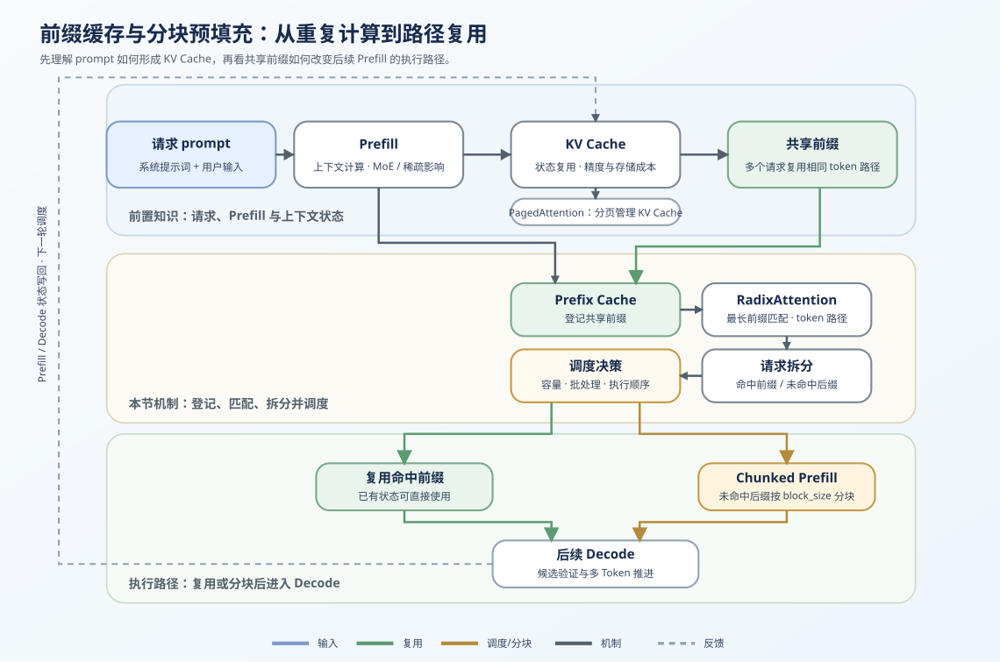
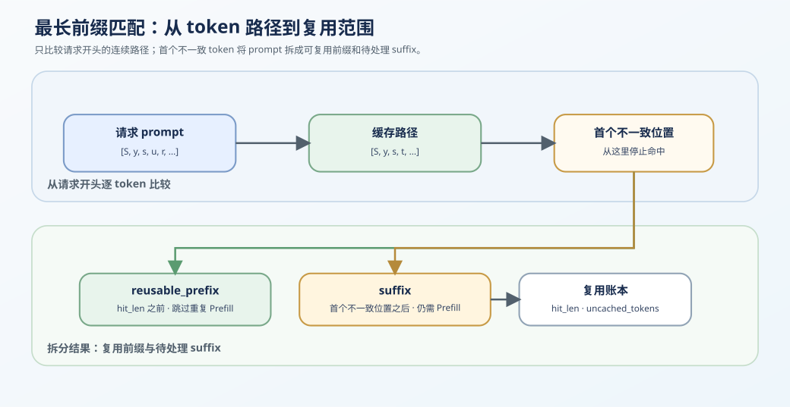

# 24. Prefix Cache Matching and Reuse | Prefix Cache 匹配与复用
**难度：** Hard | **环境：** CPU-first | **标签：** `推理优化`, `KV Cache`, `Prefix Cache` | **目标人群：** 推理优化学习者

> 🚀 **云端运行环境**
>
> 本章节的实战代码可以点击以下链接在免费 GPU 算力平台上直接运行：
>
> [](https://colab.research.google.com/github/datawhalechina/llm-algo-leetcode/blob/main/02_PyTorch_Algorithms/24_Prefix_Cache_Matching_and_Reuse.ipynb)
> [](https://modelscope.cn/my/mynotebook) *(国内推荐：魔搭社区免费实例)*


---

## 本节导读

许多请求会共享 system prompt、工具说明或多轮历史的开头。若每次都重新 Prefill，这段相同输入对应的 KV Cache 会被重复计算；Prefix Cache 的任务是识别这段连续共享前缀，并让后续请求直接复用已有状态。

本节沿着“登记 → 最长匹配 → 复用账本 → 写回新状态”理解前缀缓存。未命中的 suffix 仍需要 Prefill；它如何被切分并与 Decode 协调，放到 [38 Prefill/Decode 调度](./38_Prefill_Decode_Scheduling.md) 继续讨论。

**关键词：** `prefix cache`, `longest-prefix match`, `cache reuse`
## 前置阅读

**导语：** 进入本节前，先能说明 KV Cache 怎样保存已处理 token 的状态；再观察多个请求为何只能复用从开头连续相同的那段输入。

- [P1: 11. KV Cache and Memory Growth | KV Cache 与显存增长](../01_Hardware_Math_and_Systems/11_KV_Cache_and_Memory_Growth.md)
- [22. vLLM PagedAttention | vLLM 分页注意力](./22_vLLM_PagedAttention.md)
### Step 1: 共享前缀为什么值得复用

请求经过 Prefill 后形成 KV Cache。若多个请求从开头开始拥有连续相同的 token，这一段状态可以登记到 Prefix Cache；后续请求命中后不必再次计算。第一个不一致 token 之后的内容是本次仍需处理的 suffix。

| 概念 | 它在请求路径中的含义 | 本次请求如何处理 |
|---|---|---|
| 请求 prompt | 可能包含重复的 system prompt、工具说明或历史上下文 | 与已登记路径比较 |
| 共享前缀 | 从 prompt 开头连续相同的 token 区间 | 复用对应 KV Cache 状态 |
| 未命中 suffix | 从第一个不一致 token 开始的剩余内容 | 继续 Prefill 并产生新状态 |
| 新状态 | 本次 suffix 对应的新增 KV Cache | 写回 Prefix Cache 或进入 Decode |



### Step 2: 最长前缀匹配如何确定复用范围

新请求从 prompt 开头逐 token 与缓存路径比较。连续命中的部分可以复用；从第一个不一致 token 开始直到请求末尾的部分称为 suffix。中间位置偶然相同的 token 不构成命中，因为它之前的状态并不一致。

$$
\text{prompt} = \text{reusable\_prefix} + \text{suffix}
$$

图中只强调匹配机制：连续命中的 `reusable_prefix` 可以跳过重复 Prefill，首个不一致位置之后的 `suffix` 仍需计算。

| 字段 | 含义 | 后续用途 |
|---|---|---|
| `hit_len` | 从 prompt 开头连续命中的 token 数 | 确定可复用状态范围 |
| `reusable_prefix` | 已缓存且命中的前缀 | 跳过这段 Prefill |
| `suffix` | 首个不一致 token 之后的剩余部分 | 产生本次新增状态 |
| 无命中 | `hit_len = 0` | 整个 prompt 仍需 Prefill |




### Step 3: 用复用账本判断本次新增工作

命中不会让请求“没有计算”，而是把本次工作从完整 prompt 缩为 suffix。记录命中 token、未命中 token 和复用比例，才能判断本次请求减少了多少重复 Prefill；suffix 的分块与调度由 [38](./38_Prefill_Decode_Scheduling.md) 继续展开。

| 账本字段 | 含义 | 还应与哪些证据一起查看 |
|---|---|---|
| `hit_tokens` | 本次可复用的前缀 token 数 | backend 的 KV 占用和 TTFT |
| `uncached_tokens` | 仍需执行 Prefill 的 suffix 长度 | Prefill 耗时和吞吐 |
| `reuse_ratio` | `hit_tokens / prompt_tokens` | 匹配 workload 下的命中率分布 |
| 新增状态 | suffix 计算后写入的 KV Cache | 淘汰、迁移与生命周期记录 |


### Step 4: 实现匹配、拆分与复用账本

本节用最小 `PrefixCacheManager` 把前面的概念链落实为五个连续动作：规范输入、登记前缀、计算最长命中、生成请求拆分与复用账本。

| TODO / 实现对象 | 学习者完成的机制 | 必须满足的约束 | 测试证据 |
|---|---|---|---|
| TODO 1 / `_normalize` | 统一 token 容器并校验整数输入 | 保持顺序；非法 token 不能进入缓存索引 | 输入契约 |
| TODO 2 / `add_prefix` | 登记非空且不重复的共享前缀 | 重复登记不增加索引条目 | 登记与去重 |
| TODO 3 / `match_prefix` | 从 prompt 开头选择最长连续命中 | 中间子串不能算命中 | 最长命中与零命中 |
| TODO 4 / `split_prompt` | 按 `hit_len` 拆出 reusable prefix 和 suffix | 两段拼接后必须还原原 prompt | 前缀/后缀契约 |
| TODO 5 / `cache_stats` | 统计命中、未命中和复用比例 | 空 prompt 返回 `0.0`，token 数守恒 | 账本与空输入 |


```python
from typing import List, Sequence, Tuple

```


```python
class PrefixCacheManager:
    """登记共享前缀，并计算一次请求可复用与仍需 Prefill 的 token 账本。

    `cached_prefixes` 是逻辑索引；本题不实现真实 KV Tensor、物理 block 或淘汰策略。
    """

    def __init__(self):
        self.cached_prefixes: List[Tuple[int, ...]] = []

    def _normalize(self, tokens: Sequence[int]) -> List[int]:
        # ==========================================
        # TODO 1：统一 token 表示，便于做前缀匹配
        # 提示：将输入转换为 list，并确认每个 token 都是整数。
        # normalized = ???  # 转成 list，并保持 token 顺序
        # ==========================================
        return normalized

    def add_prefix(self, prefix_tokens: Sequence[int]) -> None:
        # ==========================================
        # TODO 2：登记一个可复用的共享前缀
        # 提示：空前缀应拒绝；重复前缀不应重复登记。
        # prefix = ???  # 规范化后的非空 token 前缀
        # ==========================================
        if prefix not in self.cached_prefixes:
            self.cached_prefixes.append(prefix)

    def match_prefix(self, prompt_tokens: Sequence[int]) -> int:
        # ==========================================
        # TODO 3：返回 prompt 能命中的最长缓存前缀长度
        # 提示：只允许从 prompt 开头连续命中，不能把中间子串当作命中。
        # is_match = ???  # cached_prefix 是否等于 prompt 的开头片段
        # ==========================================
        prompt = self._normalize(prompt_tokens)
        best_len = 0
        for cached_prefix in self.cached_prefixes:
            if len(cached_prefix) > len(prompt):
                continue
            if is_match:
                best_len = max(best_len, len(cached_prefix))
        return best_len

    def split_prompt(self, prompt_tokens: Sequence[int]) -> Tuple[List[int], List[int], int]:
        # ==========================================
        # TODO 4: 拆出可复用前缀和待处理 suffix
        # 提示：hit_len 之前是 reusable_prefix，之后是 suffix。
        # reusable_prefix = ???  # prompt[:hit_len]
        # suffix = ???  # prompt[hit_len:]
        # ==========================================
        prompt = self._normalize(prompt_tokens)
        hit_len = self.match_prefix(prompt)
        return reusable_prefix, suffix, hit_len

    def cache_stats(self, prompt_tokens: Sequence[int]) -> dict:
        """返回 token 级复用账本；不代表真实 KV 显存收益或吞吐。"""
        # ==========================================
        # TODO 5：统计命中、未命中与复用比例
        # 提示：空 prompt 的 reuse_ratio 定义为 0.0，避免除零。
        # hit_tokens = ???  # 命中的连续前缀 token 数
        # uncached_tokens = ???  # 仍需 Prefill 的 token 数
        # reuse_ratio = ???  # 空 prompt 时返回 0.0
        # ==========================================
        return {'hit_tokens': hit_tokens, 'uncached_tokens': uncached_tokens, 'reuse_ratio': reuse_ratio}
```

### 测试


```python
# 机制测试：按输入契约、登记去重、最长命中、请求拆分和复用账本分别定位问题。
# 下面使用按机制拆分的测试入口。
def _prefix_cache_fixture():
    manager = PrefixCacheManager()
    manager.add_prefix([1, 2, 3])
    manager.add_prefix([1, 2, 9])
    manager.add_prefix([1, 2, 3])
    return manager


def test_prefix_input_contract():
    """验证空前缀和非整数 token 会被拒绝。"""
    manager = PrefixCacheManager()
    for invalid_prefix in ([], [1, 'bad']):
        try:
            manager.add_prefix(invalid_prefix)
        except (ValueError, TypeError):
            pass
        else:
            raise AssertionError('空前缀或非整数 token 应被拒绝')

def test_prefix_registration_and_deduplication():
    """验证非空前缀登记以及重复前缀去重。"""
    manager = _prefix_cache_fixture()
    assert manager.cached_prefixes == [(1, 2, 3), (1, 2, 9)]

def test_longest_prefix_match():
    """验证只从 prompt 开头计算最长连续命中。"""
    manager = _prefix_cache_fixture()
    assert manager.match_prefix([1, 2, 3, 9]) == 3
    assert manager.match_prefix([1, 2, 9, 8]) == 3
    assert manager.match_prefix([1, 2, 0]) == 0

def test_prefix_suffix_split_and_stats():
    """验证 prefix/suffix 拆分和 token 级复用账本。"""
    manager = _prefix_cache_fixture()
    prefix, suffix, hit_len = manager.split_prompt([1, 2, 3, 9])
    assert (prefix, suffix, hit_len) == ([1, 2, 3], [9], 3)
    assert manager.cache_stats([1, 2, 3, 9]) == {'hit_tokens': 3, 'uncached_tokens': 1, 'reuse_ratio': 0.75}
    assert manager.cache_stats([]) == {'hit_tokens': 0, 'uncached_tokens': 0, 'reuse_ratio': 0.0}

def test_prefix_cache_manager():
    test_prefix_input_contract()
    test_prefix_registration_and_deduplication()
    test_longest_prefix_match()
    test_prefix_suffix_split_and_stats()
    print('✅ PrefixCacheManager 机制测试通过')

test_prefix_cache_manager()
```


### 参考答案


```python
class PrefixCacheManager:
    """登记共享前缀，并计算一次请求可复用与仍需 Prefill 的 token 账本。

    `cached_prefixes` 是逻辑索引；本题不实现真实 KV Tensor、物理 block 或淘汰策略。
    """

    def __init__(self):
        self.cached_prefixes: List[Tuple[int, ...]] = []

    def _normalize(self, tokens: Sequence[int]) -> List[int]:
        # TODO 1: 统一 token 表示，便于做前缀匹配
        normalized = list(tokens)
        if any(not isinstance(token, int) for token in normalized):
            raise TypeError('tokens 必须是整数序列')
        return normalized

    def add_prefix(self, prefix_tokens: Sequence[int]) -> None:
        # TODO 2: 登记一个可复用的共享前缀
        prefix = tuple(self._normalize(prefix_tokens))
        if not prefix:
            raise ValueError('prefix_tokens 不能为空')
        if prefix not in self.cached_prefixes:
            self.cached_prefixes.append(prefix)

    def match_prefix(self, prompt_tokens: Sequence[int]) -> int:
        # TODO 3: 返回 prompt 能命中的最长缓存前缀长度
        prompt = self._normalize(prompt_tokens)
        best_len = 0
        for cached_prefix in self.cached_prefixes:
            if len(cached_prefix) > len(prompt):
                continue
            is_match = prompt[:len(cached_prefix)] == list(cached_prefix)
            if is_match:
                best_len = max(best_len, len(cached_prefix))
        return best_len

    def split_prompt(self, prompt_tokens: Sequence[int]) -> Tuple[List[int], List[int], int]:
        # TODO 4: 拆出可复用前缀和待处理 suffix
        prompt = self._normalize(prompt_tokens)
        hit_len = self.match_prefix(prompt)
        reusable_prefix = prompt[:hit_len]
        suffix = prompt[hit_len:]
        return reusable_prefix, suffix, hit_len

    def cache_stats(self, prompt_tokens: Sequence[int]) -> dict:
        """返回 token 级复用账本；不代表真实 KV 显存收益或吞吐。"""
        # TODO 5: 统计命中、未命中与复用比例
        prompt = self._normalize(prompt_tokens)
        hit_tokens = self.match_prefix(prompt)
        uncached_tokens = len(prompt) - hit_tokens
        reuse_ratio = hit_tokens / len(prompt) if prompt else 0.0
        return {'hit_tokens': hit_tokens, 'uncached_tokens': uncached_tokens, 'reuse_ratio': round(reuse_ratio, 4)}
```

### 解析

本题依次实现 token 输入规范、共享前缀登记、最长命中、请求拆分和复用账本。答案代码保留与题目区相同的函数和控制流，只补全每处机制决策。

**TODO 1：统一 token 表示**

- 将输入转换为保持顺序的 `list[int]`，并在进入缓存索引前拒绝非整数 token。

**TODO 2：登记共享前缀**

- 先复用 `_normalize` 的输入契约，再拒绝空前缀，并用 tuple 保存稳定索引。
- 重复前缀不增加缓存索引条目。

**TODO 3：返回最长连续命中长度**

- 只比较 prompt 的开头片段，并在候选前缀中返回长度最大的连续命中。
- 中间偶然相同的 token 不构成命中。

**TODO 4：拆分请求**

- 用 `hit_len` 切出 `reusable_prefix` 和 `suffix`，两段拼接后必须还原原 prompt。
- 零命中时 suffix 等于完整 prompt。

**TODO 5：生成复用账本**

- `hit_tokens` 等于最长命中长度，`uncached_tokens` 是剩余 suffix 长度。
- 非空 prompt 的 `reuse_ratio` 为命中比例，空 prompt 返回 `0.0`。
- 这些是 token 级证据，不等于真实 KV 显存节省或 TTFT 提升；物理 KV block 和 suffix 调度分别由 PagedAttention 与 [38](./38_Prefill_Decode_Scheduling.md) 承接。
### 真实 backend benchmark 入口

本节的 CPU 题目已经验证最长前缀命中与复用账本。Prefix Cache 是否改善 TTFT、吞吐和 KV 占用，需要在相同 workload 下比较关闭与开启缓存的真实 backend；请在 [69. Prefix Caching Benchmark](./69_Prefix_Caching_Benchmark.md) 中完成该实验并记录 `hit_rate`、TTFT、TPOT、throughput、peak memory、evidence level 与 decision。


## 相关阅读

**论文与官方实现**

完成前缀登记、最长命中和复用账本后，可以继续阅读物理 KV block 管理、Radix 树复用与真实 benchmark。

- [SGLang 原论文：Efficient Execution of Structured Language Model Programs](https://arxiv.org/abs/2312.07104)
- [vLLM Automatic Prefix Caching 文档](https://docs.vllm.ai/en/latest/features/automatic_prefix_caching.html)
- [34. SGLang RadixAttention | SGLang 基数注意力](./34_SGLang_RadixAttention.md)
- [38. Prefill/Decode 调度](./38_Prefill_Decode_Scheduling.md)
- [69. Prefix Caching Benchmark | 前缀缓存基准](./69_Prefix_Caching_Benchmark.md)