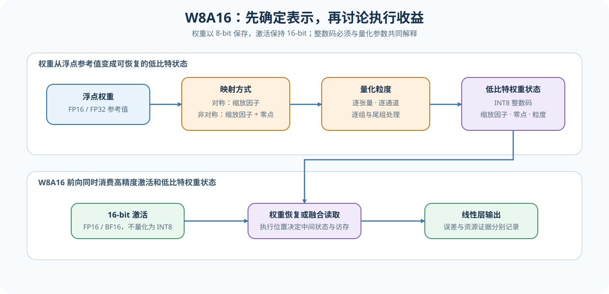
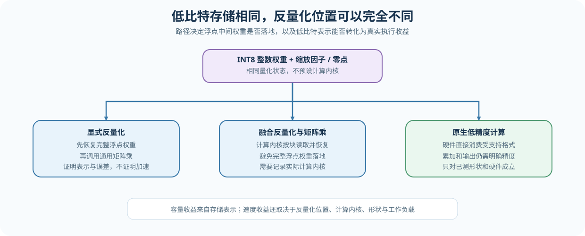

# 25. Quantization W8A16 | W8A16 量化
**难度：** Medium | **环境：** CPU-first | **标签：** `量化压缩`, `W8A16`, `granularity` | **目标人群：** 需要理解量化表示与反量化执行位置的学习者

> 🚀 **云端运行环境**
>
> 本章节的实战代码可以点击以下链接在免费 GPU 算力平台上直接运行：
>
> [](https://colab.research.google.com/github/datawhalechina/llm-algo-leetcode/blob/main/02_PyTorch_Algorithms/25_Quantization_W8A16.ipynb)
> [](https://modelscope.cn/my/mynotebook) *(国内推荐：魔搭社区免费实例)*


---

## 本节导读

量化权重不是把浮点数直接改成整数数据类型：系统还必须保存缩放因子（scale）、必要时保存零点（zero point），并明确这些参数由整个张量、每个输出通道还是每个分组共享。不同粒度会同时改变恢复误差、元数据和计算内核读取方式。

本节以 W8A16 线性层为例，先建立对称与非对称量化表示，再比较逐张量（per-tensor）、逐通道（per-channel）和逐组（per-group）粒度，最后判断低比特存储怎样转化为计算收益。W8A16 描述权重和激活的表示，不自动等于纯整数执行。

**关键词：** `W8A16`, `scale`, `zero point`, `granularity`, `dequantization`

---

## 前置阅读

**导语：** 先理解浮点数据类型与整数映射，再观察权重表示、粒度和执行路径如何改变成本。

- [Part 01 · 01 Data Types and Precision | 数据类型与精度](../01_Hardware_Math_and_Systems/01_Data_Types_and_Precision.md)
- [Part 01 · 21 Quantization Theory | 量化理论与 INT4/INT8](../01_Hardware_Math_and_Systems/21_Quantization_Theory_and_INT4_INT8.md)

---

### Step 1：整数码、缩放因子与零点如何表示权重

量化状态至少包含整数码和缩放因子；非对称量化还需要零点表示实数零落在哪个整数码点。对称量化令零点为 0，适合分布大致围绕零的权重；非对称量化利用完整整数区间，更适合明显偏移的分布，但会增加参数与核函数处理条件。

| 表示 | 映射方式 | 优点 | 代价与适用条件 |
|---|---|---|---|
| 对称量化 | `q = round(x / scale)`，`zero_point = 0` | 公式和计算内核更简单 | 偏移分布可能浪费码点 |
| 非对称量化 | `q = round(x / scale + zero_point)` | 更充分覆盖 `[min, max]` | 需要保存并处理零点 |
| 反量化 | `x_hat = (q - zero_point) × scale` | 恢复近似浮点权重 | 舍入与截断误差不可逆 |
| W8A16 | 权重 8-bit，激活 16-bit | 降低权重存储与读取成本 | 不保证矩阵乘采用纯整数计算内核 |



### Step 2：量化粒度如何改变误差与元数据

粒度决定多少个权重共享一组量化参数。共享范围越大，缩放因子数量越少，但异常值更容易压缩其他数值的有效码点；范围越小，局部误差通常更低，却会增加缩放因子、零点和核函数索引成本。比较粒度时，量化值、缩放因子、零点和尾组都必须进入字节账本，并同时观察容量代价与误差传播。

| 粒度 | 参数共享范围 | 缩放因子数量 | 典型取舍 |
|---|---|---:|---|
| 逐张量 | 整个权重张量 | 1 | 元数据最少，容易受全局异常值影响 |
| 逐通道 | 每个输出通道 | `out_features` | Linear 常用，误差与实现复杂度较平衡 |
| 逐组 | 每个输出通道内固定长度 group | `out_features × ceil(in_features / group_size)` | 局部误差更低，元数据与计算内核约束更多 |

### Step 3：反量化发生在哪里，为什么会影响真实性能

仅权重量化（weight-only quantization）描述的是“权重以低比特保存”，不是“整个线性层使用整数算术”。反量化可以发生在算子调用前，也可以与矩阵乘融合；不同位置决定中间权重是否落地，以及低比特表示能否转化为真实的访存和延迟收益。

| 执行路径 | 反量化位置 | 可以证明什么 | 不能直接推出什么 |
|---|---|---|---|
| eager dequantization | 通用矩阵乘前显式恢复浮点权重 | 表示、误差与状态账本 | 量化计算内核加速 |
| fused dequant + matmul | 计算内核读取低比特权重时恢复 | 减少中间权重与访存 | 端到端服务收益 |
| integer / low-precision 计算内核 | 目标计算单元直接消费受支持格式 | 真实低精度执行 | 其他形状、硬件和工作负载的收益 |



### Step 4：实现量化参数、粒度状态与 W8A16 前向

题目区用二维权重和一个教学 Linear 复现 W8A16 的表示链。骨架已经提供粒度循环、状态保存、通用反量化和粒度对照汇总；你需要分别补全对称与非对称量化参数、尾组数量，以及显式反量化前向。完成后，`compare_granularity_tradeoffs` 会把三个粒度转换成同口径的误差与字节账本。

| 任务与目的 | 已知条件 | 完成标准 | 测试验证 |
|:---|:---|:---|:---|
| TODO 1：计算对称量化参数 | `qmin=-127`、`qmax=127`、浮点 Tensor | absmax 映射到正缩放因子，`zero_point=0` | 正负范围、全零 Tensor |
| TODO 2：计算非对称量化参数 | `qmin=-128`、`qmax=127`、浮点 Tensor | `[min,max]` 覆盖整数区间，零点被裁剪 | 偏移范围、常量 Tensor |
| TODO 3：计算逐组状态数量 | `in_features` 与正 `effective_group_size` | 向上取整，尾组不丢失 | 三种粒度、不可整除尾组 |
| TODO 4：执行 W8A16 教学前向 | 已保存 INT8 权重与逐通道量化参数 | 按输入数据类型恢复权重，输出与显式参考一致 | FP32/FP16 数据类型、形状、数值结果 |
| 已提供：汇总粒度取舍 | 同一二维权重、输入和分组大小 | 输出 qparam、总状态字节与权重/输出误差 | 字段完整性、容量顺序与误差趋势 |


```python
import torch
import torch.nn as nn
import torch.nn.functional as F
```


```python
def calculate_qparams(
    values: torch.Tensor, *, symmetric: bool, eps: float = 1e-8
) -> tuple[torch.Tensor, torch.Tensor, int, int]:
    """返回缩放因子、零点、qmin 和 qmax。"""
    if values.numel() == 0 or not values.is_floating_point():
        raise ValueError("values must be a non-empty floating tensor")
    qmin, qmax = (-127, 127) if symmetric else (-128, 127)
    if symmetric:
        # TODO 1（对称量化参数）：用 absmax 覆盖正负范围，并保持零点为零。
        # 注意：全零 Tensor 也必须得到正缩放因子，且统计过程不保留计算图。
        # absmax = ???      # 浮点权重的绝对最大值。
        # scale = ???       # 有限且为正的缩放因子。
        # zero_point = ???  # 与缩放因子同设备的零值 Tensor。
        raise NotImplementedError("TODO 1: calculate symmetric qparams")
    # TODO 2（非对称量化参数）：用 min/max 覆盖整数区间，并把零点裁剪到合法码值。
    # 注意：常量 Tensor 不能产生零缩放因子。
    # minimum = ???     # 浮点权重最小值。
    # maximum = ???     # 浮点权重最大值。
    # scale = ???       # 覆盖完整整数区间的正缩放因子。
    # zero_point = ???  # 裁剪到 [qmin, qmax] 的整数零点。
    raise NotImplementedError("TODO 2: calculate asymmetric qparams")


def _quantize_chunk(chunk: torch.Tensor, *, symmetric: bool):
    scale, zero_point, qmin, qmax = calculate_qparams(chunk, symmetric=symmetric)
    quantized = torch.clamp(torch.round(chunk / scale + zero_point), qmin, qmax).to(torch.int8)
    return quantized, scale, zero_point


def quantize_weight(
    weight: torch.Tensor, *, granularity: str = "per_channel",
    group_size: int | None = None, symmetric: bool = True,
) -> dict[str, torch.Tensor | str | int]:
    """沿最后一维建立逐张量、逐通道或逐组权重量化状态。"""
    if weight.ndim != 2 or not weight.is_floating_point():
        raise ValueError("weight must be a 2D floating tensor")
    if granularity not in {"per_tensor", "per_channel", "per_group"}:
        raise ValueError("unsupported granularity")

    out_features, in_features = weight.shape
    if granularity == "per_tensor":
        quantized, scale, zero_point = _quantize_chunk(weight, symmetric=symmetric)
        return {
            "quantized": quantized,
            "scale": scale.reshape(1, 1),
            "zero_point": zero_point.reshape(1, 1),
            "granularity": granularity,
            "group_size": in_features * out_features,
        }

    effective_group_size = in_features if granularity == "per_channel" else group_size
    if effective_group_size is None or effective_group_size <= 0:
        raise ValueError("per_group quantization requires a positive group_size")
    # TODO 3（粒度划分）：计算最后一维需要的 group 数；不足一组的尾部也要占一个 group。
    # n_groups = ???  # 沿 in_features 向上取整后的分组数。
    raise NotImplementedError("TODO 3: count groups without dropping the tail")
    quantized = torch.empty_like(weight, dtype=torch.int8)
    scales = torch.empty((out_features, n_groups), dtype=torch.float32, device=weight.device)
    zero_points = torch.empty((out_features, n_groups), dtype=torch.float32, device=weight.device)
    for row in range(out_features):
        for group in range(n_groups):
            start = group * effective_group_size
            end = min(start + effective_group_size, in_features)
            q, scale, zero_point = _quantize_chunk(weight[row, start:end], symmetric=symmetric)
            quantized[row, start:end] = q
            scales[row, group] = scale
            zero_points[row, group] = zero_point
    return {
        "quantized": quantized,
        "scale": scales,
        "zero_point": zero_points,
        "granularity": granularity,
        "group_size": effective_group_size,
    }


def dequantize_weight(state: dict[str, torch.Tensor | str | int], dtype: torch.dtype) -> torch.Tensor:
    """按状态中的粒度恢复近似浮点权重。"""
    quantized = state["quantized"]
    scale = state["scale"]
    zero_point = state["zero_point"]
    granularity = state["granularity"]
    if granularity == "per_tensor":
        return ((quantized.float() - zero_point) * scale).to(dtype)

    group_size = int(state["group_size"])
    restored = torch.empty_like(quantized, dtype=torch.float32)
    for row in range(quantized.shape[0]):
        for group in range(scale.shape[1]):
            start = group * group_size
            end = min(start + group_size, quantized.shape[1])
            restored[row, start:end] = (quantized[row, start:end].float() - zero_point[row, group]) * scale[row, group]
    return restored.to(dtype)


def compare_granularity_tradeoffs(
    weight: torch.Tensor, inputs: torch.Tensor, *, group_sizes: tuple[int, ...] = (32, 64, 128),
    symmetric: bool = True,
) -> list[dict[str, float | int | str]]:
    """在相同权重与输入上汇总粒度的 qparam、状态字节和恢复误差。"""
    if inputs.shape[-1] != weight.shape[1]:
        raise ValueError("inputs last dimension must match weight in_features")
    specs = [("per_tensor", None), ("per_channel", None)]
    specs.extend(("per_group", size) for size in group_sizes)
    reference_output = F.linear(inputs, weight)
    rows = []
    for granularity, group_size in specs:
        state = quantize_weight(
            weight, granularity=granularity, group_size=group_size, symmetric=symmetric
        )
        restored = dequantize_weight(state, weight.dtype)
        candidate_output = F.linear(inputs, restored)
        scale = state["scale"]
        zero_point = state["zero_point"]
        quantized = state["quantized"]
        qparam_count = scale.numel() + (0 if symmetric else zero_point.numel())
        qparam_bytes = scale.numel() * scale.element_size()
        if not symmetric:
            qparam_bytes += zero_point.numel() * zero_point.element_size()
        delta = candidate_output.float() - reference_output.float()
        rows.append({
            "granularity": granularity,
            "group_size": int(state["group_size"]),
            "qparam_count": int(qparam_count),
            "qparam_bytes": int(qparam_bytes),
            "quantized_weight_bytes": int(quantized.numel() * quantized.element_size()),
            "total_state_bytes": int(quantized.numel() * quantized.element_size() + qparam_bytes),
            "weight_mse": float((restored.float() - weight.float()).square().mean()),
            "output_mse": float(delta.square().mean()),
            "output_cosine": float(F.cosine_similarity(
                candidate_output.float().flatten(), reference_output.float().flatten(), dim=0
            )),
        })
    return rows


class W8A16Linear(nn.Module):
    """保存 INT8 权重与逐通道量化参数，并以高精度激活执行教学前向。"""

    def __init__(self, in_features: int, out_features: int):
        super().__init__()
        self.in_features = in_features
        self.out_features = out_features
        self.register_buffer("weight_int8", torch.zeros((out_features, in_features), dtype=torch.int8))
        self.register_buffer("scale", torch.ones((out_features, 1), dtype=torch.float32))
        self.register_buffer("zero_point", torch.zeros((out_features, 1), dtype=torch.float32))
        self.bias = nn.Parameter(torch.zeros(out_features))

    def from_float(self, linear_layer: nn.Linear):
        """把浮点 Linear 转为对称逐通道 W8A16 状态。"""
        if linear_layer.weight.shape != self.weight_int8.shape:
            raise ValueError("linear layer shape does not match")
        state = quantize_weight(linear_layer.weight.detach(), granularity="per_channel", symmetric=True)
        with torch.no_grad():
            self.weight_int8.copy_(state["quantized"])
            self.scale.copy_(state["scale"])
            self.zero_point.copy_(state["zero_point"])
            if linear_layer.bias is not None:
                self.bias.copy_(linear_layer.bias)
        return self

    def forward(self, x: torch.Tensor) -> torch.Tensor:
        """显式反量化权重，再执行高精度激活路径。"""
        state = {"quantized": self.weight_int8, "scale": self.scale,
                 "zero_point": self.zero_point, "granularity": "per_channel",
                 "group_size": self.in_features}
        # TODO 4（反量化前向）：恢复与输入同数据类型的权重，再执行线性计算。
        # 注意：bias 也要转换到输入数据类型；不要修改持久化的 INT8 状态。
        # weight = ???  # 与输入数据类型一致的恢复权重。
        # output = ???  # 使用恢复权重和同数据类型 bias 的线性层输出。
        raise NotImplementedError("TODO 4: dequantize weights and run linear")

```

### 测试

测试分别验证量化参数、粒度状态、尾组以及 W8A16 前向契约；每个机制 TODO 都有独立测试入口。

```python
# 机制测试：量化参数、粒度状态、尾组和 W8A16 反量化前向。
def test_symmetric_qparams_contract():
    """TODO 1：对称量化保持零点为零，并处理全零范围。"""
    symmetric = calculate_qparams(torch.tensor([-2.0, 1.0]), symmetric=True)
    assert symmetric[1].item() == 0
    assert symmetric[2:] == (-127, 127)
    assert torch.isfinite(calculate_qparams(torch.zeros(4), symmetric=True)[0])


def test_asymmetric_qparams_contract():
    """TODO 2：非对称量化覆盖偏移范围，并处理常量 Tensor。"""
    asymmetric = calculate_qparams(torch.tensor([1.0, 3.0]), symmetric=False)
    constant = calculate_qparams(torch.ones(4), symmetric=False)
    assert asymmetric[1].item() != 0
    assert asymmetric[2:] == (-128, 127)
    assert constant[0].item() > 0 and torch.isfinite(constant[0])


def test_granularity_state_shapes():
    """TODO 3：三种粒度产生不同数量的量化参数，并保留权重形状。"""
    weight = torch.tensor([[1.0, -2.0, 3.0, -4.0, 5.0], [0.5, 0.25, -0.75, 1.5, -2.0]])
    tensor_state = quantize_weight(weight, granularity="per_tensor")
    channel_state = quantize_weight(weight, granularity="per_channel")
    group_state = quantize_weight(weight, granularity="per_group", group_size=2)
    assert tensor_state["scale"].shape == (1, 1)
    assert channel_state["scale"].shape == (2, 1)
    assert group_state["scale"].shape == (2, 3)
    assert group_state["quantized"].shape == weight.shape


def test_tail_group_and_dequantization():
    """非整除尾组不会丢失，恢复结果保持有限。"""
    weight = torch.arange(10, dtype=torch.float32).reshape(2, 5) - 4
    state = quantize_weight(weight, granularity="per_group", group_size=3, symmetric=False)
    restored = dequantize_weight(state, torch.float32)
    assert state["scale"].shape == (2, 2)
    assert restored.shape == weight.shape
    assert torch.isfinite(restored).all()


def test_granularity_tradeoff_matrix():
    """粒度矩阵同时报告最小 qparam 字节、总状态字节和误差。"""
    weight = torch.tensor([[0.1, 0.2, 5.0, 6.0], [-0.2, -0.1, -4.0, -5.0]])
    inputs = torch.tensor([[1.0, -1.0, 0.5, -0.5]])
    rows = compare_granularity_tradeoffs(weight, inputs, group_sizes=(2,))
    assert [row["qparam_count"] for row in rows] == [1, 2, 4]
    assert rows[0]["qparam_bytes"] < rows[1]["qparam_bytes"] < rows[2]["qparam_bytes"]
    assert all(torch.isfinite(torch.tensor(row["weight_mse"])) for row in rows)
    assert all(row["total_state_bytes"] >= row["quantized_weight_bytes"] for row in rows)
    assert all(-1.0 <= row["output_cosine"] <= 1.0 for row in rows)


def test_w8a16_linear_contract():
    """TODO 4：教学前向与显式逐通道反量化参考结果一致。"""
    torch.manual_seed(42)
    fp_linear = nn.Linear(8, 4)
    quantized = W8A16Linear(8, 4).from_float(fp_linear)
    x = torch.randn(2, 8)
    state = {"quantized": quantized.weight_int8, "scale": quantized.scale,
             "zero_point": quantized.zero_point, "granularity": "per_channel", "group_size": 8}
    reference = F.linear(x, dequantize_weight(state, x.dtype), quantized.bias)
    assert torch.allclose(quantized(x), reference, atol=1e-6)
    assert quantized.weight_int8.dtype == torch.int8


def test_fp16_activation_contract():
    """A16 路径保持激活和输出为 FP16。"""
    layer = W8A16Linear(8, 4).from_float(nn.Linear(8, 4))
    output = layer(torch.randn(2, 8, dtype=torch.float16))
    assert output.dtype == torch.float16 and output.shape == (2, 4)


for test in (
    test_symmetric_qparams_contract,
    test_asymmetric_qparams_contract,
    test_granularity_state_shapes,
    test_tail_group_and_dequantization,
    test_granularity_tradeoff_matrix,
    test_w8a16_linear_contract,
    test_fp16_activation_contract,
):
    test()
print("✅ W8A16 机制测试通过：qparams、粒度、尾组与反量化前向均已验证。")

```

---

🛑 **STOP HERE** 🛑
<br><br><br><br><br><br><br><br><br><br>
> 请先尝试自己完成代码并跑通测试。<br>
> 如果遇到困难，再向下查看参考代码与解析。
<br><br><br><br><br><br><br><br><br><br>

---
## 参考代码与解析

### 代码

```python
def calculate_qparams(
    values: torch.Tensor, *, symmetric: bool, eps: float = 1e-8
) -> tuple[torch.Tensor, torch.Tensor, int, int]:
    """返回缩放因子、零点、qmin 和 qmax。"""
    if values.numel() == 0 or not values.is_floating_point():
        raise ValueError("values must be a non-empty floating tensor")
    qmin, qmax = (-127, 127) if symmetric else (-128, 127)
    # TODO 1（对称量化参数）：用 absmax 覆盖正负范围，并保持零点为零。
    # 注意：全零 Tensor 也必须得到正缩放因子，且统计过程不保留计算图。
    # absmax = ???      # 浮点权重的绝对最大值。
    # scale = ???       # 有限且为正的缩放因子。
    # zero_point = ???  # 与缩放因子同设备的零值 Tensor。
    if symmetric:
        absmax = values.detach().float().abs().max().clamp_min(eps)
        scale = absmax / qmax
        zero_point = torch.zeros_like(scale)
        return scale, zero_point, qmin, qmax
    # TODO 2（非对称量化参数）：用 min/max 覆盖整数区间，并把零点裁剪到合法码值。
    # 注意：常量 Tensor 不能产生零缩放因子。
    # minimum = ???     # 浮点权重最小值。
    # maximum = ???     # 浮点权重最大值。
    # scale = ???       # 覆盖完整整数区间的正缩放因子。
    # zero_point = ???  # 裁剪到 [qmin, qmax] 的整数零点。
    minimum = values.detach().float().min()
    maximum = values.detach().float().max()
    scale = ((maximum - minimum) / (qmax - qmin)).clamp_min(eps)
    zero_point = torch.clamp(torch.round(qmin - minimum / scale), qmin, qmax)
    return scale, zero_point, qmin, qmax


def _quantize_chunk(chunk: torch.Tensor, *, symmetric: bool):
    scale, zero_point, qmin, qmax = calculate_qparams(chunk, symmetric=symmetric)
    quantized = torch.clamp(torch.round(chunk / scale + zero_point), qmin, qmax).to(torch.int8)
    return quantized, scale, zero_point


def quantize_weight(
    weight: torch.Tensor, *, granularity: str = "per_channel",
    group_size: int | None = None, symmetric: bool = True,
) -> dict[str, torch.Tensor | str | int]:
    """沿最后一维建立逐张量、逐通道或逐组权重量化状态。"""
    if weight.ndim != 2 or not weight.is_floating_point():
        raise ValueError("weight must be a 2D floating tensor")
    if granularity not in {"per_tensor", "per_channel", "per_group"}:
        raise ValueError("unsupported granularity")

    out_features, in_features = weight.shape
    if granularity == "per_tensor":
        quantized, scale, zero_point = _quantize_chunk(weight, symmetric=symmetric)
        return {
            "quantized": quantized,
            "scale": scale.reshape(1, 1),
            "zero_point": zero_point.reshape(1, 1),
            "granularity": granularity,
            "group_size": in_features * out_features,
        }

    effective_group_size = in_features if granularity == "per_channel" else group_size
    if effective_group_size is None or effective_group_size <= 0:
        raise ValueError("per_group quantization requires a positive group_size")
    # TODO 3（粒度划分）：计算最后一维需要的 group 数；不足一组的尾部也要占一个 group。
    # n_groups = ???  # 沿 in_features 向上取整后的分组数。
    n_groups = (in_features + effective_group_size - 1) // effective_group_size
    quantized = torch.empty_like(weight, dtype=torch.int8)
    scales = torch.empty((out_features, n_groups), dtype=torch.float32, device=weight.device)
    zero_points = torch.empty((out_features, n_groups), dtype=torch.float32, device=weight.device)
    for row in range(out_features):
        for group in range(n_groups):
            start = group * effective_group_size
            end = min(start + effective_group_size, in_features)
            q, scale, zero_point = _quantize_chunk(weight[row, start:end], symmetric=symmetric)
            quantized[row, start:end] = q
            scales[row, group] = scale
            zero_points[row, group] = zero_point
    return {
        "quantized": quantized,
        "scale": scales,
        "zero_point": zero_points,
        "granularity": granularity,
        "group_size": effective_group_size,
    }


def dequantize_weight(state: dict[str, torch.Tensor | str | int], dtype: torch.dtype) -> torch.Tensor:
    """按状态中的粒度恢复近似浮点权重。"""
    quantized = state["quantized"]
    scale = state["scale"]
    zero_point = state["zero_point"]
    granularity = state["granularity"]
    if granularity == "per_tensor":
        return ((quantized.float() - zero_point) * scale).to(dtype)

    group_size = int(state["group_size"])
    restored = torch.empty_like(quantized, dtype=torch.float32)
    for row in range(quantized.shape[0]):
        for group in range(scale.shape[1]):
            start = group * group_size
            end = min(start + group_size, quantized.shape[1])
            restored[row, start:end] = (quantized[row, start:end].float() - zero_point[row, group]) * scale[row, group]
    return restored.to(dtype)


def compare_granularity_tradeoffs(
    weight: torch.Tensor, inputs: torch.Tensor, *, group_sizes: tuple[int, ...] = (32, 64, 128),
    symmetric: bool = True,
) -> list[dict[str, float | int | str]]:
    """在相同权重与输入上汇总粒度的 qparam、状态字节和恢复误差。"""
    if inputs.shape[-1] != weight.shape[1]:
        raise ValueError("inputs last dimension must match weight in_features")
    specs = [("per_tensor", None), ("per_channel", None)]
    specs.extend(("per_group", size) for size in group_sizes)
    reference_output = F.linear(inputs, weight)
    rows = []
    for granularity, group_size in specs:
        state = quantize_weight(
            weight, granularity=granularity, group_size=group_size, symmetric=symmetric
        )
        restored = dequantize_weight(state, weight.dtype)
        candidate_output = F.linear(inputs, restored)
        scale = state["scale"]
        zero_point = state["zero_point"]
        quantized = state["quantized"]
        qparam_count = scale.numel() + (0 if symmetric else zero_point.numel())
        qparam_bytes = scale.numel() * scale.element_size()
        if not symmetric:
            qparam_bytes += zero_point.numel() * zero_point.element_size()
        delta = candidate_output.float() - reference_output.float()
        rows.append({
            "granularity": granularity,
            "group_size": int(state["group_size"]),
            "qparam_count": int(qparam_count),
            "qparam_bytes": int(qparam_bytes),
            "quantized_weight_bytes": int(quantized.numel() * quantized.element_size()),
            "total_state_bytes": int(quantized.numel() * quantized.element_size() + qparam_bytes),
            "weight_mse": float((restored.float() - weight.float()).square().mean()),
            "output_mse": float(delta.square().mean()),
            "output_cosine": float(F.cosine_similarity(
                candidate_output.float().flatten(), reference_output.float().flatten(), dim=0
            )),
        })
    return rows


class W8A16Linear(nn.Module):
    """保存 INT8 权重与逐通道量化参数，并以高精度激活执行教学前向。"""

    def __init__(self, in_features: int, out_features: int):
        super().__init__()
        self.in_features = in_features
        self.out_features = out_features
        self.register_buffer("weight_int8", torch.zeros((out_features, in_features), dtype=torch.int8))
        self.register_buffer("scale", torch.ones((out_features, 1), dtype=torch.float32))
        self.register_buffer("zero_point", torch.zeros((out_features, 1), dtype=torch.float32))
        self.bias = nn.Parameter(torch.zeros(out_features))

    def from_float(self, linear_layer: nn.Linear):
        """把浮点 Linear 转为对称逐通道 W8A16 状态。"""
        if linear_layer.weight.shape != self.weight_int8.shape:
            raise ValueError("linear layer shape does not match")
        state = quantize_weight(linear_layer.weight.detach(), granularity="per_channel", symmetric=True)
        with torch.no_grad():
            self.weight_int8.copy_(state["quantized"])
            self.scale.copy_(state["scale"])
            self.zero_point.copy_(state["zero_point"])
            if linear_layer.bias is not None:
                self.bias.copy_(linear_layer.bias)
        return self

    def forward(self, x: torch.Tensor) -> torch.Tensor:
        """显式反量化权重，再执行高精度激活路径。"""
        # TODO 4（反量化前向）：恢复与输入同数据类型的权重，再执行线性计算。
        # 注意：bias 也要转换到输入数据类型；不要修改持久化的 INT8 状态。
        # weight = ???  # 与输入数据类型一致的恢复权重。
        # output = ???  # 使用恢复权重和同数据类型 bias 的线性层输出。
        state = {"quantized": self.weight_int8, "scale": self.scale,
                 "zero_point": self.zero_point, "granularity": "per_channel",
                 "group_size": self.in_features}
        weight = dequantize_weight(state, x.dtype)
        output = F.linear(x, weight, self.bias.to(x.dtype))
        return output

```

### 解析

**TODO 1：对称量化参数。** 对称量化使用绝对最大值覆盖正负范围并固定 `zero_point=0`；全零范围使用 `eps` 保持缩放因子为正。

**TODO 2：非对称量化参数。** 非对称量化用 `[min,max]` 映射完整整数区间，并把零点裁剪到 `[qmin,qmax]`；常量范围同样需要正缩放因子。

**TODO 3：粒度划分。** 逐通道等价于每个输出通道一个 group；逐组对最后一维向上取整，确保尾组不丢失。缩放因子和零点的数量必须进入状态账本。

**TODO 4：反量化前向。** 教学实现先按输入数据类型恢复浮点权重再调用 `F.linear`，因此只验证 W8A16 表示与误差，不构成 INT8 计算内核证据。成熟执行后端可以融合读取、反量化和矩阵乘。

**粒度对照。** `compare_granularity_tradeoffs` 固定权重和输入，分别报告最小必要量化参数、总状态字节、权重 MSE 与输出误差。更细粒度通常降低局部误差，但增加的量化参数是否值得，仍需结合权重形状和后端支持判断。

### Step 5：可选 GPU 实验——用 torchao 比较 FP16 与 W8A16

CPU 题目确认整数码、缩放因子、量化粒度和反量化误差；GPU 实验把同一模型层转换为 torchao INT8 仅权重表示，分别测量物理状态、输出偏差和不同 Token 负载下的执行时间。这样可以区分“权重更小”“结果仍可信”和“当前负载更快”三个结论。

| 学习问题 | CPU 已确认 | GPU 要确认 |
|---|---|---|
| W8A16 的表示与执行收益是否一致 | 量化参数、粒度状态和显式反量化 | 真实量化状态是否缩小、输出是否保持一致、哪些层与 Token 负载获得执行收益 |

#### 5.1 环境、真实层角色与 Token 负载矩阵

本实验使用 `Q-CUDA-MECHANISM`。首次运行请先完成[量化机制 GPU 环境 Quickstart](../topic_discussion/quantization_compression/quickstart.md#q-cuda-mechanism-quickstart)，已有环境只需激活、执行 Profile 预检并从同一解释器启动 JupyterLab。预检确认存在 ROS、系统 Python 或用户目录污染时，再查看[环境隔离故障处理](../gpu_environment_assets.md#environment-isolation-troubleshooting)；正常环境不需要修改 `PYTHONPATH`。

| 配置层 | 本节固定口径 | 修改规则 |
|---|---|---|
| 运行环境 | `Q-CUDA-MECHANISM`；单张 NVIDIA GPU；参考显存 8 GiB | 不与 vLLM/SGLang 环境混装；预检失败时先修复环境 |
| 工作负载 | `Qwen/Qwen2.5-0.5B-Instruct`；`q_proj`、`gate_proj`、`down_proj`；Token 数 1、32、256 | 改变模型、层角色或长度矩阵后新建工作负载版本 |
| 配对变量 | FP16 Linear → torchao INT8 仅权重量化 | baseline 与 candidate 共用权重来源和随机输入，只改变权重表示 |
| 测量方法 | 张量子类展开后的物理状态；CUDA Event 分块计时；输出误差 | 不用逻辑形状推断压缩字节，不用单次主机计时判断微小 Kernel |
| 结果资产 | `benchmarks/results/25_torchao_w8a16_layer_microbenchmark_<run_label>.json` | 正式复测固定模型提交哈希并使用唯一运行标签 |

该工作负载不下载数据集或加载分词器，只下载模型权重并构造固定随机激活。`dry_run` 用于核对配置，`real_gpu` 执行真实矩阵；运行开关不会安装依赖或修复环境。


```python
# 5.1 只定义学习者入口、模型来源与固定实验协议；安装和缓存规则由环境 Profile 维护。
# 学习者入口：普通复测通常只修改这两项。
RUN_MODE = "dry_run"  # 默认值 dry_run：只登记计划；改为 real_gpu 才执行真实 GPU 矩阵。
RUN_LABEL = "default"  # 默认值 default；正式复测改为唯一标签，避免覆盖同名结果。

# 模型来源：main 会在 5.2 自动解析并记录为本次运行实际使用的 commit。
MODEL_ID = "Qwen/Qwen2.5-0.5B-Instruct"  # 真实层来源；换模型后结果不可直接合并。
MODEL_REVISION = "main"  # 请求的 Hub revision；可填写分支、标签或 commit hash。

# 固定工作负载：改变层角色、输入形状或 Token 矩阵后递增协议版本。
ENVIRONMENT_PROFILE = "Q-CUDA-MECHANISM"  # 固定环境身份；必须先通过同名 Profile 预检。
WORKLOAD_ID = "quant-w8a16-layer"  # 稳定工作负载身份，不在 ID 中重复编码版本。
WORKLOAD_VERSION = "v3"  # v3 使用 median/P95 双阈值识别加速候选。
TARGET_LAYERS = ("q_proj", "gate_proj", "down_proj")  # 覆盖 Attention 与两类 MLP 投影。
TOKEN_COUNTS = (1, 32, 256)  # 覆盖 Decode 到较大 Prefill 类 Token 负载。

# 固定测量协议：普通复测保持不变，修改后应更新 WORKLOAD_VERSION。
WARMUP_STEPS = 10  # 预热次数；不进入统计。
REPEAT_STEPS = 20  # 独立计时块数量；用于计算中位数和 P95。
INNER_LOOPS = 100  # 每个计时块内的前向次数；用于降低微小 Kernel 的计时噪声。
MEANINGFUL_MEDIAN_RATIO = 0.90  # 候选中位延迟至少降低 10%，才进入加速候选。
STABLE_P95_RATIO = 0.95  # 候选 P95 至少降低 5%，排除只改善中位数的抖动。
SEED = 42  # 固定随机激活；改变后必须另存运行记录。

# 派生输出：路径只由 RUN_LABEL 决定，不需要单独修改。
OUTPUT_RELATIVE_PATH = f"02_PyTorch_Algorithms/benchmarks/results/25_torchao_w8a16_layer_microbenchmark_{RUN_LABEL}.json"  # 仓库相对结果路径；由 5.2 锚定到仓库根目录。

```

#### 5.2 执行层角色 × Token 负载配对实验

执行单元从同一模型检查点复制 FP16 层和 INT8 仅权重候选，对每个层角色与 Token 负载复用相同输入。物理状态通过 TorchAO 张量子类的内部张量统计，执行时间通过 CUDA Event 分块测量，最终将容量、误差、延迟和失败状态写入同一份 JSON。


```python
# 5.2 读取 5.1 的唯一配置，执行层角色 × Token 负载配对实验并保存 JSON。
from tools.notebook_runtime import package_version, resolve_model_commit
from tools.project_runtime import resolve_project_root
from tools.quantization_runtime import tensor_storage_components

import copy
import importlib.metadata
import json
import os
import platform
import statistics
from pathlib import Path

import torch


REPO_ROOT = resolve_project_root()
OUTPUT_PATH = REPO_ROOT / OUTPUT_RELATIVE_PATH


def measure(module, inputs):
    """使用 CUDA Event 分块测量单次前向延迟与增量峰值显存。"""
    with torch.inference_mode():
        for _ in range(WARMUP_STEPS):
            module(inputs)
        torch.cuda.synchronize()
        allocated_before = int(torch.cuda.memory_allocated())
        torch.cuda.reset_peak_memory_stats()
        timings_ms = []
        output = None
        for _ in range(REPEAT_STEPS):
            started = torch.cuda.Event(enable_timing=True)
            finished = torch.cuda.Event(enable_timing=True)
            started.record()
            for _ in range(INNER_LOOPS):
                output = module(inputs)
            finished.record()
            finished.synchronize()
            timings_ms.append(started.elapsed_time(finished) / INNER_LOOPS)
        peak_increment = max(
            0, int(torch.cuda.max_memory_allocated()) - allocated_before
        )
    ordered = sorted(timings_ms)
    p95_index = min(len(ordered) - 1, int(0.95 * len(ordered)))
    return output, {
        "median_latency_ms": statistics.median(timings_ms),
        "p95_latency_ms": ordered[p95_index],
        "incremental_peak_bytes": peak_increment,
    }


result = {
    "schema_version": "quantization-mechanism-gpu/v5",
    "chapter": "25",
    "environment_profile": ENVIRONMENT_PROFILE,
    "run_mode": RUN_MODE,
    "run_label": RUN_LABEL,
    "framework": {
        "python": platform.python_version(),
        "torch": torch.__version__,
        "transformers": package_version("transformers"),
        "torchao": package_version("torchao"),
    },
    "hardware": {
        "cuda_available": torch.cuda.is_available(),
        "cuda": torch.version.cuda,
        "device": torch.cuda.get_device_name(0) if torch.cuda.is_available() else None,
        "total_memory_bytes": (
            int(torch.cuda.get_device_properties(0).total_memory)
            if torch.cuda.is_available()
            else None
        ),
    },
    "workload": {
        "id": WORKLOAD_ID,
        "version": WORKLOAD_VERSION,
        "model_id": MODEL_ID,
        "requested_model_revision": MODEL_REVISION,
        "resolved_model_commit": None,
        "loader_revision": None,
        "revision_resolution_source": None,
        "revision_is_pinned": False,
        "target_layers": list(TARGET_LAYERS),
        "token_counts": list(TOKEN_COUNTS),
        "warmup_steps": WARMUP_STEPS,
        "repeat_steps": REPEAT_STEPS,
        "inner_loops": INNER_LOOPS,
        "meaningful_median_ratio": MEANINGFUL_MEDIAN_RATIO,
        "stable_p95_ratio": STABLE_P95_RATIO,
        "seed": SEED,
    },
    "baseline": {"name": "fp16_linear"},
    "candidate": {
        "name": "torchao_int8_weight_only",
        "config": "Int8WeightOnlyConfig",
    },
    "measurement_matrix": [],
    "summary": None,
    "failure": None,
    "evidence_level": "dry_run",
    "decision": "not_measured",
}

execution_stage = "environment_preflight"

if RUN_MODE == "real_gpu":
    try:
        if not torch.cuda.is_available():
            raise RuntimeError("RUN_MODE=real_gpu，但 CUDA 不可用")
        if torch.version.cuda != "12.8":
            raise RuntimeError(
                f"本实验要求 cu128 基线，当前 torch.version.cuda={torch.version.cuda}"
            )

        from torch import nn
        from torch.nn import functional as F
        from torchao.quantization import Int8WeightOnlyConfig, quantize_
        from torchao.utils import get_model_size_in_bytes
        from transformers import AutoModelForCausalLM

        execution_stage = "model_revision_resolution"
        model_cache_dir = os.getenv("HF_HUB_CACHE") or None
        local_files_only = os.getenv("HF_HUB_OFFLINE") == "1"
        resolved_model_commit, revision_resolution_source = resolve_model_commit(
            MODEL_ID,
            MODEL_REVISION,
            model_cache_dir,
            local_files_only,
        )
        loader_revision = resolved_model_commit
        result["workload"].update({
            "resolved_model_commit": resolved_model_commit,
            "loader_revision": loader_revision,
            "revision_resolution_source": revision_resolution_source,
            "revision_is_pinned": True,
        })

        execution_stage = "model_and_layer_loading"
        torch.manual_seed(SEED)
        # 模型保留在 CPU，只把当前配对层复制到 GPU，避免整模型驻留干扰局部显存证据。
        model = AutoModelForCausalLM.from_pretrained(
            MODEL_ID,
            revision=loader_revision,
            cache_dir=model_cache_dir,
            local_files_only=local_files_only,
            dtype=torch.float16,
        ).eval()
        layer = model.model.layers[0]
        sources = {
            "q_proj": layer.self_attn.q_proj,
            "gate_proj": layer.mlp.gate_proj,
            "down_proj": layer.mlp.down_proj,
        }

        execution_stage = "paired_layer_measurement"
        for layer_name in TARGET_LAYERS:
            source = sources[layer_name]
            baseline_module = nn.Sequential(copy.deepcopy(source)).to("cuda").eval()
            candidate_module = nn.Sequential(copy.deepcopy(source)).to("cuda").eval()
            quantize_(candidate_module, Int8WeightOnlyConfig())

            baseline_bytes = int(get_model_size_in_bytes(baseline_module))
            candidate_bytes = int(get_model_size_in_bytes(candidate_module))
            candidate_weight = candidate_module[0].weight
            storage_components = tensor_storage_components(candidate_weight)

            for token_count in TOKEN_COUNTS:
                generator = torch.Generator(device="cuda").manual_seed(
                    SEED + token_count
                )
                inputs = torch.randn(
                    (1, token_count, source.in_features),
                    generator=generator,
                    device="cuda",
                    dtype=torch.float16,
                )
                baseline_output, baseline_metrics = measure(baseline_module, inputs)
                candidate_output, candidate_metrics = measure(candidate_module, inputs)
                cosine = F.cosine_similarity(
                    baseline_output.float().flatten(),
                    candidate_output.float().flatten(),
                    dim=0,
                ).item()
                mse = torch.mean(
                    (baseline_output.float() - candidate_output.float()) ** 2
                ).item()
                result["measurement_matrix"].append({
                    "layer": layer_name,
                    "token_count": token_count,
                    "input_shape": list(inputs.shape),
                    "baseline": {**baseline_metrics, "state_bytes": baseline_bytes},
                    "candidate": {
                        **candidate_metrics,
                        "state_bytes": candidate_bytes,
                        "weight_type": type(candidate_weight).__name__,
                        "storage_components": storage_components,
                    },
                    "state_storage_reduction_ratio": 1.0 - (
                        candidate_bytes / max(1, baseline_bytes)
                    ),
                    "latency_ratio_candidate_over_baseline": (
                        candidate_metrics["median_latency_ms"]
                        / max(1e-9, baseline_metrics["median_latency_ms"])
                    ),
                    "p95_latency_ratio_candidate_over_baseline": (
                        candidate_metrics["p95_latency_ms"]
                        / max(1e-9, baseline_metrics["p95_latency_ms"])
                    ),
                    "output_mse": mse,
                    "output_cosine_similarity": cosine,
                })
                del baseline_output, candidate_output, inputs
                torch.cuda.empty_cache()

            del baseline_module, candidate_module
            torch.cuda.empty_cache()

        matrix = result["measurement_matrix"]
        storage_ok = all(
            item["state_storage_reduction_ratio"] > 0.35 for item in matrix
        )
        quality_ok = all(
            item["output_cosine_similarity"] > 0.99 for item in matrix
        )
        raw_faster_cases = sum(
            item["latency_ratio_candidate_over_baseline"] < 1.0 for item in matrix
        )
        speedup_candidates = [
            {"layer": item["layer"], "token_count": item["token_count"]}
            for item in matrix
            if item["latency_ratio_candidate_over_baseline"]
            <= MEANINGFUL_MEDIAN_RATIO
            and item["p95_latency_ratio_candidate_over_baseline"]
            <= STABLE_P95_RATIO
        ]
        result["summary"] = {
            "storage_check_passed": storage_ok,
            "quality_check_passed": quality_ok,
            "raw_faster_cases": raw_faster_cases,
            "meaningful_faster_cases": len(speedup_candidates),
            "speedup_candidates": speedup_candidates,
            "total_cases": len(matrix),
        }
        result["evidence_level"] = "local_mechanism_benchmark"
        if storage_ok and quality_ok and speedup_candidates:
            result["decision"] = "accept_for_capacity_with_speedup_candidates"
        elif storage_ok and quality_ok:
            result["decision"] = "accept_for_capacity_only"
        elif not quality_ok:
            result["decision"] = "reject_quality"
        else:
            result["decision"] = "tune_measurement_or_config"
        del model
        torch.cuda.empty_cache()
    except Exception as exc:
        result.update({
            "failure": {
                "stage": execution_stage,
                "type": type(exc).__name__,
                "message": str(exc),
            },
            "evidence_level": "failed_real_gpu_attempt",
            "decision": "reject_until_environment_fixed",
        })

OUTPUT_PATH.parent.mkdir(parents=True, exist_ok=True)
OUTPUT_PATH.write_text(
    json.dumps(result, ensure_ascii=False, indent=2), encoding="utf-8"
)
print(json.dumps(result, ensure_ascii=False, indent=2))

```

#### 5.3 读取配对实验结果

读取单元汇总每个层角色与 Token 负载的物理状态缩减、输出余弦相似度和候选/基线延迟比。原始延迟比小于 1 只表示本次统计领先；只有中位延迟比不高于 0.90 且 P95 延迟比不高于 0.95，才记为加速候选。候选仍需跨运行复测后才能形成稳定性能结论；旧版结果必须按新版协议重跑。


```python
# 5.3 只读取 5.2 保存的 JSON，不重复下载模型或执行量化。
if OUTPUT_PATH.exists():
    saved = json.loads(OUTPUT_PATH.read_text(encoding="utf-8"))
    matrix = saved.get("measurement_matrix", saved.get("measurements", []))
    overview = {
        key: saved.get(key)
        for key in (
            "schema_version",
            "framework",
            "hardware",
            "workload",
            "summary",
            "failure",
            "evidence_level",
            "decision",
        )
    }
    print(json.dumps(overview, ensure_ascii=False, indent=2))
    print("\n层角色 × Token 负载摘要")
    for item in matrix:
        print({
            "layer": item.get("layer"),
            "token_count": item.get("token_count"),
            "storage_reduction": round(
                item.get("state_storage_reduction_ratio", 0.0), 4
            ),
            "cosine": round(item.get("output_cosine_similarity", 0.0), 6),
            "median_latency_ratio": round(
                item.get("latency_ratio_candidate_over_baseline", 0.0), 4
            ),
            "p95_latency_ratio": round(
                item.get("p95_latency_ratio_candidate_over_baseline", 0.0), 4
            ),
        })
else:
    print(f"等待 W8A16 配对实验结果：{OUTPUT_PATH}")

```

#### 5.4 解释容量、误差与执行代价

先检查 `failure` 与 `evidence_level`，再按“物理状态 → 数值质量 → 执行时间”的顺序判断。容量通过展开量化张量内部的整数数据与缩放因子统计；速度只在当前层形状、Token 负载和 GPU 上成立。仅权重量化可以节省容量，但不保证每个负载都更快。

本地 RTX 5070 Ti 对 Qwen2.5-0.5B 的复测中，三类真实层都获得约 50% 的物理状态缩减，局部输出余弦相似度均高于 0.9999；9 组负载中只有 `q_proj × 32 Token` 同时通过中位数与 P95 阈值。这个候选仍需独立复测，不能据此宣称 W8A16 已获得稳定加速。默认模型保持 0.5B，以较低下载与显存成本验证表示、质量和局部执行机制。

`accept_for_capacity_only` 表示压缩状态和局部数值质量已通过，但当前微基准没有形成显著速度候选。`accept_for_capacity_with_speedup_candidates` 也只表示某些层与负载同时通过 median/P95 阈值；至少使用两个独立运行标签复测后，才能将候选升级为稳定性能结论。两种结果都不能直接替代端到端吞吐测试。

| 观察项 | 读取字段 | 判断问题 |
|---|---|---|
| 形状与负载 | `layer`、`input_shape`、`token_count` | 收益是否只出现在特定层或 Token 数 |
| 表示路径 | `candidate.weight_type`、`candidate.storage_components` | 是否生成量化张量及其整数数据、缩放因子等物理组件 |
| 容量收益 | `baseline.state_bytes`、`candidate.state_bytes`、`state_storage_reduction_ratio` | INT8 仅权重状态是否真实缩小，而非只改变逻辑 dtype |
| 数值影响 | `output_mse`、`output_cosine_similarity` | 容量变化是否仍保持可接受的局部输出一致性 |
| 执行代价 | `median_latency_ms`、`p95_latency_ms`、两种 `latency_ratio` | 中位数和 P95 是否同时达到加速候选阈值 |
| 临时状态 | `incremental_peak_bytes` | 候选执行是否引入更多增量工作区 |
| 证据与决策 | `summary`、`failure`、`evidence_level`、`decision` | 结论是容量可用、存在加速候选，还是需要调整配置 |

## 相关阅读

- [Transformers：torchao quantization](https://huggingface.co/docs/transformers/main/quantization/torchao)
- [torchao：Quantization API](https://docs.pytorch.org/ao/stable/api_reference/api_ref_quantization.html)
- [52. Quantization Calibration and Error | 量化校准与误差控制](./52_Quantization_Calibration_and_Error.md)
- [40. GPTQ and AWQ Weight Quantization | GPTQ 与 AWQ 权重量化](./40_GPTQ_and_AWQ_Weight_Quantization.md)
- [53. Activation Quantization and SmoothQuant | 激活量化与 SmoothQuant](./53_Activation_Quantization_and_SmoothQuant.md)
