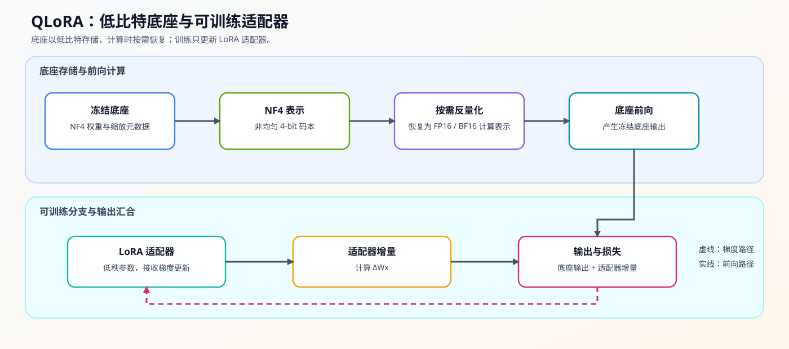
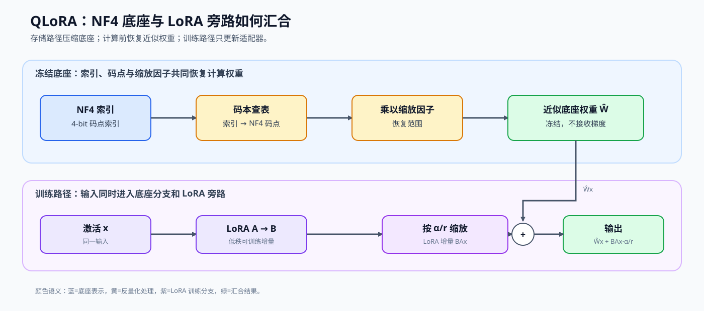

# 26. QLoRA and 4bit Quantization | QLoRA 与 4-bit 量化

**难度：** Hard | **环境：** CPU-first | **标签：** `量化压缩`, `QLoRA`, `4-bit` | **目标人群：** 量化压缩学习者

> 🚀 **云端运行环境**
>
> 本章节的实战代码可以点击以下链接在免费 GPU 算力平台上直接运行：
>
> [](https://colab.research.google.com/github/datawhalechina/llm-algo-leetcode/blob/main/02_PyTorch_Algorithms/26_QLoRA_and_4bit_Quantization.ipynb)
> [](https://modelscope.cn/my/mynotebook) *(国内推荐：魔搭社区免费实例)*


---

## 本节导读

微调时，底座模型除了占用权重显存，还会带来梯度、优化器状态和可训练参数的额外开销。QLoRA 将底座压成 4-bit 并冻结，再用少量 LoRA 参数学习任务变化，从而把“底座大小”和“需要更新的参数量”分开处理。

本节沿着一次训练前向观察三个对象：4-bit 底座如何保存，LoRA 旁路如何产生增量，以及两条路径如何合并。学习时重点比较底座压缩、旁路更新和输出误差之间的关系。

**关键词：** `QLoRA`, `NF4`, `LoRA`

---

## 前置阅读

**导语：** 进入本节前，先理解权重压缩如何降低底座成本，再理解 LoRA 旁路如何承担可训练参数。
- [14. LoRA Tutorial | LoRA 教程](./14_LoRA_Tutorial.md)
- [25. W8A16 Quantization | W8A16 量化](./25_Quantization_W8A16.md)

---

### Step 1：QLoRA 如何组织底座与训练分支

QLoRA 面向显存受限的参数高效微调：底座权重压缩为 4-bit 并冻结，LoRA 旁路保留少量可训练参数。一次前向的输入是激活 `x`、压缩底座权重和 LoRA 参数，输出是底座结果与适配器增量合并后的结果；反向时主要更新 LoRA 参数。4-bit 只描述底座的存储表示，激活、LoRA 梯度和优化器状态仍需要各自的精度与显存账本。
先区分每个对象在存储、计算和训练中的角色，再沿着主图观察底座路径与训练路径如何汇合。

| 参与对象 | 存储或计算方式 | 是否更新 | 在训练流中的作用 |
|---|---|---|---|
| 底座权重 `W` | NF4 索引，前向时查表恢复 | 冻结 | 提供压缩后的基础模型能力 |
| NF4 码点与缩放因子 | 查表和缩放信息 | 不作为训练参数 | 把 4-bit 表示还原为计算权重 |
| LoRA 旁路 `A、B` | 高精度低秩矩阵 | 更新 | 学习任务相关的权重变化 |
| LoRA 优化器状态 | 仅为 `A、B` 保存的一阶 / 二阶状态 | 随适配器更新 | 不应误计为冻结底座的训练状态 |
| 前向输出 | `W_nf4 x` 与 `BAx` 合并 | 由 LoRA 梯度驱动 | 同时利用底座能力与微调增量 |




### Step 2：NF4 如何用 4-bit 码点表示权重
NF4 的核心是一张预计算的 16 码点查找表（lookup table）。它基于标准正态分布的累积分布函数（CDF）与分位数函数构造，使码点在 0 附近更密集、在尾部更稀疏，因此比均匀 4-bit 更贴合神经网络权重的统计特性。

从直观上看，INT4 是"均匀铺点"，而 NF4 是"按概率密度聚集铺点"：权重出现概率高的区域（靠近 0）码点更密，尾部区域码点更疏。

其码点构造可概括为：

$$
q_i = \Phi^{-1}(p_i), \quad p_i = \frac{i - 0.5}{16}, \quad i = 1,2,\dots,16
$$

其中 $\Phi$ 表示标准正态分布的累积分布函数，$\Phi^{-1}$ 是其反函数。实际实现中，这些码点会预先计算并存入查找表。

例如，一个权重值先被归一化为 `0.20`，再映射到最接近的 NF4 码点 `0.161`，最后乘以该分组的缩放因子恢复近似权重。这个例子说明 NF4 保存的是索引，真正的浮点值来自“码点 × 缩放因子”。双重量化（Double Quantization）还可以进一步压缩缩放因子等量化元数据；它属于 NF4 存储路径的扩展，不改变“底座冻结、LoRA 更新”的训练分工。它降低的是缩放因子的驻留成本，不会自动降低激活、LoRA 梯度或优化器状态的峰值。

| 表示方式 | 码点来源 | 码点分布 | 对微调的意义 |
|---|---|---|---|
| INT4 | 等间隔整数码点 | 均匀铺点 | 实现简单，但不一定贴合权重分布 |
| NF4 | 标准正态分布分位点 | 0 附近更密、尾部更疏 | 在相同 4-bit 索引下更贴近常见权重分布 |
| NF4 + Double Quantization | NF4 码点与再次量化的缩放因子 | 权重和元数据都压缩 | 进一步降低底座存储开销 |
### Step 3：NF4 反量化、LoRA 前向与训练状态
NF4 码点负责压缩底座表示；本步继续追踪它们如何进入一次前向：先用索引查表得到近似底座权重，再与 LoRA 旁路产生的低秩增量合并。

底座路径和旁路路径的关系可以写成：

$$
y = x\hat{W}^{\top} + (x A^\top) B^\top \cdot \frac{\alpha}{r}
$$

其中 $W_{NF4}$ 在反向传播中保持冻结，$A$ 和 $B$ 承担可训练更新。下面的表格把表示、计算和梯度流向对应起来。

| 前向环节 | 使用的表示 | 产生的结果 | 梯度归属 |
| --- | --- | --- | --- |
| 查表与缩放 | NF4 index、codebook、缩放因子 | 近似底座权重 `Ŵ` | 底座保持冻结 |
| 底座计算 | `Ŵ` 与激活 `x` | `Ŵx` | 不更新底座 index |
| LoRA 旁路 | 高精度 `A`、`B`、`α/r` | `BAx · α/r` | 更新 `A`、`B` |
| 输出合并 | 底座结果 + LoRA 增量 | 训练输出 | 反向主要经过 LoRA |


### Step 4：实现并验证 QLoRA 前向路径

题目区模拟一次 QLoRA 前向：NF4 索引先经查表和缩放恢复近似底座权重，再与 LoRA 的低秩增量合并；训练状态账本进一步区分冻结底座与可训练适配器。三个 TODO 各补一个机制动作，测试分别检查码点、输出、梯度流向和状态归属。

| TODO / 函数 | 学习者完成的机制 | 必须满足的约束 | 测试证据 |
|:---|:---|:---|:---|
| TODO 1：恢复 NF4 底座权重<br>`QLoRALinearSim.forward` | 将 0–15 的索引映射到 NF4 码点并应用缩放因子 | 索引转换为长整型，恢复权重形状与底座一致且保持冻结 | 索引数据类型、恢复形状与有限值 |
| TODO 2：合并 LoRA 旁路<br>`QLoRALinearSim.forward` | 分别计算底座输出与低秩增量，再按 LoRA 缩放合并 | 输出形状不变，梯度只流向 LoRA 参数 | 显式参考式、旁路贡献与梯度流向 |
| TODO 3：统计可训练状态<br>`qlora_trainable_state_ledger` | 统计可训练适配器参数及其优化器状态字节 | 只累计 `requires_grad=True` 的参数，不把 NF4 缓冲区计入训练状态 | 参数归属、优化器状态与两种底座字节口径 |


```python
import torch
import torch.nn as nn
import torch.nn.functional as F
```


```python
# 题目区分别练习 NF4 查表、LoRA 旁路和可训练参数筛选。
# 码点、冻结缓冲区、适配器初始化及状态字节公式由骨架提供。

def create_nf4_lookup_table() -> torch.Tensor:
    """返回教学用的 16 个 NF4 近似码点。"""
    nf4_values = [
        -1.0, -0.696, -0.525, -0.395, -0.284, -0.185, -0.091, 0.0,
        0.080, 0.161, 0.246, 0.338, 0.441, 0.563, 0.723, 1.0,
    ]
    return torch.tensor(nf4_values)


class QLoRALinearSim(nn.Module):
    """用 INT8 索引模拟 NF4 底座，并用 LoRA 参数学习增量。"""

    def __init__(self, in_features: int, out_features: int, r: int = 8, alpha: float = 16.0):
        super().__init__()
        self.register_buffer('weight_nf4_indices', torch.randint(0, 16, (out_features, in_features), dtype=torch.int8))
        self.register_buffer('weight_scale', torch.tensor(1.0))
        self.register_buffer('nf4_table', create_nf4_lookup_table())
        self.lora_A = nn.Parameter(torch.randn(r, in_features) * 0.01)
        self.lora_B = nn.Parameter(torch.zeros(out_features, r))
        self.register_buffer('scaling', torch.tensor(alpha / r))

    def forward(self, x: torch.Tensor) -> torch.Tensor:
        """计算冻结 NF4 底座输出与可训练 LoRA 增量的和。"""
        # ==========================================
        # TODO 1：恢复 NF4 底座权重
        # ==========================================
        # indices = ???                  # 数据类型为 torch.long，形状与 weight_nf4_indices 相同。
        # dequantized_base_weight = ???  # 形状为 [out_features, in_features]。
        raise NotImplementedError('TODO 1：恢复 NF4 底座权重')

        # ==========================================
        # TODO 2：合并 LoRA 旁路
        # ==========================================
        # base_out = ???  # 使用 F.linear(x, dequantized_base_weight)。
        # lora_out = ???  # 依次经过 lora_A、lora_B，并乘 self.scaling。
        raise NotImplementedError('TODO 2：合并 LoRA 旁路')
        return base_out + lora_out


def qlora_trainable_state_ledger(
    layer: QLoRALinearSim, *, optimizer_bytes_per_parameter: int = 8
) -> dict[str, int]:
    """分开统计冻结 NF4 底座与可训练适配器状态。"""
    if optimizer_bytes_per_parameter <= 0:
        raise ValueError('optimizer_bytes_per_parameter must be positive')
    # ==========================================
    # TODO 3：统计可训练状态
    # ==========================================
    # 注意：不要把 register_buffer 保存的 NF4 底座状态计入可训练参数。
    # trainable_parameters = ???  # 只累加 requires_grad=True 参数的元素数。
    raise NotImplementedError('TODO 3：统计可训练状态')
    index_container_bytes = layer.weight_nf4_indices.numel() * layer.weight_nf4_indices.element_size()
    scale_metadata_bytes = layer.weight_scale.numel() * layer.weight_scale.element_size()
    packed_nf4_bytes = (layer.weight_nf4_indices.numel() + 1) // 2 + scale_metadata_bytes
    base_storage_bytes = (
        layer.weight_nf4_indices.numel() * layer.weight_nf4_indices.element_size()
        + layer.weight_scale.numel() * layer.weight_scale.element_size()
    )
    optimizer_state_bytes = trainable_parameters * optimizer_bytes_per_parameter
    return {
        'trainable_parameters': trainable_parameters,
        'base_storage_bytes': base_storage_bytes,
        'index_container_bytes': index_container_bytes,
        'packed_nf4_bytes': packed_nf4_bytes,
        'optimizer_state_bytes': optimizer_state_bytes,
    }

```

### 测试

测试分别验证 NF4 查表、LoRA 旁路、可训练状态归属和梯度流向；每个机制 TODO 都有独立测试入口。

```python
def _build_qlora_fixture():
    """构造固定 NF4 index、缩放因子与 LoRA 参数，供各机制测试复用。"""
    layer = QLoRALinearSim(in_features=4, out_features=3, r=2, alpha=8.0)
    with torch.no_grad():
        layer.weight_nf4_indices.copy_(torch.tensor([
            [0, 1, 2, 3], [4, 5, 6, 7], [8, 9, 10, 11],
        ], dtype=torch.int8))
        layer.weight_scale.copy_(torch.tensor(0.5))
        layer.lora_A.copy_(torch.tensor([
            [0.1, 0.2, 0.3, 0.4], [0.5, 0.6, 0.7, 0.8],
        ], dtype=layer.lora_A.dtype))
        layer.lora_B.copy_(torch.tensor([
            [0.9, -0.1], [0.2, 0.3], [-0.4, 0.7],
        ], dtype=layer.lora_B.dtype))
    return layer


# 机制测试：分别检查码点表示、旁路贡献、冻结约束和前向等价性。
def test_nf4_lookup_and_dequantization():
    """验证 NF4 表包含 16 个有限码点，并能恢复对应权重形状。"""
    table = create_nf4_lookup_table()
    assert table.shape == (16,)
    assert table[0] < 0 < table[-1]
    layer = _build_qlora_fixture()
    restored = layer.nf4_table[layer.weight_nf4_indices.long()] * layer.weight_scale
    assert restored.shape == layer.weight_nf4_indices.shape
    assert torch.isfinite(restored).all()


def test_lora_branch_contract():
    """验证 LoRA 旁路确实改变底座输出且保持输出形状。"""
    layer = _build_qlora_fixture()
    x = torch.tensor([[[0.1, -0.2, 0.3, -0.4], [0.5, 0.6, -0.7, 0.8]]])
    base_weight = layer.nf4_table[layer.weight_nf4_indices.long()] * layer.weight_scale
    base_out = F.linear(x, base_weight)
    out = layer(x)
    assert out.shape == (1, 2, 3)
    assert not torch.allclose(out, base_out, atol=1e-6)


def test_qlora_trainable_state_ledger_contract():
    """验证底座驻留与 LoRA 训练状态不能混为同一账本。"""
    layer = _build_qlora_fixture()
    ledger = qlora_trainable_state_ledger(layer, optimizer_bytes_per_parameter=8)
    expected_trainable = layer.lora_A.numel() + layer.lora_B.numel()
    assert ledger['trainable_parameters'] == expected_trainable
    assert ledger['optimizer_state_bytes'] == expected_trainable * 8
    assert ledger['base_storage_bytes'] > 0
    assert ledger['base_storage_bytes'] == ledger['index_container_bytes'] + layer.weight_scale.element_size()
    assert ledger['packed_nf4_bytes'] < ledger['base_storage_bytes']


def test_frozen_base_gradient_contract():
    """验证梯度流向 LoRA 参数，而不是 NF4 底座状态。"""
    layer = _build_qlora_fixture()
    x = torch.randn(1, 2, 4, requires_grad=True)
    layer(x).sum().backward()
    assert x.grad is not None
    assert layer.lora_A.grad is not None
    assert layer.lora_B.grad is not None
    assert not layer.weight_nf4_indices.requires_grad
    assert layer.weight_nf4_indices.grad is None
    assert layer.weight_scale.grad is None


def test_qlora_output_contract():
    """验证实现输出与显式底座加 LoRA 参考式一致。"""
    layer = _build_qlora_fixture()
    x = torch.randn(1, 2, 4)
    out = layer(x)
    reference_weight = layer.nf4_table[layer.weight_nf4_indices.long()] * layer.weight_scale
    reference = F.linear(x, reference_weight) + (x @ layer.lora_A.T) @ layer.lora_B.T * layer.scaling
    assert torch.allclose(out, reference, atol=1e-5)


def run_qlora_tests():
    """依次运行 NF4、LoRA 旁路、梯度和输出契约测试。"""
    for test in (
        test_nf4_lookup_and_dequantization,
        test_lora_branch_contract,
        test_qlora_trainable_state_ledger_contract,
        test_frozen_base_gradient_contract,
        test_qlora_output_contract,
    ):
        test()
    print('✅ QLoRA 机制测试通过：NF4、LoRA 旁路、冻结基座与梯度流向均已验证。')


run_qlora_tests()

```

---

🛑 **STOP HERE** 🛑
<br><br><br><br><br><br><br><br><br><br>
> 请先尝试自己完成代码并跑通测试。<br>
> 如果遇到困难，再向下查看参考代码与解析。
<br><br><br><br><br><br><br><br><br><br>

---
## 参考代码与解析

### 代码

```python
def create_nf4_lookup_table() -> torch.Tensor:
    """返回教学用的 16 个 NF4 近似码点。"""
    nf4_values = [
        -1.0, -0.696, -0.525, -0.395, -0.284, -0.185, -0.091, 0.0,
        0.080, 0.161, 0.246, 0.338, 0.441, 0.563, 0.723, 1.0,
    ]
    return torch.tensor(nf4_values)


class QLoRALinearSim(nn.Module):
    """用 INT8 索引模拟 NF4 底座，并用 LoRA 参数学习增量。"""

    def __init__(self, in_features: int, out_features: int, r: int = 8, alpha: float = 16.0):
        super().__init__()
        self.register_buffer('weight_nf4_indices', torch.randint(0, 16, (out_features, in_features), dtype=torch.int8))
        self.register_buffer('weight_scale', torch.tensor(1.0))
        self.register_buffer('nf4_table', create_nf4_lookup_table())
        self.lora_A = nn.Parameter(torch.randn(r, in_features) * 0.01)
        self.lora_B = nn.Parameter(torch.zeros(out_features, r))
        self.register_buffer('scaling', torch.tensor(alpha / r))

    def forward(self, x: torch.Tensor) -> torch.Tensor:
        """计算冻结 NF4 底座输出与可训练 LoRA 增量的和。"""
        # TODO 1：恢复 NF4 底座权重。
        indices = self.weight_nf4_indices.long()
        dequantized_base_weight = self.nf4_table[indices] * self.weight_scale

        # TODO 2：合并 LoRA 旁路。
        base_out = F.linear(x, dequantized_base_weight)
        lora_out = (x @ self.lora_A.T) @ self.lora_B.T * self.scaling
        return base_out + lora_out


def qlora_trainable_state_ledger(
    layer: QLoRALinearSim, *, optimizer_bytes_per_parameter: int = 8
) -> dict[str, int]:
    """分开统计冻结 NF4 底座与可训练适配器状态。"""
    if optimizer_bytes_per_parameter <= 0:
        raise ValueError('optimizer_bytes_per_parameter must be positive')
    # TODO 3：统计可训练状态。
    trainable_parameters = sum(parameter.numel() for parameter in layer.parameters() if parameter.requires_grad)
    index_container_bytes = layer.weight_nf4_indices.numel() * layer.weight_nf4_indices.element_size()
    scale_metadata_bytes = layer.weight_scale.numel() * layer.weight_scale.element_size()
    packed_nf4_bytes = (layer.weight_nf4_indices.numel() + 1) // 2 + scale_metadata_bytes
    base_storage_bytes = (
        layer.weight_nf4_indices.numel() * layer.weight_nf4_indices.element_size()
        + layer.weight_scale.numel() * layer.weight_scale.element_size()
    )
    optimizer_state_bytes = trainable_parameters * optimizer_bytes_per_parameter
    return {
        'trainable_parameters': trainable_parameters,
        'base_storage_bytes': base_storage_bytes,
        'index_container_bytes': index_container_bytes,
        'packed_nf4_bytes': packed_nf4_bytes,
        'optimizer_state_bytes': optimizer_state_bytes,
    }

```

### 解析

#### TODO 1：恢复 NF4 底座权重

- NF4 状态保存 0–15 的码点索引和缩放因子，矩阵乘前必须恢复为与底座相同形状的浮点近似权重。
- 答案将索引转换为长整型后查表并应用缩放；索引类型、恢复形状和有限值测试证明表示关系成立。

#### TODO 2：合并 LoRA 旁路

- 底座输出与低秩增量分别计算，增量乘以 `alpha / r` 后才能与底座输出相加。
- 答案完成两条路径并合并；显式参考式、旁路贡献和梯度测试证明输出关系与更新范围正确。

#### TODO 3：统计可训练状态

- 训练状态只包含启用梯度的 LoRA 参数，NF4 索引、缩放因子和码点表属于冻结缓冲区。
- 答案按 `requires_grad` 统计参数与优化器状态；状态归属和字节测试证明训练状态没有混入量化底座。

### Step 5：可选 GPU 实验——BF16 LoRA 与 NF4 QLoRA 配对矩阵

CPU 题目已经确认冻结底座、低秩旁路和可训练状态的关系；GPU 实验进一步比较同一 LoRA 更新在 BF16 底座与 NF4 底座上的显存、训练时间和评测损失。只有真实 4-bit 参数状态与配对结果同时成立，才能判断量化底座是否降低训练资源。

| 学习问题 | CPU 已确认 | GPU 要确认 |
|---|---|---|
| NF4 底座能否以可接受的质量代价降低 LoRA 训练资源 | NF4 查表、LoRA 增量、冻结底座和训练状态归属 | 真实 4-bit 参数路径；不同序列长度下的峰值显存、单步耗时和独立评测损失 |

#### 5.1 环境与固定工作负载

本实验使用独立的 `Q-QLORA` 环境。首次运行先完成[QLoRA GPU 环境 Quickstart](../topic_discussion/quantization_compression/quickstart.md#q-qlora-quickstart)，已有环境执行 Profile 预检后再启动 JupyterLab。两条路径使用同一模型 commit、互斥的训练 / 验证 / 测试数据划分、LoRA rank、目标模块、优化器步数和随机种子，仅改变底座表示；测试集只形成最终质量证据。

| 配置层 | 本节固定口径 | 修改规则 |
|---|---|---|
| 环境 | `Q-QLORA`；Transformers + bitsandbytes + PEFT；单张 NVIDIA GPU | 不与量化产物或 Serving 环境混装 |
| 模型与数据 | `Qwen/Qwen2.5-1.5B-Instruct`；固定 WikiText-2 train/validation/test | `default1` 保留 0.5B 基线；规模变化必须新建运行记录 |
| 工作负载 | 序列长度 64 / 128 / 256 Token；每路径 20 个优化器步 | 步数或长度矩阵改变后递增工作负载版本 |
| 配对变量 | BF16 LoRA → NF4 + double quant QLoRA；统一 rank、目标模块和随机种子 | 每次只改变底座表示 |
| 训练控制 | micro-batch 1；梯度累积 1；默认关闭激活重计算；统一 BF16 计算 | 若启用激活重计算，两条路径必须同时启用 |
| 测量指标 | 真实 4 位路径、峰值显存、单步耗时、独立测试损失 | 质量与资源必须同时判断 |
| 结果资产 | JSON 与各矩阵点的 adapter 目录 | 正式复测使用唯一 `RUN_LABEL` |


```python
# 5.1 只定义配对训练矩阵；默认不下载模型、不占用 GPU。
import os
from pathlib import Path

# 学习者入口：普通复测通常只修改这两项。
RUN_MODE = "dry_run"  # 默认值 dry_run：只登记计划；确认环境后改为 real_gpu。
RUN_LABEL = "default2"  # 默认值 default2；对应 1.5B 复测，并保留 default1 的 0.5B 负结果。

# 模型来源：main 会在 5.2 自动解析为本次运行使用的不可变 commit。
MODEL_ID = "Qwen/Qwen2.5-1.5B-Instruct"  # 检查模型放大后，NF4 底座节省能否摊薄训练开销。
MODEL_REVISION = "main"  # 可填写分支、标签或 commit hash。
DATA_SOURCE = "huggingface"  # huggingface 下载固定快照；local_jsonl 读取登记后的离线副本。
DATASET_ID = "Salesforce/wikitext"  # 用于 LoRA / QLoRA 配对训练的语言模型数据集。
DATASET_CONFIG = "wikitext-2-raw-v1"  # 使用保留原始文本的配置。
DATASET_REVISION = "f776294184f13b8ff2337b3841cf9269a6216d1e"  # 固定 Hub commit。
TRAIN_SPLIT = "train"  # 更新 adapter 参数。
VALIDATION_SPLIT = "validation"  # 观察训练过程，不参与最终质量结论。
TEST_SPLIT = "test"  # 独立比较 BF16 LoRA 与 NF4 QLoRA。
TRAIN_SAMPLES = 128  # 训练样本数；增大会延长每个矩阵点的执行时间。
VALIDATION_SAMPLES = 64  # 验证样本数；不得参与参数更新。
TEST_SAMPLES = 64  # 独立测试样本数；不得参与训练与阈值调整。
DATA_SEED = 42  # 固定样本选择与 Trainer DataLoader 顺序。
HF_HUB_CACHE = os.getenv("HF_HUB_CACHE")  # 可选模型缓存环境变量；未设置时使用默认目录。
MODEL_CACHE_DIR = Path(HF_HUB_CACHE) if HF_HUB_CACHE else None  # 模型缓存目录。
HF_DATASETS_CACHE = os.getenv("HF_DATASETS_CACHE")  # 可选数据缓存环境变量；未设置时使用默认目录。
DATA_CACHE_DIR = Path(HF_DATASETS_CACHE) if HF_DATASETS_CACHE else None  # 数据缓存目录。
LOCAL_DATA_FILES = None  # local_jsonl 模式传入 train/validation/test JSONL 路径。
LOCAL_FILES_ONLY = False  # True：仅使用已缓存模型；False：允许联网解析 revision 并下载缺失文件。

# 固定实验身份：协议改变时递增版本，不把版本编码进稳定 ID。
ENVIRONMENT_PROFILE = "Q-QLORA"  # 运行前必须通过同名 Profile 预检。
WORKLOAD_ID = "quant-qlora-mechanism"  # BF16 LoRA 与 NF4 QLoRA 配对训练矩阵。
WORKLOAD_VERSION = "v4"  # v4 保持配对协议不变，只把模型规模从 0.5B 提升到 1.5B。

# 训练矩阵：改变下列内容时递增 WORKLOAD_VERSION。
SEQUENCE_LENGTHS = (64, 128, 256)  # 同时观察激活增长与底座压缩收益。
TRAIN_BATCH_SIZE = 1  # 每设备 micro-batch；两条路径必须一致。
GRADIENT_ACCUMULATION_STEPS = 1  # 每次优化器更新累计的 micro-batch 数；两条路径必须一致。
MAX_STEPS = 20  # 每个矩阵点的优化器步数；避免把单步可运行性当成训练证据。
COMPUTE_DTYPE = "bfloat16"  # 两条路径共享的前向与 LoRA 计算类型。
LEARNING_RATE = 2e-4  # LoRA 参数学习率；两条路径必须一致。
TARGET_MODULES = ("q_proj", "v_proj")  # 两条路径注入相同 Attention 投影层。
LORA_RANK = 8  # 低秩维度；增大会增加可训练参数与显存。
LORA_ALPHA = 16  # LoRA 缩放分子，与 rank 共同决定旁路强度。
LORA_DROPOUT = 0.05  # LoRA 旁路 dropout 概率。
USE_GRADIENT_CHECKPOINTING = False  # False 隔离底座量化收益；若启用，两条路径必须同时启用。
BNB_QUANT_TYPE = "nf4"  # bitsandbytes 4 位量化类型。
USE_DOUBLE_QUANT = True  # 是否进一步压缩量化常数；仅作用于 QLoRA 底座。
MAX_TEST_LOSS_RATIO = 1.10  # QLoRA 最终 test loss 相对 BF16 LoRA 的上限。
SEED = 42  # 固定初始化与训练随机性。

ADAPTER_RELATIVE_PATH = f"02_PyTorch_Algorithms/benchmarks/artifacts/26_qlora/{RUN_LABEL}"  # 仓库相对 adapter 目录；由 5.2 统一锚定。
OUTPUT_RELATIVE_PATH = f"02_PyTorch_Algorithms/benchmarks/results/26_lora_qlora_mechanism_matrix_{RUN_LABEL}.json"  # 仓库相对结果路径；由 5.2 统一锚定。

```

#### 5.2 执行并保存 JSON

执行单元为每档序列长度分别加载 BF16 与 NF4 底座，注入相同 LoRA 配置并完成相同步数。每条记录同时保存底座路径确认、可训练参数、初始/最终评测损失、训练时间和峰值显存；任一路径失败都会保留结构化失败信息。


```python
# 5.2 执行 BF16 LoRA / NF4 QLoRA 配对矩阵，并保存 JSON。
import gc
import hashlib
import importlib.metadata
import json
import platform
import random
import time

import torch


def locate_repo_root(start=None):
    """从当前目录向上定位仓库根目录，避免结果位置受 Jupyter 启动目录影响。"""
    current = Path.cwd().resolve() if start is None else Path(start).resolve()
    for candidate in (current, *current.parents):
        if (candidate / "02_PyTorch_Algorithms").is_dir() and (candidate / "requirements").is_dir():
            return candidate
    raise RuntimeError("无法定位仓库根目录；请从本仓库内启动 JupyterLab")


REPO_ROOT = locate_repo_root()
ADAPTER_ROOT = REPO_ROOT / ADAPTER_RELATIVE_PATH
OUTPUT_JSON = REPO_ROOT / OUTPUT_RELATIVE_PATH


def package_version(name):
    """读取依赖版本；缺失时返回 None。"""
    try:
        return importlib.metadata.version(name)
    except importlib.metadata.PackageNotFoundError:
        return None


def resolve_model_commit(model_id, requested_revision, cache_dir, local_files_only):
    """将分支、标签或 commit 请求解析为本次运行唯一使用的不可变 commit。"""
    if local_files_only:
        from huggingface_hub.constants import HF_HUB_CACHE as DEFAULT_HUB_CACHE

        hub_cache = Path(cache_dir) if cache_dir else Path(DEFAULT_HUB_CACHE)
        repo_cache = hub_cache / f"models--{model_id.replace('/', '--')}"
        ref_path = repo_cache / "refs" / requested_revision
        resolved = ref_path.read_text(encoding="utf-8").strip() if ref_path.is_file() else requested_revision
        if not (repo_cache / "snapshots" / resolved).is_dir():
            raise FileNotFoundError(f"本地缓存无法解析 {model_id}@{requested_revision}")
        source = "local_cache_ref"
    else:
        from huggingface_hub import HfApi

        resolved = HfApi().model_info(repo_id=model_id, revision=requested_revision).sha
        source = "huggingface_hub_api"
    if not resolved:
        raise RuntimeError(f"无法将 {model_id}@{requested_revision} 解析为 commit hash")
    return str(resolved), source


result = {
    "schema_version": "quantization-mechanism-gpu/v7",
    "chapter": "26",
    "run_mode": RUN_MODE,
    "run_label": RUN_LABEL,
    "environment_profile": ENVIRONMENT_PROFILE,
    "framework": {
        "python": platform.python_version(),
        "torch": torch.__version__,
        "transformers": package_version("transformers"),
        "peft": package_version("peft"),
        "bitsandbytes": package_version("bitsandbytes"),
        "datasets": package_version("datasets"),
        "accelerate": package_version("accelerate"),
    },
    "hardware": {
        "cuda_available": torch.cuda.is_available(),
        "cuda": torch.version.cuda,
        "device": torch.cuda.get_device_name(0) if torch.cuda.is_available() else None,
        "total_memory_bytes": torch.cuda.get_device_properties(0).total_memory if torch.cuda.is_available() else None,
        "compute_capability": list(torch.cuda.get_device_capability(0)) if torch.cuda.is_available() else None,
    },
    "dataset": {
        "source": DATA_SOURCE,
        "dataset_id": DATASET_ID,
        "config": DATASET_CONFIG,
        "revision": DATASET_REVISION,
        "train_split": TRAIN_SPLIT,
        "validation_split": VALIDATION_SPLIT,
        "test_split": TEST_SPLIT,
        "train_samples": TRAIN_SAMPLES,
        "validation_samples": VALIDATION_SAMPLES,
        "test_samples": TEST_SAMPLES,
        "selection_seed": DATA_SEED,
    },
    "workload": {
        "id": WORKLOAD_ID,
        "version": WORKLOAD_VERSION,
        "model_id": MODEL_ID,
        "model_revision": MODEL_REVISION,
        "resolved_model_commit": None,
        "revision_resolution_source": None,
        "cache_dir": str(MODEL_CACHE_DIR) if MODEL_CACHE_DIR else None,
        "sequence_lengths": list(SEQUENCE_LENGTHS),
        "batch_size": TRAIN_BATCH_SIZE,
        "gradient_accumulation_steps": GRADIENT_ACCUMULATION_STEPS,
        "steps": MAX_STEPS,
        "compute_dtype": COMPUTE_DTYPE,
        "target_modules": list(TARGET_MODULES),
        "lora_rank": LORA_RANK,
        "lora_alpha": LORA_ALPHA,
        "lora_dropout": LORA_DROPOUT,
        "gradient_checkpointing": USE_GRADIENT_CHECKPOINTING,
        "seed": SEED,
    },
    "baseline": {"name": "bf16_lora"},
    "candidate": {
        "name": "nf4_qlora",
        "quant_type": BNB_QUANT_TYPE,
        "double_quant": USE_DOUBLE_QUANT,
    },
    "measurement_matrix": [],
    "artifact_manifests": [],
    "failure": None,
    "evidence_level": "not_executed",
    "decision": None,
}

failure_stage = "environment_preflight"
if RUN_MODE == "real_gpu":
    try:
        if not torch.cuda.is_available():
            raise RuntimeError("RUN_MODE=real_gpu 但 CUDA 不可用")

        from datasets import load_dataset
        from peft import LoraConfig, get_peft_model, prepare_model_for_kbit_training
        from transformers import (
            AutoModelForCausalLM,
            AutoTokenizer,
            BitsAndBytesConfig,
            DataCollatorForLanguageModeling,
            Trainer,
            TrainingArguments,
        )

        failure_stage = "model_and_data_loading"
        resolved_commit, resolution_source = resolve_model_commit(
            MODEL_ID, MODEL_REVISION, MODEL_CACHE_DIR, LOCAL_FILES_ONLY
        )
        result["workload"]["resolved_model_commit"] = resolved_commit
        result["workload"]["revision_resolution_source"] = resolution_source
        compute_dtype = {"bfloat16": torch.bfloat16, "float16": torch.float16}[COMPUTE_DTYPE]

        tokenizer = AutoTokenizer.from_pretrained(
            MODEL_ID,
            revision=resolved_commit,
            cache_dir=MODEL_CACHE_DIR,
            local_files_only=LOCAL_FILES_ONLY,
            use_fast=True,
        )
        if tokenizer.pad_token is None:
            tokenizer.pad_token = tokenizer.eos_token

        if DATA_SOURCE == "huggingface":
            raw = load_dataset(
                DATASET_ID,
                DATASET_CONFIG,
                revision=DATASET_REVISION,
                cache_dir=str(DATA_CACHE_DIR) if DATA_CACHE_DIR else None,
            )
        elif DATA_SOURCE == "local_jsonl":
            if not LOCAL_DATA_FILES:
                raise ValueError("DATA_SOURCE=local_jsonl 时必须配置 LOCAL_DATA_FILES")
            raw = load_dataset("json", data_files=LOCAL_DATA_FILES)
        else:
            raise ValueError(f"未知 DATA_SOURCE：{DATA_SOURCE}")

        def stable_sample(dataset, count, seed):
            """过滤空文本后按固定随机种子抽样。"""
            eligible = [index for index, text in enumerate(dataset["text"]) if text and text.strip()]
            selected = random.Random(seed).sample(eligible, count)
            return dataset.select(selected), selected

        def hash_ids(ids):
            """生成稳定样本 ID 哈希，不复制原始文本。"""
            return hashlib.sha256(",".join(map(str, ids)).encode("utf-8")).hexdigest()

        train_rows, train_ids = stable_sample(raw[TRAIN_SPLIT], TRAIN_SAMPLES, DATA_SEED)
        validation_rows, validation_ids = stable_sample(raw[VALIDATION_SPLIT], VALIDATION_SAMPLES, DATA_SEED + 1)
        test_rows, test_ids = stable_sample(raw[TEST_SPLIT], TEST_SAMPLES, DATA_SEED + 2)
        result["dataset"].update({
            "train_ids_hash": hash_ids(train_ids),
            "validation_ids_hash": hash_ids(validation_ids),
            "test_ids_hash": hash_ids(test_ids),
            "filter": "non_empty_text",
        })

        def tokenize_dataset(dataset, sequence_length):
            """把固定数据划分 token 化；Trainer 内部使用 PyTorch DataLoader。"""
            return dataset.map(
                lambda batch: tokenizer(
                    batch["text"],
                    truncation=True,
                    padding="max_length",
                    max_length=sequence_length,
                ),
                batched=True,
                remove_columns=["text"],
            )

        def run_path(path_name, sequence_length):
            """在一个序列长度上执行 BF16 LoRA 或 NF4 QLoRA。"""
            torch.manual_seed(SEED)
            quantized = path_name == "nf4_qlora"
            load_kwargs = {
                "revision": resolved_commit,
                "cache_dir": MODEL_CACHE_DIR,
                "local_files_only": LOCAL_FILES_ONLY,
                "device_map": {"": 0},
            }
            if quantized:
                load_kwargs["quantization_config"] = BitsAndBytesConfig(
                    load_in_4bit=True,
                    bnb_4bit_quant_type=BNB_QUANT_TYPE,
                    bnb_4bit_use_double_quant=USE_DOUBLE_QUANT,
                    bnb_4bit_compute_dtype=compute_dtype,
                )
            else:
                load_kwargs["dtype"] = compute_dtype

            model = AutoModelForCausalLM.from_pretrained(MODEL_ID, **load_kwargs)
            model.config.use_cache = False
            if quantized:
                model = prepare_model_for_kbit_training(
                    model, use_gradient_checkpointing=USE_GRADIENT_CHECKPOINTING
                )
            elif USE_GRADIENT_CHECKPOINTING:
                model.gradient_checkpointing_enable()
            model = get_peft_model(
                model,
                LoraConfig(
                    r=LORA_RANK,
                    lora_alpha=LORA_ALPHA,
                    lora_dropout=LORA_DROPOUT,
                    target_modules=list(TARGET_MODULES),
                    task_type="CAUSAL_LM",
                ),
            )
            trainable_parameters = sum(
                parameter.numel() for parameter in model.parameters() if parameter.requires_grad
            )
            total_parameters = sum(parameter.numel() for parameter in model.parameters())
            base_parameters_frozen = all(
                ("lora_" in name) or (not parameter.requires_grad)
                for name, parameter in model.named_parameters()
            )
            params4bit_count = sum(
                parameter.numel()
                for parameter in model.parameters()
                if type(parameter).__name__ == "Params4bit"
            )

            train_dataset = tokenize_dataset(train_rows, sequence_length)
            validation_dataset = tokenize_dataset(validation_rows, sequence_length)
            test_dataset = tokenize_dataset(test_rows, sequence_length)
            trainer = Trainer(
                model=model,
                train_dataset=train_dataset,
                eval_dataset=validation_dataset,
                data_collator=DataCollatorForLanguageModeling(tokenizer, mlm=False),
                args=TrainingArguments(
                    output_dir=str(
                        PART02_ROOT
                        / f"benchmarks/results/26_lora_qlora_tmp/{RUN_LABEL}/{path_name}_{sequence_length}"
                    ),
                    per_device_train_batch_size=TRAIN_BATCH_SIZE,
                    per_device_eval_batch_size=TRAIN_BATCH_SIZE,
                    max_steps=MAX_STEPS,
                    gradient_accumulation_steps=GRADIENT_ACCUMULATION_STEPS,
                    bf16=COMPUTE_DTYPE == "bfloat16",
                    fp16=COMPUTE_DTYPE == "float16",
                    learning_rate=LEARNING_RATE,
                    logging_strategy="no",
                    disable_tqdm=True,
                    save_strategy="no",
                    report_to=[],
                    seed=SEED,
                    data_seed=DATA_SEED,
                ),
            )
            initial_validation_loss = float(trainer.evaluate()["eval_loss"])
            torch.cuda.empty_cache()
            torch.cuda.synchronize()
            base_allocated_bytes = int(torch.cuda.memory_allocated())
            torch.cuda.reset_peak_memory_stats()
            started = time.perf_counter()
            train_output = trainer.train()
            torch.cuda.synchronize()
            elapsed_ms = (time.perf_counter() - started) * 1000.0
            peak_allocated_bytes = int(torch.cuda.max_memory_allocated())
            incremental_peak_allocated_bytes = max(
                0, peak_allocated_bytes - base_allocated_bytes
            )
            final_validation_loss = float(trainer.evaluate()["eval_loss"])
            final_test_loss = float(
                trainer.evaluate(test_dataset, metric_key_prefix="test")["test_loss"]
            )
            adapter_path = ADAPTER_ROOT / f"{path_name}_{sequence_length}"
            adapter_path.mkdir(parents=True, exist_ok=True)
            model.save_pretrained(adapter_path, safe_serialization=True)
            adapter_files = sorted(
                file.name for file in adapter_path.iterdir() if file.is_file()
            )
            artifact_manifest = {
                "path": adapter_path.relative_to(REPO_ROOT).as_posix(),
                "files": adapter_files,
                "has_config": "adapter_config.json" in adapter_files,
                "has_weights": any(name.endswith((".safetensors", ".bin")) for name in adapter_files),
                "base_model_id": MODEL_ID,
                "base_model_commit": resolved_commit,
                "base_representation": "nf4" if quantized else COMPUTE_DTYPE,
                "target_modules": list(TARGET_MODULES),
            }
            record = {
                "path": path_name,
                "sequence_length": sequence_length,
                "initial_validation_loss": initial_validation_loss,
                "final_validation_loss": final_validation_loss,
                "validation_loss_change": final_validation_loss - initial_validation_loss,
                "final_test_loss": final_test_loss,
                "train_loss": float(train_output.training_loss),
                "training_ms": elapsed_ms,
                "training_ms_per_step": elapsed_ms / MAX_STEPS,
                "base_allocated_bytes": base_allocated_bytes,
                "peak_allocated_bytes": peak_allocated_bytes,
                "incremental_peak_allocated_bytes": incremental_peak_allocated_bytes,
                "trainable_parameters": trainable_parameters,
                "total_parameters": total_parameters,
                "base_parameters_frozen": base_parameters_frozen,
                "params4bit_count": params4bit_count,
                "path_confirmed": (
                    base_parameters_frozen
                    and ((params4bit_count > 0) if quantized else (params4bit_count == 0))
                ),
                "artifact_manifest": artifact_manifest,
            }
            del trainer, model, train_dataset, validation_dataset, test_dataset
            gc.collect()
            torch.cuda.empty_cache()
            return record

        failure_stage = "paired_training"
        matrix = []
        for sequence_length in SEQUENCE_LENGTHS:
            matrix.append(run_path("bf16_lora", sequence_length))
            matrix.append(run_path("nf4_qlora", sequence_length))

        comparisons = []
        for sequence_length in SEQUENCE_LENGTHS:
            baseline = next(
                row for row in matrix
                if row["sequence_length"] == sequence_length and row["path"] == "bf16_lora"
            )
            candidate = next(
                row for row in matrix
                if row["sequence_length"] == sequence_length and row["path"] == "nf4_qlora"
            )
            comparisons.append({
                "sequence_length": sequence_length,
                "peak_memory_saved_bytes": (
                    baseline["peak_allocated_bytes"] - candidate["peak_allocated_bytes"]
                ),
                "peak_memory_reduction_ratio": 1.0 - candidate["peak_allocated_bytes"] / max(
                    1, baseline["peak_allocated_bytes"]
                ),
                "incremental_training_peak_ratio": (
                    candidate["incremental_peak_allocated_bytes"] / max(
                        1, baseline["incremental_peak_allocated_bytes"]
                    )
                ),
                "step_time_ratio": candidate["training_ms_per_step"] / max(
                    1e-9, baseline["training_ms_per_step"]
                ),
                "final_test_loss_ratio": candidate["final_test_loss"] / max(
                    1e-9, baseline["final_test_loss"]
                ),
                "trainable_parameter_match": (
                    candidate["trainable_parameters"] == baseline["trainable_parameters"]
                ),
            })

        failure_stage = "artifact_and_decision"
        paths_confirmed = all(row["path_confirmed"] for row in matrix)
        trainable_parameters_matched = all(
            row["trainable_parameter_match"] for row in comparisons
        )
        memory_improved = all(row["peak_memory_reduction_ratio"] > 0 for row in comparisons)
        quality_allowed = all(
            row["final_test_loss_ratio"] <= MAX_TEST_LOSS_RATIO for row in comparisons
        )
        artifact_manifests = [row["artifact_manifest"] for row in matrix]
        artifacts_complete = all(
            item["has_config"] and item["has_weights"] for item in artifact_manifests
        )
        result.update({
            "measurement_matrix": matrix,
            "comparisons": comparisons,
            "artifact_manifests": artifact_manifests,
            "evidence_level": "matched_bf16_lora_nf4_qlora_sequence_matrix",
            "decision": (
                "accept_qlora_candidate"
                if paths_confirmed and trainable_parameters_matched
                and memory_improved and quality_allowed and artifacts_complete
                else "tune_qlora_protocol"
            ),
        })
    except Exception as exc:
        result.update({
            "failure": {
                "stage": failure_stage,
                "type": type(exc).__name__,
                "message": str(exc),
            },
            "evidence_level": "failed_real_gpu_attempt",
            "decision": "reject_until_failure_resolved",
        })

OUTPUT_JSON.parent.mkdir(parents=True, exist_ok=True)
OUTPUT_JSON.write_text(json.dumps(result, ensure_ascii=False, indent=2), encoding="utf-8")
print({
    "result_path": OUTPUT_JSON.relative_to(REPO_ROOT).as_posix(),
    "failure": result.get("failure"),
    "evidence_level": result.get("evidence_level"),
    "decision": result.get("decision"),
})

```

#### 5.3 读取结果

读取单元只展示两条训练路径的序列长度矩阵、配对比较、失败状态和证据等级，不重新加载模型或启动训练。


```python
# 5.3 只读取 5.2 保存的 JSON，并按运行身份、训练矩阵、adapter 交付分层展示。
if OUTPUT_JSON.exists():
    saved = json.loads(OUTPUT_JSON.read_text(encoding="utf-8"))
    workload = saved.get("workload", {})
    print("运行身份与决策")
    print({
        "run_label": saved.get("run_label"),
        "model_id": workload.get("model_id"),
        "resolved_model_commit": workload.get("resolved_model_commit"),
        "steps": workload.get("steps"),
        "failure": saved.get("failure"),
        "evidence_level": saved.get("evidence_level"),
        "decision": saved.get("decision"),
    })
    comparisons = saved.get("comparisons", [])
    print(f"\nLoRA / QLoRA 配对摘要（{len(comparisons)} 个长度）")
    for row in comparisons:
        print(row)
    manifests = saved.get("artifact_manifests", [])
    print(f"\nadapter 产物（{len(manifests)} 个）")
    for item in manifests:
        print({
            "path": item.get("path"),
            "base_representation": item.get("base_representation"),
            "complete": bool(item.get("has_config") and item.get("has_weights")),
        })
else:
    print(f"等待 LoRA / QLoRA 配对矩阵：{OUTPUT_JSON}")

```

#### 5.4 解释证据与决策

先确认 BF16 路径没有 `Params4bit`，NF4 路径真实包含 4 位参数，并且两条路径都只更新 LoRA 参数。随后逐档比较峰值显存、每步训练时间和最终测试损失，最后检查 adapter 配置与权重文件是否完整；单一长度上的优势不能替代完整矩阵。

`default1` 的 0.5B 矩阵只确认了真实 4-bit 路径与 adapter 交付：NF4 虽降低常驻底座显存，但总峰值、单步耗时和测试损失均未通过准入。`default2` 保持训练协议不变并改用 1.5B 模型后，三档序列长度的总峰值显存下降 14.8%–26.7%，测试损失增加 3.8%–4.2%，六个 adapter 均完整，因此接受 QLoRA 作为容量受限场景的候选。

这不是无代价加速：QLoRA 的单步训练时间增加 18.1%–41.4%，增量训练工作区达到 BF16 LoRA 的 1.74–2.92 倍。模型放大后，NF4 的常驻底座节省才覆盖额外工作区。当前结果支持将 QLoRA 用作容量受限的适配训练候选；长周期收敛、适配器合并和部署加载需要在完整训练与目标推理后端中验证。

| 观察项 | 读取字段 | 本地应形成的结论 | 不能外推到 |
|---|---|---|---|
| 运行身份 | `resolved_model_commit`、三个样本 ID 哈希、`failure` | 两条路径是否共享模型与互斥数据划分 | 其他模型、数据或训练预算 |
| 路径确认 | `params4bit_count`、`base_parameters_frozen`、`path_confirmed` | NF4 底座与 LoRA 更新责任是否真实成立 | GPTQ/AWQ 等部署量化产物 |
| 资源收益 | `peak_memory_saved_bytes`、`peak_memory_reduction_ratio`、`incremental_training_peak_ratio`、`step_time_ratio` | QLoRA 在各长度下降低多少常驻加训练峰值，并增加多少训练时间 | 多卡训练与长周期吞吐 |
| 质量约束 | `final_test_loss_ratio` | QLoRA 是否通过固定测试损失上限 | 业务任务和生成质量 |
| adapter 交付 | `artifact_manifests`、`trainable_parameter_match` | 两条路径可训练参数是否一致，配置、权重和底座 commit 是否完整 | 合并后模型与 Serving 后端兼容性 |
| 决策 | `evidence_level`、`decision` | 接受候选或继续调整训练协议 | 生产训练稳定性与最终部署收益 |

## 相关阅读

- [QLoRA 原论文](https://arxiv.org/abs/2305.14314)
- [Transformers：bitsandbytes quantization](https://huggingface.co/docs/transformers/main/quantization/bitsandbytes)
- [PEFT：LoRA](https://huggingface.co/docs/peft/main/package_reference/lora)
- [62. Instruction Fine-Tuning Project | 指令微调项目](./62_Instruction_Fine_Tuning_Project.md)
