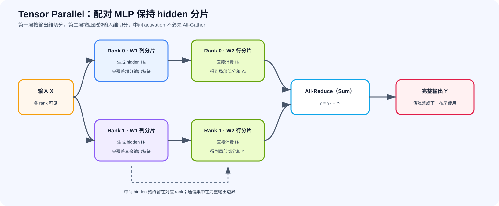
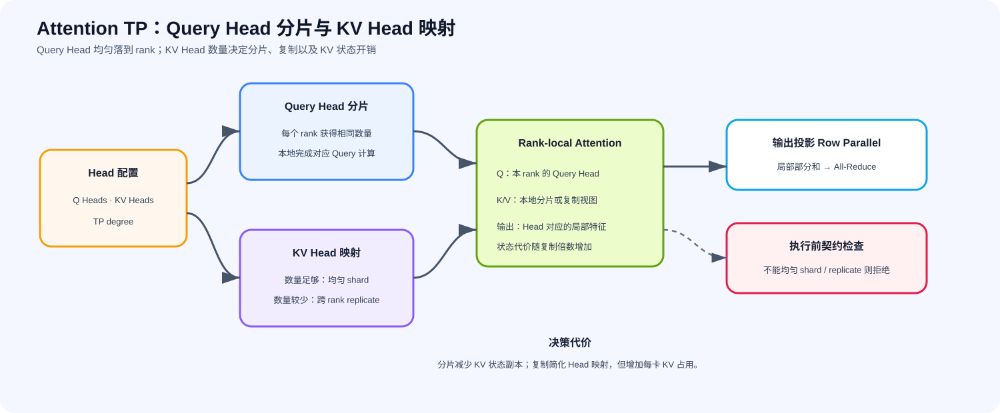

# 29. Tensor Parallelism Sim | Tensor 并行模拟

**难度：** Hard | **环境：** CPU-first | **标签：** `并行通信`, `Tensor Parallelism`, `通信` | **目标人群：** 并行通信学习者

> 🚀 **云端运行环境**
>
> 本章节的实战代码可以点击以下链接在免费 GPU 算力平台上直接运行：
>
> [](https://colab.research.google.com/github/datawhalechina/llm-algo-leetcode/blob/main/02_PyTorch_Algorithms/29_Tensor_Parallelism_Sim.ipynb)
> [](https://modelscope.cn/my/mynotebook) *(国内推荐：魔搭社区免费实例)*


---

## 本节导读

当单个 Linear 的权重、计算或中间激活无法由一张设备高效承载时，可以沿张量维度把同一层拆到多个 rank 上共同计算。Tensor Parallelism（TP）因此既用于 MLP，也用于 Attention 的投影层。

TP 的核心不是孤立地切开矩阵，而是让相邻算子的布局连续：Column Parallel 产生的特征或 Head 分片，应尽量由后续算子直接消费；Row Parallel 再在需要完整输出的位置归约。本节先建立 Column / Row 的共同模型，再比较 MLP 配对路径与 Attention 的 Q/K/V、输出投影及 KV Head 映射。

**关键词：** `Tensor Parallelism`, `Column Parallel`, `Row Parallel`

---

## 前置阅读

**导语：** 先用并行策略决策框架识别张量切分解决的问题；ZeRO 与 Pipeline 是并列比较项，不是学习本节的必经前置。

- [P1: 26. Parallel Strategy Decision Framework | 并行策略决策框架](../01_Hardware_Math_and_Systems/26_Parallel_Strategy_Decision_Framework.md)


---
### Step 1：理解 Column / Row 两种张量布局

假设输入 $X$ 形状为 `(batch, in_dim)`，权重 $A$ 形状为 `(in_dim, out_dim)`，经过线性层变为 $Y = XA$，形状 `(batch, out_dim)`。

> **Column Parallel（列切分）：切分 $A$ 的列，即输出维度**
> $A=[A_0,A_1]$ 后，各 rank 计算 $Y_i=XA_i$，得到输出特征分片。若下游需要完整 $Y$，再 All-Gather 拼接；若下游正好接受相同分片布局，则可以先不聚合。

> **Row Parallel（行切分）：切分 $A$ 的行，即输入维度**
> 输入也要按同一范围切为 $X_i$。各 rank 计算局部部分和 $Y_i=X_iA_i$；完整输出为 $Y=\sum_iY_i$，因此末端需要 All-Reduce（Sum）。

两种布局在 MLP 中通常成对出现：扩维层采用 Column Parallel，激活保持分片，缩维层采用匹配的 Row Parallel；这样中间 activation 不需要先拼成完整张量再重新切分。



### Step 2：在 MLP 与 Attention 中保持布局连续

在两层前馈网络 $Y=\operatorname{act}(XW_1)W_2$ 中，将 $W_1$ 按列切分会产生 hidden 分片 $H_i$；把 $W_2$ 按行切分后，rank $i$ 正好可以消费同一范围的 $H_i$。Attention 采用相同思想：Q/K/V 投影通常沿输出维按 Head 切分，各 rank 完成本地 Attention，输出投影再沿输入维切分并归约。

这里的重点是**布局连续性**：如果中途恢复完整激活，虽然数值正确，却会增加一次传输。对于 GQA，Query Head 通常需要能被 TP degree 整除；KV Head 可以均匀分片时优先分片，数量少于 TP rank 时则可能复制。复制能满足映射约束，却会增加 KV 状态占用。TP 切 Head / 特征维，不等同于切序列长度的 Context Parallelism。



### Step 3：比较布局收益与 collective 代价
Tensor Parallel 降低每卡持有的权重与单层计算量，但在 layer 内引入高频 collective。是否值得使用，要同时看布局是否连续、payload 是否落在关键路径，以及互联能否承受这些重复同步。

| 路径 | 切分对象 | 局部输出如何恢复 | 常见位置 | 主要代价 |
|---|---|---|---|---|
| Column Parallel | 权重输出维 | 输出分片可暂存；需要完整输出时才 All-Gather | MLP 扩维层 | 输入复制与可选输出聚合 |
| Row Parallel | 输入与权重输入维 | All-Reduce / 求和 | MLP 缩维层 | 输出归约 |
| Column → Row 配对 | 中间 activation 保持分片 | 末端统一归约 | 两层 MLP | 布局不匹配会重新引入中间同步 |
| Q/K/V 投影 | 输出维按 Head 切分 | 各 rank 保留本地 Head | Attention 输入投影 | Head 数必须满足映射约束 |
| Attention 输出投影 | 输入 Head 维切分 | 末端 All-Reduce / Reduce-Scatter | Attention 输出 | 归约位于层内关键路径 |
| GQA 的 KV Head 映射 | KV Head 分片或跨 rank 复制 | 本地 Q Head 访问对应 KV Head | 紧凑 KV 表示 | 复制会增加 KV 状态占用 |

### Step 4：CPU 实现——验证配对 MLP 的 TP 布局

本题先实现独立 Linear 的 Column / Row 路径，再把它们连接成两层 MLP；最后根据 Query Head、KV Head 与 TP degree 判断 Attention 应采用 KV 分片还是复制。实现重点是局部布局、恢复位置和 Head 映射约束。

测试区分别检查 Column / Row 与 dense 线性层的数值等价、配对 MLP 的布局连续性，以及 GQA 在可分片、需复制和不兼容配置下的行为。

| 任务与目的 | 已知条件 | 完成标准 | 测试验证 |
| --- | --- | --- | --- |
| TODO 1：完成 Column Parallel 路径 | `X`、沿输出维切分的权重 | 各 rank 计算输出分片；需要完整视图时沿特征维拼接 | 与 dense 输出的数值等价和形状契约 |
| TODO 2：完成 Row Parallel 路径 | 沿同一输入维切分的 `X` 与权重 | 各 rank 计算部分和；末端按元素求和 | 与 dense 输出的数值等价和形状契约 |
| TODO 3：保持配对 MLP 的 hidden 分片 | `W1 / W2` 的匹配 hidden 范围、`partial_outputs` | 中间 activation 不提前拼接，最终输出才归约 | 配对 MLP 与 dense 等价、hidden 维度边界 |
| TODO 4：规划 Attention Head 映射 | `num_q_heads`、`num_kv_heads`、`tp_size` | Q Head 均匀分片；KV Head 可分片时分片，数量较少时复制，不兼容配置拒绝 | 分片、复制与异常输入 |


```python
import torch
import torch.nn as nn
import torch.nn.functional as F
import math
```


```python
def tensor_parallel_column_sim(X: torch.Tensor, A: torch.Tensor, num_gpus: int = 2):
    """
    模拟 Column Parallel Linear: Y = X @ A
    将权重 A 沿列 (输出特征维度) 切分，分布到不同的 GPU 上计算，最后拼接。
    
    参数:
    X: 形状 (batch, in_features)
    A: 形状 (in_features, out_features)
    """
    in_features, out_features = A.shape
    assert out_features % num_gpus == 0, "输出维度必须能被 GPU 数量整除"
    
    # ==========================================
    # TODO 1（Column Parallel）：完成输出维切分、本地计算与结果恢复。
    # weight_chunks = ???  # 沿输出特征维形成 num_gpus 个权重分片。
    # local_outputs = ???  # 每个权重分片与完整输入对应的局部输出。
    # Y_tp = ???  # 沿输出特征维恢复完整结果。
    # ==========================================
    raise NotImplementedError
    return Y_tp


def tensor_parallel_row_sim(X: torch.Tensor, A: torch.Tensor, num_gpus: int = 2):
    """
    模拟 Row Parallel Linear: Y = X @ A
    将权重 A 沿行 (输入特征维度) 切分，输入 X 也同步切分，最后将各卡输出求和。
    
    参数:
    X: 形状 (batch, in_features)
    A: 形状 (in_features, out_features)
    """
    in_features, out_features = A.shape
    assert in_features % num_gpus == 0, "输入维度必须能被 GPU 数量整除"
    
    # ==========================================
    # TODO 2（Row Parallel）：完成输入维配对切分、局部部分和与结果归约。
    # input_chunks = ???  # 沿输入特征维形成 num_gpus 个输入分片。
    # weight_chunks = ???  # 与输入分片覆盖相同特征范围的权重分片。
    # partial_outputs = ???  # 各 rank 对完整输出贡献的局部部分和。
    # Y_tp = ???  # 按元素归约所有局部部分和。
    # ==========================================
    raise NotImplementedError
    return Y_tp


def tensor_parallel_mlp_sim(X: torch.Tensor, W1: torch.Tensor, W2: torch.Tensor, num_gpus: int = 2):
    """
    模拟 Column Parallel → ReLU → Row Parallel 的两层 MLP。

    W1 沿输出维切分，W2 沿输入维按相同范围切分。中间 activation
    始终保持分片，只有最终输出执行逻辑 All-Reduce。
    """
    if W1.shape[1] != W2.shape[0]:
        raise ValueError('W1 的输出维必须与 W2 的输入维一致')
    hidden_dim = W1.shape[1]
    if hidden_dim % num_gpus != 0:
        raise ValueError('hidden 维度必须能被 GPU 数量整除')
    hidden_per_rank = hidden_dim // num_gpus
    partial_outputs = []

    for rank in range(num_gpus):
        start = rank * hidden_per_rank
        end = start + hidden_per_rank
        # ==========================================
        # TODO 3（配对 MLP）：保持 hidden activation 分片并计算局部部分和。
        # w1_local = ???  # 第一层中属于当前 rank 的输出特征分片。
        # hidden_local = ???  # 当前 rank 的激活分片，不恢复完整 hidden。
        # w2_local = ???  # 第二层中消费同一 hidden 范围的输入分片。
        # partial_output = ???  # 当前 rank 对最终输出的局部贡献。
        # ==========================================
        raise NotImplementedError
        partial_outputs.append(partial_output)

    # 只有末端输出需要恢复完整视图，模拟 All-Reduce (Sum)。
    return torch.stack(partial_outputs, dim=0).sum(dim=0)


def plan_attention_tp(num_q_heads: int, num_kv_heads: int, tp_size: int):
    """规划 GQA 的 Query / KV Head 在 TP rank 间的映射。

    KV Head 能均匀切分时采用 shard；KV Head 少于 rank 且可均匀复制时采用
    replicate。其余组合没有稳定的一对多映射，应显式拒绝。
    """
    if min(num_q_heads, num_kv_heads, tp_size) <= 0:
        raise ValueError('Head 数与 tp_size 必须为正整数')
    if num_q_heads % tp_size != 0:
        raise ValueError('Query Head 数必须能被 tp_size 整除')

    q_heads_per_rank = num_q_heads // tp_size
    # ==========================================
    # TODO 4（Attention TP）：选择 KV Head 的分片或复制方式。
    # ==========================================
    if num_kv_heads % tp_size == 0:
        # kv_plan = ???  # 依次给出布局、每 rank 数量和单个 KV Head 副本数。
        raise NotImplementedError
    elif tp_size % num_kv_heads == 0:
        # kv_plan = ???  # 依次给出布局、每 rank 数量和单个 KV Head 副本数。
        raise NotImplementedError
    else:
        raise ValueError('KV Head 无法在 TP rank 间均匀分片或复制')

    kv_mode, kv_heads_per_rank, kv_replication = kv_plan
    return {
        'q_heads_per_rank': q_heads_per_rank,
        'kv_mode': kv_mode,
        'kv_heads_per_rank': kv_heads_per_rank,
        'kv_replication': kv_replication,
    }

```


```python
# 测试你的实现
def test_column_parallel_contract():
    """Column 切分后必须按输出维恢复完整线性层结果。"""
    torch.manual_seed(42)
    X = torch.randn(2, 8)
    A = torch.randn(8, 12)
    assert torch.allclose(tensor_parallel_column_sim(X, A, 2), X @ A)

def test_row_parallel_contract():
    """Row 切分后必须用局部部分和恢复完整线性层结果。"""
    torch.manual_seed(42)
    X = torch.randn(2, 8)
    A = torch.randn(8, 12)
    assert torch.allclose(tensor_parallel_row_sim(X, A, 2), X @ A, atol=1e-5)

def test_tensor_parallel_shape_contract():
    """两条 TP 路径不得改变 batch 或输出特征维度。"""
    X = torch.randn(2, 8)
    A = torch.randn(8, 12)
    assert tensor_parallel_column_sim(X, A, 2).shape == (2, 12)
    assert tensor_parallel_row_sim(X, A, 2).shape == (2, 12)

def test_tensor_parallel_dimension_contract():
    """切分维度不能整除 TP degree 时必须显式失败。"""
    X = torch.randn(2, 8)
    try:
        tensor_parallel_column_sim(X, torch.randn(8, 11), 2)
    except AssertionError:
        pass
    else:
        raise AssertionError('Column 输出维不可整除时应失败')
    try:
        tensor_parallel_row_sim(torch.randn(2, 7), torch.randn(7, 12), 2)
    except AssertionError:
        pass
    else:
        raise AssertionError('Row 输入维不可整除时应失败')

def test_paired_tensor_parallel_mlp_contract():
    """Column → Row 配对 MLP 应等价于 dense MLP，且中间 hidden 可保持分片。"""
    torch.manual_seed(7)
    X = torch.randn(3, 8)
    W1 = torch.randn(8, 16)
    W2 = torch.randn(16, 8)
    dense = torch.relu(X @ W1) @ W2
    parallel = tensor_parallel_mlp_sim(X, W1, W2, num_gpus=2)
    assert parallel.shape == dense.shape
    assert torch.allclose(parallel, dense, atol=1e-5)
    try:
        tensor_parallel_mlp_sim(X, W1[:, :15], W2[:15], num_gpus=2)
    except ValueError:
        pass
    else:
        raise AssertionError('hidden 维度不可整除时应抛出 ValueError')

def test_attention_tp_head_mapping_contract():
    """GQA 的 KV Head 应在可分片时分片、较少时复制。"""
    sharded = plan_attention_tp(num_q_heads=32, num_kv_heads=8, tp_size=4)
    assert sharded == {
        'q_heads_per_rank': 8,
        'kv_mode': 'shard',
        'kv_heads_per_rank': 2,
        'kv_replication': 1,
    }

    replicated = plan_attention_tp(num_q_heads=32, num_kv_heads=2, tp_size=4)
    assert replicated == {
        'q_heads_per_rank': 8,
        'kv_mode': 'replicate',
        'kv_heads_per_rank': 1,
        'kv_replication': 2,
    }

def test_attention_tp_invalid_mapping():
    """无法形成均匀 Head 映射的配置必须显式失败。"""
    for args in [(30, 8, 4), (32, 6, 4), (32, 8, 0)]:
        try:
            plan_attention_tp(*args)
        except ValueError:
            pass
        else:
            raise AssertionError(f'不兼容配置应抛出 ValueError: {args}')

test_column_parallel_contract()
test_row_parallel_contract()
test_tensor_parallel_shape_contract()
test_tensor_parallel_dimension_contract()
test_paired_tensor_parallel_mlp_contract()
test_attention_tp_head_mapping_contract()
test_attention_tp_invalid_mapping()

```

---

🛑 **STOP HERE** 🛑
<br><br><br><br><br><br><br><br><br><br>
> 请先尝试自己完成代码并跑通测试。<br>
> 如果你正在 Colab 中运行，并且遇到困难没有思路，可以向下滚动查看参考答案。
<br><br><br><br><br><br><br><br><br><br>

---
## 参考代码与解析

### 代码


```python
def tensor_parallel_column_sim(X: torch.Tensor, A: torch.Tensor, num_gpus: int = 2):
    """沿输出维切分权重，拼接局部输出以模拟 Column Parallel。"""
    in_features, out_features = A.shape
    assert out_features % num_gpus == 0, '输出维度必须能被 GPU 数量整除'
    # TODO 1：切分输出维、计算各 rank 的局部输出，并恢复完整特征视图。
    weight_chunks = torch.chunk(A, num_gpus, dim=1)
    local_outputs = [X @ weight_chunk for weight_chunk in weight_chunks]
    Y_tp = torch.cat(local_outputs, dim=-1)
    return Y_tp


def tensor_parallel_row_sim(X: torch.Tensor, A: torch.Tensor, num_gpus: int = 2):
    """沿输入维切分输入与权重，求和局部输出以模拟 Row Parallel。"""
    in_features, out_features = A.shape
    assert in_features % num_gpus == 0, '输入维度必须能被 GPU 数量整除'
    # TODO 2：沿同一输入维切分输入与权重，计算并归约局部部分和。
    input_chunks = torch.chunk(X, num_gpus, dim=1)
    weight_chunks = torch.chunk(A, num_gpus, dim=0)
    partial_outputs = [
        x_chunk @ weight_chunk
        for x_chunk, weight_chunk in zip(input_chunks, weight_chunks)
    ]
    Y_tp = torch.stack(partial_outputs, dim=0).sum(dim=0)
    return Y_tp


def tensor_parallel_mlp_sim(X: torch.Tensor, W1: torch.Tensor, W2: torch.Tensor, num_gpus: int = 2):
    """保持 hidden 分片的 Column → ReLU → Row Parallel MLP。"""
    if W1.shape[1] != W2.shape[0]:
        raise ValueError('W1 的输出维必须与 W2 的输入维一致')
    hidden_dim = W1.shape[1]
    if hidden_dim % num_gpus != 0:
        raise ValueError('hidden 维度必须能被 GPU 数量整除')
    hidden_per_rank = hidden_dim // num_gpus
    partial_outputs = []

    for rank in range(num_gpus):
        start = rank * hidden_per_rank
        end = start + hidden_per_rank
        # TODO 3：Column 输出分片直接作为匹配 Row 权重分片的输入。
        w1_local = W1[:, start:end]
        hidden_local = torch.relu(X @ w1_local)
        w2_local = W2[start:end, :]
        partial_output = hidden_local @ w2_local
        partial_outputs.append(partial_output)

    return torch.stack(partial_outputs, dim=0).sum(dim=0)


def plan_attention_tp(num_q_heads: int, num_kv_heads: int, tp_size: int):
    """规划 GQA 的 Query / KV Head 在 TP rank 间的映射。"""
    if min(num_q_heads, num_kv_heads, tp_size) <= 0:
        raise ValueError('Head 数与 tp_size 必须为正整数')
    if num_q_heads % tp_size != 0:
        raise ValueError('Query Head 数必须能被 tp_size 整除')

    q_heads_per_rank = num_q_heads // tp_size
    # TODO 4：优先均匀分片 KV Head；KV Head 较少时按 rank 复制。
    if num_kv_heads % tp_size == 0:
        kv_plan = ('shard', num_kv_heads // tp_size, 1)
    elif tp_size % num_kv_heads == 0:
        kv_plan = ('replicate', 1, tp_size // num_kv_heads)
    else:
        raise ValueError('KV Head 无法在 TP rank 间均匀分片或复制')

    kv_mode, kv_heads_per_rank, kv_replication = kv_plan
    return {
        'q_heads_per_rank': q_heads_per_rank,
        'kv_mode': kv_mode,
        'kv_heads_per_rank': kv_heads_per_rank,
        'kv_replication': kv_replication,
    }

```

### 解析

**TODO 1：Column Parallel 路径**

权重沿输出特征维分片，输入 `X` 在各 rank 可见，因此每个 rank 得到一个输出特征分片。需要完整视图时，再沿特征维拼接；这对应逻辑上的 All-Gather。

**TODO 2：Row Parallel 路径**

输入与权重必须沿同一输入维范围切分，各 rank 才能得到完整输出的局部部分和。末端按元素求和恢复输出，对应 All-Reduce（Sum），不能用拼接替代。

**TODO 3：配对 MLP 的分片连续性**

- 第一层的列分片产生 hidden 特征分片；第二层沿同一 hidden 范围做行分片，便可直接消费该分片。
- 因而中间 activation 无需先恢复成完整张量，通信集中在需要完整输出的边界。

**TODO 4：Attention TP 的 Head 映射**

- Query Head 必须均匀落到各 TP rank，保证每个 rank 的本地 Attention 工作量一致。
- KV Head 足够多时直接分片；KV Head 少于 rank 且能均匀覆盖时复制，每个 KV Head 会服务多个 rank。
- 复制避免了不规则映射，但会增加 KV 状态占用；无法均匀分片或复制的配置应在执行前失败。

### Step 5（可选）：GPU Tensor Parallel 机制基准

先用 CPU 实验验证 Column / Row Parallel 的等价关系，再在多张 GPU 上运行真实的 Column → 激活 → Row 配对 MLP。每个 rank 只持有本地权重分片，末端执行 All-Reduce，并与 dense 输出核对。

| 学习问题 | CPU 已确认 | GPU 要确认与后续使用 |
| --- | --- | --- |
| Column / Row 切分能否保持正确性并降低每 rank 状态 | 局部矩阵计算、归约与 hidden 分片连续性 | 记录 dense 等价误差、分片 MLP 时间、末端 payload、每 rank 峰值显存和吞吐代理，再到 79 做组合并行复测 |

#### 5.1 环境与固定 workload

安装与双卡预检见通信专题 Quickstart。以下配置固定配对 MLP 的形状、dtype、warmup 和重复次数。

| 类别 | 固定并记录的字段 | 用途 |
| --- | --- | --- |
| 运行环境 | GPU 数、PyTorch / CUDA、NCCL、world size | 确认 collective 路径可运行 |
| workload | dtype、batch、输入 / hidden / 输出维、payload、warmup、repeats | 固定每 rank 的通信规模 |
| 对照 | dense 数值参考、真实分片 MLP | 同时验证正确性与端到端机制成本 |
| 输出 | `RESULT_PATH`、默认关闭开关 | 保存 benchmark JSON、failure 与 evidence level |


```python
RUN_MODE = 'dry_run'  # 默认 dry_run；双卡 Profile 预检通过后改为 real_gpu。
RUN_LABEL = 'default'  # 默认 default；正式复测改为唯一标签并保留历史 JSON。
ENVIRONMENT_PROFILE = 'PAR-CUDA-MECHANISM'  # TP collective 使用的双卡环境。
WORKLOAD_ID = 'par-tensor-column-row-mlp'  # Column → 激活 → Row 配对 MLP。
WORLD_SIZE = 2  # TP rank 数；hidden 维必须能够整除该值。
BATCH_SIZE = 8  # 每次前向的 Token/样本行数。
IN_DIM = 4096  # MLP 输入维度。
HIDDEN_DIM = 11008  # 中间维度，也是 Column/Row 配对切分维。
OUT_DIM = 4096  # MLP 输出维度和末端 All-Reduce 宽度。
DTYPE = 'bf16'  # Notebook 配置名；runner 转换为 bfloat16。
RUNNER_DTYPE = 'bfloat16' if DTYPE == 'bf16' else 'float32'
WARMUP = 5  # 预热轮数，不进入统计。
REPEATS = 20  # 正式重复轮数。
RESULT_PATH = f'benchmarks/results/29_tensor_parallel_benchmark_{RUN_LABEL}.json'  # 标签隔离历史结果。
print({'run_mode': RUN_MODE, 'profile': ENVIRONMENT_PROFILE, 'world_size': WORLD_SIZE, 'shape': [BATCH_SIZE, IN_DIM, HIDDEN_DIM, OUT_DIM], 'dtype': DTYPE, 'result': RESULT_PATH})

```

#### 5.2 执行并保存 JSON

开启后用 `torchrun` 初始化 NCCL，执行本地 Column / Row GEMM 与末端 All-Reduce。JSON 同时记录 dense 等价误差、最慢 rank 时间、峰值显存和实际归约 payload。


```python
# 5.2：执行真实分片 MLP benchmark。
if RUN_MODE == 'real_gpu':
    import subprocess
    command = [
        'torchrun', '--standalone', '--nproc_per_node', str(WORLD_SIZE),
        'tools/run_parallel_mechanism_benchmark.py', '--mode', 'tp_mlp',
        '--run-label', RUN_LABEL, '--workload-id', WORKLOAD_ID,
        '--batch-size', str(BATCH_SIZE), '--in-dim', str(IN_DIM),
        '--hidden-dim', str(HIDDEN_DIM), '--out-dim', str(OUT_DIM),
        '--warmup', str(WARMUP), '--repeats', str(REPEATS),
        '--dtype', RUNNER_DTYPE, '--output', RESULT_PATH,
    ]
    subprocess.run(command, check=True)
else:
    print('dry_run：完成配置检查后，将 RUN_MODE 改为 real_gpu 再执行 5.2。')

```

#### 5.3 读取结果

读取正确性、最慢 rank 时间、峰值显存、末端 payload 与吞吐代理。解释和决策集中放在 5.4。


```python
# 5.3：读取真实 TP 机制结果；正确性失败时不得解释性能。
import json
from pathlib import Path
if Path(RESULT_PATH).exists():
    result = json.loads(Path(RESULT_PATH).read_text())
    required = {'workload', 'hardware', 'metrics', 'evidence_level', 'failure', 'decision'}
    missing = required - set(result)
    if missing:
        raise ValueError(f'结果 JSON 缺少字段：{sorted(missing)}')
    print(result)
else:
    print(f'尚无 TP benchmark 结果：{RESULT_PATH}')

```

#### 5.4 解释证据并形成决策

先检查 dense 等价误差；正确性失败时停止性能解读。正确性通过后，再把每 rank 权重状态、末端 All-Reduce payload、最慢 rank 时间和吞吐放在一起，判断切分是否解决了单层容量问题。

| 观察项 | 读取字段 | 当前结果 | 解释与动作 |
| --- | --- | --- | --- |
| 正确性 | `max_abs_error`、`failure` | 运行后填写 | 未通过时检查切分维与归约语义 |
| 状态与通信 | 每 rank 峰值显存、`all_reduce_payload_bytes_per_rank` | 运行后填写 | 核对容量收益是否伴随预期 payload |
| 时间与吞吐 | `max_rank_step_ms`、`tokens_per_s_proxy` | 运行后填写 | 判断层内同步是否吞掉局部计算收益 |
| 证据出口 | `evidence_level`、`decision` | 运行后填写 | 通过后与 46 同 payload 口径复测 collective |
## 相关阅读

Tensor Parallelism 的关键不是切分本身，而是切分后计算和通信如何交替。可以继续阅读 Megatron-LM 和分布式基准项目。

- [Megatron-LM 原论文](https://arxiv.org/abs/2104.04473)
- [Megatron-LM 开源仓库](https://github.com/NVIDIA/Megatron-LM)
- [P1: 通信调度优化](../01_Hardware_Math_and_Systems/27_Communication_Scheduling_Optimization.md)
- [79. 分布式并行基准](../02_PyTorch_Algorithms/79_Distributed_Parallel_Benchmark.md)
