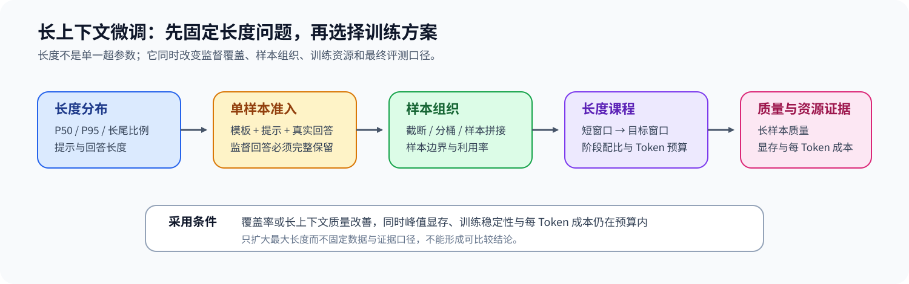
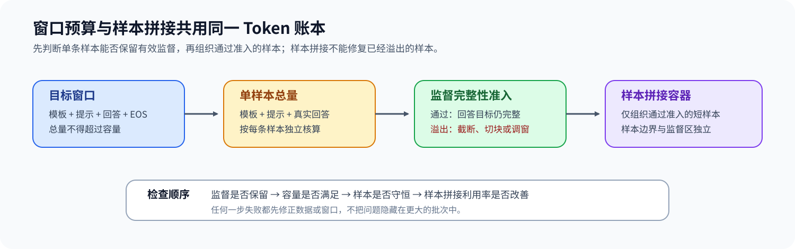

# 30. Long Context Fine Tuning | 长上下文微调机制
**难度：** Medium | **环境：** CPU-first | **标签：** `后训练`, `长上下文`, `数据组织` | **目标人群：** 训练机制学习者

> 🚀 **云端运行环境**
>
> 本章节的实战代码可以点击以下链接在免费 GPU 算力平台上直接运行：
>
> [](https://colab.research.google.com/github/datawhalechina/llm-algo-leetcode/blob/main/02_PyTorch_Algorithms/30_Long_Context_Fine_Tuning.ipynb)
> [](https://modelscope.cn/my/mynotebook) *(国内推荐：魔搭社区免费实例)*


---

## 本节导读

长上下文微调不是把 `max_length` 调大。训练窗口必须同时容纳提示词、监督回答和模板 Token；长度分布又会改变 packing 效率、每步 Token 数、显存与训练时间。本节从样本长度出发，依次建立窗口预算、packing 账本和长度课程，再用质量与成本门槛筛选候选。

**关键词：** `length distribution`, `packing`, `context budget`, `length curriculum`

---
## 前置阅读

**导语：** 进入本节前，先理解 SFT 的监督边界与训练激活成本，再比较样本长度分布与目标窗口是否匹配。

- [13. SFT Training Loop | SFT 训练循环](./13_SFT_Training_Loop.md)
- [19. Activation Checkpointing | 激活检查点](./19_Activation_Checkpointing.md)

---

### Step 1：长度分布决定问题规模

先用目标 tokenizer 统计样本 Token 长度，并区分能够直接装入、需要 packing 组织和超过目标窗口的样本。最大值只能说明极端情况；P50、P95、溢出比例和监督回答长度才能判断，是少量长尾样本还是整体长度迁移推动了长上下文需求。

| 观察项 | 回答的问题 | 对训练设计的影响 |
|:---|:---|:---|
| P50 / P95 | 典型样本与长尾样本有多长 | 选择基础窗口和长样本分支 |
| 溢出比例 | 多少样本无法完整进入目标窗口 | 截断、切块或扩大窗口 |
| 回答 Token | 监督区域需要预留多少空间 | 防止提示词挤占 labels |
| 长度分桶 | 各长度区间样本占比 | packing 与 curriculum 配比 |


### Step 2：窗口预算与 Packing 必须一起计算

目标窗口先扣除模板与回答预留，再得到可用提示词预算。packing 将多条短样本装入同一序列，可以减少 padding，但不能跨样本泄漏 labels，也不能让 packed tokens 超过窗口。

| 账本 | 关键不变量 | 失败表现 |
|:---|:---|:---|
| 单样本预算 | `prompt + response + template <= context` | 回答被截断或监督 Token 消失 |
| packed batch | 每个 bin 的 Token 总数不超过窗口 | OOM、越界或 padding 收益失真 |
| 样本边界 | 每条样本保留自己的监督区与终止符 | 跨样本学习和 loss 污染 |


### Step 3：长度课程把覆盖率收益与训练代价对齐

训练可以先用短窗口建立稳定更新，再逐步提高长样本比例和目标窗口。每个阶段要固定长度区间、采样比例和 Token 预算；候选只有在长样本覆盖率或长上下文评测改善，同时峰值显存与每 Token 成本仍可接受时才进入下一阶段。

| 阶段 | 数据重点 | 需要比较的证据 |
|:---|:---|:---|
| 基线 | 主体短样本 | loss、tokens/s、峰值显存 |
| 过渡 | 增加中长样本比例 | packing 利用率、长样本质量、稳定性 |
| 目标 | 达到目标窗口 | 长上下文评测、每 Token 成本、失败/OOM |
### Step 4：实现长度分布、Packing 与课程决策

本题使用样本 Token 长度、窗口预留和候选指标复现长上下文训练决策。骨架提供输入结构与报告格式；你需要补全长度分布、窗口预算、Packing 和候选 gate。测试分别覆盖阈值边界、容量守恒、非法输入和三类决策。

| TODO / 函数 | 学习者完成的机制 | 必须满足的约束 | 测试证据 |
|:---|:---|:---|:---|
| TODO 1：汇总长度分布<br>`summarize_length_distribution` | 统计长度分桶与 P50 / P95 | 分桶边界一致，空输入显式处理 | `test_length_distribution_and_budget`、`test_invalid_length_inputs` |
| TODO 2：规划窗口预算<br>`plan_context_budget` | 计算提示词可用预算与溢出样本 | 先扣除模板和回答预留，窗口必须为正 | `test_length_distribution_and_budget`、`test_invalid_length_inputs` |
| TODO 3：构造 Packing 容器<br>`pack_sample_lengths` | 用 first-fit decreasing 组织样本 | 每个样本只出现一次，任何容器不超容量 | `test_packing_preserves_capacity_and_samples`、`test_invalid_length_inputs` |
| TODO 4：筛选长上下文候选<br>`decide_long_context_candidate` | 联合覆盖率、质量、显存和每 Token 时间形成决策 | 质量退化优先拒绝，硬门槛不能被综合分数掩盖 | `test_candidate_decision_separates_quality_and_cost` |
## 测试

运行下方 CPU 机制测试，检查长度分布、窗口预算、Packing 容量和候选决策。


```python
from typing import Dict, List

```


```python
def summarize_length_distribution(
    lengths: List[int], short_threshold: int, long_threshold: int
) -> Dict[str, object]:
    """统计长度分桶、P50 与 P95。"""
    if short_threshold < 0 or long_threshold < short_threshold or any(length < 0 for length in lengths):
        raise ValueError("长度必须非负，且 short_threshold <= long_threshold")
    # ==========================================
    # TODO 1：汇总长度分布
    # ==========================================
    # ordered = ???  # 按升序排列的非负 Token 长度。
    # buckets = ???  # short / medium / long 三档样本计数。
    # p50_tokens = ???  # 最近秩口径的中位长度；空输入为 0。
    # p95_tokens = ???  # 最近秩口径的长尾长度；空输入为 0。
    raise NotImplementedError("TODO 1：汇总长度分布")
    return {"count": len(ordered), "buckets": buckets, "p50_tokens": p50_tokens, "p95_tokens": p95_tokens}


def plan_context_budget(
    samples: List[Dict[str, int]],
    target_context_len: int,
    template_tokens: int,
    reserved_response_tokens: int,
) -> Dict[str, object]:
    """计算提示词预算并区分 fit / overflow。"""
    if target_context_len <= 0 or template_tokens < 0 or reserved_response_tokens < 0:
        raise ValueError("窗口必须为正，预留量必须非负")
    # ==========================================
    # TODO 2：规划窗口预算
    # ==========================================
    # available_prompt_tokens = ???  # 扣除模板与回答预留后的非负 Token 容量。
    # fit_names = ???  # 提示长度不超过可用容量的样本名称。
    # overflow_names = ???  # 提示长度超过可用容量的样本名称。
    raise NotImplementedError("TODO 2：规划上下文预算")
    if available_prompt_tokens < 0:
        raise ValueError("模板与回答预留超过目标窗口")
    return {"available_prompt_tokens": available_prompt_tokens, "fit_names": fit_names, "overflow_names": overflow_names, "fit_rate": len(fit_names) / len(samples) if samples else 0.0}


def pack_sample_lengths(lengths: List[int], max_tokens_per_bin: int) -> Dict[str, object]:
    """使用 first-fit decreasing 构造 Packing 容器。"""
    if max_tokens_per_bin <= 0 or any(length <= 0 or length > max_tokens_per_bin for length in lengths):
        raise ValueError("每个长度必须位于 (0, max_tokens_per_bin] 区间")
    bins: List[List[int]] = []
    for length in sorted(lengths, reverse=True):
        # ==========================================
        # TODO 3：构造 Packing 容器
        # ==========================================
        # target_bin = ???  # 第一个还能容纳当前样本的容器；不存在时为 None。
        raise NotImplementedError("TODO 3：选择当前样本的 Packing 容器")
        if target_bin is None:
            bins.append([length])
        else:
            target_bin.append(length)
    capacity = len(bins) * max_tokens_per_bin
    return {"bins": bins, "utilization": sum(lengths) / capacity if capacity else 0.0}


def decide_long_context_candidate(
    baseline: Dict[str, float],
    candidate: Dict[str, float],
    max_memory_ratio: float,
    max_time_per_token_ratio: float,
) -> Dict[str, object]:
    """联合覆盖率、质量与资源门槛形成决策。"""
    coverage_gain = candidate["coverage"] - baseline["coverage"]
    # ==========================================
    # TODO 4：筛选长上下文候选
    # ==========================================
    # quality_delta = ???  # 候选质量减去基线质量。
    # memory_ratio = ???  # 候选峰值显存相对基线的倍率。
    # time_per_token_ratio = ???  # 候选每 Token 时间相对基线的倍率。
    # decision = ???  # 依据质量、覆盖率和资源门槛返回 accept / tune / reject。
    raise NotImplementedError("TODO 4：形成长上下文候选决策")
    return {"coverage_gain": coverage_gain, "quality_delta": quality_delta, "memory_ratio": memory_ratio, "time_per_token_ratio": time_per_token_ratio, "decision": decision}
```


```python
def _assert_raises_value_error(callback) -> None:
    """确认非法长度、窗口或容量被显式拒绝。"""
    try:
        callback()
    except ValueError:
        return
    raise AssertionError("非法输入应抛出 ValueError")


def test_length_distribution_and_budget() -> None:
    """长度分桶、分位数和窗口预留应使用同一 Token 口径。"""
    summary = summarize_length_distribution([64, 128, 300, 900], 128, 512)
    assert summary["buckets"] == {"short": 2, "medium": 1, "long": 1}
    assert summary["p50_tokens"] == 128
    assert summary["p95_tokens"] == 900
    samples = [
        {"name": "short", "prompt_tokens": 300},
        {"name": "medium", "prompt_tokens": 1200},
        {"name": "overflow", "prompt_tokens": 1900},
    ]
    plan = plan_context_budget(samples, 2048, 32, 256)
    assert plan["available_prompt_tokens"] == 1760
    assert plan["fit_names"] == ["short", "medium"]
    assert plan["overflow_names"] == ["overflow"]


def test_packing_preserves_capacity_and_samples() -> None:
    """Packing 不得超出 bin 容量，也不能丢失样本。"""
    report = pack_sample_lengths([7, 6, 4, 3], 10)
    assert report["bins"] == [[7, 3], [6, 4]]
    assert all(sum(bin_lengths) <= 10 for bin_lengths in report["bins"])
    assert sorted(sum(report["bins"], [])) == [3, 4, 6, 7]
    assert report["utilization"] == 1.0


def test_invalid_length_inputs() -> None:
    """负长度、无效预留和超长 Packing 样本必须被拒绝。"""
    _assert_raises_value_error(lambda: summarize_length_distribution([-1, 8], 16, 32))
    _assert_raises_value_error(lambda: plan_context_budget([], 128, 64, 80))
    _assert_raises_value_error(lambda: pack_sample_lengths([129], 128))


def test_candidate_decision_separates_quality_and_cost() -> None:
    """质量硬门槛与资源软门槛必须产生不同决策。"""
    baseline = {"coverage": 0.45, "quality": 0.61, "peak_memory_gb": 14.0, "time_per_token_ms": 2.0}
    accepted = {"coverage": 0.80, "quality": 0.64, "peak_memory_gb": 18.0, "time_per_token_ms": 2.4}
    tuned = {**accepted, "peak_memory_gb": 21.0}
    rejected = {**accepted, "quality": 0.60}
    assert decide_long_context_candidate(baseline, accepted, 1.4, 1.3)["decision"] == "accept"
    assert decide_long_context_candidate(baseline, tuned, 1.4, 1.3)["decision"] == "tune"
    assert decide_long_context_candidate(baseline, rejected, 1.4, 1.3)["decision"] == "reject"


try:
    test_length_distribution_and_budget()
    test_packing_preserves_capacity_and_samples()
    test_invalid_length_inputs()
    test_candidate_decision_separates_quality_and_cost()
    print("✅ 长度、窗口、packing 与候选决策测试通过。")
except (AttributeError, NameError, TypeError, ValueError, AssertionError) as error:
    raise NotImplementedError("请先完成 TODO 代码！") from error
```

---

🛑 **STOP HERE** 🛑
<br><br><br><br><br><br><br><br><br><br>
> 请先尝试自己完成代码并跑通测试。<br>
> 如果遇到困难没有思路，可以向下滚动查看参考答案。
<br><br><br><br><br><br><br><br><br><br>

---

## 参考代码与解析

### 代码


```python
def summarize_length_distribution(
    lengths: List[int], short_threshold: int, long_threshold: int
) -> Dict[str, object]:
    """统计长度分桶、P50 与 P95。"""
    if short_threshold < 0 or long_threshold < short_threshold or any(length < 0 for length in lengths):
        raise ValueError("长度必须非负，且 short_threshold <= long_threshold")
    # TODO 1：汇总长度分布。
    ordered = sorted(int(length) for length in lengths)
    buckets = {"short": sum(length <= short_threshold for length in ordered), "medium": sum(short_threshold < length <= long_threshold for length in ordered), "long": sum(length > long_threshold for length in ordered)}
    p50_tokens = ordered[max(0, int(0.50 * len(ordered) + 0.999999) - 1)] if ordered else 0
    p95_tokens = ordered[max(0, int(0.95 * len(ordered) + 0.999999) - 1)] if ordered else 0
    return {
        "count": len(ordered),
        "buckets": buckets,
        "p50_tokens": p50_tokens,
        "p95_tokens": p95_tokens,
    }


def plan_context_budget(
    samples: List[Dict[str, int]],
    target_context_len: int,
    template_tokens: int,
    reserved_response_tokens: int,
) -> Dict[str, object]:
    """计算提示词预算并区分 fit / overflow。"""
    if target_context_len <= 0 or template_tokens < 0 or reserved_response_tokens < 0:
        raise ValueError("窗口必须为正，预留量必须非负")
    # TODO 2：规划窗口预算。
    available_prompt_tokens = target_context_len - template_tokens - reserved_response_tokens
    if available_prompt_tokens < 0:
        raise ValueError("模板与回答预留超过目标窗口")
    fit_names = [item["name"] for item in samples if item["prompt_tokens"] <= available_prompt_tokens]
    overflow_names = [item["name"] for item in samples if item["prompt_tokens"] > available_prompt_tokens]
    return {
        "available_prompt_tokens": available_prompt_tokens,
        "fit_names": fit_names,
        "overflow_names": overflow_names,
        "fit_rate": len(fit_names) / len(samples) if samples else 0.0,
    }


def pack_sample_lengths(lengths: List[int], max_tokens_per_bin: int) -> Dict[str, object]:
    """使用 first-fit decreasing 构造 packing bins。"""
    if max_tokens_per_bin <= 0 or any(length <= 0 or length > max_tokens_per_bin for length in lengths):
        raise ValueError("每个长度必须位于 (0, max_tokens_per_bin] 区间")
    # TODO 3：构造 Packing 容器。
    bins: List[List[int]] = []
    for length in sorted(lengths, reverse=True):
        target_bin = next((bin_lengths for bin_lengths in bins if sum(bin_lengths) + length <= max_tokens_per_bin), None)
        if target_bin is None:
            bins.append([length])
        else:
            target_bin.append(length)
    capacity = len(bins) * max_tokens_per_bin
    return {
        "bins": bins,
        "utilization": sum(lengths) / capacity if capacity else 0.0,
    }


def decide_long_context_candidate(
    baseline: Dict[str, float],
    candidate: Dict[str, float],
    max_memory_ratio: float,
    max_time_per_token_ratio: float,
) -> Dict[str, object]:
    """联合覆盖率、质量与资源门槛形成决策。"""
    # TODO 4：筛选长上下文候选。
    coverage_gain = candidate["coverage"] - baseline["coverage"]
    quality_delta = candidate["quality"] - baseline["quality"]
    memory_ratio = candidate["peak_memory_gb"] / baseline["peak_memory_gb"]
    time_per_token_ratio = candidate["time_per_token_ms"] / baseline["time_per_token_ms"]
    if quality_delta < 0:
        decision = "reject"
    elif coverage_gain <= 0 or memory_ratio > max_memory_ratio or time_per_token_ratio > max_time_per_token_ratio:
        decision = "tune"
    else:
        decision = "accept"
    return {
        "coverage_gain": coverage_gain,
        "quality_delta": quality_delta,
        "memory_ratio": memory_ratio,
        "time_per_token_ratio": time_per_token_ratio,
        "decision": decision,
    }
```

### 解析

#### TODO 1：汇总长度分布

- 答案先对非负长度排序，再按阈值统计 short / medium / long，并用最近秩口径读取 P50 与 P95。
- 分桶刻画主体结构，分位数定位中位与长尾；测试同时覆盖空输入、阈值顺序和负长度，防止统计口径漂移。

#### TODO 2：规划窗口预算

- 答案先从目标窗口扣除模板与回答预留，再按提示长度分别生成 fit 和 overflow 样本集合。
- 预算必须在样本分类前固定；测试验证两类集合互补，并覆盖预留超过窗口时的失败路径。

#### TODO 3：构造 Packing 容器

- 答案按长度降序遍历，并把当前样本放入第一个仍有容量的容器；不存在时才新建容器。
- 这一实现对应 First-fit decreasing；测试检查每个容器不超容量、样本总量守恒以及超长样本被拒绝。

#### TODO 4：筛选长上下文候选

- 答案计算覆盖率增量、质量差值、峰值显存倍率和每 Token 时间倍率，再按硬门槛形成决策。
- 质量退化直接拒绝；覆盖率无收益或资源超限返回 tune，只有质量、覆盖率与资源门槛全部通过才接受。
### Step 5：可选 GPU 实验——序列长度与训练资源曲线

CPU 题目确认长度分布、窗口预算与 Packing 决策；GPU 实验固定真实模型、batch 和输入语义，只扫描序列长度，测量一次前向 / 反向的时间、每 Token 时间与峰值显存。环境创建见[后训练实验 Quickstart](../topic_discussion/post_training_optimization/quickstart.md#pt-sft-cuda-quickstart)。

| 学习问题 | CPU 已确认 | GPU 要确认与后续使用 |
| --- | --- | --- |
| 序列变长如何改变训练资源 | 窗口、Packing、覆盖率与候选 gate | 真实模型反向传播的时间和显存曲线；结果交给长上下文微调项目选择工作负载 |

#### 5.1 环境与固定工作负载

本实验使用 `PT-SFT-CUDA`。首次运行先完成专题 Quickstart；已有环境只需通过 Profile 预检，并从同一解释器启动 JupyterLab。

| 配置层 | 本节固定口径 | 修改规则 |
| --- | --- | --- |
| 运行环境 | `PT-SFT-CUDA`；单张 NVIDIA GPU；参考显存 8 GiB | 预检失败时停止实验 |
| 模型 / 数据来源 | `Qwen/Qwen2.5-0.5B`；内置固定文本 | 自动固定模型 commit；本实验不下载数据集 |
| 工作负载 | batch 1；长度 128 / 256 / 512；预热 2 次、测量 10 次 | 改变长度矩阵、batch 或次数后递增 workload version |
| 配对变量 | 同一模型与输入语义，仅改变序列长度 | dtype、SDPA backend、随机种子、测量代码和硬件保持一致 |
| 测量方法 | loss 有限性、前向 / 反向时间、每 Token 时间、峰值显存 | 不把重复文本上的 loss 当作任务质量 |
| 结果资产 | `benchmarks/results/pt_long_context/pt-long-context_<run_label>.json` | 正式复测使用唯一标签并保留旧结果 |

```python
RUN_MODE = "dry_run"  # 默认值 dry_run：只登记计划；改为 real_gpu 执行真实长度矩阵。
RUN_LABEL = "default"  # 默认值 default；正式复测改为唯一标签，避免覆盖旧结果。
ENVIRONMENT_PROFILE = "PT-SFT-CUDA"  # 默认值 PT-SFT-CUDA；运行前必须通过同名 Profile 预检。
MODEL_ID = "Qwen/Qwen2.5-0.5B"  # 默认基础模型；更换后不得与旧结果直接合并。
MODEL_REVISION = "main"  # 默认 main；5.2 自动解析并记录实际模型 commit。
WORKLOAD_ID = "pt-long-context"  # 稳定工作负载身份。
WORKLOAD_VERSION = "v2"  # v2 固定 SDPA、batch 1 与 128 / 256 / 512 长度矩阵。
SEQUENCE_LENGTHS = [128, 256, 512]  # 默认三个 Token 长度点；增加长度会提高耗时与显存。
BATCH_SIZE = 1  # 默认值 1；改变后同时改变 Token 工作量与峰值显存。
WARMUP_STEPS = 2  # 默认值 2 次；不进入计时统计。
REPEAT_STEPS = 10  # 默认值 10 次；用于降低单次 GPU 抖动对中位数和 P95 的影响。
ATTENTION_BACKEND = "sdpa"  # 默认值 sdpa；改变 backend 后结果不可与本工作负载直接合并。
SEED = 42  # 默认值 42；固定模型和输入构造。
LOCAL_FILES_ONLY = False  # 默认值 False；已缓存相同 commit 且离线运行时改为 True。
OUTPUT_RELATIVE_PATH = f"benchmarks/results/pt_long_context/{WORKLOAD_ID}_{RUN_LABEL}.json"  # 由运行标签派生的仓库相对路径。
```

#### 5.2 执行并保存 JSON

5.2 从同一模型快照构造三个长度点，逐点预热并重复执行前向 / 反向；每次测量前清空梯度并重置峰值显存统计。

```python
import gc
import platform
import time

import torch
from tools.notebook_runtime import failure_record, package_version, resolve_model_commit, save_json
from tools.project_runtime import resolve_project_root
from tools.training_mechanism_runtime import cuda_hardware_snapshot, gradient_l2_norm, median_and_p95

REPO_ROOT = resolve_project_root()
OUTPUT_PATH = REPO_ROOT / OUTPUT_RELATIVE_PATH
result = {
    "schema_version": "post-training-mechanism-gpu/v1", "semantic_id": "PT-LONG-CONTEXT",
    "environment_profile": ENVIRONMENT_PROFILE, "run_mode": RUN_MODE, "run_label": RUN_LABEL,
    "framework": {"python": platform.python_version(), "torch": torch.__version__, "transformers": package_version("transformers")},
    "hardware": {"cuda_available": torch.cuda.is_available(), "cuda": torch.version.cuda},
    "model": {"id": MODEL_ID, "requested_revision": MODEL_REVISION, "resolved_commit": None},
    "workload": {"id": WORKLOAD_ID, "version": WORKLOAD_VERSION, "sequence_lengths": SEQUENCE_LENGTHS, "batch_size": BATCH_SIZE, "warmup_steps": WARMUP_STEPS, "repeat_steps": REPEAT_STEPS, "attention_backend": ATTENTION_BACKEND, "seed": SEED},
    "measurements": [], "failure": None, "evidence_level": "dry_run", "decision": "not_measured",
}
execution_stage = "environment_preflight"
if RUN_MODE == "real_gpu":
    model = None
    try:
        if not torch.cuda.is_available():
            raise RuntimeError("RUN_MODE=real_gpu，但 CUDA 不可用")
        if not SEQUENCE_LENGTHS or sorted(set(SEQUENCE_LENGTHS)) != SEQUENCE_LENGTHS or min(SEQUENCE_LENGTHS) <= 1:
            raise ValueError("SEQUENCE_LENGTHS 必须是严格递增且大于 1 的唯一长度列表")
        from transformers import AutoModelForCausalLM, AutoTokenizer
        torch.manual_seed(SEED)
        torch.cuda.manual_seed_all(SEED)
        device = torch.device("cuda")
        dtype = torch.bfloat16 if torch.cuda.is_bf16_supported() else torch.float16
        execution_stage = "revision_and_model"
        model_commit, revision_source = resolve_model_commit(MODEL_ID, MODEL_REVISION, local_files_only=LOCAL_FILES_ONLY)
        result["model"].update({"resolved_commit": model_commit, "resolution_source": revision_source})
        tokenizer = AutoTokenizer.from_pretrained(MODEL_ID, revision=model_commit, local_files_only=LOCAL_FILES_ONLY)
        seed_ids = tokenizer("Long context training must preserve supervision while controlling memory and time.", add_special_tokens=False)["input_ids"]
        model = AutoModelForCausalLM.from_pretrained(MODEL_ID, revision=model_commit, local_files_only=LOCAL_FILES_ONLY, dtype=dtype, attn_implementation=ATTENTION_BACKEND).to(device)
        model.config.use_cache = False
        result["workload"]["parameter_dtype"] = str(dtype).replace("torch.", "")
        model.train()
        execution_stage = "length_matrix"
        for sequence_length in SEQUENCE_LENGTHS:
            repeated = (seed_ids * ((sequence_length + len(seed_ids) - 1) // len(seed_ids)))[:sequence_length]
            input_ids = torch.tensor([repeated] * BATCH_SIZE, dtype=torch.long, device=device)
            batch = {"input_ids": input_ids, "attention_mask": torch.ones_like(input_ids), "labels": input_ids.clone()}
            timings, losses, gradient_norms = [], [], []
            for step in range(WARMUP_STEPS + REPEAT_STEPS):
                model.zero_grad(set_to_none=True)
                if step == WARMUP_STEPS:
                    torch.cuda.reset_peak_memory_stats()
                torch.cuda.synchronize()
                started = time.perf_counter()
                with torch.autocast("cuda", dtype=dtype):
                    loss = model(**batch).loss
                loss.backward()
                torch.cuda.synchronize()
                if step >= WARMUP_STEPS:
                    timings.append((time.perf_counter() - started) * 1000)
                    losses.append(float(loss.detach().item()))
                    gradient_norms.append(gradient_l2_norm(model.parameters()))
            median_ms, p95_ms = median_and_p95(timings)
            result["measurements"].append({"sequence_length": sequence_length, "tokens_per_step": sequence_length * BATCH_SIZE, "median_step_ms": median_ms, "p95_step_ms": p95_ms, "median_ms_per_token": median_ms / (sequence_length * BATCH_SIZE), "losses": losses, "gradient_norms": gradient_norms, "peak_allocated_bytes": int(torch.cuda.max_memory_allocated()), "peak_reserved_bytes": int(torch.cuda.max_memory_reserved())})
        finite = all(torch.isfinite(torch.tensor(item["losses"] + item["gradient_norms"])).all().item() for item in result["measurements"])
        memory_monotonic = all(left["peak_allocated_bytes"] <= right["peak_allocated_bytes"] for left, right in zip(result["measurements"], result["measurements"][1:]))
        result.update({"hardware": cuda_hardware_snapshot(), "evidence_level": "real_model_length_mechanism_benchmark", "decision": "accept_mechanism" if finite and memory_monotonic else "tune"})
    except Exception as error:
        result["failure"] = failure_record(execution_stage, error)
        result["evidence_level"] = "failed_real_gpu_attempt"
        result["decision"] = "reject_until_fixed"
    finally:
        del model
        gc.collect()
        torch.cuda.empty_cache()
elif RUN_MODE == "dry_run":
    result["decision"] = "ready_to_measure"
else:
    raise ValueError("RUN_MODE 只能是 dry_run 或 real_gpu")
save_json(OUTPUT_PATH, result)
print(OUTPUT_PATH)
print(result["decision"], result["failure"])
```

#### 5.3 读取长度矩阵

先检查失败阶段和模型 commit，再按序列长度读取 loss 有限性、时间、每 Token 时间与两种峰值显存。

```python
import json
if not OUTPUT_PATH.exists():
    print(f"尚未找到结果文件：{OUTPUT_PATH}")
else:
    record = json.loads(OUTPUT_PATH.read_text(encoding="utf-8"))
    print(json.dumps({key: record.get(key) for key in ("run_label", "model", "failure", "evidence_level", "decision")}, ensure_ascii=False, indent=2))
    for item in record.get("measurements", []):
        print({key: item.get(key) for key in ("sequence_length", "tokens_per_step", "median_step_ms", "p95_step_ms", "median_ms_per_token", "peak_allocated_bytes", "peak_reserved_bytes")})
```

#### 5.4 解释长度与资源证据

先检查 `failure`、模型 commit 和长度矩阵；口径可比后，再看 loss 有限性、时间与峰值显存随长度的变化。当前仓库尚未登记本节统一实机快照，因此下表保留待验证状态。

| 观察项 | 读取字段 | 当前结果 | 解释与动作 |
| --- | --- | --- | --- |
| 运行与口径 | `failure`、model commit、sequence lengths、batch | 待验证 | 模型、输入或长度矩阵变化时先重跑 |
| 机制与路径 | `tokens_per_step`、`gradient_norms` | 待验证 | 每个长度点必须完成真实前向与反向，并产生有限梯度 |
| 正确性或质量 | `losses` | 待验证 | 只检查数值有限，不把重复文本损失解释为任务质量 |
| 资源与性能 | `median_step_ms`、`p95_step_ms`、`median_ms_per_token`、峰值显存 | 待验证 | 用曲线识别可承受长度，不从单个长度点外推 |
| 证据与决策 | `evidence_level`、`decision` | 待验证 | 机制通过后进入真实数据、Packing 与质量配对项目 |
## 相关阅读

完成长度分布、上下文预算和 CPU 观察后，可以继续阅读长上下文方法、显存动作与真实微调项目。

- [LongLoRA 原论文：Efficient Fine-tuning of Long-Context Large Language Models](https://arxiv.org/abs/2309.12307)
- [Hugging Face Transformers：长文本生成文档](https://huggingface.co/docs/transformers/main/en/llm_tutorial)
- [32. SFT Data Admission and Length Audit | SFT 数据准入与长度审计](./32_Data_Engineering_for_SFT.md)
- [42. Activation Offload | 激活卸载](./42_Activation_Offload.md)
- [62. Instruction Fine-Tuning Project | 指令微调项目](./62_Instruction_Fine_Tuning_Project.md)
