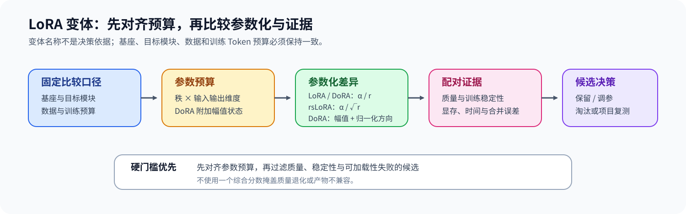
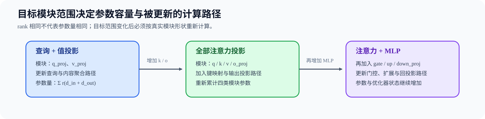

# 31. LoRA Variants Theory | LoRA 变体缩放与预算
**难度：** Medium | **环境：** CPU-first | **标签：** `训练微调`, `LoRA`, `低秩适配` | **目标人群：** 训练机制学习者

> 🚀 **云端运行环境**
>
> 本章节的实战代码可以点击以下链接在免费 GPU 算力平台上直接运行：
>
> [](https://colab.research.google.com/github/datawhalechina/llm-algo-leetcode/blob/main/02_PyTorch_Algorithms/31_LoRA_Variants_Theory.ipynb)
> [](https://modelscope.cn/my/mynotebook) *(国内推荐：魔搭社区免费实例)*


---

## 本节导读

LoRA 变体改变低秩增量的缩放、参数化或挂载范围。比较这些方案时，需要先固定基座、目标模块、数据与训练预算，再分别检查参数容量、训练稳定性、质量和交付路径。

**关键词：** `rank`, `alpha`, `dropout`, `target modules`

---

## 前置阅读

**导语：** 进入本节前，先能说明 LoRA 旁路、缩放与合并如何工作。
- [14. LoRA Tutorial | LoRA 教程](./14_LoRA_Tutorial.md)

---

### Step 1：LoRA 变体先对齐更新路径与参数预算

LoRA 将权重增量写成低秩乘积 `ΔW = sBA`，其中 `A ∈ R^{r×d_in}`、`B ∈ R^{d_out×r}`，可训练参数量为 `r(d_in+d_out)`。rsLoRA 改变 rank 增大时的缩放规律，DoRA 则把权重更新拆成方向与幅值；因此比较变体时必须同时固定 rank、alpha、目标模块及其形状。

| 变体 | 更新路径 | 缩放或附加状态 |
|:---|:---|:---|
| LoRA | `ΔW = (alpha / r)BA` | rank 增大时缩放随 `1/r` 减小 |
| rsLoRA | `ΔW = (alpha / sqrt(r))BA` | 高 rank 下保留更强的更新尺度 |
| DoRA | 幅值 `m` × 归一化方向 `W + ΔW` | 除低秩矩阵外，每个输出通道增加一个幅值参数 |


### Step 2：Target Modules 决定容量与表达范围

同一个 rank 放在 `q_proj`、`v_proj` 或全部 Attention/MLP 投影上，参数量和表达范围不同。参数预算必须按真实模块形状逐项累计，不能用 rank 代替容量。扩大目标范围时，应先确认新增模块是否对应任务所需的表示变化。

| 目标范围 | 主要改变 | 参数与训练代价 |
|:---|:---|:---|
| `q_proj` / `v_proj` | 注意力查询与取值映射 | 参数最少，表达范围较窄 |
| 全部 Attention 投影 | Q/K/V/O 共同适配 | 参数增加，注意力路径更完整 |
| Attention + MLP | 同时适配信息交互与通道变换 | 参数和优化状态最多，需要重新核对预算 |


### Step 3：用独立证据判断候选能否准入

公平比较先要把候选放到可解释的预算口径中：目标模块范围扩大后，同一参数上限允许的 rank 会下降；DoRA 的幅值状态也会占用固定预算。完成预算对齐后，再分别检查验证质量、训练稳定性和产物可加载性。

| 准入维度 | 首要证据 | 拒绝条件 |
|:---|:---|:---|
| 参数预算 | 相同上限下的可用 rank 与可训练参数量 | 超过训练资源上限 |
| 质量 | 独立验证集指标 | 低于预先固定的质量门槛 |
| 稳定性 | loss 波动或稳定性得分 | 出现持续震荡或非有限值 |
| 产物 | adapter / merged artifact 加载结果 | 无法加载或合并前后语义不一致 |
### Step 4：实现参数预算、变体规格与 rank 对齐

本题使用目标模块形状与参数上限复现 LoRA 变体的预算对齐。骨架提供字段解析和约束检查；你需要补全单模块参数量、变体缩放，并反推出给定目标范围下允许的最大 rank。测试覆盖 LoRA / rsLoRA / DoRA、非法配置和预算不足路径。

| TODO / 函数 | 学习者完成的机制 | 必须满足的约束 | 测试证据 |
|:---|:---|:---|:---|
| TODO 1：计算适配器参数<br>`count_adapter_parameters` | 按模块形状累计 LoRA / DoRA 可训练参数 | 只统计目标模块，DoRA 额外计入幅值状态 | `test_parameter_budget_and_scaling`、`test_invalid_variant_inputs` |
| TODO 2：统一变体规格<br>`build_lora_variant_spec` | 计算 LoRA / rsLoRA 缩放与参数量 | rank、alpha、变体和目标模块必须有效 | `test_parameter_budget_and_scaling`、`test_invalid_variant_inputs` |
| TODO 3：反推预算 rank<br>`max_rank_for_budget` | 从目标模块形状与参数上限求最大 rank | DoRA 先扣除幅值参数，结果不得超过预算 | `test_budget_aligned_rank`、`test_insufficient_budget` |
## 测试

运行下方 CPU 机制测试，检查参数账本、变体缩放和固定预算下的 rank 对齐。


```python
import math
from typing import Dict, List

```


```python
def count_adapter_parameters(
    module_shapes: Dict[str, tuple[int, int]],
    target_modules: List[str],
    rank: int,
    use_dora: bool,
) -> int:
    """TODO 1：计算目标模块上的 LoRA / DoRA 可训练参数。"""
    if rank <= 0:
        raise ValueError("rank 必须为正数")
    adapter_params = 0
    for name in target_modules:
        if name not in module_shapes:
            raise KeyError(f"未知目标模块：{name}")
        in_features, out_features = module_shapes[name]
        # ==========================================
        # TODO 1：当前模块的适配器参数量；DoRA 还需计入输出通道幅值。
        # module_params = ???
        # ==========================================
        raise NotImplementedError("TODO 1：计算当前模块的适配器参数量")
        adapter_params += module_params
    return adapter_params


def build_lora_variant_spec(
    variant: Dict[str, object], module_shapes: Dict[str, tuple[int, int]]
) -> Dict[str, object]:
    """TODO 2：生成包含缩放与参数量的统一变体规格。"""
    rank = int(variant["rank"])
    alpha = float(variant["alpha"])
    variant_type = str(variant.get("variant", "lora")).lower()
    target_modules = list(variant.get("target_modules", []))
    if variant_type not in {"lora", "rslora", "dora"}:
        raise ValueError(f"未知 LoRA 变体：{variant_type}")
    if rank <= 0 or alpha <= 0 or not target_modules:
        raise ValueError("rank、alpha 必须为正数且 target_modules 不能为空")
    # ==========================================
    # TODO 2：缩放系数（标量）与总可训练参数量（整数）。
    # scaling = ???  # LoRA/DoRA: alpha/r；rsLoRA: alpha/sqrt(r)
    # trainable_params = ???  # 所有目标模块的适配器参数总量
    # ==========================================
    raise NotImplementedError("TODO 2：统一 LoRA 变体规格")
    return {**variant, "variant": variant_type, "target_modules": target_modules, "scaling": scaling, "trainable_params": trainable_params}


def max_rank_for_budget(
    module_shapes: Dict[str, tuple[int, int]],
    target_modules: List[str],
    max_trainable_params: int,
    use_dora: bool,
) -> Dict[str, object]:
    """TODO 3：在固定参数上限内求目标模块可使用的最大 rank。"""
    if max_trainable_params <= 0 or not target_modules:
        raise ValueError("参数上限必须为正数且 target_modules 不能为空")
    for name in target_modules:
        if name not in module_shapes:
            raise KeyError(f"未知目标模块：{name}")
    rank_unit = sum(sum(module_shapes[name]) for name in target_modules)
    fixed_params = sum(module_shapes[name][1] for name in target_modules) if use_dora else 0
    # ==========================================
    # TODO 3：最大可用 rank（正整数）；先扣除 DoRA 固定幅值参数。
    # max_rank = ???
    # ==========================================
    raise NotImplementedError("TODO 3：反推参数预算允许的 rank")
    if max_rank < 1:
        return {"max_rank": 0, "trainable_params": 0, "decision": "reject"}
    trainable_params = count_adapter_parameters(module_shapes, target_modules, max_rank, use_dora)
    return {"max_rank": max_rank, "trainable_params": trainable_params, "decision": "accept"}
```


```python
def test_parameter_budget_and_scaling() -> None:
    """模块形状、DoRA magnitude 与缩放规则应显式进入规格。"""
    shapes = {"q_proj": (16, 16), "v_proj": (16, 8)}
    assert count_adapter_parameters(shapes, ["q_proj", "v_proj"], 4, False) == 224
    assert count_adapter_parameters(shapes, ["q_proj", "v_proj"], 4, True) == 248
    lora = build_lora_variant_spec({"name": "lora", "rank": 4, "alpha": 8, "target_modules": ["q_proj"], "variant": "lora", "quality_score": 0.8}, shapes)
    rslora = build_lora_variant_spec({"name": "rslora", "rank": 4, "alpha": 8, "target_modules": ["q_proj"], "variant": "rslora", "quality_score": 0.8}, shapes)
    assert lora["scaling"] == 2.0
    assert rslora["scaling"] == 4.0


def test_budget_aligned_rank() -> None:
    """相同参数上限下，DoRA 的固定幅值状态会降低最大可用 rank。"""
    shapes = {"q_proj": (16, 16), "v_proj": (16, 8)}
    lora = max_rank_for_budget(shapes, ["q_proj", "v_proj"], 248, use_dora=False)
    dora = max_rank_for_budget(shapes, ["q_proj", "v_proj"], 248, use_dora=True)
    assert lora == {"max_rank": 4, "trainable_params": 224, "decision": "accept"}
    assert dora == {"max_rank": 4, "trainable_params": 248, "decision": "accept"}
    tighter_dora = max_rank_for_budget(shapes, ["q_proj", "v_proj"], 224, use_dora=True)
    assert tighter_dora["max_rank"] == 3


def _assert_raises(error_type, fn) -> None:
    """断言调用抛出指定异常。"""
    try:
        fn()
    except error_type:
        return
    raise AssertionError(f"预期抛出 {error_type.__name__}")


def test_invalid_variant_inputs() -> None:
    """非法 rank、目标模块和变体名必须被拒绝。"""
    shapes = {"q_proj": (16, 16)}
    _assert_raises(ValueError, lambda: count_adapter_parameters(shapes, ["q_proj"], 0, False))
    _assert_raises(KeyError, lambda: count_adapter_parameters(shapes, ["k_proj"], 4, False))
    bad = {"name": "bad", "variant": "unknown", "rank": 4, "alpha": 8, "target_modules": ["q_proj"]}
    _assert_raises(ValueError, lambda: build_lora_variant_spec(bad, shapes))
    empty = {"name": "empty", "variant": "lora", "rank": 4, "alpha": 8, "target_modules": []}
    _assert_raises(ValueError, lambda: build_lora_variant_spec(empty, shapes))


def test_insufficient_budget() -> None:
    """连 rank=1 都无法容纳时，应返回可解释的拒绝结果。"""
    shapes = {"q_proj": (16, 16)}
    result = max_rank_for_budget(shapes, ["q_proj"], 31, use_dora=False)
    assert result == {"max_rank": 0, "trainable_params": 0, "decision": "reject"}


try:
    test_parameter_budget_and_scaling()
    test_budget_aligned_rank()
    test_invalid_variant_inputs()
    test_insufficient_budget()
    print("✅ LoRA 参数预算、缩放与预算对齐测试通过。")
except (AttributeError, KeyError, NameError, TypeError, ValueError, AssertionError) as error:
    raise NotImplementedError("请先完成 TODO 代码！") from error
```

---

🛑 **STOP HERE** 🛑
<br><br><br><br><br><br><br><br><br><br>
> 请先尝试自己完成代码并跑通测试。<br>
> 如果遇到困难没有思路，可以向下滚动查看参考答案。
<br><br><br><br><br><br><br><br><br><br>

---

## 参考代码与解析

### 代码


```python
import math


def count_adapter_parameters(
    module_shapes: Dict[str, tuple[int, int]],
    target_modules: List[str],
    rank: int,
    use_dora: bool,
) -> int:
    """计算目标模块上的 LoRA / DoRA 可训练参数。"""
    if rank <= 0:
        raise ValueError("rank 必须为正数")
    adapter_params = 0
    for name in target_modules:
        if name not in module_shapes:
            raise KeyError(f"未知 target module: {name}")
        in_features, out_features = module_shapes[name]
        # TODO 1：计算当前目标模块的适配器参数。
        adapter_params += rank * (in_features + out_features)
        if use_dora:
            adapter_params += out_features
    return adapter_params


def build_lora_variant_spec(
    variant: Dict[str, object], module_shapes: Dict[str, tuple[int, int]]
) -> Dict[str, object]:
    """生成包含缩放与参数量的统一变体规格。"""
    rank = int(variant["rank"])
    alpha = float(variant["alpha"])
    variant_type = str(variant.get("variant", "lora")).lower()
    target_modules = list(variant.get("target_modules", []))
    if variant_type not in {"lora", "rslora", "dora"}:
        raise ValueError(f"未知 LoRA 变体：{variant_type}")
    if rank <= 0 or alpha <= 0 or not target_modules:
        raise ValueError("rank、alpha 必须为正数且 target_modules 不能为空")
    # TODO 2：统一变体缩放与参数规格。
    scaling = alpha / math.sqrt(rank) if variant_type == "rslora" else alpha / rank
    trainable_params = count_adapter_parameters(
        module_shapes, target_modules, rank, use_dora=variant_type == "dora"
    )
    return {
        **variant,
        "variant": variant_type,
        "target_modules": target_modules,
        "scaling": scaling,
        "trainable_params": trainable_params,
    }


def max_rank_for_budget(
    module_shapes: Dict[str, tuple[int, int]],
    target_modules: List[str],
    max_trainable_params: int,
    use_dora: bool,
) -> Dict[str, object]:
    """在固定参数上限内求目标模块可使用的最大 rank。"""
    if max_trainable_params <= 0 or not target_modules:
        raise ValueError("参数上限必须为正数且 target_modules 不能为空")
    for name in target_modules:
        if name not in module_shapes:
            raise KeyError(f"未知目标模块：{name}")
    # TODO 3：反推参数预算允许的最大 rank。
    rank_unit = sum(sum(module_shapes[name]) for name in target_modules)
    fixed_params = sum(module_shapes[name][1] for name in target_modules) if use_dora else 0
    max_rank = (max_trainable_params - fixed_params) // rank_unit
    if max_rank < 1:
        return {"max_rank": 0, "trainable_params": 0, "decision": "reject"}
    trainable_params = count_adapter_parameters(module_shapes, target_modules, max_rank, use_dora)
    return {"max_rank": max_rank, "trainable_params": trainable_params, "decision": "accept"}
```

### 解析

#### TODO 1：参数预算

- 答案按每个目标线性层的输入维度、输出维度和秩计算低秩矩阵参数；DoRA 还加入输出通道幅值状态。
- 该账本让目标范围和参数化差异进入同一口径；测试分别核对 LoRA、DoRA 与未知模块失败路径。

#### TODO 2：统一变体规格

- 答案将变体名称、目标模块、缩放系数和总可训练参数整理为统一规格，其中 rsLoRA 使用 `alpha / sqrt(rank)`。
- 统一规格用于公平比较不同参数化；测试对比 LoRA、rsLoRA、DoRA，并验证非法变体和空目标范围被拒绝。

#### TODO 3：预算对齐

- 答案先扣除 DoRA 的固定幅值状态，再用每增加一阶所需的参数量反推最大可用秩。
- 固定参数上限后，扩大目标范围或加入固定状态都会压低可用秩；测试同时覆盖预算不足时的 reject。
### Step 5：可选 GPU 实验——真实模型变体路径与预算对齐

CPU 题目确认缩放、参数账本和预算 rank；GPU 实验固定真实模型、目标模块和监督输入，先在相同 rank 下比较 LoRA、rsLoRA、DoRA，再加入参数预算对齐的 DoRA 候选。环境创建见[后训练实验 Quickstart](../topic_discussion/post_training_optimization/quickstart.md#pt-sft-cuda-quickstart)。

| 学习问题 | CPU 已确认 | GPU 要确认与后续使用 |
|:---|:---|:---|
| 变体参数化与预算对齐是否进入真实训练路径 | 缩放公式、目标模块参数量、DoRA 幅值状态和最大 rank | PEFT 配置、实际可训练参数、短程梯度与损失、更新时间、峰值显存和 merge 等价性；质量排序交给 63 节项目 |

#### 5.1 环境与固定工作负载

本实验复用 `PT-SFT-CUDA`，不新增环境。首次运行先完成专题 Quickstart；已有环境只需通过 Profile 预检，并从同一解释器启动 JupyterLab。

| 配置层 | 本节固定口径 | 修改规则 |
|:---|:---|:---|
| 运行环境 | `PT-SFT-CUDA`；单张 NVIDIA GPU；参考显存 8 GiB | 预检失败时停止实验 |
| 模型 / 数据来源 | `Qwen/Qwen2.5-0.5B`；两条内置监督样本 | 自动固定模型 commit；不下载数据集 |
| 固定 rank 矩阵 | LoRA / rsLoRA / DoRA，均使用 rank 8、alpha 16 | 用于隔离缩放与参数化差异 |
| 固定预算矩阵 | 以 LoRA rank 8 的参数量为上限，反推 DoRA rank | 改变目标模块或参数上限后递增 workload version |
| 工作负载 | `q_proj + v_proj`；长度 128；5 次更新 | 模型、输入、dtype、学习率和随机种子保持一致 |
| 测量方法 | 配置缩放、参数 / adapter 字节、有限 loss / 梯度、更新时间、峰值显存、merge 误差 | 不把短程 loss 变化解释为任务质量 |
| 结果资产 | `benchmarks/results/pt_lora_variants/pt-lora-variants_<run_label>.json` | 正式复测使用唯一标签并保留旧结果 |

```python
# 学习者入口：普通复测通常只修改这两项。
RUN_MODE = "dry_run"  # 默认值 dry_run；改为 real_gpu 才执行真实 LoRA 变体矩阵。
RUN_LABEL = "default"  # 默认值 default；正式复测改为唯一标签，避免覆盖旧结果。

ENVIRONMENT_PROFILE = "PT-SFT-CUDA"  # 默认值 PT-SFT-CUDA；运行前必须通过同名 Profile 预检。
MODEL_ID = "Qwen/Qwen2.5-0.5B"  # 默认基础模型；更换模型后不得与旧结果直接合并。
MODEL_REVISION = "main"  # 默认 main；5.2 自动解析并记录实际模型 commit。
WORKLOAD_ID = "pt-lora-variants"  # 稳定工作负载身份；不随运行标签变化。
WORKLOAD_VERSION = "v1"  # v1 固定双矩阵、q/v 目标模块和 merge 检查。
MAX_LENGTH = 128  # 默认值 128 token；增大会提高激活占用和更新时间。
FIXED_RANK = 8  # 默认值 8；固定 rank 矩阵中的共同 rank。
LORA_ALPHA = 16  # 默认值 16；固定三种变体的 alpha。
UPDATE_STEPS = 5  # 默认值 5；用于检查短程数值与资源，不代表模型收敛。
LEARNING_RATE = 1e-3  # 默认值 1e-3；所有候选使用相同短程学习率。
MAX_MERGE_ABS_DIFF = 0.1  # 默认值 0.1；BF16/FP16 下 merge 前后 logits 的绝对误差门槛。
SEED = 42  # 默认值 42；固定初始化、输入和候选对照。
LOCAL_FILES_ONLY = False  # 默认值 False；已缓存相同 commit 且离线运行时改为 True。
TARGET_MODULES = ["q_proj", "v_proj"]  # 固定 q/v，避免与 14 节的挂载范围实验重复。
OUTPUT_RELATIVE_PATH = f"benchmarks/results/pt_lora_variants/{WORKLOAD_ID}_{RUN_LABEL}.json"

```

#### 5.2 执行双口径变体矩阵并保存 JSON

5.2 从同一模型 commit 构造监督输入，先读取真实 q/v 模块形状，再生成三个固定 rank 候选和一个预算对齐的 DoRA 候选。每个候选从相同基座重新加载，依次检查初始等价、短程更新与 merge 等价。

```python
import gc
import math
import platform
import time

import torch
from tools.notebook_runtime import failure_record, package_version, resolve_model_commit, save_json
from tools.project_runtime import resolve_project_root
from tools.training_mechanism_runtime import cuda_hardware_snapshot, gradient_l2_norm, median_and_p95

REPO_ROOT = resolve_project_root()
OUTPUT_PATH = REPO_ROOT / OUTPUT_RELATIVE_PATH
result = {
    "schema_version": "post-training-mechanism-gpu/v1",
    "semantic_id": "PT-LORA-VARIANTS",
    "environment_profile": ENVIRONMENT_PROFILE,
    "run_mode": RUN_MODE,
    "run_label": RUN_LABEL,
    "framework": {"python": platform.python_version(), "torch": torch.__version__, "transformers": package_version("transformers"), "peft": package_version("peft")},
    "hardware": {"cuda_available": torch.cuda.is_available(), "cuda": torch.version.cuda},
    "model": {"id": MODEL_ID, "requested_revision": MODEL_REVISION, "resolved_commit": None},
    "workload": {"id": WORKLOAD_ID, "version": WORKLOAD_VERSION, "max_length": MAX_LENGTH, "fixed_rank": FIXED_RANK, "alpha": LORA_ALPHA, "update_steps": UPDATE_STEPS, "learning_rate": LEARNING_RATE, "target_modules": TARGET_MODULES, "seed": SEED},
    "budget": None, "candidates": [], "failure": None,
    "evidence_level": "dry_run", "decision": "not_measured",
}

execution_stage = "environment_preflight"
if RUN_MODE == "real_gpu":
    model = merged_model = optimizer = inspection_model = None
    try:
        if not torch.cuda.is_available():
            raise RuntimeError("RUN_MODE=real_gpu，但 CUDA 不可用")
        from peft import LoraConfig, TaskType, get_peft_model
        from transformers import AutoModelForCausalLM, AutoTokenizer

        torch.manual_seed(SEED)
        torch.cuda.manual_seed_all(SEED)
        device = torch.device("cuda")
        dtype = torch.bfloat16 if torch.cuda.is_bf16_supported() else torch.float16
        execution_stage = "revision_and_workload"
        model_commit, revision_source = resolve_model_commit(MODEL_ID, MODEL_REVISION, local_files_only=LOCAL_FILES_ONLY)
        result["model"].update({"resolved_commit": model_commit, "resolution_source": revision_source})
        tokenizer = AutoTokenizer.from_pretrained(MODEL_ID, revision=model_commit, local_files_only=LOCAL_FILES_ONLY)
        if tokenizer.pad_token_id is None:
            tokenizer.pad_token = tokenizer.eos_token
        prompts = ["Instruction: Explain gradient accumulation.\nResponse:", "Instruction: Explain low-rank adaptation.\nResponse:"]
        responses = [" It combines gradients before one optimizer update.", " It trains a small low-rank weight update."]
        full_texts = [prompt + response + tokenizer.eos_token for prompt, response in zip(prompts, responses)]
        encoded = tokenizer(full_texts, add_special_tokens=False, padding="max_length", truncation=True, max_length=MAX_LENGTH, return_tensors="pt")
        labels = encoded["input_ids"].clone()
        for row, prompt in enumerate(prompts):
            prompt_len = min(len(tokenizer(prompt, add_special_tokens=False)["input_ids"]), MAX_LENGTH)
            labels[row, :prompt_len] = -100
        labels[encoded["attention_mask"] == 0] = -100
        batch = {"input_ids": encoded["input_ids"].to(device), "attention_mask": encoded["attention_mask"].to(device), "labels": labels.to(device)}

        inspection_model = AutoModelForCausalLM.from_pretrained(MODEL_ID, revision=model_commit, local_files_only=LOCAL_FILES_ONLY, dtype=dtype)
        matched_shapes = [(name, (module.in_features, module.out_features)) for name, module in inspection_model.named_modules() if isinstance(module, torch.nn.Linear) and name.rsplit(".", 1)[-1] in TARGET_MODULES]
        if not matched_shapes:
            raise ValueError("目标模块未命中真实线性层")
        rank_unit = sum(in_features + out_features for _, (in_features, out_features) in matched_shapes)
        dora_fixed_params = sum(out_features for _, (_, out_features) in matched_shapes)
        parameter_budget = FIXED_RANK * rank_unit
        budget_aligned_dora_rank = (parameter_budget - dora_fixed_params) // rank_unit
        if budget_aligned_dora_rank < 1:
            raise ValueError("当前参数预算无法容纳 DoRA rank=1")
        result["budget"] = {"matched_module_count": len(matched_shapes), "rank_unit_params": rank_unit, "dora_fixed_params": dora_fixed_params, "parameter_budget": parameter_budget, "budget_aligned_dora_rank": budget_aligned_dora_rank}
        del inspection_model
        inspection_model = None
        gc.collect()

        candidate_specs = [
            {"name": "lora_r8", "variant": "lora", "rank": FIXED_RANK, "roles": ["fixed_rank", "fixed_budget"]},
            {"name": "rslora_r8", "variant": "rslora", "rank": FIXED_RANK, "roles": ["fixed_rank", "fixed_budget"]},
            {"name": "dora_r8", "variant": "dora", "rank": FIXED_RANK, "roles": ["fixed_rank"]},
            {"name": f"dora_r{budget_aligned_dora_rank}", "variant": "dora", "rank": budget_aligned_dora_rank, "roles": ["fixed_budget"]},
        ]

        for spec in candidate_specs:
            execution_stage = f"candidate:{spec['name']}"
            gc.collect()
            torch.cuda.empty_cache()
            torch.cuda.reset_peak_memory_stats()
            torch.manual_seed(SEED)
            model = AutoModelForCausalLM.from_pretrained(MODEL_ID, revision=model_commit, local_files_only=LOCAL_FILES_ONLY, dtype=dtype).to(device)
            model.config.use_cache = False
            model.eval()
            with torch.no_grad(), torch.autocast("cuda", dtype=dtype):
                base_logits = model(input_ids=batch["input_ids"], attention_mask=batch["attention_mask"]).logits
            config = LoraConfig(r=spec["rank"], lora_alpha=LORA_ALPHA, lora_dropout=0.0, target_modules=TARGET_MODULES, bias="none", task_type=TaskType.CAUSAL_LM, use_rslora=spec["variant"] == "rslora", use_dora=spec["variant"] == "dora")
            model = get_peft_model(model, config)
            trainable = [parameter for parameter in model.parameters() if parameter.requires_grad]
            trainable_params = sum(parameter.numel() for parameter in trainable)
            adapter_bytes = sum(parameter.numel() * parameter.element_size() for parameter in trainable)
            base_frozen = all((not parameter.requires_grad) or ("lora_" in name) or ("magnitude" in name) for name, parameter in model.named_parameters())
            scaling_values = []
            for module in model.modules():
                scaling = getattr(module, "scaling", None)
                if isinstance(scaling, dict) and "default" in scaling:
                    scaling_values.append(float(scaling["default"]))
            model.eval()
            with torch.no_grad(), torch.autocast("cuda", dtype=dtype):
                initial_logits = model(input_ids=batch["input_ids"], attention_mask=batch["attention_mask"]).logits
            initial_max_abs_diff = float((initial_logits - base_logits).abs().max().item())
            del initial_logits, base_logits

            optimizer = torch.optim.AdamW(trainable, lr=LEARNING_RATE)
            update_times_ms, losses, gradient_norms = [], [], []
            model.train()
            for _ in range(UPDATE_STEPS):
                optimizer.zero_grad(set_to_none=True)
                torch.cuda.synchronize()
                started = time.perf_counter()
                with torch.autocast("cuda", dtype=dtype):
                    loss = model(**batch).loss
                loss.backward()
                gradient_norms.append(gradient_l2_norm(trainable))
                optimizer.step()
                torch.cuda.synchronize()
                update_times_ms.append((time.perf_counter() - started) * 1000)
                losses.append(float(loss.detach().item()))
            model.eval()
            with torch.no_grad(), torch.autocast("cuda", dtype=dtype):
                premerge_logits = model(input_ids=batch["input_ids"], attention_mask=batch["attention_mask"]).logits
            merged_model = model.merge_and_unload()
            merged_model.eval()
            with torch.no_grad(), torch.autocast("cuda", dtype=dtype):
                merged_logits = merged_model(input_ids=batch["input_ids"], attention_mask=batch["attention_mask"]).logits
            merge_max_abs_diff = float((premerge_logits - merged_logits).abs().max().item())
            median_ms, p95_ms = median_and_p95(update_times_ms)
            result["candidates"].append({**spec, "actual_scaling": scaling_values[0] if scaling_values else None, "trainable_params": trainable_params, "adapter_bytes": adapter_bytes, "base_frozen": base_frozen, "initial_max_abs_diff": initial_max_abs_diff, "losses": losses, "gradient_norms": gradient_norms, "median_update_ms": median_ms, "p95_update_ms": p95_ms, "peak_allocated_bytes": int(torch.cuda.max_memory_allocated()), "peak_reserved_bytes": int(torch.cuda.max_memory_reserved()), "merge_max_abs_diff": merge_max_abs_diff})
            del premerge_logits, merged_logits, merged_model, model, optimizer
            merged_model = model = optimizer = None

        finite_paths = all(all(math.isfinite(value) for value in item["losses"] + item["gradient_norms"]) for item in result["candidates"])
        merge_paths = all(item["merge_max_abs_diff"] <= MAX_MERGE_ABS_DIFF for item in result["candidates"])
        parameter_paths = all(item["base_frozen"] and item["trainable_params"] > 0 for item in result["candidates"])
        result["hardware"] = cuda_hardware_snapshot()
        result["evidence_level"] = "local_mechanism_benchmark"
        result["decision"] = "accept_mechanism" if finite_paths and merge_paths and parameter_paths else "tune"
    except Exception as error:
        result["failure"] = failure_record(execution_stage, error)
        result["evidence_level"] = "failed_real_gpu_attempt"
        result["decision"] = "reject_until_fixed"
    finally:
        del model, merged_model, optimizer, inspection_model
        gc.collect()
        if torch.cuda.is_available():
            torch.cuda.empty_cache()
else:
    result["decision"] = "ready_to_measure"

save_json(OUTPUT_PATH, result)
print(f"结果已保存：{OUTPUT_PATH}")

```

#### 5.3 读取双口径候选矩阵

先检查失败阶段和模型 commit，再核对参数预算、实际 rank、PEFT scaling、短程更新资源与 merge 误差。

```python
import json

if not OUTPUT_PATH.exists():
    print(f"尚未找到结果文件：{OUTPUT_PATH}")
else:
    record = json.loads(OUTPUT_PATH.read_text(encoding="utf-8"))
    print(json.dumps({key: record.get(key) for key in ("run_label", "model", "budget", "failure", "evidence_level", "decision")}, ensure_ascii=False, indent=2))
    for candidate in record.get("candidates", []):
        print({key: candidate.get(key) for key in ("name", "roles", "rank", "actual_scaling", "trainable_params", "adapter_bytes", "median_update_ms", "p95_update_ms", "peak_allocated_bytes", "merge_max_abs_diff")})

```

#### 5.4 解释变体、预算与资源证据

先检查 `failure`、模型 commit 和预算口径；确认候选来自同一基座与输入后，再比较固定 rank 与固定预算两组证据。当前仓库尚未登记本节统一实机快照，因此下表保留待验证状态。

| 观察项 | 读取字段 | 当前结果 | 解释与动作 |
|:---|:---|:---|:---|
| 运行与口径 | `failure`、model commit、target modules、roles | 待验证 | 任一候选模型、输入或目标模块不一致时先重跑 |
| 机制与路径 | variant、rank、`actual_scaling`、`base_frozen` | 待验证 | 核对 LoRA / rsLoRA / DoRA 是否命中预期 PEFT 路径 |
| 正确性或质量 | `losses`、`gradient_norms`、`merge_max_abs_diff` | 待验证 | 只验证有限更新与合并等价，不从短程 loss 外推任务质量 |
| 资源与性能 | `trainable_params`、`adapter_bytes`、更新时间、峰值显存 | 待验证 | 固定 rank 解释参数化代价；固定预算解释 rank 调整后的资源差异 |
| 证据与决策 | `evidence_level`、`decision` | 待验证 | 机制通过后进入 63 节真实数据、多随机种子与独立评测 |
## 相关阅读

完成变体规格和比较指标后，可以继续阅读 LoRA 原论文、PEFT 实现和项目基准，核对方案是否适合具体训练预算。

- [LoRA 原论文：Low-Rank Adaptation of Large Language Models](https://arxiv.org/abs/2106.09685)
- [Hugging Face PEFT 官方仓库](https://github.com/huggingface/peft)
- [63. LoRA Variants Benchmark | LoRA 变体基准对比](./63_LoRA_Variants_Benchmark.md)
- [65. QLoRA Selection Project | QLoRA 方案选择项目](./65_QLoRA_Selection_Project.md)
