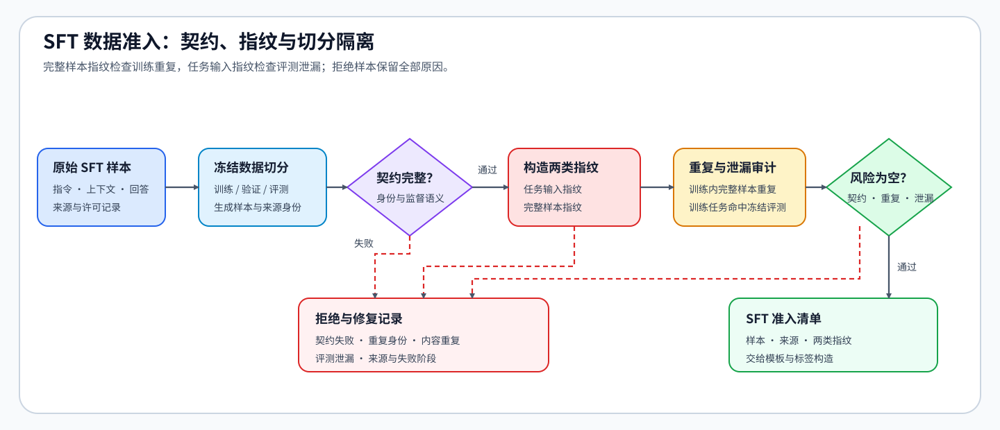
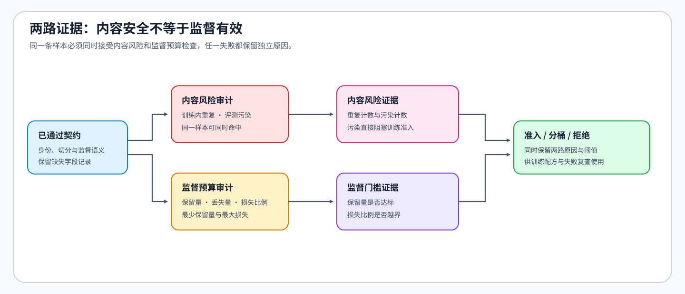

# 32. Data Engineering for SFT | SFT 数据准入与长度审计
**难度：** Medium | **环境：** CPU-only | **标签：** `后训练`, `SFT`, `数据治理` | **目标人群：** 后训练学习者

> 🚀 **云端运行环境**
>
> 本章节的实战代码可以点击以下链接在免费 GPU 算力平台上直接运行：
>
> [](https://colab.research.google.com/github/datawhalechina/llm-algo-leetcode/blob/main/02_PyTorch_Algorithms/32_Data_Engineering_for_SFT.ipynb)
> [](https://modelscope.cn/my/mynotebook) *(国内推荐：魔搭社区免费实例)*


---

## 本节导读

SFT 数据进入训练前，需要同时确认监督语义是否完整、训练内容是否泄漏到评测集，以及模板化后的有效监督是否能进入目标窗口。本节从样本契约出发，依次建立内容级去重与去污染、监督 Token 账本和准入决策。

**关键词：** `data contract`, `deduplication`, `decontamination`, `token budget`

---
## 前置阅读

**导语：** 进入本节前，先理解 SFT 样本如何形成监督目标，再检查原始指令数据如何进入稳定的数据契约。
- [13. SFT Training Loop | SFT 训练循环](./13_SFT_Training_Loop.md)
- [04. Python Config and Data Entry | Python 配置与数据组织](../00_Prerequisites/04_Python_Config_and_Data_Entry.md)

---

### Step 1：样本身份与监督语义共同构成准入契约

一条 SFT 样本既要能追溯来源，也要明确模型看到什么、哪些内容提供监督。身份完整但回答为空，或回答存在但来源和切分不可追溯，都不能进入训练池。文本规范化只消除空白等表示噪声，不能改写任务或回答语义。

| 契约层 | 必须确认的内容 | 失败风险 |
|:---|:---|:---|
| 样本身份 | 样本标识、来源标识和切分共同支持追溯 | 重复消费或失败样本无法回查 |
| 输入语义 | 指令与可选上下文共同定义任务条件 | 不同任务被错误合并 |
| 监督语义 | 回答与输入属于同一任务且回答非空 | 空监督或错误监督 |
| 模板边界 | 输入区域与回答区域在模板化后仍可区分 | 输入 Token 被误计入监督目标 |


### Step 2：内容指纹把去重与去污染连接起来

身份重复只能发现重复标识，无法发现改过 ID 或空白格式的同一内容。内容指纹应从规范化后的任务条件和回答生成：同一训练池内的重复指纹用于去重，训练指纹与独立评测指纹相交则表示污染。两类风险必须分别记录。

| 风险 | 比较范围 | 准入动作 |
|:---|:---|:---|
| 身份重复 | 同一切分中的样本标识 | 拒绝重复身份并追踪来源 |
| 内容重复 | 训练池中的内容指纹 | 只保留一份训练内容 |
| 评测污染 | 训练指纹与独立评测指纹 | 从训练候选中移除并记录 |
| 契约失败 | 身份或监督语义不完整 | 不生成训练候选 |


### Step 3：监督 Token 账本决定样本能否完整进入窗口

字符数不能代替 Token 数，总长度也不能说明回答是否仍被完整监督。模板化后需要分别统计提示 Token、回答 Token、窗口内保留的监督 Token和丢失的监督 Token。若窗口只保留提示而截断回答，即使总序列可以执行，也不应视为有效训练样本。

| 账本字段 | 回答的问题 | 准入含义 |
|:---|:---|:---|
| 提示 Token | 输入条件占用多少窗口 | 判断回答可用空间 |
| 监督 Token | 原始回答提供多少学习信号 | 识别空监督与长回答 |
| 保留监督 Token | 窗口内实际参与损失的回答 Token | 衡量有效监督量 |
| 丢失监督 Token | 截断损失了多少回答 Token | 决定拒绝、分桶或扩大窗口 |
### Step 4：实现 SFT 数据准入链

题目区实现三个相互衔接的机制：判定样本契约、识别内容重复与评测污染、计算窗口内的有效监督。文本规范化、模板拼接、内容指纹表示和报告装配由骨架提供，TODO 不要求拼接字符串。

| TODO / 函数 | 学习者完成的机制 | 必须满足的约束 | 测试证据 |
|:---|:---|:---|:---|
| TODO 1：判定监督契约<br>`assess_sft_contract` | 区分身份完整与监督完整 | 两类条件同时满足才准入 | `test_contract_assessment` |
| TODO 2：审计重复与污染<br>`audit_sft_content` | 比较训练内容指纹与评测指纹 | 重复和污染分别计数，同一样本可同时命中 | `test_content_audit` |
| TODO 3：计算监督预算<br>`summarize_supervision_budget` | 计算提示、监督、保留和丢失 Token | 计数非负，空监督不能通过 | `test_supervision_budget`、`test_invalid_token_budget` |
## 测试

运行下方 CPU 机制测试，检查样本契约、内容风险审计和有效监督 Token 账本。


```python
from typing import Dict, List

```


```python
def normalize_sft_record(record: Dict[str, object]) -> Dict[str, str]:
    """清理表示噪声；字符串规范化由题目骨架完成。"""
    return {
        "sample_id": str(record.get("sample_id", "")).strip(),
        "source_id": str(record.get("source_id", "")).strip(),
        "split": str(record.get("split", "")).strip(),
        "instruction": str(record.get("instruction", "")).strip(),
        "input": str(record.get("input", "")).strip(),
        "response": str(record.get("response", "")).strip(),
    }


def assess_sft_contract(record: Dict[str, str]) -> Dict[str, bool]:
    """分别判定身份完整性和监督完整性。"""
    # ==========================================
    # TODO 1：身份完整要求样本、来源和合法切分齐全。
    # identity_complete = ???
    # supervision_complete = ???  # 指令与回答均非空。
    # admitted = ???  # 仅两类契约同时满足时为 True。
    # ==========================================
    raise NotImplementedError("TODO 1：判定样本契约")
    return {"identity_complete": identity_complete, "supervision_complete": supervision_complete, "admitted": admitted}


def content_fingerprint(record: Dict[str, str]) -> tuple[str, str, str]:
    """构造内容比较键；表示细节由骨架提供，不作为 TODO。"""
    return (record["instruction"].casefold(), record["input"].casefold(), record["response"].casefold())


def audit_sft_content(records: List[Dict[str, str]], evaluation_fingerprints: set[tuple[str, str, str]]) -> Dict[str, int]:
    """分别统计契约失败、训练内容重复和评测污染。"""
    seen_train = set()
    rejected_contract_count = 0
    duplicate_content_count = 0
    contamination_count = 0
    for record in records:
        contract = assess_sft_contract(record)
        if not contract["admitted"]:
            rejected_contract_count += 1
            continue
        if record["split"] != "train":
            continue
        fingerprint = content_fingerprint(record)
        # ==========================================
        # TODO 2：同一训练样本可同时命中重复与评测污染。
        # is_duplicate = ???
        # is_contaminated = ???
        # ==========================================
        raise NotImplementedError("TODO 2：审计内容重复与评测污染")
        duplicate_content_count += int(is_duplicate)
        contamination_count += int(is_contaminated)
        seen_train.add(fingerprint)
    return {"total_samples": len(records), "rejected_contract_count": rejected_contract_count, "duplicate_content_count": duplicate_content_count, "contamination_count": contamination_count}


def build_sft_training_examples(records: List[Dict[str, str]], template_prefix: str) -> List[Dict[str, str]]:
    """装配提示与回答；字符串拼接由骨架完成，不作为 TODO。"""
    examples = []
    for record in records:
        prompt = template_prefix + record["instruction"]
        if record["input"]:
            prompt += "\n### Input\n" + record["input"]
        examples.append({"sample_id": record["sample_id"], "prompt": prompt, "response": record["response"]})
    return examples


def summarize_supervision_budget(tokenizer, examples: List[Dict[str, str]], max_tokens: int) -> Dict[str, object]:
    """计算窗口内实际保留和丢失的监督 Token。"""
    if max_tokens <= 0:
        raise ValueError("max_tokens 必须为正数")
    rows = []
    for example in examples:
        prompt_ids = tokenizer(example["prompt"], add_special_tokens=True)["input_ids"]
        response_ids = tokenizer(example["response"], add_special_tokens=False)["input_ids"]
        # ==========================================
        # TODO 3：计算提示、监督、保留监督和丢失监督 Token。
        # prompt_tokens = ???
        # supervised_tokens = ???
        # kept_supervised_tokens = ???
        # lost_supervised_tokens = ???
        # ==========================================
        raise NotImplementedError("TODO 3：计算有效监督预算")
        rows.append({"sample_id": example["sample_id"], "prompt_tokens": prompt_tokens, "supervised_tokens": supervised_tokens, "kept_supervised_tokens": kept_supervised_tokens, "lost_supervised_tokens": lost_supervised_tokens, "admitted": supervised_tokens > 0 and kept_supervised_tokens == supervised_tokens})
    return {"rows": rows, "admitted_count": sum(row["admitted"] for row in rows), "lost_supervised_tokens": sum(row["lost_supervised_tokens"] for row in rows)}
```


```python
def _sample_sft_records():
    """返回同时包含内容重复、评测污染与空监督的样例。"""
    raw = [
        {"sample_id": "train-1", "source_id": "source-a", "split": "train", "instruction": " 解释 LoRA ", "input": "", "response": " 低秩适配。 "},
        {"sample_id": "train-2", "source_id": "source-b", "split": "train", "instruction": "解释 LoRA", "input": "", "response": "低秩适配。"},
        {"sample_id": "train-3", "source_id": "source-c", "split": "train", "instruction": "总结", "input": "训练成本", "response": ""},
    ]
    return [normalize_sft_record(record) for record in raw]


def _assert_raises(error_type, fn) -> None:
    """断言调用抛出指定异常。"""
    try:
        fn()
    except error_type:
        return
    raise AssertionError(f"预期抛出 {error_type.__name__}")


def test_contract_assessment():
    """身份与监督必须分别判定，且同时满足才准入。"""
    valid, duplicate, empty = _sample_sft_records()
    assert assess_sft_contract(valid) == {"identity_complete": True, "supervision_complete": True, "admitted": True}
    assert assess_sft_contract(empty) == {"identity_complete": True, "supervision_complete": False, "admitted": False}
    missing_source = {**duplicate, "source_id": ""}
    assert assess_sft_contract(missing_source)["identity_complete"] is False


def test_content_audit():
    """同一内容可同时命中训练重复和评测污染。"""
    records = _sample_sft_records()
    evaluation_fingerprints = {content_fingerprint(records[0])}
    report = audit_sft_content(records, evaluation_fingerprints)
    assert report == {"total_samples": 3, "rejected_contract_count": 1, "duplicate_content_count": 1, "contamination_count": 2}


class MockTokenizer:
    """按空格切分，便于验证监督预算口径。"""
    def __call__(self, text, add_special_tokens=True):
        ids = list(range(len(text.split()) + int(add_special_tokens)))
        return {"input_ids": ids}


def test_supervision_budget():
    """窗口必须优先区分提示占用与实际保留的监督量。"""
    examples = [{"sample_id": "a", "prompt": "one two three", "response": "four five six"}]
    report = summarize_supervision_budget(MockTokenizer(), examples, max_tokens=6)
    assert report["rows"][0] == {"sample_id": "a", "prompt_tokens": 4, "supervised_tokens": 3, "kept_supervised_tokens": 2, "lost_supervised_tokens": 1, "admitted": False}
    assert report["lost_supervised_tokens"] == 1


def test_invalid_token_budget():
    """非正窗口不能生成监督账本。"""
    _assert_raises(ValueError, lambda: summarize_supervision_budget(MockTokenizer(), [], 0))


try:
    test_contract_assessment()
    test_content_audit()
    test_supervision_budget()
    test_invalid_token_budget()
    print("✅ SFT 契约、内容审计与有效监督预算测试通过。")
except (AttributeError, NameError, TypeError, ValueError, AssertionError, IndexError) as error:
    raise NotImplementedError("请先完成 TODO 代码！") from error
```

---

🛑 **STOP HERE** 🛑
<br><br><br><br><br><br><br><br><br><br>
> 请先尝试自己完成代码并跑通测试。<br>
> 如果遇到困难没有思路，可以向下滚动查看参考答案。
<br><br><br><br><br><br><br><br><br><br>

---

## 参考代码与解析

### 代码


```python
def normalize_sft_record(record: Dict[str, object]) -> Dict[str, str]:
    return {
        "sample_id": str(record.get("sample_id", "")).strip(),
        "source_id": str(record.get("source_id", "")).strip(),
        "split": str(record.get("split", "")).strip(),
        "instruction": str(record.get("instruction", "")).strip(),
        "input": str(record.get("input", "")).strip(),
        "response": str(record.get("response", "")).strip(),
    }


def assess_sft_contract(record: Dict[str, str]) -> Dict[str, bool]:
    # TODO 1：判定身份契约与监督契约。
    identity_complete = bool(record["sample_id"] and record["source_id"] and record["split"] in {"train", "validation", "test"})
    supervision_complete = bool(record["instruction"] and record["response"])
    admitted = identity_complete and supervision_complete
    return {"identity_complete": identity_complete, "supervision_complete": supervision_complete, "admitted": admitted}


def content_fingerprint(record: Dict[str, str]) -> tuple[str, str, str]:
    return (record["instruction"].casefold(), record["input"].casefold(), record["response"].casefold())


def audit_sft_content(records: List[Dict[str, str]], evaluation_fingerprints: set[tuple[str, str, str]]) -> Dict[str, int]:
    seen_train = set()
    rejected_contract_count = 0
    duplicate_content_count = 0
    contamination_count = 0
    for record in records:
        contract = assess_sft_contract(record)
        if not contract["admitted"]:
            rejected_contract_count += 1
            continue
        if record["split"] != "train":
            continue
        fingerprint = content_fingerprint(record)
        # TODO 2：独立判断训练内容重复和评测污染。
        is_duplicate = fingerprint in seen_train
        is_contaminated = fingerprint in evaluation_fingerprints
        duplicate_content_count += int(is_duplicate)
        contamination_count += int(is_contaminated)
        seen_train.add(fingerprint)
    return {"total_samples": len(records), "rejected_contract_count": rejected_contract_count, "duplicate_content_count": duplicate_content_count, "contamination_count": contamination_count}


def build_sft_training_examples(records: List[Dict[str, str]], template_prefix: str) -> List[Dict[str, str]]:
    examples = []
    for record in records:
        prompt = template_prefix + record["instruction"]
        if record["input"]:
            prompt += "\n### Input\n" + record["input"]
        examples.append({"sample_id": record["sample_id"], "prompt": prompt, "response": record["response"]})
    return examples


def summarize_supervision_budget(tokenizer, examples: List[Dict[str, str]], max_tokens: int) -> Dict[str, object]:
    if max_tokens <= 0:
        raise ValueError("max_tokens 必须为正数")
    rows = []
    for example in examples:
        prompt_ids = tokenizer(example["prompt"], add_special_tokens=True)["input_ids"]
        response_ids = tokenizer(example["response"], add_special_tokens=False)["input_ids"]
        # TODO 3：计算窗口内保留和丢失的监督 Token。
        prompt_tokens = len(prompt_ids)
        supervised_tokens = len(response_ids)
        kept_supervised_tokens = min(supervised_tokens, max(0, max_tokens - prompt_tokens))
        lost_supervised_tokens = supervised_tokens - kept_supervised_tokens
        rows.append({"sample_id": example["sample_id"], "prompt_tokens": prompt_tokens, "supervised_tokens": supervised_tokens, "kept_supervised_tokens": kept_supervised_tokens, "lost_supervised_tokens": lost_supervised_tokens, "admitted": supervised_tokens > 0 and kept_supervised_tokens == supervised_tokens})
    return {"rows": rows, "admitted_count": sum(row["admitted"] for row in rows), "lost_supervised_tokens": sum(row["lost_supervised_tokens"] for row in rows)}
```

### 解析

#### TODO 1：判定样本契约

- 答案分别检查样本身份、来源、合法切分，以及非空指令和回答，最后用两类条件的合取形成准入结果。
- 身份完整与监督完整是独立证据；测试覆盖缺少来源、非法切分和空回答，确保失败原因不会被一个布尔值掩盖。

#### TODO 2：审计内容重复与评测污染

- 答案对已准入的训练样本计算规范化内容指纹，并分别查询训练已见集合和冻结评测指纹集合。
- 重复消费与评测污染含义不同、可以同时命中；测试验证两个计数独立累加，并保留契约失败样本的单独计数。

#### TODO 3：计算有效监督预算

- 答案分别统计提示 Token、回答监督 Token、窗口内保留量和丢失量，只有监督非空且完整保留时才准入。
- 总长度超预算时，关键不是截断是否发生，而是监督目标是否受损；测试覆盖提示占满窗口、回答为空和完整保留三类情况。
## 相关阅读

完成字段清洗、数据审计和样本生成后，可以继续阅读 Datasets 工具和微调项目，验证样本如何进入真实训练闭环。

- [Hugging Face Datasets 官方文档](https://huggingface.co/docs/datasets)
- [30. Long-Context Fine-Tuning Mechanics | 长上下文微调机制](./30_Long_Context_Fine_Tuning.md)
- [62. Instruction Fine-Tuning Project | 指令微调项目](./62_Instruction_Fine_Tuning_Project.md)
- [64. SFT Data Quality Project | SFT 数据质量项目](./64_SFT_Data_Quality_Project.md)
