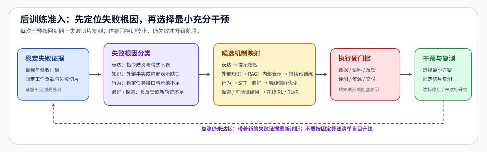
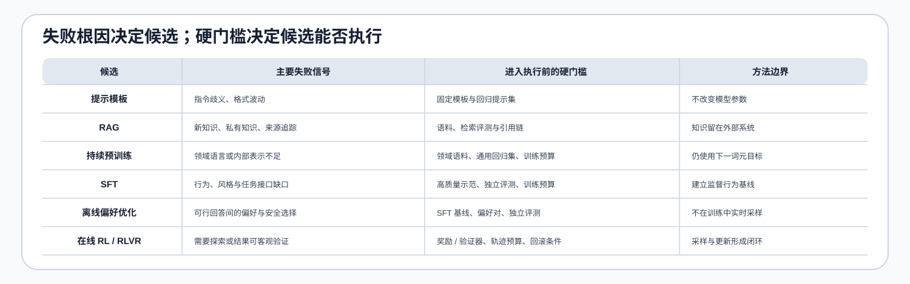

# 33. Fine Tuning Readiness | 微调准入与最小干预
**难度：** Medium | **环境：** CPU-only | **标签：** `后训练`, `准入决策`, `评测` | **目标人群：** 微调项目设计者

> 🚀 **云端运行环境**
>
> 本章节的实战代码可以点击以下链接在免费 GPU 算力平台上直接运行：
>
> [](https://colab.research.google.com/github/datawhalechina/llm-algo-leetcode/blob/main/02_PyTorch_Algorithms/33_Fine_Tuning_Readiness.ipynb)
> [](https://modelscope.cn/my/mynotebook) *(国内推荐：魔搭社区免费实例)*


---

## 本节导读

微调不是所有问题的默认答案。上线前应先确认失败是否稳定复现，再比较提示词、检索增强生成（RAG）和监督微调（SFT）能否解决问题，并检查数据、评测、资源和交付条件。本节实现的是最小可行干预选择，而不是训练参数报表。

**关键词：** `readiness gate`, `minimal intervention`, `Prompt`, `RAG`, `SFT`

---
## 前置阅读

**导语：** 进入本节前，先理解可比较实验为什么需要固定目标、工作负载与基线。
- [20. Performance Evidence and Experiment Design | 性能证据与实验设计](../00_Prerequisites/20_Performance_Evidence_and_Experiment_Design.md)

---

### Step 1：先确认问题是否值得进入干预链

目标必须可测量，失败必须在固定工作负载和稳定切片上复现，基线还要覆盖这些失败切片。只有总指标、没有失败切片，可能把局部退化误判为整体能力问题；没有独立评测，则无法判断干预是否泛化。

| 证据 | 准入问题 | 缺失时的动作 |
|:---|:---|:---|
| 可测目标 | 指标和验收门槛是否明确 | 先定义目标与门槛 |
| 重复失败 | 失败是否在多次运行中稳定出现 | 固定工作负载并复现 |
| 失败切片 | 哪些场景、任务或样本持续失败 | 建立切片级基线 |
| 独立评测 | 是否能检验未见数据上的泛化 | 建立隔离评测集 |


### Step 2：选择能够解决根因的最小干预

提示词适合表达或格式问题，检索增强生成（RAG）适合外部且持续变化的知识，监督微调（SFT）适合可由高质量示范稳定描述的行为缺口。每个候选应声明自己覆盖的失败信号和所需资产；只有机制覆盖当前失败切片后，才进入资源与交付检查。

| 候选 | 能覆盖的失败信号 | 进入执行前的必要条件 |
|:---|:---|:---|
| Prompt | 指令歧义、格式不稳定 | 固定模板后可复测 |
| RAG | 新知识、私有知识、可追溯来源 | 可用语料、检索评测与引用链 |
| SFT | 重复行为缺口、风格或任务模式 | 高质量示范、独立评测和训练预算 |


### Step 3：在可执行候选中选择最小充分干预

机制匹配还不等于项目可执行。候选通过资产与资源检查后，还要比较侵入性、成本和可逆性：能通过提示模板解决的问题不应直接进入训练，需要外部新知识的问题也不应靠 SFT 固化。若所有匹配候选都被阻塞，决策必须保留具体缺失条件。

| 决策量 | 检查内容 | 对选择的影响 |
|:---|:---|:---|
| 机制覆盖 | 候选是否覆盖当前失败信号 | 不匹配则不进入排序 |
| 执行条件 | 数据、语料、评测、资源和交付是否齐备 | 缺失则记录阻塞原因 |
| 侵入性 | 是否改变模型权重或线上链路 | 优先选择改动更小的候选 |
| 成本与可逆性 | 建设和运行成本、失败后能否快速回滚 | 在同等覆盖下决定排序 |
### Step 4：实现最小干预准入决策

题目区先检查失败切片是否具备完整证据，再根据外部候选规格计算机制覆盖与执行条件，最后按侵入性、成本和可逆性选择最小充分干预。候选名称、报告文案和规格装配由骨架提供，TODO 不要求拼接字符串。

| TODO / 函数 | 学习者完成的机制 | 必须满足的约束 | 测试证据 |
|:---|:---|:---|:---|
| TODO 1：检查问题证据<br>`assess_problem_evidence` | 找出缺失基础证据和未覆盖失败切片 | 两类缺口分别返回 | `test_problem_evidence_gate` |
| TODO 2：建立候选状态<br>`build_intervention_candidates` | 计算失败信号覆盖与缺失执行条件 | 候选规格由参数传入，不在函数内硬编码 | `test_prompt_rag_and_sft_candidates` |
| TODO 3：选择最小干预<br>`recommend_minimal_intervention` | 对匹配且就绪的候选进行显式排序 | 优先低侵入、低成本、可逆；保留阻塞原因 | `test_minimal_intervention_decision`、`test_no_ready_candidate` |
## 测试

运行下方 CPU 机制测试，检查问题证据、候选准入和最小干预决策。


```python
from typing import Dict, List

```


```python
def assess_problem_evidence(evidence: Dict[str, object]) -> Dict[str, object]:
    """检查基础证据，并确认基线覆盖全部稳定失败切片。"""
    required = ["goal_metric", "target_threshold", "repeatable_failure", "independent_evaluation"]
    failure_slices = set(evidence.get("failure_slices", []))
    baseline_slices = set(evidence.get("baseline_slices", []))
    # ==========================================
    # TODO 1：分别计算缺失基础证据和未被基线覆盖的失败切片。
    # missing_foundations = ???
    # uncovered_failure_slices = ???
    # ready = ???  # 还要求至少存在一个稳定失败切片。
    # ==========================================
    raise NotImplementedError("TODO 1：检查问题证据")
    return {"ready": ready, "missing_foundations": missing_foundations, "uncovered_failure_slices": uncovered_failure_slices}


def build_intervention_candidates(context: Dict[str, object], specifications: List[Dict[str, object]]) -> List[Dict[str, object]]:
    """按外部规格建立候选的机制覆盖与执行条件证据。"""
    failure_signals = set(context.get("failure_signals", []))
    candidates = []
    for spec in specifications:
        # ==========================================
        # TODO 2：计算候选覆盖的失败信号，以及尚未满足的必要条件。
        # matched_signals = ???
        # missing_requirements = ???
        # ==========================================
        raise NotImplementedError("TODO 2：建立干预候选状态")
        candidates.append({"name": spec["name"], "matched_signals": matched_signals, "mechanism_match": bool(matched_signals), "requirements_ready": not missing_requirements, "missing_requirements": missing_requirements, "invasiveness": spec["invasiveness"], "cost": spec["cost"], "reversible": spec["reversible"]})
    return candidates


def recommend_minimal_intervention(
    evidence_report: Dict[str, object],
    candidates: List[Dict[str, object]],
) -> Dict[str, object]:
    """在机制匹配且条件就绪的候选中选择最小充分干预。"""
    if not evidence_report["ready"]:
        return {"decision": "blocked", "reason": "missing_problem_evidence", "missing": evidence_report["missing_foundations"] + evidence_report["uncovered_failure_slices"]}
    # ==========================================
    # TODO 3：筛选可执行候选，并按侵入性、成本、可逆性排序。
    # ready_candidates = ???
    # ==========================================
    raise NotImplementedError("TODO 3：选择最小可行干预")
    if ready_candidates:
        selected = ready_candidates[0]
        return {"decision": selected["name"], "reason": "minimal_ready_intervention", "missing": []}
    missing = [item for candidate in candidates if candidate["mechanism_match"] for item in candidate["missing_requirements"]]
    return {"decision": "blocked", "reason": "candidate_requirements_not_ready", "missing": missing}
```


```python
def _intervention_specs():
    """候选规格由调用方提供，便于扩展而不改决策函数。"""
    return [
        {"name": "prompt", "failure_signals": {"format", "instruction"}, "requirements": ["prompt_tested"], "invasiveness": 1, "cost": 1, "reversible": True},
        {"name": "rag", "failure_signals": {"fresh_knowledge", "private_knowledge"}, "requirements": ["corpus_ready", "retrieval_eval_ready"], "invasiveness": 2, "cost": 2, "reversible": True},
        {"name": "sft", "failure_signals": {"behavior", "style", "task_pattern"}, "requirements": ["sft_data_ready", "training_budget_ready"], "invasiveness": 3, "cost": 3, "reversible": False},
    ]


def test_problem_evidence_gate():
    """问题定义不完整时不能进入候选比较。"""
    report = assess_problem_evidence({"goal_metric": "accuracy", "target_threshold": 0.9, "repeatable_failure": True, "independent_evaluation": False, "failure_slices": ["json_format", "long_input"], "baseline_slices": ["json_format"]})
    assert report == {"ready": False, "missing_foundations": ["independent_evaluation"], "uncovered_failure_slices": ["long_input"]}


def test_prompt_rag_and_sft_candidates():
    """三类候选必须按根因和必要条件分别判断。"""
    specs = _intervention_specs()
    prompt = build_intervention_candidates({"failure_signals": ["format"], "prompt_tested": True}, specs)
    assert prompt[0]["mechanism_match"] is True and prompt[0]["requirements_ready"] is True
    rag = build_intervention_candidates({"failure_signals": ["fresh_knowledge"], "corpus_ready": True, "retrieval_eval_ready": True}, specs)
    assert rag[1]["mechanism_match"] is True and rag[1]["requirements_ready"] is True
    sft = build_intervention_candidates({"failure_signals": ["behavior"], "sft_data_ready": True, "training_budget_ready": True}, specs)
    assert sft[2]["mechanism_match"] is True and sft[2]["requirements_ready"] is True


def test_minimal_intervention_decision():
    """决策只选择机制匹配且满足条件的最小候选。"""
    evidence = {"ready": True, "missing_foundations": [], "uncovered_failure_slices": []}
    candidates = build_intervention_candidates({"failure_signals": ["fresh_knowledge"], "corpus_ready": True, "retrieval_eval_ready": True, "sft_data_ready": True, "training_budget_ready": True}, _intervention_specs())
    assert recommend_minimal_intervention(evidence, candidates)["decision"] == "rag"
    assert recommend_minimal_intervention({"ready": False, "missing_foundations": ["independent_evaluation"], "uncovered_failure_slices": []}, candidates)["decision"] == "blocked"


def test_no_ready_candidate():
    """根因匹配但执行条件不足时，应返回具体阻塞字段。"""
    evidence = {"ready": True, "missing_foundations": [], "uncovered_failure_slices": []}
    candidates = build_intervention_candidates({"failure_signals": ["behavior"], "sft_data_ready": False, "training_budget_ready": False}, _intervention_specs())
    result = recommend_minimal_intervention(evidence, candidates)
    assert result == {"decision": "blocked", "reason": "candidate_requirements_not_ready", "missing": ["sft_data_ready", "training_budget_ready"]}


try:
    test_problem_evidence_gate()
    test_prompt_rag_and_sft_candidates()
    test_minimal_intervention_decision()
    test_no_ready_candidate()
    print("✅ 微调问题证据、候选 gate 与最小干预测试通过。")
except (AttributeError, NameError, TypeError, ValueError, AssertionError) as error:
    raise NotImplementedError("请先完成 TODO 代码！") from error
```

---

🛑 **STOP HERE** 🛑
<br><br><br><br><br><br><br><br><br><br>
> 请先尝试自己完成代码并跑通测试。<br>
> 如果遇到困难没有思路，可以向下滚动查看参考答案。
<br><br><br><br><br><br><br><br><br><br>

---

## 参考代码与解析

### 代码


```python
def assess_problem_evidence(evidence: Dict[str, object]) -> Dict[str, object]:
    required = ["goal_metric", "target_threshold", "repeatable_failure", "independent_evaluation"]
    failure_slices = set(evidence.get("failure_slices", []))
    baseline_slices = set(evidence.get("baseline_slices", []))
    # TODO 1：检查基础证据与失败切片覆盖。
    missing_foundations = [name for name in required if not evidence.get(name)]
    uncovered_failure_slices = sorted(failure_slices - baseline_slices)
    ready = bool(failure_slices) and not missing_foundations and not uncovered_failure_slices
    return {"ready": ready, "missing_foundations": missing_foundations, "uncovered_failure_slices": uncovered_failure_slices}


def build_intervention_candidates(context: Dict[str, object], specifications: List[Dict[str, object]]) -> List[Dict[str, object]]:
    failure_signals = set(context.get("failure_signals", []))
    candidates = []
    for spec in specifications:
        # TODO 2：计算失败信号覆盖与缺失执行条件。
        matched_signals = sorted(failure_signals & set(spec["failure_signals"]))
        missing = [item for item in spec["requirements"] if not context.get(item)]
        candidates.append({
            "name": spec["name"],
            "matched_signals": matched_signals,
            "mechanism_match": bool(matched_signals),
            "requirements_ready": not missing,
            "missing_requirements": missing,
            "invasiveness": spec["invasiveness"],
            "cost": spec["cost"],
            "reversible": spec["reversible"],
        })
    return candidates


def recommend_minimal_intervention(evidence_report: Dict[str, object], candidates: List[Dict[str, object]]) -> Dict[str, object]:
    if not evidence_report["ready"]:
        return {"decision": "blocked", "reason": "missing_problem_evidence", "missing": evidence_report["missing_foundations"] + evidence_report["uncovered_failure_slices"]}
    # TODO 3：选择最小可行干预。
    ready_candidates = sorted(
        (candidate for candidate in candidates if candidate["mechanism_match"] and candidate["requirements_ready"]),
        key=lambda candidate: (candidate["invasiveness"], candidate["cost"], not candidate["reversible"]),
    )
    if ready_candidates:
        return {"decision": ready_candidates[0]["name"], "reason": "minimal_ready_intervention", "missing": []}
    missing = [item for candidate in candidates if candidate["mechanism_match"] for item in candidate["missing_requirements"]]
    return {"decision": "blocked", "reason": "candidate_requirements_not_ready", "missing": missing}
```

### 解析

#### TODO 1：检查问题证据

- 答案分别列出缺失的目标、阈值、稳定复现和独立评测证据，再计算未被基线覆盖的失败切片。
- 只有存在稳定失败切片且两类缺口都为空时才允许选方案；测试分别验证基础证据不足和切片覆盖不足。

#### TODO 2：建立候选准入条件

- 答案将当前失败信号与每个候选的作用信号取交集，并逐项检查候选要求的数据、评测或资源条件。
- 机制匹配和执行就绪必须分开记录；测试验证不相关候选不会进入排序，缺失条件仍能被准确报告。

#### TODO 3：选择最小可行干预

- 答案只筛选机制匹配且执行条件就绪的候选，再按侵入性、成本和可逆性进行稳定排序。
- 问题证据不足时直接 blocked；没有就绪候选时返回缺失条件，测试验证不会为了得到结果而强行选择 SFT。
## 相关阅读

完成问题与干预准入后，可以继续检查 SFT 数据、训练循环与项目交付。

- [32. SFT Data Admission and Length Audit | SFT 数据准入与长度审计](./32_Data_Engineering_for_SFT.md)
- [13. SFT Training Loop | SFT 训练循环](./13_SFT_Training_Loop.md)
- [62. Instruction Fine-Tuning Project | 指令微调项目](./62_Instruction_Fine_Tuning_Project.md)
