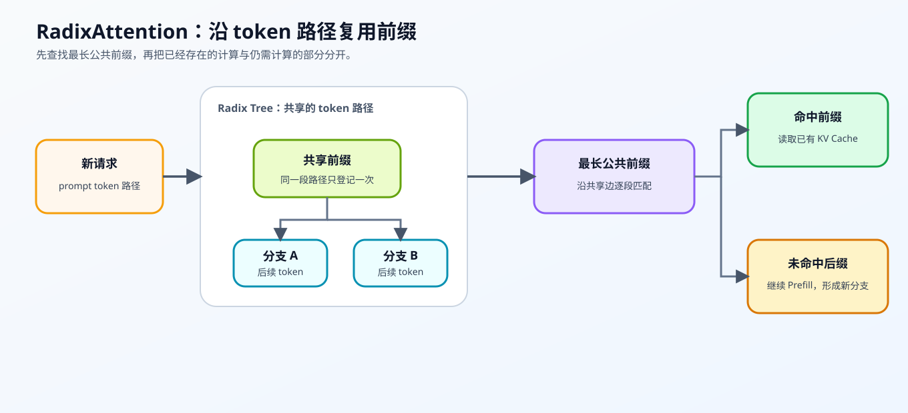
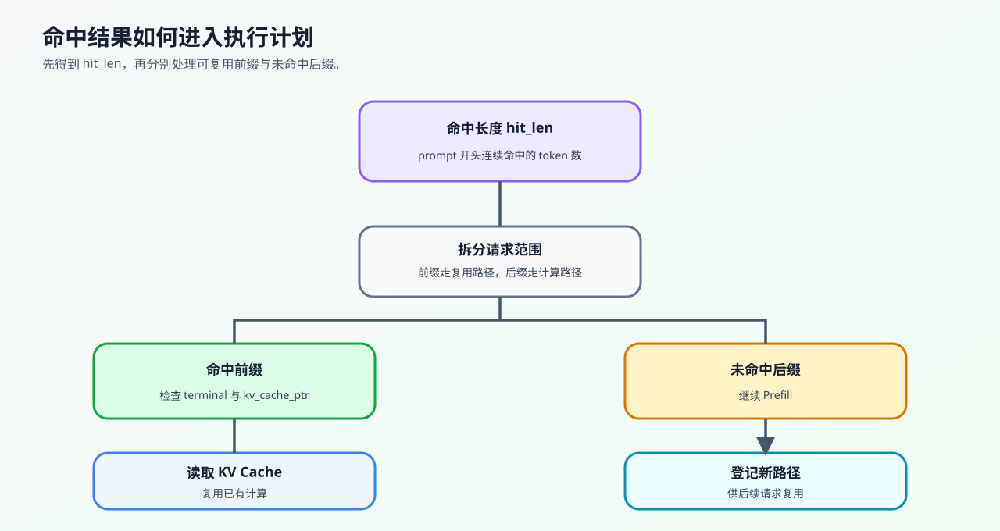

# 34. SGLang RadixAttention | SGLang 基数注意力
**难度：** Hard | **环境：** CPU-first | **标签：** `推理优化`, `KV Cache`, `RadixAttention` | **目标人群：** 推理优化学习者

> 🚀 **云端运行环境**
>
> 本章节的实战代码可以点击以下链接在免费 GPU 算力平台上直接运行：
>
> [](https://colab.research.google.com/github/datawhalechina/llm-algo-leetcode/blob/main/02_PyTorch_Algorithms/34_SGLang_RadixAttention.ipynb)
> [](https://modelscope.cn/my/mynotebook) *(国内推荐：魔搭社区免费实例)*


---

## 本节导读

真实推理服务里，请求往往不是彼此独立的：多轮对话会反复带上历史上下文，Agent 和工具调用也会共享很长的 system prompt。问题在于，如果每个请求都重新计算这些公共前缀，KV Cache 会被重复占用，首 token 延迟也会被拖高。

RadixAttention 把已经处理过的 prompt 组织成可检索的前缀树。新请求到来时，系统先寻找最长公共前缀：命中的部分复用已有状态，未命中的后缀再进入 Prefill。重点是看清共享路径、命中长度与新增计算量之间的关系。

**关键词：** `RadixAttention`, `prefix tree`, `multi-turn`

---
## 前置阅读

**导语：** 先理解 KV Cache 的存储、最长前缀命中和 suffix，再观察 RadixAttention 如何把大量共享前缀组织成可检索路径。
- [P1: 11. KV Cache and Memory Growth | KV Cache 与显存增长](../01_Hardware_Math_and_Systems/11_KV_Cache_and_Memory_Growth.md)
- [22. vLLM PagedAttention | vLLM 分页注意力](./22_vLLM_PagedAttention.md)
- [24. Prefix Cache Matching and Reuse | Prefix Cache 匹配与复用](./24_Prefix_Cache_Matching_and_Reuse.md)
- [21. Decoding Strategies | 解码策略（可选背景）](./21_Decoding_Strategies.md)

---

### Step 1: RadixAttention 如何组织公共前缀复用

重复出现的 System Prompt 或历史上下文会让请求反复执行相同的 prefill。RadixAttention 的输入是已登记的 token 前缀和新请求 prompt，处理方式是沿 Radix Tree 查找最长公共前缀；输出是可复用的命中范围和需要继续计算的未命中后缀。
先通过表格区分公共前缀、树路径、命中范围和未命中后缀，再观察主图中的查找与复用过程。

| 概念 | 它记录什么 | 对请求执行的作用 |
|---|---|---|
| 公共前缀 | 多个请求开头相同的 token 序列 | 作为可复用的候选缓存范围 |
| Radix Tree | 按 token 路径组织共享边，并支持最长前缀匹配 | 快速找到当前请求可以复用的范围 |
| 未命中后缀 | 从首个不一致 token 开始的剩余序列 | 继续执行 prefill，并登记为新分支 |
| PagedAttention 对照 | 按物理 Block 管理 KV Cache；RadixAttention 按 token 前缀组织共享路径 | 前者解决分页分配，后者强调前缀查找与复用 |



### Step 2: Radix Tree 的插入、分裂与匹配

用两条有公共前缀的请求观察路径如何插入、分裂和匹配：先沿共享边查找最长公共前缀，再把未命中的 token 留给后续 prefill。表格把每个操作与树的变化对应起来，帮助你从请求路径理解数据结构。

| 操作 | 输入 | 树的变化 | 要观察的结果 |
|---|---|---|---|
| 插入 | 新 token 路径 | 新建边，或在首个不一致位置分裂已有边 | 公共前缀只保留一条共享路径 |
| 匹配 | 新请求 prompt | 沿边逐段比较 token | 返回最长命中长度 `hit_len` |
| 拆分 | `hit_len` 与 prompt | 切出命中前缀和未命中 suffix | suffix 进入后续 prefill |


### Step 3: 命中范围如何进入执行计划

树匹配返回 token 范围，执行器还要把它转换成“复用多少、重新计算多少”的执行计划。先用公式说明命中长度，再用表格把命中前缀、未命中后缀和缓存句柄对应到下一步动作。最长公共前缀为：
$$H = \max_j \operatorname{lcp}(prompt\_tokens, cached\_path_j)$$
| 字段 | 含义 | 下一步 |
|---|---|---|
| `hit_len` | 从 prompt 开始连续命中的 token 数 | 读取对应前缀缓存 |
| `hit_prefix` | 可复用的 token 前缀 | 跳过重复 prefill |
| `miss_suffix` | 命中位置之后的 token | 执行剩余 prefill，并登记新路径 |
| `terminal` / `kv_cache_ptr` | 标记完整缓存路径，并关联缓存句柄 | 决定命中结果是否有可复用的缓存对象 |




### Step 4: 实现并验证前缀缓存索引

本题用压缩边节点和 token 序列复现 Radix Tree；节点结构、子边查找和遍历骨架已经提供，学习者补全边分裂、逐 token 公共前缀判断、完整路径命中和 prompt 拆分。测试覆盖共享边、反向插入、不完整路径、零命中与空输入。
| 函数 | 学习者完成的机制 | 必须满足的约束 | 测试证据 |
|---|---|---|---|
| `insert` | TODO 1：把部分重叠边拆成共享前缀和旧后缀 | 保留旧边的子节点、终止状态和缓存指针 | 共享边与边分裂测试 |
| `_lcp_len` | TODO 2：判断当前位置 token 是否继续匹配 | 首个不一致位置立即停止 | LCP 边界测试 |
| `match_prefix` | TODO 3：只在完整缓存路径结束处更新命中长度 | 不完整边和非终止节点不能复用 | 最长命中与未命中测试 |
| `split_prompt` | TODO 4：按命中长度拆分前缀与后缀 | 空 prompt 和零命中安全回退 | 前缀/后缀契约测试 |


```python
import torch
```


```python
class TreeNode:
    """表示一条压缩边及其子路径；`terminal` 表示完整路径在此结束。"""
    def __init__(self, key_tokens, terminal=False):
        self.key_tokens = list(key_tokens)  # 这条边上的 Token 序列
        self.children = []            # 子节点列表
        self.kv_cache_ptr = None      # 模拟指向物理 KV Cache 的指针
        self.terminal = terminal      # 是否有完整请求在此结束

class SimpleRadixCache:
    """用压缩 Radix Tree 模拟公共 token 前缀的登记与匹配。"""
    def __init__(self):
        # 根节点是空的
        self.root = TreeNode([])

    def _find_child(self, node, token):
        """返回首 token 匹配的子边；同一节点下不应出现重复首 token。"""
        return next((child for child in node.children if child.key_tokens and child.key_tokens[0] == token), None)
        
    def insert(self, tokens):
        """插入路径；遇到部分重叠边时分裂旧边。"""
        tokens = list(tokens)
        if not tokens:
            raise ValueError('tokens 不能为空')
        node = self.root
        offset = 0
        while offset < len(tokens):
            child = self._find_child(node, tokens[offset])
            # 若没有同首 token 的 child，新增叶节点时要标记 terminal=True，
            # 因为这条完整 token 路径已经登记，可以作为后续复用候选。
            if child is None:
                node.children.append(TreeNode(tokens[offset:], terminal=True))
                return
            common = self._lcp_len(child.key_tokens, tokens[offset:])
            if common == len(child.key_tokens):
                node, offset = child, offset + common
                continue
            # TODO 1（边分裂）：切出共享前缀和旧边剩余后缀。
            # shared_tokens = ???
            # old_suffix_tokens = ???
            raise NotImplementedError('TODO 1：请拆分部分重叠的压缩边')
            shared = TreeNode(shared_tokens)
            old_suffix = TreeNode(old_suffix_tokens, terminal=child.terminal)
            old_suffix.children = child.children
            old_suffix.kv_cache_ptr = child.kv_cache_ptr
            shared.children.append(old_suffix)
            node.children[node.children.index(child)] = shared
            if offset + common == len(tokens):
                shared.terminal = True
            else:
                shared.children.append(TreeNode(tokens[offset + common:], terminal=True))
            return
        
    def _lcp_len(self, cached_tokens, prompt_tokens):
        """计算两段 token 序列的最长公共前缀长度。"""
        match_len = 0
        for cached_token, prompt_token in zip(cached_tokens, prompt_tokens):
            # TODO 2（公共前缀）：判断当前位置是否仍然匹配。
            # tokens_match = ???
            raise NotImplementedError('TODO 2：请判断当前位置 token 是否匹配')
            if not tokens_match:
                break
            match_len += 1
        return match_len
        
    def match_prefix(self, prompt_tokens):
        """
        在现有树中，为新的 prompt_tokens 寻找最长的匹配前缀。
        如果前 N 个 token 完全一致，说明这 N 个 token 的 KV Cache 可以直接复用！
        """
        best_match_len = 0
        node = self.root
        offset = 0
        while offset < len(prompt_tokens):
            child = self._find_child(node, prompt_tokens[offset])
            common = self._lcp_len(child.key_tokens, prompt_tokens[offset:]) if child is not None else 0
            if child is None or common < len(child.key_tokens):
                break
            offset += common
            node = child
            # TODO 3（完整路径）：只有终止节点才更新可复用长度。
            if node.terminal:
                # best_match_len = ???
                raise NotImplementedError('TODO 3：请更新完整路径的命中长度')
        return best_match_len

    def split_prompt(self, prompt_tokens):
        """把 prompt 拆成可复用前缀和需要重算的后缀。

        `hit_prefix` 必须来自 prompt 的开头，`miss_suffix` 从首个未命中 token 开始。"""
        # TODO 4（执行拆分）：根据命中长度拆出可复用前缀与待计算后缀。
        # hit_len = ???
        # hit_prefix = ???
        # miss_suffix = ???
        raise NotImplementedError('TODO 4：请拆分命中前缀与未命中后缀')
        return hit_prefix, miss_suffix, hit_len
```


```python
# 按机制拆分测试，失败时可以直接定位到 LCP、分裂、匹配或 prompt 拆分。
def _build_radix_cache():
    cache = SimpleRadixCache()
    cache.insert([0, 1, 2, 3])
    cache.insert([0, 1, 2, 3, 4])
    cache.insert([9, 9, 9])
    return cache

def test_lcp_contract():
    """验证最长公共前缀的停止条件。"""
    cache = SimpleRadixCache()
    assert cache._lcp_len([1, 2, 3], [1, 2, 4]) == 2
    assert cache._lcp_len([7, 8], [7, 8, 9, 10]) == 2

def test_insert_and_split():
    """验证公共边共享和部分重叠边分裂。"""
    cache = _build_radix_cache()
    assert len(cache.root.children) == 2, "公共前缀没有被合并为共享边"
    shared = next(child for child in cache.root.children if child.key_tokens[0] == 0)
    assert shared.key_tokens == [0, 1, 2, 3]
    assert shared.terminal is True
    assert len(shared.children) == 1 and shared.children[0].key_tokens == [4]
    assert shared.children[0].terminal is True

    reverse_cache = SimpleRadixCache()
    reverse_cache.insert([4, 5, 6, 7])
    reverse_cache.insert([4, 5])
    assert reverse_cache.match_prefix([4, 5, 8]) == 2

def test_match_prefix_contract():
    """验证完整 terminal 路径才能计入命中长度。"""
    cache = _build_radix_cache()
    assert cache.match_prefix([0, 1, 2, 3, 4, 5]) == 5
    assert cache.match_prefix([9, 9, 9]) == 3
    assert cache.match_prefix([7, 6, 5]) == 0

def test_split_prompt_contract():
    """验证命中前缀与待计算后缀的拆分契约。"""
    cache = _build_radix_cache()
    assert cache.split_prompt([0, 1, 2, 3, 4, 5]) == ([0, 1, 2, 3, 4], [5], 5)
    assert cache.split_prompt([0, 1, 2, 3, 4]) == ([0, 1, 2, 3, 4], [], 5)
    assert cache.split_prompt([7, 6, 5]) == ([], [7, 6, 5], 0)

def test_empty_prompt_and_path():
    """验证空 prompt、空路径和零命中回退。"""
    cache = _build_radix_cache()
    assert cache.match_prefix([]) == 0
    assert cache.split_prompt([]) == ([], [], 0)
    try:
        cache.insert([])
    except ValueError:
        pass
    else:
        raise AssertionError("空 token 路径不能登记")

def test_radix_attention():
    """汇总运行公共前缀、边分裂、完整命中和 prompt 拆分测试。"""
    try:
        test_lcp_contract()
        test_insert_and_split()
        test_match_prefix_contract()
        test_split_prompt_contract()
        test_empty_prompt_and_path()
        print("✅ RadixAttention 机制测试通过：LCP、共享边、最长命中和 prompt 拆分均通过。")
    except NotImplementedError:
        print("请先完成 TODO 部分的代码！")
        raise
    except Exception as error:
        print(f"❌ RadixAttention 测试失败: {type(error).__name__}: {error}")
        raise


test_radix_attention()

```


### 参考答案

```python
class TreeNode:
    """表示一条压缩边及其子路径；`terminal` 表示完整路径在此结束。"""
    def __init__(self, key_tokens, terminal=False):
        self.key_tokens = list(key_tokens)
        self.children = []
        self.kv_cache_ptr = None
        self.terminal = terminal

class SimpleRadixCache:
    """用压缩 Radix Tree 模拟公共 token 前缀的登记与匹配。"""
    def __init__(self):
        self.root = TreeNode([])
        
    def _find_child(self, node, token):
        """返回首 token 匹配的子边；同一节点下不应出现重复首 token。"""
        return next((child for child in node.children if child.key_tokens and child.key_tokens[0] == token), None)

    def insert(self, tokens):
        """插入路径；部分重叠时分裂边，公共边由多个请求共享。"""
        tokens = list(tokens)
        if not tokens:
            raise ValueError('tokens 不能为空')
        node, offset = self.root, 0
        while offset < len(tokens):
            child = self._find_child(node, tokens[offset])
            if child is None:
                node.children.append(TreeNode(tokens[offset:], terminal=True))
                return
            common = self._lcp_len(child.key_tokens, tokens[offset:])
            if common == len(child.key_tokens):
                node, offset = child, offset + common
                continue
            # TODO 1（边分裂）：切出共享前缀和旧边剩余后缀。
            shared_tokens = child.key_tokens[:common]
            old_suffix_tokens = child.key_tokens[common:]
            shared = TreeNode(shared_tokens)
            old_suffix = TreeNode(old_suffix_tokens, terminal=child.terminal)
            old_suffix.children = child.children
            old_suffix.kv_cache_ptr = child.kv_cache_ptr
            shared.children.append(old_suffix)
            child_index = node.children.index(child)
            node.children[child_index] = shared
            if offset + common == len(tokens):
                shared.terminal = True
            else:
                shared.children.append(TreeNode(tokens[offset + common:], terminal=True))
            return
        
    def _lcp_len(self, cached_tokens, prompt_tokens):
        match_len = 0
        for cached_token, prompt_token in zip(cached_tokens, prompt_tokens):
            # TODO 2（公共前缀）：判断当前位置是否仍然匹配。
            tokens_match = cached_token == prompt_token
            if not tokens_match:
                break
            match_len += 1
        return match_len
        
    def match_prefix(self, prompt_tokens):
        """
        在现有树中，为新的 prompt_tokens 寻找最长的匹配前缀。
        """
        prompt_tokens = list(prompt_tokens)
        node, offset, best_match_len = self.root, 0, 0
        while offset < len(prompt_tokens):
            child = self._find_child(node, prompt_tokens[offset])
            if child is None:
                break
            common = self._lcp_len(child.key_tokens, prompt_tokens[offset:])
            if common < len(child.key_tokens):
                break
            offset += common
            node = child
            # TODO 3（完整路径）：只有终止节点才更新可复用长度。
            if node.terminal:
                best_match_len = offset
        return best_match_len

    def split_prompt(self, prompt_tokens):
        """把 prompt 拆成可复用前缀和需要重算的后缀。"""
        # TODO 4（执行拆分）：根据命中长度拆出可复用前缀与待计算后缀。
        hit_len = self.match_prefix(prompt_tokens)
        hit_prefix = prompt_tokens[:hit_len]
        miss_suffix = prompt_tokens[hit_len:]
        return hit_prefix, miss_suffix, hit_len
```

### 解析

题目保留查找和遍历骨架，解析只对应会改变树结构或命中结果的四项机制。

**TODO 1：分裂部分重叠边**
共享前缀成为父边，旧后缀继承原节点的子节点、终止状态和缓存指针，新后缀成为同级分支。分裂测试检查旧路径与新路径都能继续命中。

**TODO 2：计算最长公共前缀**
逐 token 比较时，首个不一致位置就是公共前缀终点；`zip` 同时处理任一序列先结束的边界。LCP 测试覆盖不一致与长度不同两种情况。

**TODO 3：记录完整路径命中**
完整走过压缩边只说明路径匹配；只有终止节点代表已登记的完整缓存对象，因此才能更新可复用长度。

**TODO 4：拆分命中前缀与未命中后缀**
`hit_len` 同时确定两个切片边界。测试检查完整命中、部分命中、零命中和空 prompt，确保两部分重新拼接后仍等于原输入。

### 真实 SGLang backend benchmark 入口

本节的 CPU 题目已经验证压缩边、边分裂和完整路径命中。要评估 RadixAttention 的服务收益，应在相同 workload 下使用真实 backend 比较缓存关闭与开启的命中率、TTFT、TPOT、throughput、peak memory、evidence level 与 decision；统一在 [69. Prefix Caching Benchmark](./69_Prefix_Caching_Benchmark.md) 中完成。


<!-- 已迁移至 69 的历史 GPU tensor 探针，不在教程页面展示。
    """把 Radix Tree 的 token 命中结果转换为 GPU 输入边界。"""
    import json
    import torch
    prompts = prompts or RADIX_GPU_PROMPTS
    cache = SimpleRadixCache()
    cache.insert(prompts['cached_prefix'])
    hit_prefix, miss_suffix, hit_len = cache.split_prompt(prompts['request'])
    plan = {
        'chapter': '24',
        'workload': {'cached_prefix_tokens': len(prompts['cached_prefix']), 'request_tokens': len(prompts['request'])},
        'hit_len': hit_len,
        'hit_tokens': len(hit_prefix),
        'suffix_tokens': len(miss_suffix),
        'evidence_level': 'synthetic_gpu_input_boundary',
    }
    if run_mode == 'dry_run':
        print(json.dumps({'mode': run_mode, 'plan': plan}, ensure_ascii=False, indent=2))
        return plan
    if run_mode != 'real_gpu':
        raise ValueError("RUN_MODE 只能是 dry_run 或 real_gpu")
    if not torch.cuda.is_available():
        result = {**plan, 'mode': run_mode, 'status': 'skipped', 'failure_reason': 'CUDA 不可用', 'evidence_level': 'unavailable'}
        print(json.dumps(result, ensure_ascii=False, indent=2))
        return result
    device = torch.device('cuda')
    hit_tensor = torch.tensor(hit_prefix, dtype=torch.long, device=device)
    suffix_tensor = torch.tensor(miss_suffix, dtype=torch.long, device=device)
    torch.cuda.synchronize(device)
    result = {**plan, 'mode': run_mode, 'status': 'completed', 'device': torch.cuda.get_device_name(0), 'hit_tensor_shape': list(hit_tensor.shape), 'suffix_tensor_shape': list(suffix_tensor.shape), 'hit_bytes': hit_tensor.numel() * hit_tensor.element_size(), 'suffix_bytes': suffix_tensor.numel() * suffix_tensor.element_size(), 'failure_reason': None}
    from pathlib import Path
    output_path = Path(GPU_RESULT_PATH)
    output_path.parent.mkdir(parents=True, exist_ok=True)
    output_path.write_text(json.dumps(result, ensure_ascii=False, indent=2), encoding='utf-8')
    result['result_path'] = str(output_path)
    print(json.dumps(result, ensure_ascii=False, indent=2))
    return result

run_radix_gpu_boundary_probe(RUN_MODE, RADIX_GPU_PROMPTS)
-->

<!-- 已迁移至 69 的历史 JSON 读取单元，不在教程页面展示。
import json
from pathlib import Path
result_path = Path(GPU_RESULT_PATH)
if result_path.exists():
    result = json.loads(result_path.read_text(encoding='utf-8'))
    required = {'chapter', 'mode', 'hit_len', 'evidence_level'}
    missing = required - set(result)
    if missing:
        raise ValueError(f'结果 JSON 缺少字段：{sorted(missing)}')
    print(result)
else:
    print(f'尚无 GPU boundary probe 结果：{result_path}')
-->
## 相关阅读

**论文与官方实现**

RadixAttention 可以继续从 SGLang 实现、前缀缓存和调度策略三个方向阅读。

- [SGLang 原论文：Efficient Execution of Structured Language Model Programs](https://arxiv.org/abs/2312.07104)
- [SGLang 官方仓库](https://github.com/sgl-project/sglang)
- [SGLang 官方文档](https://docs.sglang.ai/)
- [22. vLLM PagedAttention | vLLM 分页注意力](./22_vLLM_PagedAttention.md)
- [24. Prefix Cache Matching and Reuse | Prefix Cache 匹配与复用](./24_Prefix_Cache_Matching_and_Reuse.md)
- [37. KV Cache Lifecycle and Capacity Control | KV Cache 生命周期与容量控制](./37_KV_Cache_Lifecycle_and_Capacity_Control.md)
- [69. Prefix Caching Benchmark | 前缀缓存基准项目](./69_Prefix_Caching_Benchmark.md)
