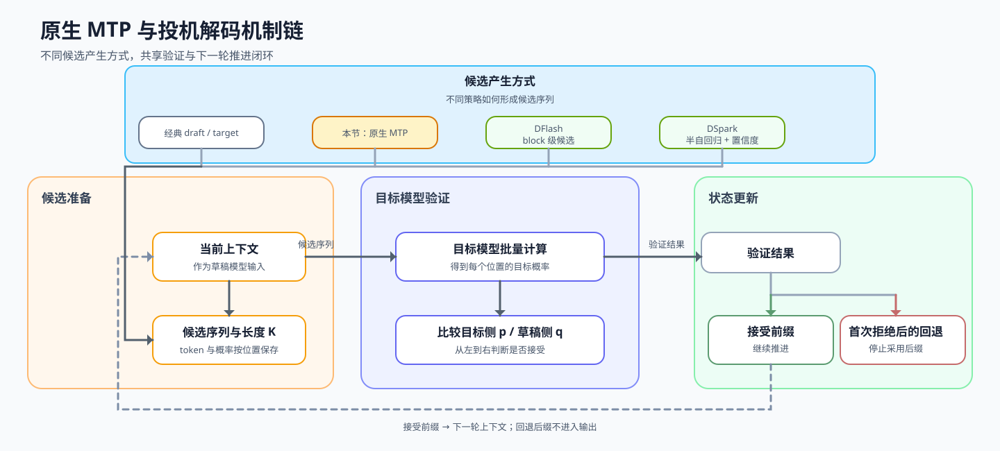

# 35. Multi Token Decoding | 原生多 Token 预测
**难度：** Hard | **环境：** CPU-first | **标签：** `推理优化`, `投机解码`, `MTP` | **目标人群：** 推理优化学习者

> 🚀 **云端运行环境**
>
> 本章节的实战代码可以点击以下链接在免费 GPU 算力平台上直接运行：
>
> [](https://colab.research.google.com/github/datawhalechina/llm-algo-leetcode/blob/main/02_PyTorch_Algorithms/35_Multi_Token_Decoding.ipynb)
> [](https://modelscope.cn/my/mynotebook) *(国内推荐：魔搭社区免费实例)*


---

## 本节导读

经典投机解码由独立草稿模型提出候选；原生 Multi-Token Prediction（MTP）则把多个未来 token 的预测头或层放在目标模型内部。它减少了独立 draft checkpoint 的配对成本，但只有原生带有 MTP 模块的模型才能直接使用这条路径。

本节聚焦原生 MTP 的候选形成、连续接受、首次拒绝和回退。EAGLE 的外置特征草稿器以及 DFlash / DSpark 的并行草稿拓扑分别由独立机制页承载，避免把不同候选来源混成一种实现。

**关键词：** `multi-token decoding`, `speculative decoding`, `verification`, `rollback`
## 前置阅读

**导语：** 先理解单 token 解码怎样更新状态，以及投机验证怎样按位置推进；再观察一次请求如何在一轮中处理多个候选 token。
- [21. Decoding Strategies | 解码策略](./21_Decoding_Strategies.md)
- [23. Speculative Decoding | 投机解码](./23_Speculative_Decoding.md)

---

### Step 1: 原生 MTP 在投机策略谱系中的位置

原生 MTP 与经典投机解码共享“提出候选 → 目标模型验证 → 接受或回退”的主线，区别在于候选由目标模型 checkpoint 内部的多 Token 预测模块产生。放回 Task2 看，21 提供 Decode 基础，23 解释精确验证语义，本节解释原生 MTP 候选和连续前缀，68 再用匹配的模型与 backend 判断真实收益。

一次验证先由原生 MTP 模块形成候选序列，再从左到右确认可接受的连续前缀。前缀越长，单轮有效推进越多；较早发生拒绝时，后续候选不能直接沿用，需要回退并进入下一轮。模型没有原生 MTP 层时，不能仅靠配置参数凭空启用该路径。

图中上方区分候选产生方式，下方展开本节共享的执行闭环：候选形成后进入目标模型验证，再根据接受前缀或首次拒绝更新解码状态；状态随后反馈到下一轮候选形成。

| 路径 | 候选如何产生 | 验证后的状态 | 本节关注点 |
|---|---|---|---|
| 经典投机解码 | 独立草稿模型提出候选 | 概率接受、residual correction 或 bonus | 经典投机语义，详见 [23](./23_Speculative_Decoding.md) |
| 原生 MTP | verifier checkpoint 内部的多 Token 预测层 | 连续接受前缀、首次拒绝和回退 | 本节的核心机制 |
| EAGLE | 外置轻量草稿器复用目标隐藏表示 | 候选树与目标验证 | [INF-EAGLE](./INF-EAGLE_Feature_Drafter_and_Candidate_Tree.md) |
| DFlash / DSpark | 块并行草稿与置信度调度 | 并行候选、块内依赖与预算 | [INF-PARALLEL-DRAFTING](./INF-PARALLEL-DRAFTING_DFlash_and_DSpark.md) |
| 项目验证 | 在统一 workload 下比较候选、验证与服务结果 | acceptance、质量、成本和端到端收益 | 由 [68](./68_Speculative_Decoding_Benchmark.md) 收口 |


### Step 2: 候选序列与验证状态

先看一轮验证中有哪些信息，再理解状态如何变化。候选序列说明本轮准备尝试哪些 token；记目标模型对候选 token 给出的概率分布为 p，草稿路径给出的概率分布为 q，二者用于比较候选是否可靠。验证从左到右进行，首次拒绝会把序列分成可接受前缀和待回退后缀。


| 机制阶段 | 关键对象 | 作用 |
|------|----------|------|
| 提议序列 | 候选 token 与本轮候选上限 | 确定本轮最多尝试的范围 |
| 接受判断 | 草稿概率与目标概率 | 判断单个候选 token 是否可靠 |
| 顺序验证 | 候选序列与当前前缀 | 从左到右验证，首次拒绝后停止 |
| 结果汇总 | 接受前缀、拒绝位置、回退后缀 | 区分可直接推进与需要重新生成的部分 |

### Step 3: 连续接受、首次拒绝与有效推进

多 Token 解码的收益取决于连续接受长度，而不是候选数量本身。若一轮提出四个候选、前面三个通过验证，本轮有效推进量就是三个；若第一个就被拒绝，候选长度再长也不能带来有效推进。接受比例可以帮助比较候选质量，但最终还要结合目标模型验证和回退成本。

因此，原生 MTP 不能只看候选头数量：还要记录实际接受长度、目标验证耗时、额外 MTP 权重与 KV 状态，以及 backend 是否真正启用了 MTP。只有有效推进量能够抵消候选生成和验证成本时，这条路径才有端到端收益。

| 机制因素 | 偏大时的风险 | 偏小时的限制 |
|------|--------------|--------------|
| 候选长度 | 尝试范围更大，但拒绝和回退可能增加 | 单轮推进短，潜在收益有限 |
| 接受阈值 | 判断更严格，连续接受长度可能下降 | 判断更宽松，错误候选或重生成代价可能增加 |


### Step 4: 实现多 Token 候选验证

题目区提供候选概率、目标概率和结果汇总骨架。学习者只需完成候选截断、单点接受判断和连续前缀更新三个机制；测试分别覆盖长度上限、接受阈值、首次拒绝、后缀关闭与全部接受。

| 函数 | 学习者完成的机制 | 必须满足的约束 | 测试证据 |
|---|---|---|---|
| `propose` | 按候选预算截取本轮前缀 | 不修改输入，长度不超过上限 | 多种候选长度与空输入 |
| `_accept_token` | 比较草稿概率、目标概率与接受阈值 | 草稿概率非正时单独处理 | 接受与拒绝阈值边界 |
| `verify` | 从左到右维护连续接受前缀 | 首次拒绝后立即停止 | 中途拒绝与后续高概率候选 |


```python
from typing import List, Sequence, Tuple
import torch
```


```python
class MultiTokenDecoderSim:
    """教学用的多 token 提议—验证模拟器。

    用于观察候选长度、接受前缀和回退后缀如何共同决定一轮推进结果。"""

    def __init__(self, max_proposal_len: int = 4, min_accept_ratio: float = 0.5):
        if not isinstance(max_proposal_len, int) or isinstance(max_proposal_len, bool) or max_proposal_len <= 0:
            raise ValueError("max_proposal_len must be positive")
        if not (0.0 < min_accept_ratio <= 1.0):
            raise ValueError("min_accept_ratio must be in (0, 1]")
        self.max_proposal_len = max_proposal_len
        self.min_accept_ratio = min_accept_ratio
        self.history: List[dict] = []

    def propose(self, draft_tokens: Sequence[int]) -> List[int]:
        """把草稿序列截断为本轮允许验证的候选前缀。

        空序列返回空列表；返回长度不超过 `max_proposal_len`。"""
        # TODO 1（候选预算）：复制输入并截取本轮允许验证的候选前缀。
        # proposed = ???
        raise NotImplementedError('TODO 1：请构造候选前缀')
        return proposed

    def _accept_token(self, draft_prob: float, target_prob: float) -> bool:
        """按教学用概率阈值判断一个候选是否通过验证。

        这里的阈值规则用于观察控制流，不等同于严格的分布保持算法。"""
        # TODO 2（接受阈值）：比较目标概率与草稿概率经过阈值缩放后的下界。
        if draft_prob <= 0:
            return target_prob > 0
        # accepted = ???
        raise NotImplementedError('TODO 2：请判断候选是否接受')
        return accepted

    def verify(
        self,
        draft_probs: torch.Tensor,
        target_probs: torch.Tensor,
        draft_tokens: Sequence[int],
    ) -> Tuple[List[int], int | None]:
        """从左到右验证候选，并在首次拒绝处停止。

        `draft_probs` 和 `target_probs` 的第 i 行对应第 i 个候选位置；
        返回已接受前缀以及首次拒绝的位置。"""
        proposed = self.propose(draft_tokens)
        accepted_tokens: List[int] = []
        rejected_at = None
        draft_probs = torch.as_tensor(draft_probs)
        target_probs = torch.as_tensor(target_probs)

        if draft_probs.ndim != 2 or target_probs.ndim != 2:
            raise ValueError("draft_probs 和 target_probs 必须是二维张量")
        if draft_probs.shape != target_probs.shape or draft_probs.shape[0] < len(proposed):
            raise ValueError("概率矩阵必须具有相同形状，并覆盖所有候选位置")
        vocab_size = draft_probs.shape[1]
        if any(not isinstance(token_id, int) or not 0 <= token_id < vocab_size for token_id in proposed):
            raise ValueError("draft token id 必须是词表范围内的整数")

        for i, token_id in enumerate(proposed):
            draft_prob = float(draft_probs[i, token_id])
            target_prob = float(target_probs[i, token_id])
            # TODO 3（连续前缀）：计算当前位置的接受结果；下方骨架负责追加或终止。
            # accepted = ???
            raise NotImplementedError('TODO 3：请计算当前位置的接受结果')

            if accepted:
                accepted_tokens = accepted_tokens + [token_id]
            else:
                rejected_at = i
                break

        return accepted_tokens, rejected_at

    def decode(
        self,
        draft_probs: torch.Tensor,
        target_probs: torch.Tensor,
        draft_tokens: Sequence[int],
    ) -> dict:
        """汇总接受前缀、拒绝位置、回退后缀和本轮推进比例。

        `progress_per_round` 只表示本轮接受比例，不代表真实吞吐提升。"""
        proposed = self.propose(draft_tokens)
        accepted_tokens, rejected_at = self.verify(draft_probs, target_probs, draft_tokens)
        rejected_suffix = proposed[rejected_at:] if rejected_at is not None else []

        result = {
            "proposed_tokens": proposed,
            "accepted_tokens": accepted_tokens,
            "accepted_len": len(accepted_tokens),
            # 本轮真正推进的 token 占提议长度的比例，和项目 benchmark 的指标对应
            "progress_per_round": (len(accepted_tokens) / len(proposed)) if proposed else 0.0,
            "rejected_at": rejected_at,
            "rejected_suffix": rejected_suffix,
        }
        self.history.append(result)
        return result

```


```python
# 按机制拆分测试，分别定位候选提议、接受判断、首次拒绝和回退状态。
def _build_multi_token_fixture():
    """构造包含中途拒绝位置的候选与概率矩阵。"""
    draft_tokens = [10, 20, 30, 31]
    draft_probs = torch.zeros(4, 40)
    target_probs = torch.zeros(4, 40)
    for index, token in enumerate(draft_tokens):
        draft_probs[index, token] = 0.5
        target_probs[index, token] = 0.8 if index < 2 else 0.2
    return draft_tokens, draft_probs, target_probs

def test_proposal_contract():
    """验证候选前缀受预算限制且顺序保持不变。"""
    draft_tokens, _, _ = _build_multi_token_fixture()
    sim = MultiTokenDecoderSim(max_proposal_len=3, min_accept_ratio=0.6)
    assert sim.propose(draft_tokens) == [10, 20, 30]

def test_acceptance_rule():
    """验证单点接受规则的通过与拒绝分支。"""
    sim = MultiTokenDecoderSim(max_proposal_len=3, min_accept_ratio=0.6)
    assert sim._accept_token(0.5, 0.31) is True
    assert sim._accept_token(0.5, 0.2) is False

def test_first_rejection():
    """验证过程在首次拒绝位置停止。"""
    draft_tokens, draft_probs, target_probs = _build_multi_token_fixture()
    sim = MultiTokenDecoderSim(max_proposal_len=3, min_accept_ratio=0.6)
    accepted, rejected_at = sim.verify(draft_probs, target_probs, draft_tokens)
    assert accepted == [10, 20]
    assert rejected_at == 2

def test_rejection_closes_the_suffix():
    """验证后续高概率候选不能越过首次拒绝。"""
    draft_tokens, draft_probs, target_probs = _build_multi_token_fixture()
    target_probs[3, draft_tokens[3]] = 0.9  # 后一个候选即使满足阈值，也不能越过第 3 个位置的拒绝。
    sim = MultiTokenDecoderSim(max_proposal_len=4, min_accept_ratio=0.6)
    accepted, rejected_at = sim.verify(draft_probs, target_probs, draft_tokens)
    assert accepted == [10, 20] and rejected_at == 2

def test_rollback_suffix():
    """验证拒绝后缀、推进比例与历史记录。"""
    draft_tokens, draft_probs, target_probs = _build_multi_token_fixture()
    sim = MultiTokenDecoderSim(max_proposal_len=3, min_accept_ratio=0.6)
    result = sim.decode(draft_probs, target_probs, draft_tokens)
    assert result["proposed_tokens"] == [10, 20, 30]
    assert result["accepted_tokens"] == [10, 20]
    assert result["accepted_len"] == 2
    assert result["progress_per_round"] == 2 / 3
    assert result["rejected_at"] == 2
    assert result["rejected_suffix"] == [30]
    assert len(sim.history) == 1

def test_all_accept_and_variable_length():
    """验证不同候选预算下的全部接受路径。"""
    draft_tokens, draft_probs, _ = _build_multi_token_fixture()
    all_target = torch.zeros(4, 40)
    for index, token in enumerate(draft_tokens):
        all_target[index, token] = 0.8
    for proposal_len in (1, 2, 3, 4):
        sim = MultiTokenDecoderSim(max_proposal_len=proposal_len, min_accept_ratio=0.6)
        result = sim.decode(draft_probs, all_target, draft_tokens)
        assert result["accepted_len"] == proposal_len
        assert result["progress_per_round"] == 1.0
        assert result["rejected_at"] is None
        assert result["rejected_suffix"] == []

def test_multi_token_decoder():
    """汇总运行候选、接受、拒绝和回退机制测试。"""
    try:
        test_proposal_contract()
        test_acceptance_rule()
        test_first_rejection()
        test_rejection_closes_the_suffix()
        test_rollback_suffix()
        test_all_accept_and_variable_length()
        print("✅ MultiTokenDecoderSim 机制测试通过：提议、接受、拒绝和回退均符合预期。")
    except NotImplementedError:
        print("请先完成 TODO 部分的代码！")
        raise
    except Exception as error:
        print(f"❌ MultiTokenDecoderSim 测试失败: {type(error).__name__}: {error}")
        raise


test_multi_token_decoder()

```


## 参考代码与解析

### 代码


```python
class MultiTokenDecoderSim:
    """教学用的多 token 提议—验证模拟器。

    用于观察候选长度、接受前缀和回退后缀如何共同决定一轮推进结果。"""

    def __init__(self, max_proposal_len: int = 4, min_accept_ratio: float = 0.5):
        if not isinstance(max_proposal_len, int) or isinstance(max_proposal_len, bool) or max_proposal_len <= 0:
            raise ValueError("max_proposal_len must be positive")
        if not (0.0 < min_accept_ratio <= 1.0):
            raise ValueError("min_accept_ratio must be in (0, 1]")
        self.max_proposal_len = max_proposal_len
        self.min_accept_ratio = min_accept_ratio
        self.history: List[dict] = []

    def propose(self, draft_tokens: Sequence[int]) -> List[int]:
        """把草稿序列截断为本轮允许验证的候选前缀。

        空序列返回空列表；返回长度不超过 `max_proposal_len`。"""
        # ==========================================
        # TODO 1: 从草稿 token 中生成本轮候选序列
        # 提示：先把 draft_tokens 转成 list，再截取前 max_proposal_len 个 token。
        # 这个结果决定本轮最多验证多少个位置，不要修改输入序列。
        # ==========================================
        proposed = list(draft_tokens)[: self.max_proposal_len]
        return proposed

    def _accept_token(self, draft_prob: float, target_prob: float) -> bool:
        """按教学用概率阈值判断一个候选是否通过验证。

        这里的阈值规则用于观察控制流，不等同于严格的分布保持算法。"""
        # ==========================================
        # TODO 2: 判断单个候选 token 是否被目标模型接受
        # 提示：正常情况下，target_prob 至少要达到
        # draft_prob * min_accept_ratio；draft_prob <= 0 时单独处理，并保持布尔返回值。
        # ==========================================
        if draft_prob <= 0:
            return target_prob > 0
        accepted = target_prob >= draft_prob * self.min_accept_ratio
        return accepted

    def verify(
        self,
        draft_probs: torch.Tensor,
        target_probs: torch.Tensor,
        draft_tokens: Sequence[int],
    ) -> Tuple[List[int], int | None]:
        """从左到右验证候选，并在首次拒绝处停止。

        `draft_probs` 和 `target_probs` 的第 i 行对应第 i 个候选位置；
        返回已接受前缀以及首次拒绝的位置。"""
        proposed = self.propose(draft_tokens)
        accepted_tokens: List[int] = []
        rejected_at = None
        draft_probs = torch.as_tensor(draft_probs)
        target_probs = torch.as_tensor(target_probs)

        if draft_probs.ndim != 2 or target_probs.ndim != 2:
            raise ValueError("draft_probs 和 target_probs 必须是二维张量")
        if draft_probs.shape != target_probs.shape or draft_probs.shape[0] < len(proposed):
            raise ValueError("概率矩阵必须具有相同形状，并覆盖所有候选位置")
        vocab_size = draft_probs.shape[1]
        if any(not isinstance(token_id, int) or not 0 <= token_id < vocab_size for token_id in proposed):
            raise ValueError("draft token id 必须是词表范围内的整数")

        for i, token_id in enumerate(proposed):
            draft_prob = float(draft_probs[i, token_id])
            target_prob = float(target_probs[i, token_id])
            # ==========================================
            # TODO 3: 维护连续接受前缀
            # 提示：先得到 accepted。若为 True，将 token 加入 accepted_tokens；
            #       若为 False，记录当前 i 为 rejected_at 并停止，后续候选不能继续加入。
            # ==========================================
            accepted = self._accept_token(draft_prob, target_prob)

            if accepted:
                accepted_tokens = accepted_tokens + [token_id]
            else:
                rejected_at = i
                break

        return accepted_tokens, rejected_at

    def decode(
        self,
        draft_probs: torch.Tensor,
        target_probs: torch.Tensor,
        draft_tokens: Sequence[int],
    ) -> dict:
        """汇总接受前缀、拒绝位置、回退后缀和本轮推进比例。

        `progress_per_round` 只表示本轮接受比例，不代表真实吞吐提升。"""
        proposed = self.propose(draft_tokens)
        accepted_tokens, rejected_at = self.verify(draft_probs, target_probs, draft_tokens)
        rejected_suffix = proposed[rejected_at:] if rejected_at is not None else []

        result = {
            "proposed_tokens": proposed,
            "accepted_tokens": accepted_tokens,
            "accepted_len": len(accepted_tokens),
            # 本轮真正推进的 token 占提议长度的比例，和项目 benchmark 的指标对应
            "progress_per_round": (len(accepted_tokens) / len(proposed)) if proposed else 0.0,
            "rejected_at": rejected_at,
            "rejected_suffix": rejected_suffix,
        }
        self.history.append(result)
        return result

```

### 解析

**TODO 1：构造候选前缀**
- 将草稿 token 复制为列表后按 `max_proposal_len` 截取。候选长度只规定本轮最多验证多少个位置，不改变原始草稿序列。

**TODO 2：判断当前位置是否接受**
- 当 `draft_prob > 0` 时，比较 `target_prob` 与 `draft_prob * min_accept_ratio`；草稿概率为零时单独处理，避免把无意义的比例带入判断。

**TODO 3：维护连续接受前缀**
- 验证顺序决定状态：当前 token 被接受才可继续；首次拒绝的位置写入 `rejected_at` 后立即停止。这样 `accepted_tokens` 始终是候选序列的连续前缀，`rejected_suffix` 则由骨架据此生成。

| 观察量 | 说明 | 在后续基准中的作用 |
|---|---|---|
| `max_proposal_len` | 每轮最多尝试的候选数 | 影响可获得的推进空间 |
| `accepted_len` / `progress_per_round` | 本轮实际被连续接受的前缀 | 反映候选质量与回退压力 |
| `rejected_at` / `rejected_suffix` | 首次拒绝及其后的候选 | 说明下一轮需要重新处理的部分 |


### 真实 GPU 验证出口

本节的 CPU 实现用于验证候选组织、连续接受、首次拒绝与回退状态。同一份 logits 上的批量前缀运算不是 MTP GPU 实验，因为它没有真实草稿模块、目标验证、KV Cache 和服务调度。

真实验需要固定目标模型与 MTP 草稿模块，比较自回归 baseline 与 MTP candidate 的接受率、有效推进 Token、TPOT、吞吐和输出质量。该证据由 [68 投机解码基准](./68_Speculative_Decoding_Benchmark.md) 在真实 backend 中承接。
## 相关阅读

完成原生 MTP 候选、顺序验证和回退处理后，可以继续比较外置特征草稿、块并行草稿与真实 backend benchmark。

- [DeepSeek-V3：Multi-Token Prediction](https://arxiv.org/abs/2412.19437)
- [vLLM Speculators：MTP](https://docs.vllm.ai/projects/speculators/en/latest/user_guide/algorithms/decision_guide/)
- [INF-EAGLE：特征草稿器与候选树](./INF-EAGLE_Feature_Drafter_and_Candidate_Tree.md)
- [INF-PARALLEL-DRAFTING：DFlash 与 DSpark](./INF-PARALLEL-DRAFTING_DFlash_and_DSpark.md)
- [36. Decode Scheduling | Decode 调度](./36_Decode_Scheduling.md)
- [68. Speculative Decoding Benchmark | 投机解码基准](./68_Speculative_Decoding_Benchmark.md)