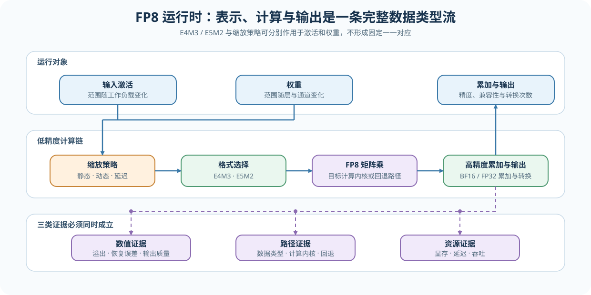
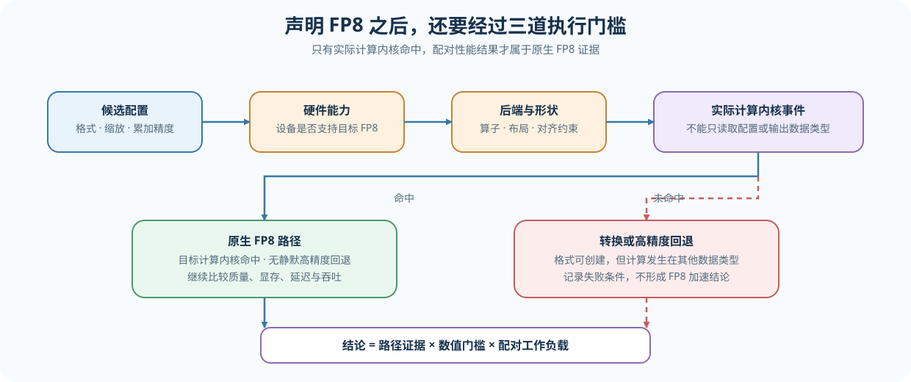

# 41. FP8 Runtime Low Precision Paths | FP8 运行时低精度路径
**难度：** Hard | **环境：** CPU-first，GPU 可选 | **标签：** `量化压缩`, `FP8`, `运行时` | **目标人群：** 希望理解 FP8 执行条件与证据层级的学习者

> 🚀 **云端运行环境**
>
> 本章节的实战代码可以点击以下链接在免费 GPU 算力平台上直接运行：
>
> [](https://colab.research.google.com/github/datawhalechina/llm-algo-leetcode/blob/main/02_PyTorch_Algorithms/41_FP8_Runtime_Low_Precision_Paths.ipynb)
> [](https://modelscope.cn/my/mynotebook) *(国内推荐：魔搭社区免费实例)*


---

## 本节导读

权重量化改变参数的保存与读取方式，FP8 运行时路径还会改变输入激活、权重、累加与输出之间的数据类型组合。低精度格式能否带来收益，取决于数值范围、缩放策略、累加精度和硬件执行路径是否同时成立。

本节依次分析 FP8 改变的对象、E4M3 / E5M2 与缩放策略的取舍，以及如何区分“数据类型可用”和“原生低精度计算已发生”。

**关键词：** `FP8`, `E4M3`, `E5M2`, `缩放策略`, `运行时计算内核`

---

## 前置阅读

先建立量化表示与反量化的基础，再比较运行时 FP8 与整数权重量化在对象和执行位置上的差异。

- [25. W8A16 Quantization | W8A16 量化](./25_Quantization_W8A16.md)
- [可选：52. Quantization Calibration and Error | 量化校准与误差控制](./52_Quantization_Calibration_and_Error.md)

---

### Step 1：FP8 运行时路径改变哪些对象

一次低精度矩阵乘至少涉及输入激活、权重、累加和输出四个位置。仅把权重保存为 FP8，并不等于激活也以 FP8 进入计算，更不等于硬件执行了原生 FP8 计算内核。判断运行时路径时，需要把表示格式与实际执行分开记录。

| 对象 | 可选表示 | 主要风险 | 需要记录的证据 |
|---|---|---|---|
| 输入激活 | FP16 / BF16 / FP8 | 动态范围随工作负载变化 | 输入数据类型、缩放因子来源 |
| 权重 | FP16 / BF16 / FP8 | 离线缩放因子影响模型质量 | 量化产物数据类型、缩放粒度 |
| 累加 | FP16 / BF16 / FP32 | 累积误差或溢出 | 累加数据类型 |
| 输出 | FP16 / BF16 / FP8 | 下游算子兼容与再次量化 | 输出数据类型、类型转换次数 |
| 执行路径 | 原生计算内核 / 类型转换 / 浮点回退 | 位宽变化但没有性能收益 | 计算内核、执行后端、硬件能力 |



### Step 2：格式与缩放如何共同决定可表示范围

E4M3 用更多尾数位换取局部精度，E5M2 用更多指数位覆盖更大的动态范围。格式规定可表示范围，缩放因子决定当前张量如何映射到该范围：静态缩放复用校准统计，动态缩放使用当前张量范围，延迟缩放则用历史绝对最大值更新下一次执行的缩放因子。

| 维度 | 选择 | 收益 | 风险与证据 |
|---|---|---|---|
| FP8 格式 | E4M3 / E5M2 | 在精度与动态范围之间取舍 | 溢出率、恢复误差、累加数据类型 |
| 静态缩放 | 固定校准统计 | 执行开销稳定 | 工作负载漂移后可能饱和 |
| 动态缩放 | 当前张量绝对最大值 | 适应当前分布 | 统计与融合开销 |
| 延迟缩放 | 历史绝对最大值窗口 | 减少同步并平滑波动 | 缩放陈旧、窗口与更新频率 |

### Step 3：从数据类型声明到原生计算内核需要经过哪些检查

框架能够创建 FP8 数据类型，只能证明表示和接口可用。运行时应依次核对设备能力、执行后端与算子支持、形状和布局约束、计算内核事件以及配对性能指标；任一条件不满足，都应记录实际回退路径。

| 实际路径 | 已证明什么 | 尚未证明什么 | 后续动作 |
|---|---|---|---|
| CPU 教学模拟 | 缩放与格式误差可计算 | GPU 接口与计算内核 | 进入环境预检 |
| 数据类型预检 | FP8 数据类型可创建、可转换 | 原生低精度矩阵乘 | 检查设备和执行后端 |
| 类型转换 + 高精度计算 | 输入可转换但计算发生回退 | FP8 性能收益 | 记录回退，不做加速结论 |
| 原生 FP8 计算内核 | 当前算子与形状可执行 | 端到端模型收益 | 固定工作负载比较质量、延迟与显存 |



### Step 4：实现并验证 FP8 缩放与运行时路径判断

题目区用教学化 FP8 网格验证三个机制：根据张量范围生成动态缩放因子，按格式尾数位近似舍入，再根据设备与执行后端条件判断证据路径。测试不要求本机具备 FP8 GPU，重点是验证数值映射和运行时准入逻辑。

| TODO | 实现对象 | 机制责任 | 关键测试 |
|:---|:---|:---|:---|
| TODO 1 | `compute_dynamic_scale` | 将当前张量范围映射到格式可表示范围 | 全零输入、有限正缩放因子 |
| TODO 2 | `simulate_roundtrip` | 按尾数位近似 FP8 网格并恢复浮点值 | 形状、有限值、格式误差差异 |
| TODO 3 | `select_runtime_path` | 区分原生计算内核、数据类型预检和 CPU 模拟 | 三类条件组合 |


```python
import torch
import torch.nn as nn

```


```python
# 题目区只挖空 FP8 缩放、格式舍入和运行时路径选择三个机制。

class FP8RuntimeSim(nn.Module):
    """教学化模拟 FP8 缩放，并区分表示可用与原生计算内核可用。

    `format_name` 支持 `e4m3` 与 `e5m2`。本类不冒充真实 FP8 kernel；
    它用于观察 scale、尾数精度和运行时 gate 如何共同影响证据等级。
    """

    FORMAT_SPECS = {
        "e4m3": {"max_value": 448.0, "mantissa_bits": 3},
        "e5m2": {"max_value": 57344.0, "mantissa_bits": 2},
    }

    def __init__(self, format_name: str = "e4m3", eps: float = 1e-8):
        super().__init__()
        if format_name not in self.FORMAT_SPECS:
            raise ValueError(f"unsupported FP8 format: {format_name}")
        self.format_name = format_name
        self.eps = eps

    def compute_dynamic_scale(self, x: torch.Tensor) -> torch.Tensor:
        """让当前绝对最大值映射到所选格式的最大有限值。"""
        fp8_max = self.FORMAT_SPECS[self.format_name]["max_value"]
        # TODO 1（动态缩放）：计算安全的 absmax，并得到有限正缩放因子。
        # absmax = ???
        # scale = ???
        return scale

    def simulate_roundtrip(self, x: torch.Tensor):
        """在缩放后空间按尾数位构造教学化 FP8 舍入网格。"""
        x = x.detach().float()
        spec = self.FORMAT_SPECS[self.format_name]
        scale = self.compute_dynamic_scale(x)
        scaled = torch.clamp(x * scale, -spec["max_value"], spec["max_value"])
        magnitude = scaled.abs().clamp_min(self.eps)
        exponent = torch.floor(torch.log2(magnitude))
        # TODO 2（格式舍入）：由 exponent 和 mantissa_bits 得到局部步长，再恢复浮点近似值。
        # step = ???
        # rounded_scaled = ???
        # restored = ???
        return restored, scale

    @staticmethod
    def select_runtime_path(device_type: str, dtype_available: bool, native_kernel: bool) -> str:
        """根据环境能力返回 native_kernel、dtype_preflight 或 cpu_simulation。"""
        # TODO 3（运行时准入检查）：只有 CUDA 且执行后端命中原生计算内核才能形成计算内核证据。
        # path = ???
        return path

    def summarize(self, x: torch.Tensor, *, device_type: str = "cpu", dtype_available: bool = False,
                  native_kernel: bool = False):
        restored, scale = self.simulate_roundtrip(x)
        return {
            "format": self.format_name,
            "scale": float(scale),
            "mse": float(torch.mean((x.float() - restored) ** 2)),
            "runtime_path": self.select_runtime_path(device_type, dtype_available, native_kernel),
        }

```


```python
# 机制测试：分别检查缩放因子、格式舍入、误差和运行时准入检查。
def test_dynamic_scale_contract():
    """动态缩放因子对普通输入和全零输入都保持有限正值。"""
    sim = FP8RuntimeSim("e4m3")
    assert float(sim.compute_dynamic_scale(torch.tensor([-2.0, 0.0, 1.0]))) > 0
    assert torch.isfinite(sim.compute_dynamic_scale(torch.zeros(4)))


def test_roundtrip_contract():
    """教学化舍入保持形状，且恢复值有限。"""
    x = torch.tensor([[-2.0, -0.25, 0.0, 0.75, 3.0]])
    restored, scale = FP8RuntimeSim("e4m3").simulate_roundtrip(x)
    assert restored.shape == x.shape
    assert torch.isfinite(restored).all() and torch.isfinite(scale)


def test_format_precision_tradeoff():
    """相同输入下，两种格式产生可比较但不强制相同的误差。"""
    x = torch.linspace(-3.0, 3.0, 33)
    e4m3 = FP8RuntimeSim("e4m3").summarize(x)
    e5m2 = FP8RuntimeSim("e5m2").summarize(x)
    assert e4m3["mse"] >= 0 and e5m2["mse"] >= 0
    assert e4m3["format"] != e5m2["format"]


def test_runtime_path_contract():
    """表示可用、原生计算内核与 CPU 模拟对应不同证据等级。"""
    select = FP8RuntimeSim.select_runtime_path
    assert select("cuda", True, True) == "native_fp8_kernel"
    assert select("cuda", True, False) == "dtype_preflight"
    assert select("cpu", False, False) == "cpu_simulation"


def run_fp8_runtime_tests():
    """汇总四组 FP8 运行时机制测试。"""
    for test in (test_dynamic_scale_contract, test_roundtrip_contract,
                 test_format_precision_tradeoff, test_runtime_path_contract):
        test()
    print("✅ FP8 运行时机制测试通过：scale、格式舍入、误差和路径 gate 均已验证。")


run_fp8_runtime_tests()

```

---

🛑 **STOP HERE** 🛑
<br><br><br><br><br><br><br><br><br><br>
> 请先尝试完成题目区并运行测试；需要提示时再向下查看参考答案。
<br><br><br><br><br><br><br><br><br><br>

---

## 参考代码与解析

### 代码


```python
# 题目区只挖空 FP8 缩放、格式舍入和运行时路径选择三个机制。

class FP8RuntimeSim(nn.Module):
    """教学化模拟 FP8 缩放，并区分表示可用与原生计算内核可用。

    `format_name` 支持 `e4m3` 与 `e5m2`。本类不冒充真实 FP8 kernel；
    它用于观察 scale、尾数精度和运行时 gate 如何共同影响证据等级。
    """

    FORMAT_SPECS = {
        "e4m3": {"max_value": 448.0, "mantissa_bits": 3},
        "e5m2": {"max_value": 57344.0, "mantissa_bits": 2},
    }

    def __init__(self, format_name: str = "e4m3", eps: float = 1e-8):
        super().__init__()
        if format_name not in self.FORMAT_SPECS:
            raise ValueError(f"unsupported FP8 format: {format_name}")
        self.format_name = format_name
        self.eps = eps

    def compute_dynamic_scale(self, x: torch.Tensor) -> torch.Tensor:
        """让当前绝对最大值映射到所选格式的最大有限值。"""
        fp8_max = self.FORMAT_SPECS[self.format_name]["max_value"]
        # TODO 1（动态缩放）：计算安全的 absmax，并得到有限正缩放因子。
        absmax = x.detach().float().abs().max().clamp_min(self.eps)
        scale = fp8_max / absmax
        return scale

    def simulate_roundtrip(self, x: torch.Tensor):
        """在缩放后空间按尾数位构造教学化 FP8 舍入网格。"""
        x = x.detach().float()
        spec = self.FORMAT_SPECS[self.format_name]
        scale = self.compute_dynamic_scale(x)
        scaled = torch.clamp(x * scale, -spec["max_value"], spec["max_value"])
        magnitude = scaled.abs().clamp_min(self.eps)
        exponent = torch.floor(torch.log2(magnitude))
        # TODO 2（格式舍入）：由 exponent 和 mantissa_bits 得到局部步长，再恢复浮点近似值。
        step = torch.pow(2.0, exponent - spec["mantissa_bits"])
        rounded_scaled = torch.round(scaled / step) * step
        restored = rounded_scaled / scale
        return restored, scale

    @staticmethod
    def select_runtime_path(device_type: str, dtype_available: bool, native_kernel: bool) -> str:
        """根据环境能力返回 native_kernel、dtype_preflight 或 cpu_simulation。"""
        # TODO 3（运行时准入检查）：只有 CUDA 且执行后端命中原生计算内核才能形成计算内核证据。
        if device_type == "cuda" and native_kernel:
            path = "native_fp8_kernel"
        elif dtype_available:
            path = "dtype_preflight"
        else:
            path = "cpu_simulation"
        return path

    def summarize(self, x: torch.Tensor, *, device_type: str = "cpu", dtype_available: bool = False,
                  native_kernel: bool = False):
        restored, scale = self.simulate_roundtrip(x)
        return {
            "format": self.format_name,
            "scale": float(scale),
            "mse": float(torch.mean((x.float() - restored) ** 2)),
            "runtime_path": self.select_runtime_path(device_type, dtype_available, native_kernel),
        }

```

### 解析

**TODO 1：动态缩放。** 当前张量的绝对最大值决定缩放因子；全零输入通过 `eps` 保持有限正值。缩放因子只建立表示映射，不能证明硬件执行路径。

**TODO 2：格式舍入。** exponent 决定当前数值所在区间，mantissa bits 决定该区间的局部步长。E4M3 与 E5M2 的误差差异来自动态范围和尾数精度的取舍。

**TODO 3：运行时准入检查。** `native_fp8_kernel` 才能作为计算内核证据；`dtype_preflight` 只证明框架表示或转换可用，`cpu_simulation` 只验证机制。

### Step 5：可选 GPU 实验——用 torchao 验证 FP8 存储与计算路径

CPU 题目确认 FP8 格式、动态缩放和运行时准入关系；GPU 实验把同一 BF16 模型转换为三类 torchao FP8 候选，分别核对物理存储、计算路径、局部数值一致性和 Token 负载下的执行时间。这样可以区分“FP8 表示已形成”“原生计算已发生”和“当前工作负载获得加速”三个结论。

| 学习问题 | CPU 已确认 | GPU 要确认 |
|---|---|---|
| FP8 数据类型、计算路径与性能收益是否一致 | E4M3/E5M2 的范围取舍、缩放误差与运行时准入条件 | FP8 权重是否真实缩小、动态候选是否命中 FP8 计算事件、局部数值是否稳定、哪些 Token 负载获得执行收益 |

#### 5.1 环境、模型与固定工作负载

本实验使用 `Q-CUDA-MECHANISM`。首次运行请先完成[量化机制 GPU 环境 Quickstart](../topic_discussion/quantization_compression/quickstart.md#q-cuda-mechanism-quickstart)，已有环境只需激活、执行 Profile 预检并从同一解释器启动 JupyterLab。预检发现代理依赖或环境污染时，再按 Quickstart 中的故障处理入口修复。

| 配置层 | 本节固定口径 | 修改规则 |
|---|---|---|
| 运行环境 | `Q-CUDA-MECHANISM`；支持 FP8 的单张 NVIDIA GPU | 不与 vLLM/SGLang 环境混装；硬件或依赖预检失败时不进入计时 |
| 模型来源 | `Qwen/Qwen2.5-0.5B-Instruct`；运行时自动解析不可变 commit | 更换模型后使用新的运行标签，结果不得与旧模型合并 |
| 输入矩阵 | 2 个固定提示词 × Token 数 1、32、256 | 改变提示词、Token 矩阵或候选集合后递增工作负载版本 |
| 配对变量 | BF16 → FP8 仅权重 / 动态逐张量 / 动态逐行 | 四条路径共用模型 commit、分词结果、预热和重复次数 |
| 测量方法 | 张量子类物理存储、性能剖析器事件、logits 余弦相似度、CUDA Event median/P95 | 存储、路径、数值和性能分别判断，不用单个指标替代其他证据 |
| 结果资产 | `benchmarks/results/41_torchao_fp8_runtime_<run_label>.json` | 正式复测使用唯一运行标签；旧协议结果不得混入新协议 |

该实验不下载独立数据集，只下载固定模型并从两段文本构造精确 Token 长度输入。`dry_run` 用于核对配置，`real_gpu` 执行真实候选矩阵；运行开关不会安装依赖或自动修改环境。


```python
# 5.1 只定义学习者入口、模型来源与固定实验协议；安装与缓存规则由环境 Profile 维护。
# 学习者入口：普通复测通常只修改这两项。
RUN_MODE = "dry_run"  # 默认值 dry_run：只登记计划；改为 real_gpu 才执行真实 FP8 候选矩阵。
RUN_LABEL = "default"  # 默认值 default；正式复测改为唯一标签，避免覆盖旧结果。

# 模型来源：main 会在 5.2 自动解析并记录为本次运行实际使用的 commit。
MODEL_ID = "Qwen/Qwen2.5-0.5B-Instruct"  # 单卡机制基线；换模型后结果不得直接合并。
MODEL_REVISION = "main"  # 请求的 Hub revision；可填写分支、标签或 commit hash。

# 固定实验身份：协议改变时递增版本，不把版本编码进稳定 ID。
ENVIRONMENT_PROFILE = "Q-CUDA-MECHANISM"  # 运行前必须通过同名 Profile 预检。
WORKLOAD_ID = "quant-fp8-runtime"  # BF16 与三类 torchao FP8 路径的配对矩阵。
WORKLOAD_VERSION = "v3"  # v3 展开张量子类的物理存储，并区分数值一致性与任务质量。

# 输入矩阵：同一组输入供基线与所有候选复用，不需要额外数据集。
EVAL_PROMPTS = (
    "Explain why FP8 scaling affects numerical range.",
    "Compare weight-only and dynamic activation quantization.",
)
TOKEN_COUNTS = (1, 32, 256)  # 覆盖 Decode 类、短 Prefill 类与较长 Prefill 类负载。
FP8_CANDIDATES = ("weight_only", "dynamic_per_tensor", "dynamic_per_row")
WARMUP_STEPS = 5  # 每个矩阵点计时前的预热次数。
REPEAT_STEPS = 20  # 每个矩阵点独立计时次数，用于计算中位数与 P95。
MIN_LOGIT_COSINE = 0.99  # 固定输入 logits 与 BF16 基线的最低局部数值一致性阈值。
MEANINGFUL_MEDIAN_RATIO = 0.95  # 候选中位延迟至多为基线的 95%，才记录为明显加速。
STABLE_P95_RATIO = 1.00  # 候选 P95 不高于基线，避免只改善中位数。
SEED = 42  # 固定输入扩展与候选执行随机状态。

# 结果资产：5.1 只声明仓库相对路径，5.2 负责定位仓库和创建目录。
OUTPUT_RELATIVE_PATH = f"02_PyTorch_Algorithms/benchmarks/results/41_torchao_fp8_runtime_{RUN_LABEL}.json"  # 本轮 FP8 配对矩阵 JSON。

```

#### 5.2 环境预检与 FP8 配对执行

执行单元先解析模型 commit，再检查依赖、代理传输、CUDA 与计算能力。每个候选都从相同 BF16 快照独立构造；失败只记录在对应候选，不抹去其他候选的有效结果。性能剖析器采集代表输入，用于区分“FP8 权重已保存”和“FP8 计算内核已执行”。


```python
# 5.2 读取 5.1 的唯一配置，执行 BF16/FP8 配对矩阵并保存 JSON。
from tools.notebook_runtime import package_version, proxy_transport_status, resolve_model_commit
from tools.project_runtime import resolve_project_root
from tools.quantization_runtime import model_storage_manifest

import gc
import importlib.metadata
import importlib.util
import json
import os
import platform
import statistics
from pathlib import Path

import torch


REPO_ROOT = resolve_project_root()
OUTPUT_PATH = REPO_ROOT / OUTPUT_RELATIVE_PATH


def percentile(values, q):
    """用线性插值计算小样本百分位数。"""
    ordered = sorted(values)
    position = (len(ordered) - 1) * q
    lower = int(position)
    upper = min(lower + 1, len(ordered) - 1)
    weight = position - lower
    return ordered[lower] * (1 - weight) + ordered[upper] * weight


def benchmark_forward(model, inputs):
    """用 CUDA Event 测量同步前向的中位数、P95 与峰值显存。"""
    with torch.inference_mode():
        for _ in range(WARMUP_STEPS):
            model(**inputs, use_cache=False, return_dict=True)
    torch.cuda.synchronize()
    torch.cuda.reset_peak_memory_stats()
    latencies_ms = []
    logits = None
    with torch.inference_mode():
        for _ in range(REPEAT_STEPS):
            started = torch.cuda.Event(enable_timing=True)
            ended = torch.cuda.Event(enable_timing=True)
            started.record()
            logits = model(**inputs, use_cache=False, return_dict=True).logits
            ended.record()
            torch.cuda.synchronize()
            latencies_ms.append(float(started.elapsed_time(ended)))
    return {
        "latency_median_ms": statistics.median(latencies_ms),
        "latency_p95_ms": percentile(latencies_ms, 0.95),
        "peak_allocated_bytes": int(torch.cuda.max_memory_allocated()),
    }, logits.detach().float().cpu()


def profile_fp8_events(model, inputs):
    """采集一轮前向中的 FP8 或 scaled-mm 事件名，形成计算路径证据。"""
    from torch.profiler import ProfilerActivity, profile

    with profile(activities=[ProfilerActivity.CPU, ProfilerActivity.CUDA]) as prof:
        with torch.inference_mode():
            model(**inputs, use_cache=False, return_dict=True)
        torch.cuda.synchronize()
    names = sorted({event.key for event in prof.key_averages()})
    markers = ("scaled_mm", "float8", "fp8", "f8f8")
    return [name for name in names if any(marker in name.lower() for marker in markers)]


model_cache_env = os.getenv("HF_HUB_CACHE")
model_cache_dir = Path(model_cache_env) if model_cache_env else None
local_files_only = os.getenv("HF_HUB_OFFLINE", "0") == "1"
network = proxy_transport_status()
result = {
    "schema_version": "quantization-mechanism-gpu/v5",
    "chapter": "41",
    "run_mode": RUN_MODE,
    "run_label": RUN_LABEL,
    "environment_profile": ENVIRONMENT_PROFILE,
    "framework": {
        "python": platform.python_version(),
        "torch": torch.__version__,
        "transformers": package_version("transformers"),
        "torchao": package_version("torchao"),
    },
    "network": network,
    "hardware": {
        "cuda_available": torch.cuda.is_available(),
        "cuda": torch.version.cuda,
        "device": torch.cuda.get_device_name(0) if torch.cuda.is_available() else None,
        "total_memory_bytes": (
            int(torch.cuda.get_device_properties(0).total_memory)
            if torch.cuda.is_available() else None
        ),
        "compute_capability": (
            list(torch.cuda.get_device_capability(0)) if torch.cuda.is_available() else None
        ),
        "bf16_supported": (
            bool(torch.cuda.is_bf16_supported()) if torch.cuda.is_available() else False
        ),
    },
    "workload": {
        "id": WORKLOAD_ID,
        "version": WORKLOAD_VERSION,
        "model_id": MODEL_ID,
        "requested_model_revision": MODEL_REVISION,
        "resolved_model_commit": None,
        "revision_resolution_source": None,
        "prompts": list(EVAL_PROMPTS),
        "token_counts": list(TOKEN_COUNTS),
        "fp8_candidates": list(FP8_CANDIDATES),
        "warmup_steps": WARMUP_STEPS,
        "repeat_steps": REPEAT_STEPS,
        "seed": SEED,
        "run_label": RUN_LABEL,
    },
    "baseline": {"name": "bf16"},
    "candidates": {},
    "measurement_matrix": [],
    "mechanism_metrics": None,
    "failure": None,
    "evidence_level": "environment_preflight",
    "decision": "ready_to_measure",
}

if RUN_MODE == "real_gpu":
    try:
        if not torch.cuda.is_available():
            raise RuntimeError("unsupported_hardware: CUDA 不可用")
        compute_capability = torch.cuda.get_device_capability(0)
        if compute_capability < (8, 9):
            raise RuntimeError(
                f"unsupported_hardware: 原生 FP8 需要 compute capability >= 8.9，当前为 {compute_capability}"
            )
        if result["framework"]["transformers"] is None or result["framework"]["torchao"] is None:
            raise RuntimeError("missing_dependency: real_gpu 需要 transformers 与 torchao")
        if network["proxy_scheme"] in {"socks", "socks5", "socks5h"} and not network["socks_support_available"]:
            raise RuntimeError("proxy_dependency: SOCKS 代理已启用，但缺少 socksio")

        from transformers import AutoModelForCausalLM, AutoTokenizer
        from torchao import quantize_
        from torchao.quantization import (
            Float8DynamicActivationFloat8WeightConfig,
            Float8WeightOnlyConfig,
            PerRow,
            PerTensor,
        )

        resolved_commit, resolution_source = resolve_model_commit(
            MODEL_ID, MODEL_REVISION, model_cache_dir, local_files_only
        )
        result["workload"]["resolved_model_commit"] = resolved_commit
        result["workload"]["revision_resolution_source"] = resolution_source
        torch.manual_seed(SEED)
        tokenizer = AutoTokenizer.from_pretrained(
            MODEL_ID,
            revision=resolved_commit,
            cache_dir=model_cache_dir,
            local_files_only=local_files_only,
            use_fast=True,
        )

        def build_inputs(prompt, token_count):
            """从真实文本构造精确 Token 长度输入，供所有候选复用。"""
            token_ids = tokenizer(prompt, add_special_tokens=False)["input_ids"]
            if not token_ids:
                token_ids = [tokenizer.eos_token_id]
            repeated = (token_ids * ((token_count + len(token_ids) - 1) // len(token_ids)))[:token_count]
            input_ids = torch.tensor([repeated], device="cuda", dtype=torch.long)
            return {"input_ids": input_ids, "attention_mask": torch.ones_like(input_ids)}

        workloads = [
            {
                "prompt_index": prompt_index,
                "token_count": token_count,
                "inputs": build_inputs(prompt, token_count),
            }
            for prompt_index, prompt in enumerate(EVAL_PROMPTS)
            for token_count in TOKEN_COUNTS
        ]

        def load_model():
            """从同一不可变 BF16 快照构造独立基线或候选。"""
            return AutoModelForCausalLM.from_pretrained(
                MODEL_ID,
                revision=resolved_commit,
                cache_dir=model_cache_dir,
                local_files_only=local_files_only,
                dtype=torch.bfloat16,
            ).to("cuda").eval()

        baseline_model = load_model()
        baseline_rows = {}
        for workload in workloads:
            key = (workload["prompt_index"], workload["token_count"])
            metrics, logits = benchmark_forward(baseline_model, workload["inputs"])
            baseline_rows[key] = {"metrics": metrics, "logits": logits}
        result["baseline"] = {
            "name": "bf16",
            "storage_manifest": model_storage_manifest(baseline_model),
            "memory_scope": "same_process_peak_allocated",
        }
        del baseline_model
        gc.collect()
        torch.cuda.empty_cache()

        candidate_configs = {
            "weight_only": Float8WeightOnlyConfig(),
            "dynamic_per_tensor": Float8DynamicActivationFloat8WeightConfig(granularity=PerTensor()),
            "dynamic_per_row": Float8DynamicActivationFloat8WeightConfig(granularity=PerRow()),
        }
        rows = []
        summaries = {}
        for candidate_name in FP8_CANDIDATES:
            candidate = {
                "config_class": type(candidate_configs[candidate_name]).__name__,
                "status": "pending",
                "failure": None,
            }
            model = None
            try:
                model = load_model()
                quantize_(model, candidate_configs[candidate_name])
                probe_weight = model.model.layers[0].self_attn.q_proj.weight
                probe_type = type(probe_weight).__name__
                fp8_storage_observed = "float8" in probe_type.lower()
                kernel_events = profile_fp8_events(model, workloads[-1]["inputs"])
                native_kernel_observed = bool(kernel_events)
                requires_native_kernel = candidate_name.startswith("dynamic_")
                path_confirmed = native_kernel_observed if requires_native_kernel else fp8_storage_observed
                candidate.update({
                    "status": "completed",
                    "probe_weight_type": probe_type,
                    "storage_manifest": model_storage_manifest(model),
                    "fp8_storage_observed": fp8_storage_observed,
                    "native_fp8_kernel_observed": native_kernel_observed,
                    "kernel_events": kernel_events,
                    "requires_native_fp8_kernel": requires_native_kernel,
                    "path_confirmed": path_confirmed,
                })
                row_failures = []
                for workload in workloads:
                    key = (workload["prompt_index"], workload["token_count"])
                    try:
                        metrics, logits = benchmark_forward(model, workload["inputs"])
                        baseline_entry = baseline_rows[key]
                        raw_cosine = torch.nn.functional.cosine_similarity(
                            baseline_entry["logits"].flatten(), logits.flatten(), dim=0
                        ).item()
                        cosine = max(-1.0, min(1.0, raw_cosine))
                        median_ratio = metrics["latency_median_ms"] / max(
                            1e-9, baseline_entry["metrics"]["latency_median_ms"]
                        )
                        p95_ratio = metrics["latency_p95_ms"] / max(
                            1e-9, baseline_entry["metrics"]["latency_p95_ms"]
                        )
                        rows.append({
                            "candidate": candidate_name,
                            "prompt_index": workload["prompt_index"],
                            "token_count": workload["token_count"],
                            "status": "completed",
                            "logit_cosine": cosine,
                            "numerical_consistency_passed": cosine >= MIN_LOGIT_COSINE,
                            "baseline": baseline_entry["metrics"],
                            "candidate_metrics": metrics,
                            "latency_median_ratio": median_ratio,
                            "latency_p95_ratio": p95_ratio,
                            "meaningful_speedup": (
                                median_ratio <= MEANINGFUL_MEDIAN_RATIO
                                and p95_ratio <= STABLE_P95_RATIO
                            ),
                        })
                    except Exception as exc:
                        failure = {
                            "candidate": candidate_name,
                            "prompt_index": workload["prompt_index"],
                            "token_count": workload["token_count"],
                            "status": "failed",
                            "failure": {"type": type(exc).__name__, "message": str(exc)},
                        }
                        rows.append(failure)
                        row_failures.append(failure)
                candidate["row_failures"] = row_failures
                if row_failures:
                    candidate["status"] = "completed_with_row_failures"
            except Exception as exc:
                candidate.update({
                    "status": "failed",
                    "failure": {"type": type(exc).__name__, "message": str(exc)},
                    "path_confirmed": False,
                })
            finally:
                if model is not None:
                    del model
                gc.collect()
                torch.cuda.empty_cache()
            summaries[candidate_name] = candidate

        completed = [
            item for item in summaries.values()
            if item["status"] in {"completed", "completed_with_row_failures"}
        ]
        measured_rows = [row for row in rows if row.get("status") == "completed"]
        expected_cases = len(FP8_CANDIDATES) * len(workloads)
        matrix_complete = len(measured_rows) == expected_cases
        numerical_consistency_passed = bool(measured_rows) and all(
            row["numerical_consistency_passed"] for row in measured_rows
        )
        path_evidence_complete = len(completed) == len(FP8_CANDIDATES) and all(
            item.get("path_confirmed", False) for item in completed
        )
        faster_cases = sum(row["meaningful_speedup"] for row in measured_rows)
        result.update({
            "candidates": summaries,
            "measurement_matrix": rows,
            "mechanism_metrics": {
                "candidate_matrix_complete": matrix_complete,
                "numerical_consistency_passed": numerical_consistency_passed,
                "path_evidence_complete": path_evidence_complete,
                "meaningfully_faster_cases": faster_cases,
                "total_measured_cases": len(measured_rows),
                "expected_cases": expected_cases,
                "failed_cases": expected_cases - len(measured_rows),
                "memory_comparison_valid": False,
                "memory_note": "峰值来自同一进程的 allocated memory，只作局部诊断。",
            },
            "evidence_level": (
                "local_mechanism_benchmark_with_path_evidence"
                if path_evidence_complete else "local_mechanism_benchmark_partial_path_evidence"
            ),
            "decision": (
                "accept_mechanism_paths"
                if numerical_consistency_passed and path_evidence_complete and matrix_complete
                else "tune_or_fallback"
            ),
        })
    except Exception as exc:
        unsupported = str(exc).startswith("unsupported_hardware:")
        result.update({
            "failure": {"type": type(exc).__name__, "message": str(exc)},
            "evidence_level": "environment_preflight" if unsupported else "failed_real_gpu_attempt",
            "decision": "unsupported_hardware" if unsupported else "reject_until_environment_fixed",
        })

OUTPUT_PATH.parent.mkdir(parents=True, exist_ok=True)
OUTPUT_PATH.write_text(json.dumps(result, ensure_ascii=False, indent=2), encoding="utf-8")
print(json.dumps(result, ensure_ascii=False, indent=2))

```

#### 5.3 读取配对实验结果

读取时先检查运行失败与矩阵完整性，再按“物理存储 → 路径证据 → 局部数值一致性 → median/P95 延迟”的顺序判断。`logit_cosine` 只比较固定输入上的局部数值，不是任务质量；延迟比小于 1 才表示候选更快，同时通过 median 与 P95 阈值后才记为加速候选。


```python
# 5.3 只读取 5.2 保存的 JSON，不重新执行模型加载或量化。
import json

if OUTPUT_PATH.exists():
    saved_result = json.loads(OUTPUT_PATH.read_text(encoding="utf-8"))
    overview = {
        key: saved_result.get(key)
        for key in (
            "schema_version", "framework", "hardware", "workload",
            "mechanism_metrics", "failure", "evidence_level", "decision",
        )
    }
    print(json.dumps(overview, ensure_ascii=False, indent=2))

    baseline_manifest = saved_result.get("baseline", {}).get("storage_manifest") or {}
    baseline_bytes = baseline_manifest.get("physical_storage_bytes")
    print("\nFP8 候选路径摘要")
    for name, candidate in (saved_result.get("candidates") or {}).items():
        manifest = candidate.get("storage_manifest") or {}
        candidate_bytes = manifest.get("physical_storage_bytes")
        storage_reduction = (
            1.0 - candidate_bytes / baseline_bytes
            if baseline_bytes and candidate_bytes is not None else None
        )
        print({
            "candidate": name,
            "status": candidate.get("status"),
            "storage_reduction": (
                round(storage_reduction, 4) if storage_reduction is not None else None
            ),
            "bytes_by_dtype": manifest.get("bytes_by_dtype"),
            "fp8_storage_observed": candidate.get("fp8_storage_observed"),
            "native_fp8_kernel_observed": candidate.get("native_fp8_kernel_observed"),
            "path_confirmed": candidate.get("path_confirmed"),
            "failure": candidate.get("failure"),
        })

    print("\nFP8 候选 × Token 负载摘要")
    for row in saved_result.get("measurement_matrix") or []:
        print({key: row.get(key) for key in (
            "candidate", "prompt_index", "token_count", "status", "logit_cosine",
            "numerical_consistency_passed", "latency_median_ratio",
            "latency_p95_ratio", "meaningful_speedup", "failure",
        )})
else:
    print(f"等待 torchao FP8 配对结果：{OUTPUT_PATH}")

```

#### 5.4 解释存储、路径、数值与执行代价

先检查 `failure`、矩阵完整性和路径证据，再解释物理存储、局部数值一致性与执行时间。FP8 仅权重候选只要求形成真实 FP8 存储；动态候选还必须观察到 FP8 计算事件。即使路径成立，也只有 median 与 P95 同时通过阈值，才能记录为当前工作负载的加速候选。

本地 RTX 5070 Ti 对 Qwen2.5-0.5B 的 `default13` 复测中，三类候选均完成 18 个矩阵点；动态逐张量与动态逐行路径都观察到 `aten::_scaled_mm`。BF16 模型物理存储约 942.29 MiB，三类 FP8 候选约 730.87–732.61 MiB，降低约 22%。模型没有整体减半，是因为部分参数仍保留 BF16，且 FP8 表示还需要缩放因子；逐行缩放的 FP32 元数据约 1.74 MiB，而逐张量缩放不足 0.001 MiB。

当前三类候选在所有 Token 负载上都没有形成加速，中位延迟约为 BF16 的 2.32–5.33 倍。小模型、batch=1 与 Eager 执行下，动态缩放、张量包装、类型转换和算子调度成本超过了 FP8 矩阵乘收益。Token=256 时三类候选均通过局部数值一致性阈值，短输入更敏感；该现象只能用于定位数值差异，不能替代独立评测集上的任务质量。

因此，`tune_or_fallback` 应解释为：接受 FP8 存储与原生计算路径证据，但不接受它作为当前小模型、单请求工作负载的性能候选。后续若要验证加速，应扩大矩阵或批量、启用编译与融合路径，或者在明确支持 FP8 的部署后端中重新测量。

| 观察项 | 读取字段 | 本节判断 | 不能外推 |
|---|---|---|---|
| 物理表示 | `storage_manifest`、`bytes_by_dtype` | FP8 权重和缩放元数据是否真实形成、总存储是否下降 | 完整量化 artifact 大小 |
| 执行路径 | `kernel_events`、`path_confirmed` | 当前候选是否观察到预期 FP8 计算路径 | 其他形状、编译器和部署后端 |
| 数值一致性 | `logit_cosine`、`numerical_consistency_passed` | 固定输入上的局部输出偏差 | 独立数据集上的任务质量 |
| 执行性能 | median/P95 延迟比、`meaningful_speedup` | 当前 Token 矩阵是否形成稳定加速候选 | Serving 吞吐、TTFT、TPOT 与 P99 |
| 运行峰值 | `peak_allocated_bytes`、`memory_comparison_valid` | 同进程局部诊断 | 独立进程容量与最大并发 |
| 证据与决策 | `mechanism_metrics`、`evidence_level`、`decision` | 接受路径、继续调优或回退 | 生产部署准入 |

## 相关阅读

- [FP8 Formats for Deep Learning](https://arxiv.org/abs/2209.05433)
- [torchao Quantized Inference](https://docs.pytorch.org/ao/stable/workflows/inference.html)
- [Transformers torchao integration](https://huggingface.co/docs/transformers/main/quantization/torchao)
- [NVIDIA Transformer Engine](https://docs.nvidia.com/deeplearning/transformer-engine/index.html)
- [54. KV Cache Quantization Strategies | KV Cache 量化策略](./54_KV_Cache_Quantization_Strategies.md)
