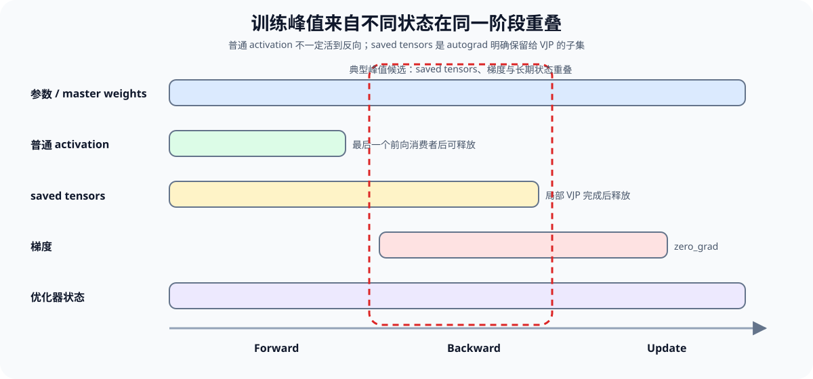
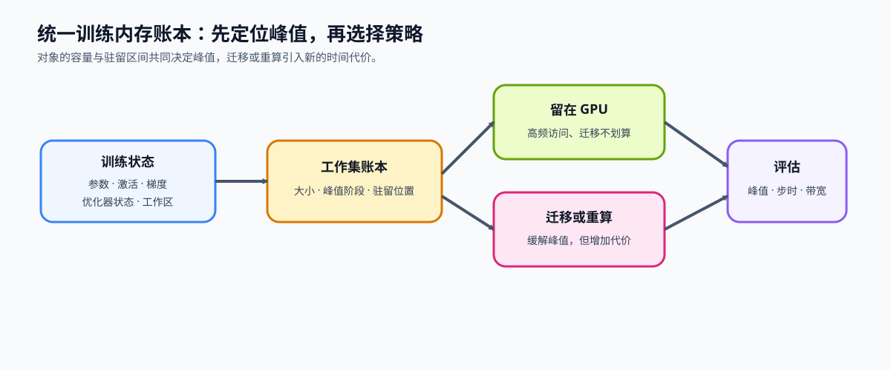

# 43. Unified Training Memory Ledger | 统一训练内存账本

**难度：** Medium | **环境：** CPU-first | **标签：** `反向传播`, `训练内存`, `生命周期` | **目标人群：** 训练机制学习者

> 🚀 **云端运行环境**
>
> 本章节的实战代码可以点击以下链接在免费 GPU 算力平台上直接运行：
>
> [](https://colab.research.google.com/github/datawhalechina/llm-algo-leetcode/blob/main/02_PyTorch_Algorithms/43_Unified_Training_Memory_Ledger.ipynb)
> [](https://modelscope.cn/my/mynotebook) *(国内推荐：魔搭社区免费实例)*


## 本节导读

训练峰值不是所有状态容量的机械相加，而是某个阶段仍驻留在设备上的状态发生重叠。参数、activation、梯度、优化器状态、workspace 和通信缓冲区有不同的产生与释放时机；只有把它们放到同一条训练时间轴，才能解释峰值为什么出现。

梯度累积、checkpoint 和 offload 分别改变梯度保留、activation 保存与设备驻留。本节把这些局部变化映射到统一生命周期字段，定位峰值阶段及其主要贡献对象。

**关键词：** `lifecycle`, `residency`, `peak overlap`, `working set`

## 前置阅读

先理解梯度累积怎样延长梯度保留窗口、checkpoint 怎样改变 activation 保存方式，以及 offload 怎样改变 activation 的驻留设备，再把这些局部变化放回统一时间轴。

- [11. Gradient Accumulation | 梯度累积](./11_Gradient_Accumulation.md)
- [19. Activation Checkpointing | 激活检查点](./19_Activation_Checkpointing.md)
- [42. Activation Offload | 激活卸载](./42_Activation_Offload.md)

### Step 1：训练状态在什么时候产生和释放

一条训练记录必须同时说明对象容量和驻留区间。下面按稳态训练 step 描述：优化器状态在第一次 update 后创建，从后续 step 开始通常长期驻留；activation、梯度和临时工作集则只覆盖部分阶段。

| 状态 | 产生时机 | 使用阶段 | 释放或更新时间 | 生命周期特征 |
|:---|:---|:---|:---|:---|
| 参数 / master weights | 模型加载 | forward、backward、update | 训练结束 | 长期驻留 |
| 普通 activation | forward | 后续 forward 或输出 | 最后一次消费者完成 | 不一定需要保留到 backward |
| saved tensors | forward 中由 autograd 保存 | 对应 backward VJP | 局部 backward 完成或重算后释放 | 是 activation 中真正跨越到反向的子集 |
| gradient | backward | accumulation、update | `zero_grad` | 跨 micro-batch 保留 |
| optimizer state | 首次 update | 后续 update | 训练结束 | 延迟创建、随后长期驻留 |
| workspace | kernel 执行 | 当前算子 | 算子结束或缓存复用 | 短期驻留 |
| 通信缓冲区 | collective 启动 | 同步或通信 | collective 结束 | 通信窗口内驻留 |

这里要特别区分普通 activation 与 `saved_tensors`：前者描述前向产生的中间结果，后者描述 autograd 为 VJP 明确保留到反向的状态。第 18 节的 `Q/K/V/P` 就是这一字段的 Attention 实例。



### Step 2：怎样从生命周期计算阶段显存

对每个阶段，只汇总该阶段仍驻留在 GPU 上的状态。账本使用统一字段描述对象，而不是用一个 `resident=True` 把不同时间范围压成同一种状态。`start_phase` 与 `end_phase` 都计入驻留区间。

| 字段 | 含义 | 例子 |
|:---|:---|:---|
| `name` / `category` | 状态名称与类别 | `layer_activations / activation` |
| `size_mb` | 当前账本中的设备容量 | `512.0` |
| `start_phase` | 开始驻留的阶段 | `forward` |
| `end_phase` | 最后驻留的阶段 | `backward` |
| `device` | 当前驻留设备 | `gpu` 或 `cpu` |
| `persistent` | 是否跨 step 长期存在 | 参数和稳态 optimizer state 为 `True` |

阶段总量回答“此刻有多少状态仍在设备上”，贡献对象回答“峰值由谁形成”。理论账本不包含 allocator 额外保留、未知 workspace 或其他进程；这些差异需要 GPU memory snapshot 或 profiler 解释。



### Step 3：不同策略改变生命周期的哪一部分

策略只有改变峰值阶段的驻留对象、容量或驻留区间，才可能降低理论峰值。下表把常见策略映射到它实际改变的账本字段，便于判断它能否触及当前峰值。

| 策略 | 生命周期变化 | 保持不变的状态 | 需要另行测量的代价 |
|:---|:---|:---|:---|
| 梯度累积 | 减少单个 micro-batch 的 activation；梯度跨多个 micro-batch 保留 | 参数和 optimizer state | 更多 forward/backward、更新频率 |
| Checkpoint | 不长期保存部分区段内部 activation | 参数、梯度和 optimizer state | backward 重算时间 |
| Offload | 部分 activation 的设备从 GPU 改为 CPU，反向前再取回 | 状态的训练语义 | D2H/H2D、同步和 host 容量 |
| ZeRO / 分片 | 减少单设备持有的参数、梯度或 optimizer state | 全局参数更新语义 | 通信、重建和同步 |
| 混合精度 | 改变部分状态的单元素字节数 | 状态的依赖关系 | 数值稳定性和硬件路径 |

### Step 4：实现生命周期账本与峰值分析

题目区把统一账本拆成三个机制责任：先检查状态记录能否落到训练时间轴，再按阶段汇总 GPU 驻留量，最后找出峰值阶段和主要贡献对象。

| TODO / 函数 | 学习者完成的机制 | 必须满足的约束 | 测试证据 |
|:---|:---|:---|:---|
| TODO 1 · `validate_state_lifecycle` | 校验状态类别、容量、设备与起止阶段 | 容量非负，阶段合法且区间不倒置 | 负容量、未知阶段与倒置区间 |
| TODO 2 · `summarize_phase_memory` | 汇总每个阶段仍驻留在 GPU 的状态 | CPU 状态不计入 GPU 峰值，区间端点按约定计入 | 分阶段容量与活跃对象 |
| TODO 3 · `find_peak_overlap` | 找出峰值阶段、容量和贡献对象 | 并列峰值取最早阶段，贡献按容量排序 | 峰值、并列顺序与贡献排序 |


```python
from typing import Dict, List

PHASES = ['load', 'forward', 'loss', 'backward', 'update', 'zero_grad']
VALID_CATEGORIES = {
    'parameter', 'master_weight', 'activation', 'gradient',
    'optimizer_state', 'workspace', 'communication_buffer',
}

```


```python
def validate_state_lifecycle(state: Dict[str, object]) -> None:
    """校验一条训练状态记录能否落到统一阶段时间轴。"""
    required = {'name', 'category', 'size_mb', 'start_phase', 'end_phase', 'device', 'persistent'}
    missing = sorted(required - set(state))
    if missing:
        raise KeyError(f'状态记录缺少字段: {missing}')

    if not isinstance(state['size_mb'], (int, float)) or isinstance(state['size_mb'], bool):
        raise TypeError('size_mb 必须是数值')
    if float(state['size_mb']) < 0:
        raise ValueError('size_mb 不能为负数')
    if state['category'] not in VALID_CATEGORIES:
        raise ValueError(f"未知状态类别: {state['category']}")
    if state['device'] not in {'cpu', 'gpu'}:
        raise ValueError('device 必须是 cpu 或 gpu')
    if state['start_phase'] not in PHASES or state['end_phase'] not in PHASES:
        raise ValueError('start_phase / end_phase 必须属于统一阶段表')

    # ==========================================
    # TODO 1：判断生命周期区间是否有效
    # 作用：保证状态的开始阶段不会晚于结束阶段。
    # phase_order_is_valid = ???  # 比较 start_phase 与 end_phase 在 PHASES 中的位置
    # ==========================================
    raise NotImplementedError('TODO 1：请判断 phase_order_is_valid')
    if not phase_order_is_valid:
        raise ValueError('start_phase 不能晚于 end_phase')
    if not isinstance(state['persistent'], bool):
        raise TypeError('persistent 必须是布尔值')


def summarize_phase_memory(states: List[Dict[str, object]]) -> List[Dict[str, object]]:
    """按训练阶段汇总 GPU 上仍驻留的状态与容量。"""
    for state in states:
        validate_state_lifecycle(state)

    records = []
    for phase_index, phase in enumerate(PHASES):
        # ==========================================
        # TODO 2：选择当前阶段仍驻留在 GPU 的状态
        # 作用：只保留 device 为 gpu，且生命周期覆盖 phase_index 的对象。
        # active = ???  # 当前阶段参与显存汇总的状态列表
        # ==========================================
        raise NotImplementedError('TODO 2：请选择 active states')
        records.append({
            'phase': phase,
            'total_mb': sum(float(state['size_mb']) for state in active),
            'active_states': [str(state['name']) for state in active],
            'state_sizes_mb': {str(state['name']): float(state['size_mb']) for state in active},
        })
    return records


def find_peak_overlap(phase_records: List[Dict[str, object]]) -> Dict[str, object]:
    """返回最早出现的峰值阶段、容量和按容量降序排列的贡献对象。"""
    if not phase_records:
        raise ValueError('phase_records 不能为空')

    # ==========================================
    # TODO 3：选择最早出现的峰值记录
    # 作用：利用 PHASES 的现有顺序，在并列峰值时保留最早阶段。
    # peak = ???  # total_mb 最大的阶段记录
    # ==========================================
    raise NotImplementedError('TODO 3：请选择 peak record')
    sizes = peak.get('state_sizes_mb', {})
    contributors = sorted(sizes, key=lambda name: (-float(sizes[name]), name))
    return {
        'peak_phase': peak['phase'],
        'peak_mb': float(peak['total_mb']),
        'contributors': contributors,
    }

```


```python
# 测试设计：分别验证输入契约、阶段驻留和峰值贡献，不使用项目 JSON。

def _sample_states() -> List[Dict[str, object]]:
    return [
        {'name': 'parameters', 'category': 'parameter', 'size_mb': 800.0, 'start_phase': 'load', 'end_phase': 'zero_grad', 'device': 'gpu', 'persistent': True},
        {'name': 'optimizer_state', 'category': 'optimizer_state', 'size_mb': 600.0, 'start_phase': 'load', 'end_phase': 'zero_grad', 'device': 'gpu', 'persistent': True},
        {'name': 'activations', 'category': 'activation', 'size_mb': 300.0, 'start_phase': 'forward', 'end_phase': 'backward', 'device': 'gpu', 'persistent': False},
        {'name': 'gradients', 'category': 'gradient', 'size_mb': 400.0, 'start_phase': 'backward', 'end_phase': 'update', 'device': 'gpu', 'persistent': False},
        {'name': 'forward_workspace', 'category': 'workspace', 'size_mb': 200.0, 'start_phase': 'forward', 'end_phase': 'forward', 'device': 'gpu', 'persistent': False},
        {'name': 'collective_buffer', 'category': 'communication_buffer', 'size_mb': 100.0, 'start_phase': 'backward', 'end_phase': 'backward', 'device': 'gpu', 'persistent': False},
        {'name': 'offloaded_activation', 'category': 'activation', 'size_mb': 250.0, 'start_phase': 'forward', 'end_phase': 'backward', 'device': 'cpu', 'persistent': False},
    ]


def test_lifecycle_contract() -> None:
    """验证训练状态的大小、生命周期和阶段字段契约。"""
    valid = _sample_states()[0]
    validate_state_lifecycle(valid)
    invalid_states = [
        {**valid, 'size_mb': -1.0},
        {**valid, 'category': 'unknown'},
        {**valid, 'device': 'tpu'},
        {**valid, 'start_phase': 'backward', 'end_phase': 'forward'},
    ]
    for state in invalid_states:
        try:
            validate_state_lifecycle(state)
        except (TypeError, ValueError):
            continue
        raise AssertionError('非法生命周期记录应明确拒绝')


def test_phase_residency() -> None:
    """验证 forward、backward 与 update 的驻留状态汇总。"""
    records = {item['phase']: item for item in summarize_phase_memory(_sample_states())}
    assert records['forward']['total_mb'] == 1900.0
    assert records['backward']['total_mb'] == 2200.0
    assert records['update']['total_mb'] == 1800.0
    assert 'offloaded_activation' not in records['backward']['active_states']
    assert 'activations' not in records['update']['active_states']


def test_peak_overlap() -> None:
    """验证峰值阶段、峰值容量与主要贡献对象。"""
    peak = find_peak_overlap(summarize_phase_memory(_sample_states()))
    assert peak['peak_phase'] == 'backward'
    assert peak['peak_mb'] == 2200.0
    assert peak['contributors'] == ['parameters', 'optimizer_state', 'gradients', 'activations', 'collective_buffer']


def run_unified_memory_tests() -> None:
    test_lifecycle_contract()
    test_phase_residency()
    test_peak_overlap()
    print('✅ 生命周期、阶段驻留与峰值重叠测试通过')


run_unified_memory_tests()

```

---

🛑 **STOP HERE** 🛑
<br><br><br><br><br><br><br><br><br><br>
> 请先尝试自己完成代码并跑通测试。<br>
> 如果你正在 Colab 中运行，并且遇到困难没有思路，可以向下滚动查看参考答案。
<br><br><br><br><br><br><br><br><br><br>

---

## 参考代码与解析

### 代码


```python
def validate_state_lifecycle(state: Dict[str, object]) -> None:
    """校验一条训练状态记录能否落到统一阶段时间轴。"""
    required = {'name', 'category', 'size_mb', 'start_phase', 'end_phase', 'device', 'persistent'}
    missing = sorted(required - set(state))
    if missing:
        raise KeyError(f'状态记录缺少字段: {missing}')
    if not isinstance(state['size_mb'], (int, float)) or isinstance(state['size_mb'], bool):
        raise TypeError('size_mb 必须是数值')
    if float(state['size_mb']) < 0:
        raise ValueError('size_mb 不能为负数')
    if state['category'] not in VALID_CATEGORIES:
        raise ValueError(f"未知状态类别: {state['category']}")
    if state['device'] not in {'cpu', 'gpu'}:
        raise ValueError('device 必须是 cpu 或 gpu')
    if state['start_phase'] not in PHASES or state['end_phase'] not in PHASES:
        raise ValueError('start_phase / end_phase 必须属于统一阶段表')
    if PHASES.index(state['start_phase']) > PHASES.index(state['end_phase']):
        raise ValueError('start_phase 不能晚于 end_phase')
    if not isinstance(state['persistent'], bool):
        raise TypeError('persistent 必须是布尔值')


def summarize_phase_memory(states: List[Dict[str, object]]) -> List[Dict[str, object]]:
    """按训练阶段汇总 GPU 上仍驻留的状态与容量。"""
    for state in states:
        validate_state_lifecycle(state)
    records = []
    for phase_index, phase in enumerate(PHASES):
        active = [
            state for state in states
            if state['device'] == 'gpu'
            and PHASES.index(state['start_phase']) <= phase_index <= PHASES.index(state['end_phase'])
        ]
        records.append({
            'phase': phase,
            'total_mb': sum(float(state['size_mb']) for state in active),
            'active_states': [str(state['name']) for state in active],
            'state_sizes_mb': {str(state['name']): float(state['size_mb']) for state in active},
        })
    return records


def find_peak_overlap(phase_records: List[Dict[str, object]]) -> Dict[str, object]:
    """返回最早出现的峰值阶段、容量和按容量降序排列的贡献对象。"""
    if not phase_records:
        raise ValueError('phase_records 不能为空')
    peak = max(phase_records, key=lambda item: float(item['total_mb']))
    sizes = peak.get('state_sizes_mb', {})
    contributors = sorted(sizes, key=lambda name: (-float(sizes[name]), name))
    return {
        'peak_phase': peak['phase'],
        'peak_mb': float(peak['total_mb']),
        'contributors': contributors,
    }

```

### 解析

#### TODO 1：生命周期区间

`start_phase` 与 `end_phase` 必须落在同一阶段表中，并满足开始位置不晚于结束位置。容量、类别、设备和持久性字段由骨架先行校验，使 TODO 聚焦于生命周期顺序。

#### TODO 2：阶段驻留

只有当前阶段仍在 GPU 的对象进入阶段总量；已经卸载到 CPU 的状态不会继续计入 GPU 峰值。区间端点仍表示对象在该阶段可用。

#### TODO 3：峰值重叠

`max` 会在键值相同时保留输入中的首个记录，因此按 `PHASES` 顺序生成阶段账本即可得到最早峰值。贡献对象继续按容量降序排列，便于定位优先优化的状态。

## 相关阅读

统一生命周期账本用于解释峰值来源；真实策略收益继续交给固定 workload 的训练性能项目。

- [PyTorch CUDA 内存管理文档](https://pytorch.org/docs/stable/notes/cuda.html#cuda-memory-management)
- [ZeRO: Memory Optimizations Toward Training Trillion Parameter Models](https://arxiv.org/abs/1910.02054)
- [73. Training Performance Analysis | 训练性能分析](./73_Training_Performance_Analysis.md)
- [76. Activation Checkpoint / Offload Benchmark | 激活检查点与卸载对比](./76_Activation_Checkpoint_Offload_Benchmark.md)
- [性能优化 · 训练状态与后训练资源账本](../topic_discussion/performance_optimization/03_training_memory_ledger.md)
