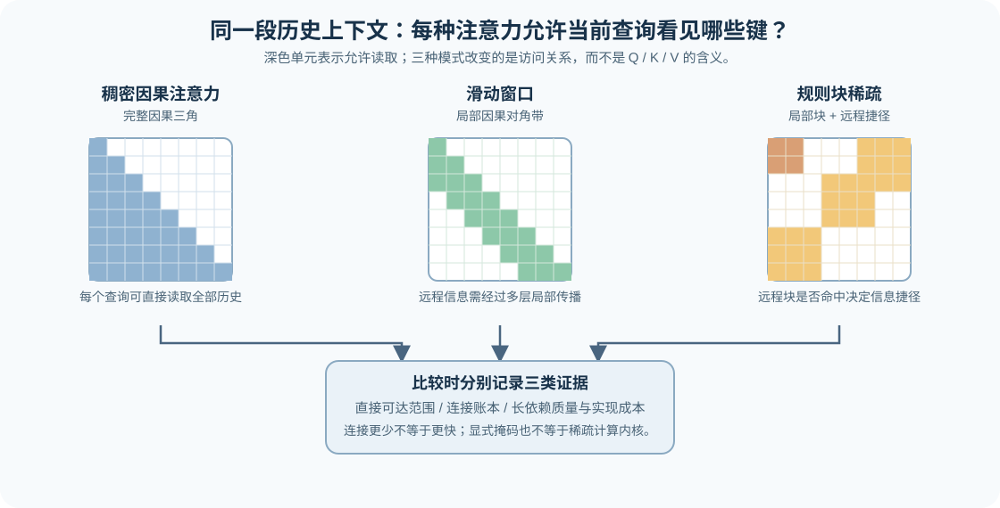
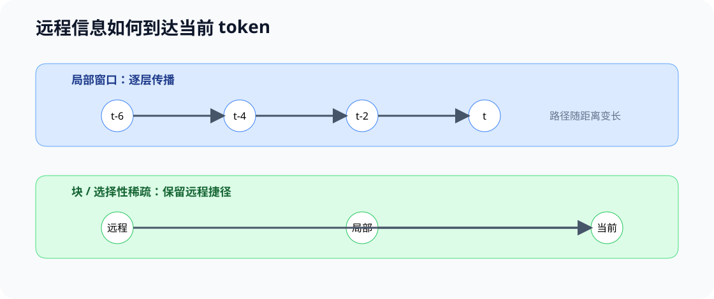

# 44. Local Sliding and Sparse Attention | 局部、滑动窗口与稀疏注意力

**难度：** Medium | **环境：** CPU-first | **标签：** `Attention`, `长上下文`, `稀疏访问`

> 🚀 **云端运行环境**
>
> 本章节的实战代码可以点击以下链接在免费 GPU 算力平台上直接运行：
>
> [](https://colab.research.google.com/github/datawhalechina/llm-algo-leetcode/blob/main/02_PyTorch_Algorithms/44_Local_Sliding_and_Sparse_Attention.ipynb)
> [](https://modelscope.cn/my/mynotebook) *(国内推荐：魔搭社区免费实例)*


## 本节导读

标准注意力让每个 token 都可以读取全部历史位置，因此能够建立全局依赖，但序列变长时，计算与中间分数矩阵也会快速增长。局部、滑动窗口和块稀疏注意力的共同思想不是改变 Q/K/V 的语义，而是改变每个查询（Query，Q）被允许访问哪些键（Key，K）。

本节比较三类访问模式如何在全局信息、理论连接数和长上下文成本之间取舍，并用掩码验证“允许访问什么”这一核心机制。它为后续架构演进、长上下文推理和稀疏算子实现提供共同的访问模式语言。

**关键词：** `稠密注意力`, `滑动窗口`, `块稀疏`, `访问掩码`

## 前置阅读

**导语：** 先理解 Q/K/V、因果掩码与多头形状，再比较不同访问范围怎样限制每个查询可读取的历史位置。

- [Part 02 · 04 Attention（MHA / GQA）](./04_Attention_MHA_GQA.md)
- [大模型架构 · Attention 演化](../topic_discussion/llm_architecture_evolution/04_attention_evolution.md)

### Step 1：注意力的访问范围

同一段 Q/K/V 可以搭配不同的访问规则。稠密因果注意力保留完整历史；滑动窗口保留最近邻域；规则块稀疏在局部连接之外保留少量远程捷径。它们首先改变当前查询能直接读取哪些历史键，随后才改变连接账本、状态规模和执行路径。



### Step 2：从访问规则到理论连接数

设序列长度为 `L`，窗口宽度为 `w`。自回归模式始终要求“键位置不晚于查询位置”：稠密注意力保留完整因果三角；滑动窗口只保留最近 `w` 个历史位置；规则块稀疏先选择块对，再在块内过滤未来位置；选择性稀疏则由内容或检索结果决定远程连接。

| 访问模式 | 每个查询可读取的位置 | 因果连接数 | 主要风险 |
| --- | --- | --- | --- |
| 稠密因果注意力 | 全部历史与当前位置 | `L(L+1)/2` | 长序列下分数矩阵和访存增长快 |
| 滑动窗口 | 最近 `min(w, t+1)` 个位置 | `wL - w(w-1)/2`（`L ≥ w`） | 超出窗口的远距离依赖不能单层直达 |
| 规则块稀疏 | 预先指定的局部或远程块对 | 由激活块对及因果过滤决定 | 非规则模式可能难以映射到高效计算内核 |
| 选择性稀疏 | 内容或检索选择的位置 | 与选择数量和命中率有关 | 选择错误会遗漏关键上下文 |

连接数给出的是结构账本，不是速度承诺：实际收益还取决于张量形状、掩码表示、计算内核与执行后端能否利用这一规则。

### Step 3：长上下文中的可达性与取舍

局部窗口减少的是**单层直接访问范围**，并不等于远距离信息永远无法影响当前位置：若每层都允许向前看 `w-1` 个位置，堆叠多层后信息可以逐层传播。对距离为 `d` 的两个 token，覆盖它至少需要 `ceil(d / (w-1))` 层；这条路径越长，跨位置的信息传递越依赖模型在中间层保留有效表示。块稀疏或选择性稀疏可以增加远程捷径，但前提是被激活的 block 或位置确实包含任务需要的信息。

连接数或 mask 密度只能说明“允许看什么”。比较长上下文方案时，还应在训练长度内外分别记录任务质量，并在固定模型、shape 和 backend 下测量延迟与显存。

| 观察角度 | 稠密注意力 | 局部 / 滑动窗口 | 块 / 选择性稀疏 |
| --- | --- | --- | --- |
| 单层直接依赖 | 完整历史 | 最近 `w` 个位置 | 指定或动态选择的位置 |
| 远程信息到达当前 token | 直接读取 | 经过多层局部传播 | 依赖远程块 / 位置是否被选中 |
| 连接与状态规模 | 随完整三角增长 | 随窗口缩小 | 取决于激活块或选择数 |
| 后续证据 | 长依赖任务质量、延迟、显存 | 距离覆盖、长依赖质量、延迟 | 选择命中率、长依赖质量、规则稀疏内核证据 |



### Step 4：实现访问掩码、连接账本与传播层数

题目区把访问策略拆成四个可验证的机制：局部因果可见性、块对可见性、连接账本，以及局部窗口下远距离信息需要经过多少层传播。骨架提供输入检查；输出均为 CPU 机制账本，后续 GPU 单元记录当前 SDPA 执行路径的成本。

| TODO / 函数 | 学习者完成的机制 | 必须满足的约束 | 测试证据 |
|---|---|---|---|
| TODO 1：构造局部因果掩码<br>`build_local_causal_mask` | 同时应用因果顺序与局部窗口约束 | 输出为 `[L,L]` 布尔掩码；未来和窗口外位置均不可见 | `test_local_causal_visibility` 覆盖窗口内、未来与窗口外位置 |
| TODO 2：激活块稀疏区域<br>`build_block_sparse_mask` | 将合法块对映射到 token 级可见区域 | 区域形状与当前块边界一致；不得绕过因果过滤 | `test_block_sparse_pairs_and_bounds` 与 `test_block_sparse_causal_filter` 覆盖合法、空、越界和未来块 |
| TODO 3：计算连接账本<br>`summarize_access` | 统计可见连接、总连接与密度 | 计数为整数；密度位于 `[0,1]` | `test_access_summary` 对照已知局部掩码的精确计数 |
| TODO 4：估算最少传播层数<br>`min_local_propagation_layers` | 把距离与单层覆盖范围转换为层数 | 距离 0 返回 0；窗口 1 的非零距离不可达 | `test_local_propagation_layers` 覆盖相邻、远距离、不可达与非法输入 |


```python
import numpy as np

```


```python
def build_local_causal_mask(seq_len: int, window_size: int) -> np.ndarray:
    """返回 [query, key] 布尔 mask；True 表示当前位置允许读取该 key。"""
    if not isinstance(seq_len, int) or not isinstance(window_size, int) or seq_len <= 0 or window_size <= 0:
        raise ValueError('seq_len 和 window_size 必须为正整数')
    # ==========================================
    # TODO 1：构造局部因果掩码
    # mask = ???  # [seq_len, seq_len] 布尔数组；只保留窗口内且不晚于查询位置的键
    # ==========================================
    raise NotImplementedError('TODO 1：请构造局部因果掩码')
    return mask

def build_block_sparse_mask(
    seq_len: int, block_size: int, active_block_pairs: set[tuple[int, int]], causal: bool = True
) -> np.ndarray:
    """按 (query_block, key_block) 构造 block 稀疏 mask；causal=True 时屏蔽未来位置。"""
    if seq_len <= 0 or block_size <= 0:
        raise ValueError('seq_len 和 block_size 必须为正整数')
    num_blocks = (seq_len + block_size - 1) // block_size
    mask = np.zeros((seq_len, seq_len), dtype=bool)
    for query_block, key_block in active_block_pairs:
        if not (0 <= query_block < num_blocks and 0 <= key_block < num_blocks):
            raise ValueError('active_block_pairs 包含越界 block')
        if causal and key_block > query_block:
            raise ValueError('因果 block 稀疏不能激活未来 block')
        q_start, q_end = query_block * block_size, min((query_block + 1) * block_size, seq_len)
        k_start, k_end = key_block * block_size, min((key_block + 1) * block_size, seq_len)
        # ==========================================
        # TODO 2：激活块稀疏区域
        # block_mask = ???  # [q_end-q_start, k_end-k_start] 布尔数组；当前块对全部可见
        # ==========================================
        raise NotImplementedError('TODO 2：请激活块稀疏区域')
        mask[q_start:q_end, k_start:k_end] = block_mask
    if causal:
        mask &= np.tri(seq_len, dtype=bool)
    return mask

def summarize_access(mask: np.ndarray) -> dict[str, int | float]:
    """统计可见连接数与相对密度，不把理论稀疏度写成真实 kernel 加速。"""
    if mask.ndim != 2 or mask.shape[0] != mask.shape[1] or mask.dtype != bool:
        raise ValueError('mask 必须是方形 bool 数组')
    # ==========================================
    # TODO 3：计算连接账本
    # visible_pairs = ???  # mask 中 True 的连接数，整数
    # total_pairs = ???  # 方形访问矩阵的全部位置数，整数
    # density = ???  # 可见连接占比，范围 [0, 1]
    # ==========================================
    raise NotImplementedError('TODO 3：请计算连接账本')
    return {'visible_pairs': visible_pairs, 'total_pairs': total_pairs, 'density': density}


def min_local_propagation_layers(distance: int, window_size: int) -> int | float:
    """返回局部窗口把距离为 distance 的历史信息传到当前位置所需的最少层数。

    每层最多向前传播 window_size - 1 个位置；返回 float('inf') 表示窗口为 1 时无法跨位置传播。
    """
    if not isinstance(distance, int) or not isinstance(window_size, int) or distance < 0 or window_size <= 0:
        raise ValueError('distance 必须为非负整数，window_size 必须为正整数')
    if distance == 0:
        return 0
    if window_size == 1:
        return float('inf')
    # ==========================================
    # TODO 4：估算最少传播层数
    # step_per_layer = ???  # 单层最多向前传播的位置数，必须为正
    # layers = ???  # 覆盖 distance 所需的向上取整层数
    # ==========================================
    raise NotImplementedError('TODO 4：请估算最少传播层数')
    return layers

```


```python
# 测试访问不变量：因果窗口不能泄漏未来，block 对必须精确生效，账本只统计 mask 中的连接。
def test_local_causal_visibility():
    """验证窗口内历史可见，未来和窗口外历史不可见。"""
    mask = build_local_causal_mask(5, 2)
    assert mask[3, 3] and mask[3, 2]
    assert not mask[3, 1] and not mask[2, 3]

def test_block_sparse_pairs_and_bounds():
    """验证指定 block 对与越界输入。"""
    mask = build_block_sparse_mask(4, 2, {(0, 0), (1, 0)})
    assert mask[1, 0] and mask[3, 0] and not mask[0, 1] and not mask[0, 3]
    assert not build_block_sparse_mask(4, 2, set()).any()
    try:
        build_block_sparse_mask(4, 2, {(2, 0)})
    except ValueError:
        return
    raise AssertionError('越界 block 必须拒绝')

def test_block_sparse_causal_filter():
    """验证因果模式拒绝未来 block；双向模式可显式保留它。"""
    try:
        build_block_sparse_mask(4, 2, {(0, 1)})
    except ValueError:
        pass
    else:
        raise AssertionError('因果 block 稀疏不应激活未来 block')
    bidirectional = build_block_sparse_mask(4, 2, {(0, 1)}, causal=False)
    assert bidirectional[0, 2]

def test_access_summary():
    """验证连接数和密度与 mask 一致。"""
    summary = summarize_access(build_local_causal_mask(4, 2))
    assert summary == {'visible_pairs': 7, 'total_pairs': 16, 'density': 7 / 16}

test_local_causal_visibility()
test_block_sparse_pairs_and_bounds()
test_block_sparse_causal_filter()
def test_local_propagation_layers():
    """验证局部窗口的多层传播范围与不可达边界。"""
    assert min_local_propagation_layers(0, 1) == 0
    assert min_local_propagation_layers(1, 2) == 1
    assert min_local_propagation_layers(5, 3) == 3
    assert min_local_propagation_layers(1, 1) == float('inf')
    try:
        min_local_propagation_layers(-1, 2)
    except ValueError:
        return
    raise AssertionError('负距离必须拒绝')

test_access_summary()
test_local_propagation_layers()
print('✅ 局部与稀疏 Attention 访问机制测试通过。')

```

---

🛑 **STOP HERE** 🛑

请先完成题目区并通过测试，再继续查看参考代码与解析。

---

## 参考代码与解析

### 代码


```python
def build_local_causal_mask(seq_len: int, window_size: int) -> np.ndarray:
    """返回 [query, key] 布尔 mask；True 表示当前位置允许读取该 key。"""
    if not isinstance(seq_len, int) or not isinstance(window_size, int) or seq_len <= 0 or window_size <= 0:
        raise ValueError('seq_len 和 window_size 必须为正整数')
    # TODO 1：构造局部因果掩码
    query, key = np.indices((seq_len, seq_len))
    mask = (key <= query) & ((query - key) < window_size)
    return mask

def build_block_sparse_mask(
    seq_len: int, block_size: int, active_block_pairs: set[tuple[int, int]], causal: bool = True
) -> np.ndarray:
    """按 (query_block, key_block) 构造 block 稀疏 mask；causal=True 时屏蔽未来位置。"""
    if seq_len <= 0 or block_size <= 0:
        raise ValueError('seq_len 和 block_size 必须为正整数')
    num_blocks = (seq_len + block_size - 1) // block_size
    mask = np.zeros((seq_len, seq_len), dtype=bool)
    for query_block, key_block in active_block_pairs:
        if not (0 <= query_block < num_blocks and 0 <= key_block < num_blocks):
            raise ValueError('active_block_pairs 包含越界 block')
        if causal and key_block > query_block:
            raise ValueError('因果 block 稀疏不能激活未来 block')
        q_start, q_end = query_block * block_size, min((query_block + 1) * block_size, seq_len)
        k_start, k_end = key_block * block_size, min((key_block + 1) * block_size, seq_len)
        # TODO 2：激活块稀疏区域
        block_mask = np.ones((q_end - q_start, k_end - k_start), dtype=bool)
        mask[q_start:q_end, k_start:k_end] = block_mask
    if causal:
        mask &= np.tri(seq_len, dtype=bool)
    return mask

def summarize_access(mask: np.ndarray) -> dict[str, int | float]:
    """统计可见连接数与相对密度，不把理论稀疏度写成真实 kernel 加速。"""
    if mask.ndim != 2 or mask.shape[0] != mask.shape[1] or mask.dtype != bool:
        raise ValueError('mask 必须是方形 bool 数组')
    # TODO 3：计算连接账本
    visible_pairs = int(mask.sum())
    total_pairs = mask.size
    density = visible_pairs / total_pairs
    return {'visible_pairs': visible_pairs, 'total_pairs': total_pairs, 'density': density}


def min_local_propagation_layers(distance: int, window_size: int) -> int | float:
    """返回局部窗口把距离为 distance 的历史信息传到当前位置所需的最少层数。

    每层最多向前传播 window_size - 1 个位置；返回 float('inf') 表示窗口为 1 时无法跨位置传播。
    """
    if not isinstance(distance, int) or not isinstance(window_size, int) or distance < 0 or window_size <= 0:
        raise ValueError('distance 必须为非负整数，window_size 必须为正整数')
    # TODO 4：估算最少传播层数
    step_per_layer = window_size - 1
    if distance == 0:
        return 0
    if window_size == 1:
        return float('inf')
    return (distance + step_per_layer - 1) // step_per_layer

```

### 解析

#### TODO 1：构造局部因果访问掩码

- 局部因果可见性同时满足 `key <= query` 与 `query-key < window_size`；只保留其中一条都会错误地泄漏未来或窗口外历史。

#### TODO 2：构造块稀疏访问掩码

- 块对先决定候选区域，再根据 `causal` 过滤未来位置。因此同一组块在自回归和双向任务中不能直接复用。

#### TODO 3：汇总连接账本

- `density` 只描述理论连接比例；要判断收益还要固定模型、张量形状与执行后端，观察延迟、显存和任务质量。

#### TODO 4：估算最少传播层数

- 局部窗口每层最多让信息向前传播 `window_size - 1` 个位置。传播层数解释了局部注意力如何间接覆盖远距离，但不能替代真实长依赖任务上的质量验证。

### Step 5：GPU 机制实验——稠密注意力与滑动窗口访问

这一组单元在相同随机 Q/K/V、数据类型、注意力头数与序列长度下，比较稠密因果 SDPA 和显式布尔滑动窗口掩码的预填充调用。

| 学习问题 | CPU 已确认 | GPU 要确认与后续使用 |
| --- | --- | --- |
| 访问连接减少是否会形成执行收益？ | 验证窗口可见性、连接数和传播范围 | 比较显式掩码的存储、延迟与峰值显存；结果用于决定是否继续检查后端和专用稀疏 Kernel |

#### 5.1 环境与固定工作负载

本节使用 `ARCH-CUDA-MECHANISM` Profile。环境创建与预检见[架构实验 Quickstart](../topic_discussion/llm_architecture_evolution/quickstart.md)，候选、结果路径和证据状态见[架构实验资产表](../topic_discussion/llm_architecture_evolution/experiment_assets.md)。两条路径共用 Q/K/V、形状、数据类型、随机种子和测量方法，只改变访问范围及掩码表示。

| 配置层 | 本次固定值 | 修改规则 |
| --- | --- | --- |
| 实验身份 | `arch-window-sdpa-v2`；默认结果标签 `default` | 改变长度矩阵或测量协议后递增 workload 版本；正式复测使用唯一标签 |
| 运行环境 | `ARCH-CUDA-MECHANISM`；单张 CUDA GPU | Profile 预检未通过时保持 `dry_run`，不生成机制证据 |
| 配对变量 | 稠密因果 SDPA → 显式布尔窗口 SDPA | 两条路径必须复用同一份 Q/K/V，不同时改变 head、dtype 或 batch |
| 长度阶梯 | `[256, 512, 1024, 2048]`；窗口固定为 256 | 256 检查无连接缩减时的 mask 开销，其余三档观察超窗增长 |
| 张量形状 | batch=1、heads=8、head_dim=64、FP16 | 改变形状后单独登记结果，不与本次长度趋势合并 |
| 测量方法 | warmup=10、repeats=100 | 同时记录输出有限性、可见连接、mask 存储、平均延迟和峰值显存 |
| 结果资产 | `benchmarks/results/44_sparse_attention/gpu_sdpa_window_<RUN_LABEL>.json` | 正式复测使用唯一标签，保留旧结果 |


```python
# 默认仅检查配置；完成 ARCH-CUDA-MECHANISM 预检后改为 real_gpu。
RUN_MODE = 'dry_run'  # 默认值 dry_run：只登记计划；改为 real_gpu 执行真实单卡矩阵。
RUN_LABEL = 'default'  # 默认值 default；正式复测改为唯一标签，避免覆盖旧结果。
PROFILE_ID = 'ARCH-CUDA-MECHANISM'  # 固定环境身份；必须先通过同名 Profile 预检。
SEMANTIC_ID = 'ARCH-ATTENTION-ACCESS-MECHANISM'  # 固定机制身份，不随复测改变。
WORKLOAD_ID = 'arch-window-sdpa-v2'  # v2 固定长度阶梯和显式布尔掩码路径。
GPU_CONFIG = {
    "batch_size": 1,  # 默认值 1；增大会同步增加两条路径的状态和计算量。
    "heads": 8,  # 默认值 8；两条路径必须保持相同注意力头数。
    "head_dim": 64,  # 默认值 64；单位为每个 Head 的特征维度。
    "seq_lens": [256, 512, 1024, 2048],  # 默认单位为 token；覆盖无缩减与超窗口档位。
    "window_size": 256,  # 默认值 256 token；增大会提高可见连接数。
    "dtype": "float16",  # 默认值 float16；更换精度后结果不可直接合并。
    "warmup": 10,  # 默认值 10 次；只用于预热，不计入平均时间。
    "repeats": 100,  # 默认值 100 次；增大可降低计时波动。
    "mask_representation": "explicit_boolean_mask",  # 固定候选身份；更换表示后递增 workload 版本。
}
RESULT_RELATIVE_PATH = f'benchmarks/results/44_sparse_attention/gpu_sdpa_window_{RUN_LABEL}.json'  # 仓库相对结果路径。
print({'run_mode': RUN_MODE, 'profile': PROFILE_ID, 'workload': WORKLOAD_ID, 'result': RESULT_RELATIVE_PATH})

```

#### 5.2 执行并保存 JSON

Dense 路径使用 PyTorch SDPA 的因果模式；候选路径使用同一份 Q/K/V 和显式布尔滑动窗口 mask。这个 mask 本身是 `L×L` 张量，可能改变 SDPA backend 或增加显存，因此结果只用于判断当前实现路径是否值得继续优化，不等同于规则稀疏 kernel 的性能结论。

```python
# 仅在显式开启后运行稠密 / 滑动窗口配对矩阵。
import json
from pathlib import Path
from tools.project_runtime import resolve_project_root

REPO_ROOT = resolve_project_root()
RESULT_PATH = REPO_ROOT / RESULT_RELATIVE_PATH
GPU_RESULTS_DIR = RESULT_PATH.parent
if RUN_MODE != 'real_gpu':
    print('保持 dry_run；按 Quickstart 完成 Profile 预检后再设置 RUN_MODE=real_gpu。')
else:
    import torch
    import torch.nn.functional as F

    if not torch.cuda.is_available():
        raise RuntimeError('RUN_MODE=real_gpu 需要 CUDA 可用的 PyTorch 环境。')

    device = torch.device("cuda")
    dtype = getattr(torch, GPU_CONFIG["dtype"])

    def sliding_window_mask(seq_len: int, window_size: int, device: torch.device) -> torch.Tensor:
        """返回 SDPA 布尔 mask；True 表示当前 Query 可以读取该 Key。"""
        positions = torch.arange(seq_len, device=device)
        query = positions[:, None]
        key = positions[None, :]
        return (key <= query) & ((query - key) < window_size)

    def measure_sdpa(q: torch.Tensor, k: torch.Tensor, v: torch.Tensor, *, attn_mask=None, is_causal=False) -> dict:
        """预热后测量固定 SDPA workload；结果只代表当前本地实现路径。"""
        for _ in range(GPU_CONFIG["warmup"]):
            F.scaled_dot_product_attention(q, k, v, attn_mask=attn_mask, is_causal=is_causal)
        torch.cuda.synchronize(device)
        torch.cuda.reset_peak_memory_stats(device)
        start, end = torch.cuda.Event(enable_timing=True), torch.cuda.Event(enable_timing=True)
        start.record()
        for _ in range(GPU_CONFIG["repeats"]):
            output = F.scaled_dot_product_attention(q, k, v, attn_mask=attn_mask, is_causal=is_causal)
        end.record()
        torch.cuda.synchronize(device)
        return {
            "mean_ms": start.elapsed_time(end) / GPU_CONFIG["repeats"],
            "peak_allocated_mb": torch.cuda.max_memory_allocated(device) / 2**20,
            "output_finite": bool(torch.isfinite(output).all().item()),
        }

    rows = []
    for seq_len in GPU_CONFIG["seq_lens"]:
        torch.manual_seed(44 + seq_len)
        q = torch.randn(GPU_CONFIG["batch_size"], GPU_CONFIG["heads"], seq_len, GPU_CONFIG["head_dim"], device=device, dtype=dtype)
        k = torch.randn_like(q)
        v = torch.randn_like(q)
        window_mask = sliding_window_mask(seq_len, GPU_CONFIG["window_size"], device)
        baseline = measure_sdpa(q, k, v, is_causal=True)
        candidate = measure_sdpa(q, k, v, attn_mask=window_mask)
        rows.append({
            "seq_len": seq_len,
            "dense_visible_pairs": seq_len * (seq_len + 1) // 2,
            "window_visible_pairs": int(window_mask.sum().item()),
            "mask_storage_mb": window_mask.numel() * window_mask.element_size() / 2**20,
            "last_token_can_read_first": bool(window_mask[-1, 0].item()),
            "baseline": baseline,
            "candidate": candidate,
        })

    faster_without_more_memory = all(
        row["candidate"]["mean_ms"] <= row["baseline"]["mean_ms"]
        and row["candidate"]["peak_allocated_mb"] <= row["baseline"]["peak_allocated_mb"]
        for row in rows
    )
    decision = "continue_to_model_quality_eval" if faster_without_more_memory else "investigate_mask_backend"
    decision_reason = (
        "窗口 mask 在所有长度上未增加峰值显存且不慢于 Dense；下一步可用真实模型检查长依赖质量。"
        if faster_without_more_memory
        else "显式布尔 mask 没有同时改善时间和峰值显存；先检查 backend、mask 表示与 shape。"
    )
    GPU_RESULTS_DIR.mkdir(parents=True, exist_ok=True)
    record = {
        "schema_version": "architecture-mechanism-gpu/v1",
        "identity": {"semantic_id": SEMANTIC_ID, "workload_id": WORKLOAD_ID, "run_label": RUN_LABEL, "profile_id": PROFILE_ID},
        "workload": GPU_CONFIG,
        "baseline": {"name": "dense_causal_sdpa"},
        "candidates": ["explicit_boolean_window_sdpa"],
        "hardware": {"gpu": torch.cuda.get_device_name(device), "torch": torch.__version__, "cuda": torch.version.cuda},
        "backend_note": {
            "flash_sdp_enabled": torch.backends.cuda.flash_sdp_enabled(),
            "mem_efficient_sdp_enabled": torch.backends.cuda.mem_efficient_sdp_enabled(),
            "math_sdp_enabled": torch.backends.cuda.math_sdp_enabled(),
            "caveat": "这些开关不保证本次调用实际选中的 backend；显式 attn_mask 可能改变执行路径。",
        },
        "metrics": {"comparison_type": "paired_explicit_mask_sdpa", "rows": rows},
        "failure": None,
        "evidence_level": "single_gpu_explicit_mask_sdpa_microbenchmark",
        "decision": decision,
        "decision_reason": decision_reason,
        "note": "Random Q/K/V verify access and local SDPA cost only; they do not measure long-context task quality.",
    }
    RESULT_PATH.write_text(json.dumps(record, indent=2), encoding="utf-8")
    print(f"Saved GPU result: {RESULT_PATH}")

```

#### 5.3 读取结果

本单元只读取结果 JSON，并展示全部长度档位。先核对实验身份、失败状态和输出有限性，再查看连接数、显式掩码存储、平均延迟与峰值显存。

```python
# 独立读取当前 RUN_LABEL 对应结果；查看历史证据不需要重跑 GPU。
import json
from pathlib import Path
from tools.project_runtime import resolve_project_root

result_path = resolve_project_root() / RESULT_RELATIVE_PATH
if result_path.exists():
    record = json.loads(Path(result_path).read_text(encoding="utf-8"))
    print(f"Result: {result_path}")
    print(f"Evidence: {record['evidence_level']} | GPU: {record['hardware']['gpu']}")
    print(f"Decision: {record['decision']} — {record['decision_reason']}")
    for row in record["metrics"]["rows"]:
        base, cand = row["baseline"], row["candidate"]
        speed_ratio = base["mean_ms"] / cand["mean_ms"] if cand["mean_ms"] else float("nan")
        print(
            f"L={row['seq_len']}: pairs {row['dense_visible_pairs']} -> {row['window_visible_pairs']}; "
            f"direct-first={row['last_token_can_read_first']}; mask MB={row['mask_storage_mb']:.2f}; "
            f"ms {base['mean_ms']:.3f} -> {cand['mean_ms']:.3f} (ratio={speed_ratio:.2f}); "
            f"peak MB {base['peak_allocated_mb']:.1f} -> {cand['peak_allocated_mb']:.1f}"
        )
else:
    print(f'尚无 GPU 结果：{result_path}；如需读取历史结果，请先在 5.1 设置对应 RUN_LABEL。')

```

#### 5.4 结果解释与下一步判断

先检查 `failure`、配对形状与输出有限性，再比较可见连接、掩码存储、延迟和峰值显存。`rtx5070ti_window_ladder_v2` 的四档结果通过正确性检查，但显式布尔掩码没有把语义稀疏转化为执行收益。

完整四档矩阵由 5.3 展示。端点结果表明掩码存储随长度近似平方增长，当前记录又没有确认实际选中的 SDPA Kernel；因此下一步是检查后端与专用稀疏 Kernel，而不是把访问连接减少直接解释为加速。

| 观察项 | 读取字段 | 代表性结果 | 解释与动作 |
| --- | --- | --- | --- |
| 正确性与访问范围 | `output_finite`、可见连接数 | 四档输出均有限；L=2048 时可见连接减少 76.57% | 接受窗口访问语义 |
| 掩码与执行代价 | `mask_storage_mb`、延迟、峰值显存 | L=256 时尚未减少连接，延迟已为 2.16×；L=2048 时掩码为 4 MiB、延迟为 3.52×、峰值为 14.06 → 22.00 MiB | 当前显式掩码路径不具备执行收益 |
| 决策 | `decision`、`evidence_level` | `investigate_mask_backend` | 用 profiler 确认实际 SDPA Kernel，再验证专用窗口或稀疏后端 |

## 相关阅读

- [Longformer 论文](https://arxiv.org/abs/2004.05150)
- [BigBird 论文](https://arxiv.org/abs/2007.14062)
- [大模型架构 · Attention 演化](../topic_discussion/llm_architecture_evolution/04_attention_evolution.md)
- [Part 02 · 20 FlashAttention 模拟与 SDPA 对照](./20_FlashAttention_Sim.md)
