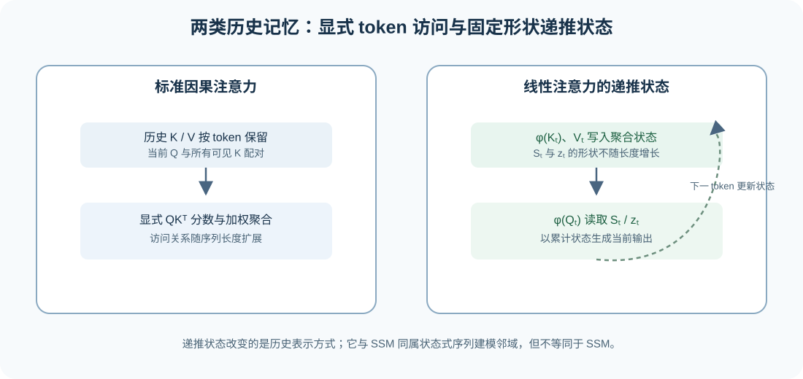
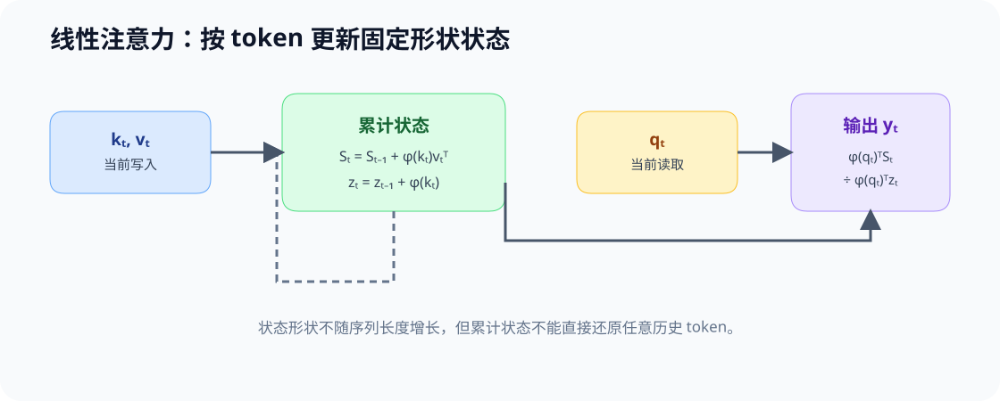

# 45. Linear Attention and Recurrent State | 线性注意力与递推状态

**难度：** Hard | **环境：** CPU-first | **标签：** `Attention`, `线性注意力`, `递推状态`

> 🚀 **云端运行环境**
>
> 本章节的实战代码可以点击以下链接在免费 GPU 算力平台上直接运行：
>
> [](https://colab.research.google.com/github/datawhalechina/llm-algo-leetcode/blob/main/02_PyTorch_Algorithms/45_Linear_Attention_and_Recurrent_State.ipynb)
> [](https://modelscope.cn/my/mynotebook) *(国内推荐：魔搭社区免费实例)*


## 本节导读

标准因果注意力会把当前查询（Query，Q）与历史键（Key，K）两两比较，因此显式保留了随序列长度增长的访问关系。线性注意力使用特征映射和累积状态，把历史信息压缩为可递推更新的统计量；它改变的不是“模型是否依赖历史”，而是历史以什么形式被保存和读取。

本节用一个简化的正特征映射，观察递推状态如何替代完整分数矩阵，并把线性注意力与 SSM 放在相邻但不同的位置比较：前者仍是一类注意力近似，后者是另一类状态更新架构。

**关键词：** `线性注意力`, `特征映射`, `递推状态`, `SSM`

## 前置阅读

**导语：** 先理解标准注意力的 Q/K/V、因果可见性和 KV 状态，再比较显式历史访问与固定大小递推状态的差异。

- [Part 02 · 04 Attention（MHA / GQA）](./04_Attention_MHA_GQA.md)
- [大模型架构 · Attention 演化](../topic_discussion/llm_architecture_evolution/04_attention_evolution.md)

### Step 1：显式访问与递推状态

稠密注意力在第 `t` 步保留当前查询与全部历史键的关系；线性注意力则把历史 K/V 汇总为状态，在新 token 到来时更新状态并生成输出。两者都依赖历史，但一个显式处理 token 对，另一个把历史压缩为固定形状的累积量。



### Step 2：线性注意力的状态更新

用正特征映射 `φ` 近似相似度后，可以把历史压缩为两个累积量：`S_t = Σ φ(k_i)v_iᵀ` 保存 K/V 的联合状态，`z_t = Σ φ(k_i)` 保存归一化项。当前输出由 `φ(q_t)` 与这两个状态计算，而不显式构造完整的 `S×S` 分数矩阵。

| 对象 | 稠密因果注意力 | 线性注意力的递推形式 |
| --- | --- | --- |
| 历史表示 | 历史 K/V 与当前查询的成对关系 | `S_t` 与 `z_t` 两个累积状态 |
| 当前输出 | 对全部历史位置归一化加权 | `φ(q_t)ᵀS_t / (φ(q_t)ᵀz_t)` |
| 序列增长 | 分数关系随 token 对增加 | 状态形状由特征维度与 V 维度决定 |
| 需要验证 | 全局依赖与因果掩码 | 状态更新、归一化稳定性与近似误差 |



### Step 3：线性注意力、KV Cache 与 SSM 的关系

线性注意力不等于“免费替代”标准注意力：特征映射改变了相似度形式，固定大小状态也不天然保留所有精确 token 对关系。它与 KV Cache 的差别在于，KV Cache 保存可按 token 读取的历史 K/V；递推状态保存的是聚合统计量。SSM 同样使用状态更新，但其选择性更新规则和参数化方式不必经过注意力的 Q/K 相似度。

| 机制 | 历史保存形式 | 是否能直接读取单个历史 token | 主要取舍 |
| --- | --- | --- | --- |
| 标准注意力 + KV Cache | 每个历史 token 的 K/V | 可以 | 状态与读取量随长度增长 |
| 线性注意力 | 特征映射的累积状态 | 不可以，读取的是聚合统计量 | 近似形式与数值稳定性需验证 |
| SSM / Mamba | 选择性递推状态 | 不以 Q/K 检索方式读取 | 不是标准注意力的简单等价替换 |

### Step 4：实现线性注意力的递推账本

本题用小矩阵和正特征映射复现线性 Attention 的状态更新。骨架已提供输入契约和输出容器；你将补全特征映射、`S_t/z_t` 递推以及归一化输出。测试覆盖状态形状、前缀因果性和非法维度，不把该教学实现写成真实模型的吞吐结论。

| TODO / 函数 | 学习者完成的机制 | 必须满足的约束 | 测试证据 |
|---|---|---|---|
| TODO 1：构造正特征映射<br>`positive_feature_map` | 将输入映射为同形正特征 | 输出与输入同形且所有元素为正 | `test_feature_map_contract` 覆盖正常输入与空序列 |
| TODO 2：更新递推状态<br>`linear_attention_scan` | 用当前 K/V 更新联合状态与归一化状态 | 每步只读取当前 token 与此前状态；状态形状固定 | `test_state_contract` 覆盖最终状态形状与有限性 |
| TODO 3：读取当前输出<br>`linear_attention_scan` | 用当前查询读取累计状态并归一化 | 分母为正；输出形状与 V 宽度一致且有限 | `test_prefix_causality` 验证未来 token 不改变此前输出 |


```python
import numpy as np

```


```python
def positive_feature_map(x: np.ndarray) -> np.ndarray:
    """返回与 x 同形的正特征映射，避免归一化项为零。"""
    if x.ndim != 2 or x.shape[0] == 0:
        raise ValueError('x 必须是非空 [seq_len, feature_dim] 二维数组')
    # ==========================================
    # TODO 1：构造正特征映射
    # features = ???  # 与 x 同形；所有元素严格大于 0
    # ==========================================
    raise NotImplementedError('TODO 1：请构造正特征映射')
    return features

def linear_attention_scan(queries: np.ndarray, keys: np.ndarray, values: np.ndarray) -> tuple[np.ndarray, np.ndarray, np.ndarray]:
    """按 token 递推 S_t、z_t，并返回 outputs、final_state、final_normalizer。"""
    if queries.shape != keys.shape or queries.ndim != 2 or values.ndim != 2 or queries.shape[0] != values.shape[0] or queries.shape[0] == 0:
        raise ValueError('queries、keys、values 必须共享非空序列长度，且 Q/K 形状一致')
    query_features, key_features = positive_feature_map(queries), positive_feature_map(keys)
    state = np.zeros((queries.shape[1], values.shape[1]), dtype=float)
    normalizer = np.zeros(queries.shape[1], dtype=float)
    outputs = []
    for query_feature, key_feature, value in zip(query_features, key_features, values):
        # ==========================================
        # TODO 2：更新递推状态
        # state = ???  # [feature_dim, value_dim]；累积到当前 token
        # normalizer = ???  # [feature_dim]；累积到当前 token
        # ==========================================
        raise NotImplementedError('TODO 2：请更新递推状态')
        # ==========================================
        # TODO 3：读取当前输出
        # denominator = ???  # 标量；由当前查询与归一化状态得到且必须为正
        # output = ???  # [value_dim]；用同一 denominator 归一化
        # ==========================================
        raise NotImplementedError('TODO 3：请读取当前输出')
        outputs.append(output)
    return np.stack(outputs), state, normalizer

```


```python
# 测试递推不变量：状态形状固定，当前输出不依赖未来 token，非法输入必须拒绝。
def _linear_fixture():
    """构造三步 Q/K/V，用于状态、因果性与输入契约测试。"""
    queries = np.array([[1.0, -1.0], [0.5, 2.0], [3.0, -0.5]])
    keys = np.array([[0.0, 1.0], [2.0, -1.0], [1.5, 1.5]])
    values = np.array([[1.0], [2.0], [4.0]])
    return queries, keys, values

def test_state_contract():
    """验证输出、状态和归一化项的形状。"""
    queries, keys, values = _linear_fixture()
    outputs, state, normalizer = linear_attention_scan(queries, keys, values)
    assert outputs.shape == values.shape and state.shape == (2, 1) and normalizer.shape == (2,)
    assert np.isfinite(outputs).all() and (normalizer > 0).all()

def test_prefix_causality():
    """修改未来 token 后，先前输出必须保持不变。"""
    queries, keys, values = _linear_fixture()
    original, _, _ = linear_attention_scan(queries, keys, values)
    changed_keys, changed_values = keys.copy(), values.copy()
    changed_keys[-1] += 100.0
    changed_values[-1] += 100.0
    changed, _, _ = linear_attention_scan(queries, changed_keys, changed_values)
    assert np.allclose(original[:-1], changed[:-1])

def test_input_contract():
    """验证 Q/K 维度不一致和空序列会被拒绝。"""
    invalid_inputs = [
        (np.ones((2, 2)), np.ones((2, 3)), np.ones((2, 1))),
        (np.empty((0, 2)), np.empty((0, 2)), np.empty((0, 1))),
    ]
    for queries, keys, values in invalid_inputs:
        try:
            linear_attention_scan(queries, keys, values)
        except ValueError:
            continue
        raise AssertionError('非法输入必须拒绝')

def test_feature_map_contract():
    """验证特征映射为正，并拒绝空序列。"""
    assert (positive_feature_map(np.array([[-2.0, 0.0]])) > 0).all()
    try:
        positive_feature_map(np.empty((0, 2)))
    except ValueError:
        return
    raise AssertionError('空序列必须拒绝')

test_state_contract()
test_prefix_causality()
test_input_contract()
test_feature_map_contract()
print('✅ 线性 Attention 递推状态测试通过。')

```

---

🛑 **STOP HERE**：先完成递推状态更新并运行测试，再查看参考答案。

## 参考代码与解析

### 代码


```python
def positive_feature_map(x: np.ndarray) -> np.ndarray:
    """返回与 x 同形的正特征映射，避免归一化项为零。"""
    if x.ndim != 2 or x.shape[0] == 0:
        raise ValueError('x 必须是非空 [seq_len, feature_dim] 二维数组')
    # TODO 1：构造正特征映射
    features = np.maximum(x, 0.0) + 1.0
    return features

def linear_attention_scan(queries: np.ndarray, keys: np.ndarray, values: np.ndarray) -> tuple[np.ndarray, np.ndarray, np.ndarray]:
    """按 token 递推 S_t、z_t，并返回 outputs、final_state、final_normalizer。"""
    if queries.shape != keys.shape or queries.ndim != 2 or values.ndim != 2 or queries.shape[0] != values.shape[0] or queries.shape[0] == 0:
        raise ValueError('queries、keys、values 必须共享非空序列长度，且 Q/K 形状一致')
    query_features, key_features = positive_feature_map(queries), positive_feature_map(keys)
    state = np.zeros((queries.shape[1], values.shape[1]), dtype=float)
    normalizer = np.zeros(queries.shape[1], dtype=float)
    outputs = []
    for query_feature, key_feature, value in zip(query_features, key_features, values):
        # TODO 2：更新递推状态
        state = state + np.outer(key_feature, value)
        normalizer = normalizer + key_feature
        # TODO 3：读取当前输出
        denominator = float(query_feature @ normalizer)
        output = (query_feature @ state) / denominator
        outputs.append(output)
    return np.stack(outputs), state, normalizer

```

### 解析

#### TODO 1：构造正特征映射

- `relu(x)+1` 只是教学用的正特征映射；它保证归一化项为正，但不代表某个真实线性注意力的完整核函数。

#### TODO 2：更新递推状态

- `state` 累积 `φ(k_t)v_tᵀ`，`normalizer` 累积 `φ(k_t)`；两者形状不随序列长度增长。

#### TODO 3：读取当前输出

- 当前查询只能读取本步更新后的历史状态，所以修改未来 token 不应改变此前输出。该不变量证明递推的因果性，不证明它与 Softmax 注意力数值等价。

### Step 5：GPU 机制实验——显式历史与固定递推状态

CPU 实验验证线性注意力的递推更新不变量；本实验固定单层、注意力头数、dtype 和长度阶梯，比较标准注意力的显式 K/V 历史与固定大小递推状态。首次运行先按[架构实验 Quickstart](../topic_discussion/llm_architecture_evolution/quickstart.md)创建并预检环境。

| CPU 机制价值 | GPU 实验价值 | 后续入口 |
| --- | --- | --- |
| 验证递推状态形状、因果性与更新顺序 | 比较状态字节、单步时间与峰值显存随长度的变化 | ARCH-HYBRID 比较多层混合计划；77 验证真实 checkpoint 的长序列质量 |

#### 5.1 环境与固定工作负载

本节使用 `ARCH-CUDA-MECHANISM` Profile。环境创建与预检见[架构实验 Quickstart](../topic_discussion/llm_architecture_evolution/quickstart.md)，候选、结果路径和证据状态见[架构实验资产表](../topic_discussion/llm_architecture_evolution/experiment_assets.md)。两条路径共用查询、状态宽度、数据类型、随机种子和测量方法，只改变读取完整 K/V 历史还是更新固定大小递推状态。

| 配置层 | 本次固定值 | 修改规则 |
| --- | --- | --- |
| 实验身份 | `arch-linear-recurrence-v2`；默认结果标签 `default` | v2 分别分配两条路径的活动状态；改变状态定义、长度矩阵或测量协议后递增 workload 版本 |
| 运行环境 | `ARCH-CUDA-MECHANISM`；单张 CUDA GPU | Profile 预检未通过时保持 `dry_run`，不生成机制证据 |
| 配对变量 | 完整 Attention 历史 → 固定递推状态 | 两条路径必须共用 batch、head、dtype 与随机种子 |
| 长度阶梯 | `[512, 2048, 8192]` | 观察显式历史字节随长度增长，而固定状态字节保持稳定 |
| 状态宽度 | heads=8、head_dim=64、BF16 | 改变宽度或 dtype 后单独登记结果 |
| 测量方法 | warmup=10、repeats=100；CUDA Event 批量计时 | 同时记录状态字节、输出有限性、平均单步时间和峰值显存 |
| 结果资产 | `benchmarks/results/45_linear_recurrent_state_<RUN_LABEL>.json` | 正式复测使用唯一标签，保留旧结果 |


```python
# 默认仅检查配置；完成 ARCH-CUDA-MECHANISM 预检后改为 real_gpu。
RUN_MODE = 'dry_run'  # 默认值 dry_run：只登记计划；改为 real_gpu 执行真实单卡矩阵。
RUN_LABEL = 'default'  # 默认值 default；正式复测改为唯一标签，避免覆盖旧结果。
PROFILE_ID = 'ARCH-CUDA-MECHANISM'  # 固定环境身份；必须先通过同名 Profile 预检。
SEMANTIC_ID = 'ARCH-RECURRENT-STATE-MECHANISM'  # 固定机制身份，不随复测改变。
WORKLOAD_ID = 'arch-linear-recurrence-v2'  # v2 分离两条路径的活动状态。
SEQUENCE_LENGTHS = [512, 2048, 8192]  # 默认单位为 token；显式历史随长度增长。
NUM_HEADS = 8  # 默认值 8；决定显式历史和递推状态的宽度。
HEAD_DIM = 64  # 默认值 64；单位为每个 Head 的特征维度。
DTYPE = 'bfloat16'  # 默认值 bfloat16；改变后结果不可与旧精度直接合并。
WARMUP = 10  # 默认值 10 次；只用于预热，不计入平均时间。
REPEATS = 100  # 默认值 100 次；增大可降低计时波动，但会延长实验。
RESULT_RELATIVE_PATH = f'benchmarks/results/45_linear_recurrent_state_{RUN_LABEL}.json'  # 仓库相对结果路径。
print({'run_mode': RUN_MODE, 'profile': PROFILE_ID, 'workload': WORKLOAD_ID, 'lengths': SEQUENCE_LENGTHS, 'result': RESULT_RELATIVE_PATH})

```

#### 5.2 执行并保存 JSON


```python
import subprocess, sys
from tools.project_runtime import resolve_project_root

REPO_ROOT = resolve_project_root()
RUNNER_PATH = REPO_ROOT / 'tools' / 'run_architecture_mechanism_benchmark.py'
RESULT_PATH = REPO_ROOT / RESULT_RELATIVE_PATH
if RUN_MODE == 'real_gpu':
    command = [
        sys.executable, str(RUNNER_PATH),
        '--mode', 'linear_recurrence', '--output', str(RESULT_PATH),
        '--semantic-id', SEMANTIC_ID, '--workload-id', WORKLOAD_ID,
        '--run-label', RUN_LABEL, '--profile-id', PROFILE_ID,
        '--sequence-lengths', ','.join(map(str, SEQUENCE_LENGTHS)),
        '--query-heads', str(NUM_HEADS), '--head-dim', str(HEAD_DIM),
        '--dtype', DTYPE, '--warmup', str(WARMUP), '--repeats', str(REPEATS),
    ]
    subprocess.run(command, check=True)
else:
    print('保持 dry_run；按 Quickstart 完成 Profile 预检后再设置 RUN_MODE=real_gpu。')

```

#### 5.3 读取结果

本单元只读取结果 JSON，并展示两种状态接口在全部长度档位上的状态字节、单步时间、峰值显存和有限值检查。


```python
import json
from tools.project_runtime import resolve_project_root

result_path = resolve_project_root() / RESULT_RELATIVE_PATH
if result_path.exists():
    result = json.loads(result_path.read_text(encoding='utf-8'))
    required = {'schema_version', 'identity', 'workload', 'hardware', 'baseline', 'candidates', 'metrics', 'evidence_level', 'failure', 'decision'}
    missing = required - set(result)
    if missing:
        raise ValueError(f'结果 JSON 缺少字段：{sorted(missing)}')
    print({'identity': result['identity'], 'baseline': result['baseline'], 'candidates': result['candidates'], 'evidence_level': result['evidence_level'], 'decision': result['decision']})
    for row in result['metrics'].get('rows', []):
        print(row)
else:
    print(f'尚无线性递推结果：{result_path}；如需读取历史结果，请先在 5.1 设置对应 RUN_LABEL。')

```

#### 5.4 结果解释与下一步判断

先检查 `failure`、工作负载身份与输出有限性，再比较状态字节、单步时间和峰值显存。`rtx5070ti_recurrent_v2` 的结果确认显式历史随长度增长，而固定递推状态保持 0.0625 MiB。

完整长度矩阵由 5.3 展示。短序列仍受递推工作区影响，长序列才显出固定状态优势；该证据只验证单层状态接口，不代表真实 Mamba、线性注意力 Kernel 或任务质量。

| 观察项 | 读取字段 | 代表性结果 | 解释与动作 |
| --- | --- | --- | --- |
| 状态增长 | `state_bytes` | L=512 时为 1 / 0.0625 MiB；L=8192 时为 16 / 0.0625 MiB | 接受固定递推状态不随历史长度增长的机制结论 |
| 时间与峰值 | `mean_step_ms`、`peak_memory_mb` | L=512 时工作区使递推峰值更高；L=8192 时递推时间约为显式历史的 53.6% | 只在长序列端点保留局部执行优势，继续验证混合层计划 |
| 决策 | `decision`、`evidence_level` | `accept_fixed_state_growth_mechanism` | 接受状态增长机制；真实模型质量与专用 Kernel 另行复测 |

## 相关阅读

- [Transformers are RNNs: Fast Autoregressive Transformers with Linear Attention](https://arxiv.org/abs/2006.16236)
- [Mamba: Linear-Time Sequence Modeling with Selective State Spaces](https://arxiv.org/abs/2312.00752)
- [大模型架构 · Attention 演化](../topic_discussion/llm_architecture_evolution/04_attention_evolution.md)
- [ARCH-HYBRID-MEMORY：Attention、SSM 与混合记忆](./ARCH-HYBRID-MEMORY_Attention_SSM_Hybrid.md)
- [77 长序列记忆架构基准](./77_Long_Sequence_Memory_Architecture_Benchmark.md)
