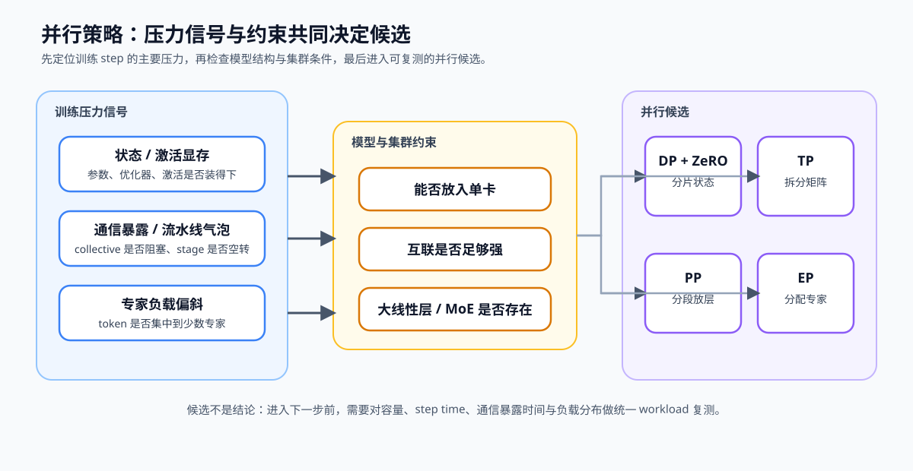
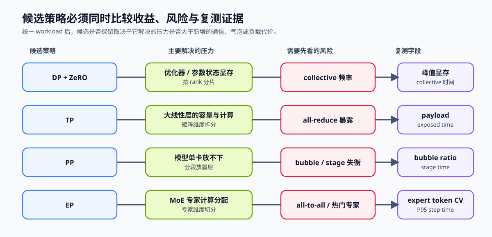

# 49. Parallelism Strategy Selection | 并行策略选型
**难度：** Medium | **环境：** CPU-first | **标签：** `并行通信`, `并行策略`, `策略选择` | **目标人群：** 并行通信学习者

> 🚀 **云端运行环境**
>
> 本章节的实战代码可以点击以下链接在免费 GPU 算力平台上直接运行：
>
> [](https://colab.research.google.com/github/datawhalechina/llm-algo-leetcode/blob/main/02_PyTorch_Algorithms/49_Parallelism_Strategy_Selection.ipynb)
> [](https://modelscope.cn/my/mynotebook) *(国内推荐：魔搭社区免费实例)*


---

## 本节导读

模型训练与推理都可能遇到单卡容量、层内计算、长上下文、流水线气泡和负载不均问题，但这些压力对应的切分维度不同。本节把观测信号转成 TP、PP、CP、EP、训练状态分片或 Serving 副本候选，并为组合方案保留复测证据。

**关键词：** `ZeRO`, `TP`, `PP`, `CP`, `EP`, `replica routing`

---

## 前置阅读

**导语：** 先回顾四类并行各自切分什么，再把显存、通信和负载信号连接到合适的候选方案。
- [27. ZeRO Optimizer Sim | ZeRO 优化器模拟](./27_ZeRO_Optimizer_Sim.md)
- [28. Pipeline Parallelism MicroBatch | Pipeline 并行与 MicroBatch](./28_Pipeline_Parallelism_MicroBatch.md)
- [29. Tensor Parallelism Sim | Tensor Parallelism 模拟](./29_Tensor_Parallelism_Sim.md)
- [PAR-CONTEXT. Context and Sequence Parallelism | 上下文与序列并行](./PAR-CONTEXT_Context_and_Sequence_Parallelism.md)
- [46. MoE Expert Parallel | MoE 专家并行](./46_MoE_Expert_Parallel.md)
- [PAR-REPLICA. Serving Replica Routing | Serving 副本与请求路由](./PAR-REPLICA_Serving_Replica_Routing.md)

---

### Step 1：从 workload 信号识别切分对象

先判断压力来自训练状态、单层张量、模型层、序列上下文、专家路由，还是 Serving 请求队列。切分对象判断错误，会用新的 collective 或路由开销掩盖原有问题。

| 观察到的信号 | 首先要追问的问题 | 常见候选方向 |
| --- | --- | --- |
| optimizer state 或参数显存高 | 状态能否按 rank 分片？ | DP + ZeRO |
| 单层矩阵过大且互联强 | 张量维度能否拆到多卡？ | TP |
| 模型无法放入单卡、stage 时长不同 | 层能否分段且气泡是否可接受？ | PP |
| MoE token 分布不均 | 专家负载和 dispatch 能否均衡？ | EP |
| 长上下文导致单 rank 序列状态过大 | 序列维是否需要跨 rank 切分？ | CP / Sequence Parallel |
| Serving 队列或副本负载不均 | 请求能否按队列、缓存或会话路由？ | 模型副本 + 请求路由 |



### Step 2：用约束生成并行候选

并行方式不是互斥菜单。ZeRO 处理训练状态，TP 切层内张量，PP 切模型层，CP 切长序列，EP 切专家；Serving 副本不切模型，而是分发独立请求。候选排序还要满足模型结构、workload 与互联条件。

| 候选 | 适用约束 | 主要收益 | 首先复测的风险 |
| --- | --- | --- | --- |
| DP + ZeRO | 状态显存压力大 | 分片参数、梯度或优化器状态 | collective 频率与单卡峰值显存 |
| TP | 大线性层且互联强 | 拆分矩阵计算与权重 | all-reduce 暴露时间 |
| PP | 模型不能放入单卡 | 分段放置模型层 | bubble 与 stage 不均衡 |
| EP | 存在 MoE 路由 | 分配专家计算 | all-to-all 与专家负载偏斜 |
| CP / Sequence Parallel | 长上下文状态成为单 rank 瓶颈 | 切分序列状态与 Attention 工作 | all-gather、reduce-scatter 或 ring 通信 |
| Serving 副本 | 模型可由单实例承载且请求可独立执行 | 扩展请求吞吐并隔离队列 | cache locality、sticky session 与尾延迟 |



### Step 3：比较风险并设计复测

候选排序只是开始。对每个候选固定同一模型、batch、序列长度和精度后，再读取容量、最大 rank 时间、通信量和负载分布。47 提供 `collective / payload_bytes_per_rank / median_max_rank_ms / p95_max_rank_ms`，48 在同一口径上增加配对调度收益；只有真实 Trace 提供 `exposed_comm_ms` 和 step time 时，才计算 49 使用的 `comm_exposed_ratio`。

| 方案已被排到前列时 | 需要保留的证据 | 出现什么情况要回调策略 |
| --- | --- | --- |
| DP + ZeRO | 单卡峰值显存、collective 时间 | 显存下降但同步时间显著增长 |
| TP | all-reduce payload、暴露时间、矩阵吞吐 | 互联不足导致通信主导 |
| PP | bubble ratio、各 stage 时长、micro-batch 数 | 一个 stage 长期拖慢全流水线 |
| EP | all-to-all 时间、专家 token 分布 | 热门专家或 dispatch 造成长尾 |
| CP / Sequence Parallel | 序列通信量、暴露通信时间、单 rank 状态 | 通信增长抵消长上下文容量收益 |
| Serving 副本 | 各副本队列、缓存命中、P95 / P99 | 吞吐增加但请求或缓存分布持续偏斜 |

### Step 4：CPU 机制实现——从约束到候选方案

题目区用归一化信号模拟选型：先识别最强压力，再结合模型容量、互联、结构、上下文长度和 Serving workload 生成候选，最后给出主策略、兼容候选和复测证据。`signals` 的值在 0–1 之间；`constraints` 表示模型与集群条件。

| 任务与目的 | 已知条件 | 完成标准 | 测试验证 |
| --- | --- | --- | --- |
| TODO 1：识别主要压力并保留次要风险 | `classify_parallel_bottleneck` 已提供信号到瓶颈的映射 | 只保留一个主压力；达到阈值的其余信号进入次要风险 | 最大信号、阈值边界与非法输入 |
| TODO 2：对满足硬约束的候选计算相关度并排序 | `rank_parallel_candidates` 已提供候选的适用条件、目标压力和风险 | 不可行候选不得进入列表；主压力匹配优先于次要风险匹配 | 状态、MoE、长上下文与 Serving 条件 |
| TODO 3：组合兼容方案并形成复测决策 | `recommend_parallel_followup` 已提供兼容关系和每类候选的测量字段 | 输出首选方案、兼容候选和 `accept / tune / collect_more_evidence` | 无候选、无风险接受、风险调优与组合兼容 |


```python
from typing import Any, Dict, List

```


```python
def classify_parallel_bottleneck(signals: Dict[str, float]) -> Dict[str, Any]:
    """识别最强并行压力，并保留达到阈值的次要风险。"""
    if not signals or any(value < 0.0 or value > 1.0 for value in signals.values()):
        raise ValueError('signals 必须非空，且所有值都位于 0–1')
    signal_to_bottleneck = {
        'state_memory_pressure': 'state_memory',
        'activation_memory_pressure': 'activation_memory',
        'comm_exposed_ratio': 'communication',
        'pipeline_bubble_ratio': 'pipeline_bubble',
        'rank_imbalance_ratio': 'load_imbalance',
        'long_context_pressure': 'long_context',
        'serving_queue_pressure': 'serving_queue',
    }
    # TODO 1（压力归因）：找出最强信号，并保留达到阈值的其他风险。
    # primary_signal, severity = ???  # 原始信号名及其强度；强度最大。
    # primary = ???  # 由 signal_to_bottleneck 映射得到的机制压力。
    # secondary_risks = ???  # 排除主信号，且原始强度不低于 0.50。
    raise NotImplementedError
    return {'primary': primary, 'severity': severity, 'secondary_risks': secondary_risks}


def rank_parallel_candidates(summary: Dict[str, Any], constraints: Dict[str, bool]) -> List[Dict[str, Any]]:
    """筛掉不满足硬约束的方案，再按压力相关度排序。"""
    primary = summary['primary']
    secondary = set(summary['secondary_risks'])
    profiles = [
        {'name': 'dp_zero', 'eligible': primary == 'state_memory', 'pressures': {'state_memory'}, 'risk_pressures': {'communication'}, 'risk': 'inspect_collective_frequency'},
        {'name': 'tp', 'eligible': constraints.get('large_linear_layer', False) and constraints.get('strong_interconnect', False), 'pressures': {'state_memory', 'communication'}, 'risk_pressures': {'communication'}, 'risk': 'inspect_all_reduce_exposure'},
        {'name': 'pp', 'eligible': primary in {'activation_memory', 'pipeline_bubble'} or not constraints.get('model_fits_single_gpu', True), 'pressures': {'activation_memory', 'pipeline_bubble'}, 'risk_pressures': {'pipeline_bubble'}, 'risk': 'inspect_bubble_and_stage_balance'},
        {'name': 'ep', 'eligible': constraints.get('has_moe', False), 'pressures': {'load_imbalance', 'communication'}, 'risk_pressures': {'load_imbalance', 'communication'}, 'risk': 'inspect_expert_load_and_all_to_all'},
        {'name': 'cp', 'eligible': constraints.get('long_context', False), 'pressures': {'long_context', 'communication'}, 'risk_pressures': {'communication'}, 'risk': 'inspect_sequence_collective_exposure'},
        {'name': 'replica', 'eligible': constraints.get('serving_workload', False) and constraints.get('model_fits_single_gpu', True), 'pressures': {'serving_queue', 'load_imbalance'}, 'risk_pressures': {'load_imbalance'}, 'risk': 'inspect_queue_balance_and_cache_locality'},
    ]
    candidates = []
    for profile in profiles:
        if not profile['eligible']:
            continue
        # TODO 2（候选排序）：主压力匹配权重大于次要风险匹配。
        # primary_match = ???  # 主压力是否属于候选可处理的压力集合。
        # secondary_matches = ???  # 次要风险与候选压力集合的交集数量。
        # score = ???  # 主压力匹配计 3 分，次要风险每项计 1 分。
        raise NotImplementedError
        if score > 0:
            known_pressures = {primary} | secondary
            risk = profile['risk'] if known_pressures & profile['risk_pressures'] else None
            candidates.append({'name': profile['name'], 'score': score, 'risk': risk})
    return sorted(candidates, key=lambda item: (-item['score'], item['name']))


def recommend_parallel_followup(
    summary: Dict[str, Any],
    ranked: List[Dict[str, Any]],
) -> Dict[str, Any]:
    """把首选候选、兼容组合和风险转成下一轮复测计划。"""
    if not ranked or ranked[0]['score'] <= 0:
        return {
            'decision': 'collect_more_evidence',
            'plan': None,
            'reason': '没有足够强的约束支持某个并行候选',
            'compatible_plans': [],
            'required_measurements': ['peak_memory_mb', 'step_time_ms'],
        }

    candidate = ranked[0]
    compatibility = {
        'dp_zero': {'tp', 'pp'}, 'tp': {'dp_zero', 'pp', 'cp', 'ep'},
        'pp': {'dp_zero', 'tp'}, 'ep': {'dp_zero', 'tp'},
        'cp': {'dp_zero', 'tp'}, 'replica': {'tp', 'pp', 'cp', 'ep'},
    }
    measurements = {
        'dp_zero': ['peak_memory_mb_per_rank', 'payload_bytes_per_rank', 'median_max_rank_ms'],
        'tp': ['payload_bytes_per_rank', 'median_max_rank_ms', 'max_abs_error'],
        'pp': ['bubble_ratio', 'stage_time_ms', 'peak_memory_mb'],
        'ep': ['cross_rank_dispatch_bytes', 'load_skew_ratio', 'p95_max_rank_ms'],
        'cp': ['kv_exchange_bytes_per_rank', 'median_max_rank_ms', 'peak_memory_mb_per_rank'],
        'replica': ['queue_wait_p95_ms', 'cache_hit_rate', 'throughput_requests_per_s'],
    }
    # TODO 3（复测决策）：只组合兼容候选，并让已知风险触发 tune。
    # compatible_plans = ???  # ranked[1:] 中与主策略兼容的候选名称。
    # needs_tuning = ???  # 候选风险或次要风险存在时为 True。
    # decision = ???  # needs_tuning 为真时 tune，否则 accept。
    raise NotImplementedError
    return {
        'decision': decision,
        'plan': candidate['name'],
        'reason': candidate['risk'] or '主压力与候选约束一致',
        'compatible_plans': compatible_plans,
        'required_measurements': measurements[candidate['name']],
    }

```


```python
def test_parallel_bottleneck_classification():
    """最大信号成为主压力，达到阈值的其他信号保留为次要风险。"""
    summary = classify_parallel_bottleneck({
        'state_memory_pressure': 0.85, 'activation_memory_pressure': 0.20,
        'comm_exposed_ratio': 0.40, 'pipeline_bubble_ratio': 0.10,
        'rank_imbalance_ratio': 0.55,
    })
    assert summary == {'primary': 'state_memory', 'severity': 0.85, 'secondary_risks': ['load_imbalance']}

def test_parallel_bottleneck_validation():
    """空信号和越界强度不能形成并行候选。"""
    for signals in ({}, {'state_memory_pressure': 1.1}):
        try:
            classify_parallel_bottleneck(signals)
        except ValueError:
            pass
        else:
            raise AssertionError('非法 signals 应抛出 ValueError')

def test_training_state_candidate_gate():
    """状态压力应保留 ZeRO，并排除不满足硬约束的候选。"""
    ranked = rank_parallel_candidates(
        {'primary': 'state_memory', 'severity': 0.85, 'secondary_risks': []},
        {'model_fits_single_gpu': True, 'strong_interconnect': False, 'large_linear_layer': False, 'has_moe': False},
    )
    assert ranked == [{'name': 'dp_zero', 'score': 3, 'risk': None}]

def test_specialized_candidate_ranking():
    """MoE、长上下文和 Serving 条件应激活各自候选。"""
    cases = [
        ({'primary': 'load_imbalance', 'severity': 0.8, 'secondary_risks': ['communication']}, {'model_fits_single_gpu': True, 'strong_interconnect': True, 'has_moe': True}, 'ep'),
        ({'primary': 'long_context', 'severity': 0.9, 'secondary_risks': ['communication']}, {'model_fits_single_gpu': False, 'strong_interconnect': True, 'long_context': True}, 'cp'),
        ({'primary': 'serving_queue', 'severity': 0.8, 'secondary_risks': []}, {'model_fits_single_gpu': True, 'serving_workload': True}, 'replica'),
    ]
    for summary, constraints, expected in cases:
        assert rank_parallel_candidates(summary, constraints)[0]['name'] == expected

def test_parallel_followup_accept_and_tune():
    """无风险候选可以接受，已有风险必须进入调优。"""
    accepted = recommend_parallel_followup(
        {'primary': 'state_memory', 'severity': 0.85, 'secondary_risks': []},
        [{'name': 'dp_zero', 'score': 3, 'risk': None}],
    )
    assert accepted['decision'] == 'accept'
    assert 'peak_memory_mb_per_rank' in accepted['required_measurements']
    tuned = recommend_parallel_followup(
        {'primary': 'load_imbalance', 'severity': 0.80, 'secondary_risks': ['communication']},
        [{'name': 'ep', 'score': 4, 'risk': 'inspect_expert_load_and_all_to_all'}],
    )
    assert tuned['decision'] == 'tune'
    assert 'load_skew_ratio' in tuned['required_measurements']

def test_parallel_followup_compatibility_and_missing_evidence():
    """组合只保留兼容候选；空候选要求继续收集证据。"""
    combined = recommend_parallel_followup(
        {'primary': 'state_memory', 'severity': 0.90, 'secondary_risks': []},
        [{'name': 'dp_zero', 'score': 4, 'risk': None}, {'name': 'tp', 'score': 3, 'risk': None}, {'name': 'replica', 'score': 2, 'risk': None}],
    )
    assert combined['compatible_plans'] == ['tp']
    missing = recommend_parallel_followup({'primary': 'communication', 'severity': 0.10, 'secondary_risks': []}, [])
    assert missing['decision'] == 'collect_more_evidence'

test_parallel_bottleneck_classification()
test_parallel_bottleneck_validation()
test_training_state_candidate_gate()
test_specialized_candidate_ranking()
test_parallel_followup_accept_and_tune()
test_parallel_followup_compatibility_and_missing_evidence()
print('parallel strategy selection passed')

```

---

🛑 **STOP HERE** 🛑
<br><br><br><br><br><br><br><br><br><br>
> 请先尝试自己完成代码并跑通测试。<br>
> 如果你正在 Colab 中运行，并且遇到困难没有思路，可以向下滚动查看参考答案。
<br><br><br><br><br><br><br><br><br><br>

---

## 参考代码与解析

### 代码


```python
def classify_parallel_bottleneck(signals: Dict[str, float]) -> Dict[str, Any]:
    """识别最强并行压力，并保留达到阈值的次要风险。"""
    if not signals or any(value < 0.0 or value > 1.0 for value in signals.values()):
        raise ValueError('signals 必须非空，且所有值都位于 0–1')
    signal_to_bottleneck = {
        'state_memory_pressure': 'state_memory',
        'activation_memory_pressure': 'activation_memory',
        'comm_exposed_ratio': 'communication',
        'pipeline_bubble_ratio': 'pipeline_bubble',
        'rank_imbalance_ratio': 'load_imbalance',
        'long_context_pressure': 'long_context',
        'serving_queue_pressure': 'serving_queue',
    }
    primary_signal, severity = max(signals.items(), key=lambda item: item[1])
    primary = signal_to_bottleneck[primary_signal]
    secondary_risks = [
        signal_to_bottleneck[name]
        for name, value in signals.items()
        if name != primary_signal and value >= 0.50
    ]
    return {'primary': primary, 'severity': severity, 'secondary_risks': secondary_risks}


def rank_parallel_candidates(summary: Dict[str, Any], constraints: Dict[str, bool]) -> List[Dict[str, Any]]:
    """筛掉不满足硬约束的方案，再按压力相关度排序。"""
    primary = summary['primary']
    secondary = set(summary['secondary_risks'])
    profiles = [
        {'name': 'dp_zero', 'eligible': primary == 'state_memory', 'pressures': {'state_memory'}, 'risk_pressures': {'communication'}, 'risk': 'inspect_collective_frequency'},
        {'name': 'tp', 'eligible': constraints.get('large_linear_layer', False) and constraints.get('strong_interconnect', False), 'pressures': {'state_memory', 'communication'}, 'risk_pressures': {'communication'}, 'risk': 'inspect_all_reduce_exposure'},
        {'name': 'pp', 'eligible': primary in {'activation_memory', 'pipeline_bubble'} or not constraints.get('model_fits_single_gpu', True), 'pressures': {'activation_memory', 'pipeline_bubble'}, 'risk_pressures': {'pipeline_bubble'}, 'risk': 'inspect_bubble_and_stage_balance'},
        {'name': 'ep', 'eligible': constraints.get('has_moe', False), 'pressures': {'load_imbalance', 'communication'}, 'risk_pressures': {'load_imbalance', 'communication'}, 'risk': 'inspect_expert_load_and_all_to_all'},
        {'name': 'cp', 'eligible': constraints.get('long_context', False), 'pressures': {'long_context', 'communication'}, 'risk_pressures': {'communication'}, 'risk': 'inspect_sequence_collective_exposure'},
        {'name': 'replica', 'eligible': constraints.get('serving_workload', False) and constraints.get('model_fits_single_gpu', True), 'pressures': {'serving_queue', 'load_imbalance'}, 'risk_pressures': {'load_imbalance'}, 'risk': 'inspect_queue_balance_and_cache_locality'},
    ]
    candidates = []
    for profile in profiles:
        if not profile['eligible']:
            continue
        primary_match = primary in profile['pressures']
        secondary_matches = len(secondary & profile['pressures'])
        score = 3 * int(primary_match) + secondary_matches
        if score > 0:
            known_pressures = {primary} | secondary
            risk = profile['risk'] if known_pressures & profile['risk_pressures'] else None
            candidates.append({'name': profile['name'], 'score': score, 'risk': risk})
    return sorted(candidates, key=lambda item: (-item['score'], item['name']))


def recommend_parallel_followup(
    summary: Dict[str, Any],
    ranked: List[Dict[str, Any]],
) -> Dict[str, Any]:
    """把首选候选、兼容组合和风险转成下一轮复测计划。"""
    if not ranked or ranked[0]['score'] <= 0:
        return {
            'decision': 'collect_more_evidence',
            'plan': None,
            'reason': '没有足够强的约束支持某个并行候选',
            'compatible_plans': [],
            'required_measurements': ['peak_memory_mb', 'step_time_ms'],
        }

    candidate = ranked[0]
    compatibility = {
        'dp_zero': {'tp', 'pp'},
        'tp': {'dp_zero', 'pp', 'cp', 'ep'},
        'pp': {'dp_zero', 'tp'},
        'ep': {'dp_zero', 'tp'},
        'cp': {'dp_zero', 'tp'},
        'replica': {'tp', 'pp', 'cp', 'ep'},
    }
    compatible_plans = [
        item['name'] for item in ranked[1:]
        if item['name'] in compatibility[candidate['name']]
    ]
    measurements = {
        'dp_zero': ['peak_memory_mb_per_rank', 'payload_bytes_per_rank', 'median_max_rank_ms'],
        'tp': ['payload_bytes_per_rank', 'median_max_rank_ms', 'max_abs_error'],
        'pp': ['bubble_ratio', 'stage_time_ms', 'peak_memory_mb'],
        'ep': ['cross_rank_dispatch_bytes', 'load_skew_ratio', 'p95_max_rank_ms'],
        'cp': ['kv_exchange_bytes_per_rank', 'median_max_rank_ms', 'peak_memory_mb_per_rank'],
        'replica': ['queue_wait_p95_ms', 'cache_hit_rate', 'throughput_requests_per_s'],
    }
    needs_tuning = candidate['risk'] is not None or bool(summary['secondary_risks'])
    decision = 'tune' if needs_tuning else 'accept'
    return {
        'decision': decision,
        'plan': candidate['name'],
        'reason': candidate['risk'] or '主压力与候选约束一致',
        'compatible_plans': compatible_plans,
        'required_measurements': measurements[candidate['name']],
    }

```

### 解析

本题依次完成压力归因、候选排序和复测决策。答案保留题目区的规则表与控制流，只补全对应的机制判断。

**TODO 1：识别主要压力并保留次要风险**

- 最大信号决定唯一主压力，其他达到阈值的信号保留为次要风险；输入校验阻止空信号和越界强度进入选型。
- 归因测试同时验证主压力、阈值筛选和非法输入。

**TODO 2：按硬约束和压力相关度排序候选**

- 候选先通过模型结构、互联和 workload 条件，再比较它与主压力及次要风险的匹配程度。
- 专项测试分别覆盖训练状态、MoE、长上下文和 Serving，确认不可行候选不会进入列表。

**TODO 3：形成兼容组合与复测决策**

- `compatible_plans` 只保留能与首选方案叠加的候选；已知风险或次要风险触发 `tune`。
- 决策测试覆盖接受、调优、组合兼容和证据不足四条路径。

## 相关阅读

完成训练状态、张量、层、序列、专家与请求副本的切分对象比较后，可以继续阅读并行框架实现和分布式基准，验证候选组合是否可靠。

- [Megatron-LM 原论文](https://arxiv.org/abs/2104.04473)
- [DeepSpeed 官方仓库](https://github.com/microsoft/DeepSpeed)
- [79. Distributed Parallel Benchmark | 分布式并行基准](./79_Distributed_Parallel_Benchmark.md)
- [80. MoE Expert Parallel Benchmark | MoE 专家并行基准](./80_MoE_Expert_Parallel_Benchmark.md)
