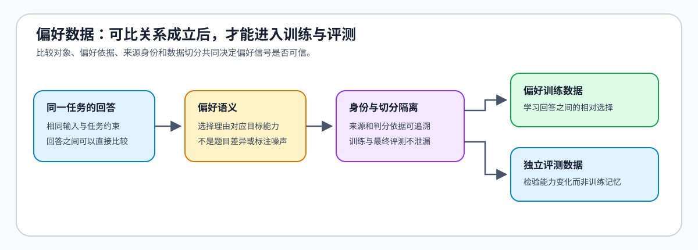
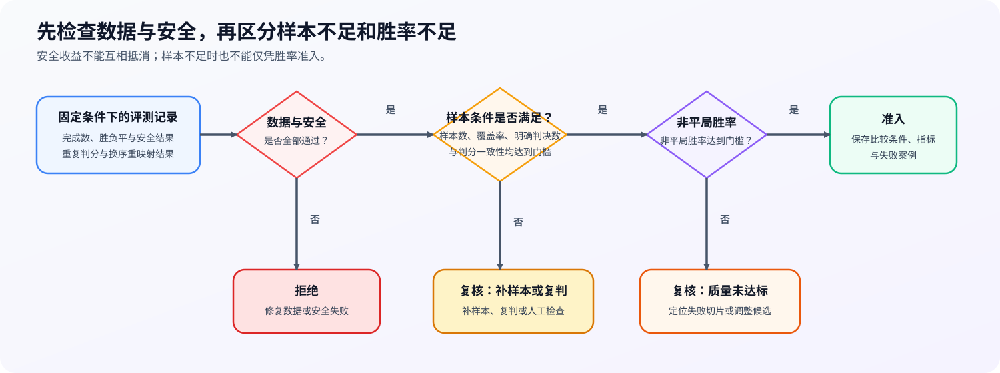

# 50. Preference Data and Evaluation | 偏好数据与对齐评测

**难度：** Medium | **环境：** CPU-first | **标签：** `后训练对齐`, `偏好数据`, `评测协议` | **目标人群：** 希望把 DPO / GRPO 结果解释清楚的学习者

> 🚀 **云端运行环境**
>
> 本章节的实战代码可以点击以下链接在免费 GPU 算力平台上直接运行：
>
> [](https://colab.research.google.com/github/datawhalechina/llm-algo-leetcode/blob/main/02_PyTorch_Algorithms/50_Preference_Data_and_Evaluation.ipynb)
> [](https://modelscope.cn/my/mynotebook) *(国内推荐：魔搭社区免费实例)*


---

## 本节导读

DPO 或 GRPO 的损失下降，不自动等于模型更有帮助、更安全或更可靠。训练前的偏好对要能表达同一问题上的明确选择，训练后的候选还要与固定基线在隔离评测集上比较。

本节依次检查样本契约、成对评测和模型评审器（Judge）一致性，并把结果归为 `qualified / review / reject` 三种证据状态，供后续算法与项目决策使用。

**关键词：** `chosen/rejected`, `trajectory record`, `evaluation split`, `win-rate`, `judge consistency`

## 前置阅读

**导语：** 先判断当前问题是否需要偏好优化，再建立训练和评测共用的数据身份。

- [Part 02 · 33 微调准入与最小干预](./33_Fine_Tuning_Readiness.md)

### Step 1：偏好样本先满足什么契约

偏好学习的最小单位不是两段孤立文本，而是同一任务与约束下的一次可比选择。比较对象、偏好依据、来源身份和数据切分必须同时成立；工具任务还需要动作、观察与终态互相对应。任一关系失效，偏好信号就可能混入题目差异、标注噪声或评测泄漏。

| 契约层次 | 需要成立的关系 | 失效后的影响 |
|:---|:---|:---|
| 比较对象 | 两个回答来自同一任务、输入和约束 | 比较结果反映题目差异而非回答质量 |
| 偏好语义 | 选择理由与目标能力一致 | 标注噪声被当作训练信号 |
| 来源身份 | 生成来源、标注规范和判分依据可追溯 | 争议样本无法复核 |
| 切分隔离 | 训练、验证与最终评测之间不存在重复或近重复 | 记忆效应被误判为能力提升 |
| 轨迹证据（可选） | 动作、观察、终态与验证结论属于同一次执行 | 奖励与任务完成情况失去因果联系 |



### Step 2：评测协议如何让基线与候选可比

可比评测要求基线与候选面对相同样本、相同生成条件和相同判分规则。任务质量、对齐约束与判分可靠性需要分别观察：单一胜率无法说明安全性是否退化，也无法排除判分器的位置偏差或重复判断不一致。

| 证据维度 | 要回答的问题 | 解释限制 |
|:---|:---|:---|
| 成对质量 | 候选是否更常给出正确且有帮助的回答 | 必须保留平局与有效覆盖，不能只报胜率 |
| 安全与拒答 | 风险请求上的行为是否保持可接受 | 拒答增加不等于安全能力提升 |
| 判分一致性 | 重复判断、交换回答顺序后结论是否稳定 | 自动判分需要抽样复核 |
| 失败分布 | 退化是否集中在特定能力或风险类型 | 总体均值可能掩盖局部失败 |
| 任务终态（可选） | 工具轨迹是否真正完成任务 | 文本偏好不能替代执行结果 |

### Step 3：把结果收束为可复查的证据状态

证据状态不是由单一分数决定，而是由数据契约、质量收益、安全门槛、覆盖程度与判分可靠性共同决定。硬门槛失败应直接拒绝；收益方向明确但证据不足时进入复核；只有各类证据相互支持时才允许准入。

| 证据组合 | 状态 | 下一步 |
|:---|:---|:---|
| 质量收益明确，安全、覆盖与判分可靠性均满足门槛 | 准入 | 保留评测身份、样本规模与失败案例 |
| 收益方向明确，但覆盖不足或判分存在冲突 | 复核 | 补充样本、人工复核或重复评测 |
| 数据契约失效或安全硬门槛失败 | 拒绝 | 修复数据或候选后重新评测 |
| 文本质量改善，但任务终态或工具执行退化 | 复核 | 回到轨迹证据定位失败阶段 |



### Step 4：实现偏好数据隔离与评测准入

题目区把机制拆成四项：审计空字段、重复与切分污染；按固定 tie 规则汇总成对结果；检查重复判分稳定性；联合质量、安全、覆盖率和一致性形成证据状态。

| TODO / 函数 | 学习者完成的机制 | 必须满足的约束 | 测试证据 |
|:---|:---|:---|:---|
| TODO 1：审计偏好数据<br>`audit_preference_dataset` | 审计完整性、重复和 train/eval 污染 | 风险分别计数并保留样本身份 | 空 pair、重复与跨切分污染 |
| TODO 2：汇总成对结果<br>`compute_pairwise_outcomes` | 汇总胜、负、平与有效覆盖 | tie 不计为 win，覆盖率独立记录 | 全胜、平局和空评测 |
| TODO 3：检查 Judge 一致性<br>`compute_judge_consistency` | 检查同一 pair 的重复判分 | 按样本身份比较，不能只比较总体比例 | 一致、翻转与长度不匹配 |
| TODO 4：判定评测证据状态<br>`classify_preference_evidence` | 联合质量、安全、覆盖与一致性门槛 | 安全失败优先拒绝，软证据不足返回 review | `qualified / review / reject` 三类路径 |

```python
from collections import Counter
from dataclasses import dataclass

```


```python
@dataclass
class PreferenceSample:
    sample_id: str
    split: str
    prompt: str
    chosen: str
    rejected: str


def audit_preference_dataset(samples: list[PreferenceSample]) -> dict[str, int]:
    """Audit empty pairs, duplicate identities, and train/eval prompt contamination."""
    # TODO 1：偏好数据准入。分别统计 empty_count、duplicate_id_count、contamination_count。
    # report = ???
    raise NotImplementedError("TODO 1：审计偏好数据")


def compute_pairwise_outcomes(candidate_scores: list[float], baseline_scores: list[float]) -> dict[str, float]:
    """Compute wins, losses, ties, decided win-rate, and pair coverage."""
    if len(candidate_scores) != len(baseline_scores) or not candidate_scores:
        raise ValueError("scores must be non-empty and have the same length")
    # TODO 2：成对评测。分别统计 wins、losses、ties、decided_win_rate 和 coverage。
    # wins = ???
    # losses = ???
    # ties = ???
    raise NotImplementedError("TODO 2：汇总成对评测结果")


def compute_judge_consistency(first_pass: list[int], repeated_pass: list[int]) -> dict[str, float]:
    """Measure whether repeated judgments preserve each pairwise outcome."""
    if len(first_pass) != len(repeated_pass) or not first_pass:
        raise ValueError("judge outputs must be non-empty and have the same length")
    # TODO 3：Judge 稳定性。统计 agreements、total 和 consistency。
    # agreements = ???
    raise NotImplementedError("TODO 3：计算重复判分一致率")


def classify_preference_evidence(
    decided_win_rate: float,
    coverage: float,
    safety_pass: bool,
    judge_consistency: float,
) -> str:
    """Return qualified, review, or reject from evaluation evidence."""
    # TODO 4：评测准入。安全失败直接 reject；质量、覆盖或一致性不足时 review。
    # evidence_status = ???
    raise NotImplementedError("TODO 4：判定偏好评测证据状态")
```

## 测试

测试按数据、评测和决策三层拆分，确保每个 TODO 对应一个可观察的机制结果。

```python
def _preference_samples() -> list[PreferenceSample]:
    return [
        PreferenceSample("train-1", "train", "Explain LoRA", "Low-rank adapters.", "All weights change."),
        PreferenceSample("train-1", "train", "Explain LoRA", "Adapters.", ""),
        PreferenceSample("eval-1", "eval", "Explain LoRA", "Low-rank adapters.", "All weights change."),
    ]


def test_preference_data_audit() -> None:
    """空字段、重复身份和跨切分 prompt 污染必须分别暴露。"""
    assert audit_preference_dataset(_preference_samples()) == {
        "total": 3, "empty_count": 1, "duplicate_id_count": 1, "contamination_count": 1,
    }


def test_pairwise_outcome_protocol() -> None:
    """平局不能进入 decided win-rate，覆盖率必须单独记录。"""
    report = compute_pairwise_outcomes([0.9, 0.2, 0.4], [0.1, 0.2, 0.5])
    assert report == {"wins": 1, "losses": 1, "ties": 1, "decided_win_rate": 0.5, "coverage": 2 / 3}


def test_judge_consistency() -> None:
    """同一批 pair 的重复判分应逐项比较。"""
    assert compute_judge_consistency([1, 0, -1, 1], [1, 0, 1, 1]) == {"agreements": 3, "total": 4, "consistency": 0.75}


def test_preference_evidence_gate() -> None:
    """安全是硬门槛，质量、覆盖或一致性不足进入 review。"""
    assert classify_preference_evidence(0.7, 0.9, True, 0.9) == "qualified"
    assert classify_preference_evidence(0.7, 0.9, False, 0.9) == "reject"
    assert classify_preference_evidence(0.7, 0.4, True, 0.9) == "review"
    assert classify_preference_evidence(0.7, 0.9, True, 0.7) == "review"


test_preference_data_audit()
test_pairwise_outcome_protocol()
test_judge_consistency()
test_preference_evidence_gate()
print("✅ 偏好数据隔离、成对评测与证据准入测试通过。")
```

---

🛑 **STOP HERE** 🛑
<br><br><br><br><br><br><br><br><br><br>
> 请先尝试自己完成代码并跑通测试。<br>
> 如果遇到困难没有思路，可以向下滚动查看参考答案。
<br><br><br><br><br><br><br><br><br><br>

---

## 参考代码与解析

### 代码


```python
from dataclasses import dataclass

@dataclass
class PreferenceSample:
    sample_id: str
    split: str
    prompt: str
    chosen: str
    rejected: str


def audit_preference_dataset(samples: list[PreferenceSample]) -> dict[str, int]:
    """分别统计空回答对、重复身份与跨切分污染。"""
    # TODO 1：审计偏好数据。
    ids = [sample.sample_id for sample in samples]
    train_prompts = {sample.prompt for sample in samples if sample.split == "train"}
    eval_prompts = {sample.prompt for sample in samples if sample.split in {"validation", "eval", "test"}}
    return {
        "total": len(samples),
        "empty_count": sum(not sample.prompt or not sample.chosen or not sample.rejected for sample in samples),
        "duplicate_id_count": len(ids) - len(set(ids)),
        "contamination_count": len(train_prompts & eval_prompts),
    }


def compute_pairwise_outcomes(candidate_scores: list[float], baseline_scores: list[float]) -> dict[str, float]:
    """汇总胜、负、平局、非平局胜率与有效覆盖率。"""
    if len(candidate_scores) != len(baseline_scores) or not candidate_scores:
        raise ValueError("scores must be non-empty and have the same length")
    # TODO 2：汇总成对结果。
    wins = sum(candidate > baseline for candidate, baseline in zip(candidate_scores, baseline_scores))
    losses = sum(candidate < baseline for candidate, baseline in zip(candidate_scores, baseline_scores))
    ties = len(candidate_scores) - wins - losses
    decided = wins + losses
    return {
        "wins": wins,
        "losses": losses,
        "ties": ties,
        "decided_win_rate": wins / decided if decided else 0.0,
        "coverage": decided / len(candidate_scores),
    }


def compute_judge_consistency(first_pass: list[int], repeated_pass: list[int]) -> dict[str, float]:
    """逐个回答对比较重复判分是否一致。"""
    if len(first_pass) != len(repeated_pass) or not first_pass:
        raise ValueError("judge outputs must be non-empty and have the same length")
    # TODO 3：检查判分一致性。
    agreements = sum(first == repeated for first, repeated in zip(first_pass, repeated_pass))
    return {"agreements": agreements, "total": len(first_pass), "consistency": agreements / len(first_pass)}


def classify_preference_evidence(
    decided_win_rate: float,
    coverage: float,
    safety_pass: bool,
    judge_consistency: float,
) -> str:
    """根据质量、安全、覆盖与判分一致性返回证据状态。"""
    # TODO 4：判定评测证据状态。
    if not safety_pass:
        return "reject"
    if decided_win_rate < 0.6 or coverage < 0.6 or judge_consistency < 0.8:
        return "review"
    return "qualified"
```

### 解析

#### TODO 1：审计偏好数据

- 空 pair、重复身份与跨切分污染分别记录，保留对应样本 ID。

#### TODO 2：汇总成对结果

- `decided_win_rate` 只使用非平局 pair；`coverage` 单独记录有效判断比例。

#### TODO 3：检查判分一致性

- 对同一 pair 的重复判分逐项比较，不能只比较总体胜率。

#### TODO 4：判定评测证据状态

- 安全失败直接拒绝；质量、覆盖或一致性不足时进入 `review`，全部通过后标记为 `qualified`。
## 相关阅读

- [Part 02 · 17 DPO 损失](./17_DPO_Loss_Tutorial.md)
- [Part 02 · 18 GRPO 损失](./18_GRPO_Loss_Tutorial.md)
- [Part 02 · 51 Online DPO](./51_Online_DPO.md)
- [Part 02 · 84 DPO 偏好优化项目](./84_DPO_Preference_Project.md)
- [Part 02 · 85 GRPO 组级对齐项目](./85_GRPO_Groupwise_Alignment_Project.md)
- [TRL: DPO Trainer](https://huggingface.co/docs/trl/dpo_trainer)
- [TRL: GRPO Trainer](https://huggingface.co/docs/trl/grpo_trainer)
