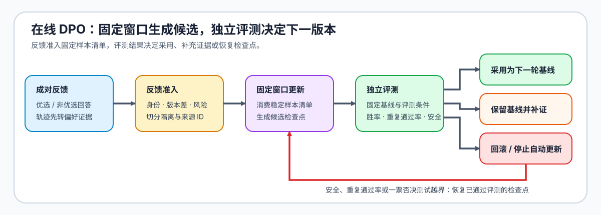
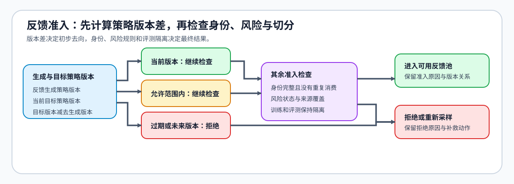

# 51. Online DPO | 在线 DPO
**难度：** Hard | **环境：** CPU-first | **标签：** `后训练对齐`, `DPO`, `在线优化` | **目标人群：** 项目决策练习者

> 🚀 **云端运行环境**
>
> 本章节的实战代码可以点击以下链接在免费 GPU 算力平台上直接运行：
>
> [](https://colab.research.google.com/github/datawhalechina/llm-algo-leetcode/blob/main/02_PyTorch_Algorithms/51_Online_DPO.ipynb)
> [](https://modelscope.cn/my/mynotebook) *(国内推荐：魔搭社区免费实例)*


---

## 本节导读

在线 DPO 关心的不是“新样本来了就更新”，而是反馈是否仍代表当前策略、更新后是否真的改善，以及发现退化时能否回到可验证的版本。Part 02 · 50 建立数据和评测契约，Part 02 · 17 解释离线偏好目标；本节接着处理新反馈持续进入时的版本、新鲜度与回滚问题。

在线样本既可以是优选 / 非优选回答组成的偏好对，也可以来自工具任务的一段轨迹及其终态反馈。本节串起反馈窗口、离线 / 在线对照和回滚条件，使每次更新都能追溯到策略版本与独立评测。

**关键词：** `online feedback`, `policy freshness`, `evaluation isolation`, `rollback`

---

## 前置阅读

**导语：** 先建立离线偏好目标、评测协议和策略版本语义，再观察持续反馈如何改变更新准入。

- [Part 02 · 50 偏好数据与对齐评测](./50_Preference_Data_and_Evaluation.md)
- [Part 02 · 17 DPO 损失](./17_DPO_Loss_Tutorial.md)
- [Part 02 · PT-ROLLOUT-LIFECYCLE Rollout 与策略新鲜度](./PT-ROLLOUT-LIFECYCLE_Rollout_and_Policy_Freshness.md)


### Step 1：在线反馈如何进入更新闭环

在线偏好优化把一次离线训练扩展为持续循环：反馈先经过身份、时效与风险检查，合格反馈形成有限更新候选，候选再接受独立评测。采用、延迟或回滚是评测结果，不由反馈到达速度直接决定。偏好对和工具轨迹都可作为反馈载体，但轨迹还要保留执行终态与验证结论。

| 阶段 | 核心关系 | 作用 |
|:---|:---|:---|
| 反馈准入 | 反馈来源、产生策略与任务环境相互对应 | 判断反馈是否仍能代表当前问题 |
| 有限更新 | 一轮更新只消费边界明确的反馈窗口 | 隔离数据变化与策略变化 |
| 独立复核 | 更新候选与固定基线接受同口径评测 | 防止训练反馈替代最终证据 |
| 采用与恢复 | 收益判断与可恢复版本同时存在 | 在退化时停止或回到稳定版本 |



### Step 2：策略新鲜度如何约束 Online DPO 反馈池

策略新鲜度描述反馈产生策略与当前策略之间的距离。距离较小时，反馈仍可进入后续复核；距离增大时，需要降权、重新采样或拒绝。版本差只是第一道门，反馈身份、来源覆盖、风险状态和评测隔离仍需单独检查。

| 判断维度 | 要回答的问题 | 风险响应 |
|:---|:---|:---|
| 身份完整性 | 同一反馈能否唯一识别并避免重复消费 | 去重、补证或拒绝 |
| 策略新鲜度 | 反馈产生策略是否仍接近当前策略 | 直接复核、降权或重新采样 |
| 风险状态 | 样本是否需要人工或规则复核 | 阻止自动进入更新 |
| 切分隔离 | 反馈是否污染独立评测 | 移出更新池并恢复隔离 |
| 环境一致性（可选） | 轨迹是否来自可比的工具与环境条件 | 分组解释或拒绝混合 |



### Step 3：用独立评测检查更新收益与退化

在线更新完成后，候选必须与固定基线在独立评测条件下比较。质量、稳定性、安全与更新成本需要分开观察；工具任务还要检查任务终态和工具调用是否退化。任何安全硬门槛失败都应优先于平均质量收益，局部失败集中也不能被总体均值掩盖。

| 证据维度 | 解释 | 决策作用 |
|:---|:---|:---|
| 成对质量变化 | 候选相对基线是否获得稳定收益 | 判断是否值得继续观察 |
| 跨窗口稳定性 | 收益是否在重复评测和后续窗口中保持 | 防止短期波动被当成改进 |
| 安全与失败分布 | 是否出现不可接受或集中的退化 | 触发延迟、停止或回滚 |
| 更新成本 | 反馈获取、参数更新和复测消耗多少资源 | 判断收益是否值得持续投入 |
| 任务终态（可选） | 轨迹是否真正完成任务 | 防止文本偏好掩盖执行失败 |

### Step 4：实现反馈窗口与回滚决策

题目区先按身份、版本、风险和来源覆盖筛选反馈，再比较离线与在线更新，最后结合安全硬门槛和回滚条件给出 `adopt / defer / rollback / halt`。

| TODO / 函数 | 学习者完成的机制 | 必须满足的约束 | 测试证据 |
|:---|:---|:---|:---|
| TODO 1：筛选反馈窗口<br>`summarize_online_preferences` | 审计重复、版本、风险和来源覆盖 | 同一反馈只处理一次，旧版与未来版本分别记录 | eligible、拒绝原因与来源覆盖 |
| TODO 2：比较更新证据<br>`compare_online_update` | 分离质量、稳定性、安全和成本变化 | 四类差值保留独立量纲 | 正负变化与字段缺失 |
| TODO 3：选择采用或回滚<br>`recommend_online_dpo` | 联合更新门槛与回滚准备形成决策 | 安全退化先检查恢复路径，软门槛不能触发 adopt | `adopt / defer / rollback / halt` |
## 测试

运行下方 CPU 机制测试，分别检查反馈准入、证据对照和采用或回滚决策。


```python
from typing import Dict, List

```


```python
def summarize_online_preferences(
    feedback_stream: List[Dict[str, object]],
    current_policy_version: int,
    max_policy_lag: int,
) -> Dict[str, object]:
    """审计反馈身份、策略新鲜度、风险与来源覆盖。"""
    # TODO 1：反馈窗口。分别统计 duplicate、stale、future、risk、eligible 和 eligible_sources。
    # seen_ids = ???
    # eligible_sources = ???
    raise NotImplementedError("TODO 1：应用在线反馈 freshness gate")


def compare_online_update(offline_run: Dict[str, float], online_run: Dict[str, float]) -> Dict[str, float]:
    """分别比较质量、稳定性、安全与成本，不折叠量纲。"""
    # TODO 2：更新对照。分别计算 win_rate_gain、stability_delta、safety_delta 和 cost_delta。
    # win_rate_gain = ???
    # stability_delta = ???
    # safety_delta = ???
    # cost_delta = ???
    raise NotImplementedError("TODO 2：比较在线更新证据")


def recommend_online_dpo(
    offline_run: Dict[str, float],
    online_run: Dict[str, float],
    min_win_rate_gain: float,
    rollback_ready: bool,
    max_stability_drop: float = 0.05,
    max_safety_drop: float = 0.02,
) -> Dict[str, object]:
    """根据更新证据与恢复条件返回采用、延迟、回滚或停止。"""
    # TODO 3：更新决策。安全退化超线时按 rollback_ready 选择 rollback 或 halt；软门槛不足时 defer。
    # comparison = ???
    # decision = ???
    raise NotImplementedError("TODO 3：形成在线更新与回滚决策")
```


```python
def test_feedback_freshness_and_source_coverage():
    """重复、过期、未来版本和风险反馈不能进入 eligible 集合。"""
    stream = [
        {"id": "fresh-a", "source": "prod", "accepted": True, "policy_version": 9, "risk": False},
        {"id": "stale", "source": "prod", "accepted": True, "policy_version": 6, "risk": False},
        {"id": "future", "source": "shadow", "accepted": True, "policy_version": 11, "risk": False},
        {"id": "risky", "source": "review", "accepted": True, "policy_version": 10, "risk": True},
        {"id": "fresh-b", "source": "shadow", "accepted": True, "policy_version": 10, "risk": False},
        {"id": "fresh-a", "source": "prod", "accepted": True, "policy_version": 9, "risk": False},
    ]
    report = summarize_online_preferences(stream, current_policy_version=10, max_policy_lag=2)
    assert report == {
        "total_feedback": 6, "duplicate_count": 1, "stale_count": 1, "future_count": 1,
        "risk_count": 1, "eligible_feedback": 2, "eligibility_rate": 2 / 6,
        "eligible_sources": ["prod", "shadow"],
    }


def test_online_update_comparison():
    """质量、稳定性、安全与成本必须分别计算。"""
    offline = {"win_rate": 0.52, "stability": 0.82, "safety_score": 0.95, "update_cost": 1.0}
    online = {"win_rate": 0.59, "stability": 0.79, "safety_score": 0.94, "update_cost": 1.2}
    assert compare_online_update(offline, online) == {
        "win_rate_gain": 0.07, "stability_delta": -0.03, "safety_delta": -0.01, "cost_delta": 0.2,
    }


def test_adopt_defer_rollback_and_halt():
    """安全退化需要恢复路径，软门槛不足只延迟采用。"""
    offline = {"win_rate": 0.52, "stability": 0.82, "safety_score": 0.95, "update_cost": 1.0}
    adopt = {"win_rate": 0.59, "stability": 0.79, "safety_score": 0.94, "update_cost": 1.2}
    unsafe = {**adopt, "safety_score": 0.90}
    assert recommend_online_dpo(offline, adopt, 0.05, rollback_ready=True)["decision"] == "adopt"
    assert recommend_online_dpo(offline, {**adopt, "win_rate": 0.54}, 0.05, rollback_ready=True)["decision"] == "defer"
    assert recommend_online_dpo(offline, unsafe, 0.05, rollback_ready=True)["decision"] == "rollback"
    assert recommend_online_dpo(offline, unsafe, 0.05, rollback_ready=False)["decision"] == "halt"


try:
    test_feedback_freshness_and_source_coverage()
    test_online_update_comparison()
    test_adopt_defer_rollback_and_halt()
    print("✅ 在线反馈窗口、更新对照与回滚准备测试通过。")
except (AttributeError, NameError, TypeError, ValueError, AssertionError) as error:
    raise NotImplementedError("请先完成 TODO 代码！") from error
```

---

🛑 **STOP HERE** 🛑
<br><br><br><br><br><br><br><br><br><br>
> 请先尝试自己完成代码并跑通测试。<br>
> 如果遇到困难没有思路，可以向下滚动查看参考答案。
<br><br><br><br><br><br><br><br><br><br>

---

## 参考代码与解析

### 代码


```python
from typing import Dict, List


def summarize_online_preferences(
    feedback_stream: List[Dict[str, object]],
    current_policy_version: int,
    max_policy_lag: int,
) -> Dict[str, object]:
    """审计反馈身份、新鲜度、风险与来源覆盖。"""
    # TODO 1：筛选反馈窗口。
    seen_ids = set()
    duplicate_count = stale_count = future_count = risk_count = 0
    eligible_sources = set()
    eligible_feedback = 0
    for feedback in feedback_stream:
        feedback_id = str(feedback.get("id", ""))
        if feedback_id in seen_ids:
            duplicate_count += 1
            continue
        seen_ids.add(feedback_id)
        version = int(feedback.get("policy_version", -1))
        if version > current_policy_version:
            future_count += 1
            continue
        if current_policy_version - version > max_policy_lag:
            stale_count += 1
            continue
        if bool(feedback.get("risk", False)):
            risk_count += 1
            continue
        if bool(feedback.get("accepted", False)):
            eligible_feedback += 1
            eligible_sources.add(str(feedback.get("source", "unknown")))
    total = len(feedback_stream)
    return {
        "total_feedback": total,
        "duplicate_count": duplicate_count,
        "stale_count": stale_count,
        "future_count": future_count,
        "risk_count": risk_count,
        "eligible_feedback": eligible_feedback,
        "eligibility_rate": eligible_feedback / total if total else 0.0,
        "eligible_sources": sorted(eligible_sources),
    }


def compare_online_update(offline_run: Dict[str, float], online_run: Dict[str, float]) -> Dict[str, float]:
    """分别计算质量、稳定性、安全和成本变化。"""
    # TODO 2：比较离线与在线更新。
    return {
        "win_rate_gain": round(online_run["win_rate"] - offline_run["win_rate"], 6),
        "stability_delta": round(online_run["stability"] - offline_run["stability"], 6),
        "safety_delta": round(online_run["safety_score"] - offline_run["safety_score"], 6),
        "cost_delta": round(online_run["update_cost"] - offline_run["update_cost"], 6),
    }


def recommend_online_dpo(
    offline_run: Dict[str, float],
    online_run: Dict[str, float],
    min_win_rate_gain: float,
    rollback_ready: bool,
    max_stability_drop: float = 0.05,
    max_safety_drop: float = 0.02,
) -> Dict[str, object]:
    """根据更新收益、退化门槛与恢复准备形成决策。"""
    # TODO 3：选择采用、延迟或回滚。
    comparison = compare_online_update(offline_run, online_run)
    if comparison["safety_delta"] < -max_safety_drop:
        decision = "rollback" if rollback_ready else "halt"
        reason = "safety_regression"
    elif comparison["win_rate_gain"] >= min_win_rate_gain and comparison["stability_delta"] >= -max_stability_drop:
        decision = "adopt"
        reason = "quality_and_stability_pass"
    else:
        decision = "defer"
        reason = "soft_gate_not_met"
    return {"decision": decision, "reason": reason, "comparison": comparison, "rollback_ready": rollback_ready}
```

### 解析

#### TODO 1：筛选反馈窗口

- 重复、过期、未来版本与高风险反馈分别处理，并保留来源覆盖。

#### TODO 2：比较离线与在线更新

- 质量、稳定性、安全和成本保留独立量纲，避免综合分数掩盖退化。

#### TODO 3：选择采用、延迟或回滚

- 安全退化优先触发恢复检查；没有可靠 checkpoint 时停止更新而不是继续采用。
## 相关阅读

- [Part 02 · PT-RL-SYSTEM 采样、训练与奖励系统](./PT-RL-SYSTEM_Rollout_Training_and_Reward_System.md)
- [Part 02 · 84 DPO 偏好优化项目](./84_DPO_Preference_Project.md)
- [Part 02 · 86 DPO 在线 Benchmark](./86_DPO_Online_Benchmark.md)
- [TRL: DPO Trainer](https://huggingface.co/docs/trl/dpo_trainer)
