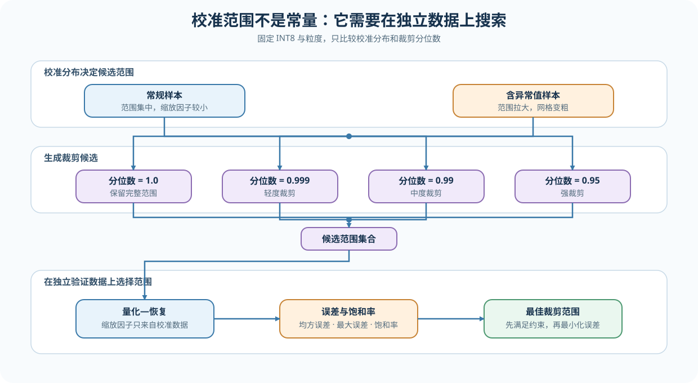
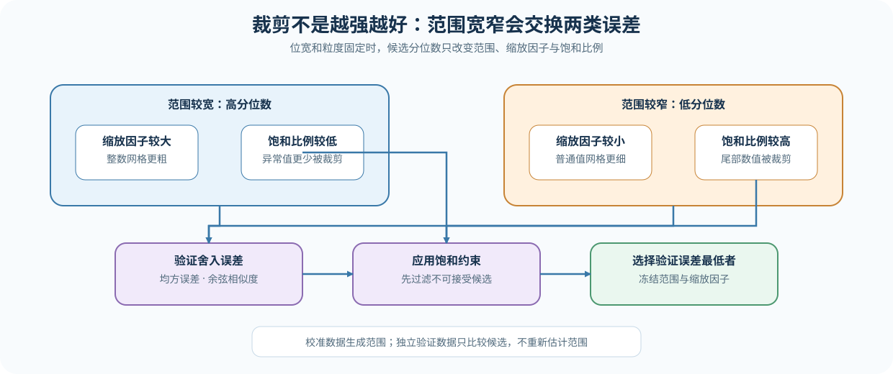

# 52. Quantization Calibration and Error | 量化校准范围与裁剪

**难度：** Medium | **环境：** CPU | **标签：** `量化`, `校准范围`, `clipping`, `误差` | **目标人群：** 希望理解量化范围如何从数据中选出的学习者

> 🚀 **云端运行环境**
>
> 本章节的实战代码可以点击以下链接在免费 GPU 算力平台上直接运行：
>
> [](https://colab.research.google.com/github/datawhalechina/llm-algo-leetcode/blob/main/02_PyTorch_Algorithms/52_Quantization_Calibration_and_Error.ipynb)
> [](https://modelscope.cn/my/mynotebook) *(国内推荐：魔搭社区免费实例)*


## 本节导读

量化范围过大时，少数异常值会让普通值只能使用稀疏的整数码；范围过小时，裁剪又会提高饱和率。校准的核心不是套用一个公式，而是在舍入误差与裁剪误差之间作出可验证的选择。

本节比较校准数据、验证数据和候选裁剪范围的职责，帮助你解释同一种 INT8 表示为什么会产生不同误差，并选择满足饱和率约束的低误差范围。

**关键词：** `calibration set`, `validation set`, `clipping quantile`, `rounding error`, `saturation rate`

## 前置阅读

**导语：** 先掌握整数码、缩放因子和粒度，再学习如何从校准数据生成范围候选，并在独立验证数据上选择裁剪分位数。

- [Part 01 · 21 Quantization Theory | 量化理论与 INT4/INT8](../01_Hardware_Math_and_Systems/21_Quantization_Theory_and_INT4_INT8.md)
- [Part 02 · 25 W8A16 Quantization | W8A16 表示与粒度](./25_Quantization_W8A16.md)

### Step 1：校准范围为什么会改变量化网格

先固定对称 INT8 和逐张量粒度，只改变校准数据。若校准值主要落在 `[-2, 2]`，量化步长约为 `2 / 127`；若加入一个 `100` 的异常值，步长会扩大到约 `100 / 127`。表示格式没有变化，但普通值能够使用的有效码点骤减。

| 校准条件 | 估计范围 | 近似缩放因子 | 对普通值的影响 |
|:---|:---|:---|:---|
| 常规样本 `[-2, 2]` | 2 | 0.0157 | 网格较细，普通值恢复更准确 |
| 加入异常值 `100` | 100 | 0.7874 | 网格变粗，普通值舍入误差增大 |
| 对异常值执行裁剪 | 小于 100 | 随候选分位数变化 | 舍入误差下降，但可能产生饱和 |



### Step 2：异常值、舍入和裁剪如何形成误差

对称量化用校准范围确定缩放因子。若直接使用绝对最大值，少数异常值会扩大整数网格间隔，使大多数普通值只能使用较少的有效码点；主动裁剪可以缩小步长，但超出范围的值会产生裁剪误差。因此候选必须同时记录恢复误差和饱和比例。

对称量化满足 `scale = range / qmax`、`q = clamp(round(x / scale))` 和 `x_hat = q × scale`。其中 `range` 可以来自绝对最大值，也可以来自裁剪后的统计范围。

| 误差来源 | 形成原因 | 观察指标 | 常见调整 |
|:---|:---|:---|:---|
| 舍入误差 | 浮点值无法落在整数网格上 | MSE、余弦相似度 | 增加位宽或细化粒度 |
| 裁剪误差 | 数值超过候选范围 | 最大误差、饱和比例 | 调整裁剪或保留异常值 |
| 统计偏移 | 校准分布与目标工作负载不一致 | 分桶误差、任务质量 | 更换或扩充校准样本 |



### Step 3：怎样在独立验证数据上选择裁剪分位数

本节保持位宽和粒度不变，只搜索裁剪分位数。每个候选的缩放因子只能由校准数值计算，再用未参与范围估计的验证数值测量 MSE 和饱和率。这样得到的是范围选择证据，而不是对校准样本的记忆。

选择顺序固定为：先淘汰饱和率超过约束的候选，再在可行集合中选择验证误差最低者。

| 搜索阶段 | 使用的数据 | 输出 |
|:---|:---|:---|
| 生成候选 | 校准数值 | 分位数、范围、缩放因子 |
| 验证候选 | 验证数值 | MSE、最大误差、饱和率 |
| 应用约束 | 验证指标 | 满足最大饱和率的可行集合 |
| 选择范围 | 可行集合 | 验证 MSE 最低的裁剪候选 |

### Step 4：实现裁剪候选评估与范围搜索

题目区固定对称 INT8 和逐张量粒度。骨架负责输入检查、误差汇总和结果字段；你需要从校准数值估计缩放因子，用该缩放因子量化独立验证数值，并完成带饱和率约束的分位数搜索。

| 任务与目的 | 已知条件 | 完成标准 | 测试验证 |
|:---|:---|:---|:---|
| TODO 1：估计裁剪缩放因子 | 校准数值、`qmax` 与合法分位数 | 缩放因子为正；全零输入不除零 | 最大范围、80% 分位数、全零 Tensor |
| TODO 2：评估单个裁剪候选 | 校准 / 验证数值与分位数 | 缩放因子只来自校准；量化—恢复只作用于验证数值 | 校准 / 验证隔离、误差与饱和率 |
| TODO 3：搜索可行分位数 | 候选分位数与最大饱和率 | 淘汰超限候选，再选择 MSE 最低者 | 无可行候选、候选平局、最佳范围 |


```python
import torch

```


```python
def calibrate_symmetric_scale(
    values: torch.Tensor, qmax: int = 127, clipping_quantile: float = 1.0
) -> torch.Tensor:
    """使用绝对值分位数估计对称量化范围，并返回正缩放因子。"""
    if values.numel() == 0 or qmax <= 0:
        raise ValueError("values must be non-empty and qmax must be positive")
    if not 0.0 < clipping_quantile <= 1.0:
        raise ValueError("clipping_quantile must be in (0, 1]")
    # TODO 1（范围估计机制）：在绝对值展平数据上估计分位数范围，再映射到 qmax。
    # 注意：全零输入仍应返回正缩放因子；不要修改原 Tensor 或保留计算图。
    # abs_values = ???        # 展平且不保留计算图的绝对值。
    # calibrated_range = ???  # clipping_quantile 对应的范围。
    # scale = ???             # 有限且为正的对称缩放因子。
    raise NotImplementedError("TODO 1: derive a positive symmetric scale")


def quantize_dequantize_symmetric(
    values: torch.Tensor, scale: torch.Tensor, qmax: int = 127
) -> tuple[torch.Tensor, torch.Tensor, float]:
    """执行对称量化闭环，并返回整数码、恢复值和饱和比例。"""
    if qmax <= 0 or scale.numel() != 1 or scale.item() <= 0:
        raise ValueError("scale must be a positive scalar and qmax must be positive")
    raw_codes = torch.round(values / scale)
    saturation_rate = float((raw_codes.abs() > qmax).float().mean())
    codes = torch.clamp(raw_codes, -qmax, qmax).to(torch.int8)
    reconstructed = codes.to(values.dtype) * scale
    return codes, reconstructed, saturation_rate


def evaluate_clipping_candidate(
    calibration_values: torch.Tensor, validation_values: torch.Tensor, clipping_quantile: float
) -> dict[str, float]:
    """只用校准估计缩放因子，并在验证上测量误差。"""
    if calibration_values.numel() == 0 or validation_values.numel() == 0:
        raise ValueError("calibration and validation values must be non-empty")
    # TODO 2（数据隔离机制）：用校准范围量化独立验证数值。
    # 注意：两个待填变量分别说明“范围来自哪里”和“误差在哪里测量”。
    # scale = ???                              # 只由 calibration_values 估计。
    # _, reconstructed, saturation_rate = ???  # 只量化 validation_values，并复用固定 scale。
    raise NotImplementedError("TODO 2: evaluate one clipping candidate")
    delta = validation_values.float() - reconstructed.float()
    return {
        "quantile": float(clipping_quantile), "scale": float(scale.item()),
        "mse": float(delta.square().mean()),
        "max_abs_error": float(delta.abs().max()),
        "saturation_rate": saturation_rate,
    }


def select_clipping_candidate(
    calibration_values: torch.Tensor, validation_values: torch.Tensor,
    quantile_candidates: list[float], max_saturation_rate: float,
) -> dict[str, float]:
    """从满足饱和率约束的候选中选择验证 MSE 最低者。"""
    if not quantile_candidates or not 0.0 <= max_saturation_rate <= 1.0:
        raise ValueError("quantiles must be non-empty and saturation limit must be in [0, 1]")
    candidates = [evaluate_clipping_candidate(
        calibration_values, validation_values, quantile
    ) for quantile in quantile_candidates]
    # TODO 3（范围选择机制）：先应用饱和率约束，再按 MSE、分位数稳定排序。
    # 注意：没有可行候选时应明确失败，不能退回任意分位数。
    # feasible = ???  # 满足 max_saturation_rate 的候选。
    # selected = ???  # 按 MSE 与分位数稳定排序后的最佳候选。
    raise NotImplementedError("TODO 3: select the best feasible clipping candidate")

```

### 测试

测试分别验证缩放因子估计、校准/验证分工、候选指标、饱和率约束和分位数选择；三个机制 TODO 均有独立测试入口。


```python
def test_clipping_scale_contract() -> None:
    """TODO 1：较低分位数缩小异常值主导的范围，全零输入仍保持正缩放因子。"""
    values = torch.tensor([-100.0, -1.0, 0.0, 1.0, 2.0])
    full_scale = calibrate_symmetric_scale(values, clipping_quantile=1.0)
    clipped_scale = calibrate_symmetric_scale(values, clipping_quantile=0.8)
    assert clipped_scale < full_scale
    assert calibrate_symmetric_scale(torch.zeros(4)).item() > 0


def test_candidate_uses_calibration_scale_on_validation() -> None:
    """TODO 2：候选缩放因子来自校准，指标只在验证上计算。"""
    calibration = torch.tensor([-2.0, -1.0, 0.0, 1.0, 100.0])
    validation = torch.tensor([-2.0, -1.0, 0.0, 1.0, 2.0])
    candidate = evaluate_clipping_candidate(calibration, validation, 0.8)
    expected_scale = calibrate_symmetric_scale(calibration, clipping_quantile=0.8)
    assert candidate["scale"] == float(expected_scale)
    assert candidate["quantile"] == 0.8
    assert {"mse", "max_abs_error", "saturation_rate"} <= set(candidate)
    assert 0.0 <= candidate["saturation_rate"] <= 1.0


def test_clipping_search_selects_lowest_feasible_mse() -> None:
    """TODO 3：先满足饱和率约束，再选择验证 MSE 最低候选。"""
    calibration = torch.tensor([-8.0, -2.0, -1.0, 0.0, 1.0, 2.0, 8.0])
    validation = torch.tensor([-3.0, -2.0, -1.0, 0.0, 1.0, 2.0, 3.0])
    quantiles = [1.0, 0.9, 0.7]
    candidates = [evaluate_clipping_candidate(calibration, validation, q) for q in quantiles]
    feasible = [item for item in candidates if item["saturation_rate"] <= 0.30]
    selected = select_clipping_candidate(calibration, validation, quantiles, 0.30)
    assert selected == min(feasible, key=lambda item: (item["mse"], -item["quantile"]))


def test_no_feasible_clipping_candidate() -> None:
    """所有候选饱和率超限时必须明确失败。"""
    try:
        select_clipping_candidate(
            torch.tensor([0.0, 1.0, 100.0]), torch.tensor([-100.0, 100.0]),
            [0.5], max_saturation_rate=0.0,
        )
    except RuntimeError as exc:
        assert "clipping candidate" in str(exc)
    else:
        raise AssertionError("no feasible clipping candidate must fail")


for test in (
    test_clipping_scale_contract,
    test_candidate_uses_calibration_scale_on_validation,
    test_clipping_search_selects_lowest_feasible_mse,
    test_no_feasible_clipping_candidate,
):
    test()
print("✅ clipping scale、validation 指标与 quantile 搜索测试通过。")

```

---

🛑 **STOP HERE** 🛑
<br><br><br><br><br><br><br><br><br><br>
> 请先尝试自己完成代码并跑通测试。<br>
> 如果遇到困难，再向下查看参考代码与解析。
<br><br><br><br><br><br><br><br><br><br>

---
## 参考代码与解析


```python
def calibrate_symmetric_scale(
    values: torch.Tensor, qmax: int = 127, clipping_quantile: float = 1.0
) -> torch.Tensor:
    """使用绝对值分位数估计对称量化范围，并返回正缩放因子。"""
    if values.numel() == 0 or qmax <= 0:
        raise ValueError("values must be non-empty and qmax must be positive")
    if not 0.0 < clipping_quantile <= 1.0:
        raise ValueError("clipping_quantile must be in (0, 1]")
    # TODO 1（范围估计机制）：在绝对值展平数据上估计分位数范围，再映射到 qmax。
    # 注意：全零输入仍应返回正缩放因子；不要修改原 Tensor 或保留计算图。
    # abs_values = ???        # 展平且不保留计算图的绝对值。
    # calibrated_range = ???  # clipping_quantile 对应的范围。
    # scale = ???             # 有限且为正的对称缩放因子。
    abs_values = values.detach().float().abs().flatten()
    calibrated_range = torch.quantile(abs_values, clipping_quantile)
    scale = calibrated_range.clamp_min(torch.finfo(torch.float32).eps) / qmax
    return scale


def quantize_dequantize_symmetric(
    values: torch.Tensor, scale: torch.Tensor, qmax: int = 127
) -> tuple[torch.Tensor, torch.Tensor, float]:
    """执行对称量化闭环，并返回整数码、恢复值和饱和比例。"""
    if qmax <= 0 or scale.numel() != 1 or scale.item() <= 0:
        raise ValueError("scale must be a positive scalar and qmax must be positive")
    raw_codes = torch.round(values / scale)
    saturation_rate = float((raw_codes.abs() > qmax).float().mean())
    codes = torch.clamp(raw_codes, -qmax, qmax).to(torch.int8)
    reconstructed = codes.to(values.dtype) * scale
    return codes, reconstructed, saturation_rate


def evaluate_clipping_candidate(
    calibration_values: torch.Tensor, validation_values: torch.Tensor, clipping_quantile: float
) -> dict[str, float]:
    """只用校准估计缩放因子，并在验证上测量误差。"""
    if calibration_values.numel() == 0 or validation_values.numel() == 0:
        raise ValueError("calibration and validation values must be non-empty")
    # TODO 2（数据隔离机制）：用校准范围量化独立验证数值。
    # 注意：缩放因子只由 calibration_values 估计；validation_values 只用于误差评估。
    scale = calibrate_symmetric_scale(calibration_values, clipping_quantile=clipping_quantile)
    _, reconstructed, saturation_rate = quantize_dequantize_symmetric(validation_values, scale)
    delta = validation_values.float() - reconstructed.float()
    metrics = {
        "quantile": float(clipping_quantile), "scale": float(scale.item()),
        "mse": float(delta.square().mean()),
        "max_abs_error": float(delta.abs().max()),
        "saturation_rate": saturation_rate,
    }
    return metrics


def select_clipping_candidate(
    calibration_values: torch.Tensor, validation_values: torch.Tensor,
    quantile_candidates: list[float], max_saturation_rate: float,
) -> dict[str, float]:
    """从满足饱和率约束的候选中选择验证 MSE 最低者。"""
    if not quantile_candidates or not 0.0 <= max_saturation_rate <= 1.0:
        raise ValueError("quantiles must be non-empty and saturation limit must be in [0, 1]")
    candidates = [evaluate_clipping_candidate(
        calibration_values, validation_values, quantile
    ) for quantile in quantile_candidates]
    # TODO 3（范围选择机制）：先应用饱和率约束，再按 MSE、分位数稳定排序。
    # 注意：没有可行候选时应明确失败，不能退回任意分位数。
    # feasible = ???  # 满足 max_saturation_rate 的候选。
    # selected = ???  # 按 MSE 与分位数稳定排序后的最佳候选。
    feasible = [candidate for candidate in candidates
                if candidate["saturation_rate"] <= max_saturation_rate]
    if not feasible:
        raise RuntimeError("no feasible clipping candidate")
    selected = min(feasible, key=lambda item: (item["mse"], -item["quantile"]))
    return selected

```

### 解析

- **TODO 1：范围估计。** 分位数小于 1 时允许裁掉少量异常值，以换取更细的整数网格；全零校准仍需通过最小正数得到合法缩放因子。
- **TODO 2：候选评估。** 缩放因子只能来自校准数值，MSE、最大误差和饱和率必须在独立验证数值上计算。
- **TODO 3：范围选择。** 先淘汰饱和率超限候选，再选择验证 MSE 最低者；MSE 相同时优先保留更高分位数，避免无必要的强裁剪。

## 相关阅读

- [25. W8A16 Quantization | W8A16 表示基础](./25_Quantization_W8A16.md)
- [40. GPTQ and AWQ | GPTQ / AWQ 权重量化](./40_GPTQ_and_AWQ_Weight_Quantization.md)
- [53. Activation Quantization and SmoothQuant | 激活量化与 SmoothQuant](./53_Activation_Quantization_and_SmoothQuant.md)
- [Hugging Face Transformers: Quantization](https://huggingface.co/docs/transformers/main/quantization/overview)
