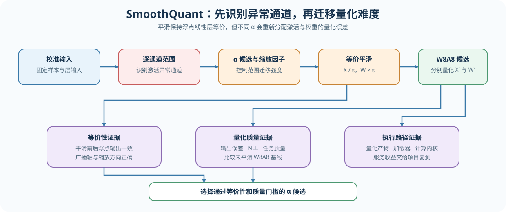
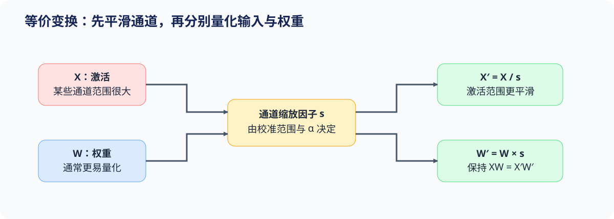

# 53. Activation Quantization and SmoothQuant | 激活量化与 SmoothQuant

**难度：** Hard　**环境：** CPU-first，GPU 可选　**标签：** `量化`, `激活`, `SmoothQuant`

> 🚀 **云端运行环境**
>
> 本章节的实战代码可以点击以下链接在免费 GPU 算力平台上直接运行：
>
> [](https://colab.research.google.com/github/datawhalechina/llm-algo-leetcode/blob/main/02_PyTorch_Algorithms/53_Activation_Quantization_and_SmoothQuant.ipynb)
> [](https://modelscope.cn/my/mynotebook) *(国内推荐：魔搭社区免费实例)*


## 本节导读

W8A8 同时压缩权重和激活，但两者的数值分布并不对称：权重通常较平稳，激活却可能在少数通道出现远大于其他通道的异常值。SmoothQuant 通过保持线性层输出不变的通道变换，把部分量化难度从激活迁移到权重。

本节依次分析异常通道、等价平滑和 `alpha` 选择，帮助你判断范围迁移何时能降低整体误差，何时只是把问题从激活侧转移到权重侧。
## 前置阅读

**导语：** 先理解量化值、缩放因子与反量化，再进入“为什么激活比权重更难量化”的问题。

- [52 量化校准与误差控制](./52_Quantization_Calibration_and_Error.md)
- [25 W8A16 量化](./25_Quantization_W8A16.md)
### Step 1：识别阻塞 W8A8 的激活异常通道

在线性层 `Y = XWᵀ` 中，`X` 的最后一维和 `W` 的输入维表示同一组通道。若少数激活通道的绝对值范围远大于其余通道，逐张量激活缩放因子必须覆盖这些异常值，普通通道可用的整数码点随之减少。判断是否需要 SmoothQuant，应先比较逐通道范围，而不是只看整个张量的最大值。

| 观察对象 | 需要记录的统计量 | 对 W8A8 的影响 |
|---|---|---|
| 激活通道 | 校准样本上的 `absmax`、异常值比率 | 决定激活量化的动态范围 |
| 权重输入通道 | 每个输入通道的 `absmax` | 决定可承接多少范围压力 |
| 线性层输出 | 浮点输出与量化输出误差 | 判断范围迁移是否真正有效 |


### Step 2：用等价变换迁移量化难度

对每个输入通道选择正数 `s`，令 `X′ = X / s`、`W′ = W × s`，则 `XWᵀ = X′W′ᵀ`。激活异常通道被压低的同时，对应权重通道会被放大；SmoothQuant 并未消除范围，而是在两个更容易共同量化的张量之间重新分配范围。

常用缩放因子形式为 `s = act_max^alpha / weight_max^(1-alpha)`。`alpha` 越大，越优先压低激活范围，也越可能放大权重范围；因此它必须通过校准候选比较确定。

| `alpha` 位置 | 激活侧变化 | 权重侧变化 | 校准时重点观察 |
|---|---|---|---|
| 接近 0 | 平滑较弱 | 权重放大较少 | 激活误差是否仍由异常值主导 |
| 中间区域 | 两侧共同承担范围 | 两侧共同变化 | 端到端输出误差是否最低 |
| 接近 1 | 激活压缩更强 | 权重放大更明显 | 权重量化误差是否反超 |


### Step 3：从误差迁移判断 W8A8 是否成立

SmoothQuant 候选需要连续通过三项机制检查：平滑前后的浮点输出保持等价；激活与权重的恢复误差没有发生不可接受的转移；平滑后的 W8A8 输出误差低于未平滑基线或满足质量阈值。

| 证据 | 判断问题 | 失败时的处理 |
|---|---|---|
| 浮点等价误差 | 通道变换是否正确 | 修正广播维度或缩放因子方向 |
| 激活/权重恢复误差 | 误差是否只是从一侧转移到另一侧 | 调整 `alpha` 或量化粒度 |
| 输出误差 | 当前候选是否通过质量门槛 | 保留浮点或换用更高精度路径 |
### Step 4：实现通道平滑与 `alpha` 校准

题目区保留三个机制决策：由逐通道范围计算缩放因子、执行保持线性层等价的范围迁移、在候选集合中选择输出误差最低的 `alpha`。量化与反量化由骨架提供，让练习集中在 SmoothQuant 本身。

| TODO | 机制责任 | 关键测试 |
|---|---|---|
| TODO 1 | 从激活与权重的逐通道范围生成正缩放因子 | 形状、有限值、异常通道响应 |
| TODO 2 | 在同一输入通道上完成 `X/s` 与 `W×s` | 浮点输出等价 |
| TODO 3 | 比较候选 `alpha` 的 W8A8 输出误差 | 最优候选、非法候选与误差记录 |

```python
import torch
```


```python
# 题目区：补全范围迁移与 alpha 校准；量化、反量化和结果记录由骨架提供。
class SmoothQuantSimulator:
    """在输入通道上执行 SmoothQuant 等价平滑与教学 W8A8 对照。

    `activations` 的最后一维与 `weight` 的输入维相同；`weight` 形状为
    `[out_features, in_features]`。本实现比较机制误差，不代表生产级 W8A8 计算内核。
    """

    def __init__(self, qmax: int = 127, eps: float = 1e-8):
        self.qmax = qmax
        self.eps = eps

    def channel_scale(self, activations: torch.Tensor, weight: torch.Tensor, alpha: float):
        """根据校准激活与权重的逐输入通道范围计算平滑缩放因子。"""
        if activations.shape[-1] != weight.shape[-1]:
            raise ValueError('activations and weight must share the input-channel dimension.')
        if not 0.0 <= alpha <= 1.0:
            raise ValueError('alpha must be in [0, 1].')

        # TODO 1（通道范围）：分别沿样本维和输出维统计输入通道 absmax，
        # 再计算 s = act_max**alpha / weight_max**(1-alpha)。
        # act_max = ???     # 每个输入通道的激活绝对最大值。
        # weight_max = ???  # 每个输入通道的权重绝对最大值。
        # scale = ???       # 与输入通道一一对应的平滑因子。
        raise NotImplementedError("TODO 1: compute channel ranges and smoothing scale")

    def smooth(self, activations: torch.Tensor, weight: torch.Tensor, alpha: float):
        """返回 X/s、W*s 和 s；变换前后的浮点线性层输出应保持一致。"""
        scale = self.channel_scale(activations, weight, alpha)

        # TODO 2（等价迁移）：激活除以逐通道缩放因子，权重在输入通道维乘以同一缩放因子。
        # smooth_activations = ???
        # smooth_weight = ???
        return smooth_activations, smooth_weight, scale

    def _quantize_dequantize_per_tensor(self, tensor: torch.Tensor):
        """执行对称逐张量 INT8 量化并立即恢复为浮点张量。"""
        absmax = tensor.detach().float().abs().max().clamp_min(self.eps)
        scale = absmax / self.qmax
        quantized = torch.clamp(
            torch.round(tensor.float() / scale), -self.qmax, self.qmax
        ).to(torch.int8)
        return quantized.float() * scale

    def compare(self, activations: torch.Tensor, weight: torch.Tensor, alpha: float):
        """返回一个 alpha 对应的浮点等价误差和教学 W8A8 输出误差。"""
        smooth_x, smooth_w, channel_scale = self.smooth(activations, weight, alpha)
        reference = activations.float() @ weight.float().t()
        smooth_float = smooth_x.float() @ smooth_w.float().t()
        restored_x = self._quantize_dequantize_per_tensor(smooth_x)
        restored_w = self._quantize_dequantize_per_tensor(smooth_w)
        quantized_output = restored_x @ restored_w.t()
        return {
            'alpha': float(alpha),
            'channel_scale': channel_scale,
            'reference': reference,
            'smooth_float': smooth_float,
            'quantized_output': quantized_output,
            'equivalence_mse': float(torch.mean((reference - smooth_float) ** 2)),
            'quantized_mse': float(torch.mean((reference - quantized_output) ** 2)),
            'activation_absmax': float(smooth_x.abs().max()),
            'weight_absmax': float(smooth_w.abs().max()),
        }

    def select_alpha(self, activations: torch.Tensor, weight: torch.Tensor, candidates):
        """比较候选 alpha，并返回 W8A8 输出误差最低的结果及全部校准记录。"""
        candidates = list(candidates)
        if not candidates:
            raise ValueError('candidates must not be empty.')

        records = [self.compare(activations, weight, alpha) for alpha in candidates]
        # TODO 3（校准选择）：从已有记录中选出 W8A8 输出误差最低的候选。
        # best = ???  # `quantized_mse` 最小的完整候选记录。
        raise NotImplementedError("TODO 3: select the record with the lowest quantized_mse")
        return {'best': best, 'records': records}

```

### 测试

测试不评价某个 `alpha` 是否对所有模型最佳，只验证通道缩放因子、等价变换和量化恢复的机制契约。

```python
# 机制测试：覆盖逐通道范围、等价迁移、异常值响应和 alpha 校准。
def make_smoothquant_fixture():
    """构造包含显著激活异常通道的固定校准样本。"""
    activations = torch.tensor([
        [1.0, 120.0, 0.5, -1.0],
        [2.0, -90.0, -0.5, 0.5],
        [-1.0, 80.0, 1.5, 2.0],
    ])
    weight = torch.tensor([
        [1.0, 0.25, -2.0, 0.5],
        [-0.5, 0.50, 1.0, -1.5],
    ])
    return activations, weight


def test_channel_scale_contract_and_outlier_response():
    """每个输入通道应有正缩放因子，异常激活通道应获得更强平滑。"""
    activations, weight = make_smoothquant_fixture()
    scale = SmoothQuantSimulator().channel_scale(activations, weight, alpha=0.5)
    assert scale.shape == (activations.shape[-1],)
    assert torch.isfinite(scale).all() and torch.all(scale > 0)
    assert scale[1] > scale[0]


def test_smoothing_preserves_float_product():
    """XWᵀ 与 (X/s)(W*s)ᵀ 在浮点路径上应等价。"""
    torch.manual_seed(0)
    activations, weight = torch.randn(2, 3, 6), torch.randn(4, 6)
    result = SmoothQuantSimulator().compare(activations, weight, alpha=0.6)
    assert result['equivalence_mse'] < 1e-10


def test_smoothing_reduces_activation_peak_for_outlier_fixture():
    """较大的 alpha 应压低固定样本的激活峰值，同时允许权重范围上升。"""
    activations, weight = make_smoothquant_fixture()
    sim = SmoothQuantSimulator()
    weak = sim.compare(activations, weight, alpha=0.0)
    strong = sim.compare(activations, weight, alpha=0.8)
    assert strong['activation_absmax'] < weak['activation_absmax']
    assert strong['weight_absmax'] > weak['weight_absmax']


def test_alpha_selection_returns_lowest_error_candidate():
    """最佳候选必须来自给定集合，并具有集合中的最低 W8A8 输出误差。"""
    activations, weight = make_smoothquant_fixture()
    selection = SmoothQuantSimulator().select_alpha(activations, weight, [0.0, 0.5, 0.8])
    errors = [record['quantized_mse'] for record in selection['records']]
    assert selection['best']['alpha'] in {0.0, 0.5, 0.8}
    assert selection['best']['quantized_mse'] == min(errors)


def test_invalid_alpha_candidates_are_rejected():
    """空候选集合和越界 alpha 都应给出明确错误。"""
    activations, weight = make_smoothquant_fixture()
    sim = SmoothQuantSimulator()
    try:
        sim.select_alpha(activations, weight, [])
        raise AssertionError('empty candidates should fail')
    except ValueError:
        pass
    try:
        sim.channel_scale(activations, weight, alpha=1.1)
        raise AssertionError('alpha outside [0, 1] should fail')
    except ValueError:
        pass


def run_smoothquant_tests():
    """汇总 SmoothQuant 的五项机制测试。"""
    tests = (
        test_channel_scale_contract_and_outlier_response,
        test_smoothing_preserves_float_product,
        test_smoothing_reduces_activation_peak_for_outlier_fixture,
        test_alpha_selection_returns_lowest_error_candidate,
        test_invalid_alpha_candidates_are_rejected,
    )
    for test in tests:
        test()
    print('✅ SmoothQuant 机制测试通过：范围统计、等价迁移、误差转移与 alpha 选择均已验证。')


run_smoothquant_tests()

```

---

🛑 **STOP HERE** 🛑
<br><br><br><br><br><br><br><br><br><br>
> 请先尝试自己完成代码并跑通测试。<br>
> 如果遇到困难，再向下查看参考代码与解析。
<br><br><br><br><br><br><br><br><br><br>

---

## 参考代码与解析

### 代码

```python
# 参考答案：实现范围迁移与 alpha 校准；量化、反量化和结果记录由骨架提供。
class SmoothQuantSimulator:
    """在输入通道上执行 SmoothQuant 等价平滑与教学 W8A8 对照。

    `activations` 的最后一维与 `weight` 的输入维相同；`weight` 形状为
    `[out_features, in_features]`。本实现比较机制误差，不代表生产级 W8A8 计算内核。
    """

    def __init__(self, qmax: int = 127, eps: float = 1e-8):
        self.qmax = qmax
        self.eps = eps

    def channel_scale(self, activations: torch.Tensor, weight: torch.Tensor, alpha: float):
        """根据校准激活与权重的逐输入通道范围计算平滑缩放因子。"""
        if activations.shape[-1] != weight.shape[-1]:
            raise ValueError('activations and weight must share the input-channel dimension.')
        if not 0.0 <= alpha <= 1.0:
            raise ValueError('alpha must be in [0, 1].')

        # TODO 1（通道范围）：分别沿样本维和输出维统计输入通道 absmax，
        # 再计算 s = act_max**alpha / weight_max**(1-alpha)。
        act_max = activations.detach().float().abs().reshape(-1, activations.shape[-1]).amax(dim=0).clamp_min(self.eps)
        weight_max = weight.detach().float().abs().amax(dim=0).clamp_min(self.eps)
        scale = (act_max.pow(alpha) / weight_max.pow(1.0 - alpha)).clamp_min(self.eps)
        return scale

    def smooth(self, activations: torch.Tensor, weight: torch.Tensor, alpha: float):
        """返回 X/s、W*s 和 s；变换前后的浮点线性层输出应保持一致。"""
        scale = self.channel_scale(activations, weight, alpha)

        # TODO 2（等价迁移）：激活除以逐通道缩放因子，权重在输入通道维乘以同一缩放因子。
        smooth_activations = activations.float() / scale
        smooth_weight = weight.float() * scale.unsqueeze(0)
        return smooth_activations, smooth_weight, scale

    def _quantize_dequantize_per_tensor(self, tensor: torch.Tensor):
        """执行对称逐张量 INT8 量化并立即恢复为浮点张量。"""
        absmax = tensor.detach().float().abs().max().clamp_min(self.eps)
        scale = absmax / self.qmax
        quantized = torch.clamp(
            torch.round(tensor.float() / scale), -self.qmax, self.qmax
        ).to(torch.int8)
        return quantized.float() * scale

    def compare(self, activations: torch.Tensor, weight: torch.Tensor, alpha: float):
        """返回一个 alpha 对应的浮点等价误差和教学 W8A8 输出误差。"""
        smooth_x, smooth_w, channel_scale = self.smooth(activations, weight, alpha)
        reference = activations.float() @ weight.float().t()
        smooth_float = smooth_x.float() @ smooth_w.float().t()
        restored_x = self._quantize_dequantize_per_tensor(smooth_x)
        restored_w = self._quantize_dequantize_per_tensor(smooth_w)
        quantized_output = restored_x @ restored_w.t()
        return {
            'alpha': float(alpha),
            'channel_scale': channel_scale,
            'reference': reference,
            'smooth_float': smooth_float,
            'quantized_output': quantized_output,
            'equivalence_mse': float(torch.mean((reference - smooth_float) ** 2)),
            'quantized_mse': float(torch.mean((reference - quantized_output) ** 2)),
            'activation_absmax': float(smooth_x.abs().max()),
            'weight_absmax': float(smooth_w.abs().max()),
        }

    def select_alpha(self, activations: torch.Tensor, weight: torch.Tensor, candidates):
        """比较候选 alpha，并返回 W8A8 输出误差最低的结果及全部校准记录。"""
        candidates = list(candidates)
        if not candidates:
            raise ValueError('candidates must not be empty.')

        # TODO 3（校准选择）：逐个调用 compare，并按 quantized_mse 选择最佳候选。
        records = [self.compare(activations, weight, alpha) for alpha in candidates]
        best = min(records, key=lambda record: record['quantized_mse'])
        return {'best': best, 'records': records}

```

### 解析

**TODO 1：逐通道范围。** 校准激活需要先把除最后一维以外的维度展平，再沿样本维取 `absmax`；权重沿输出维取 `absmax`。这样得到的两个向量都对应输入通道，才能计算平滑缩放因子。

**TODO 2：等价迁移。** 对激活除以 `s`、对权重输入通道乘以同一个 `s`，不会改变浮点线性层输出。测试先验证这一不变量，避免把广播错误误判成量化误差。

**TODO 3：`alpha` 校准。** 不直接填写某个固定值，而是保留每个候选的激活峰值、权重峰值和 W8A8 输出误差，再选择当前校准工作负载下误差最低的候选。最终部署仍需独立质量集和真实执行后端复测。
### Step 5：可选 GPU 实验——用 LLM Compressor 验证 SmoothQuant

CPU 题目解释激活异常值、范围迁移和 `alpha` 的作用；GPU 实验把相同 BF16 检查点转换为未平滑 W8A8 与多个 SmoothQuant W8A8 产物，比较 Token 加权 NLL、真实层输入范围、校准成本和产物元数据。

#### 5.1 固定实验条件并定义候选矩阵

本实验使用 `Q-CUDA-MECHANISM`。首次运行先完成[量化机制 GPU 环境 Quickstart](../topic_discussion/quantization_compression/quickstart.md#q-cuda-mechanism-quickstart)，已有环境执行 Profile 预检后再启动 JupyterLab。预检确认环境污染时才进入[环境隔离故障处理](../gpu_environment_assets.md#environment-isolation-troubleshooting)。

实际执行包含三类、六条路径。所有路径固定模型与分词器版本、WikiText-2 版本、样本抽取种子、最大序列长度、BF16 基线、W8A8 方案、GPU 和软件环境；每个量化候选都从同一 BF16 检查点重新加载。校准集固定为 train 的 64 条样本，候选比较固定使用 validation 的 64 条样本及相同顺序，样本 ID 哈希随结果保存。唯一自变量是是否启用 SmoothQuant，以及启用时的 `alpha`。

四个 `alpha` 是同一个无量纲超参数在一条有序强度轴上的候选值，不是四个分别控制不同模块的变量。`0.5` 作为激活侧与权重侧的平衡锚点，`0.7`、`0.8`、`0.9` 依次增强向权重侧迁移激活范围的力度；范围迁移强度随 `alpha` 单调增加，但量化质量不保证单调改善。标准实验保持这组候选不变；扩展搜索时修改 5.1 中的 `SMOOTHQUANT_ALPHA_CANDIDATES`，并同步更新工作负载版本和运行标签。

`MODEL_REVISION="main"` 表示请求当前主分支；5.2 会在首次加载前自动解析一次实际 commit，并让 tokenizer、BF16 和全部量化候选共同使用该不可变快照。正式复测只需使用唯一 `RUN_LABEL`，JSON 会同时保存请求 revision 与解析出的 commit。本节 validation 结果用于筛选候选，不替代独立 test 或 Serving 后端验收。

| 类别 | 结果名称 | 平滑设置 | 低精度设置 | 本组作用 |
|---|---|---|---|---|
| 浮点基线 | `bf16` | 无 | 无 | 建立 Token 加权 NLL、生成输出和真实层输入范围基线 |
| 未平滑量化 | `w8a8` | 无 | W8A8 PTQ | 暴露激活异常值直接进入 W8A8 时的质量变化 |
| SmoothQuant 候选 | `smoothquant_alpha_0.5/0.7/0.8/0.9` | `0.5` 平衡锚点 → `0.7` 中等 → `0.8` 较强 → `0.9` 激进 | 与未平滑组相同的 W8A8 PTQ | 沿同一强度轴寻找激活误差与权重误差的平衡点 |


```python
# 5.1 只定义学习者入口、模型来源与固定实验协议；默认不下载模型、不占用 GPU。
# 学习者入口：普通复测通常只修改这两项。
RUN_MODE = "dry_run"  # 默认值 dry_run：只登记计划；改为 real_gpu 才下载资产并执行完整候选矩阵。
RUN_LABEL = "default"  # 默认值 default；正式复测改为唯一标签，并创建独立产物目录和 JSON。

# 模型来源：main 会在 5.2 自动解析并记录为本次运行实际使用的 commit。
MODEL_ID = "Qwen/Qwen2.5-0.5B-Instruct"  # 机制矩阵固定模型；换模型后结果不得直接合并。
MODEL_REVISION = "main"  # 请求的 Hub revision；可填写分支、标签或 commit hash。

# 固定实验身份：普通复测保持不变，协议变化时只递增 WORKLOAD_VERSION。
ENVIRONMENT_PROFILE = "Q-CUDA-MECHANISM"  # 固定环境身份；必须先通过同名 Profile 预检。
WORKLOAD_ID = "quant-smoothquant-w8a8"  # 稳定工作负载身份，不在 ID 中重复编码版本。
WORKLOAD_VERSION = "v4"  # v4 按候选临时构造 recipe，并显式释放压缩会话。

# 数据协议：校准集生成量化统计，评测集比较候选质量。
DATA_SOURCE = "huggingface"  # huggingface 使用固定 Hub 数据；local_jsonl 使用登记后的离线副本。
DATASET_ID = "Salesforce/wikitext"  # 数据集稳定身份；更换后必须新建实验记录。
DATASET_CONFIG = "wikitext-2-raw-v1"  # WikiText-2 原始文本配置；决定字段与样本集合。
DATASET_REVISION = "f776294184f13b8ff2337b3841cf9269a6216d1e"  # 固定 Hub commit，避免样本漂移。
CALIBRATION_SPLIT = "train"  # 只收集 PTQ 统计，不直接形成最终质量结论。
EVALUATION_SPLIT = "validation"  # 固定候选比较集；不得回写校准统计。
CALIBRATION_SAMPLES = 64  # 校准文本数；增大会提高统计覆盖并增加产物生成时间。
EVALUATION_SAMPLES = 64  # Token 加权 NLL 样本数；增大会提高稳定性和执行时间。
GENERATION_SAMPLES = 8  # greedy 前缀一致率样本数；只作为 NLL 的辅助诊断。
RANGE_AUDIT_SAMPLES = 8  # 输入范围审计样本数；只解释范围迁移，不参与 alpha 选择。
DATA_SEED = 42  # 固定非空文本抽样，结果中保存样本 ID 哈希。
LOCAL_DATA_FILES = None  # 仅当 DATA_SOURCE=local_jsonl 时填写 JSONL 路径或 split 映射。

# 候选与决策协议：四个数值是同一 alpha 超参数的有序候选，不是四个独立变量。
MAX_SEQ_LENGTH = 256  # tokenizer 截断上限，单位为 Token；增大会提高显存和执行时间。
MAX_NEW_TOKENS = 32  # 每条生成样本最多新增 Token；只影响 greedy 一致率成本。
SMOOTHQUANT_ALPHA_CANDIDATES = (0.5, 0.7, 0.8, 0.9)  # 平衡→中等→较强→激进的范围迁移强度。
MAX_NLL_RATIO_VS_BF16 = 1.10  # 候选 NLL / BF16 NLL 上限；超过时不接受该候选。
MAX_NLL_RATIO_VS_W8A8 = 0.995  # SmoothQuant / 普通 W8A8 NLL 上限，要求至少改善 0.5%。
RANGE_AUDIT_MODULES = (  # 固定范围审计模块；换模型时必须同步核对模块名称。
    "model.layers.0.self_attn.q_proj",  # Attention Query 投影输入范围。
    "model.layers.0.mlp.gate_proj",  # MLP Gate 投影输入范围。
    "model.layers.0.mlp.down_proj",  # MLP Down 投影输入范围与变换覆盖情况。
)
SEED = 42  # 固定 PyTorch 随机状态与生成过程；正式复测保持不变。

# 结果资产：5.1 只声明仓库相对路径，5.2 负责定位仓库和创建目录。
ARTIFACT_RELATIVE_PATH = f"02_PyTorch_Algorithms/benchmarks/artifacts/53_smoothquant/{RUN_LABEL}"  # 每个 alpha 候选的量化产物根目录。
OUTPUT_RELATIVE_PATH = f"02_PyTorch_Algorithms/benchmarks/results/53_llmcompressor_smoothquant_{RUN_LABEL}.json"  # 本轮 alpha 矩阵 JSON。

```

#### 5.2 执行 BF16 / W8A8 / SmoothQuant alpha 矩阵

每个候选从同一 BF16 检查点独立加载，并共享校准样本、评测样本和范围审计样本。实验先生成未平滑 W8A8，再遍历四个 alpha；质量使用 Token 加权 NLL，生成一致率只作为小样本辅证。输出同时保存范围摘要、校准成本和量化产物 manifest，不在本节声称 Serving 吞吐收益。


```python
# 5.2 使用 LLM Compressor 执行真实校准、范围审计与压缩产物生成。
from tools.notebook_runtime import hash_ids, package_version, proxy_transport_status, resolve_model_commit, stable_sample
from tools.project_runtime import resolve_project_root
from tools.quantization_runtime import artifact_manifest, mean_prefix_agreement

import gc
import hashlib
import importlib.metadata
import importlib.util
import json
import math
import os
import platform
import random
import time
from pathlib import Path

import torch


REPO_ROOT = resolve_project_root()
ARTIFACT_ROOT = REPO_ROOT / ARTIFACT_RELATIVE_PATH
OUTPUT_PATH = REPO_ROOT / OUTPUT_RELATIVE_PATH


network_status = proxy_transport_status()
model_cache_dir = os.getenv("HF_HUB_CACHE") or None
data_cache_dir = os.getenv("HF_DATASETS_CACHE") or None
local_files_only = os.getenv("HF_HUB_OFFLINE") == "1"
execution_stage = "environment_preflight"

result = {
    "schema_version": "quantization-mechanism-gpu/v5",
    "chapter": "53",
    "environment_profile": ENVIRONMENT_PROFILE,
    "run_mode": RUN_MODE,
    "run_label": RUN_LABEL,
    "framework": {
        "python": platform.python_version(),
        "torch": torch.__version__,
        "transformers": package_version("transformers"),
        "llmcompressor": package_version("llmcompressor"),
        "compressed_tensors": package_version("compressed-tensors"),
        "datasets": package_version("datasets"),
    },
    "network": network_status,
    "hardware": {
        "cuda_available": torch.cuda.is_available(),
        "cuda": torch.version.cuda,
        "device": torch.cuda.get_device_name(0) if torch.cuda.is_available() else None,
        "total_memory_bytes": (
            int(torch.cuda.get_device_properties(0).total_memory)
            if torch.cuda.is_available() else None
        ),
        "compute_capability": (
            list(torch.cuda.get_device_capability(0))
            if torch.cuda.is_available() else None
        ),
        "bf16_supported": (
            bool(torch.cuda.is_bf16_supported())
            if torch.cuda.is_available() else False
        ),
    },
    "dataset": {
        "source": DATA_SOURCE,
        "dataset_id": DATASET_ID,
        "config": DATASET_CONFIG,
        "revision": DATASET_REVISION,
        "calibration_split": CALIBRATION_SPLIT,
        "evaluation_split": EVALUATION_SPLIT,
        "calibration_samples": CALIBRATION_SAMPLES,
        "evaluation_samples": EVALUATION_SAMPLES,
        "generation_samples": GENERATION_SAMPLES,
        "range_audit_samples": RANGE_AUDIT_SAMPLES,
        "selection_seed": DATA_SEED,
    },
    "workload": {
        "id": WORKLOAD_ID,
        "version": WORKLOAD_VERSION,
        "model_id": MODEL_ID,
        "requested_model_revision": MODEL_REVISION,
        "resolved_model_commit": None,
        "loader_revision": None,
        "revision_resolution_source": None,
        "revision_is_pinned": False,
        "max_seq_length": MAX_SEQ_LENGTH,
        "max_new_tokens": MAX_NEW_TOKENS,
        "smoothquant_alpha_candidates": list(SMOOTHQUANT_ALPHA_CANDIDATES),
        "max_nll_ratio_vs_bf16": MAX_NLL_RATIO_VS_BF16,
        "max_nll_ratio_vs_w8a8": MAX_NLL_RATIO_VS_W8A8,
        "range_audit_modules": list(RANGE_AUDIT_MODULES),
        "seed": SEED,
        "run_label": RUN_LABEL,
    },
    "baseline": {"name": "bf16"},
    "candidates": {},
    "mechanism_metrics": None,
    "failure": None,
    "evidence_level": "environment_preflight",
    "decision": "ready_to_measure",
}

if RUN_MODE == "real_gpu":
    try:
        if not torch.cuda.is_available():
            raise RuntimeError("RUN_MODE=real_gpu 但 CUDA 不可用")
        if not torch.cuda.is_bf16_supported():
            raise RuntimeError("本实验使用 BF16 基线，但当前 GPU 不支持 BF16")

        execution_stage = "download_preflight"
        if (
            network_status["proxy_scheme"]
            in {"socks", "socks4", "socks4a", "socks5", "socks5h"}
            and not network_status["socks_support_available"]
        ):
            raise ModuleNotFoundError(
                "检测到 SOCKS ALL_PROXY，但当前环境缺少 socksio。"
                "请安装 requirements/quantization.txt 后重启 Jupyter；"
                "如果不需要 SOCKS，可使用 "
                "`env -u all_proxy -u ALL_PROXY python -m jupyter lab` 启动。"
            )

        if ARTIFACT_ROOT.exists():
            raise FileExistsError(
                f"artifact 目录已存在：{ARTIFACT_ROOT}；请修改 RUN_LABEL 后复测"
            )

        execution_stage = "dependency_import"
        from datasets import load_dataset
        from llmcompressor import oneshot, reset_session
        from llmcompressor.modifiers.gptq import GPTQModifier
        from llmcompressor.modifiers.transform.smoothquant import SmoothQuantModifier
        from torch.nn import functional as F
        from torch.utils.data import DataLoader, Dataset as TorchDataset
        from transformers import AutoModelForCausalLM, AutoTokenizer

        execution_stage = "model_revision_resolution"
        resolved_model_commit, revision_resolution_source = resolve_model_commit(
            MODEL_ID,
            MODEL_REVISION,
            model_cache_dir,
            local_files_only,
        )
        loader_revision = resolved_model_commit
        result["workload"].update({
            "resolved_model_commit": resolved_model_commit,
            "loader_revision": loader_revision,
            "revision_resolution_source": revision_resolution_source,
            "revision_is_pinned": True,
        })

        execution_stage = "model_and_dataset_download"
        torch.manual_seed(SEED)
        tokenizer = AutoTokenizer.from_pretrained(
            MODEL_ID,
            revision=loader_revision,
            cache_dir=model_cache_dir,
            local_files_only=local_files_only,
            use_fast=True,
        )
        if DATA_SOURCE == "huggingface":
            raw = load_dataset(
                DATASET_ID,
                DATASET_CONFIG,
                revision=DATASET_REVISION,
                cache_dir=str(data_cache_dir) if data_cache_dir else None,
            )
        elif DATA_SOURCE == "local_jsonl":
            if not LOCAL_DATA_FILES:
                raise ValueError("DATA_SOURCE=local_jsonl 时必须配置 LOCAL_DATA_FILES")
            raw = load_dataset("json", data_files=LOCAL_DATA_FILES)
        else:
            raise ValueError(f"未知 DATA_SOURCE：{DATA_SOURCE}")

        execution_stage = "candidate_generation_and_evaluation"
        calibration_rows, calibration_ids = stable_sample(
            raw[CALIBRATION_SPLIT], CALIBRATION_SAMPLES, DATA_SEED
        )
        evaluation_rows, evaluation_ids = stable_sample(
            raw[EVALUATION_SPLIT], EVALUATION_SAMPLES, DATA_SEED + 1
        )
        result["dataset"].update({
            "calibration_ids_hash": hash_ids(calibration_ids),
            "evaluation_ids_hash": hash_ids(evaluation_ids),
            "filter": "non_empty_text",
            "evaluation_shuffle": False,
        })
        calibration = calibration_rows.map(
            lambda row: tokenizer(
                row["text"],
                padding=False,
                truncation=True,
                max_length=MAX_SEQ_LENGTH,
                add_special_tokens=False,
            ),
            remove_columns=["text"],
        )

        class EvaluationTextDataset(TorchDataset):
            """为全部候选提供相同顺序的独立评测文本。"""

            def __init__(self, texts):
                self.texts = list(texts)

            def __len__(self):
                return len(self.texts)

            def __getitem__(self, index):
                return self.texts[index]

        evaluation_loader = DataLoader(
            EvaluationTextDataset(evaluation_rows["text"]),
            batch_size=1,
            shuffle=False,
            collate_fn=lambda batch: batch,
        )

        def load_model():
            """每个候选从相同 BF16 检查点独立加载。"""
            return AutoModelForCausalLM.from_pretrained(
                MODEL_ID,
                revision=loader_revision,
                cache_dir=model_cache_dir,
                local_files_only=local_files_only,
                dtype=torch.bfloat16,
                device_map="auto",
            ).eval()

        def model_device(model):
            """返回模型首个参数所在设备；0.5B 单卡实验应为 CUDA。"""
            return next(model.parameters()).device

        def collect_input_ranges(model):
            """使用固定评测文本汇总指定 Linear 输入的通道范围。"""
            modules = dict(model.named_modules())
            missing = [name for name in RANGE_AUDIT_MODULES if name not in modules]
            if missing:
                raise KeyError(f"范围审计模块不存在：{missing}")
            channel_maxima = {}
            hooks = []

            def make_hook(name):
                def hook(_module, args):
                    values = args[0].detach().float().abs()
                    dims = tuple(range(values.ndim - 1))
                    current = values.amax(dim=dims).cpu()
                    previous = channel_maxima.get(name)
                    channel_maxima[name] = (
                        current if previous is None else torch.maximum(previous, current)
                    )
                return hook

            for name in RANGE_AUDIT_MODULES:
                hooks.append(modules[name].register_forward_pre_hook(make_hook(name)))
            try:
                for index, text_batch in enumerate(evaluation_loader):
                    if index >= RANGE_AUDIT_SAMPLES:
                        break
                    batch = tokenizer(
                        text_batch[0],
                        return_tensors="pt",
                        truncation=True,
                        max_length=MAX_SEQ_LENGTH,
                    )
                    batch = {
                        key: value.to(model_device(model)) for key, value in batch.items()
                    }
                    with torch.inference_mode():
                        model(**batch)
            finally:
                for hook in hooks:
                    hook.remove()
            summary = {}
            for name, values in channel_maxima.items():
                summary[name] = {
                    "channels": int(values.numel()),
                    "absmax": float(values.max()),
                    "channel_absmax_median": float(values.median()),
                    "channel_absmax_p99": float(torch.quantile(values, 0.99)),
                }
            return summary

        def evaluate_model(model):
            """返回 Token 加权 NLL、perplexity 与固定子集的 greedy 输出。"""
            total_nll = 0.0
            total_tokens = 0
            generated = []
            for index, text_batch in enumerate(evaluation_loader):
                batch = tokenizer(
                    text_batch[0],
                    return_tensors="pt",
                    truncation=True,
                    max_length=MAX_SEQ_LENGTH,
                )
                batch = {
                    key: value.to(model_device(model)) for key, value in batch.items()
                }
                with torch.inference_mode():
                    logits = model(**batch).logits
                    shift_logits = logits[:, :-1, :].float()
                    shift_labels = batch["input_ids"][:, 1:]
                    token_mask = batch["attention_mask"][:, 1:].bool()
                    token_losses = F.cross_entropy(
                        shift_logits.reshape(-1, shift_logits.shape[-1]),
                        shift_labels.reshape(-1),
                        reduction="none",
                    ).reshape_as(shift_labels)
                    total_nll += float(token_losses[token_mask].sum())
                    total_tokens += int(token_mask.sum())
                    if index < GENERATION_SAMPLES:
                        output = model.generate(
                            **batch,
                            max_new_tokens=MAX_NEW_TOKENS,
                            do_sample=False,
                            pad_token_id=tokenizer.eos_token_id,
                        )
                        generated.append(
                            output[0, batch["input_ids"].shape[1]:]
                            .detach().cpu().tolist()
                        )
            mean_nll = total_nll / max(1, total_tokens)
            return {
                "token_weighted_nll": mean_nll,
                "perplexity": math.exp(min(20.0, mean_nll)),
                "evaluated_tokens": total_tokens,
                "greedy_outputs": generated,
            }

        gc.collect()
        torch.cuda.empty_cache()
        baseline_allocated_before = int(torch.cuda.memory_allocated())
        torch.cuda.reset_peak_memory_stats()
        baseline_model = load_model()
        baseline_ranges = collect_input_ranges(baseline_model)
        baseline_evaluation = evaluate_model(baseline_model)
        baseline_peak_allocated = int(torch.cuda.max_memory_allocated())
        del baseline_model
        gc.collect()
        torch.cuda.empty_cache()
        baseline_allocated_after_cleanup = int(torch.cuda.memory_allocated())
        result["baseline"].update({
            "memory_isolation": "shared_process",
            "memory_comparison_valid": False,
            "allocated_before_bytes": baseline_allocated_before,
            "peak_allocated_bytes": baseline_peak_allocated,
            "peak_incremental_bytes": max(
                0, baseline_peak_allocated - baseline_allocated_before
            ),
            "allocated_after_cleanup_bytes": baseline_allocated_after_cleanup,
            "token_weighted_nll": baseline_evaluation["token_weighted_nll"],
            "perplexity": baseline_evaluation["perplexity"],
            "evaluated_tokens": baseline_evaluation["evaluated_tokens"],
            "input_range_audit": baseline_ranges,
        })

        # 只保存候选参数，不跨轮次持有已经执行过的 Modifier/recipe 对象。
        candidate_specs = [("w8a8", None)] + [
            (f"smoothquant_alpha_{alpha:.1f}", alpha)
            for alpha in SMOOTHQUANT_ALPHA_CANDIDATES
        ]

        candidate_metrics = {}
        for name, alpha in candidate_specs:
            recipe = [
                GPTQModifier(targets="Linear", scheme="W8A8", ignore=["lm_head"])
            ]
            if alpha is not None:
                recipe.insert(
                    0,
                    SmoothQuantModifier(smoothing_strength=alpha),
                )
            artifact_dir = ARTIFACT_ROOT / name
            gc.collect()
            torch.cuda.empty_cache()
            allocated_before = int(torch.cuda.memory_allocated())
            torch.cuda.reset_peak_memory_stats()
            model = load_model()
            started = time.perf_counter()
            oneshot(
                model=model,
                tokenizer=tokenizer,
                dataset=calibration,
                recipe=recipe,
                num_calibration_samples=CALIBRATION_SAMPLES,
                shuffle_calibration_samples=False,
                max_seq_length=MAX_SEQ_LENGTH,
                output_dir=str(artifact_dir),
                clear_sparse_session=True,
            )
            calibration_seconds = time.perf_counter() - started
            candidate_ranges = collect_input_ranges(model)
            candidate_evaluation = evaluate_model(model)
            nll = candidate_evaluation["token_weighted_nll"]
            nll_ratio = nll / max(
                1e-9, baseline_evaluation["token_weighted_nll"]
            )
            range_ratios = {
                module_name: {
                    "absmax_ratio_vs_bf16": (
                        candidate_ranges[module_name]["absmax"]
                        / max(1e-12, baseline_ranges[module_name]["absmax"])
                    ),
                    "p99_ratio_vs_bf16": (
                        candidate_ranges[module_name]["channel_absmax_p99"]
                        / max(
                            1e-12,
                            baseline_ranges[module_name]["channel_absmax_p99"],
                        )
                    ),
                }
                for module_name in RANGE_AUDIT_MODULES
            }
            manifest = artifact_manifest(artifact_dir)
            peak_allocated = int(torch.cuda.max_memory_allocated())
            candidate_metrics[name] = {
                "calibration_seconds": calibration_seconds,
                "memory_isolation": "shared_process",
                "memory_comparison_valid": False,
                "allocated_before_bytes": allocated_before,
                "peak_allocated_bytes": peak_allocated,
                "peak_incremental_bytes": max(0, peak_allocated - allocated_before),
                "artifact_path": str(artifact_dir),
                "artifact_manifest": manifest,
                "token_weighted_nll": nll,
                "perplexity": candidate_evaluation["perplexity"],
                "evaluated_tokens": candidate_evaluation["evaluated_tokens"],
                "nll_ratio_vs_bf16": nll_ratio,
                "mean_greedy_prefix_agreement": mean_prefix_agreement(
                    baseline_evaluation["greedy_outputs"],
                    candidate_evaluation["greedy_outputs"],
                ),
                "input_range_audit": candidate_ranges,
                "input_range_ratio_vs_bf16": range_ratios,
            }
            # oneshot 会按 clear_sparse_session 重置一次；这里再次显式重置，
            # 随后删除本轮 model 与 recipe，避免 Modifier 状态跨候选保留。
            reset_session()
            del model, recipe
            gc.collect()
            torch.cuda.empty_cache()
            candidate_metrics[name]["allocated_after_cleanup_bytes"] = int(
                torch.cuda.memory_allocated()
            )

        unsmoothed = candidate_metrics["w8a8"]
        for name, metrics in candidate_metrics.items():
            metrics["nll_ratio_vs_w8a8"] = (
                metrics["token_weighted_nll"]
                / max(1e-9, unsmoothed["token_weighted_nll"])
            )
        smooth_candidates = {
            name: metrics for name, metrics in candidate_metrics.items()
            if name.startswith("smoothquant_alpha_")
        }
        feasible_smooth = {
            name: metrics for name, metrics in smooth_candidates.items()
            if metrics["nll_ratio_vs_bf16"] <= MAX_NLL_RATIO_VS_BF16
        }
        selected_pool = feasible_smooth or smooth_candidates
        selected_name = min(
            selected_pool,
            key=lambda name: selected_pool[name]["token_weighted_nll"],
        )
        selected = smooth_candidates[selected_name]
        smooth_vs_w8a8 = selected["nll_ratio_vs_w8a8"]
        smooth_quality_ok = (
            selected["nll_ratio_vs_bf16"] <= MAX_NLL_RATIO_VS_BF16
        )
        unsmoothed_quality_ok = (
            unsmoothed["nll_ratio_vs_bf16"] <= MAX_NLL_RATIO_VS_BF16
        )
        smooth_beats_w8a8 = smooth_vs_w8a8 <= MAX_NLL_RATIO_VS_W8A8
        manifests_complete = all(
            metrics["artifact_manifest"]["has_config"]
            and metrics["artifact_manifest"]["has_weight_file"]
            and metrics["artifact_manifest"]["quantization_config"] is not None
            for metrics in candidate_metrics.values()
        )

        if not manifests_complete:
            decision = "tune_or_reject_candidates"
        elif smooth_quality_ok and (smooth_beats_w8a8 or not unsmoothed_quality_ok):
            decision = "accept_smoothquant_candidate"
        elif unsmoothed_quality_ok:
            decision = "prefer_unsmoothed_w8a8_candidate"
        else:
            decision = "tune_or_reject_candidates"

        result.update({
            "candidates": candidate_metrics,
            "mechanism_metrics": {
                "selected_smoothquant_candidate": selected_name,
                "selected_nll_ratio_vs_bf16": selected["nll_ratio_vs_bf16"],
                "selected_nll_ratio_vs_unsmoothed_w8a8": smooth_vs_w8a8,
                "smoothquant_quality_check_passed": smooth_quality_ok,
                "unsmoothed_w8a8_quality_check_passed": unsmoothed_quality_ok,
                "smoothquant_improvement_check_passed": smooth_beats_w8a8,
                "artifact_manifests_complete": manifests_complete,
                "candidate_matrix_complete": len(candidate_metrics)
                == 1 + len(SMOOTHQUANT_ALPHA_CANDIDATES),
            },
            "evidence_level": "artifact_generation",
            "decision": decision,
        })
    except Exception as exc:
        result.update({
            "failure": {
                "stage": execution_stage,
                "type": type(exc).__name__,
                "message": str(exc),
            },
            "evidence_level": "failed_real_gpu_attempt",
            "decision": "reject_until_environment_fixed",
        })

OUTPUT_PATH.parent.mkdir(parents=True, exist_ok=True)
OUTPUT_PATH.write_text(
    json.dumps(result, ensure_ascii=False, indent=2), encoding="utf-8"
)
print(json.dumps(result, ensure_ascii=False, indent=2))

```

#### 5.3 读取 W8A8 与 alpha 候选矩阵

读取单元先展示环境、数据划分和最终决策，再逐项列出未平滑 W8A8 与四个 SmoothQuant 候选的 Token 加权 NLL、质量比率、范围变化和产物完整性，不重新加载模型。


```python
# 5.3 只读取 5.2 保存的 JSON，不重复下载模型或执行压缩。
if OUTPUT_PATH.exists():
    saved = json.loads(OUTPUT_PATH.read_text(encoding="utf-8"))
    overview = {
        key: saved.get(key)
        for key in (
            "schema_version",
            "run_mode",
            "run_label",
            "framework",
            "network",
            "hardware",
            "dataset",
            "workload",
            "baseline",
            "mechanism_metrics",
            "failure",
            "evidence_level",
            "decision",
        )
    }
    print(json.dumps(overview, ensure_ascii=False, indent=2))
    candidates = saved.get("candidates", {})
    print(f"\nW8A8 / SmoothQuant 候选摘要（{len(candidates)} 个）")
    if not candidates:
        print("尚未生成候选；请结合 run_mode、failure.stage 与 decision 判断原因。")
    for name, metrics in candidates.items():
        manifest = metrics.get("artifact_manifest", {})
        print({
            "candidate": name,
            "token_weighted_nll": metrics.get("token_weighted_nll"),
            "nll_ratio_vs_bf16": metrics.get("nll_ratio_vs_bf16"),
            "nll_ratio_vs_w8a8": metrics.get("nll_ratio_vs_w8a8"),
            "greedy_prefix_agreement": metrics.get("mean_greedy_prefix_agreement"),
            "peak_incremental_bytes": metrics.get("peak_incremental_bytes"),
            "allocated_after_cleanup_bytes": metrics.get(
                "allocated_after_cleanup_bytes"
            ),
            "memory_comparison_valid": metrics.get(
                "memory_comparison_valid"
            ),
            "artifact_bytes": manifest.get("total_bytes"),
            "artifact_complete": bool(
                manifest.get("has_config")
                and manifest.get("has_weight_file")
                and manifest.get("quantization_config") is not None
            ),
            "range_ratio_vs_bf16": metrics.get("input_range_ratio_vs_bf16"),
        })
else:
    print(f"等待 W8A8 / SmoothQuant alpha 矩阵结果：{OUTPUT_PATH}")

```

#### 5.4 解释范围迁移、量化产物与质量代理

先确认数据划分哈希、候选矩阵和产物清单（artifact manifest）完整，再比较未平滑 W8A8 与各 `alpha` 的 Token 加权 NLL。SmoothQuant 只有在满足 BF16 质量上限，并相对未平滑 W8A8 达到预设改善幅度时，才被接受为候选产物；真实层范围比率用于解释改善来自哪里，贪心前缀一致率只作为小样本辅证。

本地 v4 结果选择 `smoothquant_alpha_0.5`：它相对 BF16 的 NLL 比率约为 1.0022，相对未平滑 W8A8 约为 0.9903。`q_proj` 与 `gate_proj` 的输入范围明显收缩，而 `down_proj` 基本不变，说明范围迁移具有模块差异。入选候选的贪心前缀一致率约为 0.1289，远比 NLL 更敏感，因此不能单独用作质量门槛。

共享进程中的显存字段承担诊断职责，不参与 alpha 选择。本地 v4 复测中，五个候选的 `peak_incremental_bytes` 都约为 1.38 GB，但 `allocated_after_cleanup_bytes` 每轮仍增加约 0.99 GB；临时构造 recipe、`reset_session()`、垃圾回收与 `empty_cache()` 均未解除全部活跃张量引用。这说明递增的是压缩执行链的跨轮状态残留，而不是 alpha 越大需要越多显存。`empty_cache()` 只能归还未被活跃张量引用的缓存块，因此不能修复这类残留。严格比较候选峰值显存时，应让每个候选在独立进程中运行；本节只用增量峰值描述单轮生成开销，并用清理后驻留量检查共享进程是否累积状态。最终质量、Serving 吞吐和延迟仍需独立数据与兼容后端复测。

| 观察项 | 读取字段 | 判断问题 |
|---|---|---|
| 数据隔离 | `calibration_ids_hash`、`evaluation_ids_hash` | 校准与评测是否使用固定且互斥的样本集合 |
| alpha 选择 | `selected_smoothquant_candidate`、`selected_nll_ratio_vs_bf16` | 哪个 alpha 在 BF16 质量约束内取得最低 Token 加权 NLL |
| 相对收益 | `nll_ratio_vs_w8a8`、`selected_nll_ratio_vs_unsmoothed_w8a8` | 各 alpha 及入选候选是否优于未平滑 W8A8 |
| 范围迁移 | `input_range_audit`、`input_range_ratio_vs_bf16` | Attention/MLP 真实层的输入绝对范围是否按预期改变 |
| 质量辅证 | `perplexity`、`mean_greedy_prefix_agreement`、`evaluated_tokens` | NLL 改善是否伴随可观察的生成变化 |
| 单轮生成开销 | `calibration_seconds`、`peak_incremental_bytes` | 当前候选在既有进程状态之上新增多少时间与峰值显存；不代表独立进程峰值 |
| 共享进程残留 | `allocated_before_bytes`、`allocated_after_cleanup_bytes`、`memory_isolation`、`memory_comparison_valid` | 清理后活跃显存是否持续增长；若标记为不可比较，则不能横向比较绝对峰值 |
| 产物契约 | `artifact_manifest`、`artifact_manifests_complete` | 配置、量化元数据和权重文件是否完整 |
| 决策 | `decision` | 接受 SmoothQuant 候选、保留未平滑 W8A8 候选，或继续调参与拒绝 |

## 相关阅读

- [SmoothQuant 原论文](https://arxiv.org/abs/2211.10438)
- [LLM Compressor：oneshot 入口](https://docs.vllm.ai/projects/llm-compressor/en/latest/guides/entrypoints/oneshot/)
- [LLM Compressor：W8A8 SmoothQuant 示例](https://github.com/vllm-project/llm-compressor/tree/main/examples/quantization_w8a8_int8)
- [SmoothQuant 开源实现](https://github.com/mit-han-lab/smoothquant)
- [40. GPTQ and AWQ Weight Quantization | GPTQ 与 AWQ 权重量化](./40_GPTQ_and_AWQ_Weight_Quantization.md)
