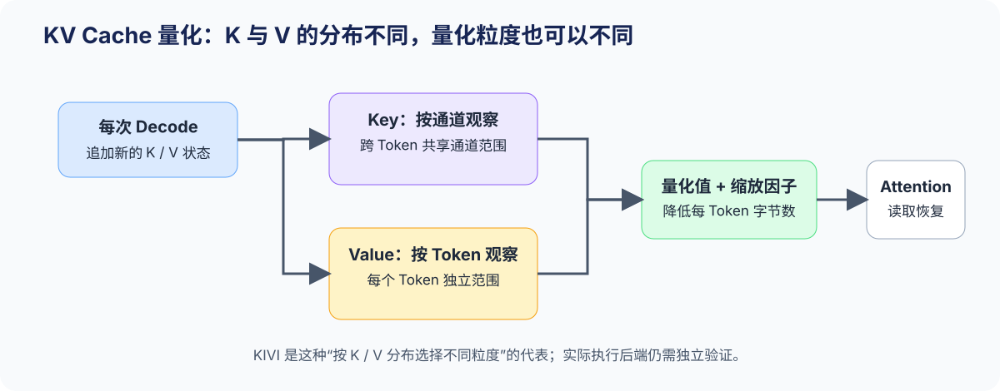
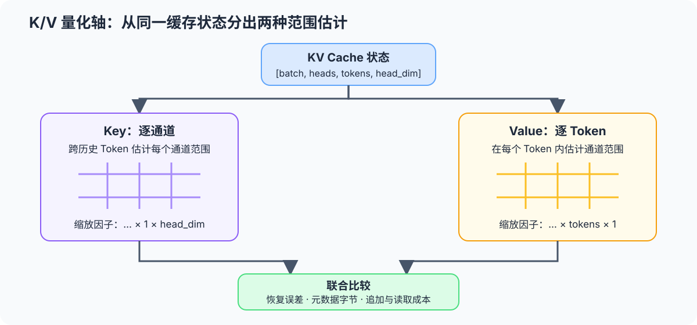

# 54. KV Cache Quantization Strategies | KV Cache 量化策略

**难度：** Hard　**环境：** CPU-first，GPU 可选　**标签：** `量化`, `KV Cache`, `KIVI`

> 🚀 **云端运行环境**
>
> 本章节的实战代码可以点击以下链接在免费 GPU 算力平台上直接运行：
>
> [](https://colab.research.google.com/github/datawhalechina/llm-algo-leetcode/blob/main/02_PyTorch_Algorithms/54_KV_Cache_Quantization_Strategies.ipynb)
> [](https://modelscope.cn/my/mynotebook) *(国内推荐：魔搭社区免费实例)*


## 本节导读

长上下文与高并发会让 KV Cache 成为推理显存和带宽的持续成本。K 和 V 虽然一起参与 Attention，却不必共享同一种量化轴。以 KIVI 为代表的方法从二者的分布差异出发，分别选择更合适的缩放粒度。

本节把状态追加、量化轴、恢复误差和容量收益连接起来，帮助你判断缓存变小是否值得承担额外的量化与恢复代价。
## 前置阅读

**导语：** 先了解 KV Cache 为什么随请求增长，再区分分页管理与量化：前者决定状态如何分配和复用，后者改变每个状态的表示与字节数。

- [Part 01 · 11 KV Cache 与显存增长](../01_Hardware_Math_and_Systems/11_KV_Cache_and_Memory_Growth.md)
- [52. 量化校准与误差控制](./52_Quantization_Calibration_and_Error.md)
- [22. vLLM PagedAttention](./22_vLLM_PagedAttention.md)

### Step 1：为什么 K 和 V 可以采用不同量化策略

每个 Decode 步都会追加新的 Key 和 Value（值状态），并在后续 Attention 中被反复读取。若统一采用一种全局缩放因子，既可能放大量化误差，也可能忽略 K 与 V 的不同分布。KIVI 的核心启发是：先按状态角色观察范围，再选择量化轴。

| 状态 | 在 Attention 中的作用 | 量化时关注 | 典型收益 |
|---|---|---|---|
| Key | 参与与 query 的匹配 | 通道范围、历史 token 的聚合 | 更低缓存容量与读取带宽 |
| Value（值状态） | 参与加权汇聚 | 每个 Token 的局部范围 | 更稳定的恢复误差 |
| 分页 / 前缀复用 | 管理状态的分配与复用 | 页、前缀与驻留策略 | 与量化互补，不改变位宽 |


### Step 2：两种量化轴如何决定缩放因子形状

本节采用 `[batch, heads, tokens, head_dim]` 的教学形状。Key 逐通道在 Token 维聚合范围，得到每个通道的缩放因子；Value 逐 Token 在 `head_dim` 维聚合范围，得到每个 Token 的缩放因子。两者都要求缩放因子能与量化张量正确广播。

| 方案 | 归约维度 | 缩放因子形状 | 适合回答的问题 |
|---|---|---|---|
| Key 逐通道 | Token 维 | `[..., 1, head_dim]` | 历史 Token 上同一通道如何共享范围 |
| Value 逐 Token | `head_dim` 维 | `[..., tokens, 1]` | 一个 Token 内各通道如何共享范围 |
| 单一分组策略 | 固定大小局部组 | 依 group 而定 | 实现简单，但未必适配 K/V 分布 |


### Step 3：追加状态、高精度残留窗口与 Decode 成本

KV Cache 在每个 Decode 步追加新 Token。KIVI 类策略不会要求所有状态在同一时刻以同一形式保存：较新的 Token 暂留在高精度残留窗口中，窗口溢出后，较旧状态再按 Key / Value 各自的轴进入量化区。已量化前缀保持不变，后续步骤只转存本轮溢出的旧状态，从而避免每追加一个 Token 就重写整段缓存。Decode 仍要承担缩放因子元数据读取、量化前缀恢复或量化计算内核的执行成本。容量收益必须与 TPOT 一起判断：状态更小可以提升并发，恢复开销却可能拖慢单请求 Decode。

| 状态或成本 | 更新方式 | 需要记录的证据 |
|---|---|---|
| 量化前缀 | 窗口溢出时只追加本轮转存段 | Token 数、数据字节、缩放因子元数据字节 |
| 高精度窗口 | 每步追加最新 K/V | `residual_length`、溢出频率 |
| Attention 读取 | 读取量化前缀与高精度窗口 | 是否融合反量化、每步读取字节 |
| Decode 代价 | 量化、恢复与计算内核调度 | TPOT、吞吐、峰值显存和质量 |

### Step 4：实现 K/V 异轴量化与追加状态

题目区用形状为 `[batch, heads, tokens, head_dim]` 的 K/V 状态复现异轴量化与多轮追加生命周期。骨架已经提供量化码生成、恢复、分段状态和两种字节口径；你需要补全 Key 量化轴、Value 量化轴，以及每轮应该从高精度窗口转存多少旧 Token。

| 任务与目的 | 已知条件 | 完成标准 | 测试验证 |
|:---|:---|:---|:---|
| TODO 1：建立 Key 逐通道缩放因子 | 四维 Key 与 `qmax/eps` | 沿 token 维聚合；缩放因子为 `[...,1,head_dim]` | 形状、有限恢复误差 |
| TODO 2：建立 Value 逐 Token 缩放因子 | 四维 Value 与 `qmax/eps` | 沿 `head_dim` 聚合；缩放因子为 `[...,tokens,1]` | 形状、全零输入与有限恢复误差 |
| TODO 3：计算本轮窗口转存量 | 已量化分段、高精度尾部和新 K/V | 只转存超过窗口的旧 Token；已量化前缀不重复处理 | 连续追加、未溢出、Token 守恒 |


```python
import torch
```


```python
class KVQuantizationStrategies:
    """教学化模拟 KIVI 的量化轴与追加状态。

    输入形状为 [batch, heads, tokens, head_dim]。Key 沿 token 维聚合范围，
    V 沿 `head_dim` 聚合范围；最新 token 保留在高精度残留窗口 中。
    """

    def __init__(self, qmax: int = 7, eps: float = 1e-8):
        # qmax=7 表示有符号 4-bit 的教学数值范围；张量仍以 int8 容器保存。
        self.qmax = qmax
        self.eps = eps

    def _quantize(self, x: torch.Tensor, scale: torch.Tensor):
        return torch.clamp(torch.round(x.float() * scale), -self.qmax, self.qmax).to(torch.int8)

    def restore(self, quantized: torch.Tensor, scale: torch.Tensor):
        """用与量化轴兼容的缩放因子恢复浮点近似值。"""
        return quantized.to(scale.dtype) / scale.clamp_min(self.eps)

    def quantize_key_per_channel(self, key: torch.Tensor):
        """沿 token 维估计每个通道的范围，得到 [..., 1, head_dim] 缩放因子。"""
        if key.ndim != 4:
            raise ValueError("key must have shape [batch, heads, tokens, head_dim].")
        # TODO 1（Key 量化轴）：沿 token 维保留维度地聚合 absmax，再生成可广播缩放因子。
        # 注意：全零通道的缩放因子仍需有限；不要沿 head_dim 聚合。
        # key_absmax = ???  # 沿 token 维聚合并保留维度。
        # key_scale = ???   # 形状可广播到 [..., tokens, head_dim]。
        # key_q = ???       # INT8 Key 量化码。
        raise NotImplementedError("TODO 1: quantize Key per channel")

    def quantize_value_per_token(self, value: torch.Tensor):
        """沿 head_dim 聚合每个 token 的范围，得到 [..., tokens, 1] 缩放因子。"""
        if value.ndim != 4:
            raise ValueError("value must have shape [batch, heads, tokens, head_dim].")
        # TODO 2（V 量化轴）：沿 head_dim 保留维度地聚合 absmax，再生成可广播缩放因子。
        # 注意：每个 token 保留独立缩放因子；不要沿 token 维聚合。
        # value_absmax = ???  # 沿 head_dim 聚合并保留维度。
        # value_scale = ???   # 每个 token 独立的缩放因子。
        # value_q = ???       # INT8 V 量化码。
        raise NotImplementedError("TODO 2: quantize Value per token")

    def append_and_partition(self, state: dict | None, new_key: torch.Tensor,
                             new_value: torch.Tensor, residual_length: int):
        """追加新状态，只量化本轮从高精度窗口溢出的旧 Token。"""
        if residual_length <= 0:
            raise ValueError("residual_length must be positive")
        if new_key.ndim != 4 or new_value.ndim != 4:
            raise ValueError("new_key and new_value must be four-dimensional")
        if new_key.shape != new_value.shape:
            raise ValueError("new_key and new_value must share the same shape")

        if state is None:
            empty_shape = new_key.shape[:-2] + (0, new_key.shape[-1])
            state = {
                "key_q_segments": [], "key_scale_segments": [],
                "value_q_segments": [], "value_scale_segments": [],
                "key_residual": new_key.new_empty(empty_shape),
                "value_residual": new_value.new_empty(empty_shape),
            }

        key_residual_all = torch.cat((state["key_residual"], new_key), dim=-2)
        value_residual_all = torch.cat((state["value_residual"], new_value), dim=-2)
        # TODO 3（窗口转存机制）：只计算本轮超过 residual_length 的旧 Token 数。
        # flush_tokens = ???  # 未溢出时为 0；不要把已量化分段重新计入。
        raise NotImplementedError("TODO 3: compute newly flushed token count")

        key_flush = key_residual_all[..., :flush_tokens, :]
        value_flush = value_residual_all[..., :flush_tokens, :]
        key_residual = key_residual_all[..., flush_tokens:, :]
        value_residual = value_residual_all[..., flush_tokens:, :]
        key_q_segments = list(state["key_q_segments"])
        key_scale_segments = list(state["key_scale_segments"])
        value_q_segments = list(state["value_q_segments"])
        value_scale_segments = list(state["value_scale_segments"])
        if flush_tokens:
            key_q, key_scale = self.quantize_key_per_channel(key_flush)
            value_q, value_scale = self.quantize_value_per_token(value_flush)
            key_q_segments.append(key_q)
            key_scale_segments.append(key_scale)
            value_q_segments.append(value_q)
            value_scale_segments.append(value_scale)

        quantized_tokens = sum(segment.shape[-2] for segment in key_q_segments)
        return {
            "key_q_segments": key_q_segments,
            "key_scale_segments": key_scale_segments,
            "value_q_segments": value_q_segments,
            "value_scale_segments": value_scale_segments,
            "key_residual": key_residual,
            "value_residual": value_residual,
            "flushed_tokens": flush_tokens,
            "quantized_tokens": quantized_tokens,
            "total_tokens": quantized_tokens + key_residual.shape[-2],
        }

    def compare(self, key: torch.Tensor, value: torch.Tensor):
        """返回两种量化状态的形状、字节与恢复误差。"""
        key_q, key_scale = self.quantize_key_per_channel(key)
        value_q, value_scale = self.quantize_value_per_token(value)
        key_restored = self.restore(key_q, key_scale)
        value_restored = self.restore(value_q, value_scale)
        return {
            "key_scale_shape": tuple(key_scale.shape),
            "value_scale_shape": tuple(value_scale.shape),
            "key_mse": torch.mean((key.float() - key_restored) ** 2),
            "value_mse": torch.mean((value.float() - value_restored) ** 2),
            "raw_bytes": key.numel() * key.element_size() + value.numel() * value.element_size(),
            "container_quantized_bytes": (key_q.numel() * key_q.element_size()
                                          + value_q.numel() * value_q.element_size()
                                          + key_scale.numel() * key_scale.element_size()
                                          + value_scale.numel() * value_scale.element_size()),
            "packed_quantized_bytes": ((key_q.numel() + value_q.numel() + 1) // 2
                                       + key_scale.numel() * key_scale.element_size()
                                       + value_scale.numel() * value_scale.element_size()),
        }

```

### 测试

八项测试分别验证 K/V 量化轴、全零范围、多轮追加、已量化分段保持不变、高精度窗口边界和两种字节口径；三个机制 TODO 均有独立测试入口。


```python
# 机制测试：K/V 量化轴、追加状态、高精度残留窗口与容量账本。
def test_key_per_channel_scale_shape():
    """TODO 1：Key 缩放因子在 token 维为 1，并保留 head_dim。"""
    key = torch.randn(1, 2, 5, 8)
    key_q, key_scale = KVQuantizationStrategies().quantize_key_per_channel(key)
    assert key_q.shape == key.shape
    assert key_scale.shape == (1, 2, 1, 8)


def test_value_per_token_scale_shape():
    """TODO 2：数值缩放因子为每个 token 保留一个标量。"""
    value = torch.randn(1, 2, 5, 8)
    value_q, value_scale = KVQuantizationStrategies().quantize_value_per_token(value)
    assert value_q.shape == value.shape
    assert value_scale.shape == (1, 2, 5, 1)


def test_append_state_contract():
    """骨架契约：追加后 K/V token 总数守恒。"""
    strategy = KVQuantizationStrategies()
    key = torch.randn(1, 2, 3, 8)
    value = torch.randn(1, 2, 3, 8)
    new_key = torch.randn(1, 2, 2, 8)
    new_value = torch.randn(1, 2, 2, 8)
    state = strategy.append_and_partition(None, key, value, residual_length=4)
    state = strategy.append_and_partition(state, new_key, new_value, residual_length=4)
    assert state["total_tokens"] == 5
    assert state["quantized_tokens"] + state["key_residual"].shape[-2] == 5
    assert state["quantized_tokens"] + state["value_residual"].shape[-2] == 5


def test_residual_window_partition_contract():
    """TODO 3：超过窗口的旧前缀量化，最新 token 保持高精度。"""
    key = torch.randn(1, 2, 3, 8)
    value = torch.randn(1, 2, 3, 8)
    new_key = torch.randn(1, 2, 2, 8)
    new_value = torch.randn(1, 2, 2, 8)
    strategy = KVQuantizationStrategies()
    state = strategy.append_and_partition(None, key, value, residual_length=2)
    state = strategy.append_and_partition(state, new_key, new_value, residual_length=2)
    assert state["quantized_tokens"] == 3
    assert sum(segment.shape[-2] for segment in state["key_q_segments"]) == 3
    assert state["key_residual"].shape[-2] == 2
    assert state["value_residual"].shape[-2] == 2


def test_previous_quantized_segments_are_not_rewritten():
    """TODO 3：连续追加只增加新分段，不重写已量化前缀。"""
    strategy = KVQuantizationStrategies()
    state = strategy.append_and_partition(
        None, torch.randn(1, 1, 3, 4), torch.randn(1, 1, 3, 4), residual_length=2
    )
    first_segment = state["key_q_segments"][0].clone()
    state = strategy.append_and_partition(
        state, torch.randn(1, 1, 2, 4), torch.randn(1, 1, 2, 4), residual_length=2
    )
    assert len(state["key_q_segments"]) == 2
    assert torch.equal(state["key_q_segments"][0], first_segment)
    assert state["flushed_tokens"] == 2


def test_window_without_overflow_contract():
    """TODO 3 边界：缓存尚未超过窗口时，不应伪造量化前缀。"""
    key = torch.randn(1, 1, 1, 4)
    value = torch.randn(1, 1, 1, 4)
    new_key = torch.randn(1, 1, 1, 4)
    new_value = torch.randn(1, 1, 1, 4)
    strategy = KVQuantizationStrategies()
    state = strategy.append_and_partition(None, key, value, residual_length=4)
    state = strategy.append_and_partition(state, new_key, new_value, residual_length=4)
    assert state["quantized_tokens"] == 0
    assert state["flushed_tokens"] == 0
    assert state["key_residual"].shape[-2] == 2


def test_restore_and_budget_contract():
    """两种状态可恢复为有限值，并把缩放因子元数据计入字节账本。"""
    torch.manual_seed(0)
    key, value = torch.randn(1, 2, 7, 8), torch.randn(1, 2, 7, 8)
    result = KVQuantizationStrategies().compare(key, value)
    assert torch.isfinite(result["key_mse"]) and torch.isfinite(result["value_mse"])
    assert result["packed_quantized_bytes"] < result["raw_bytes"]
    assert result["packed_quantized_bytes"] < result["container_quantized_bytes"]


def test_zero_range_scale_is_finite():
    """TODO 1/2 边界：全零 K/V 不能产生无穷缩放因子。"""
    strategy = KVQuantizationStrategies()
    zeros = torch.zeros(1, 1, 3, 4)
    _, key_scale = strategy.quantize_key_per_channel(zeros)
    _, value_scale = strategy.quantize_value_per_token(zeros)
    assert torch.isfinite(key_scale).all() and torch.isfinite(value_scale).all()


def run_kv_strategy_tests():
    """汇总 K/V 异轴量化、追加状态与窗口边界的八项测试。"""
    for test in (test_key_per_channel_scale_shape, test_value_per_token_scale_shape,
                 test_append_state_contract, test_residual_window_partition_contract,
                 test_previous_quantized_segments_are_not_rewritten,
                 test_window_without_overflow_contract,
                 test_restore_and_budget_contract, test_zero_range_scale_is_finite):
        test()
    print("✅ KV Cache 策略测试通过：量化轴、追加状态、窗口边界与字节账本均已验证。")


run_kv_strategy_tests()

```

---

🛑 **STOP HERE** 🛑
<br><br><br><br><br><br><br><br><br><br>
> 请先尝试自己完成代码并跑通测试。<br>
> 如果遇到困难，再向下查看参考代码与解析。
<br><br><br><br><br><br><br><br><br><br>

---
## 参考代码与解析

### 代码

```python
class KVQuantizationStrategies:
    """教学化模拟 KIVI 的量化轴与追加状态。

    输入形状为 [batch, heads, tokens, head_dim]。Key 沿 token 维聚合范围，
    V 沿 `head_dim` 聚合范围；最新 token 保留在高精度残留窗口 中。
    """

    def __init__(self, qmax: int = 7, eps: float = 1e-8):
        # qmax=7 表示有符号 4-bit 的教学数值范围；张量仍以 int8 容器保存。
        self.qmax = qmax
        self.eps = eps

    def _quantize(self, x: torch.Tensor, scale: torch.Tensor):
        return torch.clamp(torch.round(x.float() * scale), -self.qmax, self.qmax).to(torch.int8)

    def restore(self, quantized: torch.Tensor, scale: torch.Tensor):
        """用与量化轴兼容的缩放因子恢复浮点近似值。"""
        return quantized.to(scale.dtype) / scale.clamp_min(self.eps)

    def quantize_key_per_channel(self, key: torch.Tensor):
        """沿 token 维估计每个通道的范围，得到 [..., 1, head_dim] 缩放因子。"""
        if key.ndim != 4:
            raise ValueError("key must have shape [batch, heads, tokens, head_dim].")
        # TODO 1（Key 量化轴）：沿 token 维保留维度地聚合 absmax，再生成可广播缩放因子。
        # 注意：全零通道的缩放因子仍需有限；不要沿 head_dim 聚合。
        # key_absmax = ???  # 沿 token 维聚合并保留维度。
        # key_scale = ???   # 形状可广播到 [..., tokens, head_dim]。
        # key_q = ???       # INT8 Key 量化码。
        key_absmax = key.float().abs().amax(dim=-2, keepdim=True)
        key_scale = self.qmax / key_absmax.clamp_min(self.eps)
        key_q = self._quantize(key, key_scale)
        return key_q, key_scale

    def quantize_value_per_token(self, value: torch.Tensor):
        """沿 head_dim 聚合每个 token 的范围，得到 [..., tokens, 1] 缩放因子。"""
        if value.ndim != 4:
            raise ValueError("value must have shape [batch, heads, tokens, head_dim].")
        # TODO 2（V 量化轴）：沿 head_dim 保留维度地聚合 absmax，再生成可广播缩放因子。
        # 注意：每个 token 保留独立缩放因子；不要沿 token 维聚合。
        # value_absmax = ???  # 沿 head_dim 聚合并保留维度。
        # value_scale = ???   # 每个 token 独立的缩放因子。
        # value_q = ???       # INT8 V 量化码。
        value_absmax = value.float().abs().amax(dim=-1, keepdim=True)
        value_scale = self.qmax / value_absmax.clamp_min(self.eps)
        value_q = self._quantize(value, value_scale)
        return value_q, value_scale

    def append_and_partition(self, state: dict | None, new_key: torch.Tensor,
                             new_value: torch.Tensor, residual_length: int):
        """追加新状态，只量化本轮从高精度窗口溢出的旧 Token。"""
        if residual_length <= 0:
            raise ValueError("residual_length must be positive")
        if new_key.ndim != 4 or new_value.ndim != 4:
            raise ValueError("new_key and new_value must be four-dimensional")
        if new_key.shape != new_value.shape:
            raise ValueError("new_key and new_value must share the same shape")

        if state is None:
            empty_shape = new_key.shape[:-2] + (0, new_key.shape[-1])
            state = {
                "key_q_segments": [], "key_scale_segments": [],
                "value_q_segments": [], "value_scale_segments": [],
                "key_residual": new_key.new_empty(empty_shape),
                "value_residual": new_value.new_empty(empty_shape),
            }

        key_residual_all = torch.cat((state["key_residual"], new_key), dim=-2)
        value_residual_all = torch.cat((state["value_residual"], new_value), dim=-2)
        # TODO 3（窗口转存机制）：只计算本轮超过 residual_length 的旧 Token 数。
        flush_tokens = max(key_residual_all.shape[-2] - residual_length, 0)

        key_flush = key_residual_all[..., :flush_tokens, :]
        value_flush = value_residual_all[..., :flush_tokens, :]
        key_residual = key_residual_all[..., flush_tokens:, :]
        value_residual = value_residual_all[..., flush_tokens:, :]
        key_q_segments = list(state["key_q_segments"])
        key_scale_segments = list(state["key_scale_segments"])
        value_q_segments = list(state["value_q_segments"])
        value_scale_segments = list(state["value_scale_segments"])
        if flush_tokens:
            key_q, key_scale = self.quantize_key_per_channel(key_flush)
            value_q, value_scale = self.quantize_value_per_token(value_flush)
            key_q_segments.append(key_q)
            key_scale_segments.append(key_scale)
            value_q_segments.append(value_q)
            value_scale_segments.append(value_scale)

        quantized_tokens = sum(segment.shape[-2] for segment in key_q_segments)
        return {
            "key_q_segments": key_q_segments,
            "key_scale_segments": key_scale_segments,
            "value_q_segments": value_q_segments,
            "value_scale_segments": value_scale_segments,
            "key_residual": key_residual,
            "value_residual": value_residual,
            "flushed_tokens": flush_tokens,
            "quantized_tokens": quantized_tokens,
            "total_tokens": quantized_tokens + key_residual.shape[-2],
        }

    def compare(self, key: torch.Tensor, value: torch.Tensor):
        """返回两种量化状态的形状、字节与恢复误差。"""
        key_q, key_scale = self.quantize_key_per_channel(key)
        value_q, value_scale = self.quantize_value_per_token(value)
        key_restored = self.restore(key_q, key_scale)
        value_restored = self.restore(value_q, value_scale)
        return {
            "key_scale_shape": tuple(key_scale.shape),
            "value_scale_shape": tuple(value_scale.shape),
            "key_mse": torch.mean((key.float() - key_restored) ** 2),
            "value_mse": torch.mean((value.float() - value_restored) ** 2),
            "raw_bytes": key.numel() * key.element_size() + value.numel() * value.element_size(),
            "container_quantized_bytes": (key_q.numel() * key_q.element_size()
                                          + value_q.numel() * value_q.element_size()
                                          + key_scale.numel() * key_scale.element_size()
                                          + value_scale.numel() * value_scale.element_size()),
            "packed_quantized_bytes": ((key_q.numel() + value_q.numel() + 1) // 2
                                       + key_scale.numel() * key_scale.element_size()
                                       + value_scale.numel() * value_scale.element_size()),
        }

```

### 解析

**TODO 1：Key 量化轴。** 沿 token 维聚合范围，使每个通道保留独立缩放因子；缩放因子形状为 `[..., 1, head_dim]`。

**TODO 2：Value 量化轴。** 沿 `head_dim` 聚合范围，使每个 Token 保留独立缩放因子；缩放因子形状为 `[..., tokens, 1]`。

**TODO 3：高精度残留窗口转存。** 每轮只计算当前高精度尾部超过 `residual_length` 的 Token 数，将这部分追加为新的量化分段；已量化分段保持不变，最新状态继续留在高精度窗口。连续追加测试同时检查 Token 守恒和旧分段未被重写。

教学张量仍用 INT8 容器承载有符号 4-bit 量化码，因此字节账本同时报告容器实际字节与理论 4-bit 打包字节；容量判断使用后者，不能把 PyTorch 容器大小误写成真实低比特产物大小。

### Step 5：可选 GPU 实验——用 Transformers 比较浮点与量化 KV Cache

CPU 题目验证 K/V 异轴量化、追加状态和高精度残留窗口；GPU 实验让 Transformers 的真实 `DynamicCache` 与 `QuantizedCache` 在同一模型快照下配对运行：上下文矩阵观察容量随长度的变化，残留窗口矩阵观察 Decode 追加状态何时转入低比特区。

| 学习问题 | CPU 已确认 | GPU 要确认 |
|---|---|---|
| 缓存量化何时值得启用 | 量化轴、追加状态、残留窗口与容量账本 | 真实缓存路径的增量峰值、固定轨迹质量、生成代价与残留窗口差异 |

#### 5.1 固定环境、模型与缓存候选矩阵

本实验使用 `Q-CUDA-MECHANISM`。首次运行先完成[量化机制 GPU 环境 Quickstart](../topic_discussion/quantization_compression/quickstart.md#q-cuda-mechanism-quickstart)，已有环境执行 Profile 预检后再启动 JupyterLab。HQQ 只承担 Transformers 缓存量化机制，不代表 vLLM 或 SGLang 的 Serving 后端。

容量矩阵固定残留窗口，只改变上下文长度；窗口矩阵固定上下文和生成长度，只改变残留窗口。当前 HQQ 路径要求 K/V 都使用 `axis=1`，因此 GPU 实验验证量化缓存的生命周期、容量、质量和延迟，不验证 CPU 部分所讲的 K/V 异轴策略优于同轴策略。正式复测只修改运行模式与标签；改变模型、矩阵或缓存位宽时，需要递增工作负载版本。

| 配置层 | 本节固定口径 | 修改规则 |
|---|---|---|
| 环境 | `Q-CUDA-MECHANISM`；Transformers + HQQ；单张 NVIDIA GPU | 不与 vLLM/SGLang 环境混装 |
| 模型与输入 | `Qwen/Qwen2.5-0.5B-Instruct`；固定提示并扩展到目标长度 | 模型或提示改变后新建运行记录 |
| 容量矩阵 | 512 / 2048 / 4096 Token；生成 64 Token；残留窗口固定 128 | 每次只改变上下文长度和缓存实现 |
| 窗口矩阵 | 512 Token 上下文；生成 128 Token；残留窗口 16 / 32 / 64 | 每次只改变缓存实现与残留窗口 |
| 候选配置 | HQQ 4 位；分组大小 64；K/V 均使用 `axis=1` | 只形成 HQQ 同轴缓存证据，不替代 KIVI 异轴实现 |
| 测量指标 | 增量峰值、生成平均毫秒/Token、固定轨迹 NLL、Top-k 重合率、生成分歧 | 不把整段平均耗时解释为 TTFT 或 TPOT |
| 准入门槛 | NLL 平均增量 ≤ 0.50；Top-5 平均重合率 ≥ 0.60；延迟比 ≤ 2.00 | NLL ratio 与贪心一致率仅作诊断 |
| 结果资产 | 配对矩阵 JSON | 正式复测使用唯一 `RUN_LABEL` |


```python
# 5.1 只定义模型、缓存策略与测量口径；默认不下载模型、不占用 GPU。
import os
from pathlib import Path

# 学习者入口：普通复测通常只修改这两项。
RUN_MODE = "dry_run"  # 默认值 dry_run：只登记计划；确认环境后改为 real_gpu。
RUN_LABEL = "default18"  # 默认值 default18；正式复测改为唯一标签，避免覆盖旧结果。

# 模型来源：main 会在 5.2 自动解析为本次运行使用的不可变 commit。
MODEL_ID = "Qwen/Qwen2.5-0.5B-Instruct"  # 单卡机制基线；换模型后不得合并旧结果。
MODEL_REVISION = "main"  # 可填写分支、标签或 commit hash。
HF_HUB_CACHE = os.getenv("HF_HUB_CACHE")  # 可选模型缓存环境变量；未设置时使用默认目录。
MODEL_CACHE_DIR = Path(HF_HUB_CACHE) if HF_HUB_CACHE else None  # 传给模型加载器的缓存路径。
LOCAL_FILES_ONLY = False  # 首次运行允许下载；模型已缓存且需离线复测时改为 True。

# 固定实验身份：协议改变时递增版本，不把版本编码进稳定 ID。
ENVIRONMENT_PROFILE = "Q-CUDA-MECHANISM"  # 运行前必须通过同名 Profile 预检。
WORKLOAD_ID = "quant-kv-runtime"  # 浮点缓存与量化缓存的配对矩阵。
WORKLOAD_VERSION = "v5"  # v5 使用 NLL 绝对增量准入，并按绝对显存节省选择候选。

# 工作负载与候选矩阵：改变下列内容时递增 WORKLOAD_VERSION。
PROMPT = "Explain why KV Cache grows with context length."  # 重复分词结果以构造精确上下文长度。
CONTEXT_LENGTHS = (512, 2048, 4096)  # 容量矩阵：从短上下文推进到缓存容量开始主导的区间。
CONTEXT_MATRIX_NEW_TOKENS = 64  # 容量矩阵固定生成长度，只比较上下文增长。
FIXED_RESIDUAL_LENGTH = 128  # 容量矩阵固定高精度残留窗口。
WINDOW_CONTEXT_LENGTH = 512  # 窗口矩阵固定上下文，避免与容量变量混杂。
WINDOW_MATRIX_NEW_TOKENS = 128  # 必须大于最大残留窗口，使窗口转存真实发生。
MODEL_DTYPE = "bfloat16"  # 与量化专题其他真实模型实验保持同一浮点基线。
CACHE_BACKEND = "hqq"  # Transformers QuantizedCache 支持的量化执行后端。
KV_NBITS = 4  # 历史 K/V 的目标位宽。
Q_GROUP_SIZE = 64  # HQQ 量化分组大小；改变后需要新建工作负载版本。
RESIDUAL_LENGTHS = (16, 32, 64)  # 窗口矩阵覆盖多次转存、较少转存与边界转存。
WARMUP_STEPS = 1  # 每种缓存候选正式计时前的预热次数。
REPEAT_STEPS = 3  # 每种缓存候选重复生成次数。
QUALITY_TOKENS = 16  # 固定轨迹质量评估使用的 continuation 长度。
TOP_K = 5  # 比较每步候选分布中前 K 个 Token 的集合重合率。
MAX_MEAN_NLL_DELTA = 0.50  # 候选平均 NLL 减去浮点基线平均 NLL 的最高允许增量。
MIN_TOPK_OVERLAP = 0.60  # 候选与浮点基线每步 Top-k 集合的最低平均重合率。
MAX_LATENCY_RATIO = 2.00  # 候选整段生成耗时最多为浮点基线的 2 倍；不是严格 TPOT 门槛。
SEED = 42  # 固定 greedy 生成与输入构造。

OUTPUT_RELATIVE_PATH = (  # 5.2 写入的仓库相对结果路径。
    f"02_PyTorch_Algorithms/benchmarks/results/54_transformers_quantized_cache_matrix_{RUN_LABEL}.json"
)

```

#### 5.2 执行浮点 / 量化缓存配对实验

真实运行复用同一个模型。容量矩阵固定残留窗口并改变上下文长度，同时在固定 continuation 上比较 NLL 与 Top-k；窗口矩阵固定上下文并生成 128 Token，使 16 / 32 / 64 三种窗口发生不同次数的状态转存。HQQ 使用 K/V 的 `axis=1`，依赖或后端失败会写入 JSON，不会被记成量化收益。


```python
# 5.2 使用 Transformers 的真实缓存实现执行配对实验，并保存可复测 JSON。
from tools.notebook_runtime import package_version, resolve_model_commit
from tools.project_runtime import resolve_project_root

import hashlib
import importlib.metadata
import json
import platform
import statistics
import time

import torch
import torch.nn.functional as F

REPO_ROOT = resolve_project_root()
OUTPUT_PATH = REPO_ROOT / OUTPUT_RELATIVE_PATH


def synchronize():
    """在 CUDA 计时边界同步设备，避免只测到异步提交时间。"""
    if torch.cuda.is_available():
        torch.cuda.synchronize()


result = {
    "schema_version": "quantization-mechanism-gpu/v7",
    "chapter": "54",
    "run_mode": RUN_MODE,
    "run_label": RUN_LABEL,
    "environment_profile": ENVIRONMENT_PROFILE,
    "framework": {
        "python": platform.python_version(),
        "torch": torch.__version__,
        "transformers": package_version("transformers"),
        "hqq": package_version("hqq"),
    },
    "hardware": {
        "cuda_available": torch.cuda.is_available(),
        "cuda": torch.version.cuda,
        "device": torch.cuda.get_device_name(0) if torch.cuda.is_available() else None,
        "total_memory_bytes": torch.cuda.get_device_properties(0).total_memory if torch.cuda.is_available() else None,
        "compute_capability": list(torch.cuda.get_device_capability(0)) if torch.cuda.is_available() else None,
    },
    "workload": {
        "workload_id": WORKLOAD_ID,
        "workload_version": WORKLOAD_VERSION,
        "model_id": MODEL_ID,
        "model_revision": MODEL_REVISION,
        "resolved_model_commit": None,
        "revision_resolution_source": None,
        "cache_dir": str(MODEL_CACHE_DIR) if MODEL_CACHE_DIR else None,
        "context_lengths": list(CONTEXT_LENGTHS),
        "context_matrix_new_tokens": CONTEXT_MATRIX_NEW_TOKENS,
        "fixed_residual_length": FIXED_RESIDUAL_LENGTH,
        "window_context_length": WINDOW_CONTEXT_LENGTH,
        "window_matrix_new_tokens": WINDOW_MATRIX_NEW_TOKENS,
        "model_dtype": MODEL_DTYPE,
        "residual_lengths": list(RESIDUAL_LENGTHS),
        "warmup_steps": WARMUP_STEPS,
        "repeat_steps": REPEAT_STEPS,
        "quality_tokens": QUALITY_TOKENS,
        "top_k": TOP_K,
        "max_mean_nll_delta": MAX_MEAN_NLL_DELTA,
        "min_topk_overlap": MIN_TOPK_OVERLAP,
        "max_latency_ratio": MAX_LATENCY_RATIO,
        "seed": SEED,
        "run_label": RUN_LABEL,
        "prompt_sha256": hashlib.sha256(PROMPT.encode("utf-8")).hexdigest(),
    },
    "baseline": {"name": "dynamic_cache"},
    "candidate_family": {
        "name": "quantized_cache",
        "backend": CACHE_BACKEND,
        "nbits": KV_NBITS,
        "q_group_size": Q_GROUP_SIZE,
        "residual_lengths": list(RESIDUAL_LENGTHS),
    },
    "measurement_matrix": [],
    "mechanism_metrics": {},
    "failure": None,
    "evidence_level": "environment_preflight",
    "decision": "ready_to_measure",
}

if RUN_MODE == "real_gpu":
    try:
        if not torch.cuda.is_available():
            raise RuntimeError("RUN_MODE=real_gpu 但 CUDA 不可用")

        from transformers import AutoModelForCausalLM, AutoTokenizer

        resolved_commit, resolution_source = resolve_model_commit(
            MODEL_ID, MODEL_REVISION, MODEL_CACHE_DIR, LOCAL_FILES_ONLY
        )
        result["workload"]["resolved_model_commit"] = resolved_commit
        result["workload"]["revision_resolution_source"] = resolution_source
        model_dtype = {"bfloat16": torch.bfloat16, "float16": torch.float16}[MODEL_DTYPE]

        torch.manual_seed(SEED)
        tokenizer = AutoTokenizer.from_pretrained(
            MODEL_ID, revision=resolved_commit, cache_dir=MODEL_CACHE_DIR,
            local_files_only=LOCAL_FILES_ONLY, use_fast=True,
        )
        model = AutoModelForCausalLM.from_pretrained(
            MODEL_ID,
            revision=resolved_commit,
            cache_dir=MODEL_CACHE_DIR,
            local_files_only=LOCAL_FILES_ONLY,
            dtype=model_dtype,
        ).to("cuda").eval()

        def build_input_ids(token_count):
            """用真实文本 token 构造精确长度的上下文。"""
            token_ids = tokenizer(PROMPT, add_special_tokens=False)["input_ids"]
            if not token_ids:
                token_ids = [tokenizer.eos_token_id]
            repeated = (token_ids * ((token_count + len(token_ids) - 1) // len(token_ids)))[:token_count]
            return torch.tensor([repeated], device="cuda", dtype=torch.long)

        def run_cache(input_ids, cache_implementation, max_new_tokens, cache_config=None):
            """测量一种缓存实现的增量显存、同步延迟与输出 token。"""
            attention_mask = torch.ones_like(input_ids)
            base_generate_kwargs = {
                "input_ids": input_ids,
                "attention_mask": attention_mask,
                "max_new_tokens": max_new_tokens,
                "min_new_tokens": max_new_tokens,
                "do_sample": False,
                "use_cache": True,
                "cache_implementation": cache_implementation,
                "pad_token_id": tokenizer.eos_token_id,
            }
            expected_cache_config = dict(cache_config) if cache_config is not None else None

            def generate_once():
                """为单次生成复制缓存配置，隔离 Transformers 的原地修改。"""
                call_kwargs = dict(base_generate_kwargs)
                if expected_cache_config is not None:
                    call_kwargs["cache_config"] = dict(expected_cache_config)
                return model.generate(**call_kwargs)

            with torch.inference_mode():
                for _ in range(WARMUP_STEPS):
                    generate_once()

                torch.cuda.empty_cache()
                synchronize()
                base_allocated = torch.cuda.memory_allocated()
                base_reserved = torch.cuda.memory_reserved()
                torch.cuda.reset_peak_memory_stats()
                timings_ms = []
                generated = None
                for _ in range(REPEAT_STEPS):
                    synchronize()
                    started = time.perf_counter()
                    generated = generate_once()
                    synchronize()
                    timings_ms.append((time.perf_counter() - started) * 1000.0)

            if cache_config is not None and cache_config != expected_cache_config:
                raise RuntimeError("cache_config 在生成过程中发生了原地修改")

            generated_tokens = generated[:, input_ids.shape[1]:].detach().cpu()
            return {
                "median_latency_ms": statistics.median(timings_ms),
                "min_latency_ms": min(timings_ms),
                "generated_tokens": int(generated_tokens.shape[1]),
                "generation_ms_per_token": statistics.median(timings_ms) / max(1, generated_tokens.shape[1]),
                "base_allocated_bytes": int(base_allocated),
                "base_reserved_bytes": int(base_reserved),
                "peak_allocated_bytes": int(torch.cuda.max_memory_allocated()),
                "peak_reserved_bytes": int(torch.cuda.max_memory_reserved()),
                "incremental_peak_allocated_bytes": int(
                    max(0, torch.cuda.max_memory_allocated() - base_allocated)
                ),
                "incremental_peak_reserved_bytes": int(
                    max(0, torch.cuda.max_memory_reserved() - base_reserved)
                ),
                "output_token_ids": generated_tokens.tolist(),
            }

        from transformers import DynamicCache, QuantizedCache

        axis = 1 if CACHE_BACKEND == "hqq" else 0

        def build_cache_config(residual_length):
            """返回可独立传入生成或质量评估路径的量化缓存配置。"""
            return {
                "backend": CACHE_BACKEND,
                "nbits": KV_NBITS,
                "axis_key": axis,
                "axis_value": axis,
                "q_group_size": Q_GROUP_SIZE,
                "residual_length": residual_length,
            }

        def evaluate_fixed_continuation(input_ids, continuation_ids, cache_implementation, cache_config=None):
            """在固定 continuation 上计算平均 NLL 和逐步 Top-k，避免生成分歧累积。"""
            if cache_implementation == "dynamic":
                cache = DynamicCache(config=model.config)
            else:
                cache = QuantizedCache(config=model.config, **dict(cache_config))
            nll_sum = 0.0
            topk_token_ids = []
            with torch.inference_mode():
                outputs = model(input_ids=input_ids, past_key_values=cache, use_cache=True)
                for step in range(continuation_ids.shape[1]):
                    logits = outputs.logits[:, -1, :].float()
                    target = continuation_ids[:, step]
                    nll_sum += float(F.cross_entropy(logits, target, reduction="sum").item())
                    topk_token_ids.append(logits.topk(TOP_K, dim=-1).indices[0].tolist())
                    if step + 1 < continuation_ids.shape[1]:
                        outputs = model(
                            input_ids=target[:, None],
                            past_key_values=outputs.past_key_values,
                            use_cache=True,
                        )
            return {
                "mean_nll": nll_sum / max(1, continuation_ids.shape[1]),
                "evaluated_tokens": int(continuation_ids.shape[1]),
                "topk_token_ids": topk_token_ids,
            }

        def compare_outputs(baseline_output, candidate_output):
            """返回贪心生成分歧诊断；该指标不作为唯一质量门槛。"""
            width = max(1, min(len(baseline_output), len(candidate_output)))
            matches = [left == right for left, right in zip(baseline_output, candidate_output)]
            return {
                "greedy_output_exact_match": baseline_output == candidate_output,
                "token_agreement_rate": sum(matches) / width,
                "first_divergence_index": next(
                    (index for index, matched in enumerate(matches) if not matched), None
                ),
            }

        capacity_baselines = {}
        capacity_rows = []
        fixed_cache_config = build_cache_config(FIXED_RESIDUAL_LENGTH)
        for context_length in CONTEXT_LENGTHS:
            input_ids = build_input_ids(context_length)
            baseline_metrics = run_cache(
                input_ids, "dynamic", CONTEXT_MATRIX_NEW_TOKENS
            )
            baseline_output = baseline_metrics.pop("output_token_ids")[0]
            continuation = torch.tensor(
                [baseline_output[:QUALITY_TOKENS]], device="cuda", dtype=torch.long
            )
            baseline_quality = evaluate_fixed_continuation(
                input_ids, continuation, "dynamic"
            )
            baseline_topk = baseline_quality.pop("topk_token_ids")
            candidate_metrics = run_cache(
                input_ids, "quantized", CONTEXT_MATRIX_NEW_TOKENS, fixed_cache_config
            )
            candidate_output = candidate_metrics.pop("output_token_ids")[0]
            candidate_quality = evaluate_fixed_continuation(
                input_ids, continuation, "quantized", fixed_cache_config
            )
            candidate_topk = candidate_quality.pop("topk_token_ids")
            topk_overlap = statistics.mean(
                len(set(left) & set(right)) / TOP_K
                for left, right in zip(baseline_topk, candidate_topk)
            )
            nll_delta = candidate_quality["mean_nll"] - baseline_quality["mean_nll"]
            nll_ratio = candidate_quality["mean_nll"] / max(1e-9, baseline_quality["mean_nll"])
            peak_saved_bytes = (
                baseline_metrics["incremental_peak_allocated_bytes"]
                - candidate_metrics["incremental_peak_allocated_bytes"]
            )
            peak_reduction = 1.0 - (
                candidate_metrics["incremental_peak_allocated_bytes"]
                / max(1, baseline_metrics["incremental_peak_allocated_bytes"])
            )
            latency_ratio = candidate_metrics["median_latency_ms"] / max(
                1e-9, baseline_metrics["median_latency_ms"]
            )
            capacity_baselines[str(context_length)] = {
                "performance": baseline_metrics,
                "quality": baseline_quality,
            }
            capacity_rows.append({
                "matrix_role": "context_capacity",
                "context_length": context_length,
                "max_new_tokens": CONTEXT_MATRIX_NEW_TOKENS,
                "residual_length": FIXED_RESIDUAL_LENGTH,
                "nbits": KV_NBITS,
                "q_group_size": Q_GROUP_SIZE,
                "axis_key": axis,
                "axis_value": axis,
                "baseline": baseline_metrics,
                "candidate": candidate_metrics,
                "baseline_quality": baseline_quality,
                "candidate_quality": candidate_quality,
                "fixed_continuation_nll_delta": nll_delta,
                "fixed_continuation_nll_ratio": nll_ratio,
                "mean_topk_overlap": topk_overlap,
                "incremental_peak_saved_bytes": peak_saved_bytes,
                "incremental_peak_reduction_ratio": peak_reduction,
                "latency_ratio_candidate_over_baseline": latency_ratio,
                **compare_outputs(baseline_output, candidate_output),
            })
            del input_ids, continuation

        window_input_ids = build_input_ids(WINDOW_CONTEXT_LENGTH)
        window_baseline = run_cache(
            window_input_ids, "dynamic", WINDOW_MATRIX_NEW_TOKENS
        )
        window_baseline_output = window_baseline.pop("output_token_ids")[0]
        window_rows = []
        for residual_length in RESIDUAL_LENGTHS:
            cache_config = build_cache_config(residual_length)
            candidate_metrics = run_cache(
                window_input_ids, "quantized", WINDOW_MATRIX_NEW_TOKENS, cache_config
            )
            candidate_output = candidate_metrics.pop("output_token_ids")[0]
            window_rows.append({
                "matrix_role": "residual_window",
                "context_length": WINDOW_CONTEXT_LENGTH,
                "max_new_tokens": WINDOW_MATRIX_NEW_TOKENS,
                "residual_length": residual_length,
                "expected_decode_window_flushes": WINDOW_MATRIX_NEW_TOKENS // residual_length,
                "nbits": KV_NBITS,
                "q_group_size": Q_GROUP_SIZE,
                "axis_key": axis,
                "axis_value": axis,
                "baseline": window_baseline,
                "candidate": candidate_metrics,
                "incremental_peak_saved_bytes": (
                    window_baseline["incremental_peak_allocated_bytes"]
                    - candidate_metrics["incremental_peak_allocated_bytes"]
                ),
                "incremental_peak_reduction_ratio": 1.0 - (
                    candidate_metrics["incremental_peak_allocated_bytes"]
                    / max(1, window_baseline["incremental_peak_allocated_bytes"])
                ),
                "latency_ratio_candidate_over_baseline": (
                    candidate_metrics["median_latency_ms"]
                    / max(1e-9, window_baseline["median_latency_ms"])
                ),
                **compare_outputs(window_baseline_output, candidate_output),
            })
        del window_input_ids

        memory_reduction_onset = next((
            row["context_length"] for row in capacity_rows
            if row["incremental_peak_reduction_ratio"] > 0
        ), None)
        eligible_rows = [
            row for row in capacity_rows
            if row["incremental_peak_reduction_ratio"] > 0
            and row["fixed_continuation_nll_delta"] <= MAX_MEAN_NLL_DELTA
            and row["mean_topk_overlap"] >= MIN_TOPK_OVERLAP
            and row["latency_ratio_candidate_over_baseline"] <= MAX_LATENCY_RATIO
        ]
        eligible_crossover = next((row["context_length"] for row in eligible_rows), None)
        selected = max(eligible_rows, key=lambda row: row["incremental_peak_saved_bytes"], default=None)

        result.update({
            "baseline": {
                "name": "dynamic_cache",
                "capacity_by_context": capacity_baselines,
                "residual_window": window_baseline,
            },
            "measurement_matrix": capacity_rows + window_rows,
            "mechanism_metrics": {
                "memory_reduction_onset_context": memory_reduction_onset,
                "eligible_crossover_context": eligible_crossover,
                "backend_axis": axis,
                "eligible_candidate_count": len(eligible_rows),
                "selected_candidate": ({
                    "context_length": selected["context_length"],
                    "residual_length": selected["residual_length"],
                    "incremental_peak_saved_bytes": selected["incremental_peak_saved_bytes"],
                    "incremental_peak_reduction_ratio": selected["incremental_peak_reduction_ratio"],
                    "latency_ratio_candidate_over_baseline": selected["latency_ratio_candidate_over_baseline"],
                    "fixed_continuation_nll_delta": selected["fixed_continuation_nll_delta"],
                    "fixed_continuation_nll_ratio": selected["fixed_continuation_nll_ratio"],
                    "mean_topk_overlap": selected["mean_topk_overlap"],
                } if selected else None),
            },
            "evidence_level": "matched_transformers_quantized_cache_context_window_matrix",
            "decision": "accept_local_cache_candidate" if selected else "tune_cache_policy",
        })
        del model
        torch.cuda.empty_cache()
    except Exception as exc:
        result.update({
            "failure": {
                "stage": "cache_execution",
                "type": type(exc).__name__,
                "message": str(exc),
            },
            "evidence_level": "failed_real_gpu_attempt",
            "decision": "reject_until_cache_configuration_fixed",
        })

OUTPUT_PATH.parent.mkdir(parents=True, exist_ok=True)
OUTPUT_PATH.write_text(json.dumps(result, ensure_ascii=False, indent=2), encoding="utf-8")
print({
    "result_path": OUTPUT_PATH.relative_to(REPO_ROOT).as_posix(),
    "failure": result.get("failure"),
    "evidence_level": result.get("evidence_level"),
    "decision": result.get("decision"),
})

```

#### 5.3 读取配对实验结果

结果读取与模型执行分开。先按 `matrix_role` 区分上下文容量和残留窗口，再复核增量显存、固定轨迹质量、生成分歧、失败原因和证据等级。


```python
# 5.3 只读取 5.2 保存的 JSON，并按运行身份、配对矩阵、候选决策分层展示。
if OUTPUT_PATH.exists():
    saved = json.loads(OUTPUT_PATH.read_text(encoding="utf-8"))
    workload = saved.get("workload", {})
    print("运行身份与决策")
    print({
        "run_label": saved.get("run_label"),
        "model_id": workload.get("model_id"),
        "resolved_model_commit": workload.get("resolved_model_commit"),
        "failure": saved.get("failure"),
        "evidence_level": saved.get("evidence_level"),
        "decision": saved.get("decision"),
    })
    rows = saved.get("measurement_matrix", [])
    print(f"\n缓存候选摘要（{len(rows)} 个）")
    for row in rows:
        print({
            "matrix_role": row.get("matrix_role"),
            "context_length": row.get("context_length"),
            "max_new_tokens": row.get("max_new_tokens"),
            "residual_length": row.get("residual_length"),
            "peak_saved_bytes": row.get("incremental_peak_saved_bytes"),
            "peak_reduction_ratio": row.get("incremental_peak_reduction_ratio"),
            "latency_ratio": row.get("latency_ratio_candidate_over_baseline"),
            "nll_delta": row.get("fixed_continuation_nll_delta"),
            "nll_ratio_diagnostic": row.get("fixed_continuation_nll_ratio"),
            "topk_overlap": row.get("mean_topk_overlap"),
            "token_agreement_rate": row.get("token_agreement_rate"),
            "first_divergence_index": row.get("first_divergence_index"),
        })
    print("\n容量起点、准入交叉点与候选决策")
    print(saved.get("mechanism_metrics", {}))
else:
    print(f"等待配对实验结果：{OUTPUT_PATH}")

```

#### 5.4 解释容量、代价与输出变化

判断顺序是：先确认模型 commit 与真实缓存路径，再用固定轨迹 NLL 绝对增量和 Top-k 重合率检查局部质量，随后比较容量收益和生成代价，最后观察残留窗口转存频率。NLL ratio 与贪心 Token 一致率只用于诊断，不参与候选准入。

`memory_reduction_onset_context` 只表示首次观察到正显存收益；`eligible_crossover_context` 还要求固定轨迹质量与延迟同时通过。即使本地候选通过，也只能证明 Transformers + HQQ 的缓存机制路径；vLLM/SGLang 的 TPOT、并发容量与后端稳定性仍需项目实验。

`default18` 在 RTX 5070 Ti Laptop 12 GiB 上完成了六组配对实验。512 Token 已出现约 18.1% 的增量峰值下降；2048 Token 节省约 17.3 MiB、延迟增加约 28.5%、固定轨迹 NLL 增量为 0.375、Top-5 重合率为 0.70，因此成为本地候选。4096 Token 虽节省约 34.5 MiB，但 NLL 增量升至 0.973、Top-5 重合率降至 0.55，未通过质量准入，说明上下文更长和显存节省更多都不能单独决定接受候选。

残留窗口从 16 增至 64 时，延迟比从 1.60 降至 1.25，而本次小模型实验观察到的增量峰值近似相同。低贪心 Token 一致率和较早分歧位置继续作为风险诊断；当前结论是接受 2048 Token 配置进入后续复测，而不是宣布生成质量等价或生产后端可用。

| 观察项 | 读取字段 | 本地应形成的结论 | 不能外推到 |
|---|---|---|---|
| 运行身份 | `resolved_model_commit`、`failure`、`evidence_level` | 是否真实进入固定模型快照的量化缓存路径 | 其他 Transformers/HQQ 版本 |
| 缓存容量收益 | `incremental_peak_saved_bytes`、`incremental_peak_reduction_ratio` | 哪个上下文开始降低增量峰值；通过准入后按绝对节省排序 | 模型常驻权重或整机显存 |
| 生成代价 | `generation_ms_per_token`、`latency_ratio_candidate_over_baseline` | 容量收益增加了多少整段平均生成时间 | 严格 TTFT、TPOT 与并发吞吐 |
| 固定轨迹质量 | `fixed_continuation_nll_delta`、`mean_topk_overlap` | 相同历史下候选分布是否通过准入 | 完整任务质量与开放式生成质量 |
| 生成分歧 | `token_agreement_rate`、`first_divergence_index` | 贪心轨迹从哪里开始分离 | 独立质量门槛 |
| 交叉点与决策 | `memory_reduction_onset_context`、`eligible_crossover_context`、`selected_candidate` | 区分开始省显存和真正通过准入 | Serving 后端可用性与生产部署 |

## 相关阅读

- [Transformers：KV Cache strategies](https://huggingface.co/docs/transformers/main/kv_cache)
- [KIVI 原论文](https://arxiv.org/abs/2402.02750)
- [KIVI 开源实现](https://github.com/jy-yuan/KIVI)
- [41. FP8 Runtime Low-Precision Paths | FP8 运行时低精度路径](./41_FP8_Runtime_Low_Precision_Paths.md)
- [24. Prefix Cache 匹配与复用](./24_Prefix_Cache_Matching_and_Reuse.md)
