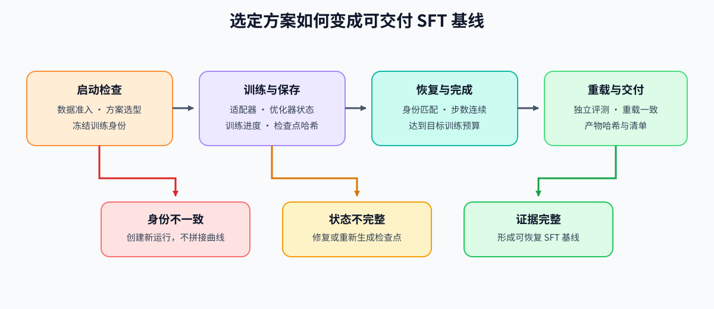
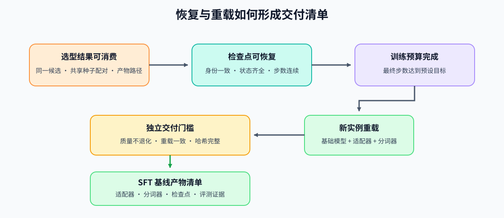

# 62. Instruction Fine Tuning Project | 指令微调项目
**难度：** Hard | **环境：** CPU-first | **标签：** `训练微调`, `指令微调`, `LoRA`, `项目评估` | **目标人群：** 已完成基础 SFT 训练、准备交付一次可复查微调实验的学习者

> 🚀 **云端运行环境**
>
> 本章节的实战代码可以点击以下链接在免费 GPU 算力平台上直接运行：
>
> [](https://colab.research.google.com/github/datawhalechina/llm-algo-leetcode/blob/main/02_PyTorch_Algorithms/62_Instruction_Fine_Tuning_Project.ipynb)
> [](https://modelscope.cn/my/mynotebook) *(国内推荐：魔搭社区免费实例)*


---

## 本节导读

本节把数据准入、训练配置、全参数微调与 LoRA 对照、验证样例和模型产物收成一次 SFT 项目交付。你会先确认指令数据与评测集是否可靠，再在相同模型、数据切分和训练条件下比较两种更新方式，最后依据质量、资源和 artifact 判断这一轮微调能否继续使用。完成后保留的 checkpoint 或 adapter 也将成为 DPO、GRPO 等后训练阶段可追溯的起点。

**关键词：** `instruction tuning`, `full fine-tuning`, `LoRA`, `evaluation`, `delivery`

---
## 前置阅读

**导语：** 进入本项目前，先能运行 SFT 训练闭环、LoRA 适配和学习率调度，再把注意力转向数据模板、格式稳定性和交付判断。

- [13. SFT Training Loop | SFT 训练循环](./13_SFT_Training_Loop.md)
- [14. LoRA Tutorial | LoRA 教程](./14_LoRA_Tutorial.md)
- [12. Optimizer Updates and Learning Rate Scheduling | 优化器更新与学习率调度](./12_Optimizer_Updates_and_Learning_Rate_Scheduling.md)
- [15. End-to-End Fine-Tuning Experiment | 端到端微调实验](./15_End_to_End_Fine_Tuning_Experiment.md)
---

### Step 1：确定 SFT 交付问题与候选方案

一次可交付的 SFT 实验同时回答三件事：数据是否能进入训练、两种更新方式的质量与资源差异是什么、最终应保存哪一种模型产物。全参数微调与 LoRA 使用同一任务、同一模型起点、同一训练/验证切分；唯一主动改变的变量是更新方式。

| 证据层 | 固定内容 | 比较或检查的对象 | 得到的判断 |
|:---|:---|:---|:---|
| 数据准入 | `instruction / input / response` 字段、模板与评测集 | 空字段、重复、长度与格式风险 | 数据是否值得进入训练 |
| 更新候选 | 模型 revision、split、dtype、batch、seq_len、steps、seed | 全参数更新与 LoRA 更新 | 质量与资源代价如何变化 |
| 交付产物 | tokenizer/chat template、checkpoint 或 adapter、配置与报告 | artifact 是否可加载、可复查 | 是否可进入后续对齐或部署 |



### Step 2：建立数据与评测的共同口径

训练和验证先共享同一字段映射与 prompt 模板。数据审计找出会直接破坏监督信号的问题；固定评测样例把训练后输出拆成格式通过与任务通过，避免只凭 loss 判断模型是否可用。

| 检查对象 | 观察量 | 为什么要先检查 |
|:---|:---|:---|
| 数据字段与模板 | 空字段、缺字段、重复、超长 prompt | 避免把无效样本或错误模板送入训练 |
| 验证划分与样例 | 固定 split、`eval_cases`、输出格式 | 让候选在同一输入上比较 |
| 监督位置 | 有效监督 token 与 padding 中误监督 token | 确认 loss 对应预期 response |

### Step 3：比较更新方式并保留可追溯产物

全参数微调更新底座权重；LoRA 冻结底座，只训练低秩适配器。比较时需要同时看可训练参数、峰值显存、每步时间和验证损失：资源收益不能掩盖质量退化，验证损失也不能替代 artifact 的可用性检查。

| 候选 | 更新对象 | 重点资源量 | 质量与交付检查 |
|:---|:---|:---|:---|
| 全参数微调 | 底座模型全部可训练参数 | 训练参数、峰值显存、step time | 作为同口径 baseline |
| LoRA | 指定线性层的低秩 adapter | 参数缩减、显存与耗时变化 | 验证损失、adapter/tokenizer、最小生成抽检 |



### Step 4：实现 CPU 项目检查与候选对照

题目区把项目逻辑拆为四个可测试职责：审计训练数据、检查格式、汇总样例质量、计算全参/LoRA 的同口径差值。配置打包、artifact 完整性检查和最终 `accept / tune / reject` 规则由骨架提供；测试分别覆盖数据 blocker、质量信号、差值方向和交付决策。

| TODO | 需要实现的机制 | 输入 | 输出与测试重点 |
|:---|:---|:---|:---|
| 1 | 数据摘要 | 指令记录与长度阈值 | 空 response、重复、超长与样本规模 |
| 2 | 格式准入 | 指令 batch | 缺字段、空字段与有效样本数 |
| 3 | 样例质量 | 固定评测输出 | 格式通过率与任务通过率分开统计 |
| 4 | 候选对照 | baseline 与 LoRA 指标 | 参数、显存、耗时、验证损失的差值方向 |

### Step 5：GPU 可选实验与交付决策

GPU 路径在固定模型、数据、split 和训练条件下运行全参数与 LoRA 候选，记录训练/验证损失、显存、耗时、吞吐、artifact 路径和环境。CPU 检查只能验证字段与比较逻辑；真实训练结论必须来自同口径的 GPU 结果。
#### 09–13 如何收束到 62 指令微调项目

`62` 将训练循环、优化器更新、有效 batch、LoRA 适配和数据审计收成一个 SFT 交付项目。它先判断数据与监督目标是否可信，再比较全参数与 LoRA 的质量—资源取舍，最后保存可供后续对齐复用的 checkpoint 或 adapter。

| 模块 | 必须记录 | 用途 |
|:---|:---|:---|
| 数据与模板 | 样本数、空/重复/超长、字段映射与 chat template | 判断输入与监督是否可靠 |
| 训练候选 | 模型 revision、更新方式、optimizer、effective batch、scheduler | 固定全参/LoRA 的比较口径 |
| 质量与资源 | train / val loss、样例通过率、peak memory、step time | 判断候选是否值得保留 |
| 交付产物 | checkpoint 或 adapter、tokenizer、配置、评测集与报告 | 支持 DPO/GRPO 或部署复核 |
| 决策 | `accept / tune / reject` | 给出下一步训练或数据动作 |
### 参数口径说明

`max_prompt_chars` 是训练前审计阈值，不是模型 token 上限；`instruction / input / response` 是固定字段映射；`eval_cases` 是独立于训练记录的最小评测集合。候选比较必须固定 model revision、数据 split、dtype、batch、seq_len、steps、optimizer、scheduler 和 seed；`peak_mem_mb`、`step_time_ms` 与 `final_val_loss` 分别记录资源代价和验证质量。

```python
from typing import Dict, List

```


```python
# 4 个核心 TODO：数据审计、格式准入、样例质量、全参/LoRA 候选对照。
# 目标：把 SFT 的数据、质量与资源证据整理成同一份项目判断；CPU 只验证机制与字段口径。

# TODO 1：统计指令数据集摘要
def summarize_instruction_dataset(records: List[Dict[str, str]], max_prompt_chars: int) -> Dict[str, float]:
    """统计样本数、空 response、重复样本和 prompt 长度风险。

    每条记录使用 instruction、input、response 字段；返回摘要字典，
    不计算模型 loss，也不把字符数当成 tokenizer token 数。
    """
    # 提示：重复键使用三字段组合；空 response 只按 response 判定。
    # total_samples = ???；empty_response_count = ???；duplicate_count = ???；over_length_count = ???。
    raise NotImplementedError("请先完成 TODO 1")

# TODO 2：检查格式是否合法
def check_instruction_format(batch: List[Dict[str, str]]) -> Dict[str, int]:
    """检查 instruction / response 必填字段和非空约束。

    返回 valid_count、missing_field_count 和 format_issue_count；
    缺字段与字段存在但为空必须分开统计。
    """
    # 提示：只有 instruction、response 都存在且非空时才计入 valid_count。
    # missing_field_count = ???；format_issue_count = ???；valid_count = ???。
    raise NotImplementedError("请先完成 TODO 2")

# TODO 3：汇总训练后样例抽检结果
def review_instruction_outputs(outputs: List[Dict[str, object]]) -> Dict[str, object]:
    """汇总固定样例的格式通过率和任务通过率。

    输入记录至少包含 format_ok、task_ok；空列表时通过率应为 0.0。
    format_ok 与 task_ok 分别对应输出格式和最小任务目标，不能合并成一个通过率。
    """
    # 提示：分别统计 format_pass_count / task_pass_count，并保留样例总数。
    # sample_count = ???；format_pass_count = ???；task_pass_count = ???。
    raise NotImplementedError("请先完成 TODO 3")

# TODO 4：比较全参数微调与 LoRA 候选
def summarize_sft_update_comparison(baseline: Dict[str, float], lora: Dict[str, float]) -> Dict[str, float]:
    """计算同口径候选差值。

    baseline 和 lora 都包含 trainable_params、peak_mem_mb、step_time_ms、final_val_loss。
    参数、显存和耗时使用 baseline - lora：正数表示 LoRA 更少或更快；
    验证损失使用 lora - baseline：正数表示 LoRA 的验证损失更高。
    """
    # 提示：每个变量单独计算，保留字段方向；不要把 loss 差值和资源收益使用同一减法方向。
    # param_reduction = 1.0 - ??? / ???
    # peak_mem_delta_mb = ??? - ???
    # step_time_delta_ms = ??? - ???
    # final_val_loss_delta = ??? - ???
    raise NotImplementedError("请先完成 TODO 4")


def build_instruction_project_report(
    summary: Dict[str, float],
    format_check: Dict[str, int],
    output_review: Dict[str, object],
    comparison: Dict[str, float],
) -> Dict[str, object]:
    """把数据、样例质量和候选比较收成项目决策。

    数据或格式 blocker 必须 reject；质量不稳或 LoRA 验证损失退化过大时 tune；
    CPU 演示可给出逻辑 accept，但不代表真实 GPU 训练已经完成。
    """
    blockers = []
    if summary['empty_response_count'] or summary['over_length_count']:
        blockers.append('data_audit_failed')
    if format_check['missing_field_count'] or format_check['format_issue_count']:
        blockers.append('format_check_failed')

    if blockers:
        return {'decision': 'reject', 'blockers': blockers, 'next_action': 'fix_data_or_format'}
    if output_review['task_pass_count'] < output_review['format_pass_count']:
        return {'decision': 'tune', 'blockers': ['task_quality_unstable'], 'next_action': 'refine_eval_or_training'}
    if comparison['final_val_loss_delta'] > 0.03:
        return {'decision': 'tune', 'blockers': ['validation_loss_regression'], 'next_action': 'tune_lora_or_training_config'}
    return {'decision': 'accept', 'blockers': [], 'next_action': 'save_artifact_and_retest_on_gpu'}

```


```python
# 机制测试：数据准入、样例质量、候选差值和决策分支。
def test_instruction_data_contract():
    records = [
        {'instruction': '解释 LoRA。', 'input': '', 'response': 'LoRA 是低秩适配。'},
        {'instruction': '解释 LoRA。', 'input': '', 'response': 'LoRA 是低秩适配。'},
        {'instruction': '给出答案。', 'input': '', 'response': ''},
        {'instruction': '   ', 'input': '', 'response': '有回答但没有指令'},
    ]
    summary = summarize_instruction_dataset(records, max_prompt_chars=20)
    assert summary['total_samples'] == 4
    assert summary['empty_response_count'] == 1
    assert summary['duplicate_count'] == 1
    format_check = check_instruction_format(records)
    assert format_check['valid_count'] == 2
    assert format_check['format_issue_count'] == 2
    return summary, format_check


def test_instruction_quality_and_comparison():
    review = review_instruction_outputs([
        {'format_ok': True, 'task_ok': True},
        {'format_ok': True, 'task_ok': False},
    ])
    assert review['format_pass_count'] == 2
    assert review['task_pass_count'] == 1
    assert review['format_pass_rate'] == 1.0
    assert review['task_pass_rate'] == 0.5

    baseline = {'trainable_params': 1000, 'peak_mem_mb': 1024.0, 'step_time_ms': 20.0, 'final_val_loss': 0.50}
    lora = {'trainable_params': 100, 'peak_mem_mb': 768.0, 'step_time_ms': 22.0, 'final_val_loss': 0.52}
    comparison = summarize_sft_update_comparison(baseline, lora)
    assert comparison == {
        'param_reduction': 0.9,
        'peak_mem_delta_mb': 256.0,
        'step_time_delta_ms': -2.0,
        'final_val_loss_delta': 0.02,
    }
    return review, comparison


def test_instruction_delivery_decisions():
    clean_summary = summarize_instruction_dataset([
        {'instruction': '总结 LoRA。', 'input': '一句话', 'response': 'LoRA 是参数高效微调方法。'},
        {'instruction': '解释 QLoRA。', 'input': '', 'response': 'QLoRA 在量化底座上进行低秩适配。'},
    ], max_prompt_chars=80)
    clean_format = check_instruction_format([
        {'instruction': '总结 LoRA。', 'input': '一句话', 'response': 'LoRA 是参数高效微调方法。'},
        {'instruction': '解释 QLoRA。', 'input': '', 'response': 'QLoRA 在量化底座上进行低秩适配。'},
    ])
    good_review = review_instruction_outputs([{'format_ok': True, 'task_ok': True}])
    good_comparison = {'param_reduction': 0.9, 'peak_mem_delta_mb': 256.0, 'step_time_delta_ms': -2.0, 'final_val_loss_delta': 0.02}
    assert build_instruction_project_report(clean_summary, clean_format, good_review, good_comparison)['decision'] == 'accept'

    unstable_review = review_instruction_outputs([{'format_ok': True, 'task_ok': False}])
    assert build_instruction_project_report(clean_summary, clean_format, unstable_review, good_comparison)['decision'] == 'tune'
    regression = {**good_comparison, 'final_val_loss_delta': 0.08}
    assert build_instruction_project_report(clean_summary, clean_format, good_review, regression)['decision'] == 'tune'


test_instruction_data_contract()
test_instruction_quality_and_comparison()
test_instruction_delivery_decisions()
print('测试通过：SFT 数据、质量、全参/LoRA 对照与交付决策口径一致。')
```

---

🛑 **STOP HERE** 🛑
<br><br><br><br><br><br><br><br><br><br>
> 请先尝试自己完成代码并跑通测试。<br>
> 如果你正在 Colab 中运行，并且遇到困难没有思路，可以向下滚动查看参考答案。
<br><br><br><br><br><br><br><br><br><br>

---

## 参考代码与解析

### 代码


```python
def summarize_instruction_dataset(records: List[Dict[str, str]], max_prompt_chars: int) -> Dict[str, float]:
    seen = set()
    empty_response_count = 0
    duplicate_count = 0
    over_length_count = 0
    total_prompt_chars = 0
    for record in records:
        instruction = str(record.get('instruction', ''))
        input_text = str(record.get('input', ''))
        response = str(record.get('response', ''))
        prompt = instruction + input_text
        total_prompt_chars += len(prompt)
        key = (instruction, input_text, response)
        if not response.strip():
            empty_response_count += 1
        if key in seen:
            duplicate_count += 1
        else:
            seen.add(key)
        if len(prompt) > max_prompt_chars:
            over_length_count += 1
    total_samples = len(records)
    return {
        'total_samples': total_samples,
        'empty_response_count': empty_response_count,
        'duplicate_count': duplicate_count,
        'over_length_count': over_length_count,
        'avg_prompt_chars': total_prompt_chars / total_samples if total_samples else 0.0,
    }


def check_instruction_format(batch: List[Dict[str, str]]) -> Dict[str, int]:
    valid_count = 0
    missing_field_count = 0
    format_issue_count = 0
    for record in batch:
        if 'instruction' not in record or 'response' not in record:
            missing_field_count += 1
            continue
        if not str(record.get('instruction', '')).strip() or not str(record.get('response', '')).strip():
            format_issue_count += 1
            continue
        valid_count += 1
    return {'valid_count': valid_count, 'missing_field_count': missing_field_count, 'format_issue_count': format_issue_count}


def review_instruction_outputs(outputs: List[Dict[str, object]]) -> Dict[str, object]:
    format_pass_count = sum(1 for item in outputs if item.get('format_ok', False))
    task_pass_count = sum(1 for item in outputs if item.get('task_ok', False))
    sample_count = len(outputs)
    return {
        'sample_count': sample_count,
        'format_pass_count': format_pass_count,
        'task_pass_count': task_pass_count,
        'format_pass_rate': round(format_pass_count / sample_count, 4) if sample_count else 0.0,
        'task_pass_rate': round(task_pass_count / sample_count, 4) if sample_count else 0.0,
        'sample_ready': bool(outputs) and format_pass_count == sample_count,
    }


# TODO 4：比较全参数微调与 LoRA 候选
def summarize_sft_update_comparison(baseline: Dict[str, float], lora: Dict[str, float]) -> Dict[str, float]:
    """按字段语义计算同口径资源收益与验证损失代价。"""
    param_reduction = 1.0 - lora['trainable_params'] / baseline['trainable_params']
    peak_mem_delta_mb = baseline['peak_mem_mb'] - lora['peak_mem_mb']
    step_time_delta_ms = baseline['step_time_ms'] - lora['step_time_ms']
    final_val_loss_delta = lora['final_val_loss'] - baseline['final_val_loss']
    return {
        'param_reduction': round(param_reduction, 4),
        'peak_mem_delta_mb': round(peak_mem_delta_mb, 2),
        'step_time_delta_ms': round(step_time_delta_ms, 2),
        'final_val_loss_delta': round(final_val_loss_delta, 4),
    }


def build_instruction_project_report(summary: Dict[str, float], format_check: Dict[str, int], output_review: Dict[str, object], comparison: Dict[str, float]) -> Dict[str, object]:
    blockers = []
    if summary['empty_response_count'] or summary['over_length_count']:
        blockers.append('data_audit_failed')
    if format_check['missing_field_count'] or format_check['format_issue_count']:
        blockers.append('format_check_failed')
    if blockers:
        return {'decision': 'reject', 'blockers': blockers, 'next_action': 'fix_data_or_format'}
    if output_review['task_pass_count'] < output_review['format_pass_count']:
        return {'decision': 'tune', 'blockers': ['task_quality_unstable'], 'next_action': 'refine_eval_or_training'}
    if comparison['final_val_loss_delta'] > 0.03:
        return {'decision': 'tune', 'blockers': ['validation_loss_regression'], 'next_action': 'tune_lora_or_training_config'}
    return {'decision': 'accept', 'blockers': [], 'next_action': 'save_artifact_and_retest_on_gpu'}
```

### 解析

题目区围绕一次 SFT 项目必须连接的四类证据设计：

**1. 数据摘要**：先统计空 response、重复和长度风险，避免将无效监督直接带入训练。

**2. 格式准入**：区分缺字段与字段为空；两者都会阻断交付，但指向的数据修复动作不同。

**3. 样例质量**：格式通过与任务通过分别统计。输出符合模板不表示完成任务，固定样例只是完整评测前的最小检查。

**4. 全参/LoRA 对照**：参数、显存、耗时以 `baseline - LoRA` 计算，正数才表示 LoRA 的资源收益；验证损失反向以 `LoRA - baseline` 计算，正数表示质量代价。这样，比较结果能直接进入最终决策而不混淆方向。

CPU 的 `accept` 仅表示数据、比较和决策逻辑自洽。真实交付仍要在 GPU 路径中固定模型、数据 split 和训练条件，保存 checkpoint 或 adapter，并记录质量与资源结果。
### 可选：导出 CPU 项目报告

默认不导出。CPU 报告只保存数据、样例质量与候选比较的逻辑结果；真实训练证据由 Step 5 的 GPU JSON 单独记录，二者不能混为一次实测。

```python
try:
    from tools.fine_tuning_project_runtime import preflight_runtime, runtime_snapshot, save_project_report, validate_project_config
except ModuleNotFoundError:
    preflight_runtime = lambda torch_module, run_mode='cpu', **kwargs: {'run_mode': run_mode, 'ready': False, 'reasons': ['共享运行时工具不可用']}
    runtime_snapshot = lambda: {'device': 'unknown'}
    validate_project_config = lambda config: []
    save_project_report = None
RUN_MODE = 'cpu'  # cpu / dry_run / real_gpu；默认不启动真实训练。
PROJECT_ID = '62_instruction_fine_tuning'
PROJECT_RESULT_PATH = 'benchmarks/results/62_instruction_fine_tuning.json'
PROJECT_CONFIG = {'project': PROJECT_ID, 'model': 'template', 'dtype': 'fp32', 'batch_size': 1, 'seq_len': 128, 'steps': 1, 'seed': 42, 'run_mode': RUN_MODE}
RUN_PROJECT_EXPORT = False  # True 只保存已完成的项目报告。
config_errors = validate_project_config(PROJECT_CONFIG)
if config_errors:
    raise ValueError('; '.join(config_errors))
print('runtime:', runtime_snapshot())
if RUN_MODE == 'dry_run':
    try:
        import torch
        print('dry_run:', preflight_runtime(torch, run_mode='dry_run'))
    except ImportError as exc:
        print({'run_mode': 'dry_run', 'ready': False, 'reasons': [f'缺少 torch：{exc}']})
if RUN_PROJECT_EXPORT:
    if 'PROJECT_REPORT' not in globals():
        raise RuntimeError('请先组装完整的 PROJECT_REPORT')
    PROJECT_REPORT.setdefault('project', PROJECT_ID)
    PROJECT_REPORT.setdefault('config', PROJECT_CONFIG)
    PROJECT_REPORT.setdefault('environment', runtime_snapshot())
    save_project_report(PROJECT_RESULT_PATH, PROJECT_REPORT)

```

### Step 5：GPU 可选实验与交付证据

GPU 实验依次完成配置、环境预检、最小 LoRA smoke、全参/LoRA 对照、结果读取与来源证据说明。默认全部关闭；只有显式修改 5.1 的开关后才会安装依赖、下载模型或启动训练。
#### 5.1 配置实验条件

```python
# 【实验配置｜只修改这一格】默认只运行 CPU 代码。
RUN_MODE = 'cpu'  # cpu / dry_run / real_gpu；dry_run 只检查环境，不训练。
RUN_SFT_SMOKE = False  # 5.3：显式开启最小 LoRA smoke。
REAL_MODEL_SOURCE = 'huggingface'  # 模型来源：auto / modelscope / huggingface / local。
REAL_MODEL_ID = 'Qwen/Qwen2.5-0.5B-Instruct'  # 基座模型；小模型便于 Colab 和约 12 GB 显存设备运行。
# 缓存、结果和本地数据路径均由 Notebook 根据仓库根目录自动推导，不需要手填路径。
REAL_DTYPE = 'auto'  # auto 优先 BF16（硬件支持时），否则回退 FP16；也可写 bfloat16 / float16。
REAL_MAX_SEQ_LEN = 256  # 每条样本最大 token 长度；影响截断、显存和 step time。
REAL_STEPS = 3  # 5.3 smoke test 的更新步数；Step 7 使用 MATCHED_STEPS。
REAL_LR = 2e-4
AUTO_INSTALL_REAL_DEPS = True  # 自动安装当前内核缺失的普通依赖。
AUTO_INSTALL_ALLOW_BREAK_SYSTEM_PACKAGES = True  # 云端 PEP 668 环境允许安装普通依赖；不会重装 PyTorch。
REAL_DATA_SOURCE = 'huggingface'  # 数据来源：inline 仅适合 smoke test；正式比较用 huggingface / modelscope / local。
REAL_DATASET_ID = 'tatsu-lab/alpaca'
REAL_DATA_FILE = None  # None 时自动搜索 benchmarks/data/ 和 data/
REAL_MAX_SAMPLES = 32  # 最多读取样本数；baseline 和 LoRA 必须使用同一批数据。
REAL_SEED = 2024  # 模型初始化、训练随机性的种子；不同实验可改变它。
SPLIT_SEED = 42  # 训练/验证集划分种子；跨实验固定，避免验证集随 REAL_SEED 改变。
RUN_SFT_MATCHED = False  # 5.4：需要正式采集时显式改为 True。
MATCHED_BATCH_SIZE = 1  # 每次送入 GPU 的 micro-batch，不是有效 batch 总大小。
MATCHED_VAL_RATIO = 0.2  # 固定留作验证的数据比例。
MATCHED_STEPS = 20  # baseline 和 LoRA 必须使用相同更新步数。

```

#### 5.2 安装依赖与检查环境

```python
# 可选：打开真实模型验证后，自动为当前 Notebook 内核补齐依赖
# 必须先运行上一格配置，再运行这一格。
if (RUN_SFT_SMOKE or RUN_SFT_MATCHED) and AUTO_INSTALL_REAL_DEPS:
    import importlib.util
    import subprocess
    import sys
    from pathlib import Path
    packages = ['transformers', 'peft', 'accelerate', 'datasets', 'httpx[socks]']
    if REAL_MODEL_SOURCE == 'modelscope' or REAL_DATA_SOURCE == 'modelscope':
        packages.append('modelscope')
    module_names = [package.split('[', 1)[0] for package in packages]
    missing = [package for package, module in zip(packages, module_names) if importlib.util.find_spec(module) is None]
    if not missing:
        print('当前 Kernel 已具备真实实验依赖，跳过安装。')
    else:
        install_cmd = [sys.executable, '-m', 'pip', 'install', '-U', *missing]
        managed_markers = [Path(sys.prefix) / 'EXTERNALLY-MANAGED', Path(sys.executable).parent.parent / 'EXTERNALLY-MANAGED']
        is_managed_python = any(marker.is_file() for marker in managed_markers)
        if is_managed_python:
            if not AUTO_INSTALL_ALLOW_BREAK_SYSTEM_PACKAGES:
                raise RuntimeError('检测到 PEP 668 受管 Python。请将 AUTO_INSTALL_ALLOW_BREAK_SYSTEM_PACKAGES 设为 True，或改用独立虚拟环境。')
            install_cmd[3:3] = ['--break-system-packages']
            print('检测到 PEP 668 受管 Python：仅对缺失的普通依赖使用 --break-system-packages。')
        print('正在使用当前 Kernel 安装：', missing)
        subprocess.check_call(install_cmd)
        print('依赖安装完成；如当前 Kernel 仍找不到新包，请重启 Kernel 后继续。')
elif not (RUN_SFT_SMOKE or RUN_SFT_MATCHED):
    print('跳过依赖安装：真实模型验证未开启。')

```


```python
# dry_run 只做环境预检：不下载模型、不读取数据、不创建 optimizer。
if globals().get('RUN_MODE', 'cpu') == 'dry_run':
    import importlib.util
    import sys
    from pathlib import Path

    project_root = next((path for path in [Path.cwd(), *Path.cwd().parents] if (path / 'tools').is_dir()), None)
    if project_root is None:
        raise RuntimeError('未找到项目根目录，请先 clone 仓库或从仓库启动 Notebook。')
    if str(project_root) not in sys.path:
        sys.path.insert(0, str(project_root))
    try:
        import torch
        from tools.fine_tuning_project_runtime import preflight_runtime
        preflight = preflight_runtime(torch, run_mode='dry_run')
    except ImportError as exc:
        preflight = {'run_mode': 'dry_run', 'ready': False, 'reasons': [f'缺少运行依赖：{exc}'], 'next_action': 'install_dependencies'}
    dependencies = {name: importlib.util.find_spec(name) is not None for name in ('transformers', 'peft', 'datasets')}
    preflight['dependencies'] = dependencies
    print('dry_run 预检结果：')
    print(preflight)
    print('提示：预检通过后，将 RUN_MODE 改为 real_gpu，并显式打开对应 GPU 实验开关。')

```

#### 5.3 运行最小 LoRA smoke

```python
if RUN_SFT_SMOKE:
    import random
    def _real_audit(records, max_total_chars):
        pairs = [(item.get('prompt', ''), item.get('response', '')) for item in records]
        return {'total_samples': len(records), 'empty_response_count': sum(not response.strip() for _, response in pairs), 'duplicate_count': len(pairs) - len(set(pairs)), 'over_length_count': sum(len(prompt) + len(response) > max_total_chars for prompt, response in pairs), 'avg_total_chars': round(sum(len(prompt) + len(response) for prompt, response in pairs) / len(records), 2) if records else 0.0}
    def _real_report(**sections):
        return {'schema_version': 'fine-tuning-project/v1', 'project': '62_instruction_fine_tuning', 'stage': 'project_decision', **sections}
    import json
    import os
    import sys
    import time
    from pathlib import Path

    import torch
    random.seed(REAL_SEED)
    torch.manual_seed(REAL_SEED)
    torch.cuda.manual_seed_all(REAL_SEED)
    from transformers import AutoModelForCausalLM, AutoTokenizer
    try:
        from peft import LoraConfig, get_peft_model
    except ImportError as exc:
        raise RuntimeError('真实 SFT LoRA smoke需要 peft：请先安装 transformers peft accelerate。') from exc

    project_root = next((path for path in [Path.cwd(), *Path.cwd().parents] if (path / 'tools').is_dir()), None)
    if project_root is None:
        raise RuntimeError('未找到项目根目录，请从仓库根目录启动 Notebook。')
    os.chdir(project_root)
    if str(project_root) not in sys.path:
        sys.path.insert(0, str(project_root))
    from tools.model_runtime import resolve_model

    if not torch.cuda.is_available():
        raise RuntimeError('RUN_SFT_SMOKE=True 需要可用 CUDA GPU。')
    device = torch.device('cuda')
    if REAL_DTYPE == 'auto':
        try:
            bf16_supported = torch.cuda.is_bf16_supported(including_emulation=False)
        except TypeError:
            bf16_supported = torch.cuda.get_device_capability(0)[0] >= 8
        dtype = torch.bfloat16 if bf16_supported else torch.float16
    else:
        dtype = getattr(torch, REAL_DTYPE)
    model_path = resolve_model(REAL_MODEL_ID, REAL_MODEL_SOURCE)
    tokenizer = AutoTokenizer.from_pretrained(model_path, use_fast=True)
    if tokenizer.pad_token is None:
        tokenizer.pad_token = tokenizer.eos_token
    model = AutoModelForCausalLM.from_pretrained(model_path, torch_dtype=dtype)
    model.config.use_cache = False
    model = get_peft_model(model, LoraConfig(
        r=8, lora_alpha=16, lora_dropout=0.05,
        target_modules=['q_proj', 'v_proj'], task_type='CAUSAL_LM',
    ))
    model.to(device).train()
    model.print_trainable_parameters()

    if REAL_DATA_SOURCE == 'inline':
        examples = [
            {'prompt': '用一句话解释 LoRA。', 'response': 'LoRA 是一种低秩参数高效微调方法。'},
            {'prompt': '用一句话解释梯度累积。', 'response': '梯度累积通过多次小批量反向传播模拟更大的 batch。'},
            {'prompt': '用一句话解释验证集。', 'response': '验证集用于检查模型对未参与训练样本的泛化表现。'},
            {'prompt': '用一句话解释 adapter。', 'response': 'adapter 是挂载在基座模型上的可训练增量参数。'},
        ]
    elif REAL_DATA_SOURCE == 'local':
        search_roots = [project_root / 'benchmarks' / 'data', project_root / 'data']
        candidates = [path for root in search_roots if root.exists() for path in root.glob('*') if path.suffix.lower() in {'.json', '.jsonl'}]
        data_path = Path(REAL_DATA_FILE) if REAL_DATA_FILE else (candidates[0] if candidates else None)
        if data_path is None:
            raise FileNotFoundError('未在 benchmarks/data 或 data 中找到 JSON/JSONL 数据文件')
        if not data_path.exists():
            raise FileNotFoundError(f'本地数据文件不存在：{data_path}')
        if data_path.suffix.lower() == '.jsonl':
            records = [json.loads(line) for line in data_path.read_text(encoding='utf-8').splitlines() if line.strip()]
        else:
            records = json.loads(data_path.read_text(encoding='utf-8'))
    elif REAL_DATA_SOURCE == 'huggingface':
        from datasets import load_dataset
        records = load_dataset(REAL_DATASET_ID, split='train')
    elif REAL_DATA_SOURCE == 'modelscope':
        from modelscope.msdatasets import MsDataset
        records = MsDataset.load(REAL_DATASET_ID, split='train')
        if hasattr(records, 'to_hf_dataset'):
            records = records.to_hf_dataset()
    else:
        raise ValueError('REAL_DATA_SOURCE 必须是 inline / huggingface / modelscope / local')
    if REAL_DATA_SOURCE != 'inline':
        examples = []
        for record in list(records)[:REAL_MAX_SAMPLES]:
            if 'prompt' in record and 'response' in record:
                prompt, response = record['prompt'], record['response']
            else:
                prompt = str(record.get('instruction', '')) + str(record.get('input', ''))
                response = record.get('output', record.get('response', ''))
            if prompt and response:
                examples.append({'prompt': str(prompt), 'response': str(response)})
        if not examples:
            raise ValueError('数据集中没有识别到 prompt/response 或 instruction/input/output 字段')
    examples = examples[:REAL_MAX_SAMPLES]
    data_audit = _real_audit(examples, max_total_chars=REAL_MAX_SEQ_LEN * 4)
    texts = [item['prompt'] + '\n' + item['response'] for item in examples]
    batch = tokenizer(texts, return_tensors='pt', padding=True, truncation=True, max_length=REAL_MAX_SEQ_LEN)
    input_ids = batch['input_ids'].to(device)
    attention_mask = batch['attention_mask'].to(device)
    labels = input_ids.masked_fill(attention_mask == 0, -100)
    optimizer = torch.optim.AdamW((p for p in model.parameters() if p.requires_grad), lr=REAL_LR)
    for _ in range(2):
        optimizer.zero_grad(set_to_none=True)
        loss = model(input_ids=input_ids, attention_mask=attention_mask, labels=labels).loss
        loss.backward()
        optimizer.step()
    torch.cuda.synchronize()
    torch.cuda.reset_peak_memory_stats()
    started = time.perf_counter()
    losses = []
    for _ in range(REAL_STEPS):
        optimizer.zero_grad(set_to_none=True)
        loss = model(input_ids=input_ids, attention_mask=attention_mask, labels=labels).loss
        loss.backward()
        optimizer.step()
        losses.append(float(loss.detach().item()))
    torch.cuda.synchronize()
    elapsed = time.perf_counter() - started
    output_dir = project_root / 'benchmarks' / 'results' / '62_instruction_fine_tuning'
    output_dir.mkdir(parents=True, exist_ok=True)
    adapter_dir = output_dir / 'adapter'
    model.save_pretrained(adapter_dir)
    tokenizer.save_pretrained(output_dir / 'tokenizer')
    report = _real_report(
        config={'model': REAL_MODEL_ID, 'model_path': model_path, 'dtype': str(dtype), 'batch_size': len(examples), 'seq_len': REAL_MAX_SEQ_LEN, 'steps': REAL_STEPS, 'seed': REAL_SEED},
        baseline={'status': 'not_run', 'reason': 'real smoke test does not run a matched full-parameter baseline'},
        candidates=[{'name': 'real_lora_smoke', 'status': 'ok', 'losses': losses}],
        quality={'train_loss': losses[-1], 'val_loss': None, 'task_metrics': {}, 'data_audit': data_audit, 'quality_status': 'smoke_only'},
        resources={'trainable_params': sum(p.numel() for p in model.parameters() if p.requires_grad), 'peak_memory_mb': round(torch.cuda.max_memory_allocated() / 2**20, 2), 'step_time_ms': round(elapsed / REAL_STEPS * 1000, 2), 'tokens_per_s': round(input_ids.numel() * REAL_STEPS / elapsed, 2)},
        artifacts={'adapter': str(adapter_dir), 'tokenizer': str(output_dir / 'tokenizer'), 'report': str(output_dir / '62_instruction_fine_tuning_smoke.json')},
        decision={'decision': 'tune', 'reason': '真实 LoRA smoke test 已完成，但尚未与同口径 baseline 和验证集比较。', 'next_action': 'run_matched_baseline_and_validation'},
        environment={'python': sys.version, 'torch': torch.__version__, 'torch_cuda': torch.version.cuda, 'device': torch.cuda.get_device_name(0)},
    )
    (output_dir / '62_instruction_fine_tuning_smoke.json').write_text(json.dumps(report, ensure_ascii=False, indent=2) + '\n', encoding='utf-8')
    print(json.dumps(report, ensure_ascii=False, indent=2))
else:
    print('跳过真实模型验证：保持 CPU-first 模式。')

```

#### 5.4 运行全参 / LoRA 同口径对照

```python
# matched 实验代码块：在固定条件下分别运行 baseline 与 LoRA，并保存报告。
if RUN_SFT_MATCHED:
    import random
    def _matched_audit(records, max_total_chars):
        pairs = [(item.get('prompt', ''), item.get('response', '')) for item in records]
        return {'total_samples': len(records), 'empty_response_count': sum(not response.strip() for _, response in pairs), 'duplicate_count': len(pairs) - len(set(pairs)), 'over_length_count': sum(len(prompt) + len(response) > max_total_chars for prompt, response in pairs), 'avg_total_chars': round(sum(len(prompt) + len(response) for prompt, response in pairs) / len(records), 2) if records else 0.0}
    def _matched_report(**sections):
        return {'schema_version': 'fine-tuning-project/v1', 'project': '62_instruction_fine_tuning', 'stage': 'project_decision', **sections}
    import gc
    import json
    import os
    import sys
    import time
    from pathlib import Path

    import torch
    random.seed(REAL_SEED)
    torch.manual_seed(REAL_SEED)
    torch.cuda.manual_seed_all(REAL_SEED)
    from transformers import AutoModelForCausalLM, AutoTokenizer
    from peft import LoraConfig, get_peft_model

    project_root = next((path for path in [Path.cwd(), *Path.cwd().parents] if (path / 'tools').is_dir()), None)
    if project_root is None:
        raise RuntimeError('未找到项目根目录，请从仓库根目录启动 Notebook。')
    os.chdir(project_root)
    if not torch.cuda.is_available():
        raise RuntimeError('RUN_SFT_MATCHED=True 需要可用 CUDA GPU。')
    from tools.model_runtime import resolve_model

    model_path = resolve_model(REAL_MODEL_ID, REAL_MODEL_SOURCE)
    try:
        bf16_supported = torch.cuda.is_bf16_supported(including_emulation=False)
    except TypeError:
        bf16_supported = torch.cuda.get_device_capability(0)[0] >= 8
    dtype = torch.bfloat16 if REAL_DTYPE == 'auto' and bf16_supported else torch.float16
    if REAL_DTYPE != 'auto':
        dtype = getattr(torch, REAL_DTYPE)
    tokenizer = AutoTokenizer.from_pretrained(model_path, use_fast=True)
    if tokenizer.pad_token is None:
        tokenizer.pad_token = tokenizer.eos_token

    # 优先复用 Step 6 已经加载的数据；否则按同一配置自动加载。
    if 'examples' not in globals() or REAL_DATA_SOURCE != 'inline':
        if REAL_DATA_SOURCE == 'inline':
            records = [
                {'prompt': '用一句话解释 LoRA。', 'response': 'LoRA 是一种低秩参数高效微调方法。'},
                {'prompt': '用一句话解释梯度累积。', 'response': '梯度累积通过多次小批量反向传播模拟更大的 batch。'},
                {'prompt': '用一句话解释验证集。', 'response': '验证集用于检查模型对未参与训练样本的泛化表现。'},
                {'prompt': '用一句话解释 adapter。', 'response': 'adapter 是挂载在基座模型上的可训练增量参数。'},
            ]
        elif REAL_DATA_SOURCE == 'huggingface':
            from datasets import load_dataset
            records = load_dataset(REAL_DATASET_ID, split='train')
        elif REAL_DATA_SOURCE == 'modelscope':
            from modelscope.msdatasets import MsDataset
            records = MsDataset.load(REAL_DATASET_ID, split='train')
            if hasattr(records, 'to_hf_dataset'):
                records = records.to_hf_dataset()
        elif REAL_DATA_SOURCE == 'local':
            search_roots = [project_root / 'benchmarks' / 'data', project_root / 'data']
            data_candidates = [path for root in search_roots if root.exists() for path in root.glob('*') if path.suffix.lower() in {'.json', '.jsonl'}]
            data_path = Path(REAL_DATA_FILE) if REAL_DATA_FILE else (data_candidates[0] if data_candidates else None)
            if data_path is None:
                raise FileNotFoundError('未在 benchmarks/data 或 data 中找到 JSON/JSONL 数据文件')
            records = [json.loads(line) for line in data_path.read_text(encoding='utf-8').splitlines() if line.strip()] if data_path.suffix.lower() == '.jsonl' else json.loads(data_path.read_text(encoding='utf-8'))
        else:
            raise ValueError('REAL_DATA_SOURCE 必须是 inline / huggingface / modelscope / local')
        examples = []
        for record in list(records)[:REAL_MAX_SAMPLES]:
            prompt = record.get('prompt', record.get('instruction', ''))
            if 'prompt' not in record:
                prompt = str(prompt) + str(record.get('input', ''))
            response = record.get('response', record.get('output', ''))
            if prompt and response:
                examples.append({'prompt': str(prompt), 'response': str(response)})
        if not examples:
            raise ValueError('数据集中没有识别到 prompt/response 或 instruction/input/output 字段')
    examples = examples[:REAL_MAX_SAMPLES]
    # 数据划分使用独立且固定的种子；不要用 REAL_SEED，否则质量变化会混入切分变化。
    random.Random(SPLIT_SEED).shuffle(examples)
    split = max(1, int(len(examples) * (1 - MATCHED_VAL_RATIO)))
    train_examples, val_examples = examples[:split], examples[split:] or examples[-1:]

    def encode_records(records):
        texts = [item['prompt'] + '\n' + item['response'] for item in records]
        batch = tokenizer(texts, return_tensors='pt', padding=True, truncation=True, max_length=REAL_MAX_SEQ_LEN)
        batch['labels'] = batch['input_ids'].masked_fill(batch['attention_mask'] == 0, -100)
        return batch

    train_batch = encode_records(train_examples)
    val_batch = encode_records(val_examples)
    device = torch.device('cuda')

    def batches(encoded):
        size = encoded['input_ids'].shape[0]
        for start in range(0, size, MATCHED_BATCH_SIZE):
            yield {key: value[start:start + MATCHED_BATCH_SIZE].to(device) for key, value in encoded.items()}

    def run_candidate(name):
        random.seed(REAL_SEED)
        torch.manual_seed(REAL_SEED)
        torch.cuda.manual_seed_all(REAL_SEED)
        model = AutoModelForCausalLM.from_pretrained(model_path, torch_dtype=dtype)
        model.config.use_cache = False
        if name == 'lora':
            model = get_peft_model(model, LoraConfig(r=8, lora_alpha=16, lora_dropout=0.05, target_modules=['q_proj', 'v_proj'], task_type='CAUSAL_LM'))
        model.to(device).train()
        trainable_params = sum(parameter.numel() for parameter in model.parameters() if parameter.requires_grad)
        optimizer = torch.optim.AdamW((parameter for parameter in model.parameters() if parameter.requires_grad), lr=REAL_LR)
        torch.cuda.empty_cache()
        torch.cuda.reset_peak_memory_stats()
        losses = []
        processed_tokens = 0
        started = time.perf_counter()
        # 训练数据保留在 CPU；每个 step 只把当前 micro-batch 搬到 GPU，避免把整个数据集计入显存峰值。
        train_batch_iterator = batches(train_batch)
        for step in range(MATCHED_STEPS):
            batch = next(train_batch_iterator, None)
            if batch is None:
                train_batch_iterator = batches(train_batch)
                batch = next(train_batch_iterator)
            processed_tokens += int(batch['attention_mask'].sum().item())
            optimizer.zero_grad(set_to_none=True)
            loss = model(**batch).loss
            loss.backward()
            optimizer.step()
            losses.append(float(loss.detach().item()))
        torch.cuda.synchronize()
        elapsed = time.perf_counter() - started
        model.eval()
        with torch.no_grad():
            val_losses = [float(model(**batch).loss.item()) for batch in batches(val_batch)]
        peak_memory = round(torch.cuda.max_memory_allocated() / 2**20, 2)
        peak_reserved = round(torch.cuda.max_memory_reserved() / 2**20, 2)
        result = {'name': name, 'status': 'ok', 'train_losses': losses, 'train_loss': losses[-1], 'val_loss': sum(val_losses) / len(val_losses), 'trainable_params': trainable_params, 'peak_memory_mb': peak_memory, 'peak_reserved_mb': peak_reserved, 'processed_tokens': processed_tokens, 'step_time_ms': round(elapsed / MATCHED_STEPS * 1000, 2), 'tokens_per_s': round(processed_tokens / elapsed, 2)}
        if name == 'lora':
            output_dir = project_root / 'benchmarks' / 'results' / '62_instruction_fine_tuning'
            output_dir.mkdir(parents=True, exist_ok=True)
            model.save_pretrained(output_dir / 'matched_adapter')
        del optimizer, model
        gc.collect()
        torch.cuda.empty_cache()
        return result

    candidates = [run_candidate('baseline'), run_candidate('lora')]
    baseline = candidates[0]
    lora = candidates[1]
    comparison_baseline = {
        'trainable_params': baseline['trainable_params'],
        'peak_mem_mb': baseline['peak_memory_mb'],
        'step_time_ms': baseline['step_time_ms'],
        'final_val_loss': baseline['val_loss'],
    }
    comparison_lora = {
        'trainable_params': lora['trainable_params'],
        'peak_mem_mb': lora['peak_memory_mb'],
        'step_time_ms': lora['step_time_ms'],
        'final_val_loss': lora['val_loss'],
    }
    summary = summarize_sft_update_comparison(comparison_baseline, comparison_lora)
    data_audit = _matched_audit(examples, REAL_MAX_SEQ_LEN * 4)
    mask_report = {
        'supervised_tokens': int((train_batch['labels'] != -100).sum().item()),
        'padding_supervised_tokens': int(((train_batch['attention_mask'] == 0) & (train_batch['labels'] != -100)).sum().item()),
    }
    artifact_record = {'adapter_saved': True, 'tokenizer_saved': True, 'generation_checked': False}
    decision = {
        'decision': 'tune',
        'reason': 'matched 对照已完成；还需检查 tokenizer 截断和固定验证集生成质量。',
        'next_action': 'add_generation_eval_and_artifact_load_check',
    }
    report = _matched_report(
        config={'model': REAL_MODEL_ID, 'model_path': model_path, 'dtype': str(dtype), 'batch_size': MATCHED_BATCH_SIZE, 'seq_len': REAL_MAX_SEQ_LEN, 'steps': MATCHED_STEPS, 'val_ratio': MATCHED_VAL_RATIO, 'seed': REAL_SEED, 'split_seed': SPLIT_SEED},
        baseline=baseline, candidates=candidates,
        quality={'train_loss': lora['train_loss'], 'val_loss': lora['val_loss'], 'baseline_val_loss': baseline['val_loss'], 'data_audit': data_audit, 'mask_report': mask_report, 'comparison_summary': summary},
        resources={'trainable_params': lora['trainable_params'], 'peak_memory_mb': lora['peak_memory_mb'], 'step_time_ms': lora['step_time_ms'], 'tokens_per_s': lora['tokens_per_s']},
        artifacts={'adapter': str(project_root / 'benchmarks' / 'results' / '62_instruction_fine_tuning' / 'matched_adapter'), 'report': str(project_root / 'benchmarks' / 'results' / '62_instruction_fine_tuning' / '62_instruction_fine_tuning_matched.json')},
        decision=decision,
        environment={'python': sys.version, 'torch': torch.__version__, 'torch_cuda': torch.version.cuda, 'device': torch.cuda.get_device_name(0)},
    )
    report_dir = project_root / 'benchmarks' / 'results' / '62_instruction_fine_tuning'
    report_path = report_dir / '62_instruction_fine_tuning_matched.json'
    seed_report_path = report_dir / f'62_instruction_fine_tuning_matched_seed{REAL_SEED}.json'
    report_text = json.dumps(report, ensure_ascii=False, indent=2) + '\n'
    report_path.write_text(report_text, encoding='utf-8')
    seed_report_path.write_text(report_text, encoding='utf-8')
    print(f'报告已保存：{report_path}')
    print(f'按 seed 保存：{seed_report_path}')
    print(json.dumps(report, ensure_ascii=False, indent=2))
else:
    print('跳过 matched baseline：保持 CPU-first / smoke-test 模式。')

```

#### 5.5 读取本轮结果

```python
# 5.5 读取结果：当前 62 结果优先，60 的历史 JSON 只作为迁移来源证据。
import json
from pathlib import Path

try:
    import pandas as pd
    from IPython.display import display
except ImportError as exc:
    raise RuntimeError('读取结果需要 pandas 与 IPython；可在完整 Notebook 环境中运行本单元。') from exc

CURRENT_RESULT_DIR = Path('benchmarks/results/62_instruction_fine_tuning')
LEGACY_RESULT_DIR = Path('benchmarks/results/60_real_lora')
result_files = [
    ('62 当前运行', path)
    for path in sorted(CURRENT_RESULT_DIR.glob('62_instruction_fine_tuning_matched_seed*.json'))
]
result_files += [
    ('60 历史来源', path)
    for path in sorted(LEGACY_RESULT_DIR.glob('60_real_lora_matched_seed*.json'))
]

rows = []
for source, path in result_files:
    report = json.loads(path.read_text(encoding='utf-8'))
    cfg = report['config']
    audit = report.get('quality', {}).get('data_audit', {})
    baseline = report.get('baseline', {})
    lora = report.get('lora') or next((item for item in report.get('candidates', []) if item.get('name') == 'lora'), {})
    rows.append({
        'source': source,
        'seed': cfg.get('seed'),
        'split_seed': cfg.get('split_seed', 'legacy'),
        'samples': audit.get('total_samples'),
        'baseline_val_loss': baseline.get('val_loss'),
        'lora_val_loss': lora.get('val_loss'),
        'baseline_peak_MB': baseline.get('peak_memory_mb'),
        'lora_peak_MB': lora.get('peak_memory_mb'),
        'baseline_step_ms': baseline.get('step_time_ms'),
        'lora_step_ms': lora.get('step_time_ms'),
        'file': path.name,
    })

results_df = pd.DataFrame(rows).sort_values(['source', 'seed']) if rows else pd.DataFrame()
display(results_df)
if results_df.empty:
    print('尚无 62 的 matched 结果；先在 5.1 固定配置，再在 5.4 显式开启对照。')
else:
    print('仅比较同一 source、模型、数据、split、dtype、batch、seq_len 和 steps 完全一致的行。')
```

#### 5.6 历史证据与本轮决策

下表保存了从 60 迁入的三组历史 GPU 对照。它们是 62 的**来源证据**，不是新的 62 实测：重新运行 5.4 后，结果会写入 `benchmarks/results/62_instruction_fine_tuning/`，再与自己的 workload 分开记录。

| 固定条件 | 历史结果（RTX 5070 Ti Laptop / 12 GB） | 如何使用 |
|:---|:---|:---|
| Qwen/Qwen2.5-0.5B-Instruct；alpaca 32 条；BF16；batch=1；seq_len=256；steps=20；`SPLIT_SEED=42` | 三个 `REAL_SEED` 下 LoRA 的峰值显存约低 63.6%，step time 约低 64.9%，token throughput 约为 baseline 的 2.83 倍 | 作为迁移前的可复查记录；不能替代新的模型、数据或 GPU 的结果 |
| 同一验证集平均 `val_loss` | LoRA 约 2.029，baseline 约 4.310 | 当前样本仅 32 条，且没有 task-level 生成指标，不能据此直接接受 LoRA |
| artifact 与报告 | 历史 adapter、tokenizer 与 JSON 位于 `benchmarks/results/60_real_lora/` | 迁入后仍保留来源路径；新的 62 结果写入自己的目录 |

当前决策保持 `tune`：补齐 tokenizer 截断统计和固定验证集生成质量后，再在相同 workload 上重复运行 matched baseline/LoRA 对照。
## 相关阅读

以下资料按“指令微调论文 → 开源训练实现 → 后续项目”排列，用于把数据模板、训练接口和交付指标连接到真实训练流程。

- [FLAN 论文：Finetuned Language Models Are Zero-Shot Learners](https://arxiv.org/abs/2109.01652)

- [Hugging Face TRL 官方仓库](https://github.com/huggingface/trl)
- [Hugging Face Transformers 官方仓库](https://github.com/huggingface/transformers)
- [Transformers Trainer 官方文档](https://huggingface.co/docs/transformers/main/en/main_classes/trainer)
- [63. LoRA Variants Benchmark | LoRA 变体对比项目](./63_LoRA_Variants_Benchmark.md)
- [84. DPO Preference Project | DPO 偏好优化项目](./84_DPO_Preference_Project.md)
