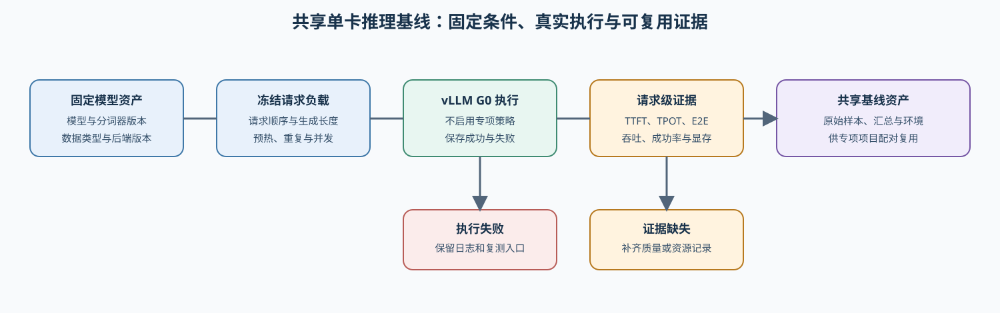
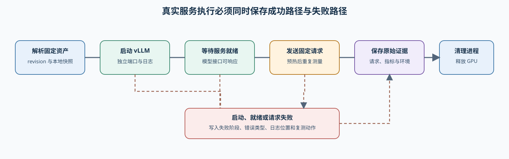

# 66. Inference Performance Comparison | 推理性能对比实验

**难度：** Hard | **环境：** CPU-first | **标签：** `推理优化`, `基准对比`, `性能对比` | **目标人群：** 项目决策练习者

> 🚀 **云端运行环境**
>
> 本章节的实战代码可以点击以下链接在免费 GPU 算力平台上直接运行：
>
> [](https://colab.research.google.com/github/datawhalechina/llm-algo-leetcode/blob/main/02_PyTorch_Algorithms/66_Inference_Performance_Comparison.ipynb)
> [](https://modelscope.cn/my/mynotebook) *(国内推荐：魔搭社区免费实例)*


---

## 本节导读

本节带你完成一次可复核的推理性能对比：围绕同一组请求和运行条件，比较 baseline 与候选方案在延迟、吞吐、显存和失败状态上的差异。
学习过程中，你会先建立可比较的实验条件，再理解 TTFT、TPOT、端到端延迟和吞吐分别反映什么，最后把这些证据转化为面向场景的选择：低延迟、高吞吐，或显存受限。


**关键词：** `benchmark`, `TTFT`, `TPOT`, `throughput`, `KV cache`

---
## 前置阅读

**导语：** 开始前先了解一次请求如何经历解码、KV Cache 如何增长，以及推理后端如何组织服务。阅读这些材料时，关注它们对输入处理、逐 token 生成和缓存占用的影响；这些概念随后会转化为本节可以测量的 workload 和指标。
- [21. Decoding Strategies | 解码策略](./21_Decoding_Strategies.md)
- [22. vLLM PagedAttention | vLLM 分页注意力](./22_vLLM_PagedAttention.md)
- [20. FlashAttention Sim | FlashAttention 模拟](./20_FlashAttention_Sim.md)
- [P1: 11. KV Cache and Memory Growth | KV Cache 与显存增长](../01_Hardware_Math_and_Systems/11_KV_Cache_and_Memory_Growth.md)

---
### Step 1：把问题转成可测量的实验

先把“哪种方案更适合当前服务”拆成一条实验路径：在 CPU 上理解请求与瓶颈，再在 GPU/backend 上比较真实基线和一个候选变量。这样，延迟、吞吐、显存和失败状态都能落在同一份结论中。

| 实验阶段 | 你要做什么 | 阶段产出 |
|:---|:---|:---|
| CPU 请求模拟（C0） | 模拟请求、并发和 prefill / decode | 请求轨迹与阶段耗时 |
| CPU 瓶颈判断（C1） | 读取模拟指标，判断主要压力 | prefill、decode 或 memory 提示 |
| GPU 基线（G0） | 在固定条件下运行真实服务 | 可复用的性能参照 |
| 单变量对照（G1） | 只改变一个候选条件 | 收益与代价 |
| 扩展对照（G2） | 在已有结果上比较额外策略或组合 | 当前 workload 下的选择 |



### Step 2：控制实验条件，选择对照变量

先把两次实验放在同一条起跑线上：模型、请求和测量方法保持一致，只选择一个主要条件进行变化。这样，后面的性能差异才有明确的解释依据。

| 实验部分 | 具体怎么做 | 目的 |
|:---|:---|:---|
| 固定条件 | 模型及权重版本、请求集、输入长度、输出长度、dtype、Cache 配置、预热次数和重复次数保持一致 | 保证两次实验可以比较 |
| 唯一变化 | 从并发数、batch、dtype、Cache 配置或 backend 中选择一个作为变量 | 让性能变化能够归因 |
| 记录口径 | 预先约定 TTFT、TPOT、端到端延迟、吞吐、峰值显存、成功率和 OOM 字段 | 让结果可以汇总到同一张表 |

### Step 3：读懂指标，整理可比结果

将 baseline 和 candidate 的原始结果整理为同一组指标，再结合请求生命周期解释它们的变化：首 token 等待对应交互体验，逐 token 时间对应 decode，吞吐和显存反映服务容量。

| 指标 | 单位 | 主要回答的问题 |
|:---|:---|:---|
| TTFT | ms | 用户等待第一个输出 token 多久？ |
| TPOT | ms/token | decode 阶段每生成一个 token 多久？ |
| E2E latency | ms | 一次请求从开始到结束总共多久？ |
| output throughput | token/s | 系统每秒生成多少输出 token？ |
| peak memory | MB / MiB | 当前 workload 的显存峰值是否接近预算？ |
| success / OOM | 次数 / 状态 | 请求是否完成，是否发生显存不足？ |

### Step 4：实现 CPU baseline 的三项机制

题目区将 CPU 预判拆成三个可独立验证的动作：请求如何组成并发波次、测量结果如何归为瓶颈、候选方案如何进入项目决策。workload、指标账本和报告字段由骨架提供。

| 函数 | 学习者完成的机制 | 必须满足的约束 | 测试证据 |
|:---|:---|:---|:---|
| `build_execution_waves` | TODO 1：请求波次机制 | `[start, end)` 连续覆盖；保留尾部波次；非法并发报错 | 波次边界、空请求与非法并发 |
| `classify_inference_bottleneck` | TODO 2：瓶颈分类机制 | 显存压力优先；再区分 prefill/decode；否则 balanced | memory / prefill / decode 三种路径 |
| `choose_inference_action` | TODO 3：策略决策机制 | 结合吞吐收益、TTFT 退化与剩余瓶颈 | `accept / tune / reject` 三种结论 |

```python
import time

```


```python
# 题目区只挖空三项推理 benchmark 机制：请求波次、瓶颈分类和策略决策。
# workload、指标账本、baseline/candidate 差值及报告字段均由骨架提供。

def build_execution_waves(request_count, concurrency):
    """Build contiguous request waves for the CPU scheduling model.

    Args:
        request_count: Total requests indexed in ``[0, request_count)``.
        concurrency: Maximum requests admitted to one wave; it must be positive.

    Returns:
        Consecutive ``(start, end)`` intervals. A final incomplete wave is kept.
    """
    if request_count < 0 or concurrency <= 0:
        raise ValueError('request_count 必须非负，concurrency 必须为正')
    # TODO 1（请求波次机制）：返回覆盖 [0, request_count) 的连续执行区间；每段最多容纳 concurrency 个请求。
    # 变量提示：start、end；尾部不足 concurrency 的请求仍应作为一个波次保留。
    raise NotImplementedError('TODO 1：请规划请求执行波次')


def simulate_inference_requests(requests, concurrency=1, prefill_ms_per_token=0.5, decode_ms_per_token=1.0, peak_mem_per_request_mb=512.0, kv_cache_mb_per_token=0.0):
    """Simulate queueing, prefill/decode cost and KV growth on CPU.

    ``prefill_ms_per_token`` and ``decode_ms_per_token`` are teaching cost
    coefficients in milliseconds per token. ``peak_mem_per_request_mb`` is the
    fixed per-request memory, while ``kv_cache_mb_per_token`` adds memory for
    every prompt/output token. The result is a mechanism trace, not a backend
    measurement.
    """
    if prefill_ms_per_token < 0 or decode_ms_per_token < 0 or peak_mem_per_request_mb < 0 or kv_cache_mb_per_token < 0:
        raise ValueError('成本参数不能为负数')
    if not requests:
        return {'request_count': 0, 'total_prompt_tokens': 0, 'total_output_tokens': 0, 'duration_ms': 0.0, 'peak_mem_mb': 0.0, 'kv_cache_tokens_peak': 0, 'request_results': []}
    results, clock_ms, wave_memories, wave_tokens = [], 0.0, [], []
    for start, end in build_execution_waves(len(requests), concurrency):
        wave = []
        for request in requests[start:end]:
            prompt_tokens = int(request['prompt_tokens'])
            generated_tokens = int(request['generated_tokens'])
            if prompt_tokens <= 0 or generated_tokens <= 0:
                raise ValueError('每个请求的 token 数必须为正数')
            prefill_ms = prompt_tokens * prefill_ms_per_token
            decode_ms = generated_tokens * decode_ms_per_token
            kv_tokens = prompt_tokens + generated_tokens
            wave.append({'prompt_tokens': prompt_tokens, 'generated_tokens': generated_tokens, 'queue_ms': clock_ms, 'prefill_ms': prefill_ms, 'decode_ms': decode_ms, 'ttft_ms': clock_ms + prefill_ms, 'tpot_ms': decode_ms / generated_tokens, 'e2e_ms': clock_ms + prefill_ms + decode_ms, 'kv_cache_tokens': kv_tokens, 'kv_cache_mem_mb': peak_mem_per_request_mb + kv_tokens * kv_cache_mb_per_token})
        results.extend(wave)
        clock_ms += max(item['prefill_ms'] + item['decode_ms'] for item in wave)
        wave_memories.append(sum(item['kv_cache_mem_mb'] for item in wave))
        wave_tokens.append(sum(item['kv_cache_tokens'] for item in wave))
    return {'request_count': len(results), 'total_prompt_tokens': sum(item['prompt_tokens'] for item in results), 'total_output_tokens': sum(item['generated_tokens'] for item in results), 'duration_ms': round(clock_ms, 4), 'peak_mem_mb': round(max(wave_memories), 2), 'kv_cache_tokens_peak': max(wave_tokens), 'request_results': results}


def build_inference_config(model_name, backend, batch_size, prompt_tokens, generated_tokens, dtype, cache_policy):
    """Create the workload contract shared by baseline and candidate.

    ``batch_size`` is the request batch used by this CPU model; ``prompt_tokens``
    and ``generated_tokens`` define the prefill/decode workload. ``dtype`` and
    ``cache_policy`` are recorded so a later GPU result can be compared under
    the same stated conditions.
    """
    if not model_name or not backend or batch_size <= 0 or prompt_tokens < 0 or generated_tokens < 0:
        raise ValueError('模型、backend 和 token 配置必须合法')
    return {'model_name': model_name, 'backend': backend, 'batch_size': batch_size, 'prompt_tokens': prompt_tokens, 'generated_tokens': generated_tokens, 'total_tokens': prompt_tokens + generated_tokens, 'dtype': dtype, 'cache_policy': cache_policy}


def summarize_prefill_decode(prefill_ms, decode_ms, generated_tokens):
    """将 prefill/decode 成本转为 TTFT、TPOT 和阶段占比。"""
    if prefill_ms < 0 or decode_ms < 0 or generated_tokens < 0:
        raise ValueError('延迟和 token 数不能为负数')
    total_ms = prefill_ms + decode_ms
    return {'prefill_ms': round(prefill_ms, 2), 'decode_ms': round(decode_ms, 2), 'total_ms': round(total_ms, 2), 'ttft_ms': round(prefill_ms, 2), 'tpot_ms': round(decode_ms / generated_tokens if generated_tokens else 0.0, 4), 'prefill_share': round(prefill_ms / total_ms if total_ms else 0.0, 3), 'decode_share': round(decode_ms / total_ms if total_ms else 0.0, 3)}


def compute_inference_metrics(config, latency_summary, peak_mem_mb):
    """把统一 workload 与阶段延迟收束为可比较的推理指标。"""
    if peak_mem_mb < 0:
        raise ValueError('peak_mem_mb 不能为负数')
    total_seconds = latency_summary['total_ms'] / 1000.0
    throughput_tok_s = config['batch_size'] * config['generated_tokens'] / total_seconds if total_seconds else 0.0
    return {'backend': config['backend'], 'batch_size': config['batch_size'], 'prompt_tokens': config['prompt_tokens'], 'generated_tokens': config['generated_tokens'], 'ttft_ms': latency_summary['ttft_ms'], 'tpot_ms': latency_summary['tpot_ms'], 'throughput_tok_s': round(throughput_tok_s, 2), 'total_ms': latency_summary['total_ms'], 'prefill_share': latency_summary['prefill_share'], 'decode_share': latency_summary['decode_share'], 'peak_mem_mb': round(peak_mem_mb, 2)}


def classify_inference_bottleneck(metrics, memory_budget_mb=None):
    """Classify the dominant pressure from memory and stage shares.

    ``memory_budget_mb`` is an optional capacity budget. This lesson treats
    90% of that budget as memory pressure and 60% stage share as prefill/decode
    dominance; both are teaching defaults rather than universal production SLOs.
    Memory pressure takes priority because an OOM-risk workload cannot be fixed
    merely by improving compute time.
    """
    if memory_budget_mb is not None and memory_budget_mb <= 0:
        raise ValueError('memory_budget_mb 必须为正数')
    memory_pressure = memory_budget_mb is not None and metrics['peak_mem_mb'] >= 0.9 * memory_budget_mb
    prefill_heavy = metrics['prefill_share'] >= 0.6
    decode_heavy = metrics['decode_share'] >= 0.6
    # TODO 2（瓶颈分类机制）：先处理容量风险，再按 prefill/decode 占比分类；均不满足时返回 balanced。
    # 变量提示：memory_pressure、prefill_heavy、decode_heavy。
    raise NotImplementedError('TODO 2：请完成推理瓶颈分类')


def diagnose_inference_bottleneck(metrics, memory_budget_mb=None):
    """将瓶颈类型映射为下一步验证方向；报告文案不作为题目挖空。"""
    bottleneck = classify_inference_bottleneck(metrics, memory_budget_mb)
    reasons = {'memory-bound': 'peak memory 接近预算，优先检查 KV cache、batch size、量化和分页策略。', 'prefill-bound': 'prefill 占比高，优先检查 prompt length、FlashAttention、chunked prefill 和 batching。', 'decode-bound': 'decode 占比高，优先检查 KV cache 读写、decode scheduling、speculative decoding 或 multi-token decoding。', 'balanced': 'prefill、decode 和显存压力都不突出，先保持 baseline 或继续做细粒度 profiling。'}
    return {'bottleneck': bottleneck, 'reason': reasons[bottleneck]}


def compare_inference_candidates(baseline_metrics, candidate_metrics):
    """统一计算 candidate 相对 baseline 的延迟、显存和吞吐变化。"""
    if baseline_metrics['throughput_tok_s'] <= 0:
        raise ValueError('baseline throughput 必须大于 0')
    return {'total_latency_delta_ms': round(baseline_metrics['total_ms'] - candidate_metrics['total_ms'], 2), 'ttft_delta_ms': round(baseline_metrics['ttft_ms'] - candidate_metrics['ttft_ms'], 2), 'tpot_delta_ms': round(baseline_metrics['tpot_ms'] - candidate_metrics['tpot_ms'], 4), 'peak_mem_delta_mb': round(baseline_metrics['peak_mem_mb'] - candidate_metrics['peak_mem_mb'], 2), 'throughput_gain': round(candidate_metrics['throughput_tok_s'] / baseline_metrics['throughput_tok_s'] - 1.0, 4)}


def choose_inference_action(comparison, candidate_bottleneck, min_throughput_gain=0.1, max_ttft_regression_ms=20.0):
    """Choose an action from throughput gain, TTFT regression and diagnosis.

    ``min_throughput_gain`` is the minimum relative gain required for a useful
    candidate. ``max_ttft_regression_ms`` is the allowed increase in TTFT.
    ``ttft_delta_ms`` uses ``baseline - candidate``: a negative value therefore
    means the candidate waits longer for its first token. Thresholds must be
    replaced with the target service's SLO during a real benchmark.
    """
    throughput_good = comparison['throughput_gain'] >= min_throughput_gain
    ttft_ok = -comparison['ttft_delta_ms'] <= max_ttft_regression_ms
    still_tunable = candidate_bottleneck['bottleneck'] != 'balanced'
    # TODO 3（策略决策机制）：吞吐收益与 TTFT 共同决定 accept；有收益且仍有瓶颈则 tune；其余 reject。
    # 变量提示：throughput_good、ttft_ok、still_tunable。
    raise NotImplementedError('TODO 3：请完成推理策略决策')


def recommend_inference_decision(comparison, candidate_bottleneck, min_throughput_gain=0.1, max_ttft_regression_ms=20.0):
    """将策略机制转换为项目报告；报告字段由骨架提供。"""
    decision = choose_inference_action(comparison, candidate_bottleneck, min_throughput_gain, max_ttft_regression_ms)
    details = {'accept': ('candidate 吞吐提升明显，TTFT 退化在可接受范围内，值得进入正式推理方案。'), 'tune': ('candidate 已有收益，但瓶颈仍然存在，继续围绕诊断结果调参或换策略。'), 'reject': ('candidate 收益不足或交互延迟退化明显，当前不值得切换。')}
    return {'decision': decision, 'reason': details[decision]}

```


```python
# 测试目标：分别验证请求波次、瓶颈分类、策略决策，再验证完整 baseline/candidate 链路。
# 所有输入均为 CPU 教学成本模型；GPU/backend 证据由 Step 5 单独采集。

def _baseline_metrics():
    """Return a fixed CPU baseline: static KV cache and higher decode cost."""
    config = build_inference_config('tiny-llama', 'pytorch-eager', 2, 128, 32, 'fp16', 'static-kv-cache')
    return compute_inference_metrics(config, summarize_prefill_decode(80.0, 160.0, 32), 4096.0)


def _candidate_metrics():
    """Return a comparable candidate: only cache/backend and decode cost differ."""
    config = build_inference_config('tiny-llama', 'paged-attention', 2, 128, 32, 'fp16', 'paged-kv-cache')
    return compute_inference_metrics(config, summarize_prefill_decode(80.0, 120.0, 32), 3584.0)


def test_execution_wave_mechanism():
    """Verify contiguous wave coverage, the tail wave and invalid concurrency."""
    assert build_execution_waves(5, 2) == [(0, 2), (2, 4), (4, 5)]
    assert build_execution_waves(0, 2) == []
    try:
        build_execution_waves(2, 0)
    except ValueError:
        return
    raise AssertionError('非法 concurrency 应被拒绝')


def test_request_simulation_contract():
    """Verify queue time and peak-memory aggregation for overlapping requests."""
    result = simulate_inference_requests([{'prompt_tokens': 100, 'generated_tokens': 20}, {'prompt_tokens': 200, 'generated_tokens': 10}, {'prompt_tokens': 100, 'generated_tokens': 20}], concurrency=2, peak_mem_per_request_mb=256.0)
    assert result['duration_ms'] == 180.0
    assert result['request_results'][2]['queue_ms'] == 110.0
    assert result['peak_mem_mb'] == 512.0


def test_bottleneck_classification_mechanism():
    """Verify memory-first, prefill and decode classification branches."""
    assert classify_inference_bottleneck({'peak_mem_mb': 4096.0, 'prefill_share': 0.7, 'decode_share': 0.3}, 4400.0) == 'memory-bound'
    assert classify_inference_bottleneck({'peak_mem_mb': 4096.0, 'prefill_share': 0.7, 'decode_share': 0.3}, 8192.0) == 'prefill-bound'
    assert classify_inference_bottleneck({'peak_mem_mb': 4096.0, 'prefill_share': 0.2, 'decode_share': 0.8}, 8192.0) == 'decode-bound'


def test_candidate_comparison_contract():
    """Verify comparison directions: lower latency/memory and higher throughput are gains."""
    comparison = compare_inference_candidates(_baseline_metrics(), _candidate_metrics())
    assert comparison['total_latency_delta_ms'] == 40.0
    assert comparison['peak_mem_delta_mb'] == 512.0
    assert comparison['throughput_gain'] > 0.15


def test_strategy_decision_mechanism():
    """Verify accept, tune and reject use both benefit and remaining diagnosis."""
    comparison = {'throughput_gain': 0.2, 'ttft_delta_ms': -5.0}
    assert choose_inference_action(comparison, {'bottleneck': 'decode-bound'}) == 'accept'
    assert choose_inference_action({'throughput_gain': 0.02, 'ttft_delta_ms': 1.0}, {'bottleneck': 'decode-bound'}) == 'tune'
    assert choose_inference_action({'throughput_gain': -0.05, 'ttft_delta_ms': -30.0}, {'bottleneck': 'balanced'}) == 'reject'


def test_inference_project_integration():
    """Verify the CPU workload, diagnosis and recommendation form one contract."""
    baseline = _baseline_metrics()
    candidate = _candidate_metrics()
    diagnosis = diagnose_inference_bottleneck(candidate, 8192.0)
    result = recommend_inference_decision(compare_inference_candidates(baseline, candidate), diagnosis)
    assert diagnosis['bottleneck'] == 'decode-bound'
    assert result['decision'] == 'accept'
    assert result['reason']


def run_inference_tests():
    """Run every mechanism test in a fixed order for notebook execution."""
    for test in (test_execution_wave_mechanism, test_request_simulation_contract, test_bottleneck_classification_mechanism, test_candidate_comparison_contract, test_strategy_decision_mechanism, test_inference_project_integration):
        test()
    print('✅ 推理性能项目：波次、瓶颈、策略决策与对照链路均已验证。')


run_inference_tests()

```

---

🛑 **STOP HERE** 🛑
<br><br><br><br><br><br><br><br><br><br>
> 请先尝试自己完成代码并跑通测试。<br>
> 如果你正在 Colab 中运行，并且遇到困难没有思路，可以向下滚动查看参考答案。
<br><br><br><br><br><br><br><br><br><br>

---
## 参考代码与解析

### 代码

```python
# 题目区只挖空三项推理 benchmark 机制：请求波次、瓶颈分类和策略决策。
# workload、指标账本、baseline/candidate 差值及报告字段均由骨架提供。

def build_execution_waves(request_count, concurrency):
    """Build contiguous request waves for the CPU scheduling model.

    Args:
        request_count: Total requests indexed in ``[0, request_count)``.
        concurrency: Maximum requests admitted to one wave; it must be positive.

    Returns:
        Consecutive ``(start, end)`` intervals. A final incomplete wave is kept.
    """
    if request_count < 0 or concurrency <= 0:
        raise ValueError('request_count 必须非负，concurrency 必须为正')
    # TODO 1：步长为 concurrency，end 用 min 保留最后不足一整波的请求。
    return [(start, min(start + concurrency, request_count)) for start in range(0, request_count, concurrency)]


def simulate_inference_requests(requests, concurrency=1, prefill_ms_per_token=0.5, decode_ms_per_token=1.0, peak_mem_per_request_mb=512.0, kv_cache_mb_per_token=0.0):
    """Simulate queueing, prefill/decode cost and KV growth on CPU.

    ``prefill_ms_per_token`` and ``decode_ms_per_token`` are teaching cost
    coefficients in milliseconds per token. ``peak_mem_per_request_mb`` is the
    fixed per-request memory, while ``kv_cache_mb_per_token`` adds memory for
    every prompt/output token. The result is a mechanism trace, not a backend
    measurement.
    """
    if prefill_ms_per_token < 0 or decode_ms_per_token < 0 or peak_mem_per_request_mb < 0 or kv_cache_mb_per_token < 0:
        raise ValueError('成本参数不能为负数')
    if not requests:
        return {'request_count': 0, 'total_prompt_tokens': 0, 'total_output_tokens': 0, 'duration_ms': 0.0, 'peak_mem_mb': 0.0, 'kv_cache_tokens_peak': 0, 'request_results': []}
    results, clock_ms, wave_memories, wave_tokens = [], 0.0, [], []
    for start, end in build_execution_waves(len(requests), concurrency):
        wave = []
        for request in requests[start:end]:
            prompt_tokens = int(request['prompt_tokens'])
            generated_tokens = int(request['generated_tokens'])
            if prompt_tokens <= 0 or generated_tokens <= 0:
                raise ValueError('每个请求的 token 数必须为正数')
            prefill_ms = prompt_tokens * prefill_ms_per_token
            decode_ms = generated_tokens * decode_ms_per_token
            kv_tokens = prompt_tokens + generated_tokens
            wave.append({'prompt_tokens': prompt_tokens, 'generated_tokens': generated_tokens, 'queue_ms': clock_ms, 'prefill_ms': prefill_ms, 'decode_ms': decode_ms, 'ttft_ms': clock_ms + prefill_ms, 'tpot_ms': decode_ms / generated_tokens, 'e2e_ms': clock_ms + prefill_ms + decode_ms, 'kv_cache_tokens': kv_tokens, 'kv_cache_mem_mb': peak_mem_per_request_mb + kv_tokens * kv_cache_mb_per_token})
        results.extend(wave)
        clock_ms += max(item['prefill_ms'] + item['decode_ms'] for item in wave)
        wave_memories.append(sum(item['kv_cache_mem_mb'] for item in wave))
        wave_tokens.append(sum(item['kv_cache_tokens'] for item in wave))
    return {'request_count': len(results), 'total_prompt_tokens': sum(item['prompt_tokens'] for item in results), 'total_output_tokens': sum(item['generated_tokens'] for item in results), 'duration_ms': round(clock_ms, 4), 'peak_mem_mb': round(max(wave_memories), 2), 'kv_cache_tokens_peak': max(wave_tokens), 'request_results': results}


def build_inference_config(model_name, backend, batch_size, prompt_tokens, generated_tokens, dtype, cache_policy):
    """Create the workload contract shared by baseline and candidate.

    ``batch_size`` is the request batch used by this CPU model; ``prompt_tokens``
    and ``generated_tokens`` define the prefill/decode workload. ``dtype`` and
    ``cache_policy`` are recorded so a later GPU result can be compared under
    the same stated conditions.
    """
    if not model_name or not backend or batch_size <= 0 or prompt_tokens < 0 or generated_tokens < 0:
        raise ValueError('模型、backend 和 token 配置必须合法')
    return {'model_name': model_name, 'backend': backend, 'batch_size': batch_size, 'prompt_tokens': prompt_tokens, 'generated_tokens': generated_tokens, 'total_tokens': prompt_tokens + generated_tokens, 'dtype': dtype, 'cache_policy': cache_policy}


def summarize_prefill_decode(prefill_ms, decode_ms, generated_tokens):
    """将 prefill/decode 成本转为 TTFT、TPOT 和阶段占比。"""
    if prefill_ms < 0 or decode_ms < 0 or generated_tokens < 0:
        raise ValueError('延迟和 token 数不能为负数')
    total_ms = prefill_ms + decode_ms
    return {'prefill_ms': round(prefill_ms, 2), 'decode_ms': round(decode_ms, 2), 'total_ms': round(total_ms, 2), 'ttft_ms': round(prefill_ms, 2), 'tpot_ms': round(decode_ms / generated_tokens if generated_tokens else 0.0, 4), 'prefill_share': round(prefill_ms / total_ms if total_ms else 0.0, 3), 'decode_share': round(decode_ms / total_ms if total_ms else 0.0, 3)}


def compute_inference_metrics(config, latency_summary, peak_mem_mb):
    """把统一 workload 与阶段延迟收束为可比较的推理指标。"""
    if peak_mem_mb < 0:
        raise ValueError('peak_mem_mb 不能为负数')
    total_seconds = latency_summary['total_ms'] / 1000.0
    throughput_tok_s = config['batch_size'] * config['generated_tokens'] / total_seconds if total_seconds else 0.0
    return {'backend': config['backend'], 'batch_size': config['batch_size'], 'prompt_tokens': config['prompt_tokens'], 'generated_tokens': config['generated_tokens'], 'ttft_ms': latency_summary['ttft_ms'], 'tpot_ms': latency_summary['tpot_ms'], 'throughput_tok_s': round(throughput_tok_s, 2), 'total_ms': latency_summary['total_ms'], 'prefill_share': latency_summary['prefill_share'], 'decode_share': latency_summary['decode_share'], 'peak_mem_mb': round(peak_mem_mb, 2)}


def classify_inference_bottleneck(metrics, memory_budget_mb=None):
    """Classify the dominant pressure from memory and stage shares.

    ``memory_budget_mb`` is an optional capacity budget. This lesson treats
    90% of that budget as memory pressure and 60% stage share as prefill/decode
    dominance; both are teaching defaults rather than universal production SLOs.
    Memory pressure takes priority because an OOM-risk workload cannot be fixed
    merely by improving compute time.
    """
    if memory_budget_mb is not None and memory_budget_mb <= 0:
        raise ValueError('memory_budget_mb 必须为正数')
    memory_pressure = memory_budget_mb is not None and metrics['peak_mem_mb'] >= 0.9 * memory_budget_mb
    prefill_heavy = metrics['prefill_share'] >= 0.6
    decode_heavy = metrics['decode_share'] >= 0.6
    # TODO 2：容量风险优先；否则才比较两个阶段占比，避免把 OOM 风险误判成计算瓶颈。
    if memory_pressure:
        return 'memory-bound'
    if prefill_heavy:
        return 'prefill-bound'
    if decode_heavy:
        return 'decode-bound'
    return 'balanced'


def diagnose_inference_bottleneck(metrics, memory_budget_mb=None):
    """将瓶颈类型映射为下一步验证方向；报告文案不作为题目挖空。"""
    bottleneck = classify_inference_bottleneck(metrics, memory_budget_mb)
    reasons = {'memory-bound': 'peak memory 接近预算，优先检查 KV cache、batch size、量化和分页策略。', 'prefill-bound': 'prefill 占比高，优先检查 prompt length、FlashAttention、chunked prefill 和 batching。', 'decode-bound': 'decode 占比高，优先检查 KV cache 读写、decode scheduling、speculative decoding 或 multi-token decoding。', 'balanced': 'prefill、decode 和显存压力都不突出，先保持 baseline 或继续做细粒度 profiling。'}
    return {'bottleneck': bottleneck, 'reason': reasons[bottleneck]}


def compare_inference_candidates(baseline_metrics, candidate_metrics):
    """统一计算 candidate 相对 baseline 的延迟、显存和吞吐变化。"""
    if baseline_metrics['throughput_tok_s'] <= 0:
        raise ValueError('baseline throughput 必须大于 0')
    return {'total_latency_delta_ms': round(baseline_metrics['total_ms'] - candidate_metrics['total_ms'], 2), 'ttft_delta_ms': round(baseline_metrics['ttft_ms'] - candidate_metrics['ttft_ms'], 2), 'tpot_delta_ms': round(baseline_metrics['tpot_ms'] - candidate_metrics['tpot_ms'], 4), 'peak_mem_delta_mb': round(baseline_metrics['peak_mem_mb'] - candidate_metrics['peak_mem_mb'], 2), 'throughput_gain': round(candidate_metrics['throughput_tok_s'] / baseline_metrics['throughput_tok_s'] - 1.0, 4)}


def choose_inference_action(comparison, candidate_bottleneck, min_throughput_gain=0.1, max_ttft_regression_ms=20.0):
    """Choose an action from throughput gain, TTFT regression and diagnosis.

    ``min_throughput_gain`` is the minimum relative gain required for a useful
    candidate. ``max_ttft_regression_ms`` is the allowed increase in TTFT.
    ``ttft_delta_ms`` uses ``baseline - candidate``: a negative value therefore
    means the candidate waits longer for its first token. Thresholds must be
    replaced with the target service's SLO during a real benchmark.
    """
    throughput_good = comparison['throughput_gain'] >= min_throughput_gain
    ttft_ok = -comparison['ttft_delta_ms'] <= max_ttft_regression_ms
    still_tunable = candidate_bottleneck['bottleneck'] != 'balanced'
    # TODO 3：ttft_delta_ms 为 baseline - candidate，ttft_ok 为真表示候选没有超过允许的交互退化。
    if throughput_good and ttft_ok:
        return 'accept'
    if comparison['throughput_gain'] > 0.0 and still_tunable:
        return 'tune'
    return 'reject'


def recommend_inference_decision(comparison, candidate_bottleneck, min_throughput_gain=0.1, max_ttft_regression_ms=20.0):
    """将策略机制转换为项目报告；报告字段由骨架提供。"""
    decision = choose_inference_action(comparison, candidate_bottleneck, min_throughput_gain, max_ttft_regression_ms)
    details = {'accept': ('candidate 吞吐提升明显，TTFT 退化在可接受范围内，值得进入正式推理方案。'), 'tune': ('candidate 已有收益，但瓶颈仍然存在，继续围绕诊断结果调参或换策略。'), 'reject': ('candidate 收益不足或交互延迟退化明显，当前不值得切换。')}
    return {'decision': decision, 'reason': details[decision]}

```

### 解析

66 是后续推理项目共享的 baseline 页，因此题目区不要求手写每一个指标字段，而是要求完成三个会改变项目结论的机制动作。

**TODO 1（请求波次机制）**

- 将请求切成连续的 `[start, end)` 波次；同一波次可并发，下一波次从前一波次完成后开始。
- 尾部不足 `concurrency` 的请求仍然必须保留，否则会漏掉排队时间与容量成本。

**TODO 2（瓶颈分类机制）**

- 显存接近预算时优先判为 `memory-bound`；否则通过 prefill 和 decode 占比判断主要阶段。
- 分类结果决定后续候选策略：长输入优先看 prefill，逐 token 慢优先看 decode，容量不足先处理 cache 与 batch。

**TODO 3（策略决策机制）**

- 吞吐收益达标且 TTFT 没有明显退化时 `accept`。
- 有收益但还存在明确瓶颈时 `tune`；收益不足或交互代价过高时 `reject`。
- 这只是 CPU 规则决策，最终采用与否仍需要 Step 5 的 backend 实测证据。

### Step 5：GPU 与 backend 主实验（可选）——真实基线与候选对照

按 5.1–5.6 固定 workload、完成预检并运行对照。结果 JSON 保留两组的模型、workload、指标和失败状态，供后续比较使用。

| 层级 | 目标 | 主要产出 |
|:---|:---|:---|
| 5.1 | 环境、模型与固定 workload | 可复用的真实 benchmark 口径 |
| 5.2 | 环境启动检查 | GPU / CUDA / backend 可用性 |
| 5.3 | 配置实验条件 | G0/G1/G2 与结果 JSON 契约 |
| 5.4 | 执行并保存 JSON | backend 测量或失败记录 |
| 5.5 | 读取结果与记录证据 | 环境、历史结果和学习者复测表 |
| 5.6 | 解释结果与形成决策 | `accept / tune / reject` |

#### 5.1 环境、输入与固定条件

先登记模型、输入和固定条件，再选择本轮唯一改变的变量。

| 实验要素 | 本节固定内容 | 允许改变的内容 | 输出 |
|:---|:---|:---|:---|
| 模型与请求 | 模型版本、请求集、输入长度、输出长度、生成参数 | 仅在单变量实验中改变 | 可复用 workload |
| 服务条件 | backend、dtype、最大上下文长度、显存使用上限 | 由 G1 明确选择一个变量 | 可比较的服务配置 |
| 实验分组 | baseline、单变量对照、已验证策略组合 | 单变量对照每次只改变一个主要变量 | 结果分组与元数据 |
| 核心指标 | TTFT、TPOT、E2E、请求/输出吞吐、峰值显存、成功率和 OOM | 根据目标补充质量指标 | 端到端证据 |


#### 5.2 确认运行环境可启动

在开始真实 benchmark 前，确认 Notebook client、backend、GPU、驱动和 CUDA 能够协同工作；更换运行环境后重新完成预检和 smoke test。

表格最后一列说明每项检查对启动和结果解释的影响。

| 类别 | 检查项 | 当前已验证配置 | 如何解读 |
|:---|:---|:---|:---|
| 系统 | OS | Linux x86_64 | vLLM 的主要支持环境 |
| 硬件 | GPU | NVIDIA GeForce RTX 5070 Ti Laptop GPU（SM120 / Blackwell），约 12 GB | 适合小模型 smoke test |
| 驱动 | NVIDIA driver / CUDA | 570.211.01 / CUDA 12.8 | 不要与 CUDA 13.0 wheel 混用；更换后需重做预检 |
| Client | Python 环境 / PyTorch | `llm_algo` / PyTorch 2.11.0+cu128 | 运行 Notebook 和 benchmark client |
| Backend | 服务环境 / vLLM | `vllm_legacy_cu128` / Python 3.12 / PyTorch 2.8.0+cu128 / vLLM 0.11.0 | 通过 HTTP 与 client 解耦；0.11.0 是本机验证版本，不是最低版本要求 |
| 模型 | smoke test 模型 | `Qwen/Qwen2.5-0.5B-Instruct`，权重约 0.92 GiB | 需要模型仓库网络或本地缓存 |
| 启动 | dtype 与服务参数 | `bfloat16`、`max_model_len=2048`、`gpu_memory_utilization=0.8`、`--enforce-eager` | 本机需要关闭 TorchInductor/CUDAGraph |
| 运行前提 | 网络、磁盘、端口、进程权限 | 可访问 HuggingFace / ModelScope、缓存空间、默认端口 8000 | 不满足时保留 CPU-first 路径 |
| 平台差异 | Colab 参考 | T4 优先尝试 `float16`；L4/A100/H100 根据预检选择 `bfloat16` | 运行时或驱动变化后重新确认 GPU 名称与 CUDA |
| 证据范围 | 当前实测路径 | `--enforce-eager`；FlashInfer 不可用时回退 PyTorch-native sampler | 结果只代表当前 eager 配置，不等同于最新版 backend 默认性能 |

```python
"""只检查当前 Notebook 内核和 backend 命令，不启动服务、不下载模型。"""
import importlib.util
import shutil
import torch

# 1. 检查 Notebook client 使用的 PyTorch、CUDA 和 GPU。
print({'torch': torch.__version__, 'torch_cuda': torch.version.cuda, 'cuda_available': torch.cuda.is_available()})
if torch.cuda.is_available():
    print({'device': torch.cuda.get_device_name(0), 'capability': torch.cuda.get_device_capability(0), 'bf16_supported': torch.cuda.is_bf16_supported()})
# 2. 检查 vLLM 是否安装在当前内核；独立 backend 环境可以显示 False。
print({'vllm_on_current_kernel': importlib.util.find_spec('vllm') is not None, 'vllm_command': shutil.which('vllm')})

# 如果 vLLM 在独立 conda 环境中运行，这里可以保持 vllm_on_current_kernel=False；
# Step 5 的运行单元会通过 VLLM_ENV 调用独立环境，或复用已启动的 OpenAI-compatible API。
```

#### 5.3 配置实验条件

根据 5.1 的固定条件填写模型、workload、dtype、G0/G1/G2 和结果路径。G0 JSON 提供浮点基线，后续项目在自己的对照实验中记录 candidate 结果。

| 契约块 | 至少记录 | 用途 |
|:---|:---|:---|
| 身份 | `project`、`role`、`model_revision`、`backend`、`result_json` | 判断 baseline / candidate 是否可比较 |
| workload | `workload_path`、`num_prompts`、`batch`、`concurrency`、`warmup`、`repeats` | 复现实验输入与请求压力 |
| 环境 | `dtype`、`backend_version`、`hardware`、`runtime_version`、`cache_policy` | 解释结果适用范围 |
| 证据与决策 | `evidence_level`、`quality`、`failure`、`decision` | 区分模拟、smoke、实测及 accept / tune / reject |


```python
# 实验配置：先运行本单元，再运行下面的环境预检和 benchmark。
# 本单元只设置变量并检查 G0/G1/G2 的填写，不下载模型、不启动 backend。
RUN_REAL_BACKEND = False  # 是否启动真实 vLLM；False 只完成 CPU-first 模板。
BACKEND = 'vllm'  # Step 5 的主基线 backend；Step 6 会显式写入 sglang。
QUANTIZATION_FORMAT = 'none'  # 66 只提供浮点 baseline；真实量化 artifact 由 67 接入。
QUANTIZATION_ARTIFACT = None
EXPERIMENT_GROUP = 'G0'  # G0=基线，G1=单变量候选，G2=扩展或组合对照。
STRATEGIES = []  # G0 为空；G1 填一个改变项；G2 填多个候选或已单独验证的组合项。
STRATEGY_NOTE = '固定 workload 的 vLLM baseline'  # 说明本次实验实际改变了什么。
MODEL_SOURCE = 'auto'  # 模型来源：auto / modelscope / huggingface / local。
MODEL_CACHE_DIR = 'model_cache'  # 模型缓存目录；通常不需要修改。
MODEL_PROFILES = {
    'qwen25_small': 'Qwen/Qwen2.5-0.5B-Instruct',
    'deepseek_r1_small': 'deepseek-ai/DeepSeek-R1-Distill-Qwen-1.5B',
}
MODEL_PROFILE = 'qwen25_small'  # 先用小模型完成 smoke test。
MODEL_ID = MODEL_PROFILES[MODEL_PROFILE]  # 实际加载的模型 ID。
MODEL_REVISION = MODEL_ID  # 正式复测时建议改为 commit/tag，避免模型别名漂移。
DTYPE = 'auto'  # auto 根据 GPU 选择；也可显式写 bfloat16 / float16。
CACHE_POLICY = 'default'  # vLLM / SGLang 使用的 cache 标记；跨 backend 对比时保持一致。
VLLM_COMMAND = None  # 为空时自动查找当前环境中的 vllm
VLLM_ENV = None  # 云端保持当前 runtime；本地多环境时再填写环境名
MAX_MODEL_LEN = 2048  # 最大上下文长度；越大越占 KV Cache。
GPU_MEMORY_UTILIZATION = 0.8  # vLLM 使用显存比例；需为桌面和其他进程留余量。
ENFORCE_EAGER = True  # 先保证 RTX 50 系列等架构可复现；稳定后可尝试 False
WORKLOAD_PATH = 'benchmarks/workloads/fixed.jsonl'  # G1 workload 变量通过替换此文件实现。
NUM_PROMPTS = 5  # 请求总数；正式实验应大于 smoke test。
BATCH_SIZE = 1  # 单请求 batch 配置；修改后必须在结果中保留。
CONCURRENCY = 1  # 同时在途请求数；只做并发实验时改变它。
WARMUP = 1  # 预热请求数；正式实验建议提高到 3-10。
RUN_ID = __import__('datetime').datetime.now().strftime('%Y%m%d_%H%M%S')
REPEATS = 1  # 正式结果建议增加重复次数；smoke test 可保持 1。
BACKEND_VERSION = 'record_at_runtime'  # 运行后填写实际 backend 版本。
HARDWARE = 'record_at_runtime'  # 运行后填写 GPU 型号、显存和数量。
RUNTIME_VERSION = 'record_at_runtime'  # 运行后填写 CUDA / PyTorch / driver 等关键版本。
EVIDENCE_LEVEL = 'real_backend_smoke' if RUN_REAL_BACKEND else 'simulation'
QUALITY_STATUS = 'not_collected'  # 未采集质量指标时必须显式标记。
FAILURE_REASON = None  # 失败、unsupported 或 OOM 时填写原因。
RETEST_PATH = None  # 失败记录或待复测结果的路径。
DECISION = 'pending'  # accept / tune / reject；由结果分析后填写。
RESULT_PATH = f'benchmarks/results/66_{EXPERIMENT_GROUP.lower()}_{BACKEND}_{RUN_ID}.json'  # 自动生成，避免覆盖历史结果。
BASELINE_POINTER_PATH = 'benchmarks/results/66_g0_vllm_baseline.json'  # 仅作为 67 的最新 G0 入口，不代表历史文件。
PEAK_MEMORY_MB = None  # 可选：由外部 nvidia-smi/监控采集后填入；None 表示本次未测 GPU 峰值显存。

SUPPORTED_AUTO_STRATEGIES = {'concurrency', 'batch', 'dtype', 'workload'}  # 当前 vLLM 入口确实能执行的 G1 变量。
if EXPERIMENT_GROUP not in {'G0', 'G1', 'G2'}:
    raise ValueError('EXPERIMENT_GROUP 只能是 G0、G1 或 G2')
if EXPERIMENT_GROUP == 'G0' and STRATEGIES:
    raise ValueError('G0 baseline 不应填写 STRATEGIES')
if EXPERIMENT_GROUP == 'G1' and len(STRATEGIES) != 1:
    raise ValueError('G1 单变量对照必须填写一个策略')
if EXPERIMENT_GROUP == 'G2' and len(STRATEGIES) < 2:
    raise ValueError('G2 策略融合至少填写两个策略')
if RUN_REAL_BACKEND and EXPERIMENT_GROUP == 'G1' and not set(STRATEGIES).issubset(SUPPORTED_AUTO_STRATEGIES):
    raise ValueError('当前 GPU 入口只自动执行 concurrency / batch / dtype / workload 对照；FlashAttention、Prefix Cache、量化等请使用专项项目或手动 backend 参数。')
if RUN_REAL_BACKEND and EXPERIMENT_GROUP == 'G2':
    raise ValueError('G2 扩展或组合对照目前只有配置与报告元数据入口，尚未自动启用组合 backend；请先完成单项策略验证。')
EXPERIMENT_METADATA = {'group': EXPERIMENT_GROUP, 'role': 'baseline' if EXPERIMENT_GROUP == 'G0' else 'candidate', 'backend': BACKEND, 'strategies': list(STRATEGIES), 'note': STRATEGY_NOTE}
BASELINE_CONTRACT = {
    'schema_version': 'inference-baseline/v1',
    'project': '66_inference_performance_comparison',
    'experiment_group': EXPERIMENT_GROUP,
    'role': 'baseline' if EXPERIMENT_GROUP == 'G0' else 'candidate',
    'model_revision': MODEL_REVISION,
    'backend': BACKEND,
    'quantization_format': QUANTIZATION_FORMAT,
    'quantization_artifact': QUANTIZATION_ARTIFACT,
    'backend_version': BACKEND_VERSION,
    'hardware': HARDWARE,
    'runtime_version': RUNTIME_VERSION,
    'workload_path': WORKLOAD_PATH,
    'num_prompts': NUM_PROMPTS,
    'dtype': DTYPE,
    'cache_policy': CACHE_POLICY,
    'batch': BATCH_SIZE,
    'concurrency': CONCURRENCY,
    'warmup': WARMUP,
    'repeats': REPEATS,
    'evidence_level': EVIDENCE_LEVEL,
    'quality': {'status': QUALITY_STATUS},
    'failure': {'status': 'not_observed' if FAILURE_REASON is None else 'recorded', 'reason': FAILURE_REASON, 'retest_path': RETEST_PATH},
    'decision': DECISION,
    'result_json': RESULT_PATH,
    'latest_baseline_pointer': BASELINE_POINTER_PATH if EXPERIMENT_GROUP == 'G0' and BACKEND == 'vllm' else None,
}
print('实验配置：', EXPERIMENT_METADATA)

```

#### 5.4 执行实验、保存结果与排障

完成环境预检和配置后，依次启动 backend、运行 workload、补充实验元数据，并将每组结果独立保存为 JSON。Notebook 内核负责发起请求和保存报告；vLLM backend 可以运行在当前环境，也可以运行在单独环境中。

模型下载和服务启动会消耗显存、磁盘与时间；实验结束后确认结果文件已保存，并释放 backend 子进程。

| 执行阶段 | 主要动作 | 阶段产出 |
|:---|:---|:---|
| 模型与 backend 启动 | 解析模型、选择端口、启动服务并等待就绪 | 可访问的 API 服务 |
| benchmark 请求 | 使用固定 workload 完成 warmup 和正式测量 | TTFT、TPOT、E2E、吞吐、成功率 |
| 元数据补充 | 写入 backend、dtype、实验组、启动参数和 evidence level | 可追溯实验记录 |
| JSON 保存与清理 | 独立保存结果，检查字段和异常，停止服务 | 可复核 JSON 与释放后的环境 |



```python
"""执行一次 vLLM 实验：解析模型、启动服务、运行 benchmark、保存 JSON 并清理进程。"""
import json
import os
import subprocess
import sys
from pathlib import Path

def write_backend_failure(error, stage):
    """Persist a failure record so startup/OOM errors remain reviewable."""
    failure_path = Path(RESULT_PATH)
    failure_path.parent.mkdir(parents=True, exist_ok=True)
    failure = {
        'schema_version': 'inference-benchmark/v1',
        'project': '66_inference_performance_comparison',
        'experiment': EXPERIMENT_METADATA,
        'experiment_contract': BASELINE_CONTRACT,
        'failure': {'status': 'recorded', 'stage': stage, 'reason': str(error), 'retest_path': str(failure_path)},
        'evidence_level': EVIDENCE_LEVEL,
        'decision': 'tune',
    }
    failure_path.write_text(json.dumps(failure, ensure_ascii=False, indent=2), encoding='utf-8')

if RUN_REAL_BACKEND:
    project_root = next((path for path in [Path.cwd(), *Path.cwd().parents] if (path / 'tools').is_dir()), None)
    if project_root is None:
        raise RuntimeError('未找到项目根目录。请从仓库根目录启动 Jupyter，或把仓库根目录加入 sys.path。')
    os.chdir(project_root)
    if str(project_root) not in sys.path:
        sys.path.insert(0, str(project_root))
    from tools.backend_runtime import resolve_model, start_vllm, stop_backend

    try:
        # 1. 定位项目根目录和模型缓存；模型只在首次运行时下载。
        model_path = resolve_model(MODEL_ID, MODEL_SOURCE, cache_dir=MODEL_CACHE_DIR)
        # 2. 启动 vLLM，自动选择可用端口并等待服务就绪。
        server, server_log, port, selected_dtype = start_vllm(
            model_path, DTYPE, vllm_command=VLLM_COMMAND,
            vllm_environment=VLLM_ENV,
            max_model_len=MAX_MODEL_LEN,
            gpu_memory_utilization=GPU_MEMORY_UTILIZATION,
            enforce_eager=ENFORCE_EAGER,
            served_model_name=MODEL_ID,
        )
    except Exception as exc:
        write_backend_failure(exc, 'model_resolution_or_backend_start')
        raise
    try:
        import torch
        device_name = torch.cuda.get_device_name(0) if torch.cuda.is_available() else 'cpu'
        hardware_snapshot = {'device': device_name, 'cuda': torch.version.cuda, 'torch': torch.__version__}
    except Exception:
        hardware_snapshot = {'device': 'unknown', 'cuda': 'unknown', 'torch': 'unknown'}
    BASELINE_CONTRACT.update({'hardware': hardware_snapshot, 'runtime_version': hardware_snapshot})
    print({'model_path': model_path, 'dtype': selected_dtype, 'port': port, 'runtime': hardware_snapshot})

    try:
        output_path = Path(RESULT_PATH)
        output_path.parent.mkdir(parents=True, exist_ok=True)
        # 3. 使用固定 workload 发起请求；G0/G1 的差异来自配置单元。
        benchmark_command = [
            sys.executable, 'tools/benchmark_inference_backend.py',
            '--base-url', f'http://127.0.0.1:{port}',
            '--model', MODEL_ID,
            '--label', f'vllm-{EXPERIMENT_GROUP.lower()}',
            '--project', '66',
            '--backend', 'vllm',
            '--dtype', selected_dtype,
            '--batch', str(BATCH_SIZE),
            '--cache-policy', 'default',
            '--workload', WORKLOAD_PATH,
            '--num-prompts', str(NUM_PROMPTS),
            '--concurrency', str(CONCURRENCY),
            '--warmup', str(WARMUP),
            '--repeats', str(REPEATS),
            '--output', str(output_path),
        ]
        if PEAK_MEMORY_MB is not None:
            benchmark_command.extend(['--peak-memory-mb', str(PEAK_MEMORY_MB)])
        subprocess.run(benchmark_command, check=True)
        # 4. 追加实验元数据后保存报告，确保每组结果可以单独复核。
        saved = json.loads(output_path.read_text(encoding='utf-8'))
        saved['experiment'] = EXPERIMENT_METADATA
        saved['experiment_contract'] = BASELINE_CONTRACT
        saved['baseline_contract'] = BASELINE_CONTRACT  # 兼容已有 68–72 读取路径。
        saved.setdefault('quality', {'status': QUALITY_STATUS})
        saved.setdefault('failure', {'status': 'not_observed' if FAILURE_REASON is None else 'recorded', 'reason': FAILURE_REASON, 'retest_path': RETEST_PATH})
        saved.setdefault('decision', DECISION)
        serialized = json.dumps(saved, ensure_ascii=False, indent=2)
        output_path.write_text(serialized, encoding='utf-8')
        if EXPERIMENT_GROUP == 'G0' and BACKEND == 'vllm':
            # 67 只读取成功写出的 G0 指针；失败记录不会覆盖上一次可复用基线。
            pointer_payload = dict(saved)
            pointer_payload['baseline_pointer'] = {
                'schema_version': 'inference-baseline-pointer/v1',
                'source_result': str(output_path),
                'status': 'ready',
                'role': 'latest_successful_g0',
            }
            Path(BASELINE_POINTER_PATH).write_text(
                json.dumps(pointer_payload, ensure_ascii=False, indent=2), encoding='utf-8'
            )
            print(f'已更新 67 可复用的 G0 指针：{BASELINE_POINTER_PATH}')
        print(saved['metrics'])
        print('统一结果：', json.dumps(saved['normalized_result'], ensure_ascii=False, indent=2))
    except Exception as exc:
        write_backend_failure(exc, 'benchmark_or_result_write')
        raise
    finally:
        # 5. 无论 benchmark 是否成功，都停止服务并释放子进程。
        stop_backend(server, server_log)
else:
    print('跳过真实 backend：保持 CPU-first 模式。')

```

#### 手动启动与排障（可选）

如果自动启动流程因 backend 环境或模型路径问题无法运行，可以在终端手动启动服务，再执行 benchmark 脚本进行排查。Notebook 主流程不依赖手动查端口或拼接命令。若看到 `ModuleNotFoundError: No module named 'tools'`，通常是旧版本在仓库根目录尚未加入 `sys.path` 前就导入了工具模块；当前代码会先定位项目根目录。

```bash
vllm serve <model-id> --dtype bfloat16 --port 8000
python tools/benchmark_inference_backend.py
```
#### 5.5 读取结果与记录证据

读取 5.4 保存的 JSON 后，先核对实际环境和 workload，再把历史样例与本机复测填入同一张结果表。TTFT、TPOT、端到端延迟、吞吐、峰值显存与失败状态共同决定本轮结论。

**历史实测环境与统一口径**

| 项目 | 历史配置 |
|:---|:---|
| GPU / 显存 | RTX 5070 Ti Laptop / 12 GB |
| 模型 | `Qwen/Qwen2.5-0.5B-Instruct` |
| backend / runtime | vLLM 0.11.0 / PyTorch 2.11.0+cu128 |
| dtype / workload | `bfloat16` / `fixed.jsonl`，生成长度 64 tokens |
| 启动参数 | `max_model_len=2048`、`gpu_memory_utilization=0.8`、`--enforce-eager` |
| 对照变量 | concurrency：1（baseline）→ 4（candidate） |
| evidence level | real backend smoke；peak memory 未采集 |

**结果与复测记录**

| 指标 | 历史 baseline | 历史 candidate（concurrency=4） | 本机 baseline | 本机 candidate | 如何解读 |
|:---|---:|---:|---:|---:|:---|
| 成功 / 失败 | 5 / 0 | 5 / 0 | 待填写 | 待填写 | 保留异常状态 |
| 请求吞吐 | 3.1189 req/s | 4.2972 req/s | 待填写 | 待填写 | 越高越好 |
| 输出吞吐 | 182.1461 token/s | 250.9544 token/s | 待填写 | 待填写 | 越高越好 |
| TTFT P50 | 33.776 ms | 234.566 ms | 待填写 | 待填写 | 越低越好 |
| TPOT P50 | 4.859 ms/token | 11.528 ms/token | 待填写 | 待填写 | 越低越好 |
| E2E P50 | 337.176 ms | 956.383 ms | 待填写 | 待填写 | 越低越好 |
| peak memory | 未采集 | 未采集 | 待填写 | 待填写 | 未采集时不能下显存结论 |
| JSON / failure | `66_vllm_real.json` / none | `66_vllm_concurrency4.json` / none | 待填写 | 待填写 | 每组独立保存 |
| evidence level / decision | real backend smoke / 待定 | real backend smoke / 待定 | 待填写 | 待填写 | 由 5.6 形成结论 |


```python
# 5.5 读取 5.4 保存的 JSON，不启动 backend；缺少结果时保留复测位置。
from pathlib import Path
import json

result_path = Path(RESULT_PATH)
if result_path.exists():
    saved_result = json.loads(result_path.read_text(encoding='utf-8'))
    contract = saved_result.get('experiment_contract', saved_result.get('baseline_contract', {}))
    print({'result_json': str(result_path), 'evidence_level': saved_result.get('evidence_level', contract.get('evidence_level')), 'decision': saved_result.get('decision', contract.get('decision')), 'failure': saved_result.get('failure', contract.get('failure'))})
    print('metrics:', json.dumps(saved_result.get('metrics', {}), ensure_ascii=False, indent=2))
else:
    print(f'等待 Step 5.4 的实验结果：{result_path}')

```

#### 5.6 解释结果与形成决策

历史记录展示了一个常见取舍：并发提高后，输出吞吐从 182.15 提升到 250.95 token/s，同时 TTFT P50 从 33.78 ms 增至 234.57 ms、E2E P50 从 337.18 ms 增至 956.38 ms。它适合作为“批量吞吐更高、交互等待更长”的示例。

复测时先按服务目标选指标：交互请求优先看 TTFT 与 E2E，批处理优先看吞吐，再同时检查成功率、峰值显存和失败记录。把这些字段填入 5.5 的复测表后即可给出 `accept / tune / reject`。

```python
# 5.6：从 5.5 读取的真实结果生成决策；不会启动 backend。
from pathlib import Path
import json


def decide_backend_result(report, *, service_goal="interactive"):
    """Use failure, latency and throughput together to classify one backend result.

    ``interactive`` prefers TTFT/E2E; ``batch`` accepts higher waiting time only
    when output throughput is available. Thresholds are teaching defaults, so the
    returned ``tune`` result also records which metric should be revisited.
    """
    contract = report.get("experiment_contract", report.get("baseline_contract", {}))
    failure = report.get("failure", contract.get("failure", {})) or {}
    if failure.get("status") not in {None, "not_observed", "none"}:
        return {"decision": "reject", "reason": "实验未成功完成", "next_action": "先处理 failure 后复测"}

    metrics = report.get("metrics", {})
    throughput = metrics.get("output_token_throughput_per_s")
    ttft_p50 = (metrics.get("ttft_ms") or {}).get("p50")
    e2e_p50 = (metrics.get("e2e_ms") or {}).get("p50")
    if throughput is None or ttft_p50 is None or e2e_p50 is None:
        return {"decision": "tune", "reason": "关键指标尚未完整采集", "next_action": "补齐 TTFT、E2E 与输出吞吐后复测"}
    if service_goal == "interactive" and (ttft_p50 > 500 or e2e_p50 > 3000):
        return {"decision": "tune", "reason": "交互延迟偏高", "next_action": "降低并发或检查 prefill 与队列等待"}
    if service_goal == "batch" and throughput <= 0:
        return {"decision": "tune", "reason": "批处理吞吐未达可用状态", "next_action": "检查并发、batch 与 backend 配置"}
    return {"decision": "accept", "reason": "结果完整且当前服务目标未触发阈值", "next_action": "与候选 backend 使用同一 workload 对照"}


result_path = Path(RESULT_PATH)
if result_path.exists():
    decision_report = json.loads(result_path.read_text(encoding="utf-8"))
    decision = decide_backend_result(decision_report, service_goal="interactive")
    decision_report["decision"] = decision["decision"]
    decision_report["decision_detail"] = decision
    result_path.write_text(json.dumps(decision_report, ensure_ascii=False, indent=2), encoding="utf-8")
    print({"result_json": str(result_path), **decision})
else:
    print(f"等待 Step 5.4 的实验结果，暂不写决策：{result_path}")

```

### Step 6：SGLang backend 对照

这一组实验只替换服务 backend：复用 vLLM G0 的模型、请求集、生成长度、并发和 dtype，记录 SGLang 的同一组指标。


#### 6.2 环境启动检查

确认 SGLang、GPU 和启动命令可用，并记录实际版本和运行环境。

#### 6.3 配置实验条件

为 SGLang 结果设置独立 JSON 路径。

```python
# Step 6 专属配置：不影响 Step 5 的 vLLM 主实验。
RUN_SGLANG = False  # 只有在确认 SGLang 环境可用后再改为 True。
SGLANG_COMMAND_TEMPLATE = None  # 例如 python -m sglang.launch_server --model-path {model_path} --port {port}
SGLANG_READY_TIMEOUT_S = 180  # SGLang 冷启动等待时间；超时会自动停止子进程。
SGLANG_RESULT_PATH = 'benchmarks/results/66_g1_sglang_backend.json'  # G1 candidate，与 vLLM G0 分开保存。
```

#### 6.4 执行对照并保存 JSON

复用 Step 5 的 workload 和 benchmark 入口，只替换 SGLang 服务地址；完成 warmup 后运行正式请求，并将结果保存到独立 JSON。unsupported、启动失败和请求失败都要保留在结果记录中。

```python
"""可选的 SGLang 对照：复用统一 workload，独立启动服务并保存 JSON。"""
# 默认关闭，不影响 vLLM 主线。
if RUN_SGLANG:
    if not SGLANG_COMMAND_TEMPLATE:
        raise ValueError('RUN_SGLANG=True 时必须填写 SGLANG_COMMAND_TEMPLATE，并包含 {model_path} 和 {port}。')
    from tools.inference_project_runtime import (
        locate_repo_root, run_backend_benchmark, start_external_openai_backend,
    )
    from tools.backend_runtime import find_free_port, resolve_model, stop_backend
    root = locate_repo_root()
    model_path = resolve_model(MODEL_ID, MODEL_SOURCE, cache_dir=MODEL_CACHE_DIR)
    sglang_port = find_free_port()
    sglang_log = root / 'benchmarks/results/66_sglang.log'
    sglang_server, sglang_log_path = start_external_openai_backend(
        SGLANG_COMMAND_TEMPLATE, model_path=str(model_path), port=sglang_port,
        log_path=sglang_log, ready_timeout_s=SGLANG_READY_TIMEOUT_S,
    )
    try:
        sglang_report = run_backend_benchmark(
            project='66', base_url=f'http://127.0.0.1:{sglang_port}',
            model=MODEL_ID, label='sglang-g1-backend', output=SGLANG_RESULT_PATH,
            workload=WORKLOAD_PATH, num_prompts=NUM_PROMPTS,
            concurrency=CONCURRENCY, warmup=WARMUP, backend='sglang',
            dtype=DTYPE, batch=BATCH_SIZE, cache_policy=CACHE_POLICY,
        )
        sglang_report['experiment'] = {**EXPERIMENT_METADATA, 'group': 'G1', 'role': 'candidate', 'backend': 'sglang', 'strategies': ['backend'], 'command_template': SGLANG_COMMAND_TEMPLATE}
        sglang_contract = {**BASELINE_CONTRACT, 'experiment_group': 'G1', 'role': 'candidate', 'backend': 'sglang', 'strategies': ['backend'], 'result_json': SGLANG_RESULT_PATH}
        sglang_report['experiment_contract'] = sglang_contract
        sglang_report['baseline_contract'] = sglang_contract  # 兼容已有 68–72 读取路径。
        sglang_report.setdefault('quality', {'status': QUALITY_STATUS})
        sglang_report.setdefault('failure', {'status': 'not_observed' if FAILURE_REASON is None else 'recorded', 'reason': FAILURE_REASON, 'retest_path': RETEST_PATH})
        sglang_report.setdefault('decision', DECISION)
        Path(SGLANG_RESULT_PATH).write_text(json.dumps(sglang_report, ensure_ascii=False, indent=2), encoding='utf-8')
        print('SGLang 结果：', json.dumps(sglang_report.get('metrics', {}), ensure_ascii=False, indent=2))
    finally:
        stop_backend(sglang_server, sglang_log_path)
else:
    print('跳过 SGLang：默认只验证 vLLM；需要独立安装和确认 SGLang 版本后再开启。')

```

#### 6.5 实测记录与结果表

读取 SGLang JSON 后，填写模型、GPU、dtype、workload、并发、生成长度和指标；与 vLLM 的差异将由 Step 7 汇总。

| 记录项 | vLLM | SGLang | 说明 |
|:---|:---:|:---:|:---|
| backend / 版本 | 待读取 | 待读取 | 必须保留版本信息 |
| GPU / 显存 | 待读取 | 待读取 | 尽量使用同一硬件 |
| 模型 / dtype | 待读取 | 待读取 | 模型和 dtype 保持一致 |
| workload / 并发 | 待读取 | 待读取 | 请求集、生成长度和并发一致 |
| TTFT / TPOT / E2E | 待读取 | 待读取 | 统一统计口径 |
| 吞吐 / 成功率 / OOM | 待读取 | 待读取 | 同时记录失败状态 |
| evidence level | 待读取 | 待读取 | 区分 smoke、repeated 和 unsupported |
| decision | 待判断 | 待判断 | 等 6.6 统一解释 |
#### 6.6 解释结果与形成决策

根据 TTFT、TPOT、E2E、吞吐、成功率和 OOM 填写本轮结果：服务可运行且目标指标达标时 `accept`，仍有可调空间时 `tune`，不支持或不满足目标时 `reject`。
### Step 7：跨 backend 结果对比

将 Step 5 和 Step 6 的 JSON 放到同一张对照表中，比较 TTFT、TPOT、E2E、吞吐、成功率、峰值显存和失败状态。报告同时保留 backend 名称与版本，帮助你把端到端差异解释为服务栈的整体结果，而不是归因给单一算法。
## 相关阅读

完成本节后，可以沿着“机制 → 引擎 → 评测规范”继续阅读：先看推理引擎如何实现请求服务，再回到论文和官方文档核对 benchmark 中的指标含义。
- [68. Speculative Decoding Benchmark | 投机解码基准](./68_Speculative_Decoding_Benchmark.md)
- [67. Quantized Inference and Deployment | 量化推理与部署](./67_Quantized_Inference_and_Deployment.md)
- [vLLM Documentation | vLLM 官方文档](https://docs.vllm.ai/en/latest/)
- [SGLang Documentation | SGLang 官方文档](https://docs.sglang.ai/)
- [Efficient Memory Management for Large Language Model Serving with PagedAttention | PagedAttention 论文](https://arxiv.org/abs/2309.06180)
- [Efficiently Scaling Transformer Inference](https://arxiv.org/abs/2211.05102)