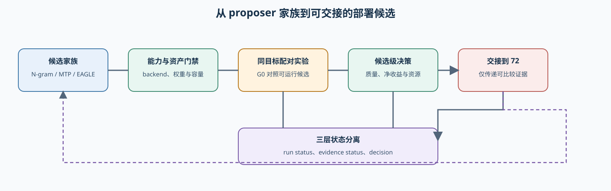
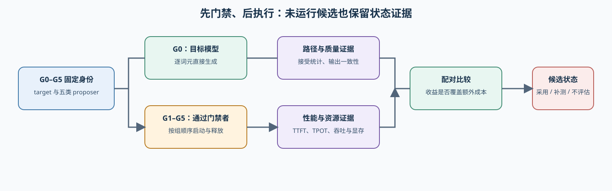

# 68. Speculative Decoding Benchmark | 投机解码机制选型基准
**难度：** Hard | **环境：** CPU-first + optional GPU | **标签：** `推理优化`, `Speculative Decoding`, `机制选型` | **目标人群：** 推理部署与性能工程学习者

> 🚀 **云端运行环境**
>
> 本章节的实战代码可以点击以下链接在免费 GPU 算力平台上直接运行：
>
> [](https://colab.research.google.com/github/datawhalechina/llm-algo-leetcode/blob/main/02_PyTorch_Algorithms/68_Speculative_Decoding_Benchmark.ipynb)
> [](https://modelscope.cn/my/mynotebook) *(国内推荐：魔搭社区免费实例)*


---

## 本节导读

本节不重新推导投机采样，也不训练推测器，而是在固定 target、工作负载、硬件和测量协议下完成部署侧机制选型：先判断 N-gram、原生 MTP、EAGLE、DFlash、DSpark 是否具备后端能力和匹配资产，再对可运行候选建立 target-only 配对证据。输出交给 72 节参与最终部署组合，不替代服务 SLO 决策。

**职责边界：** 23 节负责接受/拒绝机制，35 节负责原生 MTP，61 节负责模型结构审计，66 节提供共享基准口径，68 节负责候选准入与专项对照，72 节负责最终部署决策。

**关键词：** `proposer family`, `capability gate`, `paired benchmark`, `acceptance telemetry`, `handoff`

---

## 前置阅读

- [23. Speculative Decoding | 投机解码](./23_Speculative_Decoding.md)：接受概率、拒绝修正和连续接受前缀。
- [35. Native Multi-Token Prediction | 原生多 Token 预测](./35_Multi_Token_Decoding.md)：模型内生的多步候选。
- [61. Model Architecture Exploration | 模型架构审计](./61_Model_Architecture_Exploration.md)：识别 checkpoint 的原生结构与附加资产。
- [66. Inference Performance Comparison | 推理性能对比](./66_Inference_Performance_Comparison.md)：统一 workload、延迟和吞吐口径。
- [72. Single-GPU Deployment and Backend Comparison | 单卡部署与 Backend 对比](./72_Multi_Model_Deployment_Comparison.md)：接收本节通过门禁的候选。

### Step 1：把 proposer 家族变成可审计候选

所有策略都遵循“候选生成 → target 验证 → 接受连续前缀”的外层协议，但候选来源、资产形态和块内依赖不同。MTP 既是模型训练/架构能力，也可在部署时充当 proposer；其余四项更直接描述候选生成路径。

| 家族 | 候选来源 | 额外资产 | 生成结构 | 本节主要检查 |
|:---|:---|:---|:---|:---|
| N-gram | prompt 或历史输出中的重复片段 | 无 | 检索式块候选 | 重复型 workload 是否形成净收益 |
| Native MTP | target 内部 MTP 模块 | 原生 checkpoint | 模型内多步预测 | target 是否真的带 MTP 结构 |
| EAGLE | target 隐藏特征 | 与 target 匹配的 EAGLE/EAGLE-3 权重 | 特征级自回归 | proposer 与 target 身份是否严格匹配 |
| DFlash | target 特征与块扩散推测器 | 匹配的 DFlash 权重 | 块并行 | backend 是否支持并行 drafter 与相应资产 |
| DSpark | 并行骨干、轻量顺序模块与置信度头 | 匹配的 DSpark 权重 | 半自回归 | 块内依赖与自适应验证是否真实启用 |

候选身份至少包含 target snapshot、proposer family、proposer snapshot、backend method、候选预算和 workload。只写“speculative=True”不足以形成可复核实验。



### Step 2：先做能力与资产门禁，再启动 GPU

准入顺序固定为：backend 接口 → family method → target 原生结构或 proposer 资产 → tokenizer/模型兼容 → 显存容量 → 真实启动。`unsupported`、`asset_missing`、`incompatible`、`capacity_blocked` 和 `failed` 是不同事实，不能统一写成 `tune`。

| 运行状态 | 含义 | 是否进入性能比较 |
|:---|:---|:---:|
| `runnable` | 静态门禁通过，可以启动 | 是 |
| `unsupported` | 当前 backend/version 没有该路径 | 否 |
| `asset_missing` | 缺少原生结构或匹配 proposer | 否 |
| `incompatible` | target、tokenizer 或 proposer 身份不匹配 | 否 |
| `capacity_blocked` | 预计显存超过设备预算 | 否 |
| `failed` | 已尝试启动或请求，但真实执行失败 | 否 |

### Step 3：分离运行状态、证据状态与采用决策

`run_status` 回答“有没有运行”，`evidence_status` 回答“能不能归因和比较”，`decision` 才回答“是否采用”。高接受率只是诊断信号：drafter 很慢时，高接受率仍可能没有净收益；反之，极便宜的 proposer 可能在中等接受率下形成加速。

| 证据 | 来源 | 决策作用 |
|:---|:---|:---|
| target/proposer resolved snapshot | 模型解析与启动配置 | 防止资产错配 |
| execution path | backend 配置、日志或指标 | 防止静默回退 |
| proposed / accepted tokens | backend 原生遥测 | 解释候选质量，不从时延反推 |
| TTFT / TPOT / E2E P95 | 同 workload 配对结果 | 判断交互速度和尾延迟 |
| output/request throughput | 同 workload 配对结果 | 判断净收益 |
| peak memory | 设备采样 | 判断单卡容量 |
| deterministic parity | `temperature=0` 的逐请求输出 | 性能结论的质量门禁 |

### Step 4：实现候选分类、准入、证据与决策

| TODO | 输入 | 输出 | 关键约束 |
|:---|:---|:---|:---|
| TODO 1：分类 proposer | family 名称 | 资产类型、依赖结构、遥测要求 | MTP 不得误当普通外置 draft model |
| TODO 2：候选准入 | backend methods、资产、容量 | 明确运行状态与原因 | 静态准入不等于真实执行成功 |
| TODO 3：建立配对证据 | G0 与 candidate | 可比性、缺证、加速和质量变化 | target/workload/sampling 必须一致 |
| TODO 4：形成决策 | 证据与门槛 | `accept/tune/reject/not_evaluated` | 接受率只用于解释，不作单独采用门槛 |


```python
from collections import Counter
from typing import Any, Dict, Iterable, Mapping

```


```python
PROPOSER_FAMILIES = {
    'ngram': {'asset_kind': 'none', 'dependency': 'retrieval', 'telemetry': ('proposed_tokens', 'accepted_tokens')},
    'mtp': {'asset_kind': 'target_native', 'dependency': 'model_native', 'telemetry': ('proposed_tokens', 'accepted_tokens')},
    'eagle': {'asset_kind': 'paired_checkpoint', 'dependency': 'feature_autoregressive', 'telemetry': ('proposed_tokens', 'accepted_tokens')},
    'dflash': {'asset_kind': 'paired_checkpoint', 'dependency': 'parallel_block', 'telemetry': ('proposed_tokens', 'accepted_tokens')},
    'dspark': {'asset_kind': 'paired_checkpoint', 'dependency': 'semi_autoregressive', 'telemetry': ('proposed_tokens', 'accepted_tokens', 'verified_tokens')},
}


def classify_speculative_strategy(family: str) -> Dict[str, Any]:
    '''返回 proposer 家族的资产、依赖和遥测契约。'''
    # TODO 1：规范化 family，拒绝未知家族，并返回一份不可修改原表的副本。
    raise NotImplementedError('TODO 1：请分类 proposer 家族')


def admit_speculative_candidate(candidate: Mapping[str, Any]) -> Dict[str, Any]:
    '''按 enabled、backend、资产、兼容和容量顺序形成准入状态。'''
    # TODO 2：状态只能来自 skipped / unsupported / asset_missing /
    # incompatible / capacity_blocked / runnable，并保留具体 reason。
    raise NotImplementedError('TODO 2：请形成候选准入状态')


def build_speculative_pair_evidence(
    baseline: Mapping[str, Any], candidate: Mapping[str, Any]
) -> Dict[str, Any]:
    '''检查同 target 配对，并计算端到端变化。'''
    # TODO 3：运行未完成、固定字段不一致、路径未生效和关键指标缺失要分开记录。
    raise NotImplementedError('TODO 3：请建立投机配对证据')


def decide_speculative_candidate(
    evidence: Mapping[str, Any], thresholds: Mapping[str, float]
) -> Dict[str, str]:
    '''根据可比性、质量、收益、尾延迟和容量形成采用决策。'''
    # TODO 4：未完成或不可比返回 not_evaluated；质量失败 reject；
    # 净收益或门槛部分未过为 tune；全部通过才 accept。
    raise NotImplementedError('TODO 4：请形成候选决策')

```


```python
def _candidate(**updates):
    base = {
        'enabled': True, 'family': 'ngram', 'backend_supported': True,
        'asset_ready': True, 'compatible': True,
        'estimated_memory_gb': 6.0, 'memory_limit_gb': 10.5,
    }
    return {**base, **updates}


def _run(role, **updates):
    base = {
        'run_status': 'completed', 'role': role,
        'target_snapshot': 'target-rev-a', 'workload_key': 'general-c1',
        'sampling_key': 't0-max128', 'execution_path': 'target_only' if role == 'baseline' else 'speculative',
        'throughput_tokens_per_s': 100.0, 'ttft_p95_ms': 50.0,
        'e2e_p95_ms': 900.0, 'peak_memory_mb': 6000.0,
        'quality_ok': True,
        'mechanism_active': True if role == 'candidate' else None,
    }
    return {**base, **updates}


def test_family_classification():
    assert classify_speculative_strategy('N-Gram')['asset_kind'] == 'none'
    assert classify_speculative_strategy('MTP')['asset_kind'] == 'target_native'
    assert classify_speculative_strategy('DSpark')['dependency'] == 'semi_autoregressive'
    try:
        classify_speculative_strategy('unknown')
    except ValueError:
        pass
    else:
        raise AssertionError('未知 proposer 家族必须被拒绝')


def test_admission_states():
    assert admit_speculative_candidate(_candidate())['run_status'] == 'runnable'
    assert admit_speculative_candidate(_candidate(backend_supported=False))['run_status'] == 'unsupported'
    assert admit_speculative_candidate(_candidate(asset_ready=False))['run_status'] == 'asset_missing'
    assert admit_speculative_candidate(_candidate(compatible=False))['run_status'] == 'incompatible'
    assert admit_speculative_candidate(_candidate(estimated_memory_gb=12.0))['run_status'] == 'capacity_blocked'


def test_pair_evidence_and_decision():
    baseline = _run('baseline')
    candidate = _run(
        'candidate', throughput_tokens_per_s=125.0, ttft_p95_ms=52.0,
        e2e_p95_ms=850.0, peak_memory_mb=7000.0,
    )
    evidence = build_speculative_pair_evidence(baseline, candidate)
    assert evidence['evidence_status'] == 'comparable'
    assert round(evidence['throughput_speedup'], 2) == 1.25
    thresholds = {
        'min_throughput_speedup': 1.10,
        'max_ttft_regression_ratio': 1.10,
        'max_e2e_p95_regression_ratio': 1.05,
        'max_peak_memory_mb': 10500.0,
    }
    assert decide_speculative_candidate(evidence, thresholds)['decision'] == 'accept'
    failed_quality = build_speculative_pair_evidence(baseline, {**candidate, 'quality_ok': False})
    assert decide_speculative_candidate(failed_quality, thresholds)['decision'] == 'reject'
    unsupported = build_speculative_pair_evidence(baseline, {**candidate, 'run_status': 'unsupported'})
    assert decide_speculative_candidate(unsupported, thresholds)['decision'] == 'not_evaluated'


def test_speculative_selection_template():
    test_family_classification()
    test_admission_states()
    test_pair_evidence_and_decision()
    print('测试通过：proposer 分类、准入状态、配对证据和采用决策均符合契约。')


try:
    test_speculative_selection_template()
except NotImplementedError:
    print('请先完成 TODO 部分的代码！')
    raise

```

## 参考代码与解析


```python
PROPOSER_FAMILIES = {
    'ngram': {'asset_kind': 'none', 'dependency': 'retrieval', 'telemetry': ('proposed_tokens', 'accepted_tokens')},
    'mtp': {'asset_kind': 'target_native', 'dependency': 'model_native', 'telemetry': ('proposed_tokens', 'accepted_tokens')},
    'eagle': {'asset_kind': 'paired_checkpoint', 'dependency': 'feature_autoregressive', 'telemetry': ('proposed_tokens', 'accepted_tokens')},
    'dflash': {'asset_kind': 'paired_checkpoint', 'dependency': 'parallel_block', 'telemetry': ('proposed_tokens', 'accepted_tokens')},
    'dspark': {'asset_kind': 'paired_checkpoint', 'dependency': 'semi_autoregressive', 'telemetry': ('proposed_tokens', 'accepted_tokens', 'verified_tokens')},
}


def _normalize_family(family):
    return str(family).strip().lower().replace('-', '').replace('_', '')


def classify_speculative_strategy(family: str) -> Dict[str, Any]:
    aliases = {'ngram': 'ngram', 'mtp': 'mtp', 'eagle': 'eagle', 'eagle3': 'eagle',
               'dflash': 'dflash', 'dspark': 'dspark'}
    normalized = _normalize_family(family)
    if normalized not in aliases:
        raise ValueError(f'未知 speculative family：{family}')
    canonical = aliases[normalized]
    return {'family': canonical, **PROPOSER_FAMILIES[canonical]}


def admit_speculative_candidate(candidate: Mapping[str, Any]) -> Dict[str, Any]:
    if not candidate.get('enabled', False):
        return {'run_status': 'skipped', 'reason': 'candidate_disabled'}
    if not candidate.get('backend_supported', False):
        return {'run_status': 'unsupported', 'reason': 'backend_method_unavailable'}
    if not candidate.get('asset_ready', False):
        return {'run_status': 'asset_missing', 'reason': 'required_model_asset_unavailable'}
    if not candidate.get('compatible', False):
        return {'run_status': 'incompatible', 'reason': 'target_proposer_contract_failed'}
    estimated = candidate.get('estimated_memory_gb')
    limit = candidate.get('memory_limit_gb')
    if estimated is not None and limit is not None and estimated > limit:
        return {'run_status': 'capacity_blocked', 'reason': 'estimated_memory_exceeds_limit'}
    return {'run_status': 'runnable', 'reason': 'static_admission_passed'}


def build_speculative_pair_evidence(
    baseline: Mapping[str, Any], candidate: Mapping[str, Any]
) -> Dict[str, Any]:
    completed = baseline.get('run_status') == candidate.get('run_status') == 'completed'
    if not completed:
        return {
            'evidence_status': 'not_evaluated',
            'missing_evidence': ['completed_pair'],
            'candidate_run_status': str(candidate.get('run_status', 'unknown')),
        }
    fixed_fields = ('target_snapshot', 'workload_key', 'sampling_key')
    mismatches = [name for name in fixed_fields if baseline.get(name) != candidate.get(name)]
    required = ('throughput_tokens_per_s', 'ttft_p95_ms', 'e2e_p95_ms', 'peak_memory_mb', 'quality_ok')
    missing = [name for name in required if candidate.get(name) is None or baseline.get(name) is None]
    path_ok = baseline.get('execution_path') == 'target_only' and candidate.get('execution_path') == 'speculative'
    if not path_ok:
        missing.append('speculative_execution_path')
    if candidate.get('mechanism_active') is not True:
        missing.append('observed_speculative_proposals')
    if mismatches:
        return {'evidence_status': 'incomparable', 'mismatches': mismatches, 'missing_evidence': missing}
    if missing:
        return {'evidence_status': 'incomplete', 'mismatches': [], 'missing_evidence': missing}
    throughput_speedup = candidate['throughput_tokens_per_s'] / baseline['throughput_tokens_per_s']
    return {
        'evidence_status': 'comparable', 'mismatches': [], 'missing_evidence': [],
        'throughput_speedup': throughput_speedup,
        'ttft_ratio': candidate['ttft_p95_ms'] / baseline['ttft_p95_ms'],
        'e2e_p95_ratio': candidate['e2e_p95_ms'] / baseline['e2e_p95_ms'],
        'candidate_peak_memory_mb': candidate['peak_memory_mb'],
        'quality_ok': bool(candidate['quality_ok']),
        'mechanism_active': True,
    }


def decide_speculative_candidate(
    evidence: Mapping[str, Any], thresholds: Mapping[str, float]
) -> Dict[str, str]:
    status = evidence.get('evidence_status')
    if status not in ('comparable', 'incomplete'):
        return {'decision': 'not_evaluated', 'reason': f'evidence_{status}'}
    if status == 'incomplete':
        return {'decision': 'tune', 'reason': 'collect_missing_evidence'}
    if not evidence.get('quality_ok', False):
        return {'decision': 'reject', 'reason': 'quality_gate_failed'}
    gates = {
        'throughput': evidence['throughput_speedup'] >= thresholds['min_throughput_speedup'],
        'ttft': evidence['ttft_ratio'] <= thresholds['max_ttft_regression_ratio'],
        'e2e_p95': evidence['e2e_p95_ratio'] <= thresholds['max_e2e_p95_regression_ratio'],
        'memory': evidence['candidate_peak_memory_mb'] <= thresholds['max_peak_memory_mb'],
    }
    if all(gates.values()):
        return {'decision': 'accept', 'reason': 'quality_and_net_benefit_passed'}
    return {'decision': 'tune', 'reason': 'one_or_more_performance_gates_failed'}

```

### 解析

#### TODO 1：分类 proposer

分类返回资产和依赖契约，而不是只返回显示名称。`eagle3` 归入 EAGLE 家族；MTP 明确标记为 target-native。

#### TODO 2：候选准入

准入状态描述静态事实。`runnable` 只表示允许尝试启动，不能替代真实执行证据；`unsupported` 也不是性能上的 `reject`。

#### TODO 3：建立配对证据

只有 target snapshot、workload 和 sampling 一致，且 candidate 路径确实为 speculative，端到端比值才可解释。机制遥测缺失时可以评价端到端结果，但不能解释接受或拒绝原因。

#### TODO 4：形成决策

质量优先于性能；采用依赖吞吐、尾延迟和容量的共同结果。接受率不进入硬门槛，只用于后续调整候选长度、工作负载和 proposer。

### Step 5（可选）：GPU 与 backend 实验——多 proposer 准入与配对

| CPU 已验证 | 真实环境补充 | 本页输出 |
|:---|:---|:---|
| proposer 分类、状态机与配对规则 | backend method、模型资产、真实执行路径、端到端与资源指标 | G0–G5 状态 JSON、已执行 raw JSON、日志与 manifest |

实验分为两条轨道：同一 target 下可以直接比较绝对指标；若某个 proposer 只能配合另一 target，则必须另建 target-only 基线，只比较组内 speedup，不能横向比较原始延迟。

#### 5.1 环境、候选与固定工作负载

实验时只需要修改运行开关和标签；模型缓存、能力探针、工作负载、候选门禁和结果路径均自动解析。当前稳定基线环境保留 `INF-VLLM-011-CU128 / vLLM 0.11.0`；完整机制选型使用独立的 `INF-VLLM-SPEC025 / vLLM 0.25.1+cu129`。`INF-VLLM-MTP / vLLM 0.31.0+cu129` 只作为第 35 节原生 MTP 或后续复测环境，不是本页硬依赖。CUDA 12.9 Profile 要求至少 R575.57，当前 R570 主机先保留能力门禁结果，驱动升级作为独立维护任务。每份结果必须记录精确版本，不能只记录“latest”。

默认只运行安全且不需要额外权重的 G1 N-gram。G2–G5 保留为显式候选：缺资产或后端能力时生成状态记录，不启动服务。




```python
# 5.1：实验时只修改下面两个用户输入；其余字段是冻结的比较契约。
RUN_REAL_EXPERIMENT = True  # False 只做预检；True 才允许 5.4 启动真实服务。
RUN_LABEL = 'rtx5070ti_speculative_ngram_smoke_v3'  # 同一轮所有 G0–G5 必须共用标签。

# 环境身份：保留当前复现环境；升级实验使用仓库已登记 Profile，不原地覆盖。
VLLM_ENV = 'llm_vllm_cu128'
PROFILE_ID = 'INF-VLLM-011-CU128'
UPGRADE_ENV = 'llm_vllm_spec025_cu129'
UPGRADE_PROFILE_ID = 'INF-VLLM-SPEC025'
UPGRADE_VLLM_VERSION = '0.25.1+cu129'
OPTIONAL_RETEST_PROFILE_ID = 'INF-VLLM-MTP'  # vLLM 0.31，仅用于后续复测。
UPGRADE_MIN_DRIVER = '575.57'  # 当前 R570 主机不满足；先升级驱动，再创建该环境。
HARDWARE_PROFILE = 'H0_12GB_5070Ti_Laptop'
BACKEND = 'vllm'

# 固定 target 与运行参数。
TARGET_MODEL_ID = 'Qwen/Qwen2.5-1.5B-Instruct'
MODEL_SOURCE = 'auto'  # auto / local / huggingface / modelscope。
MODEL_CACHE = 'auto'  # 自动复用仓库缓存、HF_HUB_CACHE 或 ~/.cache/huggingface/hub。
DTYPE = 'bfloat16'
MAX_MODEL_LEN = 2048
GPU_MEMORY_UTILIZATION = 0.80
ENFORCE_EAGER = True

# 两类 workload：general 检查通用生成，repetition 暴露 N-gram 的适用边界。
WORKLOADS = {
    'general': 'benchmarks/workloads/speculative_general.jsonl',
    'repetition': 'benchmarks/workloads/speculative_repetition.jsonl',
}
CONCURRENCY_LEVELS = [1]  # 首轮 smoke 固定单并发；通过后再建立独立 full 标签。
NUM_PROMPTS = 8  # 与每份冻结 workload 的 8 行一一对应，不循环 request_id。
WARMUP = 2
REPEATS = 1
MAX_TOKENS = 64
TEMPERATURE = 0.0
REQUEST_TIMEOUT_S = 180.0
COMMON_SPECULATIVE_TOKENS = 5

# candidate 配置：asset=None 表示无外置权重或尚未提供；method=None 让新版 vLLM 按模型资产自动识别。
STRATEGIES = {
    'g0_target_only': {'enabled': True, 'family': 'baseline', 'method': None, 'asset': None},
    'g1_ngram': {
        'enabled': True, 'family': 'ngram', 'method': 'ngram', 'asset': None,
        'options': {'prompt_lookup_min': 3, 'prompt_lookup_max': 5},
    },
    'g2_mtp': {'enabled': True, 'family': 'mtp', 'method': 'mtp', 'asset': None},
    'g3_eagle': {'enabled': True, 'family': 'eagle', 'method': 'eagle3', 'asset': None},
    'g4_dflash': {'enabled': True, 'family': 'dflash', 'method': None, 'asset': None, 'min_vllm': '0.25.1'},
    'g5_dspark': {'enabled': True, 'family': 'dspark', 'method': None, 'asset': None, 'min_vllm': '0.25.1'},
}

# 采用门槛。接受率是诊断项，不是独立采用门槛。
MIN_THROUGHPUT_SPEEDUP = 1.10
MAX_TTFT_REGRESSION_RATIO = 1.10
MAX_E2E_P95_REGRESSION_RATIO = 1.05
MAX_PEAK_MEMORY_MB = 10500.0
REQUIRE_EXACT_MATCH_AT_T0 = True

# 派生路径：不要逐个硬编码结果文件名。
RESULT_DIR = 'benchmarks/results'
MANIFEST_PATH = f'{RESULT_DIR}/68_manifest_{RUN_LABEL}.json'

```

#### 5.2 环境与输入预检

只读检查仓库、Kernel、CUDA、vLLM、workload 和缓存目录；不下载模型、不启动服务。这里同时显示当前实验环境和建议升级环境，实际结果以当前 Kernel 及解析到的 vLLM 可执行文件为准。


```python
import json
import re
import shutil
import subprocess
import sys
from pathlib import Path

from tools.backend_runtime import probe_vllm_speculative_support, resolve_vllm_command
from tools.model_runtime import find_cached_snapshot, model_cache_candidates
from tools.inference_project_runtime import (
    admit_speculative_candidate, build_speculative_pair_evidence,
    decide_speculative_candidate, locate_repo_root, runtime_snapshot,
)

repo_root = locate_repo_root()
result_dir = repo_root / RESULT_DIR
result_dir.mkdir(parents=True, exist_ok=True)
workload_paths = {name: repo_root / path for name, path in WORKLOADS.items()}
missing_workloads = [str(path) for path in workload_paths.values() if not path.is_file()]
if missing_workloads:
    raise FileNotFoundError(f'缺少 speculative workload：{missing_workloads}')
if set(STRATEGIES) != {'g0_target_only', 'g1_ngram', 'g2_mtp', 'g3_eagle', 'g4_dflash', 'g5_dspark'}:
    raise ValueError('68 必须保留 G0–G5 的固定候选身份')
if TEMPERATURE != 0.0 and REQUIRE_EXACT_MATCH_AT_T0:
    raise ValueError('逐请求精确输出核对仅适用于 TEMPERATURE=0')

vllm_command = resolve_vllm_command(environment=VLLM_ENV)
capability = probe_vllm_speculative_support(environment=VLLM_ENV)
try:
    driver_version = subprocess.run(
        ['nvidia-smi', '--query-gpu=driver_version', '--format=csv,noheader'],
        capture_output=True, text=True, check=True, timeout=5,
    ).stdout.strip().splitlines()[0]
except (OSError, IndexError, subprocess.SubprocessError):
    driver_version = None
try:
    import torch
    gpu_available = torch.cuda.is_available()
    gpu_name = torch.cuda.get_device_name(0) if gpu_available else None
    gpu_total_gb = round(torch.cuda.get_device_properties(0).total_memory / 1024**3, 2) if gpu_available else 0.0
except ImportError:
    torch = None
    gpu_available = False
    gpu_name = None
    gpu_total_gb = 0.0

target_snapshot_preflight = find_cached_snapshot(TARGET_MODEL_ID, MODEL_CACHE)
result_collisions = sorted(path.name for path in result_dir.glob(f'68_*{RUN_LABEL}*'))
audit_errors = []
if not re.fullmatch(r'[A-Za-z0-9._-]+', RUN_LABEL):
    audit_errors.append('RUN_LABEL 只能包含字母、数字、点、下划线和连字符')
if not 0 < GPU_MEMORY_UTILIZATION < 1:
    audit_errors.append('GPU_MEMORY_UTILIZATION 必须位于 (0, 1)')
if any(value <= 0 for value in (*CONCURRENCY_LEVELS, NUM_PROMPTS, REPEATS, MAX_TOKENS, COMMON_SPECULATIVE_TOKENS)) or WARMUP < 0:
    audit_errors.append('并发、请求数、重复次数、生成长度和 proposal length 必须为正；预热不能为负')
ngram_options = STRATEGIES['g1_ngram'].get('options', {})
if not 1 <= ngram_options.get('prompt_lookup_min', 0) <= ngram_options.get('prompt_lookup_max', 0):
    audit_errors.append('N-gram prompt_lookup_min/max 配置无效')
if RUN_REAL_EXPERIMENT and target_snapshot_preflight is None:
    audit_errors.append(f'未在自动缓存路径中找到 target：{TARGET_MODEL_ID}')
if RUN_REAL_EXPERIMENT and not gpu_available:
    audit_errors.append('当前 Kernel 无法访问 CUDA GPU')
if RUN_REAL_EXPERIMENT and capability.get('status') != 'supported':
    audit_errors.append('当前 vLLM 未暴露可识别的 speculative 接口')
if RUN_REAL_EXPERIMENT and result_collisions:
    audit_errors.append(f'RUN_LABEL 已存在结果文件：{result_collisions}')

preflight = {
    'repo_root': str(repo_root), 'kernel_python': sys.executable,
    'configured_env': VLLM_ENV, 'profile_id': PROFILE_ID,
    'upgrade_env': UPGRADE_ENV, 'upgrade_profile_id': UPGRADE_PROFILE_ID,
    'upgrade_vllm_version': UPGRADE_VLLM_VERSION,
    'optional_retest_profile_id': OPTIONAL_RETEST_PROFILE_ID,
    'upgrade_min_driver': UPGRADE_MIN_DRIVER, 'detected_driver': driver_version,
    'vllm_command': vllm_command, 'vllm_version': capability.get('version'),
    'speculative_interface': capability.get('mode'),
    'declared_methods': capability.get('methods', []),
    'gpu_available': gpu_available, 'gpu_name': gpu_name, 'gpu_total_gb': gpu_total_gb,
    'model_cache_mode': MODEL_CACHE,
    'model_cache_candidates': [str(path) for path in model_cache_candidates(MODEL_CACHE)],
    'resolved_target_snapshot': str(target_snapshot_preflight) if target_snapshot_preflight else None,
    'result_collisions': result_collisions, 'audit_errors': audit_errors,
    'workloads': {name: str(path) for name, path in workload_paths.items()},
    'runtime': runtime_snapshot(torch),
}
print(json.dumps(preflight, ensure_ascii=False, indent=2))
if audit_errors:
    raise RuntimeError('实验前配置审计未通过：' + '；'.join(audit_errors))

```

#### 5.3 候选能力、资产与容量门禁

本单元读取本地缓存和 checkpoint 配置，不启动服务。`--speculative-config` 只证明存在通用接口；还必须检查当前版本声明的方法和具体资产。DFlash/DSpark 使用模型自动识别路径时，还需满足最低版本与匹配 checkpoint。


```python
def _version_tuple(value):
    numbers = re.findall(r'\d+', str(value or '0'))
    return tuple(int(item) for item in numbers[:3]) + (0,) * max(0, 3 - len(numbers[:3]))


def _cached_snapshot(model_id):
    candidate = Path(str(model_id)).expanduser()
    if candidate.is_dir():
        return candidate.resolve()
    return find_cached_snapshot(str(model_id), MODEL_CACHE)


def _read_hf_config(snapshot):
    config_path = snapshot / 'config.json' if snapshot else None
    if not config_path or not config_path.is_file():
        return {}
    return json.loads(config_path.read_text(encoding='utf-8'))


target_snapshot = _cached_snapshot(TARGET_MODEL_ID)
target_config = _read_hf_config(target_snapshot)
target_model_type = str(target_config.get('model_type', '')).lower()
native_mtp = any((
    target_model_type.endswith('_mtp'),
    bool(target_config.get('num_nextn_predict_layers')),
    bool(target_config.get('num_mtp_modules')),
))
declared_methods = set(capability.get('methods') or ())
backend_version = capability.get('version')
memory_limit_gb = MAX_PEAK_MEMORY_MB / 1024

admission = {}
for group_name, strategy in STRATEGIES.items():
    if group_name == 'g0_target_only':
        admission[group_name] = {
            'run_status': 'runnable' if target_snapshot and gpu_available else 'asset_missing',
            'reason': 'baseline_ready' if target_snapshot and gpu_available else 'target_or_gpu_missing',
            'resolved_asset': str(target_snapshot) if target_snapshot else None,
        }
        continue
    family = strategy['family']
    method = strategy.get('method')
    min_version_ok = _version_tuple(backend_version) >= _version_tuple(strategy.get('min_vllm', '0'))
    interface_ok = capability.get('status') == 'supported'
    method_ok = method in declared_methods if method else min_version_ok
    if family == 'ngram':
        asset_ready = True
        asset_path = None
    elif family == 'mtp':
        asset_ready = native_mtp
        asset_path = str(target_snapshot) if native_mtp and target_snapshot else None
    else:
        asset_path_obj = _cached_snapshot(strategy.get('asset')) if strategy.get('asset') else None
        asset_ready = asset_path_obj is not None
        asset_path = str(asset_path_obj) if asset_path_obj else None
    candidate = {
        **strategy,
        'backend_supported': interface_ok and method_ok and min_version_ok,
        'asset_ready': asset_ready,
        'compatible': bool(target_snapshot),
        'estimated_memory_gb': None,
        'memory_limit_gb': memory_limit_gb,
    }
    admission[group_name] = {
        **admit_speculative_candidate(candidate),
        'family': family, 'backend_method': method,
        'resolved_asset': asset_path, 'min_version_ok': min_version_ok,
    }

print(json.dumps({
    'target_snapshot': str(target_snapshot) if target_snapshot else None,
    'target_model_type': target_model_type, 'native_mtp_detected': native_mtp,
    'backend_version': backend_version, 'declared_methods': sorted(declared_methods),
    'admission': admission,
}, ensure_ascii=False, indent=2))

```

#### 5.4 顺序执行 G0–G5 并保存 JSON

只有 `runnable` 候选会启动。每个服务都按“启动 → ready → warmup → 正式测量 → 保存 → 停止 → 释放显存”执行；清理函数接收启动器返回的日志句柄，避免将 `TextIOWrapper` 错当路径。未运行候选也生成状态 JSON，因此 manifest 始终包含 G0–G5。


```python
import os
import urllib.request

# vLLM 0.11 以固定周期把 EngineCore 统计刷新到 Prometheus；缩短周期，避免短测得到假零值。
os.environ.setdefault('VLLM_LOG_STATS_INTERVAL', '0.5')

from tools.inference_project_runtime import (
    run_backend_benchmark,
    start_optional_vllm,
    start_speculative_strategy_vllm,
    stop_optional_vllm,
)


def _group_path(group_name, suffix='summary'):
    return result_dir / f'68_{group_name}_{suffix}_{RUN_LABEL}.json'


def _write_json(path, payload):
    path.parent.mkdir(parents=True, exist_ok=True)
    path.write_text(json.dumps(payload, ensure_ascii=False, indent=2) + '\n', encoding='utf-8')


def _scenario_key(workload_name, concurrency):
    return f'{workload_name}-c{concurrency}'


def _prometheus_sum(text, names):
    values = []
    for line in text.splitlines():
        if not line or line.startswith('#'):
            continue
        metric_name = line.split('{', 1)[0].split(None, 1)[0]
        if metric_name not in names:
            continue
        try:
            values.append(float(line.rsplit(None, 1)[-1]))
        except ValueError:
            continue
    return sum(values) if values else None


def _read_speculative_counters(base_url):
    try:
        with urllib.request.urlopen(base_url.rstrip('/') + '/metrics', timeout=5) as response:
            text = response.read().decode('utf-8', errors='replace')
    except Exception:
        return {'drafts': None, 'proposed_tokens': None, 'accepted_tokens': None}
    return {
        'drafts': _prometheus_sum(text, {
            'vllm:spec_decode_num_drafts', 'vllm:spec_decode_num_drafts_total',
        }),
        'proposed_tokens': _prometheus_sum(text, {
            'vllm:spec_decode_num_draft_tokens', 'vllm:spec_decode_num_draft_tokens_total',
        }),
        'accepted_tokens': _prometheus_sum(text, {
            'vllm:spec_decode_num_accepted_tokens', 'vllm:spec_decode_num_accepted_tokens_total',
        }),
    }


def _counter_delta(before, after, name):
    left, right = before.get(name), after.get(name)
    return right - left if isinstance(left, (int, float)) and isinstance(right, (int, float)) else None


def _measure_server(base_url, group_name, role, selected_dtype):
    scenarios = {}
    for workload_name, workload in WORKLOADS.items():
        for concurrency in CONCURRENCY_LEVELS:
            key = _scenario_key(workload_name, concurrency)
            raw_path = result_dir / f'68_{group_name}_{key}_raw_{RUN_LABEL}.json'
            counters_before = _read_speculative_counters(base_url)
            report = run_backend_benchmark(
                project='68', base_url=base_url, model=TARGET_MODEL_ID,
                label=group_name, output=raw_path, workload=workload,
                num_prompts=NUM_PROMPTS, max_tokens=MAX_TOKENS,
                concurrency=concurrency, warmup=WARMUP, repeats=REPEATS,
                temperature=TEMPERATURE, timeout_s=REQUEST_TIMEOUT_S,
                backend=BACKEND, dtype=selected_dtype, role=role,
                include_requests=True, measure_device_peak_memory=True,
                quiet=True,
            )
            counters_after = _read_speculative_counters(base_url)
            proposed = _counter_delta(counters_before, counters_after, 'proposed_tokens')
            accepted = _counter_delta(counters_before, counters_after, 'accepted_tokens')
            drafts = _counter_delta(counters_before, counters_after, 'drafts')
            mechanism_metrics = {
                'draft_rounds': drafts,
                'proposed_tokens': proposed,
                'accepted_tokens': accepted,
                'acceptance_rate': accepted / proposed if proposed else None,
                'mean_accepted_length': 1 + accepted / drafts if drafts else None,
                'mechanism_active': proposed > 0 if proposed is not None else None,
                'source': 'vllm_prometheus_counter_delta' if proposed is not None else 'not_exported',
            }
            report.setdefault('metrics', {}).update(mechanism_metrics)
            report['mechanism_metrics'] = mechanism_metrics
            _write_json(raw_path, report)
            scenarios[key] = {'raw_path': str(raw_path.relative_to(repo_root)), 'report': report}
    return scenarios


def _compact_scenario(item):
    report = item['report']
    return {
        'raw_path': item['raw_path'],
        'workload': report.get('workload', {}),
        'metrics': report.get('metrics', {}),
        'resource_measurement': report.get('resource_measurement', {}),
    }


group_reports = {}
baseline_scenarios = None
for group_name, strategy in STRATEGIES.items():
    gate = admission[group_name]
    summary_path = _group_path(group_name)
    base_record = {
        'schema_version': 'speculative-selection/v1', 'project': '68',
        'run_label': RUN_LABEL, 'group': group_name, 'strategy': strategy,
        'admission': gate, 'environment': preflight,
        'run_status': gate['run_status'], 'evidence_status': 'not_evaluated',
        'decision': {'decision': 'not_evaluated', 'reason': 'not_executed'},
    }
    if not RUN_REAL_EXPERIMENT or gate['run_status'] != 'runnable':
        if not RUN_REAL_EXPERIMENT and gate['run_status'] == 'runnable':
            base_record['run_status'] = 'skipped'
            base_record['admission'] = {**gate, 'reason': 'RUN_REAL_EXPERIMENT=False'}
        _write_json(summary_path, base_record)
        group_reports[group_name] = base_record
        continue

    server = log_handle = None
    log_path = result_dir / f'68_{group_name}_backend_{RUN_LABEL}.log'
    try:
        if group_name == 'g0_target_only':
            server, log_handle, port, selected_dtype, resolved_target = start_optional_vllm(
                model_id=TARGET_MODEL_ID, model_source=MODEL_SOURCE, cache_dir=MODEL_CACHE,
                dtype=DTYPE, vllm_environment=VLLM_ENV, max_model_len=MAX_MODEL_LEN,
                gpu_memory_utilization=GPU_MEMORY_UTILIZATION, enforce_eager=ENFORCE_EAGER,
                served_model_name=TARGET_MODEL_ID, generation_config='vllm', log_path=log_path,
            )
            capability_snapshot = {'resolved_target_snapshot': Path(resolved_target).name}
            role = 'baseline'
        else:
            server, log_handle, port, selected_dtype, resolved_target, capability_snapshot = start_speculative_strategy_vllm(
                target_model_id=TARGET_MODEL_ID, method=strategy.get('method'),
                proposal_length=COMMON_SPECULATIVE_TOKENS,
                proposer_model_id=strategy.get('asset'), method_options=strategy.get('options'),
                model_source=MODEL_SOURCE, cache_dir=MODEL_CACHE, dtype=DTYPE,
                vllm_environment=VLLM_ENV, max_model_len=MAX_MODEL_LEN,
                gpu_memory_utilization=GPU_MEMORY_UTILIZATION, enforce_eager=ENFORCE_EAGER,
                served_model_name=TARGET_MODEL_ID, generation_config='vllm', log_path=log_path,
            )
            role = 'candidate'
        scenarios = _measure_server(f'http://127.0.0.1:{port}', group_name, role, selected_dtype)
        record = {
            **base_record, 'run_status': 'completed',
            'execution_path': 'target_only' if role == 'baseline' else 'speculative',
            'capability': capability_snapshot,
            'backend_log': str(log_path.relative_to(repo_root)),
            'scenarios': {key: _compact_scenario(value) for key, value in scenarios.items()},
        }
        if role == 'baseline':
            baseline_scenarios = scenarios
    except Exception as error:
        record = {
            **base_record, 'run_status': 'failed',
            'failure': {'failure_reason': str(error), 'retest_path': 'inspect_backend_log_and_asset_contract'},
            'backend_log': str(log_path.relative_to(repo_root)),
        }
    finally:
        if server is not None:
            stop_optional_vllm(server, log_handle)
    _write_json(summary_path, record)
    group_reports[group_name] = record

manifest = {
    'schema_version': 'speculative-selection-manifest/v1', 'project': '68',
    'run_label': RUN_LABEL, 'config': {
        'target_model': TARGET_MODEL_ID, 'workloads': WORKLOADS,
        'concurrency_levels': CONCURRENCY_LEVELS, 'num_prompts': NUM_PROMPTS,
        'warmup': WARMUP, 'repeats': REPEATS, 'max_tokens': MAX_TOKENS,
        'temperature': TEMPERATURE, 'common_speculative_tokens': COMMON_SPECULATIVE_TOKENS,
    },
    'groups': [
        {'group': name, 'summary_path': str(_group_path(name).relative_to(repo_root)),
         'run_status': report['run_status'], 'admission': report['admission']}
        for name, report in group_reports.items()
    ],
}
_write_json(repo_root / MANIFEST_PATH, manifest)
print(json.dumps({'manifest': MANIFEST_PATH, 'groups': manifest['groups']}, ensure_ascii=False, indent=2))

```

#### 5.5 读取结果并核对证据

本单元只展示有界摘要，不打印 raw requests。`temperature=0` 时按请求输出多重集合核对一致性；接受统计只读取 backend 原生字段，缺失时保持为空，不能从 TPOT 或 speedup 反推。


```python
from collections import Counter


def _metric(report, section, key='p95'):
    value = report.get('metrics', {}).get(section)
    return value.get(key) if isinstance(value, dict) else value


def _output_multiset(report):
    return Counter(
        (item.get('prompt'), item.get('output_text'))
        for item in (report.get('results') or []) if item.get('ok')
    )


manifest_file = repo_root / MANIFEST_PATH
if not manifest_file.is_file():
    raise FileNotFoundError(f'请先运行 5.4：{manifest_file}')
loaded_groups = {
    item['group']: json.loads((repo_root / item['summary_path']).read_text(encoding='utf-8'))
    for item in json.loads(manifest_file.read_text(encoding='utf-8'))['groups']
}
baseline_record = loaded_groups['g0_target_only']
summary_rows = []
for group_name, record in loaded_groups.items():
    if record.get('run_status') != 'completed':
        summary_rows.append({'group': group_name, 'run_status': record.get('run_status'),
                             'scenario': None, 'evidence_status': 'not_evaluated',
                             'reason': (record.get('failure') or record.get('admission') or {}).get('failure_reason')
                                       or (record.get('admission') or {}).get('reason')})
        continue
    for scenario_key, scenario in record.get('scenarios', {}).items():
        report = json.loads((repo_root / scenario['raw_path']).read_text(encoding='utf-8'))
        baseline_scenario = baseline_record.get('scenarios', {}).get(scenario_key)
        baseline_report = json.loads((repo_root / baseline_scenario['raw_path']).read_text(encoding='utf-8')) if baseline_scenario else None
        quality_ok = True if group_name == 'g0_target_only' else (
            _output_multiset(report) == _output_multiset(baseline_report)
            if REQUIRE_EXACT_MATCH_AT_T0 and baseline_report else None
        )
        metrics = report.get('metrics', {})
        summary_rows.append({
            'group': group_name, 'run_status': 'completed', 'scenario': scenario_key,
            'ttft_p95_ms': _metric(report, 'ttft_ms'),
            'tpot_p95_ms': _metric(report, 'tpot_ms'),
            'e2e_p95_ms': _metric(report, 'e2e_ms'),
            'throughput_tokens_per_s': metrics.get('output_token_throughput_per_s'),
            'peak_memory_mb': metrics.get('peak_memory_mb'),
            'quality_ok': quality_ok,
            'accepted_tokens': metrics.get('accepted_tokens'),
            'proposed_tokens': metrics.get('proposed_tokens'),
            'mechanism_active': metrics.get('mechanism_active'),
        })

for row in summary_rows:
    print(json.dumps(row, ensure_ascii=False))

```

#### 5.6 形成候选决策与 72 节交接

逐场景形成配对证据，再汇总为候选结论。候选必须在至少一个声明场景完成可比实验；通用与重复 workload 结果分开保留，避免用 N-gram 的专用优势外推到所有请求。


```python
thresholds = {
    'min_throughput_speedup': MIN_THROUGHPUT_SPEEDUP,
    'max_ttft_regression_ratio': MAX_TTFT_REGRESSION_RATIO,
    'max_e2e_p95_regression_ratio': MAX_E2E_P95_REGRESSION_RATIO,
    'max_peak_memory_mb': MAX_PEAK_MEMORY_MB,
}
rows_by_group = {}
for row in summary_rows:
    rows_by_group.setdefault(row['group'], {})[row.get('scenario')] = row

decisions = {}
for group_name in STRATEGIES:
    if group_name == 'g0_target_only':
        continue
    candidate_record = loaded_groups[group_name]
    scenario_decisions = {}
    if candidate_record.get('run_status') == 'completed':
        for scenario_key, candidate_row in rows_by_group.get(group_name, {}).items():
            baseline_row = rows_by_group.get('g0_target_only', {}).get(scenario_key)
            baseline_input = {
                'run_status': 'completed', 'role': 'baseline',
                'target_snapshot': baseline_record.get('capability', {}).get('resolved_target_snapshot'),
                'workload_key': scenario_key, 'sampling_key': f't{TEMPERATURE}-max{MAX_TOKENS}',
                'execution_path': 'target_only',
                'throughput_tokens_per_s': baseline_row.get('throughput_tokens_per_s') if baseline_row else None,
                'ttft_p95_ms': baseline_row.get('ttft_p95_ms') if baseline_row else None,
                'e2e_p95_ms': baseline_row.get('e2e_p95_ms') if baseline_row else None,
                'peak_memory_mb': baseline_row.get('peak_memory_mb') if baseline_row else None,
                'quality_ok': True,
            }
            candidate_input = {
                'run_status': 'completed', 'role': 'candidate',
                'target_snapshot': candidate_record.get('capability', {}).get('resolved_target_snapshot'),
                'workload_key': scenario_key, 'sampling_key': f't{TEMPERATURE}-max{MAX_TOKENS}',
                'execution_path': candidate_record.get('execution_path'),
                'throughput_tokens_per_s': candidate_row.get('throughput_tokens_per_s'),
                'ttft_p95_ms': candidate_row.get('ttft_p95_ms'),
                'e2e_p95_ms': candidate_row.get('e2e_p95_ms'),
                'peak_memory_mb': candidate_row.get('peak_memory_mb'),
                'quality_ok': candidate_row.get('quality_ok'),
                'mechanism_active': candidate_row.get('mechanism_active'),
            }
            evidence = build_speculative_pair_evidence(baseline_input, candidate_input)
            if candidate_row.get('mechanism_active') is not True:
                evidence = {
                    'evidence_status': 'incomplete', 'mismatches': [],
                    'missing_evidence': ['observed_speculative_proposals'],
                }
            scenario_decisions[scenario_key] = {
                'evidence': evidence,
                'decision': decide_speculative_candidate(evidence, thresholds),
            }
    else:
        evidence = build_speculative_pair_evidence(
            {'run_status': baseline_record.get('run_status')},
            {'run_status': candidate_record.get('run_status')},
        )
        scenario_decisions['not_run'] = {
            'evidence': evidence,
            'decision': decide_speculative_candidate(evidence, thresholds),
        }
    decisions[group_name] = scenario_decisions

handoff = {
    'schema_version': 'speculative-selection-handoff/v1', 'project': '68',
    'run_label': RUN_LABEL, 'target_model': TARGET_MODEL_ID,
    'decisions': decisions,
    'next_project': '72',
    'rule': '只交接 completed + comparable 的 candidate；跨 target 只能比较组内 speedup。',
}
handoff_path = result_dir / f'68_handoff_to_72_{RUN_LABEL}.json'
_write_json(handoff_path, handoff)
print(json.dumps({'handoff_path': str(handoff_path.relative_to(repo_root)), 'decisions': decisions}, ensure_ascii=False, indent=2))

```

## 相关阅读

- [EAGLE: Speculative Sampling Requires Rethinking Feature Uncertainty](https://arxiv.org/abs/2401.15077)
- [Better & Faster Large Language Models via Multi-token Prediction](https://arxiv.org/abs/2404.19737)
- [DFlash: Block Diffusion for Flash Speculative Decoding](https://arxiv.org/abs/2602.06036)
- [DSpark: Confidence-Scheduled Speculative Decoding with Semi-Autoregressive Generation](https://arxiv.org/abs/2607.05147)
- [vLLM Speculative Decoding](https://docs.vllm.ai/en/latest/features/speculative_decoding/)
- [69. Prefix Caching Benchmark | 前缀缓存基准](./69_Prefix_Caching_Benchmark.md)
- [72. Single-GPU Deployment and Backend Comparison | 单卡部署与 Backend 对比](./72_Multi_Model_Deployment_Comparison.md)
