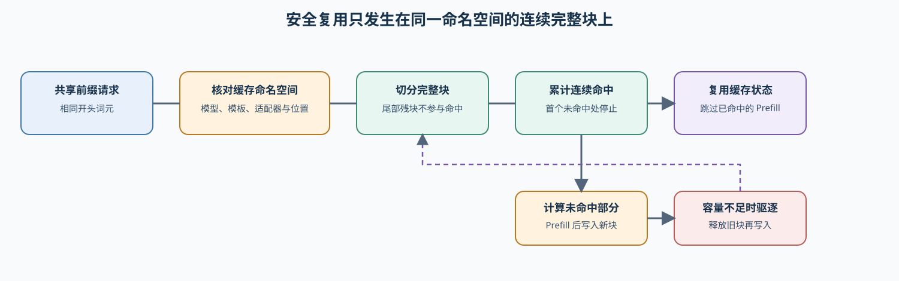
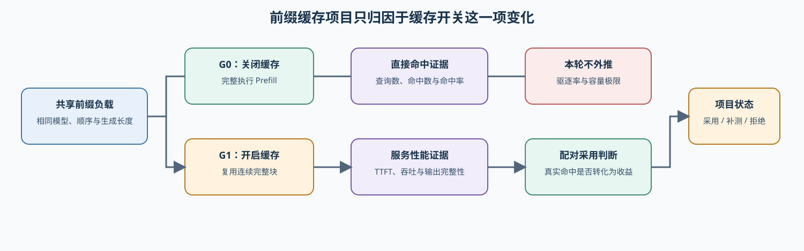

# 69. Prefix Caching Benchmark | 前缀缓存基准
**难度：** Hard | **环境：** CPU-first | **标签：** `推理优化`, `Prefix Cache`, `基准对比` | **目标人群：** 项目决策练习者

> 🚀 **云端运行环境**
>
> 本章节的实战代码可以点击以下链接在免费 GPU 算力平台上直接运行：
>
> [](https://colab.research.google.com/github/datawhalechina/llm-algo-leetcode/blob/main/02_PyTorch_Algorithms/69_Prefix_Caching_Benchmark.ipynb)
> [](https://modelscope.cn/my/mynotebook) *(国内推荐：魔搭社区免费实例)*


---

## 本节导读

多个请求如果共享相同的开头，前缀缓存可以让后续请求跳过已经完成的部分 Prefill。学习时要从请求分布出发，观察哪些前缀真的会重复、命中后节省了多少工作，以及缓存维护和失效带来了什么代价。本节沿着请求样本、baseline、对照指标和部署判断逐步完成评估。

**关键词：** `prefix cache`, `hit rate`, `TTFT`, `overhead`, `deployment`

---
## 前置阅读

**导语：** 进入本节前，先理解 KV Cache 如何保存请求状态，以及 PagedAttention、RadixAttention 如何组织这些状态。阅读时重点观察共享前缀如何被识别、命中和复用，再把这种复用与 TTFT、吞吐和缓存容量联系起来。
- [22. vLLM PagedAttention | vLLM PagedAttention](./22_vLLM_PagedAttention.md)
- [24. Prefix Cache Matching and Reuse | Prefix Cache 匹配与复用](./24_Prefix_Cache_Matching_and_Reuse.md)
- [34. SGLang RadixAttention | SGLang RadixAttention](./34_SGLang_RadixAttention.md)


### Step 1：建立前缀缓存的生命周期视野

多个请求共享开头时，前缀缓存把已经完成的 Prefill 状态按 token block 保存下来。后续请求先寻找从位置 0 开始的连续完整 block 命中；命中部分可以复用，未命中部分仍需计算，容量不足时再按策略驱逐旧 block。

| 机制环节 | 要理解的状态变化 | 结果会影响什么 |
|:---|:---|:---|
| 共享前缀 | 请求是否有相同的开头 token | 可复用的候选范围 |
| 完整 block | 前缀按固定大小切分；尾块不参与命中 | 命中粒度与元数据开销 |
| 连续命中 | 只从第一个 block 开始累计命中 | reused tokens 与 Prefill 减少量 |
| 写入与驱逐 | 未命中 block 写入；容量满时移除旧 block | cache blocks、维护开销与后续命中 |
| 配置选择 | 比较 block、容量或驱逐策略的候选记录 | 是否值得进入 backend 复测 |



### Step 2：固定请求分布，比较缓存配置

CPU 对照使用同一组已 token 化请求，只改变 block 粒度、容量或驱逐策略。真实 backend 对照同样固定模型、tokenizer、请求顺序、生成长度、并发与测量过程，避免把 workload 改变误解为缓存收益。

| 对照对象 | 保持一致 | 唯一变化 | 必须满足的条件 |
|:---|:---|:---|:---|
| G0 cache off | 模型、tokenizer、shared-prefix workload、batch、并发 | 不复用前缀 | 作为 TTFT 与吞吐基线 |
| G1 prefix cache | 与 G0 相同 | 一组 block / capacity / eviction 配置 | 记录命中证据与缓存容量 |
| G2 扩展 | 与 G0 相同 | backend 或一项缓存配置 | 单独记录变更与运行环境 |
| CPU 生命周期 | 同一 token 序列 | block_size 或 capacity_blocks | 尾块不命中；请求只处理一次 |

### Step 3：把复用收益和维护代价放进同一判断

命中率不是最终目标。先确认 backend 或日志确实给出了命中证据，再将复用 token、TTFT、吞吐、显存和驱逐代价放到同一结果中，比较多个缓存配置是否适合当前请求分布。

| 证据组 | 字段 | 如何解释 |
|:---|:---|:---|
| 匹配与复用 | hit rate、reused tokens、prefill work reduction | 共享前缀是否真的减少了 Prefill 工作 |
| 性能 | TTFT、TPOT、E2E、throughput、P99 | 命中是否转化为端到端服务收益 |
| 维护成本 | peak memory、cache blocks、eviction、overhead | 高命中是否伴随不可接受的容量或维护压力 |
| 质量与失败 | 输出质量、OOM、unsupported、retest path | 不能把不可用或失败的候选当作收益 |
| 决策 | accept、tune、reject | 命中、TTFT 与维护成本必须共同判断 |

### Step 4：实现 CPU 缓存机制与候选选择

题目区只挖空三项会改变缓存行为或候选选择的机制：连续前缀命中、LRU 写入与驱逐、以及收益—代价排序。同 workload 汇总、baseline/candidate 对照和报告格式由骨架提供。

| TODO | 函数 | 机制责任 | 关键测试 |
|:---|:---|:---|:---|
| TODO 1 | count_continuous_prefix_hits | 只从位置 0 累计连续完整 block 命中 | 尾块不命中、首个 miss 停止、位置 key |
| TODO 2 | write_blocks_with_lru | 写入 block，容量超限时更新并驱逐最旧项 | touch 更新、容量上限、eviction 数 |
| TODO 3 | prefix_cache_rank_key | 在证据合格前提下按复用收益与代价排序候选配置 | 排序方向、质量/失败门槛、配置选择 |
| 辅助函数 | simulate / summarize / compare / recommend | 生命周期记录、同口径对照和项目报告 | workload 契约、字段完整性 |


```python
from typing import Dict, List

```


```python
# 题目区依次实现连续前缀命中、LRU 写入/驱逐和候选配置排序。
# 汇总、同 workload 对照和报告函数已经给出，便于把机制结果放入一次可比较的项目记录。
def complete_token_blocks(tokens: List[int], block_size: int) -> List[tuple[int, ...]]:
    """仅切出完整 token block；尾部不足一个 block 的 token 不参与缓存匹配。"""
    return [tuple(tokens[start:start + block_size]) for start in range(0, len(tokens) - block_size + 1, block_size)]


def count_continuous_prefix_hits(blocks, cache):
    """返回从 block 位置 0 开始连续命中的数量。

    blocks 是当前请求的完整 block 列表；cache 的 key 为 (block_index, block)。
    返回首个 miss 前的命中数，后续偶然命中不计入。
    """
    # TODO 1（连续命中机制）：令 hit_blocks 从 0 开始；按 block_index 顺序检查 (block_index, block)。
    # 首个不在 cache 的 key 立即停止；命中时 hit_blocks 增加 1，最后返回 hit_blocks。
    # 变量提示：block_index、block、hit_blocks。
    raise NotImplementedError('TODO 1：请完成连续前缀命中机制')


def write_blocks_with_lru(cache, blocks, clock, capacity_blocks):
    """写入当前请求的完整 block，并返回更新后的时钟与驱逐次数。

    已存在的 block 再次写入也要刷新访问时间；返回 (clock, eviction_count)。
    """
    # TODO 2（LRU 写入与驱逐）：每处理一个 block 就推进 clock 并更新对应 key。
    # 若 cache 超过 capacity_blocks，删除访问时间最小的 key 并增加 eviction_count。
    # 变量提示：clock、eviction_count、oldest、capacity_blocks。
    raise NotImplementedError('TODO 2：请完成 LRU 写入与驱逐机制')


def simulate_prefix_cache(token_sequences: List[List[int]], block_size: int = 4, capacity_blocks: int = 8) -> Dict[str, object]:
    """模拟完整 token block 的前缀复用和 LRU 驱逐；不测真实 backend 延迟。"""
    if block_size <= 0 or capacity_blocks <= 0:
        raise ValueError('block_size 和 capacity_blocks 必须为正数')
    if not isinstance(token_sequences, list) or not all(isinstance(tokens, list) for tokens in token_sequences):
        raise TypeError('token_sequences 必须是 list[list[int]]')
    cache, clock = {}, 0
    reused_tokens = total_prompt_tokens = hit_requests = eviction_count = 0
    for tokens in token_sequences:
        if not tokens:
            continue
        total_prompt_tokens += len(tokens)
        blocks = complete_token_blocks(tokens, block_size)
        hit_blocks = count_continuous_prefix_hits(blocks, cache)
        if hit_blocks:
            hit_requests += 1
        reused_tokens += hit_blocks * block_size
        clock, evicted = write_blocks_with_lru(cache, blocks, clock, capacity_blocks)
        eviction_count += evicted
    request_count = sum(bool(tokens) for tokens in token_sequences)
    return {'total_requests': request_count, 'total_prompt_tokens': total_prompt_tokens,
            'reused_tokens': reused_tokens, 'miss_tokens': total_prompt_tokens - reused_tokens,
            'hit_rate': hit_requests / request_count if request_count else 0.0,
            'token_reuse_rate': reused_tokens / total_prompt_tokens if total_prompt_tokens else 0.0,
            'prefill_work_reduction': reused_tokens / total_prompt_tokens if total_prompt_tokens else 0.0,
            'eviction_count': eviction_count, 'cache_size_blocks': len(cache)}


def summarize_prefix_cache(runs):
    """汇总同一 workload 的缓存运行记录；仅保留可比较的证据。"""
    if not runs:
        return {'run_count': 0, 'best_hit_rate_run': None, 'avg_hit_rate': 0.0, 'avg_ttft_ms': 0.0}
    required = {'name', 'workload_id', 'hit_rate', 'ttft_ms'}
    if any(not required.issubset(item) for item in runs):
        raise KeyError(f'每条 run 必须包含 {sorted(required)}')
    if len({item['workload_id'] for item in runs}) != 1:
        raise ValueError('缓存汇总必须使用同一 workload_id')
    best = max(runs, key=lambda item: item['hit_rate'])
    return {'run_count': len(runs), 'best_hit_rate_run': best['name'],
            'avg_hit_rate': sum(item['hit_rate'] for item in runs) / len(runs),
            'avg_ttft_ms': sum(item['ttft_ms'] for item in runs) / len(runs)}


def compare_prefix_cache_to_baseline(baseline, candidate):
    """计算同一 workload 下 candidate 相对 baseline 的复用、TTFT 与开销变化。"""
    required = {'workload_id', 'hit_rate', 'ttft_ms', 'overhead'}
    if not required.issubset(baseline) or not required.issubset(candidate):
        raise KeyError(f'比较记录必须包含 {sorted(required)}')
    if baseline['workload_id'] != candidate['workload_id']:
        raise ValueError('baseline 与 candidate 必须使用同一 workload_id')
    return {'hit_rate_gain': candidate['hit_rate'] - baseline['hit_rate'],
            'ttft_delta_ms': candidate['ttft_ms'] - baseline['ttft_ms'],
            'overhead_delta': candidate['overhead'] - baseline['overhead']}


def prefix_cache_rank_key(candidate):
    """返回一项证据合格缓存配置的升序排序 key。

    更大的 hit_rate_gain、更小的 ttft_delta_ms 和 overhead_delta 应排在前面；
    ttft_delta_ms 为负时表示 candidate 的 TTFT 更低。
    """
    summary = candidate['comparison']
    # TODO 3（候选配置排序）：负号让更大命中收益、更低 TTFT 排在前面；较低维护开销优先。
    # rank_key = ???  # 顺序：hit_rate_gain、ttft_delta_ms、overhead_delta。
    raise NotImplementedError('TODO 3：请定义缓存候选排序机制')


def select_prefix_cache_candidate(candidates):
    """排除无命中证据、失败或质量不合格候选后排序。"""
    eligible = [item for item in candidates if item['evidence_ok'] and item['quality_ok']]
    eligible.sort(key=prefix_cache_rank_key)
    return {'candidate_count': len(candidates), 'eligible_count': len(eligible),
            'selected': eligible[0] if eligible else None,
            'rejected_names': [item['name'] for item in candidates if item not in eligible]}


def recommend_prefix_cache_run(baseline, candidate, min_hit_rate_gain, max_overhead):
    """将阈值判断转换为项目报告；决策字段不作为题目挖空。"""
    comparison = compare_prefix_cache_to_baseline(baseline, candidate)
    hit_rate_ok = comparison['hit_rate_gain'] >= min_hit_rate_gain
    ttft_ok = comparison['ttft_delta_ms'] < 0
    overhead_ok = comparison['overhead_delta'] <= max_overhead
    if hit_rate_ok and ttft_ok and overhead_ok:
        decision = 'accept'
    elif hit_rate_ok and ttft_ok:
        decision = 'tune'
    else:
        decision = 'reject'
    details = {'accept': ('命中率、延迟收益和维护开销都达标', 'promote_to_serving_eval'),
               'tune': ('命中率和延迟收益可用，但维护开销仍偏高', 'refine_chunk_or_eviction_policy'),
               'reject': ('命中率不足或延迟收益不明显', 'fallback_to_no_cache')}
    reason, next_action = details[decision]
    return {'decision': decision, 'reason': reason, 'next_action': next_action}

```


```python
# 本测试区验证缓存机制、候选配置排序和同 workload 的报告骨架。
def _prefix_cache_sequences():
    """构造共享前缀、部分命中与完全不相关的三条请求。"""
    return [[1, 2, 3, 4, 5, 6, 7, 8], [1, 2, 3, 4, 5, 6, 9, 10], [20, 21, 22, 23, 24, 25, 26, 27]]

def _cache_report(name, hit_rate, ttft_ms, overhead, evidence=True, quality=True):
    """构造同一 workload 下可用于缓存配置排序的显式指标记录。"""
    return {'name': name, 'workload_id': 'shared-prefix-v1', 'hit_rate': hit_rate, 'ttft_ms': ttft_ms,
            'overhead': overhead, 'evidence_ok': evidence, 'quality_ok': quality}

def test_continuous_block_hits():
    """验证连续前缀命中不能跳过首个 miss。"""
    cache = {(0, (1, 2)): 1, (1, (3, 4)): 2}
    assert count_continuous_prefix_hits([(1, 2), (3, 4), (5, 6)], cache) == 2
    assert count_continuous_prefix_hits([(9, 9), (3, 4)], cache) == 0

def test_lru_write_and_eviction():
    """验证容量上限、重新访问刷新时间和尾块不命中。"""
    cache = {(0, (1, 2)): 1}
    _, evicted = write_blocks_with_lru(cache, [(3, 4), (5, 6)], 1, 2)
    assert len(cache) == 2 and evicted == 1
    previous_clock = cache[(0, (3, 4))]
    refreshed_clock, no_extra_eviction = write_blocks_with_lru(cache, [(3, 4)], 3, 2)
    assert cache[(0, (3, 4))] == refreshed_clock > previous_clock and no_extra_eviction == 0
    simulated = simulate_prefix_cache(_prefix_cache_sequences(), block_size=2, capacity_blocks=4)
    assert simulated['reused_tokens'] == 6 and simulated['eviction_count'] > 0
    tail_case = simulate_prefix_cache([[1, 2, 3, 4, 5], [1, 2, 3, 4, 9]], block_size=4, capacity_blocks=8)
    assert tail_case['reused_tokens'] == 4
    for invalid in ({'block_size': 0}, {'capacity_blocks': 0}):
        try:
            simulate_prefix_cache([[1, 2]], **invalid)
        except ValueError:
            pass
        else:
            raise AssertionError('非法缓存参数应明确拒绝')

def test_candidate_ranking_and_contract():
    """验证证据和质量门槛先于缓存收益排序。"""
    baseline = _cache_report('off', 0., 130, 0.)
    small = _cache_report('small', .5, 100, .03)
    large = _cache_report('large', .7, 95, .08)
    candidates = [{'name': item['name'], 'evidence_ok': item['evidence_ok'], 'quality_ok': item['quality_ok'],
                   'comparison': compare_prefix_cache_to_baseline(baseline, item)} for item in [small, large]]
    assert select_prefix_cache_candidate(candidates)['selected']['name'] == 'large'
    blocked = {'name': 'blocked', 'evidence_ok': False, 'quality_ok': False,
               'comparison': {**candidates[1]['comparison'], 'hit_rate_gain': 99}}
    assert select_prefix_cache_candidate([blocked])['selected'] is None
    assert summarize_prefix_cache([baseline, small])['best_hit_rate_run'] == 'small'
    try:
        compare_prefix_cache_to_baseline(baseline, {**small, 'workload_id': 'other'})
    except ValueError:
        pass
    else:
        raise AssertionError('不同 workload 不应直接比较缓存收益')

def test_prefix_cache_benchmark_template():
    """运行本节全部 CPU 缓存机制测试。"""
    test_continuous_block_hits()
    test_lru_write_and_eviction()
    test_candidate_ranking_and_contract()
    print('测试通过：前缀连续命中、LRU 驱逐与缓存候选排序均通过。')

try:
    test_prefix_cache_benchmark_template()
except NotImplementedError:
    print('请先完成 TODO 部分的代码！')
    raise

```

## 参考代码与解析


```python
# 题目区保留三项缓存机制：连续前缀命中、LRU 写入/驱逐和候选配置排序。
# 汇总、差值计算、部署报告由骨架提供，避免把报告字段当作缓存机制 TODO。
def complete_token_blocks(tokens: List[int], block_size: int) -> List[tuple[int, ...]]:
    """仅切出完整 token block；尾部不足一个 block 的 token 不参与缓存匹配。"""
    return [tuple(tokens[start:start + block_size]) for start in range(0, len(tokens) - block_size + 1, block_size)]


def count_continuous_prefix_hits(blocks, cache):
    """返回从 block 位置 0 开始连续命中的数量。"""
    # TODO 1：位置和 token 内容共同构成 key；首个 miss 后不能跳过继续复用。
    hit_blocks = 0
    for block_index, block in enumerate(blocks):
        if (block_index, block) not in cache:
            break
        hit_blocks += 1
    return hit_blocks


def write_blocks_with_lru(cache, blocks, clock, capacity_blocks):
    """写入当前请求的完整 block，并返回更新后的时钟与驱逐次数。"""
    # TODO 2：每次访问刷新时钟；容量超限时驱逐最久未访问的 block。
    eviction_count = 0
    for block_index, block in enumerate(blocks):
        clock += 1
        cache[(block_index, block)] = clock
        while len(cache) > capacity_blocks:
            oldest = min(cache, key=cache.get)
            del cache[oldest]
            eviction_count += 1
    return clock, eviction_count


def simulate_prefix_cache(token_sequences: List[List[int]], block_size: int = 4, capacity_blocks: int = 8) -> Dict[str, object]:
    """模拟完整 token block 的前缀复用和 LRU 驱逐；不测真实 backend 延迟。"""
    if block_size <= 0 or capacity_blocks <= 0:
        raise ValueError('block_size 和 capacity_blocks 必须为正数')
    if not isinstance(token_sequences, list) or not all(isinstance(tokens, list) for tokens in token_sequences):
        raise TypeError('token_sequences 必须是 list[list[int]]')
    cache, clock = {}, 0
    reused_tokens = total_prompt_tokens = hit_requests = eviction_count = 0
    for tokens in token_sequences:
        if not tokens:
            continue
        total_prompt_tokens += len(tokens)
        blocks = complete_token_blocks(tokens, block_size)
        hit_blocks = count_continuous_prefix_hits(blocks, cache)
        if hit_blocks:
            hit_requests += 1
        reused_tokens += hit_blocks * block_size
        clock, evicted = write_blocks_with_lru(cache, blocks, clock, capacity_blocks)
        eviction_count += evicted
    request_count = sum(bool(tokens) for tokens in token_sequences)
    return {'total_requests': request_count, 'total_prompt_tokens': total_prompt_tokens,
            'reused_tokens': reused_tokens, 'miss_tokens': total_prompt_tokens - reused_tokens,
            'hit_rate': hit_requests / request_count if request_count else 0.0,
            'token_reuse_rate': reused_tokens / total_prompt_tokens if total_prompt_tokens else 0.0,
            'prefill_work_reduction': reused_tokens / total_prompt_tokens if total_prompt_tokens else 0.0,
            'eviction_count': eviction_count, 'cache_size_blocks': len(cache)}


def summarize_prefix_cache(runs):
    """汇总同一 workload 的缓存运行记录；仅保留可比较的证据。"""
    if not runs:
        return {'run_count': 0, 'best_hit_rate_run': None, 'avg_hit_rate': 0.0, 'avg_ttft_ms': 0.0}
    required = {'name', 'workload_id', 'hit_rate', 'ttft_ms'}
    if any(not required.issubset(item) for item in runs):
        raise KeyError(f'每条 run 必须包含 {sorted(required)}')
    if len({item['workload_id'] for item in runs}) != 1:
        raise ValueError('缓存汇总必须使用同一 workload_id')
    best = max(runs, key=lambda item: item['hit_rate'])
    return {'run_count': len(runs), 'best_hit_rate_run': best['name'],
            'avg_hit_rate': sum(item['hit_rate'] for item in runs) / len(runs),
            'avg_ttft_ms': sum(item['ttft_ms'] for item in runs) / len(runs)}


def compare_prefix_cache_to_baseline(baseline, candidate):
    """计算同一 workload 下 candidate 相对 baseline 的复用、TTFT 与开销变化。"""
    required = {'workload_id', 'hit_rate', 'ttft_ms', 'overhead'}
    if not required.issubset(baseline) or not required.issubset(candidate):
        raise KeyError(f'比较记录必须包含 {sorted(required)}')
    if baseline['workload_id'] != candidate['workload_id']:
        raise ValueError('baseline 与 candidate 必须使用同一 workload_id')
    return {'hit_rate_gain': candidate['hit_rate'] - baseline['hit_rate'],
            'ttft_delta_ms': candidate['ttft_ms'] - baseline['ttft_ms'],
            'overhead_delta': candidate['overhead'] - baseline['overhead']}


def prefix_cache_rank_key(candidate):
    """返回一项证据合格缓存配置的升序排序 key。"""
    summary = candidate['comparison']
    # TODO 3：更多复用、更低 TTFT 和更低维护开销优先。
    return (-summary['hit_rate_gain'], summary['ttft_delta_ms'], summary['overhead_delta'])


def select_prefix_cache_candidate(candidates):
    """排除无命中证据、失败或质量不合格候选后排序。"""
    eligible = [item for item in candidates if item['evidence_ok'] and item['quality_ok']]
    eligible.sort(key=prefix_cache_rank_key)
    return {'candidate_count': len(candidates), 'eligible_count': len(eligible),
            'selected': eligible[0] if eligible else None,
            'rejected_names': [item['name'] for item in candidates if item not in eligible]}


def recommend_prefix_cache_run(baseline, candidate, min_hit_rate_gain, max_overhead):
    """将阈值判断转换为项目报告；决策字段不作为题目挖空。"""
    comparison = compare_prefix_cache_to_baseline(baseline, candidate)
    hit_rate_ok = comparison['hit_rate_gain'] >= min_hit_rate_gain
    ttft_ok = comparison['ttft_delta_ms'] < 0
    overhead_ok = comparison['overhead_delta'] <= max_overhead
    if hit_rate_ok and ttft_ok and overhead_ok:
        decision = 'accept'
    elif hit_rate_ok and ttft_ok:
        decision = 'tune'
    else:
        decision = 'reject'
    details = {'accept': ('命中率、延迟收益和维护开销都达标', 'promote_to_serving_eval'),
               'tune': ('命中率和延迟收益可用，但维护开销仍偏高', 'refine_chunk_or_eviction_policy'),
               'reject': ('命中率不足或延迟收益不明显', 'fallback_to_no_cache')}
    reason, next_action = details[decision]
    return {'decision': decision, 'reason': reason, 'next_action': next_action}

```

### 解析

前缀缓存的项目比较依次回答三个问题：当前请求能复用多少连续前缀，有限容量下如何保留可复用状态，以及多种缓存配置中哪一种值得继续复测。

**TODO 1：连续前缀命中**

- key 同时使用 block 位置和 token 内容；同样的 token 出现在不同位置不能直接复用。
- 只从第一个 block 开始累计，首个 miss 后停止；尾部不足一个 block 的 token 不会进入匹配。

**TODO 2：LRU 写入与驱逐**

- 每次写入或再次访问都刷新 clock；容量超过上限时删除最久未访问的 block。
- 这个规则决定了共享前缀能否在有限缓存中持续保留，也会产生 eviction 代价。

**TODO 3：候选配置排序**

- 先排除缺少命中证据或质量不合格的候选，再比较命中收益、TTFT 与维护开销。
- 排序选出优先复测的 block、容量或驱逐配置；Step 5 再用真实 backend 结果确认服务收益。

### Step 5（可选）：GPU 与 backend 实验——真实 prefix cache 对照

使用同一共享前缀请求分别运行 cache off、prefix cache 和单变量扩展配置；每次运行保存分组 JSON，再从 manifest 读取证据并形成项目决策。

#### 5.1 环境、输入与固定条件

本次实验回答一个具体问题：在同一组共享前缀请求上，开启 prefix cache 是否带来可观测收益。先记录实验契约，再让 G0 与 G1 只改变 cache policy；模型、backend、请求分布、生成长度、并发和测量流程保持一致。

| 实验要素 | 本轮契约 | G0 / G1 如何保持一致 | 证据输出 |
|:---|:---|:---|:---|
| 实验对象 | G0 cache off；G1 prefix cache | 使用同一模型 revision、backend 和服务版本 | 两组可比较结果 |
| 固定 workload | shared-prefix 请求文件、生成长度、batch / concurrency | 使用同一请求顺序和 token 化结果 | 统一 workload 记录 |
| 测量流程 | warmup、重复次数、超时和输出长度 | 两组使用相同流程 | 可复查的 JSON 结果 |
| 唯一变量 | cache policy | G0 关闭，G1 只开启 prefix cache | 命中、延迟、吞吐和资源对照 |




```python
# 5.1 检查共享前缀 workload 是否存在；G0/G1/G2 的完整配置在 5.3 定义。
from pathlib import Path
WORKLOAD = 'benchmarks/workloads/prefix_reuse.jsonl'
print({'workload': WORKLOAD, 'workload_exists': Path(WORKLOAD).exists()})

```

#### 5.2 环境启动检查

确认共享前缀 workload 可被读取，并记录 backend、GPU 与缓存开关。预检结果用于解释后续启动失败或缺少命中指标的原因。

| 检查项 | 需要确认的内容 | 记录用途 |
|:---|:---|:---|
| 模型与 backend | G0/G1 使用同一模型 revision 与服务版本 | 保持对照条件一致 |
| GPU 与运行时 | GPU、驱动、CUDA、PyTorch、dtype | 环境变更后重新采集 |
| workload 与开关 | 请求文件、端口、cache policy | 确认共享前缀请求和策略可加载 |
| 命中证据 | backend metrics、日志或专用接口 | 不能由 TTFT 或吞吐反推命中率 |


```python
# 5.2 预检请求文件和候选缓存策略，不启动服务。
preflight = {
    'workload_exists': Path(WORKLOAD).exists(),
    'backend': 'vllm',
    'cache_policy_candidates': ['off', 'prefix_cache'],
}
print('prefix cache preflight:', preflight)

```

#### 5.3 配置实验条件

为 G0、G1 和可选 G2 建立同一份实验契约：G0 关闭缓存，G1 开启 prefix cache，G2 每次只改变一个 backend 或缓存配置。下面字段会写入分组 JSON 和 manifest。

| 字段组 | 必须记录的内容 | 本节用途 |
|:---|:---|:---|
| 身份与角色 | `project`、group、`baseline` / `candidate`、cache policy | 区分 G0/G1/G2 的唯一变化 |
| workload / config | 模型、backend、dtype、prompt、generated tokens、batch、concurrency、warmup | 确认所有组使用相同请求分布 |
| 端到端指标 | TTFT、TPOT、throughput、P95/P99、peak memory、queue wait | 判断服务收益与尾延迟 |
| 缓存机制 | hit rate、reused tokens、eviction、维护开销与证据来源 | 解释收益是否来自缓存复用 |
| 质量与状态 | 输出质量、`ok` / `unsupported` / `OOM` / `failed` | 保留失败和复测信息 |
| 证据与决策 | `evidence_level`、decision、failure reason、retest path | 支持后续比较与项目收口 |


```python
# 5.3 配置 G0/G1/G2；执行 cell 只读取这些条件，不重新定义比较口径。
try:
    from tools.inference_project_runtime import (
        locate_repo_root, runtime_snapshot, start_optional_vllm,
        stop_optional_vllm, run_backend_benchmark,
    )
    REPO_ROOT = locate_repo_root()
except ModuleNotFoundError:
    RUN_REAL_BACKEND = False

MODEL_ID = 'Qwen/Qwen2.5-0.5B-Instruct'
WORKLOAD = 'benchmarks/workloads/prefix_reuse.jsonl'
RUN_ID = 'smoke'
NUM_PROMPTS = 5          # smoke 规模；正式测量应提高请求数并重复运行。
CONCURRENCY = 1          # G0/G1 必须相同；并发扫描单独形成一组实验。
WARMUP = 1
MAX_TOKENS = 64
BACKEND = 'vllm'
DTYPE = 'auto'
RUN_REAL_BACKEND = False  # 默认关闭：不会下载模型或占用 GPU。
MANIFEST_PATH = f'benchmarks/results/69_manifest_{RUN_ID}.json'
GROUPS = (
    {'name': 'g0_cache_off', 'role': 'baseline', 'cache_policy': 'off', 'enabled': False},
    {'name': 'g1_prefix_cache', 'role': 'candidate', 'cache_policy': 'prefix_cache', 'enabled': True},
    # G2 示例：复制 G1，只改变 block、容量、驱逐策略或 backend 中的一项。
)
project_config = {
    'model': MODEL_ID, 'backend': BACKEND, 'dtype': DTYPE, 'workload': WORKLOAD,
    'generated_tokens': MAX_TOKENS, 'num_prompts': NUM_PROMPTS,
    'concurrency': CONCURRENCY, 'warmup': WARMUP,
    'groups': [item['name'] for item in GROUPS],
}
print(project_config)

```

#### 5.4 执行实验并保存 JSON

按 G0 → G1 → G2 运行：每一组完成 warmup 后再测量，并将单组报告与本次 manifest 一起保存。没有直接命中指标、backend 不支持或运行失败时，也要写入状态、原因和复测位置。

| 分支 | 执行内容 | 产物 |
|:---|:---|:---|
| G0 | cache off，固定共享前缀 workload | `69_g0_cache_off_...json` |
| G1 | prefix cache，其他条件不变 | `69_g1_prefix_cache_...json` |
| G2 | 只改变一项缓存或 backend 配置 | 独立 G2 JSON |
| manifest | 汇总本次已执行组、结果路径与状态 | `69_manifest_...json` |


```python
# 5.4 执行 G0/G1；启动、测量或停止失败都会写入 manifest。
if RUN_REAL_BACKEND:
    reports = []
    for group in GROUPS:
        result_path = f"benchmarks/results/69_{group['name']}_{BACKEND}_{RUN_ID}.json"
        server = log_path = None
        try:
            server, log_path, port, selected_dtype, model_path = start_optional_vllm(
                model_id=MODEL_ID, model_source='auto', dtype=DTYPE,
                served_model_name=MODEL_ID, enable_prefix_caching=group['enabled'],
            )
            report = run_backend_benchmark(
                project='69', base_url=f'http://127.0.0.1:{port}', model=MODEL_ID,
                label=f"{BACKEND}-{group['name']}", output=result_path, workload=WORKLOAD,
                backend=BACKEND, batch=1, max_tokens=MAX_TOKENS,
                num_prompts=NUM_PROMPTS, concurrency=CONCURRENCY, warmup=WARMUP,
                dtype=selected_dtype, cache_policy=group['cache_policy'],
            )
            reports.append({'group': group, 'role': group['role'], 'report_path': result_path,
                            'status': report.get('status', 'ok'),
                            'quality': report.get('quality', {'status': 'not_evaluated'}),
                            'failure': report.get('failure'),
                            'evidence_level': 'real_backend_smoke'})
        except Exception as error:
            reports.append({'group': group, 'role': group['role'], 'report_path': result_path,
                            'status': 'failed', 'quality': {'status': 'failed'},
                            'failure': {'failure_reason': str(error), 'retest_path': 'recheck_backend_and_cache_policy'},
                            'evidence_level': 'backend_execution_failure'})
        finally:
            if server is not None:
                stop_optional_vllm(server, log_path)

    by_group = {item['group']['name']: item for item in reports}
    manifest = {
        'schema_version': 'inference-project-manifest/v1', 'project': '69',
        'experiment': 'prefix_cache_reuse', 'config': project_config,
        'environment': runtime_snapshot(), 'groups': reports,
        'artifact': {'manifest_path': MANIFEST_PATH, 'group_result_paths': [item['report_path'] for item in reports]},
        'failure': [item for item in reports if item.get('status') != 'ok'] or None,
        'quality': {'status': 'not_evaluated'}, 'evidence_level': 'real_backend_smoke',
        'decision': {'decision': 'tune', 'reason': '读取分组 JSON 并补齐命中证据后再判断'},
    }
    output = Path(MANIFEST_PATH)
    output.parent.mkdir(parents=True, exist_ok=True)
    output.write_text(json.dumps(manifest, ensure_ascii=False, indent=2), encoding='utf-8')
    print(f'对照清单已保存: {output}')

```

#### 5.5 读取结果与记录证据

逐条读取 manifest 引用的分组 JSON，确认 G0/G1/G2 是否共享模型、backend、dtype、workload、生成长度和并发。结果表只保留比较所需的信息；完整字段、失败原因和复测路径仍保留在 JSON。

| 组别 | 唯一变化 | 缓存机制证据 | 端到端与质量 | 证据与下一步 |
|:---|:---|:---|:---|:---|
| G0 | cache off | 不适用 | TTFT / TPOT / 吞吐 / 显存；参考输出 | baseline，作为对照 |
| G1 | prefix cache | hit rate、reused tokens、eviction、证据来源 | 与 G0 同口径；质量状态 | 字段齐全后进入判断 |
| G2 | 单变量缓存配置 | 与 G1 相同 | 与 G0 同口径；质量状态 | 判断该变量是否值得保留 |
| 失败记录 | unsupported / OOM / failed | 已采集字段 | failure reason、retest path | 不与成功运行混合平均 |


```python
# 5.5 读取分组 JSON，提取共同配置、缓存证据、端到端指标和质量状态。
RESULT_CONFIG_FIELDS = ('model', 'backend', 'dtype', 'workload', 'generated_tokens', 'concurrency')
RESULT_METRIC_FIELDS = ('ttft_ms', 'tpot_ms', 'throughput', 'p95_ms', 'p99_ms', 'peak_memory_mb', 'queue_wait_ms')
CACHE_FIELDS = ('hit_rate', 'reused_tokens', 'eviction_count', 'overhead', 'hit_rate_evidence')

def read_prefix_result(result_path):
    """读取单组报告；兼容 backend report 与已标准化项目结果。"""
    result_path = Path(result_path)
    if not result_path.exists():
        return {'path': str(result_path), 'status': 'missing'}
    raw = json.loads(result_path.read_text(encoding='utf-8'))
    normalized = raw.get('normalized_result') or raw
    config = raw.get('config', normalized.get('config', {}))
    metrics = normalized.get('metrics', raw.get('metrics', {}))
    strategy = raw.get('strategy_metrics', normalized.get('strategy_metrics', {}))
    return {
        'path': str(result_path), 'status': raw.get('status') or normalized.get('status') or ('failed' if raw.get('failure') else 'ok'),
        'config': {field: config.get(field) for field in RESULT_CONFIG_FIELDS},
        'metrics': {field: metrics.get(field) for field in RESULT_METRIC_FIELDS},
        'cache_metrics': {field: strategy.get(field) for field in CACHE_FIELDS},
        'quality': raw.get('quality', normalized.get('quality', {})),
        'failure': raw.get('failure', normalized.get('failure', {})),
    }

def read_prefix_manifest(manifest_path):
    """读取 manifest 及其分组结果，并检查组内比较所需的共同配置。"""
    manifest_path = Path(manifest_path)
    if not manifest_path.exists():
        return {'status': 'not_run', 'manifest': str(manifest_path), 'results': []}
    manifest = json.loads(manifest_path.read_text(encoding='utf-8'))
    groups = manifest.get('groups', [])
    if groups:
        results = []
        for group in groups:
            item = read_prefix_result(group.get('report_path', ''))
            item['group'] = group.get('group', {}).get('name')
            item['role'] = group.get('role')
            if item['status'] == 'missing' and group.get('status') == 'failed':
                item.update({'status': 'failed', 'failure': group.get('failure', {})})
            results.append(item)
    else:
        paths = manifest.get('artifact', {}).get('group_result_paths', [])
        results = [read_prefix_result(item) for item in paths]
    readable = [item for item in results if item.get('status') not in {'missing', 'failed'}]
    signatures = {tuple(item['config'].get(field) for field in RESULT_CONFIG_FIELDS) for item in readable}
    return {'status': 'ok', 'manifest': str(manifest_path), 'results': results,
            'shared_config_ok': len(signatures) <= 1,
            'paired_summary': manifest.get('paired_summary', {}),
            'quality': manifest.get('quality', {}), 'failure': manifest.get('failure')}

prefix_evidence = read_prefix_manifest(globals().get('MANIFEST_PATH', 'benchmarks/results/69_manifest_smoke.json'))
print(json.dumps(prefix_evidence, ensure_ascii=False, indent=2))

```

#### 5.6 解释结果与形成决策

先确认比较口径和命中证据，再同时查看质量、TTFT、吞吐与维护开销。这样可以区分“缓存机制尚未被观测到”和“缓存已运行但没有带来服务收益”。

| 观察到的结果 | 决策 | 下一步 |
|:---|:---|:---|
| 命中证据完整，质量通过，TTFT 或吞吐改善，开销可接受 | `accept` | 扩展请求分布并做回归测试 |
| 结果文件不全、命中证据缺失，或只有部分指标改善 | `tune` | 补充指标或调整 block、容量、驱逐策略 |
| unsupported、OOM、质量失败或端到端性能退化 | `reject` | 保留失败记录，回退 cache off 或更换候选 |


```python
# 5.6 用读出的 G0/G1 证据形成项目决策。
def decide_prefix_cache_evidence(evidence):
    """按失败、命中证据、质量、TTFT、吞吐和维护开销返回项目动作。"""
    if evidence.get('status') != 'ok':
        return {'decision': 'tune', 'reason': '尚未获得可读取的分组结果'}
    if evidence.get('failure'):
        return {'decision': 'reject', 'reason': '存在 unsupported、OOM 或 failed 记录'}
    records = {item.get('group'): item for item in evidence.get('results', [])}
    g0, g1 = records.get('g0_cache_off'), records.get('g1_prefix_cache')
    if not g0 or not g1 or not evidence.get('shared_config_ok'):
        return {'decision': 'tune', 'reason': 'G0/G1 结果或共同配置尚未完整'}
    g1_cache = g1.get('cache_metrics', {})
    if g1_cache.get('hit_rate') is None or not g1_cache.get('hit_rate_evidence'):
        return {'decision': 'tune', 'reason': '缺少直接命中率或其证据来源'}
    quality_status = g1.get('quality', {}).get('status')
    if quality_status in {'failed', 'rejected'}:
        return {'decision': 'reject', 'reason': '输出质量未通过'}
    if quality_status not in {'ok', 'passed'}:
        return {'decision': 'tune', 'reason': '输出质量尚未完成评测'}
    g0_metrics, g1_metrics = g0.get('metrics', {}), g1.get('metrics', {})
    ttft0, ttft1 = g0_metrics.get('ttft_ms'), g1_metrics.get('ttft_ms')
    throughput0, throughput1 = g0_metrics.get('throughput'), g1_metrics.get('throughput')
    overhead = g1_cache.get('overhead')
    if None in {ttft0, ttft1, throughput0, throughput1, overhead}:
        return {'decision': 'tune', 'reason': 'TTFT、吞吐或维护开销字段不完整'}
    if ttft1 < ttft0 and throughput1 > throughput0 and overhead >= 0:
        return {'decision': 'accept', 'reason': '命中证据、质量和 G0/G1 性能对照均通过'}
    if ttft1 > ttft0 and throughput1 < throughput0:
        return {'decision': 'reject', 'reason': '缓存配置使 TTFT 和吞吐同时退化'}
    return {'decision': 'tune', 'reason': '存在部分收益，需调整 block、容量或驱逐策略'}

prefix_cache_decision = decide_prefix_cache_evidence(globals().get('prefix_evidence', {}))
manifest_path = Path(globals().get('MANIFEST_PATH', 'benchmarks/results/69_manifest_smoke.json'))
if manifest_path.exists():
    manifest = json.loads(manifest_path.read_text(encoding='utf-8'))
    manifest['decision'] = prefix_cache_decision
    manifest_path.write_text(json.dumps(manifest, ensure_ascii=False, indent=2), encoding='utf-8')
    print({'decision': prefix_cache_decision, 'manifest_updated': str(manifest_path)})
else:
    print({'decision': prefix_cache_decision, 'manifest_updated': None})

```

## 相关阅读

**项目与开源实现**

完成前缀缓存 benchmark 后，可用 70 继续检查缓存命中与请求调度之间的关系，并保持相同的 workload 记录方式。下面的实现文档和论文用于继续追踪真实系统中的缓存组织、命中和显存管理。
- [70. Serving Scheduler Benchmark | 推理服务调度基准](./70_Serving_Scheduler_Benchmark.md)
- [Automatic Prefix Caching（vLLM 开源实现文档）](https://docs.vllm.ai/en/latest/design/prefix_caching/)
- [Radix Cache（SGLang 开源实现）](https://github.com/sgl-project/sglang/blob/main/python/sglang/srt/mem_cache/radix_cache.py)
- [Efficient Memory Management for Large Language Model Serving with PagedAttention（论文）](https://arxiv.org/abs/2309.06180)

> 注意：OpenAI-compatible API 通常不会直接返回 prefix-cache hit rate。真实 backend 实验可以用共享前缀 workload 比较 TTFT 和吞吐，但不能仅凭延迟变化反推出命中率；命中率必须来自 backend metrics、日志或专用观测接口。
