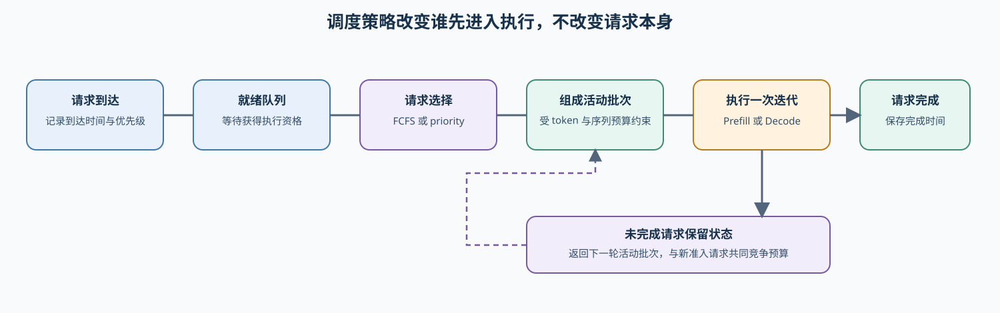
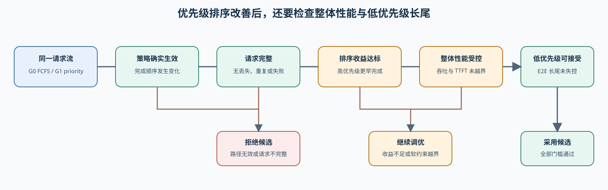

# 70. Serving Scheduler Benchmark | 推理服务调度基准
**难度：** Hard | **环境：** CPU-first | **标签：** `推理优化`, `推理服务`, `调度`, `基准对比` | **目标人群：** 项目决策练习者

> 🚀 **云端运行环境**
>
> 本章节的实战代码可以点击以下链接在免费 GPU 算力平台上直接运行：
>
> [](https://colab.research.google.com/github/datawhalechina/llm-algo-leetcode/blob/main/02_PyTorch_Algorithms/70_Serving_Scheduler_Benchmark.ipynb)
> [](https://modelscope.cn/my/mynotebook) *(国内推荐：魔搭社区免费实例)*


---
## 本节导读

本节从一组可复现的请求流和资源配置开始，先建立 serving baseline，再分别观察负载变化与调度策略对请求等待和服务能力的影响。
学习过程中，你会把“整体吞吐变高”与“部分请求等待更久”放在同一张结果表里，最后根据延迟、服务能力和公平性判断方案适合什么负载。完成后的调度候选记录交给 72；本节不负责模型产物和跨策略部署选择。

**关键词：** `serving scheduler`, `TTFT`, `TPOT`, `throughput`, `fairness`, `utilization`

---
## 前置阅读

**导语：** 开始前先了解 decode 调度、KV Cache 调度、PD 分离和前缀缓存如何改变请求的等待与执行顺序。阅读时关注请求状态、资源分配和服务指标之间的联系，随后把这些机制放入统一的 serving workload 中观察。
- [36. Decode Scheduling | 解码调度](./36_Decode_Scheduling.md)
- [37. KV Cache Lifecycle and Capacity Control | KV Cache 生命周期与容量控制](./37_KV_Cache_Lifecycle_and_Capacity_Control.md)
- [38. Prefill/Decode Scheduling | Prefill/Decode 调度](./38_Prefill_Decode_Scheduling.md)

---
### Step 1：把请求流、准入策略与执行后端分开记录

一个 Serving 调度器持续处理同一条状态链：请求到达后进入 pending，被选入 batch 后进入 active，完成后进入 completed。请求选择策略决定谁先获得执行资格；后端的连续批处理、抢占、块管理和执行内核决定这一批怎样运行。项目候选必须同时记录固定请求流、调度参数和后端能力，不能把 CPU 单 worker 的排序结果直接写成真实 Serving 收益。

| 状态或动作 | 发生了什么 | 会影响什么 |
|:---|:---|:---|
| pending | 请求已到达、尚未获准执行 | queue wait、队列长度 |
| 选择策略 | FIFO、shortest 或 priority 从 ready queue 选择请求 | 完成顺序与公平性 |
| active batch | 至多 batch_size 个请求共享一次服务窗口 | 批次耗时、utilization、吞吐 |
| completed | batch 结束后请求完成并从队列移除 | E2E、完成数与下一轮等待 |
| 策略对照 | 对同一请求流比较 baseline 与 candidate | 是否接受、继续调优或拒绝 |



### Step 2：验证准入不变量与后端执行证据

CPU 模型固定请求流与服务成本，用于检查未到达请求不能提前执行、请求只能完成一次、批次不超过容量等不变量。真实 backend 对照固定模型、请求流、并发、生成参数和硬件，只改变调度策略或一项容量参数，并保存逐请求到达、准入、首词元和完成时间。只有后端实际启用相应策略时，指标变化才能归因于调度候选。

| 对照对象 | 固定条件 | 唯一变化 | 必须保持的不变量 |
|:---|:---|:---|:---|
| FIFO baseline | 请求流、单 worker、服务成本 | FIFO，batch_size=1 | 每个请求只完成一次 |
| 策略对照 | 同一请求流与 batch 上限 | FIFO / shortest / priority | 未到达请求不能被提前选择 |
| 批次对照 | 同一请求流与选择策略 | batch_size 或 batch_speedup | batch 不超过上限；未选请求留在队列 |
| 到达模式对照 | 同一服务成本与策略 | arrival_ms | 只有已到达请求可参与当前轮 |


### Step 3：用等待、吞吐与公平性解释策略取舍

先读取逐请求与批次轨迹，确认策略确实改变了谁在何时进入服务窗口；再汇总请求级和服务级指标。请求丢失、重复完成、后端策略未启用或 SLO 硬门槛失守时 `reject`；轨迹、质量或资源证据缺失时 `tune`。吞吐提高并不自动代表更好的交互体验，TTFT P95、长尾等待、公平性与完成率必须共同进入 `accept` 判断。

| 指标 | 单位 | 解释时要结合什么 |
|:---|:---|:---|
| queue_wait_ms / ttft_ms | ms | 请求到达至被 batch 接纳的等待；CPU 模型用它近似首 token 前的排队时间 |
| makespan_ms | ms | 整组请求结束时间，结合 batch trace 判断批处理是否缩短总时间 |
| throughput_tps | token/s | 总输出 token 除以 makespan，不能脱离等待时间单独判断 |
| utilization | 0–1 | worker 的忙碌占比；高利用率若伴随高等待并非直接收益 |
| fairness | 0–1 | 请求等待差距的教学代理；与完成顺序一起判断是否牺牲部分请求 |
| completed_count | 请求数 | 必须等于输入请求数，且每个 request_id 只能完成一次 |



### Step 4：实现 CPU 调度机制与决策

题目区先用队列推进模型解释状态变化，重点判断请求流是否可比、真实后端轨迹是否完整，以及调度候选能否同时满足延迟、完成率和公平性门槛。

| 任务与目的 | 已知条件 | 完成标准 | 测试验证 |
|:---|:---|:---|:---|
| TODO 1：核对调度对照契约 | 请求流、模型、后端和唯一调度变化 | 固定条件一致且仅策略发生变化 | 请求集错配、多变量变化和后端差异 |
| TODO 2：建立轨迹证据 | 请求级轨迹、批次轨迹和运行状态 | 每个请求到达后执行且只完成一次，关键指标齐全 | 重复完成、丢失请求和轨迹缺口 |
| TODO 3：形成采用状态 | TTFT、TPOT、吞吐、完成率、公平性与资源记录 | 用户体验和服务能力同时达标才采用 | `accept`、`tune`、`reject` |


```python
from typing import Dict, List
```


```python
# 队列选择、状态推进和指标汇总构成机制底座；TODO 聚焦配对、轨迹和采用状态。
# CPU 模型解释不变量，真实服务收益由 Step 5 的后端对照产生。

def select_next_batch(queue: List[Dict[str, float]], policy: str, batch_size: int) -> tuple[list[Dict[str, float]], list[Dict[str, float]]]:
    """从已到达的 pending 队列中选择一个不超过上限的 active batch。

    ``shortest`` 按 ``service_ms`` 排序，``priority`` 优先选择较小 priority，
    ``fifo`` 保持到达与输入顺序。返回值分别是本轮 active batch 与剩余 pending 队列。
    """
    if policy not in {'fifo', 'shortest', 'priority'}:
        raise ValueError('policy 只能是 fifo、shortest 或 priority')
    if batch_size < 1:
        raise ValueError('batch_size 必须 >= 1')
    if policy == 'shortest':
        ordered = sorted(queue, key=lambda item: (item['service_ms'], item['_index']))
    elif policy == 'priority':
        ordered = sorted(queue, key=lambda item: (item.get('priority', 0.0), item['arrival_ms'], item['_index']))
    else:
        ordered = list(queue)
    return ordered[:batch_size], ordered[batch_size:]

# 机制：推进请求状态、批处理和完成时间。
def simulate_serving_scheduler(requests: List[Dict[str, float]], policy: str = 'fifo', batch_size: int = 1, batch_speedup: float = 1.0) -> Dict[str, object]:
    """用单 worker CPU 模型推进 pending、active 与 completed 三种状态。

    请求到达后才可被选择；每轮至多选择 ``batch_size`` 个请求。批内最慢请求决定
    服务窗口，``batch_speedup`` 表示教学模型中的批处理收益；``queue_wait_ms`` 是
    首 token 前排队时间的代理，``batch_trace`` 记录每个 active 窗口。
    """
    if policy not in {'fifo', 'shortest', 'priority'}:
        raise ValueError('policy 只能是 fifo、shortest 或 priority')
    if batch_size < 1 or batch_speedup <= 0:
        raise ValueError('batch_size 必须 >= 1，batch_speedup 必须 > 0')
    if not isinstance(requests, list):
        raise TypeError('requests 必须是 list[dict]')
    if not requests:
        return {'request_count': 0, 'completed_count': 0, 'makespan_ms': 0.0, 'throughput_tps': 0.0, 'utilization': 0.0, 'fairness': 1.0, 'requests': []}
    pending = []
    for index, item in enumerate(requests):
        arrival = float(item.get('arrival_ms', 0.0))
        service = float(item.get('service_ms', 0.0))
        tokens = int(item.get('output_tokens', 0))
        if arrival < 0 or service <= 0 or tokens < 0:
            raise ValueError('arrival_ms >= 0，service_ms > 0，output_tokens >= 0')
        pending.append({**item, '_index': index, 'arrival_ms': arrival, 'service_ms': service, 'output_tokens': tokens})
    pending.sort(key=lambda item: (item['arrival_ms'], item['_index']))
    queue, completed, batch_trace, cursor = [], [], [], 0
    now = busy = 0.0
    while cursor < len(pending) or queue:
        if not queue and cursor < len(pending):
            now = max(now, pending[cursor]['arrival_ms'])
        while cursor < len(pending) and pending[cursor]['arrival_ms'] <= now:
            queue.append(pending[cursor]); cursor += 1
        batch, queue = select_next_batch(queue, policy, batch_size)
        start = now
        duration = max(item['service_ms'] for item in batch) / batch_speedup
        batch_trace.append({'start_ms': round(start, 4), 'duration_ms': round(duration, 4), 'request_ids': [item.get('request_id', f"request-{item['_index']}") for item in batch]})
        now += duration; busy += duration
        for item in batch:
            completed.append({
                'request_id': item.get('request_id', f"request-{item['_index']}"),
                'queue_wait_ms': round(start - item['arrival_ms'], 4),
                'ttft_ms': round(start - item['arrival_ms'], 4),
                'e2e_ms': round(now - item['arrival_ms'], 4),
                'output_tokens': item['output_tokens'],
            })
    makespan = now - min(item['arrival_ms'] for item in pending)
    waits = [item['ttft_ms'] for item in completed]
    mean_wait = sum(waits) / len(waits) if waits else 0.0
    spread = (max(waits) - min(waits)) if waits else 0.0
    fairness = max(0.0, 1.0 - spread / max(mean_wait, 1.0))
    total_tokens = sum(item['output_tokens'] for item in completed)
    avg_queue_wait_ms = sum(item['queue_wait_ms'] for item in completed) / len(completed) if completed else 0.0
    return {
        'request_count': len(pending), 'completed_count': len(completed),
        'makespan_ms': round(makespan, 4),
        'throughput_tps': round(total_tokens / (makespan / 1000.0), 4) if makespan else 0.0,
        'utilization': round(busy / makespan, 4) if makespan else 0.0,
        'avg_queue_wait_ms': round(avg_queue_wait_ms, 4),
        'fairness': round(fairness, 4), 'batch_trace': batch_trace, 'requests': completed,
    }

# 辅助函数：汇总调度运行结果
def summarize_serving_scheduler_runs(runs: List[Dict[str, float]]) -> Dict[str, object]:
    """汇总同一请求流和 batch 配置下的调度运行结果。"""
    if not isinstance(runs, list):
        raise TypeError('runs 必须是 list[dict]')
    required = {'name', 'ttft_ms', 'throughput_tps'}
    for index, item in enumerate(runs):
        if not isinstance(item, dict) or not required.issubset(item):
            raise ValueError(f'第 {index} 条 run 必须包含 {sorted(required)}')
    run_count = len(runs)
    avg_throughput_tps = sum(item['throughput_tps'] for item in runs) / run_count if run_count else 0.0
    best = min(runs, key=lambda item: item['ttft_ms']) if runs else None
    return {'run_count': run_count, 'best_latency_run': best.get('name', 'run') if best else None, 'avg_throughput_tps': avg_throughput_tps}

# 辅助函数：比较 baseline 与 candidate
def compare_scheduler_to_baseline(baseline: Dict[str, float], candidate: Dict[str, float]) -> Dict[str, float]:
    """计算 candidate 相对 baseline 的延迟、吞吐、公平性和利用率变化。"""
    required = {'ttft_ms', 'tpot_ms', 'throughput_tps', 'fairness', 'utilization'}
    for name, item in (('baseline', baseline), ('candidate', candidate)):
        if not isinstance(item, dict) or not required.issubset(item):
            raise ValueError(f'{name} 必须包含 {sorted(required)}')
    delta_specs = [
        ('ttft_ms', 'ttft_delta_ms'),
        ('tpot_ms', 'tpot_delta_ms'),
        ('throughput_tps', 'throughput_gain_tps'),
        ('fairness', 'fairness_delta'),
        ('utilization', 'utilization_delta'),
    ]
    comparison = {
        output_key: round(candidate[source_key] - baseline[source_key], 4)
        for source_key, output_key in delta_specs
    }
    return comparison

def validate_scheduler_contract(baseline, candidate):
    """核对请求流、模型、后端和测量过程是否一致。"""
    fixed_fields = ('model_id', 'revision', 'backend', 'request_stream_id', 'measurement_key')
    mismatches = [field for field in fixed_fields if baseline.get(field) != candidate.get(field)]
    # TODO 1：固定条件一致且调度策略确实变化，才允许解释策略收益。
    # fixed_ok：固定字段没有差异。
    # changed_once：baseline 与 candidate 的 scheduler_policy 不同。
    raise NotImplementedError('TODO 1：请核对调度对照契约')


def build_scheduler_trace_evidence(baseline, candidate):
    """检查配对契约、请求完成不变量和关键服务指标。"""
    contract = validate_scheduler_contract(baseline, candidate)
    request_ids = list(candidate.get('request_ids', []))
    completed_ids = list(candidate.get('completed_ids', []))
    required_metrics = ('ttft_p95_ms', 'tpot_p95_ms', 'throughput_tps', 'completion_rate', 'fairness', 'peak_memory_gb')
    missing = [field for field in required_metrics if candidate.get(field) is None]
    # TODO 2：契约或运行失败为硬失败；请求重复/丢失和指标缺失为缺证。
    # trace_complete：完成集合等于请求集合，且每个请求只完成一次。
    raise NotImplementedError('TODO 2：请建立调度轨迹证据')


def decide_scheduler_candidate(evidence, max_ttft_p95_ms, max_tpot_p95_ms, min_throughput_gain, min_completion_rate, min_fairness):
    """按失败、缺证、用户体验和服务能力形成采用状态。"""
    # TODO 3：硬失败 reject；缺证或部分门槛未过 tune；全部通过 accept。
    # latency_ok：TTFT 与 TPOT 的 P95 均不越界。
    # service_ok：吞吐增益、完成率和公平性均达标。
    raise NotImplementedError('TODO 3：请形成调度候选状态')


def recommend_serving_scheduler_run(
    baseline: Dict[str, float], candidate: Dict[str, float], min_throughput_gain: float, min_fairness: float
) -> Dict[str, object]:
    """Choose a scheduler action from latency, throughput, utilization and fairness.

    min_throughput_gain is candidate minus baseline token/s; min_fairness is an
    absolute candidate fairness floor. Accept requires all user-facing metrics
    to pass, while tune retains a candidate with partial capacity improvement.
    """
    if min_throughput_gain < 0:
        raise ValueError('min_throughput_gain 不能为负数')
    if not 0 <= min_fairness <= 1:
        raise ValueError('min_fairness 必须位于 [0, 1]')
    comparison = compare_scheduler_to_baseline(baseline, candidate)
    throughput_ok = comparison['throughput_gain_tps'] >= min_throughput_gain
    fairness_ok = candidate['fairness'] >= min_fairness
    latency_ok = comparison['ttft_delta_ms'] < 0 and comparison['tpot_delta_ms'] <= 0
    # 决策：交互延迟、服务能力与公平性共同判断。
    if latency_ok and throughput_ok and fairness_ok:
        return {'decision': 'accept', 'reason': '延迟、吞吐和公平性都达标，适合进入真实 serving 验证', 'next_action': 'promote_to_serving_rollout'}
    if comparison['throughput_gain_tps'] >= 0 and comparison['utilization_delta'] >= 0:
        return {'decision': 'tune', 'reason': '吞吐和利用率已有改善，但公平性或延迟边界还不够稳', 'next_action': 'refine_queue_rules_or_worker_split'}
    return {'decision': 'reject', 'reason': 'candidate 没有形成可信的 serving 调度收益', 'next_action': 'fallback_to_scheduler_audit'}
```


```python
# 测试你的实现
# 测试目标：分别验证队列状态转移、运行汇总、baseline 对照和 accept/tune/reject 决策。
# 这些断言检查机制契约与指标方向，不把 CPU 教学耗时当作真实 GPU serving 性能。
REQUESTS = [
    {'request_id': 'r1', 'arrival_ms': 0, 'service_ms': 10, 'output_tokens': 20, 'priority': 5},
    {'request_id': 'r2', 'arrival_ms': 0, 'service_ms': 2, 'output_tokens': 20, 'priority': 0},
    {'request_id': 'r3', 'arrival_ms': 1, 'service_ms': 3, 'output_tokens': 20, 'priority': 2},
]

BASELINE = {
    'name': 'fifo',
    'ttft_ms': 220,
    'tpot_ms': 42,
    'throughput_tps': 180,
    'fairness': 0.78,
    'utilization': 0.70,
}

CANDIDATE = {
    'name': 'priority_scheduler',
    'ttft_ms': 180,
    'tpot_ms': 36,
    'throughput_tps': 205,
    'fairness': 0.81,
    'utilization': 0.79,
}


def _assert_value_error(callable_, message):
    """断言调用会抛出 ValueError。"""
    try:
        callable_()
    except ValueError:
        return
    raise AssertionError(message)


def test_serving_simulation_contract():
    """验证请求完成一次、等待时间和聚合指标之间的契约。"""
    simulation = simulate_serving_scheduler(REQUESTS, policy='fifo', batch_size=1)
    assert simulation['request_count'] == 3
    assert simulation['completed_count'] == 3
    assert simulation['makespan_ms'] == 15.0
    assert simulation['throughput_tps'] == 4000.0
    assert simulation['utilization'] == 1.0
    assert simulation['avg_queue_wait_ms'] == round((0.0 + 10.0 + 11.0) / 3, 4)
    assert simulation['requests'][0]['queue_wait_ms'] == 0.0
    assert simulation['requests'][1]['ttft_ms'] == 10.0
    assert [trace['request_ids'] for trace in simulation['batch_trace']] == [['r1'], ['r2'], ['r3']]
    assert 0.0 <= simulation['fairness'] <= 1.0


def test_policy_batching_and_input_guards():
    """验证 FIFO/shortest、batch 边界、空输入和非法配置。"""
    shortest = simulate_serving_scheduler(REQUESTS, policy='shortest', batch_size=1)
    assert shortest['requests'][0]['request_id'] == 'r2'
    assert shortest['requests'][-1]['request_id'] == 'r1'
    priority = simulate_serving_scheduler(REQUESTS, policy='priority', batch_size=1)
    assert priority['requests'][0]['request_id'] == 'r2'
    assert priority['batch_trace'][0]['request_ids'] == ['r2']
    batched = simulate_serving_scheduler(REQUESTS, policy='fifo', batch_size=2, batch_speedup=1.0)
    assert batched['completed_count'] == len(REQUESTS)
    assert batched['makespan_ms'] == 13.0
    assert batched['makespan_ms'] < 15.0
    empty = simulate_serving_scheduler([])
    assert empty['request_count'] == 0 and empty['completed_count'] == 0
    _assert_value_error(lambda: simulate_serving_scheduler(REQUESTS, policy='unknown'), '非法调度策略应明确拒绝！')
    for invalid in ({'batch_size': 0}, {'batch_speedup': 0.0}):
        _assert_value_error(lambda invalid=invalid: simulate_serving_scheduler(REQUESTS, **invalid), '非法 batch 参数应明确拒绝！')


def test_result_summary_contract():
    """验证同一 workload 的运行汇总和最低 TTFT 选择。"""
    summary = summarize_serving_scheduler_runs([BASELINE, CANDIDATE])
    assert summary['run_count'] == 2
    assert summary['best_latency_run'] == 'priority_scheduler'
    assert summary['avg_throughput_tps'] == 192.5
    assert summarize_serving_scheduler_runs([]) == {
        'run_count': 0,
        'best_latency_run': None,
        'avg_throughput_tps': 0.0,
    }


def test_baseline_comparison_contract():
    """验证 candidate-baseline 的差值方向和指标解释。"""
    comparison = compare_scheduler_to_baseline(BASELINE, CANDIDATE)
    assert comparison['ttft_delta_ms'] == -40
    assert comparison['tpot_delta_ms'] == -6
    assert comparison['throughput_gain_tps'] == 25
    assert comparison['fairness_delta'] == 0.03
    assert comparison['utilization_delta'] == 0.09
    assert comparison['throughput_gain_tps'] > 0
    assert comparison['fairness_delta'] > 0


def test_decision_policy_contract():
    """验证同时达标、部分改善和无收益三种决策。"""
    decision = recommend_serving_scheduler_run(
        BASELINE,
        CANDIDATE,
        min_throughput_gain=20,
        min_fairness=0.8,
    )
    assert decision['decision'] == 'accept'
    assert decision['next_action'] == 'promote_to_serving_rollout'

    weak_candidate = {
        'name': 'aggressive_batching',
        'ttft_ms': 195,
        'tpot_ms': 38,
        'throughput_tps': 202,
        'fairness': 0.76,
        'utilization': 0.82,
    }
    weak_decision = recommend_serving_scheduler_run(
        BASELINE,
        weak_candidate,
        min_throughput_gain=20,
        min_fairness=0.8,
    )
    assert weak_decision['decision'] == 'tune'

    bad_candidate = {
        'name': 'overfit_scheduler',
        'ttft_ms': 260,
        'tpot_ms': 48,
        'throughput_tps': 170,
        'fairness': 0.60,
        'utilization': 0.66,
    }
    bad_decision = recommend_serving_scheduler_run(
        BASELINE,
        bad_candidate,
        min_throughput_gain=20,
        min_fairness=0.8,
    )
    assert bad_decision['decision'] == 'reject'


def _scheduler_project_record(policy, throughput_tps, ttft_p95_ms, tpot_p95_ms, fairness):
    """构造同请求流的调度项目记录。"""
    request_ids = ['r1', 'r2', 'r3']
    return {'model_id': 'target', 'revision': 'commit', 'backend': 'vllm',
            'request_stream_id': 'mixed-v1', 'measurement_key': 'warm2-repeat5',
            'scheduler_policy': policy, 'request_ids': request_ids, 'completed_ids': list(request_ids),
            'ttft_p95_ms': ttft_p95_ms, 'tpot_p95_ms': tpot_p95_ms,
            'throughput_tps': throughput_tps, 'completion_rate': 1.0,
            'fairness': fairness, 'peak_memory_gb': 7.0, 'failure': None}


def test_scheduler_project_contract_and_trace():
    """验证调度契约、完成轨迹和采用门槛。"""
    baseline = _scheduler_project_record('fifo', 180.0, 220.0, 42.0, 0.78)
    candidate = _scheduler_project_record('priority', 205.0, 180.0, 36.0, 0.82)
    assert validate_scheduler_contract(baseline, candidate)['contract_ok']
    assert not validate_scheduler_contract(baseline, {**candidate, 'backend': 'other'})['contract_ok']
    evidence = build_scheduler_trace_evidence(baseline, candidate)
    assert evidence['hard_failures'] == [] and evidence['missing_evidence'] == []
    assert decide_scheduler_candidate(evidence, 200.0, 40.0, 20.0, 1.0, 0.8)['decision'] == 'accept'
    broken = build_scheduler_trace_evidence(baseline, {**candidate, 'completed_ids': ['r1', 'r1', 'r3']})
    assert decide_scheduler_candidate(broken, 200.0, 40.0, 20.0, 1.0, 0.8)['decision'] == 'tune'


def test_serving_scheduler_benchmark_template():
    """运行本节全部 CPU 调度测试。"""
    test_serving_simulation_contract()
    test_policy_batching_and_input_guards()
    test_result_summary_contract()
    test_baseline_comparison_contract()
    test_decision_policy_contract()
    test_scheduler_project_contract_and_trace()
    print('测试通过：调度对照契约、请求轨迹与采用状态均通过。')


test_serving_scheduler_benchmark_template()
```

## 参考代码与解析

### 代码

```python
from typing import Dict, List
def select_next_batch(queue: List[Dict[str, float]], policy: str, batch_size: int) -> tuple[list[Dict[str, float]], list[Dict[str, float]]]:
    """从已到达的 pending 队列中选择一个不超过上限的 active batch。

    ``shortest`` 按 ``service_ms`` 排序，``priority`` 优先选择较小 priority，
    ``fifo`` 保持到达与输入顺序。返回值分别是本轮 active batch 与剩余 pending 队列。
    """
    if policy not in {'fifo', 'shortest', 'priority'}:
        raise ValueError('policy 只能是 fifo、shortest 或 priority')
    if batch_size < 1:
        raise ValueError('batch_size 必须 >= 1')
    # 机制：稳定排序后切分批次，剩余请求继续等待。
    if policy == 'shortest':
        ordered = sorted(queue, key=lambda item: (item['service_ms'], item['_index']))
    elif policy == 'priority':
        ordered = sorted(queue, key=lambda item: (item.get('priority', 0.0), item['arrival_ms'], item['_index']))
    else:
        ordered = list(queue)
    return ordered[:batch_size], ordered[batch_size:]

# 机制：推进请求状态、批处理和完成时间。
def simulate_serving_scheduler(requests: List[Dict[str, float]], policy: str = 'fifo', batch_size: int = 1, batch_speedup: float = 1.0) -> Dict[str, object]:
    """用单 worker CPU 模型推进 pending、active 与 completed 三种状态。

    请求到达后才可被选择；每轮至多选择 ``batch_size`` 个请求。批内最慢请求决定
    服务窗口，``batch_speedup`` 表示教学模型中的批处理收益；``queue_wait_ms`` 是
    首 token 前排队时间的代理，``batch_trace`` 记录每个 active 窗口。
    """
    if policy not in {'fifo', 'shortest', 'priority'}:
        raise ValueError('policy 只能是 fifo、shortest 或 priority')
    if batch_size < 1 or batch_speedup <= 0:
        raise ValueError('batch_size 必须 >= 1，batch_speedup 必须 > 0')
    if not isinstance(requests, list):
        raise TypeError('requests 必须是 list[dict]')
    if not requests:
        return {'request_count': 0, 'completed_count': 0, 'makespan_ms': 0.0, 'throughput_tps': 0.0, 'utilization': 0.0, 'fairness': 1.0, 'requests': []}
    pending = []
    for index, item in enumerate(requests):
        arrival = float(item.get('arrival_ms', 0.0))
        service = float(item.get('service_ms', 0.0))
        tokens = int(item.get('output_tokens', 0))
        if arrival < 0 or service <= 0 or tokens < 0:
            raise ValueError('arrival_ms >= 0，service_ms > 0，output_tokens >= 0')
        pending.append({**item, '_index': index, 'arrival_ms': arrival, 'service_ms': service, 'output_tokens': tokens})
    pending.sort(key=lambda item: (item['arrival_ms'], item['_index']))
    queue, completed, batch_trace, cursor = [], [], [], 0
    now = busy = 0.0
    while cursor < len(pending) or queue:
        if not queue and cursor < len(pending):
            now = max(now, pending[cursor]['arrival_ms'])
        while cursor < len(pending) and pending[cursor]['arrival_ms'] <= now:
            queue.append(pending[cursor]); cursor += 1
        batch, queue = select_next_batch(queue, policy, batch_size)
        start = now
        # 机制：同一活动批次的服务窗口由最慢请求决定。
        duration = max(item['service_ms'] for item in batch) / batch_speedup
        batch_trace.append({'start_ms': round(start, 4), 'duration_ms': round(duration, 4), 'request_ids': [item.get('request_id', f"request-{item['_index']}") for item in batch]})
        now += duration; busy += duration
        for item in batch:
            completed.append({
                'request_id': item.get('request_id', f"request-{item['_index']}"),
                'queue_wait_ms': round(start - item['arrival_ms'], 4),
                'ttft_ms': round(start - item['arrival_ms'], 4),
                'e2e_ms': round(now - item['arrival_ms'], 4),
                'output_tokens': item['output_tokens'],
            })
    makespan = now - min(item['arrival_ms'] for item in pending)
    waits = [item['ttft_ms'] for item in completed]
    mean_wait = sum(waits) / len(waits) if waits else 0.0
    spread = (max(waits) - min(waits)) if waits else 0.0
    fairness = max(0.0, 1.0 - spread / max(mean_wait, 1.0))
    total_tokens = sum(item['output_tokens'] for item in completed)
    avg_queue_wait_ms = sum(item['queue_wait_ms'] for item in completed) / len(completed) if completed else 0.0
    return {
        'request_count': len(pending), 'completed_count': len(completed),
        'makespan_ms': round(makespan, 4),
        'throughput_tps': round(total_tokens / (makespan / 1000.0), 4) if makespan else 0.0,
        'utilization': round(busy / makespan, 4) if makespan else 0.0,
        'avg_queue_wait_ms': round(avg_queue_wait_ms, 4),
        'fairness': round(fairness, 4), 'batch_trace': batch_trace, 'requests': completed,
    }

# 辅助函数：汇总调度运行结果
def summarize_serving_scheduler_runs(runs: List[Dict[str, float]]) -> Dict[str, object]:
    """汇总同一请求流和 batch 配置下的调度运行结果。"""
    if not isinstance(runs, list):
        raise TypeError('runs 必须是 list[dict]')
    required = {'name', 'ttft_ms', 'throughput_tps'}
    for index, item in enumerate(runs):
        if not isinstance(item, dict) or not required.issubset(item):
            raise ValueError(f'第 {index} 条 run 必须包含 {sorted(required)}')
    run_count = len(runs)
    avg_throughput_tps = sum(item['throughput_tps'] for item in runs) / run_count if run_count else 0.0
    best = min(runs, key=lambda item: item['ttft_ms']) if runs else None
    return {'run_count': run_count, 'best_latency_run': best.get('name', 'run') if best else None, 'avg_throughput_tps': avg_throughput_tps}

# 辅助函数：比较 baseline 与 candidate
def compare_scheduler_to_baseline(baseline: Dict[str, float], candidate: Dict[str, float]) -> Dict[str, float]:
    """计算 candidate 相对 baseline 的延迟、吞吐、公平性和利用率变化。"""
    required = {'ttft_ms', 'tpot_ms', 'throughput_tps', 'fairness', 'utilization'}
    for name, item in (('baseline', baseline), ('candidate', candidate)):
        if not isinstance(item, dict) or not required.issubset(item):
            raise ValueError(f'{name} 必须包含 {sorted(required)}')
    delta_specs = [
        ('ttft_ms', 'ttft_delta_ms'),
        ('tpot_ms', 'tpot_delta_ms'),
        ('throughput_tps', 'throughput_gain_tps'),
        ('fairness', 'fairness_delta'),
        ('utilization', 'utilization_delta'),
    ]
    comparison = {
        output_key: round(candidate[source_key] - baseline[source_key], 4)
        for source_key, output_key in delta_specs
    }
    return comparison

def validate_scheduler_contract(baseline, candidate):
    """核对请求流、模型、后端和测量过程是否一致。"""
    fixed_fields = ('model_id', 'revision', 'backend', 'request_stream_id', 'measurement_key')
    mismatches = [field for field in fixed_fields if baseline.get(field) != candidate.get(field)]
    # TODO 1：固定条件一致，且唯一声明变化是调度策略。
    fixed_ok = not mismatches
    changed_once = baseline.get('scheduler_policy') != candidate.get('scheduler_policy')
    issues = list(mismatches) + ([] if changed_once else ['scheduler_policy'])
    return {'contract_ok': fixed_ok and changed_once, 'issues': issues}


def build_scheduler_trace_evidence(baseline, candidate):
    """检查配对契约、请求完成不变量和关键服务指标。"""
    contract = validate_scheduler_contract(baseline, candidate)
    request_ids = list(candidate.get('request_ids', []))
    completed_ids = list(candidate.get('completed_ids', []))
    required_metrics = ('ttft_p95_ms', 'tpot_p95_ms', 'throughput_tps', 'completion_rate', 'fairness', 'peak_memory_gb')
    missing = [field for field in required_metrics if candidate.get(field) is None]
    # TODO 2：请求必须全部且只完成一次，轨迹缺口不能伪装成性能收益。
    trace_complete = set(completed_ids) == set(request_ids) and len(completed_ids) == len(set(completed_ids))
    hard_failures = list(contract['issues'])
    if baseline.get('failure'):
        hard_failures.append('baseline')
    if candidate.get('failure'):
        hard_failures.append('candidate')
    missing_evidence = list(missing) + ([] if trace_complete else ['request_trace'])
    return {'hard_failures': hard_failures, 'missing_evidence': missing_evidence,
            'ttft_p95_ms': candidate.get('ttft_p95_ms'), 'tpot_p95_ms': candidate.get('tpot_p95_ms'),
            'throughput_gain': candidate.get('throughput_tps', 0.0) - baseline.get('throughput_tps', 0.0),
            'completion_rate': candidate.get('completion_rate'), 'fairness': candidate.get('fairness')}


def decide_scheduler_candidate(evidence, max_ttft_p95_ms, max_tpot_p95_ms, min_throughput_gain, min_completion_rate, min_fairness):
    """按失败、缺证、用户体验和服务能力形成采用状态。"""
    # TODO 3：交互延迟与服务能力必须同时达标。
    latency_ok = evidence['ttft_p95_ms'] <= max_ttft_p95_ms and evidence['tpot_p95_ms'] <= max_tpot_p95_ms
    service_ok = (evidence['throughput_gain'] >= min_throughput_gain
                  and evidence['completion_rate'] >= min_completion_rate
                  and evidence['fairness'] >= min_fairness)
    if evidence['hard_failures']:
        return {'decision': 'reject', 'next_action': 'repair_contract_or_backend'}
    if evidence['missing_evidence']:
        return {'decision': 'tune', 'next_action': 'collect_request_trace'}
    if latency_ok and service_ok:
        return {'decision': 'accept', 'next_action': 'promote_to_deployment_comparison'}
    return {'decision': 'tune', 'next_action': 'adjust_queue_or_batch_policy'}


def recommend_serving_scheduler_run(
    baseline: Dict[str, float], candidate: Dict[str, float], min_throughput_gain: float, min_fairness: float
) -> Dict[str, object]:
    """按延迟、吞吐和公平性门槛给出教学决策。"""
    if min_throughput_gain < 0:
        raise ValueError('min_throughput_gain 不能为负数')
    if not 0 <= min_fairness <= 1:
        raise ValueError('min_fairness 必须位于 [0, 1]')
    comparison = compare_scheduler_to_baseline(baseline, candidate)
    throughput_ok = comparison['throughput_gain_tps'] >= min_throughput_gain
    fairness_ok = candidate['fairness'] >= min_fairness
    latency_ok = comparison['ttft_delta_ms'] < 0 and comparison['tpot_delta_ms'] <= 0
    # 决策：交互延迟、吞吐增益和公平性同时满足才采用。
    if latency_ok and throughput_ok and fairness_ok:
        return {'decision': 'accept', 'reason': '延迟、吞吐和公平性都达标，适合进入真实 serving 验证', 'next_action': 'promote_to_serving_rollout'}
    if comparison['throughput_gain_tps'] >= 0 and comparison['utilization_delta'] >= 0:
        return {'decision': 'tune', 'reason': '吞吐和利用率已有改善，但公平性或延迟边界还不够稳', 'next_action': 'refine_queue_rules_or_worker_split'}
    return {'decision': 'reject', 'reason': 'candidate 没有形成可信的 serving 调度收益', 'next_action': 'fallback_to_scheduler_audit'}
```

### 解析

本题先用队列模拟解释状态变化，学习者负责项目级配对、请求轨迹完整性和服务采用判断。

**TODO 1：核对调度对照契约**

- 模型、后端、请求流和测量过程必须一致，唯一解释变量是调度策略。
- 测试用后端错配和策略未变化两个反例阻止无效比较。

**TODO 2：建立请求轨迹证据**

- 完成集合必须与请求集合一致，每个请求只能完成一次；否则完成率和延迟分布都不可信。
- 测试把轨迹缺口与运行失败分开，分别对应补采证据和修复后端。

**TODO 3：形成调度候选状态**

- TTFT 与 TPOT 的 P95 共同约束用户体验；吞吐增益、完成率和公平性共同约束服务能力。
- 无硬失败和缺证，且两组门槛同时通过时才进入 `accept`。

### Step 5（可选）：单卡 GPU 调度策略对照
| CPU 已验证 | 单卡 GPU 补充 | 本页输出 |
|:---|:---|:---|
| 到达后准入、容量上限、完成唯一性与决策门槛 | 同一 vLLM 版本下配对比较 FCFS 与 priority | 两组原始 JSON、逐请求首 token/完成顺序和采用判断 |
#### 5.1 环境、请求流与固定条件

使用 `INF-VLLM-011-CU128` Profile，硬件下限为单张 12 GB NVIDIA GPU。首次运行先按[推理优化 Quickstart](../topic_discussion/inference_optimization/quickstart.md#inf-vllm-quickstart)创建环境。配置集中在下一单元：G0 与 G1 固定模型、请求流、并发、生成长度、队列容量和重复次数，只改变 vLLM 的 `scheduling-policy`；G1 才把 workload 中的 priority 字段发送给服务。固定的小 `max_num_seqs` 用来形成可观测的等待队列。

| 组别 | 服务端策略 | 请求 priority | 回答的问题 |
|:---|:---|:---|:---|
| G0 | FCFS | 不发送，但保留标签用于离线统计 | 默认完成顺序与服务指标是什么 |
| G1 | priority | 发送；数值越小越早 | 交互请求是否更早完成，且没有不可接受的整体退化 |

```python
# 5.1：唯一可编辑配置。正式复测只修改本单元，并为 RUN_LABEL 使用新值。
RUN_REAL_BACKEND = True  # 改为 True 后，5.4 会顺序启动 G0 与 G1；不要预先启动其他 vLLM 服务。
RUN_LABEL = 'rtx5070ti_scheduler_priority_v4'  # 每次复测使用新标签，保留旧 JSON。
PROFILE_ID = 'INF-VLLM-011-CU128'  # vLLM 0.11 + CUDA 12.8 隔离环境。
MODEL_ID = 'Qwen/Qwen2.5-0.5B-Instruct'  # 两组使用同一模型资产。
MODEL_SOURCE = 'auto'  # 优先复用 model_cache；缺失时由共享解析器处理。
DTYPE = 'bfloat16'
WORKLOAD = 'benchmarks/workloads/scheduler_priority.jsonl'  # 冻结的交互/批处理混合请求流。
NUM_PROMPTS = 8  # 与 workload 行数一致，避免重复 request_id。
MAX_TOKENS = 96
CONCURRENCY = 8  # 同步提交全部请求，避免客户端提交抖动主导到达顺序。
MAX_NUM_SEQS = 2  # 两组都限制同时运行序列数，确保其余请求进入等待队列。
WARMUP = 2
REPEATS = 5
MAX_MODEL_LEN = 2048
GPU_MEMORY_UTILIZATION = 0.80
ENFORCE_EAGER = True  # 首轮减少 CUDA Graph 之外的环境变量；后续可单独比较 graph 模式。
MIN_PRIORITY_ORDER_GAIN = 0.15  # G1 的高优先级首 token 顺序分数至少提高 0.15。
MAX_THROUGHPUT_REGRESSION = 0.10  # 总输出吞吐最多回退 10%。
MAX_TTFT_P95_REGRESSION = 0.25  # 全体 TTFT P95 最多回退 25%。
MAX_LOW_PRIORITY_E2E_REGRESSION = 0.50  # 低优先级 E2E P95 最多回退 50%。
GROUPS = (
    {'name': 'g0_fcfs', 'role': 'baseline', 'scheduler_policy': 'fcfs', 'send_priority': False},
    {'name': 'g1_priority', 'role': 'candidate', 'scheduler_policy': 'priority', 'send_priority': True},
)
```

#### 5.2 环境与输入预检

本单元只检查当前 Kernel、GPU、vLLM 命令、固定请求流和 Profile 身份，不下载模型、不启动服务。

```python
# 5.2：只读预检；失败时先修复环境或输入，再进入候选检查。
import json
import shutil
import sys
from pathlib import Path
import torch
from tools.inference_project_runtime import locate_repo_root

REPO_ROOT = locate_repo_root()
WORKLOAD_PATH = REPO_ROOT / WORKLOAD
preflight = {
    'profile_id': PROFILE_ID,
    'python': sys.executable,
    'torch': torch.__version__,
    'cuda_available': torch.cuda.is_available(),
    'gpu': torch.cuda.get_device_name(0) if torch.cuda.is_available() else None,
    'gpu_memory_gb': (round(torch.cuda.get_device_properties(0).total_memory / 1024**3, 2)
                      if torch.cuda.is_available() else None),
    'vllm_command': shutil.which('vllm'),
    'workload_exists': WORKLOAD_PATH.is_file(),
}
if RUN_REAL_BACKEND and (not preflight['cuda_available'] or not preflight['vllm_command'] or not preflight['workload_exists']):
    raise RuntimeError(f'真实实验预检失败：{preflight}')
print(json.dumps(preflight, ensure_ascii=False, indent=2))
```

#### 5.3 候选与可比性检查

读取冻结请求流并检查 request_id、priority 和组别定义。该单元只派生结果路径，不启动后端。

```python
# 5.3：检查同负载配对以及 priority 的可辨识性。
records = [json.loads(line) for line in WORKLOAD_PATH.read_text(encoding='utf-8').splitlines() if line.strip()]
request_ids = [item.get('request_id') for item in records]
priorities = [item.get('priority') for item in records]
if len(records) != NUM_PROMPTS:
    raise ValueError(f'NUM_PROMPTS={NUM_PROMPTS}，但冻结 workload 有 {len(records)} 行')
if None in request_ids or len(request_ids) != len(set(request_ids)):
    raise ValueError('每条调度请求必须有唯一 request_id')
if None in priorities or len(set(priorities)) < 2:
    raise ValueError('调度 workload 至少需要两个 priority 层级')
if {group['scheduler_policy'] for group in GROUPS} != {'fcfs', 'priority'}:
    raise ValueError('本页必须保留 FCFS 与 priority 两个策略组')
if any(value <= 0 for value in (NUM_PROMPTS, MAX_TOKENS, CONCURRENCY, MAX_NUM_SEQS, REPEATS)) or WARMUP < 0:
    raise ValueError('请求数、生成长度、并发和重复次数必须为正，预热不能为负')
if CONCURRENCY < NUM_PROMPTS:
    raise ValueError('同步发车要求 CONCURRENCY 不小于 NUM_PROMPTS')
if MAX_NUM_SEQS >= NUM_PROMPTS:
    raise ValueError('MAX_NUM_SEQS 必须小于请求数，否则不能形成等待队列')
RESULT_DIR = REPO_ROOT / 'benchmarks/results/70_serving_scheduler'
RESULT_PATHS = {
    group['name']: RESULT_DIR / f"{group['name']}_{RUN_LABEL}.json"
    for group in GROUPS
}
print({'request_ids': request_ids, 'priority_levels': sorted(set(priorities)),
       'groups': GROUPS, 'result_paths': {k: str(v) for k, v in RESULT_PATHS.items()}})
```

#### 5.4 顺序执行两组真实服务

每组都单独启动 vLLM、完成预热与重复测量、保存逐请求结果，再释放显存。成功和失败都写入对应 JSON；本单元不形成采用结论。

```python
# 5.4：顺序运行 FCFS 与 priority；不要并行启动两组服务。
import importlib
from tools import backend_runtime
from tools import inference_project_runtime as inference_runtime
backend_runtime = importlib.reload(backend_runtime)  # 先刷新底层 vLLM 启动封装。
inference_runtime = importlib.reload(inference_runtime)  # 再刷新项目运行时，避免 Kernel 使用旧签名。
start_optional_vllm = inference_runtime.start_optional_vllm
stop_optional_vllm = inference_runtime.stop_optional_vllm
run_backend_benchmark = inference_runtime.run_backend_benchmark

RESULT_DIR.mkdir(parents=True, exist_ok=True)
if RUN_REAL_BACKEND:
    for group in GROUPS:
        output_path = RESULT_PATHS[group['name']]
        server = log_handle = None
        try:
            server, log_handle, port, selected_dtype, model_path = start_optional_vllm(
                model_id=MODEL_ID, model_source=MODEL_SOURCE, dtype=DTYPE,
                max_model_len=MAX_MODEL_LEN,
                gpu_memory_utilization=GPU_MEMORY_UTILIZATION,
                enforce_eager=ENFORCE_EAGER,
                served_model_name=MODEL_ID,
                scheduling_policy=group['scheduler_policy'],
                max_num_seqs=MAX_NUM_SEQS,
                log_path=RESULT_DIR / f"{group['name']}_{RUN_LABEL}.log",
            )
            report = run_backend_benchmark(
                project='70', base_url=f'http://127.0.0.1:{port}', model=MODEL_ID,
                label=group['name'], output=output_path, workload=WORKLOAD,
                num_prompts=NUM_PROMPTS, max_tokens=MAX_TOKENS,
                concurrency=CONCURRENCY, warmup=WARMUP, repeats=REPEATS,
                backend='vllm', dtype=selected_dtype, role=group['role'],
                include_requests=True,
                send_workload_priority=group['send_priority'],
                synchronize_start=True,
            )
            report['scheduler_identity'] = {
                **group, 'model_path': model_path, 'profile_id': PROFILE_ID,
                'workload': WORKLOAD, 'concurrency': CONCURRENCY,
                'max_num_seqs': MAX_NUM_SEQS, 'synchronized_start': True,
            }
            output_path.write_text(json.dumps(report, ensure_ascii=False, indent=2) + '\n', encoding='utf-8')
        except Exception as exc:
            failure = {
                'schema_version': 'serving-scheduler-run/v1',
                'scheduler_identity': group, 'status': 'failed',
                'failure': {'type': type(exc).__name__, 'message': str(exc)},
            }
            output_path.write_text(json.dumps(failure, ensure_ascii=False, indent=2) + '\n', encoding='utf-8')
            print(failure)
        finally:
            if server is not None:
                stop_optional_vllm(server, log_handle)
else:
    print('实验未启动：确认 5.1 后将 RUN_REAL_BACKEND 改为 True。')
```

#### 5.5 读取配对证据

只读两组 JSON，核对策略身份、请求完成率、输出非空、各轮首 token 顺序及服务指标。完成顺序只作为诊断字段，缺失字段保持缺失。

```python
# 5.5：读取原始结果并形成统一视图；不启动服务、不改写 JSON。
def percentile(values, q):
    """返回小样本线性插值分位数；空序列返回 None。"""
    if not values:
        return None
    ordered = sorted(values)
    position = (len(ordered) - 1) * q
    lower = int(position)
    upper = min(lower + 1, len(ordered) - 1)
    weight = position - lower
    return ordered[lower] * (1 - weight) + ordered[upper] * weight

loaded = {}
for name, path in RESULT_PATHS.items():
    loaded[name] = json.loads(path.read_text(encoding='utf-8')) if path.is_file() else None

scheduler_rows = {}
for name, record in loaded.items():
    if record is None or record.get('failure'):
        scheduler_rows[name] = {'status': 'missing_or_failed', 'failure': None if record is None else record.get('failure')}
        continue
    metrics = record.get('metrics', {})
    runs = record.get('runs') or [record]
    request_runs = [run.get('results') or [] for run in runs]
    requests = [item for request_run in request_runs for item in request_run]
    low_priority_p95_by_run = [
        percentile([item['e2e_ms'] for item in request_run
                    if item.get('ok') and item.get('priority') == 5], 0.95)
        for request_run in request_runs
    ]
    low_priority_p95_by_run = [value for value in low_priority_p95_by_run if value is not None]
    scheduler_rows[name] = {
        'status': 'ok', 'identity': record.get('scheduler_identity'),
        'successful_requests': metrics.get('successful_requests'),
        'failed_requests': metrics.get('failed_requests'),
        'output_nonempty': all(bool(item.get('output_text', '').strip()) for item in requests if item.get('ok')),
        'priority_first_token_order_score': metrics.get('priority_first_token_order_score'),
        'priority_first_token_scores_by_run': [
            (run.get('metrics') or {}).get('priority_first_token_order_score') for run in runs
        ],
        'priority_completion_order_score': metrics.get('priority_order_score'),
        'throughput_tps': metrics.get('output_token_throughput_per_s'),
        'ttft_p95_ms': (metrics.get('ttft_ms') or {}).get('p95'),
        'tpot_p95_ms': (metrics.get('tpot_ms') or {}).get('p95'),
        'low_priority_e2e_p95_ms': (sum(low_priority_p95_by_run) / len(low_priority_p95_by_run)
                                        if low_priority_p95_by_run else None),
        'request_metric_runs': len(request_runs),
    }
print(json.dumps(scheduler_rows, ensure_ascii=False, indent=2))
```

#### 5.6 形成调度采用判断

先拒绝后端失败或不可比结果，再检查完成率和输出；最后用首 token 顺序判断高优先级请求是否更早获得服务，并检查吞吐、全体 TTFT 和低优先级长尾是否仍在门槛内。完成顺序只保留为诊断指标，避免生成长度混入调度采用门槛。priority 改善局部请求但造成明显饥饿时只能继续调优。

```python
# 5.6：基于 5.5 的只读视图形成 accept / tune / reject。
baseline = scheduler_rows.get('g0_fcfs', {})
candidate = scheduler_rows.get('g1_priority', {})
if baseline.get('status') != 'ok' or candidate.get('status') != 'ok':
    scheduler_decision = {'decision': 'reject', 'reason': 'FCFS 或 priority 后端失败或结果缺失',
                          'next_action': '修复失败组后使用新 RUN_LABEL 复测'}
elif baseline.get('identity', {}).get('workload') != candidate.get('identity', {}).get('workload'):
    scheduler_decision = {'decision': 'reject', 'reason': '两组请求流不一致',
                          'next_action': '恢复同一冻结 workload'}
elif any(row.get('successful_requests') != NUM_PROMPTS or row.get('failed_requests') != 0 or not row.get('output_nonempty')
         for row in (baseline, candidate)):
    scheduler_decision = {'decision': 'reject', 'reason': '请求完成率或输出检查失败',
                          'next_action': '检查逐请求失败与输出'}
else:
    required = ('priority_first_token_order_score', 'throughput_tps', 'ttft_p95_ms', 'low_priority_e2e_p95_ms')
    missing = [field for field in required if baseline.get(field) is None or candidate.get(field) is None]
    if missing:
        scheduler_decision = {'decision': 'tune', 'reason': f'缺少配对指标：{missing}',
                              'next_action': '补齐逐请求结果后复测'}
    else:
        order_gain = candidate['priority_first_token_order_score'] - baseline['priority_first_token_order_score']
        paired_order_gains = [
            candidate_score - baseline_score
            for baseline_score, candidate_score in zip(
                baseline.get('priority_first_token_scores_by_run', []),
                candidate.get('priority_first_token_scores_by_run', []),
            )
            if baseline_score is not None and candidate_score is not None
        ]
        throughput_ratio = candidate['throughput_tps'] / baseline['throughput_tps']
        ttft_ratio = candidate['ttft_p95_ms'] / baseline['ttft_p95_ms']
        low_priority_ratio = candidate['low_priority_e2e_p95_ms'] / baseline['low_priority_e2e_p95_ms']
        gates = {
            'priority_first_token_order_gain_ok': order_gain >= MIN_PRIORITY_ORDER_GAIN,
            'throughput_ok': throughput_ratio >= 1 - MAX_THROUGHPUT_REGRESSION,
            'ttft_p95_ok': ttft_ratio <= 1 + MAX_TTFT_P95_REGRESSION,
            'low_priority_tail_ok': low_priority_ratio <= 1 + MAX_LOW_PRIORITY_E2E_REGRESSION,
        }
        scheduler_decision = {
            'decision': 'accept' if all(gates.values()) else 'tune',
            'reason': ('高优先级首 token 顺序改善且整体服务门槛通过' if all(gates.values())
                       else '优先级收益、整体延迟、吞吐或低优先级长尾尚未同时达标'),
            'gates': gates,
            'comparison': {'priority_first_token_order_gain': round(order_gain, 4),
                           'priority_first_token_gains_by_run': [round(value, 4) for value in paired_order_gains],
                           'throughput_ratio': round(throughput_ratio, 4),
                           'ttft_p95_ratio': round(ttft_ratio, 4),
                           'low_priority_e2e_p95_ratio': round(low_priority_ratio, 4)},
            'next_action': ('交给 72 做部署候选复核' if all(gates.values())
                            else '调整 priority 分层或服务容量后复测'),
        }
print(json.dumps(scheduler_decision, ensure_ascii=False, indent=2))
```

#### 5.7 保存调度证据记录

将配对结果、采用判断和复测边界写成独立证据文件，供 72 与 81 消费；原始 G0/G1 JSON 保持不变。

```python
# 5.7：只在 G0/G1 结果存在时登记独立证据，不覆盖原始测量。
EVIDENCE_PATH = RESULT_DIR / f'70_evidence_record_{RUN_LABEL}.json'
baseline_record = loaded.get('g0_fcfs') or {}
candidate_record = loaded.get('g1_priority') or {}
candidate_normalized = candidate_record.get('normalized_result') or {}
pair_ok = baseline.get('status') == candidate.get('status') == 'ok'
failure_reason = None if pair_ok else '; '.join(
    f"{name}: {(record.get('failure') or {}).get('message', 'missing result')}"
    for name, record in (('g0_fcfs', baseline_record), ('g1_priority', candidate_record))
    if record.get('failure') or not record
)
evidence_record = {
    'schema_version': 'inference-benchmark/v1',
    'project': '70',
    'strategy': 'priority_scheduler',
    'role': 'candidate',
    'config': {
        'model': MODEL_ID, 'backend': 'vllm', 'dtype': DTYPE,
        'generated_tokens': MAX_TOKENS, 'batch': 1, 'concurrency': CONCURRENCY,
        'cache_policy': 'default', 'workload': WORKLOAD,
        **(candidate_normalized.get('config') or {}),
        'scheduler_policy': 'priority',
        'baseline_scheduler_policy': 'fcfs',
        'max_num_seqs': MAX_NUM_SEQS,
        'synchronized_start': True,
        'repeats': REPEATS,
    },
    'workload': candidate_record.get('workload') or {
        'source': WORKLOAD, 'requests': NUM_PROMPTS, 'max_tokens': MAX_TOKENS,
        'concurrency': CONCURRENCY, 'warmup': WARMUP, 'repeats': REPEATS,
        'workload_priority_sent': True, 'synchronized_start': True,
    },
    'metrics': candidate_normalized.get('metrics') or candidate_record.get('metrics'),
    'quality': {
        'status': 'passed' if pair_ok else 'incomplete',
        'output_completeness': baseline.get('output_nonempty') and candidate.get('output_nonempty'),
        'paired_runs': min(baseline.get('request_metric_runs', 0), candidate.get('request_metric_runs', 0)),
    },
    'status': 'measured' if pair_ok else 'failed',
    'evidence_level': 'real_backend_scheduler_pair' if pair_ok else 'backend_failure_record',
    'failure': {
        'failure_reason': failure_reason,
        'retest_path': None if pair_ok else '重载运行时后使用新 RUN_LABEL 复测',
    },
    'decision': scheduler_decision,
    'strategy_metrics': {
        'priority_first_token_order_score': candidate.get('priority_first_token_order_score'),
        'baseline_first_token_order_score': baseline.get('priority_first_token_order_score'),
        'priority_completion_order_score': candidate.get('priority_completion_order_score'),
        'baseline_completion_order_score': baseline.get('priority_completion_order_score'),
        'low_priority_e2e_p95_ms': candidate.get('low_priority_e2e_p95_ms'),
        'baseline_low_priority_e2e_p95_ms': baseline.get('low_priority_e2e_p95_ms'),
    },
    'source_paths': {name: str(path.relative_to(REPO_ROOT)) for name, path in RESULT_PATHS.items()},
}
EVIDENCE_PATH.write_text(json.dumps(evidence_record, ensure_ascii=False, indent=2) + '\n', encoding='utf-8')
print(f'调度证据已保存: {EVIDENCE_PATH.relative_to(REPO_ROOT)}')
```

## 相关阅读

完成 serving 调度 benchmark 后，可继续观察调度器实现、负载扫描和分布式资源组织。下面的项目链接用于连接到后续并行实验，开源实现和开发文档用于对照真实 serving 系统中的调度与 batching 行为。
- [79. Distributed Parallel Benchmark | 分布式并行基准项目](./79_Distributed_Parallel_Benchmark.md)
- [vLLM Scheduler 开源实现](https://github.com/vllm-project/vllm/blob/main/vllm/v1/core/sched/scheduler.py)
- [SGLang Benchmark and Profiling 开发文档](https://github.com/sgl-project/sglang/blob/main/docs_new/docs/developer_guide/benchmark_and_profiling.mdx)
- [SGLang Server Arguments：调度与 batching 配置](https://github.com/sgl-project/sglang/blob/main/docs/advanced_features/server_arguments.md)
