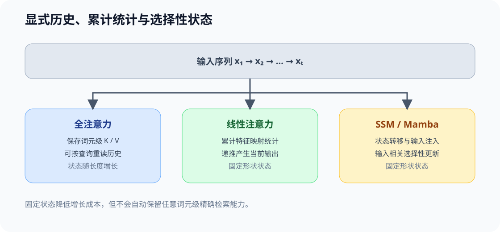
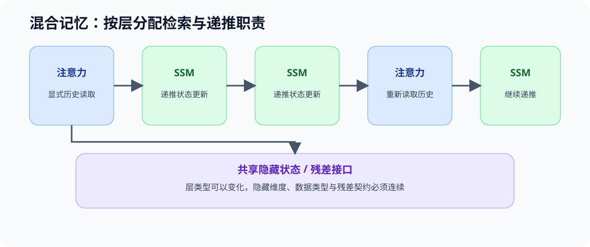

# ARCH-HYBRID-MEMORY. Attention SSM Hybrid | Attention、SSM 与混合记忆架构

**难度：** Hard | **环境：** CPU-first | **标签：** `模型架构`, `SSM`, `混合记忆`

> 🚀 **云端运行环境**
>
> 本章节的实战代码可以点击以下链接在免费 GPU 算力平台上直接运行：
>
> [](https://colab.research.google.com/github/datawhalechina/llm-algo-leetcode/blob/main/02_PyTorch_Algorithms/ARCH-HYBRID-MEMORY_Attention_SSM_Hybrid.ipynb)
> [](https://modelscope.cn/my/mynotebook) *(国内推荐：魔搭社区免费实例)*


## 本节导读

注意力（Attention）可以按查询重新访问词元级历史，递推模型则把过去压缩进固定形状状态。两者分别擅长灵活检索与低成本顺序更新，也分别承担状态增长和信息压缩的代价。混合架构不是简单地把两种层交替摆放，而是明确哪些层保留显式历史访问，哪些层负责递推更新。

本节在 45 的线性 Attention 基础上，进一步区分 SSM/Mamba 的选择性状态更新，并用层级计划与状态账本检查混合架构的记忆职责。

## 前置阅读

- [45 线性 Attention 与递推状态](./45_Linear_Attention_and_Recurrent_State.md)
- [05 Decoder Block](./05_LLaMA3_Block_Tutorial.md)

### Step 1：三类记忆接口

全注意力保留可按词元访问的历史 K/V；线性注意力把历史汇总为特征统计；状态空间模型则通过状态转移和输入相关控制更新内部状态。三者都处理序列，但可恢复的历史信息和状态增长规律不同。

| 记忆接口 | 保存什么 | 状态随长度变化 | 主要能力与代价 |
|---|---|---|---|
| 全注意力 | 词元级 K/V | 线性增长 | 可重新访问具体历史，缓存和带宽持续增长 |
| 线性注意力 | 特征映射后的累计统计 | 固定形状 | 更新成本低，但相似度形式和可恢复信息受限 |
| SSM / Mamba | 递推状态与选择性控制 | 固定形状 | 适合扫描与流式更新，不等同于 Q/K 检索 |



### Step 2：混合架构中的层级分工

混合模型通常让部分层保留注意力，以支持全局或精确历史访问；其余层使用递推状态降低长序列成本。层比例只是配置结果，还需要同时检查层的位置、状态传递方式和任务所需的历史访问能力。

| 层角色 | 主要职责 | 需要检查 |
|---|---|---|
| 注意力层 | 内容寻址、远程检索、词元级重读 | K/V 表示、访问范围与缓存成本 |
| 递推层 / 状态空间层 | 低成本状态更新与局部序列建模 | 状态维度、选择性更新和信息遗忘 |
| 层间接口与残差 | 在不同层类型之间传递隐藏状态 | 隐藏维度、数据类型和残差尺度 |



### Step 3：状态成本、检索要求与证据

固定大小状态不等于固定质量，全注意力也不等于所有任务都需要。架构判断应同时记录序列长度、显式注意力层数、递推状态维度和任务是否要求精确历史检索。跨模型对照还要控制数据、规模和训练预算，不能把全部差异归因于两类层的比例。

| 问题 | CPU 机制账本 | 后续真实证据 |
|---|---|---|
| 状态怎样增长 | K/V 状态字节数与递推状态字节数 | 实际常驻显存和带宽 |
| 哪些层保留显式访问 | 层级计划 | 模型配置与源码 |
| 精确历史能否被重新访问 | 是否存在注意力路径 | 长距离检索与目标任务质量 |
| 混合是否更高效 | 理论状态和层比例 | 固定模型族与训练条件下的延迟与质量 |

### Step 4：实现层级计划、状态账本与访问条件

本题用层级计划表达注意力与递推层的分工，再计算显式 K/V 和递推状态的理论账本。输入检查和报告结构已给出；学习者只补全层计划、状态成本与历史访问准入条件。

| TODO / 函数 | 学习者完成的机制 | 必须满足的约束 | 测试证据 |
| --- | --- | --- | --- |
| TODO 1：生成混合层级计划<br>`build_hybrid_schedule` | 生成注意力 / 状态空间层级计划 | 层数必须为正；`None` 表示纯递推；周期位置使用注意力 | 纯注意力、纯递推、混合计划与非法层数 |
| TODO 2：计算混合记忆状态账本<br>`memory_state_ledger` | 计算显式 K/V 与递推状态账本 | 注意力层状态随长度增长；递推层保留固定维度状态 | 层数、K/V 字节、递推状态字节与总量 |
| TODO 3：判断精确历史访问条件<br>`exact_history_gate` | 判断当前层计划是否满足任务需求 | 需要精确历史时至少保留一层注意力；流式任务不强制 | 混合、纯递推与不需要精确历史的三类输入 |

```python
from typing import Dict, List, Optional

```


```python
def build_hybrid_schedule(num_layers: int, attention_every: Optional[int]) -> List[str]:
    """生成 Attention / SSM 层级计划。"""
    if not isinstance(num_layers, int):
        raise TypeError("num_layers must be an integer")
    if num_layers <= 0:
        raise ValueError("num_layers must be positive")
    if attention_every is not None and (not isinstance(attention_every, int) or attention_every <= 0):
        raise ValueError("attention_every must be a positive integer or None")
    # ==========================================
    # TODO 1：生成混合层级计划
    # ==========================================
    # schedule = ???  # 按层索引生成 `attention` / `ssm` 计划。
    raise NotImplementedError("TODO 1：请生成混合层计划")
    return schedule


def memory_state_ledger(
    schedule: List[str],
    seq_len: int,
    num_kv_heads: int,
    head_dim: int,
    recurrent_state_dim: int,
    dtype_bytes: int = 2,
) -> Dict[str, int]:
    """计算单样本的显式 KV 与递推状态理论字节数。"""
    if not schedule or any(layer not in {"attention", "ssm"} for layer in schedule):
        raise ValueError("schedule must contain attention or ssm")
    values = (seq_len, num_kv_heads, head_dim, recurrent_state_dim, dtype_bytes)
    if any(not isinstance(value, int) or value <= 0 for value in values):
        raise ValueError("all dimensions must be positive integers")
    attention_layers = schedule.count("attention")
    ssm_layers = schedule.count("ssm")
    # ==========================================
    # TODO 2：计算混合记忆状态账本
    # ==========================================
    # kv_bytes = ???  # 显式 K/V 历史的理论字节数。
    # recurrent_bytes = ???  # 固定递推状态的理论字节数。
    raise NotImplementedError("TODO 2：请计算混合记忆状态账本")
    return {
        "attention_layers": attention_layers,
        "ssm_layers": ssm_layers,
        "kv_bytes": kv_bytes,
        "recurrent_bytes": recurrent_bytes,
        "total_bytes": kv_bytes + recurrent_bytes,
    }


def exact_history_gate(schedule: List[str], requires_exact_history: bool) -> Dict[str, object]:
    """根据任务要求判断当前计划是否保留显式历史读取路径。"""
    if not schedule or any(layer not in {"attention", "ssm"} for layer in schedule):
        raise ValueError("schedule must contain attention or ssm")
    has_attention = "attention" in schedule
    # ==========================================
    # TODO 3：判断精确历史访问条件
    # ==========================================
    # eligible = ???  # 当前层计划是否满足任务的历史访问要求。
    raise NotImplementedError("TODO 3：请判断精确历史访问条件")
    reason = "attention_path_available" if has_attention else (
        "exact_history_requires_attention" if requires_exact_history else "streaming_state_is_sufficient"
    )
    return {"eligible": eligible, "has_attention": has_attention, "reason": reason}

```


```python
# 测试设计：分别验证层级计划、状态增长规律和精确历史访问 gate。
def test_hybrid_schedule_contract():
    """验证纯递推、周期 Attention 和非法层数。"""
    assert build_hybrid_schedule(6, 2) == ["attention", "ssm", "attention", "ssm", "attention", "ssm"]
    assert build_hybrid_schedule(3, 1) == ["attention", "attention", "attention"]
    assert build_hybrid_schedule(3, None) == ["ssm", "ssm", "ssm"]
    try:
        build_hybrid_schedule(0, 2)
    except ValueError:
        pass
    else:
        raise AssertionError("num_layers=0 必须拒绝")


def test_memory_state_ledger():
    """验证显式 KV 与固定递推状态的字节账本。"""
    schedule = build_hybrid_schedule(4, 2)
    report = memory_state_ledger(schedule, seq_len=8, num_kv_heads=2, head_dim=4, recurrent_state_dim=16)
    assert report["attention_layers"] == 2
    assert report["ssm_layers"] == 2
    assert report["kv_bytes"] == 512
    assert report["recurrent_bytes"] == 64
    assert report["total_bytes"] == 576


def test_exact_history_gate():
    """验证精确历史访问与层计划的准入关系。"""
    mixed = ["attention", "ssm"]
    recurrent_only = ["ssm", "ssm"]
    assert exact_history_gate(mixed, True)["eligible"] is True
    assert exact_history_gate(recurrent_only, True)["eligible"] is False
    assert exact_history_gate(recurrent_only, False)["eligible"] is True


def run_arch_hybrid_tests():
    """运行本节全部机制测试。"""
    test_hybrid_schedule_contract()
    test_memory_state_ledger()
    test_exact_history_gate()
    print("✅ 混合记忆：层级计划、状态账本与历史访问 gate 测试通过")


run_arch_hybrid_tests()

```

---

🛑 **STOP HERE** 🛑
<br><br><br><br><br><br><br><br><br><br>
> 请先尝试自己完成代码并跑通测试。<br>
> 如果遇到困难，再向下查看参考代码与解析。
<br><br><br><br><br><br><br><br><br><br>

---
## 参考代码与解析

### 代码

```python
from typing import Dict, List, Optional


def build_hybrid_schedule(num_layers: int, attention_every: Optional[int]) -> List[str]:
    """生成 Attention / SSM 层级计划。"""
    if not isinstance(num_layers, int):
        raise TypeError("num_layers must be an integer")
    if num_layers <= 0:
        raise ValueError("num_layers must be positive")
    if attention_every is not None and (not isinstance(attention_every, int) or attention_every <= 0):
        raise ValueError("attention_every must be a positive integer or None")
    # TODO 1：生成混合层级计划
    schedule = ["ssm"] * num_layers if attention_every is None else [
        "attention" if index % attention_every == 0 else "ssm" for index in range(num_layers)
    ]
    return schedule


def memory_state_ledger(
    schedule: List[str],
    seq_len: int,
    num_kv_heads: int,
    head_dim: int,
    recurrent_state_dim: int,
    dtype_bytes: int = 2,
) -> Dict[str, int]:
    """计算单样本的显式 KV 与递推状态理论字节数。"""
    if not schedule or any(layer not in {"attention", "ssm"} for layer in schedule):
        raise ValueError("schedule must contain attention or ssm")
    values = (seq_len, num_kv_heads, head_dim, recurrent_state_dim, dtype_bytes)
    if any(not isinstance(value, int) or value <= 0 for value in values):
        raise ValueError("all dimensions must be positive integers")
    attention_layers = schedule.count("attention")
    ssm_layers = schedule.count("ssm")
    # TODO 2：计算混合记忆状态账本
    kv_bytes = attention_layers * seq_len * num_kv_heads * head_dim * 2 * dtype_bytes
    recurrent_bytes = ssm_layers * recurrent_state_dim * dtype_bytes
    return {
        "attention_layers": attention_layers,
        "ssm_layers": ssm_layers,
        "kv_bytes": kv_bytes,
        "recurrent_bytes": recurrent_bytes,
        "total_bytes": kv_bytes + recurrent_bytes,
    }


def exact_history_gate(schedule: List[str], requires_exact_history: bool) -> Dict[str, object]:
    """根据任务要求判断当前计划是否保留显式历史读取路径。"""
    if not schedule or any(layer not in {"attention", "ssm"} for layer in schedule):
        raise ValueError("schedule must contain attention or ssm")
    has_attention = "attention" in schedule
    # TODO 3：判断精确历史访问条件
    eligible = has_attention or not requires_exact_history
    reason = "attention_path_available" if has_attention else (
        "exact_history_requires_attention" if requires_exact_history else "streaming_state_is_sufficient"
    )
    return {"eligible": eligible, "has_attention": has_attention, "reason": reason}

```

### 解析

#### TODO 1：生成混合层级计划

- 判断依据：纯递推候选不保留注意力层；周期混合候选在第 0 层及后续周期位置保留注意力。
- 实现与证据：按层索引生成计划；测试覆盖纯注意力、纯递推、周期混合和非法层数。

#### TODO 2：计算混合记忆状态账本

- 判断依据：注意力层的 K/V 状态随序列长度增长，递推层只保留固定维度状态。
- 实现与证据：分别计算两类状态字节数后再求和；测试固定层数、序列长度和预期总量。

#### TODO 3：判断精确历史访问条件

- 判断依据：需要精确历史重读时，层计划至少要保留一条注意力路径；流式任务不强制该条件。
- 实现与证据：组合“是否有注意力层”和“是否需要精确历史”；测试覆盖混合、纯递推与流式任务。

### Step 5：GPU 机制实验——状态增长与长度阶梯

CPU 账本说明显式 K/V 随长度增长、递推状态保持固定；GPU 实验在相同层数、表示宽度和数据类型下，对照全注意力、全递推与混合层计划。

| 学习问题 | CPU 已确认 | GPU 要确认与后续使用 |
| --- | --- | --- |
| 混合层计划如何改变状态增长和执行成本？ | 验证层计划、状态账本和精确历史准入条件 | 比较长度阶梯上的状态量、单步时间与峰值显存；结果可供真实模型长序列质量复测 |

#### 5.1 环境与固定工作负载

本节使用 `ARCH-CUDA-MECHANISM` Profile。环境创建与预检见[架构实验 Quickstart](../topic_discussion/llm_architecture_evolution/quickstart.md)，候选、结果路径和当前证据状态见[架构实验资产表](../topic_discussion/llm_architecture_evolution/experiment_assets.md)。三个候选固定总层数、状态宽度和测量方法，只改变注意力层与递推层的分配。

| 配置层 | 必须说明的内容 | 修改规则 |
| --- | --- | --- |
| 实验身份 | `arch-hybrid-memory-growth-v1`；默认结果标签 `default` | 正式复测使用唯一标签；改变候选或测量协议后递增工作负载版本 |
| 运行环境 | `ARCH-CUDA-MECHANISM`；单张 CUDA GPU | Profile 预检未通过时保持 `dry_run` |
| 长度阶梯 | `512, 2048, 8192` | 观察三种记忆接口的长度增长规律 |
| 层级配对 | 总层数 `4`；混合候选每 `4` 层保留一层注意力 | 改变层比例后必须单独登记结果 |
| 表示宽度 | 注意力头数 `8`；单头维度 `64` | 三个候选必须保持相同宽度 |
| 测量方法 | BF16、warmup=10、repeats=100；CUDA Event 计时 | 改变精度或测量次数后不与旧结果直接合并 |
| 结果资产 | `benchmarks/results/arch_hybrid_memory_growth_<RUN_LABEL>.json` | 保留旧结果，不覆盖已登记证据 |


```python
# ======== 学习者配置：先改运行开关与结果标签 ========
RUN_MODE = 'dry_run'  # 默认值 dry_run；合法值为 dry_run / real_gpu，Profile 预检通过后才启用 GPU。
RUN_LABEL = 'default'  # 默认值 default；正式复测改为唯一标签，避免覆盖旧结果。

# ======== 工作负载：首次运行建议保留默认值 ========
SEQUENCE_LENGTHS = [512, 2048, 8192]  # 默认值：三个长度阶梯；显式历史随长度增长。
NUM_LAYERS = 4  # 默认值：4；三种候选保持相同总层数。
ATTENTION_EVERY = 4  # 默认值：4；混合候选每四层保留一层 Attention。
NUM_HEADS = 8  # 默认值：8；决定历史状态和递推状态的宽度。
HEAD_DIM = 64  # 默认值：64；增大会同时提高三种候选的状态与计算成本。
DTYPE = 'bfloat16'  # 默认值：bfloat16；三种候选必须使用相同 dtype。
WARMUP = 10  # 默认值：10；不计入结果的预热轮数。
REPEATS = 100  # 默认值：100；CUDA Event 计时的重复轮数。

# ======== 固定实验身份与相对结果路径：不要修改 ========
PROFILE_ID = 'ARCH-CUDA-MECHANISM'  # 固定环境身份；必须先通过同名 Profile 预检。
SEMANTIC_ID = 'ARCH-HYBRID-MEMORY-MECHANISM'  # 固定机制身份，不随复测改变。
WORKLOAD_ID = 'arch-hybrid-memory-growth-v1'  # 固定候选、状态宽度和测量口径。
RESULT_RELATIVE_PATH = f'benchmarks/results/arch_hybrid_memory_growth_{RUN_LABEL}.json'  # 仓库相对结果路径。
print({'run_mode': RUN_MODE, 'profile': PROFILE_ID, 'workload': WORKLOAD_ID, 'lengths': SEQUENCE_LENGTHS, 'layers': NUM_LAYERS, 'attention_every': ATTENTION_EVERY, 'result': RESULT_RELATIVE_PATH})

```

#### 5.2 执行并保存 JSON


```python
from tools.project_runtime import resolve_project_root

REPO_ROOT = resolve_project_root()
RUNNER_PATH = REPO_ROOT / 'tools' / 'run_architecture_mechanism_benchmark.py'
RESULT_PATH = REPO_ROOT / RESULT_RELATIVE_PATH

if RUN_MODE == 'real_gpu':
    expected_identity = ('ARCH-HYBRID-MEMORY-MECHANISM', 'arch-hybrid-memory-growth-v1', 'ARCH-CUDA-MECHANISM')
    actual_identity = (SEMANTIC_ID, WORKLOAD_ID, PROFILE_ID)
    expected_result_name = f'arch_hybrid_memory_growth_{RUN_LABEL}.json'
    if actual_identity != expected_identity or RESULT_PATH.name != expected_result_name:
        raise RuntimeError('混合记忆实验身份不一致；请先重新运行本 Notebook 的 5.1 配置单元。')
    import subprocess, sys
    command = [
        sys.executable, str(RUNNER_PATH),
        '--mode', 'memory_growth', '--output', str(RESULT_PATH),
        '--semantic-id', SEMANTIC_ID, '--workload-id', WORKLOAD_ID,
        '--run-label', RUN_LABEL, '--profile-id', PROFILE_ID,
        '--sequence-lengths', ','.join(map(str, SEQUENCE_LENGTHS)),
        '--num-layers', str(NUM_LAYERS), '--attention-every', str(ATTENTION_EVERY),
        '--query-heads', str(NUM_HEADS), '--head-dim', str(HEAD_DIM), '--dtype', DTYPE,
        '--warmup', str(WARMUP), '--repeats', str(REPEATS),
    ]
    subprocess.run(command, check=True)
else:
    print('保持 dry_run；按 Quickstart 完成 Profile 预检后再设置 RUN_MODE=real_gpu。')

```

#### 5.3 读取结果

本单元只读取结果 JSON，并展示全注意力、全递推与混合层计划在全部长度档位上的状态字节、单步时间、峰值显存和有限值检查。


```python
import json
from tools.project_runtime import resolve_project_root

result_path = resolve_project_root() / RESULT_RELATIVE_PATH
if result_path.exists():
    result = json.loads(result_path.read_text(encoding='utf-8'))
    required = {'schema_version', 'identity', 'workload', 'hardware', 'baseline', 'candidates', 'metrics', 'evidence_level', 'failure', 'decision'}
    missing = required - set(result)
    if missing:
        raise ValueError(f'结果 JSON 缺少字段：{sorted(missing)}')
    print({'identity': result['identity'], 'baseline': result['baseline'], 'candidates': result['candidates'], 'evidence_level': result['evidence_level'], 'decision': result['decision']})
    for row in result['metrics'].get('rows', []):
        print(row)
else:
    print(f'尚无混合记忆结果：{result_path}；如需读取历史结果，请先在 5.1 设置对应 RUN_LABEL。')

```

#### 5.4 结果解释与下一步判断

按“身份与失败 → 状态增长 → 执行代价 → 采用决策”读取结果。`rtx5070ti_hybrid_v1` 验证了受控层计划下的状态增长机制，不代表真实 Mamba/SSM 计算内核、模型质量或生产吞吐。

| 观察项 | 读取字段 | 当前结果 | 解释与动作 |
| --- | --- | --- | --- |
| 实验身份与失败 | `identity`、`failure` | 身份、有限值和状态增长检查通过 | 允许继续解读机制指标 |
| 状态增长 | `state_bytes` | 全注意力由 4 MiB 增至 64 MiB；全递推固定为 0.25 MiB；混合候选由 1.19 MiB 增至 16.19 MiB | 接受“注意力层随长度增长、递推层固定状态”的机制结论 |
| 时间与峰值 | `mean_ms`、`peak_allocated_bytes` | 8192 词元时，混合候选状态约少 74.7%，代理单步时间约为全注意力的 32.8% | 保留为局部机制证据；不外推为真实模型加速 |
| 决策 | `decision`、`evidence_level` | `accept_hybrid_state_growth_mechanism` | 接受状态增长机制，长序列质量与生产收益需真实模型复测 |

## 相关阅读

- [Mamba](https://arxiv.org/abs/2312.00752)：选择性状态空间模型。
- [Transformers are SSMs](https://arxiv.org/abs/2405.21060)：Attention 与状态空间模型的结构联系。
- [10 线性 Attention、SSM 与混合记忆](../topic_discussion/llm_architecture_evolution/10_linear_attention_ssm_and_hybrid.md)
- [77 长序列记忆架构基准](./77_Long_Sequence_Memory_Architecture_Benchmark.md)
