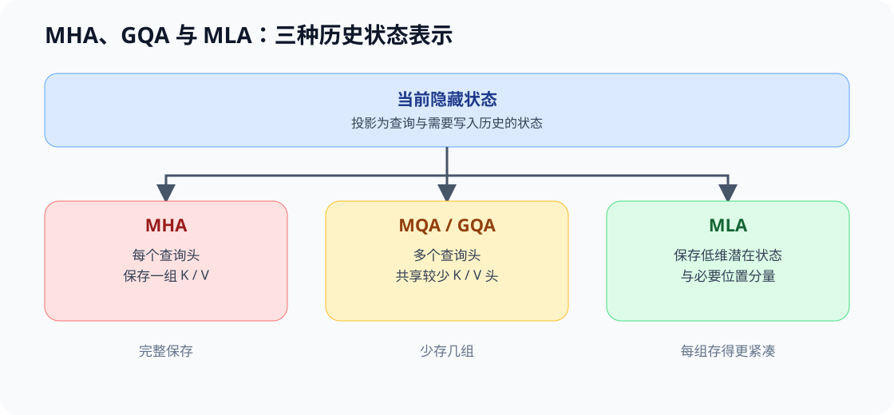
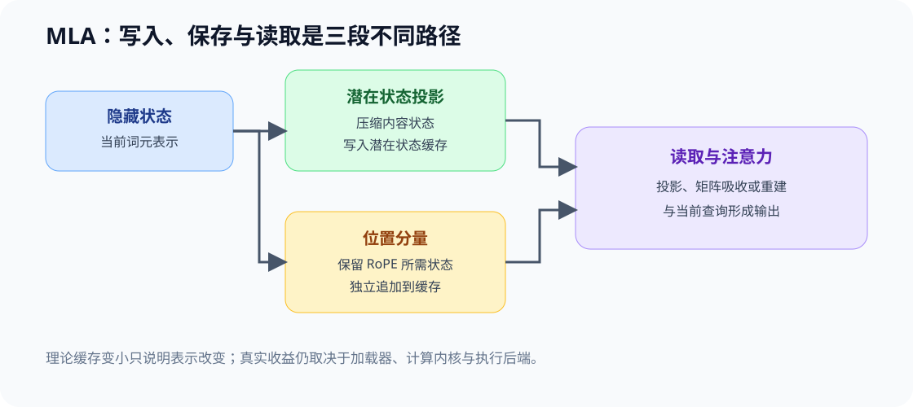

# ARCH-MLA. Multihead Latent Attention | MLA 与紧凑 KV 表示

**难度：** Hard | **环境：** CPU-first + 可选单卡 GPU | **标签：** `模型架构`, `MLA`, `KV 表示`

> 🚀 **云端运行环境**
>
> 本章节的实战代码可以点击以下链接在免费 GPU 算力平台上直接运行：
>
> [](https://colab.research.google.com/github/datawhalechina/llm-algo-leetcode/blob/main/02_PyTorch_Algorithms/ARCH-MLA_Multihead_Latent_Attention.ipynb)
> [](https://modelscope.cn/my/mynotebook) *(国内推荐：魔搭社区免费实例)*


## 本节导读

MHA 保存每个 KV Head 的历史状态，GQA/MQA 通过共享 KV Head 减少重复；MLA 进一步改变历史状态的表示，把可压缩内容写入低维 latent，并单独保留位置相关分量。本节用统一形状和字节账本比较三条路径，再观察紧凑表示带来的重建代价。

## 前置阅读

先掌握 Q/K/V、MHA/MQA/GQA 和普通 KV Cache 的形状，再进入表示压缩。

- [04 Attention MHA / GQA](./04_Attention_MHA_GQA.md)
- [Part 01 · 11 KV Cache 与显存增长](../01_Hardware_Math_and_Systems/11_KV_Cache_and_Memory_Growth.md)

### Step 1：三条 KV 表示路径

MHA 为每个查询头保存对应的 K/V；MQA/GQA 通过共享减少 K/V 头数；MLA 则把历史内容写入较低维的潜在状态，并单独保留位置相关状态。

| 路径 | 保存的历史状态 | 主要压缩动作 | 读取代价 |
|---|---|---|---|
| MHA | 每个 K/V 头的 K 和 V | 不共享 | 状态直接参与注意力 |
| MQA / GQA | 较少 K/V 头的 K 和 V | 减少 K/V 头数 | 读取时映射到查询头 |
| MLA | 潜在状态与位置分量 | 压缩历史表示维度 | 需要投影、吸收或重建路径 |



### Step 2：潜在状态与解耦位置分量

MLA 将每个历史词元的缓存拆成潜在内容状态和位置分量。前者承载可压缩的内容信息，后者保留 RoPE 所需的位置信息。二者需要分开计账，因为位置旋转经过任意低维压缩后不再必然等价。

| 状态 | 主要来源 | 随序列增长 | 读取时需要什么 |
|---|---|---|---|
| 潜在 K/V 状态 | 隐藏状态的低维投影 | 是 | 投影或矩阵吸收后的读取路径 |
| RoPE 分量 | 位置相关的键表示 | 是 | 与查询的位置分量匹配 |
| 当前查询状态 | 当前词元的查询投影 | 否，不作为历史缓存 | 当前步计算 |



### Step 3：训练表示、推理缓存与执行条件

训练时可并行处理完整序列并保留反向传播所需的状态；自回归推理则逐词元追加缓存。理论字节下降只说明历史表示更紧凑，不自动代表端到端更快；重建、转置或浮点回退都可能抵消带宽收益。

| 证据层 | 能回答什么 | 仍需补充什么 |
|---|---|---|
| CPU 形状与字节账本 | 表示是否合法、理论状态量如何变化 | 真实显存峰值与延迟 |
| 模型配置与实现 | 潜在状态、RoPE 和投影如何落地 | 当前后端是否命中优化路径 |
| GPU 机制对照 | 紧凑状态、重建时间和峰值显存 | 真实模型快照的质量与服务收益 |
| 后端基准 | TTFT、TPOT、吞吐、显存和回退 | 跨模型架构质量结论 |

### Step 4：实现 KV 表示账本

本题用同一组 Head、维度和数据类型配置比较 MHA、GQA 与简化 MLA。字段检查、模式分派和报告结构已经给出；你将补全配置不变量、三类状态元素数与相对比例。测试分别覆盖非法维度、不可整除配置、字节账本和最紧凑表示。

| TODO / 函数 | 学习者完成的机制 | 必须满足的约束 | 测试证据 |
| --- | --- | --- | --- |
| TODO 1：校验表示配置<br>`validate_attention_state_config` | 校验三类表示的共用配置 | 必需字段完整；维度为正整数；查询头可均匀映射到 K/V 头 | 缺失字段、非法维度与不可整除配置 |
| TODO 2：计算历史状态字节数<br>`cache_bytes_per_token` | 计算单词元历史状态字节数 | MHA / GQA 同时记录 K、V；MLA 记录潜在状态与位置分量 | 三类字节数、未知模式与数据类型口径 |
| TODO 3：生成同口径表示对照<br>`compare_attention_states` | 生成同口径表示对照 | 返回相对 MHA 的比例和最紧凑候选 | 比例、排序与同数据类型不变量 |

```python
from typing import Dict

```


```python
def validate_attention_state_config(config: Dict[str, int]) -> None:
    """校验 MHA/GQA/MLA 共用的状态配置。"""
    required = ('num_heads', 'num_kv_heads', 'head_dim', 'latent_dim', 'rope_dim', 'dtype_bytes')
    missing = [key for key in required if key not in config]
    if missing:
        raise ValueError(f'missing fields: {missing}')
    # ==========================================
    # TODO 1：校验表示配置
    # ==========================================
    # values = ???  # required 对应的全部配置值。
    # heads_divisible = ???  # Query Head 数可被 KV Head 数整除时为真。
    raise NotImplementedError('TODO 1：请校验表示配置')
    if any(not isinstance(value, int) or value <= 0 for value in values):
        raise ValueError('所有维度和 dtype_bytes 必须是正整数')
    if not heads_divisible:
        raise ValueError('num_heads 必须能被 num_kv_heads 整除')


def cache_bytes_per_token(mode: str, config: Dict[str, int]) -> int:
    """返回单层、单样本、单 token 的历史状态字节数。"""
    validate_attention_state_config(config)
    # ==========================================
    # TODO 2：计算历史状态字节数
    # ==========================================
    # mha_elements = ???  # 完整 K/V Head 的元素数。
    # gqa_elements = ???  # 共享 KV Head 后的 K/V 元素数。
    # mla_elements = ???  # latent 与位置分量的元素数。
    raise NotImplementedError('TODO 2：请计算历史状态字节数')
    elements_by_mode = {'mha': mha_elements, 'gqa': gqa_elements, 'mla': mla_elements}
    if mode not in elements_by_mode:
        raise ValueError(f'unknown mode: {mode}')
    return elements_by_mode[mode] * config['dtype_bytes']


def compare_attention_states(config: Dict[str, int]) -> Dict[str, object]:
    """比较三种表示并返回相对 MHA 的状态比例。"""
    modes = ('mha', 'gqa', 'mla')
    # ==========================================
    # TODO 3：生成同口径表示对照
    # ==========================================
    # bytes_by_mode = ???  # 三种模式到单 token 状态字节数的映射。
    # ratio_vs_mha = ???  # 每种模式相对 MHA 的字节比例。
    # most_compact = ???  # 状态字节数最小的模式名。
    raise NotImplementedError('TODO 3：请生成同口径表示对照')
    return {
        'bytes_per_token': bytes_by_mode,
        'ratio_vs_mha': ratio_vs_mha,
        'most_compact': most_compact,
    }

```


```python
# 测试设计：分别验证配置不变量、三类状态字节数和相对比例。
BASE_CONFIG = {
    "num_heads": 16,
    "num_kv_heads": 4,
    "head_dim": 64,
    "latent_dim": 256,
    "rope_dim": 32,
    "dtype_bytes": 2,
}


def test_attention_state_config_contract():
    """配置必须包含正整数维度并满足 Head 整除关系。"""
    validate_attention_state_config(BASE_CONFIG)
    invalid = dict(BASE_CONFIG, num_heads=15)
    try:
        validate_attention_state_config(invalid)
    except ValueError:
        pass
    else:
        raise AssertionError("num_heads 不能被 num_kv_heads 整除时必须拒绝")


def test_cache_bytes_per_token():
    """三类表示应按各自保存状态计算单 token 字节数。"""
    assert cache_bytes_per_token("mha", BASE_CONFIG) == 4096
    assert cache_bytes_per_token("gqa", BASE_CONFIG) == 1024
    assert cache_bytes_per_token("mla", BASE_CONFIG) == 576


def test_attention_state_comparison():
    """同 dtype 对照应返回稳定比例与最紧凑候选。"""
    report = compare_attention_states(BASE_CONFIG)
    assert report["most_compact"] == "mla"
    assert report["ratio_vs_mha"]["mha"] == 1.0
    assert report["ratio_vs_mha"]["gqa"] == 0.25
    assert report["ratio_vs_mha"]["mla"] == 0.140625


def run_arch_mla_tests():
    test_attention_state_config_contract()
    test_cache_bytes_per_token()
    test_attention_state_comparison()
    print("✅ MLA：配置、状态字节数与表示对照测试通过")


run_arch_mla_tests()

```

---

🛑 **STOP HERE** 🛑
<br><br><br><br><br><br><br><br><br><br>
> 请先尝试自己完成代码并跑通测试。<br>
> 如果遇到困难，再向下查看参考代码与解析。
<br><br><br><br><br><br><br><br><br><br>

---
## 参考代码与解析

### 代码

```python
from typing import Dict


def validate_attention_state_config(config: Dict[str, int]) -> None:
    """校验 MHA/GQA/MLA 共用的状态配置。"""
    required = ('num_heads', 'num_kv_heads', 'head_dim', 'latent_dim', 'rope_dim', 'dtype_bytes')
    missing = [key for key in required if key not in config]
    if missing:
        raise ValueError(f'missing fields: {missing}')
    # TODO 1：校验表示配置
    values = [config[key] for key in required]
    heads_divisible = config['num_heads'] % config['num_kv_heads'] == 0
    if any(not isinstance(value, int) or value <= 0 for value in values):
        raise ValueError('所有维度和 dtype_bytes 必须是正整数')
    if not heads_divisible:
        raise ValueError('num_heads 必须能被 num_kv_heads 整除')


def cache_bytes_per_token(mode: str, config: Dict[str, int]) -> int:
    """返回单层、单样本、单 token 的历史状态字节数。"""
    validate_attention_state_config(config)
    # TODO 2：计算历史状态字节数
    mha_elements = 2 * config['num_heads'] * config['head_dim']
    gqa_elements = 2 * config['num_kv_heads'] * config['head_dim']
    mla_elements = config['latent_dim'] + config['rope_dim']
    elements_by_mode = {'mha': mha_elements, 'gqa': gqa_elements, 'mla': mla_elements}
    if mode not in elements_by_mode:
        raise ValueError(f'unknown mode: {mode}')
    return elements_by_mode[mode] * config['dtype_bytes']


def compare_attention_states(config: Dict[str, int]) -> Dict[str, object]:
    """比较三种表示并返回相对 MHA 的状态比例。"""
    modes = ('mha', 'gqa', 'mla')
    # TODO 3：生成同口径表示对照
    bytes_by_mode = {mode: cache_bytes_per_token(mode, config) for mode in modes}
    mha_bytes = bytes_by_mode['mha']
    ratio_vs_mha = {mode: value / mha_bytes for mode, value in bytes_by_mode.items()}
    most_compact = min(bytes_by_mode, key=bytes_by_mode.get)
    return {
        'bytes_per_token': bytes_by_mode,
        'ratio_vs_mha': ratio_vs_mha,
        'most_compact': most_compact,
    }

```

### 解析

#### TODO 1：校验表示配置

- 判断依据：所有维度和数据类型字节数必须为正整数，查询头数还必须能被 K/V 头数整除。
- 实现与证据：从必需字段读取取值并计算整除条件；测试使用 15 个查询头验证拒绝路径。

#### TODO 2：计算历史状态字节数

- 判断依据：MHA/GQA 都保存 K 和 V，因此元素数含系数 2；简化 MLA 保存潜在状态与位置分量。
- 实现与证据：分别写出三类元素数，再乘数据类型字节数；测试固定三组期望字节数。

#### TODO 3：生成同口径表示对照

- 判断依据：三个候选只有在同一数据类型下才能比较字节与相对比例。
- 实现与证据：先生成模式到字节数的映射，再以 MHA 为基准计算比例并选出最紧凑表示；测试检查比例和排序。

### Step 5：GPU 机制实验——KV 表示、重建与吸收式路径

CPU 账本给出每个词元的理论状态量；GPU 实验在同一查询头数、序列长度和数据类型下，对照 MHA、GQA、潜在状态重建与吸收式路径。

| 学习问题 | CPU 已确认 | GPU 要确认与后续使用 |
| --- | --- | --- |
| 紧凑表示是否同时减少状态与执行代价？ | 验证维度契约、理论字节数和相对比例 | 分离缓存压缩、K/V 物化与吸收式路径的代价；结果可供真实模型和服务后端复测 |

#### 5.1 环境与固定工作负载

本节使用 `ARCH-CUDA-MECHANISM` Profile。环境创建与预检见[架构实验 Quickstart](../topic_discussion/llm_architecture_evolution/quickstart.md)，模型、候选、结果路径和当前证据状态见[架构实验资产表](../topic_discussion/llm_architecture_evolution/experiment_assets.md)。四条路径共用查询头数、长度阶梯、数据类型和测量方法，只改变历史表示及是否物化完整 K/V。

| 配置层 | 必须说明的内容 | 修改规则 |
| --- | --- | --- |
| 实验身份 | `arch-mla-representation-v2`；默认结果标签 `default` | 改变候选或测量协议后递增工作负载版本；正式复测使用唯一标签 |
| 运行环境 | `ARCH-CUDA-MECHANISM`；单张 CUDA GPU | Profile 预检未通过时保持 `dry_run`，不生成机制证据 |
| 配对变量 | MHA → GQA → 潜在状态重建 → 潜在状态吸收式代理 | 两条潜在路径共用同一状态和投影；只改变是否物化完整历史 K/V |
| 长度阶梯 | `[512, 2048, 8192]` | 比较三种表示的状态字节和单步代价随历史长度的变化 |
| 表示宽度 | 查询头=16、K/V 头=4、单头维度=64、潜在维度=256、RoPE 维度=64 | 改变任一宽度后单独登记结果 |
| 测量方法 | BF16、warmup=10、repeats=100；CUDA Event 批量计时 | 记录缓存字节、物化 K/V 字节、平均时间、峰值显存及两条潜在路径的余弦一致性 |
| 结果资产 | `benchmarks/results/arch_mla_representation_<RUN_LABEL>.json` | 正式复测使用唯一标签，保留旧结果 |


```python
# ======== 学习者配置：修改后先重新运行本单元 ========
RUN_MODE = 'dry_run'  # 默认值 dry_run；合法值为 dry_run / real_gpu，预检通过后才启用真实 GPU。
RUN_LABEL = 'default'  # 默认值 default；正式复测改为唯一标签，避免覆盖旧结果。

SEQUENCE_LENGTHS = [512, 2048, 8192]  # 默认单位为 token；增大会线性增加三种表示的历史状态。
QUERY_HEADS = 16  # 默认值 16；MHA 使用同数量 KV Head，且必须能被 KV_HEADS 整除。
KV_HEADS = 4  # 默认值 4；定义 GQA 和 latent 重建后的 KV Head 数。
HEAD_DIM = 64  # 默认值 64；单位为每个 Head 的特征维度。
LATENT_DIM = 256  # 默认值 256；每 token 保存的潜在内容维度，增大会提高状态量和重建计算。
ROPE_DIM = 64  # 默认值 64；每 token 单独保留的位置分量维度。
DTYPE = 'bfloat16'  # 默认值 bfloat16；合法值为 bfloat16 / float32，更换后结果不可直接合并。
WARMUP = 10  # 默认值 10 次；只用于预热，不计入平均时间。
REPEATS = 100  # 默认值 100 次；增大可降低计时波动，但会延长实验。
# ====================================================

# 固定身份与相对结果路径：协议不变时不要修改。
PROFILE_ID = 'ARCH-CUDA-MECHANISM'  # 固定环境身份；必须先通过同名 Profile 预检。
SEMANTIC_ID = 'ARCH-MLA-REPRESENTATION-MECHANISM'  # 固定机制身份，不随复测改变。
WORKLOAD_ID = 'arch-mla-representation-v2'  # v2 增加吸收式路径与语义一致性检查。
RESULT_RELATIVE_PATH = f'benchmarks/results/arch_mla_representation_{RUN_LABEL}.json'  # 仓库相对结果路径。
print({
    'run_mode': RUN_MODE, 'profile': PROFILE_ID, 'workload': WORKLOAD_ID,
    'lengths': SEQUENCE_LENGTHS, 'query_heads': QUERY_HEADS,
    'kv_heads': KV_HEADS, 'latent_dim': LATENT_DIM, 'result': RESULT_RELATIVE_PATH,
})

```

#### 5.2 执行并保存 JSON


```python
from tools.project_runtime import resolve_project_root

REPO_ROOT = resolve_project_root()
RUNNER_PATH = REPO_ROOT / 'tools' / 'run_architecture_mechanism_benchmark.py'
RESULT_PATH = REPO_ROOT / RESULT_RELATIVE_PATH

if RUN_MODE == 'real_gpu':
    expected_identity = ('ARCH-MLA-REPRESENTATION-MECHANISM', 'arch-mla-representation-v2', 'ARCH-CUDA-MECHANISM')
    actual_identity = (SEMANTIC_ID, WORKLOAD_ID, PROFILE_ID)
    expected_result_name = f'arch_mla_representation_{RUN_LABEL}.json'
    if actual_identity != expected_identity or RESULT_PATH.name != expected_result_name:
        raise RuntimeError('MLA 实验身份不一致；请先重新运行本 Notebook 的 5.1 配置单元。')
    import subprocess, sys
    command = [
        sys.executable, str(RUNNER_PATH),
        '--mode', 'kv_representation', '--output', str(RESULT_PATH),
        '--semantic-id', SEMANTIC_ID, '--workload-id', WORKLOAD_ID,
        '--run-label', RUN_LABEL, '--profile-id', PROFILE_ID,
        '--sequence-lengths', ','.join(map(str, SEQUENCE_LENGTHS)),
        '--query-heads', str(QUERY_HEADS), '--kv-heads', str(KV_HEADS),
        '--head-dim', str(HEAD_DIM), '--latent-dim', str(LATENT_DIM),
        '--rope-dim', str(ROPE_DIM), '--dtype', DTYPE,
        '--warmup', str(WARMUP), '--repeats', str(REPEATS),
    ]
    subprocess.run(command, check=True)
else:
    print('保持 dry_run；按 Quickstart 完成 Profile 预检后再设置 RUN_MODE=real_gpu。')

```

#### 5.3 读取结果

本单元只读取结果 JSON，并展示 MHA、GQA、潜在状态重建与吸收式代理在全部长度档位上的状态、物化 K/V、时间、峰值和一致性证据。


```python
import json
from tools.project_runtime import resolve_project_root

result_path = resolve_project_root() / RESULT_RELATIVE_PATH
if result_path.exists():
    result = json.loads(result_path.read_text(encoding='utf-8'))
    required = {'schema_version', 'identity', 'workload', 'hardware', 'baseline', 'candidates', 'metrics', 'evidence_level', 'failure', 'decision'}
    missing = required - set(result)
    if missing:
        raise ValueError(f'结果 JSON 缺少字段：{sorted(missing)}')
    print({'identity': result['identity'], 'baseline': result['baseline'], 'candidates': result['candidates'], 'evidence_level': result['evidence_level'], 'decision': result['decision']})
    for row in result['metrics'].get('rows', []):
        print(row)
else:
    print(f'尚无 MLA 表示结果：{result_path}；如需读取历史结果，请先在 5.1 设置对应 RUN_LABEL。')

```

#### 5.4 结果解释与下一步判断

按“身份与失败 → 状态量 → 一致性 → 时间与峰值 → 采用决策”读取结果。`rtx5070ti_mla_v3` 证明了潜在表示和代数吸收的内存路径，但当前通用 PyTorch 组合算子未产生执行加速。

| 观察项 | 读取字段 | 当前结果 | 解释与动作 |
| --- | --- | --- | --- |
| 实验身份与失败 | `identity`、`failure` | 身份通过，无失败 | 允许继续解读机制指标 |
| 历史状态量 | `cache_bytes`、`materialized_kv_bytes` | GQA 比 MHA 少 75%；潜在状态比 MHA 少 84.375%；吸收式路径不物化 K/V | 接受紧凑表示和吸收式路径的容量机制 |
| 输出一致性 | `cosine_similarity` | 0.999988–0.999993，输出均为有限值 | 通过代数路径一致性检查 |
| 执行时间与峰值 | `mean_ms`、`peak_allocated_bytes` | 吸收式代理约为重建路径的 1.9–2.0 倍；8192 词元时峰值约低 30.5% | 只采用容量结论；加速需专用计算内核和服务后端复测 |
| 决策 | `decision`、`evidence_level` | `accept_latent_representation_and_absorbed_path_mechanism` | 接受表示与吸收机制，不声称生产加速 |

## 相关阅读

- [DeepSeek-V2](https://arxiv.org/abs/2405.04434)：MLA 的代表架构。
- [04 Attention 演进专题正文](../topic_discussion/llm_architecture_evolution/04_attention_evolution.md)
- [71 MLA / KV Cache 结构基准](./71_MLA_KV_Cache_Architecture_Benchmark.md)
